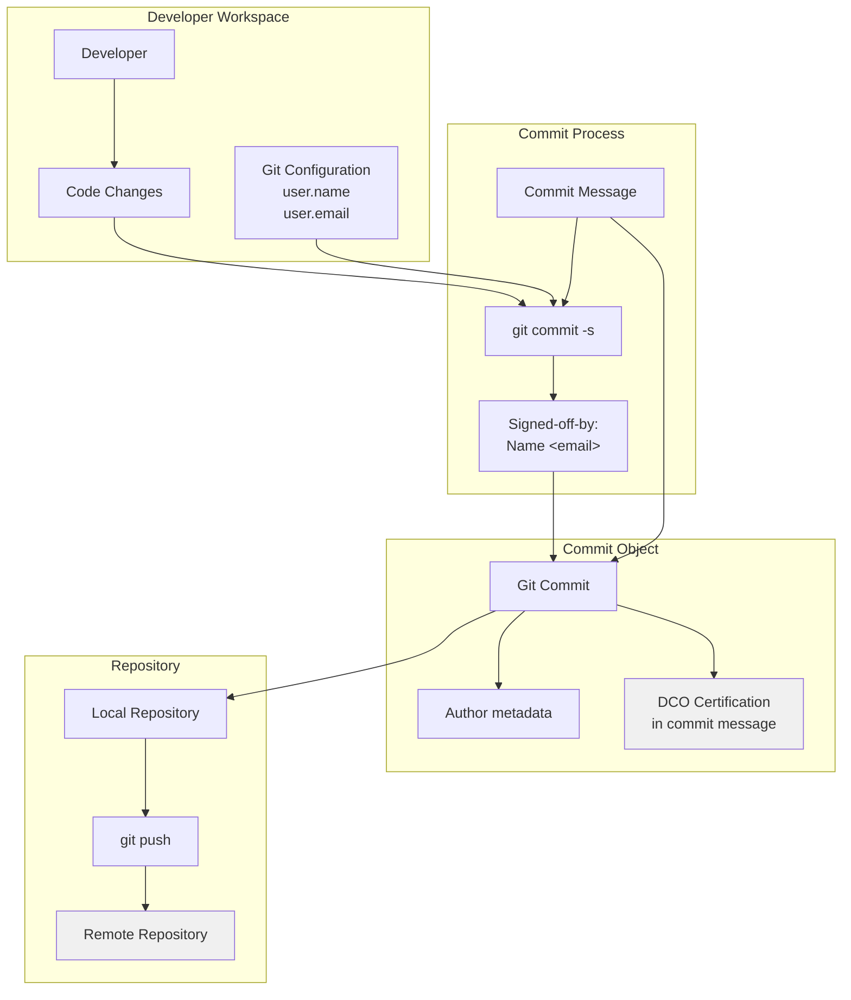
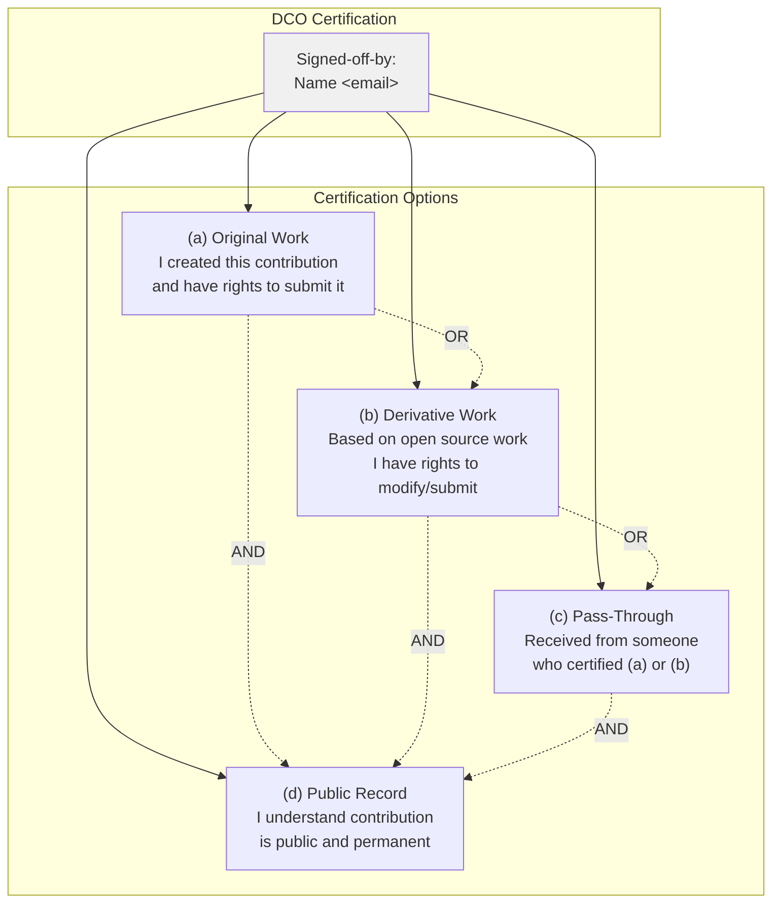
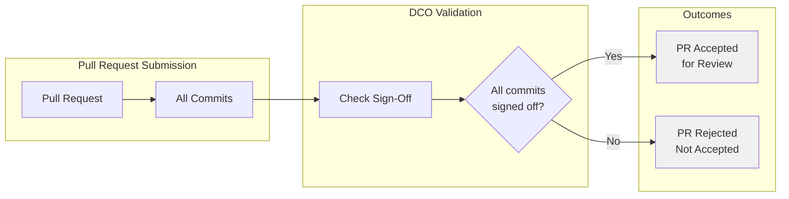
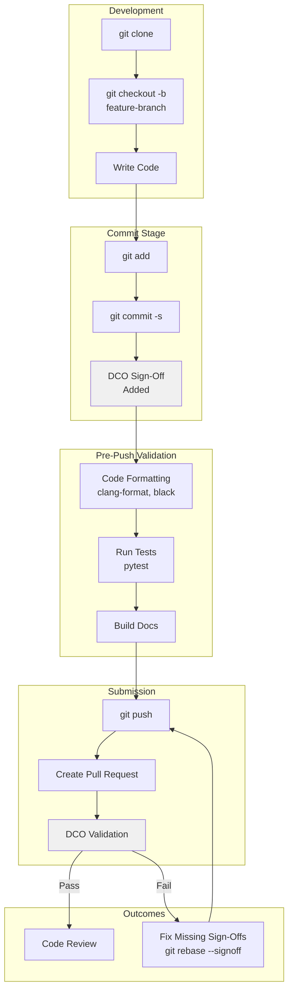

<!-- source: DeepWiki mcp.deepwiki.com · repo NVIDIA/ACCV-Lab · page 5.1 Developer Certificate of Origin · fetched 2026-10-26 -->

# Developer Certificate of Origin

<details>
<summary>Relevant source files</summary>

The following files were used as context for generating this wiki page:

- [CONTRIBUTING.MD](CONTRIBUTING.MD)

</details>


## Purpose and Scope

This page explains the Developer Certificate of Origin (DCO) requirement for contributing to ACCV-Lab. The DCO is a legal attestation that you have the right to submit your contribution under the project's license. All commits must be signed off to certify compliance with the DCO.

For the overall contribution workflow and pull request process, see [Contributing](#5). For specific PR submission requirements, see [Pull Request Process](#5.3). For licensing details, see [License and Legal](#6).

**Sources**: [CONTRIBUTING.MD:1-46]()

---

## What is the DCO?

The Developer Certificate of Origin (DCO) is a lightweight mechanism for contributors to certify that they wrote or have the right to submit code to an open source project. By signing off on commits, contributors agree to the terms specified in DCO version 1.1.

### DCO Requirement Policy

| Aspect | Requirement |
|--------|-------------|
| **Mandatory** | Yes - all commits must be signed off |
| **Scope** | Every commit in a pull request |
| **Enforcement** | PRs with unsigned commits will not be accepted |
| **Method** | Git sign-off flag (`-s` or `--signoff`) |

The DCO certifies that your contribution is either:
- (a) Your original work with rights to submit under the project license
- (b) Based on prior open source work you have rights to modify and submit
- (c) Provided by someone else who certified (a) or (b)
- (d) You understand the contribution is public and permanently recorded

**Sources**: [CONTRIBUTING.MD:6-21]()

---

## Sign-Off Process

### Basic Git Sign-Off

To sign off on a commit, use the `--signoff` or `-s` flag with `git commit`:

```bash
git commit -s -m "Add cool feature."
```

This automatically appends the following to your commit message:

```
Signed-off-by: Your Name <your@email.com>
```

The sign-off uses your Git configuration (`user.name` and `user.email`) to populate the signature.

### Sign-Off Workflow Diagram



**Sources**: [CONTRIBUTING.MD:12-19]()

---

## Signing Multiple Commits

### Interactive Rebase for Retroactive Sign-Off

If you have existing commits without sign-off, you can add sign-off retroactively using interactive rebase:

```bash
# Sign off last N commits
git rebase --signoff HEAD~N

# Or sign off all commits on current branch vs main
git rebase --signoff main
```

### Amending the Last Commit

To add sign-off to the most recent commit:

```bash
git commit --amend --signoff --no-edit
```

### Git Command Options

| Command | Flag | Purpose |
|---------|------|---------|
| `git commit` | `-s` or `--signoff` | Add DCO sign-off to commit message |
| `git commit` | `--amend` | Modify the last commit |
| `git commit` | `--no-edit` | Keep existing commit message |
| `git rebase` | `--signoff` | Add sign-off to all commits being rebased |

**Sources**: [CONTRIBUTING.MD:12-19]()

---

## DCO Certification Details

### What You Certify

When you sign off a commit, you certify the following according to DCO 1.1:



### Certification Scenarios

| Scenario | DCO Clause | Requirements |
|----------|-----------|--------------|
| You wrote the code from scratch | (a) | You own the copyright or have rights to contribute |
| You modified existing open source code | (b) | Original work is open source licensed; you have rights to submit modifications |
| Someone gave you code with their DCO | (c) | You did not modify it; original contributor certified (a) or (b) |
| All contributions | (d) | You accept the contribution is public and permanent |

**Sources**: [CONTRIBUTING.MD:37-45]()

---

## Enforcement and Compliance

### Pull Request Requirements



### Enforcement Policy

| Aspect | Policy |
|--------|--------|
| **Check Timing** | Before PR review begins |
| **Scope** | Every commit in the PR |
| **Failure Action** | PR will not be accepted |
| **Remediation** | Use `git rebase --signoff` to add missing sign-offs |
| **Force Push** | Allowed to fix unsigned commits |

The policy is absolute: **any contribution which contains commits that are not signed off will not be accepted**. This ensures legal clarity for all contributions to the project.

**Sources**: [CONTRIBUTING.MD:8-10]()

---

## Full DCO Text

The complete Developer Certificate of Origin version 1.1 is reproduced below:

```
Developer Certificate of Origin
Version 1.1

Copyright (C) 2004, 2006 The Linux Foundation and its contributors.
1 Letterman Drive
Suite D4700
San Francisco, CA, 94129

Everyone is permitted to copy and distribute verbatim copies of this
license document, but changing it is not allowed.


Developer's Certificate of Origin 1.1

By making a contribution to this project, I certify that:

(a) The contribution was created in whole or in part by me and I
    have the right to submit it under the open source license
    indicated in the file; or

(b) The contribution is based upon previous work that, to the best
    of my knowledge, is covered under an appropriate open source
    license and I have the right under that license to submit that
    work with modifications, whether created in whole or in part
    by me, under the same open source license (unless I am
    permitted to submit under a different license), as indicated
    in the file; or

(c) The contribution was provided directly to me by some other
    person who certified (a), (b) or (c) and I have not modified
    it.

(d) I understand and agree that this project and the contribution
    are public and that a record of the contribution (including all
    personal information I submit with it, including my sign-off) is
    maintained indefinitely and may be redistributed consistent with
    this project or the open source license(s) involved.
```

### DCO Metadata

| Property | Value |
|----------|-------|
| **Version** | 1.1 |
| **Copyright** | The Linux Foundation (2004, 2006) |
| **Modification** | Not allowed (verbatim distribution only) |
| **Origin** | Linux kernel development process |

**Sources**: [CONTRIBUTING.MD:21-46]()

---

## Git Configuration Setup

### Configuring Your Identity

Before signing off commits, ensure your Git identity is correctly configured:

```bash
# Set your name (appears in sign-off)
git config user.name "Your Name"

# Set your email (appears in sign-off)
git config user.email "your@email.com"

# Verify configuration
git config --get user.name
git config --get user.email
```

### Configuration Scope

| Scope | Command Flag | Location |
|-------|-------------|----------|
| **Global** (all repos) | `--global` | `~/.gitconfig` |
| **Local** (current repo) | None | `.git/config` |
| **System** (all users) | `--system` | `/etc/gitconfig` |

The sign-off will use the configured name and email at commit time. Use your real name and a valid email address that you monitor.

**Sources**: [CONTRIBUTING.MD:12-19]()

---

## Integration with Contribution Workflow

### DCO in the Development Lifecycle



The DCO sign-off is a critical quality gate in the contribution process. It must be completed for every commit before a pull request can be accepted for review.

For complete contribution workflow details, see [Contributing](#5). For formatting and testing requirements, see [Code Formatting Standards](#5.2) and [Testing and Quality Gates](#5.4).

**Sources**: [CONTRIBUTING.MD:1-46]()

---

