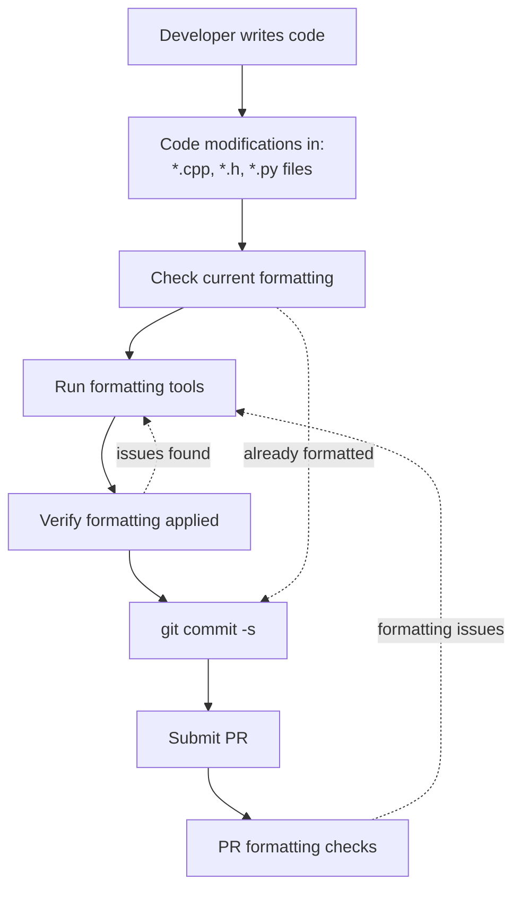
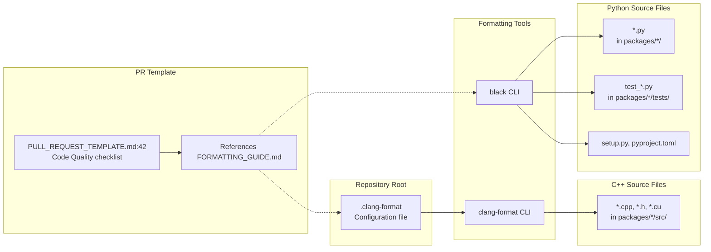
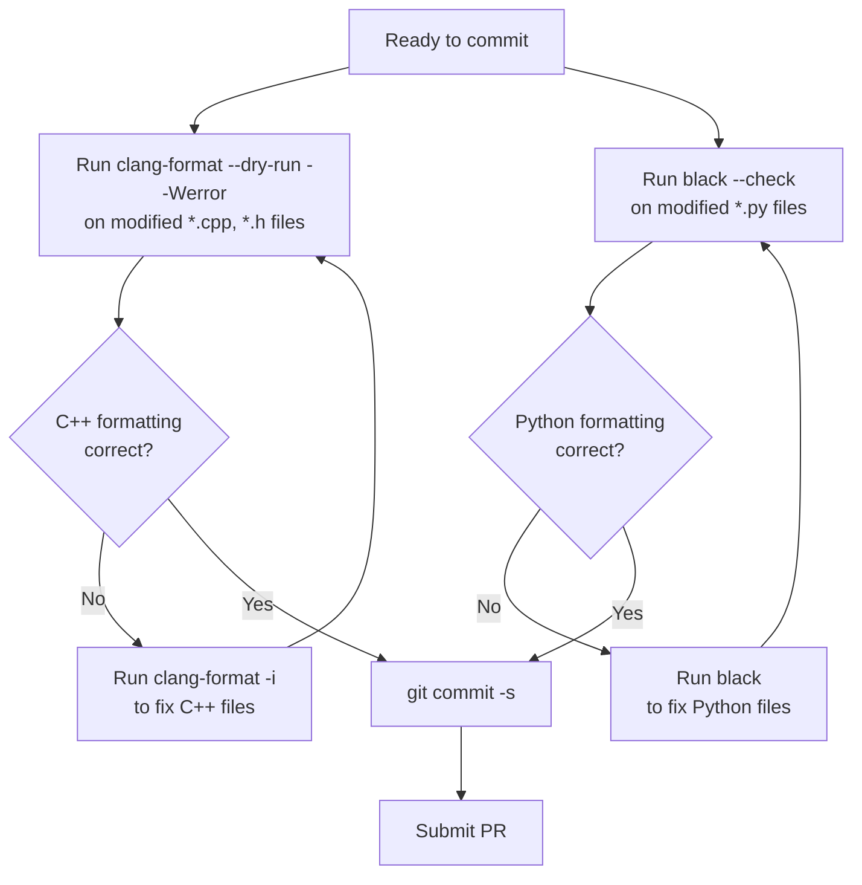

<!-- source: DeepWiki mcp.deepwiki.com · repo NVIDIA/ACCV-Lab · page 5.2 Code Formatting Standards · fetched 2026-10-26 -->

# Code Formatting Standards

<details>
<summary>Relevant source files</summary>

The following files were used as context for generating this wiki page:

- [.clang-format](.clang-format)
- [.github/PULL_REQUEST_TEMPLATE.md](.github/PULL_REQUEST_TEMPLATE.md)

</details>


## Purpose and Scope

This document defines the code formatting standards required for all contributions to ACCV-Lab. It specifies the formatting tools, configuration, and verification procedures for C++ and Python code.

For the broader contribution process including DCO requirements, see [Developer Certificate of Origin](#5.1). For the complete PR submission workflow, see [Pull Request Process](#5.3).

## Overview

ACCV-Lab enforces consistent code formatting across all packages using automated formatting tools. Properly formatted code is a requirement for all pull requests.

| Language | Tool | Configuration File | Enforcement |
|----------|------|-------------------|-------------|
| C++ | `clang-format` | `.clang-format` | Required for PR |
| Python | `black` | Default configuration | Required for PR |

**Sources:** [.github/PULL_REQUEST_TEMPLATE.md:42](), [.clang-format:1-19]()

## Formatting Workflow

The following diagram illustrates how code formatting integrates into the development workflow:



**Sources:** [.github/PULL_REQUEST_TEMPLATE.md:38-44]()

## C++ Formatting with clang-format

### Configuration

C++ code formatting is controlled by the `.clang-format` configuration file at the repository root. This configuration is based on Google style with specific overrides for ACCV-Lab conventions.

#### Key Configuration Settings

The following table summarizes the primary formatting rules:

| Setting | Value | Purpose |
|---------|-------|---------|
| `BasedOnStyle` | `Google` | Foundation style guide |
| `Language` | `Cpp` | Applies to C++ code |
| `IndentWidth` | `4` | Four-space indentation |
| `PointerAlignment` | `Left` | Pointer asterisks align left: `int* ptr` |
| `ReferenceAlignment` | `Left` | Reference symbols align left: `int& ref` |
| `ColumnLimit` | `110` | Maximum line length |
| `SortIncludes` | `false` | Preserves manual include ordering |
| `ReflowComments` | `false` | Preserves original comment formatting |

**Sources:** [.clang-format:1-18]()

#### Rationale for Key Overrides

**Indent Width (4 spaces):** [.clang-format:5]()  
Overrides Google's default 2-space indentation to improve readability in CUDA/C++ code with nested structures.

**Pointer/Reference Alignment:** [.clang-format:6-8]()  
Aligns pointer and reference symbols to the left (`int* ptr` rather than `int *ptr`) for consistency with common C++ conventions.

**Column Limit (110):** [.clang-format:9]()  
Allows longer lines than Google's 80-character limit to accommodate modern wide displays while maintaining readability.

**Disabled Include Sorting:** [.clang-format:11-13]()  
Preserves developer-specified include ordering, which may be intentionally grouped by scope (standard library, third-party, local headers).

**Disabled Comment Reflow:** [.clang-format:15-17]()  
Prevents reformatting of comments that may contain license headers, ASCII art, or deliberately formatted content.

**Sources:** [.clang-format:1-18]()

### Usage

#### Formatting Individual Files

```bash
clang-format -i path/to/file.cpp
clang-format -i path/to/file.h
```

#### Formatting Multiple Files

```bash
find packages/ -name "*.cpp" -o -name "*.h" | xargs clang-format -i
```

#### Checking Format Without Modification

```bash
clang-format --dry-run --Werror path/to/file.cpp
```

**Sources:** [.clang-format:1]()

## Python Formatting

### Configuration

Python code uses `black` with its default configuration. Black is an opinionated formatter that requires minimal configuration.

#### Black Default Settings

| Setting | Default Value |
|---------|--------------|
| Line length | 88 characters |
| String quotes | Double quotes preferred |
| Trailing commas | Added when beneficial |
| Magic trailing comma | Respected |

### Usage

#### Formatting Individual Files

```bash
black path/to/file.py
```

#### Formatting Entire Package

```bash
black packages/package_name/
```

#### Checking Format Without Modification

```bash
black --check path/to/file.py
```

#### Showing Format Differences

```bash
black --diff path/to/file.py
```

**Sources:** Referenced in repository development practices

## Code Entities and File Mapping

The following diagram maps formatting concepts to specific code entities and files in the repository:



**Sources:** [.clang-format:1](), [.github/PULL_REQUEST_TEMPLATE.md:42]()

## Verification Before Submission

### Pre-Commit Verification Workflow

Before submitting a pull request, all code must pass formatting verification:



**Sources:** [.github/PULL_REQUEST_TEMPLATE.md:38-44]()

## Integration with Pull Request Process

Code formatting is verified as part of the PR quality checklist:

### PR Template Code Quality Section

The PR template includes a specific checklist item for code formatting:

```markdown
## Code Quality

Checklist for dependencies:
  - [ ] Dependencies updated in the relevant `pyproject.toml` if/as needed
  - [ ] Code formatted according to the [Code Formatting Guide]
```

This checklist item references `docs/guides/FORMATTING_GUIDE.md` for detailed formatting instructions.

**Sources:** [.github/PULL_REQUEST_TEMPLATE.md:38-44]()

## Common Formatting Scenarios

### Scenario 1: New C++ Extension

When adding a new C++ extension to a package:

1. Write the C++ code in `packages/package_name/src/`
2. Apply formatting: `clang-format -i packages/package_name/src/*.cpp`
3. Apply formatting: `clang-format -i packages/package_name/src/*.h`
4. Verify: `clang-format --dry-run --Werror packages/package_name/src/*.cpp`

### Scenario 2: Python Package Code

When modifying Python code:

1. Edit Python files in `packages/package_name/`
2. Apply formatting: `black packages/package_name/`
3. Verify: `black --check packages/package_name/`

### Scenario 3: Build Configuration Changes

When modifying build system files:

1. Edit `setup.py` or `pyproject.toml`
2. Apply formatting: `black setup.py`
3. Verify: `black --check setup.py`

**Sources:** [.clang-format:1](), [.github/PULL_REQUEST_TEMPLATE.md:42]()

## Docker Environment Integration

The Docker development environment includes both `clang-format` and `black` pre-installed. When working in the Docker container, formatting tools are immediately available:

```bash
# Inside Docker container
clang-format --version
black --version
```

The Docker setup ensures all developers use consistent tool versions for formatting.

**Sources:** Referenced in Docker development environment (see [Docker Environment](#2.1))

## Summary

| Action | Command | Purpose |
|--------|---------|---------|
| Format C++ file | `clang-format -i file.cpp` | Apply formatting in-place |
| Check C++ format | `clang-format --dry-run --Werror file.cpp` | Verify without changes |
| Format Python file | `black file.py` | Apply formatting in-place |
| Check Python format | `black --check file.py` | Verify without changes |
| Format package | `black packages/package_name/` | Format entire Python package |

All formatting must be applied before committing code and submitting pull requests. The PR template includes a checklist item to verify formatting compliance.

**Sources:** [.clang-format:1-18](), [.github/PULL_REQUEST_TEMPLATE.md:42]()

---

