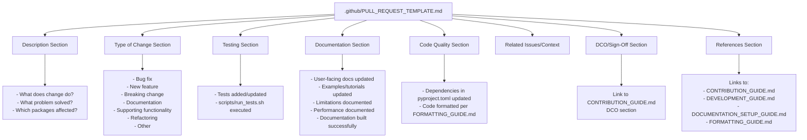
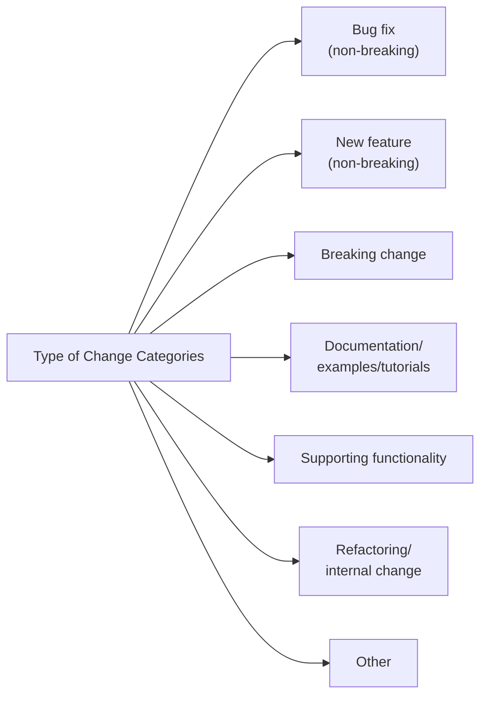
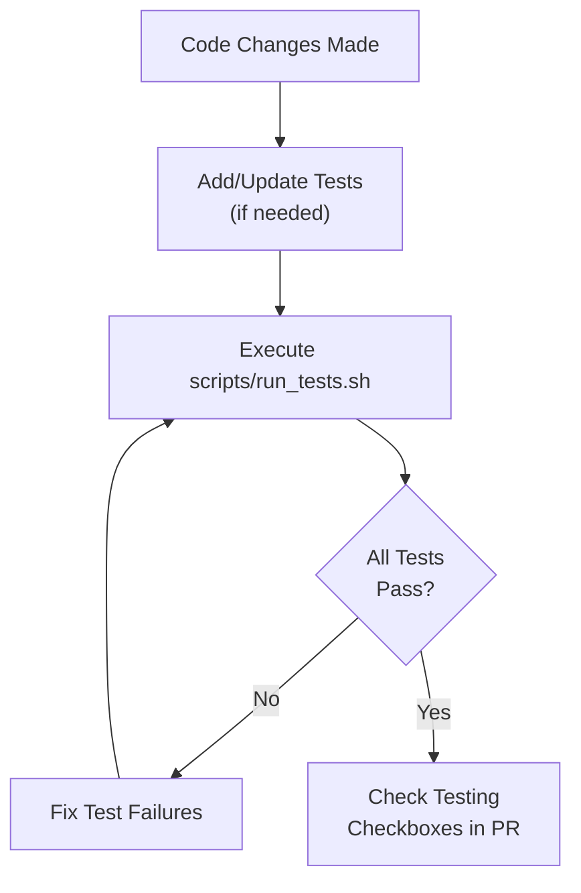
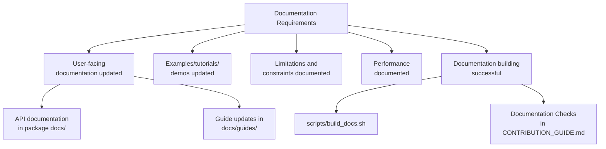

<!-- source: DeepWiki mcp.deepwiki.com · repo NVIDIA/ACCV-Lab · page 5.3 Pull Request Process · fetched 2026-10-26 -->

# Pull Request Process

<details>
<summary>Relevant source files</summary>

The following files were used as context for generating this wiki page:

- [.github/PULL_REQUEST_TEMPLATE.md](.github/PULL_REQUEST_TEMPLATE.md)
- [README.md](README.md)

</details>


This page provides a detailed walkthrough of the pull request submission workflow for ACCV-Lab contributions. It covers the PR template structure, required information, quality checklist items, and the complete submission process.

For information about code formatting requirements before PR submission, see [Code Formatting Standards](#5.2). For DCO sign-off requirements, see [Developer Certificate of Origin](#5.1). For testing requirements, see [Testing and Quality Gates](#5.4).

**Sources:** [.github/PULL_REQUEST_TEMPLATE.md:1-68]()

---

## Overview

The ACCV-Lab repository uses a structured PR template to ensure contributions meet quality standards and include necessary documentation. The template is automatically populated when creating a new pull request and serves as a checklist for contributors to verify their submission is complete.

The PR template is located at [.github/PULL_REQUEST_TEMPLATE.md:1-68]() and is divided into seven major sections, each addressing a specific aspect of the contribution.

**Sources:** [.github/PULL_REQUEST_TEMPLATE.md:1-68](), [README.md:159-167]()

---

## PR Template Structure

The following diagram shows the complete structure of the PR template and the relationships between its sections:



**Sources:** [.github/PULL_REQUEST_TEMPLATE.md:1-68]()

---

## Description Section

The description section is the first part of the PR template and requires a clear explanation of the contribution.

### Required Information

[.github/PULL_REQUEST_TEMPLATE.md:1-7]() defines three key questions that must be answered:

| Question | Purpose |
|----------|---------|
| What does this change do? | Explain the functionality or fix being introduced |
| What problem does it solve and why is it needed? | Provide context and justification for the change |
| Which namespace packages or components are affected? | Identify the scope of the change across the repository |

The namespace packages that may be affected include:
- `accvlab.on_demand_video_decoder`
- `accvlab.batching_helpers`
- `accvlab.dali_pipeline_framework`
- `accvlab.draw_heatmap`
- `accvlab.optim_test_tools`
- Build system components (`build_config/`)
- Documentation system (`docs/`)

**Sources:** [.github/PULL_REQUEST_TEMPLATE.md:1-7](), [README.md:19-36]()

---

## Type of Change Section

The type of change section categorizes the contribution to help reviewers understand the nature of the changes.

### Change Type Categories

[.github/PULL_REQUEST_TEMPLATE.md:8-17]() defines the following categories:



### Category Definitions

| Category | Definition | Examples |
|----------|------------|----------|
| Bug fix | Non-breaking change that fixes an issue | Fixing incorrect behavior in decoder, correcting memory leak |
| New feature | Non-breaking change that adds functionality | Adding new augmentation operator, new API method |
| Breaking change | Fix or feature that changes existing functionality | Changing function signatures, modifying return types |
| Documentation | Changes to docs, examples, tutorials, demos | Adding package documentation, updating examples |
| Supporting functionality | Changes to build, test, or doc generation systems | Updating `build_config/`, modifying Sphinx extensions |
| Refactoring | Internal changes without functional impact | Code reorganization, performance improvements |
| Other | Changes not fitting above categories | Must provide description |

**Sources:** [.github/PULL_REQUEST_TEMPLATE.md:8-17]()

---

## Testing Section

The testing section ensures that changes are properly validated before submission.

### Testing Checklist

[.github/PULL_REQUEST_TEMPLATE.md:19-25]() defines the testing requirements:

| Requirement | Command/Action | Purpose |
|-------------|----------------|---------|
| Tests added or updated | Add/modify tests in package test directories | Ensure new functionality is tested or bugs have regression tests |
| Repository test runner executed | `scripts/run_tests.sh` | Verify all tests pass across all packages |

### Test Execution Workflow



The `scripts/run_tests.sh` script executes tests across all namespace packages and ensures consistent test execution. Contributors may also add optional descriptions of their testing approach in this section.

**Sources:** [.github/PULL_REQUEST_TEMPLATE.md:19-25](), [README.md:159-167]()

---

## Documentation Section

The documentation section ensures that user-facing and internal documentation stays synchronized with code changes.

### Documentation Checklist

[.github/PULL_REQUEST_TEMPLATE.md:27-36]() defines five documentation requirements:



### Documentation Requirements Table

| Requirement | When Required | Location |
|-------------|---------------|----------|
| User-facing documentation | When API changes or new features added | Package `docs/` directories, `docs/guides/` |
| Examples/tutorials/demos | When new functionality added or existing examples affected | Package `docs/examples/`, tutorial files |
| Limitations/constraints | When functionality has known limitations | Package documentation, API reference |
| Performance | When performance characteristics are important | Package documentation, evaluation sections |
| Documentation build successful | Always | Execute `scripts/build_docs.sh` and verify build completes |

### Documentation Checks Reference

[.github/PULL_REQUEST_TEMPLATE.md:34]() references the Documentation Checks section in the Contribution Guide, which provides detailed verification steps for documentation quality.

**Sources:** [.github/PULL_REQUEST_TEMPLATE.md:27-36](), [README.md:85-101]()

---

## Code Quality Section

The code quality section ensures that code meets project standards and dependency management requirements.

### Code Quality Checklist

[.github/PULL_REQUEST_TEMPLATE.md:38-44]() defines two primary quality requirements:

| Requirement | File Location | Purpose |
|-------------|---------------|---------|
| Dependencies updated in `pyproject.toml` | Each package's `pyproject.toml` | Ensure all new dependencies are declared |
| Code formatted per FORMATTING_GUIDE.md | All source files | Maintain consistent code style |

### Code Formatting Standards

The formatting requirement references [docs/guides/FORMATTING_GUIDE.md](), which specifies:
- C++ code formatting using `.clang-format` configuration
- Python code formatting requirements
- Unified formatting script usage

For detailed formatting requirements, see [Code Formatting Standards](#5.2).

**Sources:** [.github/PULL_REQUEST_TEMPLATE.md:38-44]()

---

## Related Issues and Context

[.github/PULL_REQUEST_TEMPLATE.md:46-48]() provides a section for linking related issues and discussions. This section helps reviewers understand the broader context of the contribution.

Contributors should include:
- Links to related GitHub issues using `#issue_number` syntax
- References to relevant discussions or planning documents
- Context from previous related PRs

**Sources:** [.github/PULL_REQUEST_TEMPLATE.md:46-48]()

---

## DCO Sign-Off Section

The DCO (Developer Certificate of Origin) section is mandatory for all contributions.

[.github/PULL_REQUEST_TEMPLATE.md:52-55]() references the DCO requirements in the Contribution Guide. All commits must be signed off using the `-s` flag:

```bash
git commit -s -m "Your commit message"
```

For complete DCO requirements and legal implications, see [Developer Certificate of Origin](#5.1).

**Sources:** [.github/PULL_REQUEST_TEMPLATE.md:52-55]()

---

## References Section

[.github/PULL_REQUEST_TEMPLATE.md:57-67]() provides links to comprehensive guides that support the PR process:

| Guide | Purpose |
|-------|---------|
| `docs/guides/CONTRIBUTION_GUIDE.md` | Complete contribution workflow and requirements |
| `docs/guides/DEVELOPMENT_GUIDE.md` | Development environment and project structure |
| `docs/guides/DOCUMENTATION_SETUP_GUIDE.md` | Documentation system and writing guidelines |
| `docs/guides/FORMATTING_GUIDE.md` | Code formatting standards and tools |

The section also references [.github/PULL_REQUEST_TEMPLATE.md:66]() the summary checklist in the Contribution Guide, which consolidates all PR requirements.

**Sources:** [.github/PULL_REQUEST_TEMPLATE.md:57-67]()

---

## Complete PR Submission Workflow

The following diagram shows the complete workflow from initial development to PR submission:

```mermaid
graph TD
    START["Start Development"]
    
    subgraph "Development Phase"
        CLONE["Clone Repository<br/>git submodule update --init"]
        BRANCH["Create Feature Branch"]
        CODE["Write Code Changes"]
        FORMAT["Format Code<br/>(FORMATTING_GUIDE.md)"]
    end
    
    subgraph "Quality Verification"
        ADD_TESTS["Add/Update Tests"]
        RUN_TESTS["Execute scripts/run_tests.sh"]
        UPDATE_DOCS["Update Documentation"]
        BUILD_DOCS["Execute scripts/build_docs.sh"]
        UPDATE_DEPS["Update pyproject.toml<br/>if needed"]
    end
    
    subgraph "Commit Phase"
        COMMIT["Git Commit with DCO<br/>git commit -s"]
        PUSH["Push to Fork"]
    end
    
    subgraph "PR Creation"
        CREATE_PR["Create Pull Request"]
        FILL_TEMPLATE["Fill PR Template Sections"]
        CHECK_DESC["Complete Description"]
        CHECK_TYPE["Select Type of Change"]
        CHECK_TEST["Check Testing Items"]
        CHECK_DOCS["Check Documentation Items"]
        CHECK_QUALITY["Check Code Quality Items"]
        CHECK_DCO["Verify DCO Sign-off"]
        SUBMIT["Submit Pull Request"]
    end
    
    START --> CLONE
    CLONE --> BRANCH
    BRANCH --> CODE
    CODE --> FORMAT
    FORMAT --> ADD_TESTS
    ADD_TESTS --> RUN_TESTS
    RUN_TESTS --> UPDATE_DOCS
    UPDATE_DOCS --> BUILD_DOCS
    BUILD_DOCS --> UPDATE_DEPS
    UPDATE_DEPS --> COMMIT
    COMMIT --> PUSH
    PUSH --> CREATE_PR
    CREATE_PR --> FILL_TEMPLATE
    FILL_TEMPLATE --> CHECK_DESC
    CHECK_DESC --> CHECK_TYPE
    CHECK_TYPE --> CHECK_TEST
    CHECK_TEST --> CHECK_DOCS
    CHECK_DOCS --> CHECK_QUALITY
    CHECK_QUALITY --> CHECK_DCO
    CHECK_DCO --> SUBMIT
```



**Sources:** [.github/PULL_REQUEST_TEMPLATE.md:1-68](), [README.md:159-167]()

---

## PR Template Section Mapping

The following table maps each PR template section to its file location and related documentation:

| Section | Template Lines | Related Guide | Related Wiki Page |
|---------|----------------|---------------|-------------------|
| Description | [1-7]() | CONTRIBUTION_GUIDE.md | N/A |
| Type of Change | [8-17]() | CONTRIBUTION_GUIDE.md | N/A |
| Testing | [19-25]() | DEVELOPMENT_GUIDE.md | [Testing and Quality Gates](#5.4) |
| Documentation | [27-36]() | DOCUMENTATION_SETUP_GUIDE.md | [Documentation System](#4) |
| Code Quality | [38-44]() | FORMATTING_GUIDE.md | [Code Formatting Standards](#5.2) |
| Related Issues | [46-48]() | CONTRIBUTION_GUIDE.md | N/A |
| DCO/Sign-Off | [52-55]() | CONTRIBUTION_GUIDE.md | [Developer Certificate of Origin](#5.1) |
| References | [57-67]() | CONTRIBUTION_GUIDE.md | N/A |

**Sources:** [.github/PULL_REQUEST_TEMPLATE.md:1-68]()

---

## Conditional Requirements

Not all checklist items apply to every PR. The following table clarifies when each requirement is mandatory:

| Requirement | Always Required | Conditionally Required | Not Required |
|-------------|-----------------|------------------------|--------------|
| Description completed | ✓ | | |
| Type of change selected | ✓ | | |
| `scripts/run_tests.sh` executed | ✓ | | |
| Tests added/updated | | When code changes affect functionality | Documentation-only changes |
| User-facing docs updated | | When API changes or features added | Internal refactoring |
| Examples updated | | When examples are affected | Unrelated changes |
| Limitations documented | | When new limitations exist | Changes without new limitations |
| Performance documented | | When performance-critical | Non-performance changes |
| Documentation build successful | ✓ | | |
| Dependencies updated | | When new dependencies added | No dependency changes |
| Code formatted | ✓ | | |
| DCO sign-off | ✓ | | |

**Sources:** [.github/PULL_REQUEST_TEMPLATE.md:19-44]()

---

## After Submission

Once a PR is submitted with the completed template:

1. **Automated Checks**: CI/CD systems may run automated checks (if configured)
2. **Maintainer Review**: Project maintainers review the PR against the checklist
3. **Feedback Iteration**: Contributors address feedback and update the PR
4. **Approval**: Maintainers approve when all requirements are met
5. **Merge**: PR is merged into the main branch

Reviewers verify that:
- All checklist items are appropriately checked
- Description clearly explains the changes
- Tests cover the changes adequately
- Documentation is complete and builds successfully
- Code follows formatting standards
- DCO sign-off is present on all commits

**Sources:** [.github/PULL_REQUEST_TEMPLATE.md:1-68](), [README.md:159-167]()

---

