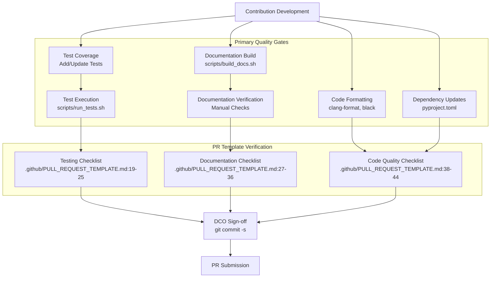
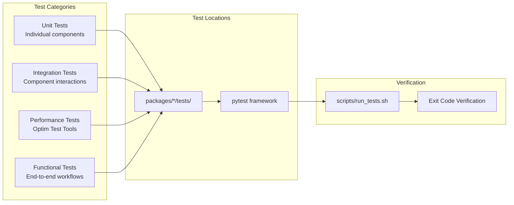
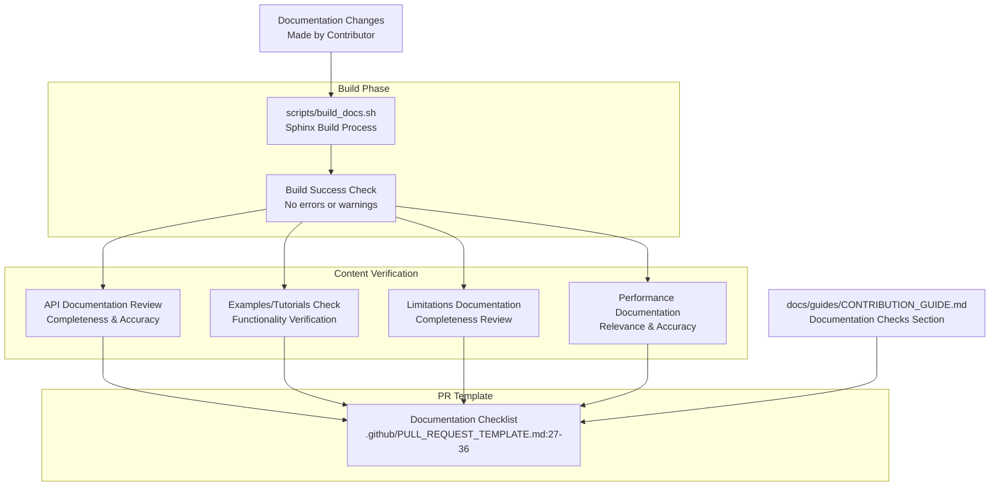
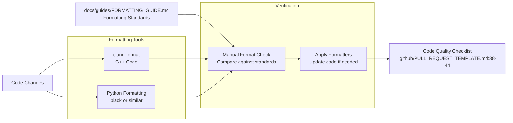
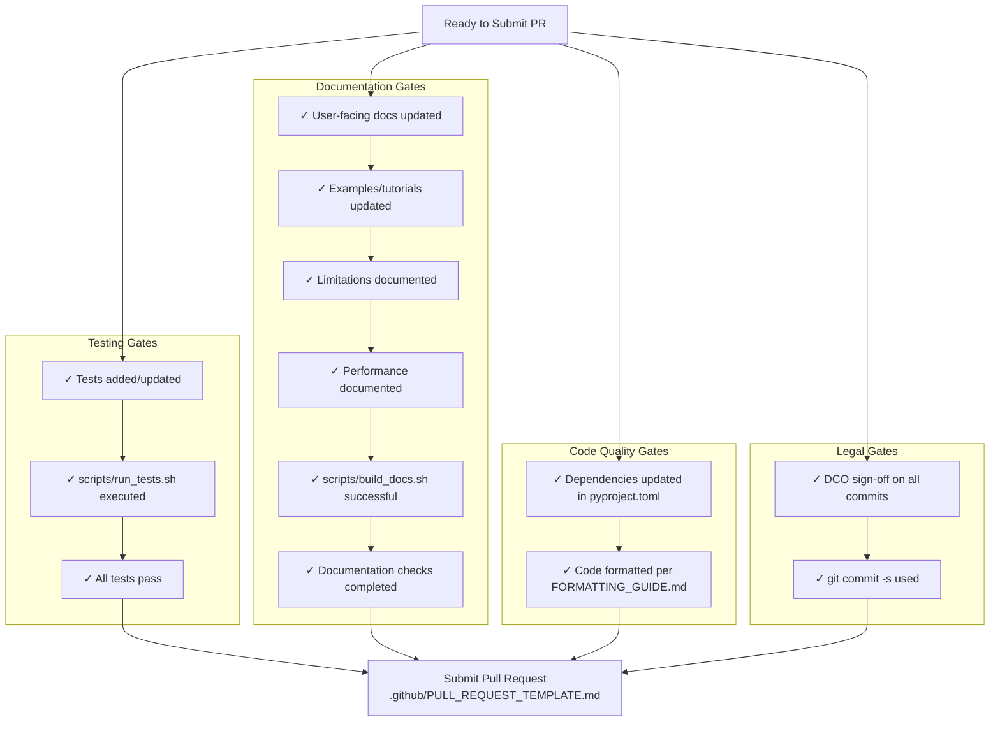

<!-- source: DeepWiki mcp.deepwiki.com · repo NVIDIA/ACCV-Lab · page 5.4 Testing and Quality Gates · fetched 2026-10-26 -->

# Testing and Quality Gates

<details>
<summary>Relevant source files</summary>

The following files were used as context for generating this wiki page:

- [.github/PULL_REQUEST_TEMPLATE.md](.github/PULL_REQUEST_TEMPLATE.md)
- [README.md](README.md)

</details>


## Purpose and Scope

This document describes the testing requirements and quality gates that must be satisfied before submitting a pull request to the ACCV-Lab repository. It covers test execution procedures, quality verification steps, and the automated checks that validate code quality, documentation, and formatting standards.

For information about code formatting standards and tools, see [Code Formatting Standards](#5.2). For the complete pull request submission process, see [Pull Request Process](#5.3). For DCO requirements, see [Developer Certificate of Origin](#5.1).

---

## Quality Gates Overview

All contributions to ACCV-Lab must pass a series of quality gates before submission. These gates ensure code quality, correctness, documentation completeness, and adherence to project standards.

### Quality Gate Pipeline



**Sources:** [.github/PULL_REQUEST_TEMPLATE.md]()

---

## Test Execution

### Repository Test Runner

The primary mechanism for executing tests is the `scripts/run_tests.sh` script, which runs the test suite across all namespace packages in the repository.

#### Running Tests

To execute all tests in the repository:

```bash
./scripts/run_tests.sh
```

This script executes tests for all namespace packages and reports any failures. All tests must pass before submitting a pull request.

**Test Execution Requirements:**

| Requirement | Description | Verification |
|------------|-------------|--------------|
| **Test Runner Execution** | Run `scripts/run_tests.sh` | Required before PR submission |
| **All Tests Pass** | No test failures in output | Check script exit code and output |
| **Coverage Maintained** | Tests added/updated for changes | Manual review during PR submission |

**Sources:** [.github/PULL_REQUEST_TEMPLATE.md:19-25](), [README.md:75-88]()

### Test Framework

Individual namespace packages use `pytest` as the testing framework. Tests are typically located in package-specific test directories and can be run individually during development:

```bash
# Run tests for a specific package
cd packages/<package-name>
pytest
```

**Sources:** [.github/PULL_REQUEST_TEMPLATE.md:23]()

---

## Test Requirements

### When to Add or Update Tests

Tests must be added or updated in the following scenarios:

1. **New Features**: All new functionality must include corresponding tests that verify correct behavior
2. **Bug Fixes**: Add tests that reproduce the bug and verify the fix
3. **API Changes**: Update existing tests to reflect API modifications
4. **Breaking Changes**: Ensure tests cover both old and new behavior where applicable
5. **Performance Optimizations**: Add tests to prevent performance regressions when relevant

### Test Types



**Sources:** [.github/PULL_REQUEST_TEMPLATE.md:19-25](), [README.md:32-33]()

### Testing Checklist

The pull request template requires the following testing checklist items to be completed:

- **Tests added or updated if/as needed**: New tests or modifications to existing tests that validate the contribution
- **Repository test runner executed**: Confirmation that `scripts/run_tests.sh` has been run successfully

**Sources:** [.github/PULL_REQUEST_TEMPLATE.md:21-23]()

---

## Documentation Checks

Documentation must be built successfully and verified before PR submission. This ensures that all documentation remains accurate and properly formatted.

### Building Documentation

Documentation is built using the `scripts/build_docs.sh` script:

```bash
./scripts/build_docs.sh
```

This script invokes Sphinx to generate HTML documentation from source files, API references, and package documentation. The build process must complete without errors.

**Sources:** [README.md:86-87](), [.github/PULL_REQUEST_TEMPLATE.md:34]()

### Documentation Quality Gates

The documentation quality gates include multiple verification steps:

| Check Type | Description | Verification Method |
|-----------|-------------|---------------------|
| **User-facing Documentation** | API docs, guides, and references updated | Manual review of affected documentation |
| **Examples/Tutorials** | Working examples demonstrating functionality | Manual verification of example code |
| **Limitations** | Known constraints and limitations documented | Review of documentation completeness |
| **Performance** | Performance characteristics documented when relevant | Review of performance documentation |
| **Build Success** | Documentation builds without errors or warnings | `scripts/build_docs.sh` exit code |
| **Documentation Checks** | Verification steps from Contribution Guide completed | Manual checklist completion |

**Sources:** [.github/PULL_REQUEST_TEMPLATE.md:27-36]()

### Documentation Verification Process



**Sources:** [.github/PULL_REQUEST_TEMPLATE.md:27-36](), [README.md:85-98]()

---

## Code Formatting Verification

Code must be formatted according to project standards before submission. The ACCV-Lab repository uses language-specific formatting tools to maintain consistent code style.

### Formatting Tools

| Language | Tool | Configuration |
|----------|------|---------------|
| **C++** | `clang-format` | `.clang-format` at repository root |
| **Python** | `black` (implied) | Project standards |

**Sources:** [.github/PULL_REQUEST_TEMPLATE.md:42](), [README.md:131-133]()

### Formatting Verification Process



The pull request template requires verification that code is "formatted according to the Code Formatting Guide" referenced at `docs/guides/FORMATTING_GUIDE.md`.

**Sources:** [.github/PULL_REQUEST_TEMPLATE.md:38-44](), [README.md:131-133]()

---

## Dependency Management

When contributions introduce new dependencies or modify existing ones, the dependency declarations must be updated appropriately.

### Dependency Update Requirements

| Scenario | Action Required | Location |
|----------|----------------|----------|
| **New Dependency** | Add to dependencies list | `packages/*/pyproject.toml` |
| **Version Change** | Update version specifier | `packages/*/pyproject.toml` |
| **Removed Dependency** | Remove from dependencies list | `packages/*/pyproject.toml` |
| **Optional Dependency** | Add to optional dependencies | `packages/*/pyproject.toml` |

The pull request template includes a checklist item: "Dependencies updated in the relevant `pyproject.toml` if/as needed".

**Sources:** [.github/PULL_REQUEST_TEMPLATE.md:41]()

---

## Pre-Submission Quality Gate Summary

Before submitting a pull request, all contributors must verify completion of the following quality gates:

### Complete Quality Gate Checklist



**Sources:** [.github/PULL_REQUEST_TEMPLATE.md:19-55]()

### PR Template Checklist Reference

The complete checklist is provided in the pull request template and covers:

1. **Testing** ([.github/PULL_REQUEST_TEMPLATE.md:19-25]()):
   - Tests added or updated if/as needed
   - Repository test runner executed: `scripts/run_tests.sh`

2. **Documentation** ([.github/PULL_REQUEST_TEMPLATE.md:27-36]()):
   - User-facing documentation updated if/as needed
   - Examples/tutorials/demos updated or added
   - Limitations and constraints documented
   - Performance documented
   - Documentation building successful & checks performed

3. **Code Quality** ([.github/PULL_REQUEST_TEMPLATE.md:38-44]()):
   - Dependencies updated in relevant `pyproject.toml`
   - Code formatted according to Formatting Guide

4. **DCO** ([.github/PULL_REQUEST_TEMPLATE.md:52-55]()):
   - All commits signed off with `git commit -s`

**Sources:** [.github/PULL_REQUEST_TEMPLATE.md]()

---

## Additional Resources

For detailed information on related topics, refer to:

- **Code Formatting**: See [Code Formatting Standards](#5.2) for detailed formatting requirements and tool usage
- **Pull Request Process**: See [Pull Request Process](#5.3) for the complete PR submission workflow
- **DCO Requirements**: See [Developer Certificate of Origin](#5.1) for legal sign-off requirements
- **Development Workflow**: See `docs/guides/DEVELOPMENT_GUIDE.md` for overall development practices
- **Documentation System**: See [Building Documentation](#4.1) for detailed documentation build procedures

**Sources:** [.github/PULL_REQUEST_TEMPLATE.md:58-67](), [README.md:112-167]()

---

