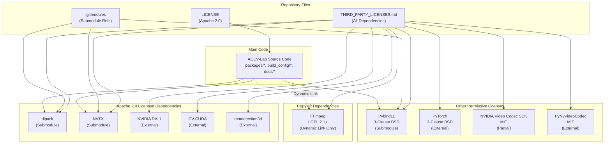
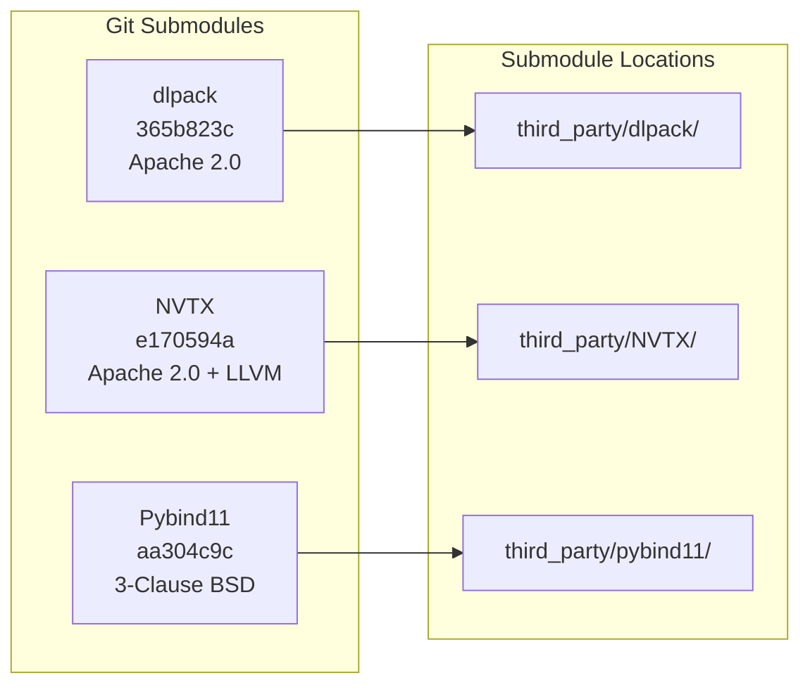
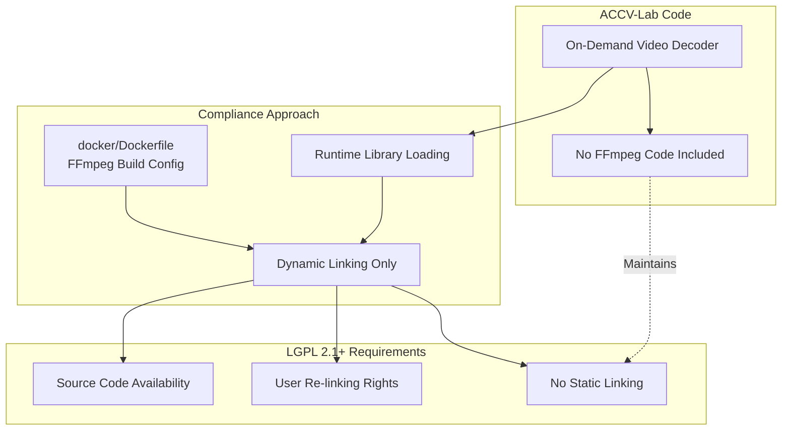
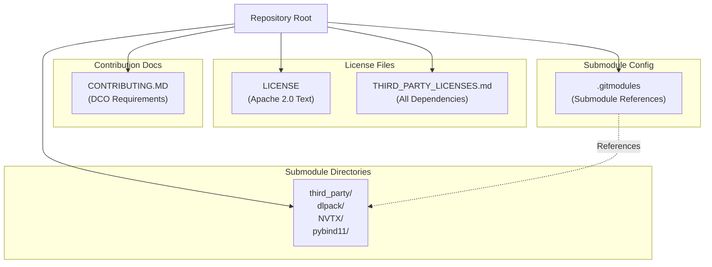

<!-- source: DeepWiki mcp.deepwiki.com · repo NVIDIA/ACCV-Lab · page 6 License and Legal · fetched 2026-10-26 -->

# License and Legal

Relevant source files

The following files were used as context for generating this wiki page:

- [LICENSE](LICENSE)
- [THIRD_PARTY_LICENSES.md](THIRD_PARTY_LICENSES.md)

This document describes the licensing structure of the ACCV-Lab repository, including the main repository license, third-party dependency licenses, and legal requirements for contributions. This information is essential for understanding usage rights, redistribution requirements, and compliance obligations.

For information about the contribution process and Developer Certificate of Origin requirements, see [Contributing](#5) and [Developer Certificate of Origin](#5.1).

## Overview

The ACCV-Lab repository uses a multi-license structure where the core repository code is licensed under Apache License 2.0, while third-party dependencies use various permissive licenses. All license information is centralized in two key files:

- [LICENSE:1-175]() - Apache License 2.0 for the main repository
- [THIRD_PARTY_LICENSES.md:1-1797]() - Complete attribution for all third-party dependencies

The licensing architecture is designed to maintain compatibility with downstream projects while properly attributing all dependencies.

**Sources:** LICENSE, THIRD_PARTY_LICENSES.md

## Licensing Architecture

**Licensing Architecture**

This diagram shows how license information is organized across repository files and how the main code relates to its dependencies. The distinction between submodules (tracked in `.gitmodules`) and external dependencies is shown, along with the critical dynamic linking relationship to FFmpeg.

**Sources:** LICENSE, THIRD_PARTY_LICENSES.md, .gitmodules

## Main Repository License: Apache 2.0

All original code in the ACCV-Lab repository is licensed under Apache License 2.0, January 2004. The complete license text is available at [LICENSE:1-175]().

### Key Terms

The Apache 2.0 license provides the following permissions:

| Permission | Description |
|------------|-------------|
| Use | Use the software for any purpose |
| Modification | Modify the source code |
| Distribution | Distribute original or modified versions |
| Patent Grant | Explicit patent license from contributors |
| Sublicensing | Sublicense to others |

### Redistribution Requirements

When redistributing ACCV-Lab code or derivative works, you must comply with [LICENSE:89-128]():

1. **Include License** - Provide a copy of the Apache 2.0 license [LICENSE:94-95]()
2. **Mark Changes** - Indicate modified files [LICENSE:97-98]()
3. **Preserve Notices** - Retain copyright, patent, trademark, and attribution notices [LICENSE:100-104]()
4. **NOTICE File** - If present, include attribution notices in redistributions [LICENSE:106-121]()

### Patent License and Termination

The Apache 2.0 license includes an explicit patent grant [LICENSE:73-87](). Patent licenses terminate if you initiate patent litigation against any entity alleging that the Work constitutes patent infringement [LICENSE:82-87]().

### Disclaimer of Warranty and Liability

The software is provided "AS IS" without warranties of any kind [LICENSE:143-151](). Contributors have limited liability [LICENSE:153-163]().

**Sources:** LICENSE

## Third-Party Dependencies

ACCV-Lab depends on several third-party libraries, each with its own license. The complete list and full license texts are maintained in [THIRD_PARTY_LICENSES.md:1-1797]().

### Dependency License Summary

| Dependency | Version/Commit | License | Type |
|------------|----------------|---------|------|
| FFmpeg | 4.4.6 | LGPL 2.1+ | External |
| Pybind11 | aa304c9c | 3-Clause BSD | Submodule |
| dlpack | 365b823c | Apache 2.0 | Submodule |
| NVTX | e170594a | Apache 2.0 w/ LLVM Exception | Submodule |
| NVIDIA DALI | 1.51.2 | Apache 2.0 | External |
| PyTorch | 2.6 | 3-Clause BSD | External |
| NVIDIA Video Codec SDK (partial) | 11.1.5 | MIT | External |
| PyNvVideoCodec | 1.0.2 | MIT | External |
| CV-CUDA | da51fc96 | Apache 2.0 | External |
| mmdetection3d | 1.4.0 | Apache 2.0 | External |

**Sources:** THIRD_PARTY_LICENSES.md:1-14

### Git Submodules

Three dependencies are managed as Git submodules:

**Git Submodule Structure**

These submodules are initialized using `git submodule update --init --recursive` as documented in the repository setup process.

**Sources:** .gitmodules, THIRD_PARTY_LICENSES.md:6-8

## Apache 2.0 Licensed Dependencies

Several dependencies use the same Apache 2.0 license as the main repository, ensuring full compatibility:

### dlpack

DLPack provides a zero-copy tensor exchange protocol. License details at [THIRD_PARTY_LICENSES.md:732-936]().

### NVTX

NVTX enables performance profiling with NVIDIA Nsight tools. Uses Apache 2.0 with LLVM Exceptions [THIRD_PARTY_LICENSES.md:938-1160]().

The LLVM Exception [THIRD_PARTY_LICENSES.md:1144-1159]() allows embedded portions in compiled object code without full redistribution compliance for certain sections.

### NVIDIA DALI

NVIDIA DALI provides GPU-accelerated data augmentation. Full Apache 2.0 license at [THIRD_PARTY_LICENSES.md:1162-1339]().

### CV-CUDA

CV-CUDA provides GPU-accelerated computer vision operations. License at [THIRD_PARTY_LICENSES.md:1478-1588]().

### mmdetection3d

3D object detection library from OpenMMLab. License at [THIRD_PARTY_LICENSES.md:1591-1797]().

**Sources:** THIRD_PARTY_LICENSES.md:7-9, THIRD_PARTY_LICENSES.md:13-14

## BSD Licensed Dependencies

Two critical dependencies use the 3-Clause BSD License:

### Pybind11

Pybind11 enables C++/Python bindings [THIRD_PARTY_LICENSES.md:698-730](). The 3-Clause BSD license permits redistribution with three conditions:

1. Retain copyright notice [THIRD_PARTY_LICENSES.md:706-707]()
2. Reproduce notice in binary distributions [THIRD_PARTY_LICENSES.md:709-711]()
3. Do not use endorsements without permission [THIRD_PARTY_LICENSES.md:713-715]()

### PyTorch

PyTorch provides tensor computation and deep learning frameworks [THIRD_PARTY_LICENSES.md:1341-1424](). The license includes multiple copyright holders from Facebook, Google, and other contributors [THIRD_PARTY_LICENSES.md:1344-1397]().

**Sources:** THIRD_PARTY_LICENSES.md:6, THIRD_PARTY_LICENSES.md:10, THIRD_PARTY_LICENSES.md:698-730, THIRD_PARTY_LICENSES.md:1341-1424

## MIT Licensed Dependencies

### NVIDIA Video Codec SDK (Partial)

Only specific header files from the NVIDIA Video Codec SDK are included in the repository [THIRD_PARTY_LICENSES.md:1426-1451](). The MIT license applies only to these included portions [THIRD_PARTY_LICENSES.md:1428]().

### PyNvVideoCodec

Python bindings for NVIDIA video codec functionality [THIRD_PARTY_LICENSES.md:1453-1476]().

**Sources:** THIRD_PARTY_LICENSES.md:11-12, THIRD_PARTY_LICENSES.md:1426-1476

## FFmpeg and LGPL Compliance

FFmpeg is the only dependency using a copyleft license (LGPL 2.1+) [THIRD_PARTY_LICENSES.md:5](), requiring special handling to maintain license compatibility.

### LGPL Compliance Strategy

**FFmpeg LGPL Compliance Architecture**

### LGPL 2.1 Key Provisions

The LGPL 2.1 license [THIRD_PARTY_LICENSES.md:21-526]() distinguishes between:

- **"Work that uses the Library"** - Programs that dynamically link with the library [THIRD_PARTY_LICENSES.md:263-267]()
- **"Work based on the Library"** - Derivative works containing library code [THIRD_PARTY_LICENSES.md:151-157]()

ACCV-Lab qualifies as a "work that uses the Library" through dynamic linking.

### Docker Configuration

The FFmpeg build configuration in the Docker environment ensures LGPL compliance. Users building locally must similarly ensure dynamic linking to FFmpeg libraries.

### Distribution Obligations

When distributing ACCV-Lab with FFmpeg, the following LGPL requirements apply [THIRD_PARTY_LICENSES.md:294-339]():

1. **Prominent Notice** - Indicate FFmpeg is used and covered by LGPL [THIRD_PARTY_LICENSES.md:301-305]()
2. **License Copy** - Include LGPL license text [THIRD_PARTY_LICENSES.md:306]()
3. **Relinking Capability** - Enable users to replace FFmpeg with modified versions [THIRD_PARTY_LICENSES.md:321-327]()

The dynamic linking approach satisfies option (b) of Section 6 [THIRD_PARTY_LICENSES.md:321-327](), using shared library mechanisms.

### LGPL 3.0 Compatibility

FFmpeg may be distributed under LGPL 2.1 or later [THIRD_PARTY_LICENSES.md:5](). LGPL 3.0 provisions are included at [THIRD_PARTY_LICENSES.md:528-696]() for reference.

**Sources:** THIRD_PARTY_LICENSES.md:5, THIRD_PARTY_LICENSES.md:18-526

## Contribution Licensing

All contributions to ACCV-Lab must comply with the Developer Certificate of Origin (DCO) process. For detailed contribution requirements, see [Developer Certificate of Origin](#5.1).

### Contribution License Terms

Contributions are submitted under Apache 2.0 terms [LICENSE:130-136]():

> "Unless You explicitly state otherwise, any Contribution intentionally submitted for inclusion in the Work by You to the Licensor shall be under the terms and conditions of this License, without any additional terms or conditions."

### Sign-off Requirement

Contributors must sign off commits using `git commit -s` to indicate acceptance of the DCO. This legal requirement ensures:

1. Right to submit the contribution
2. Submission under Apache 2.0 terms
3. Understanding of public availability

**Sources:** LICENSE:130-136, CONTRIBUTING.MD

## License Compatibility Matrix

The following matrix shows compatibility between ACCV-Lab's Apache 2.0 license and its dependencies:

| Dependency License | Compatible with Apache 2.0 | Static Linking Allowed | Dynamic Linking Allowed | Notes |
|--------------------|----------------------------|------------------------|------------------------|-------|
| Apache 2.0 | ✓ | ✓ | ✓ | Same license |
| Apache 2.0 w/ LLVM | ✓ | ✓ | ✓ | Additional exceptions for compiled code |
| 3-Clause BSD | ✓ | ✓ | ✓ | Permissive, requires attribution |
| MIT | ✓ | ✓ | ✓ | Very permissive |
| LGPL 2.1+ | ⚠️ | ✗ | ✓ | Dynamic linking only |

### Redistribution Checklist

When redistributing ACCV-Lab or creating derivative works:

- [ ] Include [LICENSE]() file (Apache 2.0)
- [ ] Include [THIRD_PARTY_LICENSES.md]() with all attributions
- [ ] Mark any modified files
- [ ] Ensure FFmpeg is dynamically linked only
- [ ] Preserve all copyright notices
- [ ] Include NOTICE file if present
- [ ] Verify all contributions are DCO signed-off

**Sources:** LICENSE, THIRD_PARTY_LICENSES.md

## File Location Reference

**License File Organization**

All legal and licensing documentation is located at the repository root for easy discovery.

**Sources:** LICENSE, THIRD_PARTY_LICENSES.md, CONTRIBUTING.MD, .gitmodules

---

