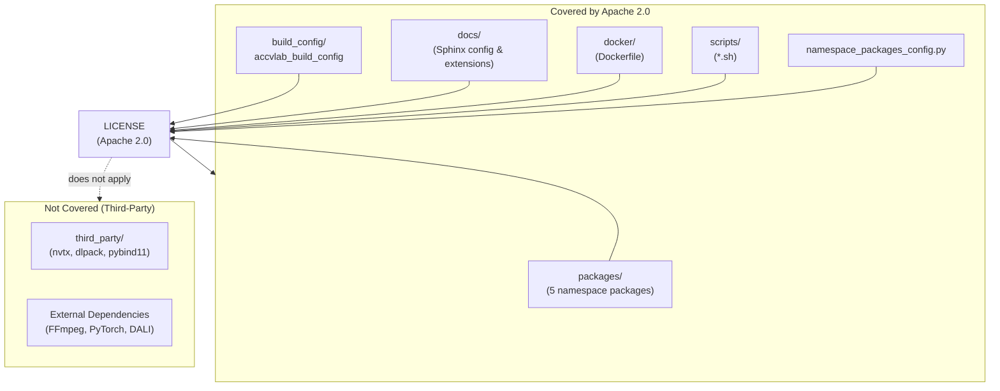
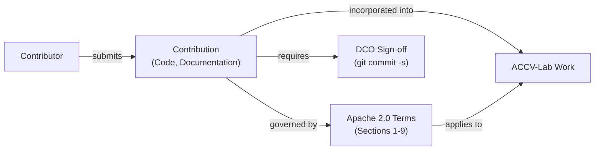
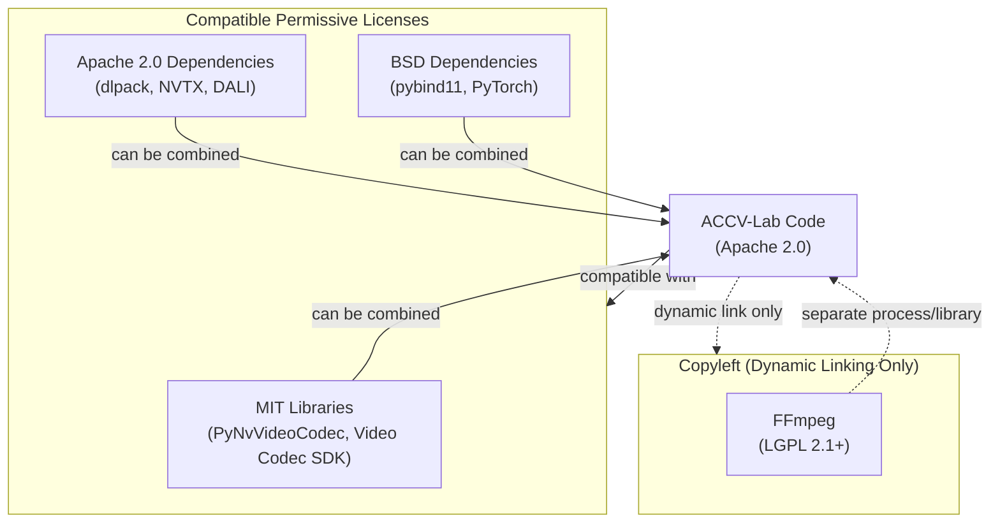
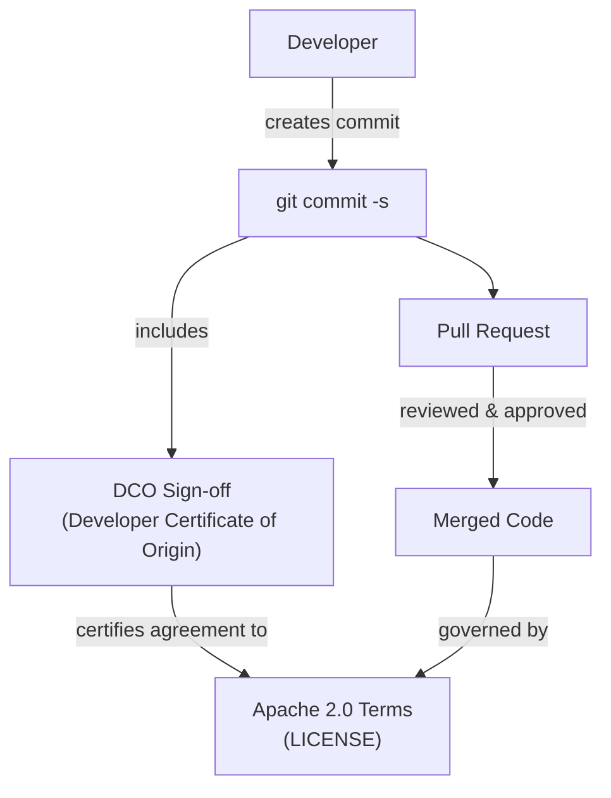

<!-- source: DeepWiki mcp.deepwiki.com · repo NVIDIA/ACCV-Lab · page 6.1 Apache License 2.0 · fetched 2026-10-26 -->

# Apache License 2.0

Relevant source files

The following files were used as context for generating this wiki page:

- [LICENSE](LICENSE)

## Purpose and Scope

This document explains the Apache License 2.0 that governs all original code in the ACCV-Lab repository. The Apache 2.0 license provides permissive terms for using, modifying, and distributing ACCV-Lab software. This page covers the main license terms, permissions, obligations, and how they apply to ACCV-Lab code.

For information about third-party dependency licenses, see [Third-Party Dependencies](#6.2). For contribution legal requirements including the DCO, see [Developer Certificate of Origin](#5.1).

**Sources:** [LICENSE:1-175]()

## License Overview

ACCV-Lab is licensed under the Apache License, Version 2.0, dated January 2004. This is a permissive open-source license approved by the Open Source Initiative (OSI) and widely used in enterprise and academic projects. The license provides broad permissions to users while including patent protection clauses and requiring attribution.

The full license text is located at [LICENSE:1-175]().

**Sources:** [LICENSE:1-3]()

## License Application Scope

The Apache 2.0 license applies to all original ACCV-Lab code, including:

| Component Type | Coverage |
|---|---|
| **Core Packages** | All Python and C++/CUDA code in `packages/` directories |
| **Build System** | The `build_config` package and build utilities |
| **Documentation** | Sphinx configuration, custom extensions, and documentation content |
| **Docker Configuration** | Dockerfiles and build scripts |
| **Scripts** | Installation, testing, and utility scripts |
| **Configuration Files** | Shared configuration files like `namespace_packages_config.py` |

**Sources:** [LICENSE:1-175]()

## Permissions Granted

The Apache 2.0 license grants users the following permissions:

### Copyright License (Section 2)

Users receive a perpetual, worldwide, non-exclusive, no-charge, royalty-free, irrevocable copyright license to:

- **Reproduce** the Work
- **Prepare Derivative Works**
- **Publicly display** the Work
- **Publicly perform** the Work
- **Sublicense** the Work
- **Distribute** the Work and Derivative Works in Source or Object form

These permissions apply to both the original Work and any Derivative Works created from it.

**Sources:** [LICENSE:66-71]()

### Patent License (Section 3)

Users receive a perpetual, worldwide, non-exclusive, no-charge, royalty-free, irrevocable patent license to:

- **Make** the Work
- **Have made** the Work
- **Use** the Work
- **Offer to sell** the Work
- **Sell** the Work
- **Import** the Work
- **Otherwise transfer** the Work

The patent license applies only to patent claims necessarily infringed by Contributions. The license includes a defensive termination clause: if you initiate patent litigation alleging that the Work infringes, your patent licenses terminate.

**Sources:** [LICENSE:73-87]()

## Redistribution Requirements

When redistributing ACCV-Lab code or derivative works, you must comply with the following requirements from Section 4:

### Required Actions

| Requirement | Description |
|---|---|
| **Include License** | Provide a copy of the Apache 2.0 license with distributions |
| **Mark Modifications** | Modified files must carry prominent notices stating the changes |
| **Retain Notices** | Keep all copyright, patent, trademark, and attribution notices from the Source form |
| **Include NOTICE** | If a NOTICE file exists, include its contents in distributions |

### Modification and Sublicensing

You may add your own copyright statement to modifications and provide different license terms for your modifications, provided your use of the original Work complies with Apache 2.0 terms.

**Sources:** [LICENSE:89-128]()

## Contribution Terms

Section 5 establishes default terms for contributions:

Unless explicitly stated otherwise, any Contribution intentionally submitted for inclusion is under Apache 2.0 terms without additional conditions. This does not supersede separate license agreements you may have with the Licensor.

ACCV-Lab additionally requires DCO sign-off for all contributions. See [Developer Certificate of Origin](#5.1) for details.

**Sources:** [LICENSE:130-136]()

## Key Definitions

The license defines several critical terms in Section 1:

### Core Terms

| Term | Definition |
|---|---|
| **License** | The terms and conditions for use, reproduction, and distribution (Sections 1-9) |
| **Licensor** | Copyright owner or authorized entity granting the License (NVIDIA for ACCV-Lab) |
| **You/Your** | Individual or Legal Entity exercising permissions under the License |
| **Work** | Work of authorship made available under the License (ACCV-Lab code) |
| **Derivative Works** | Works based on or derived from the Work |
| **Contribution** | Work intentionally submitted to Licensor for inclusion |
| **Contributor** | Licensor and individuals/entities whose Contributions are incorporated |

### Form Types

| Form | Definition |
|---|---|
| **Source Form** | Preferred form for modifications (source code, documentation source, configuration files) |
| **Object Form** | Result of mechanical transformation (compiled code, generated docs, conversions) |

**Sources:** [LICENSE:7-64]()

## Legal Entity Control

The license defines "Legal Entity" for organizational contributors:

A Legal Entity includes the acting entity and all entities that control, are controlled by, or are under common control with that entity. "Control" means:

1. Power to direct management by contract or otherwise
2. Ownership of 50% or more of outstanding shares
3. Beneficial ownership of the entity

**Sources:** [LICENSE:15-21]()

## Trademark Restrictions

Section 6 explicitly limits trademark usage:

The Apache 2.0 license **does not grant permission** to use:
- Trade names of the Licensor
- Trademarks
- Service marks  
- Product names

Exception: reasonable and customary use for describing the Work's origin and reproducing NOTICE file content.

**Sources:** [LICENSE:138-141]()

## Disclaimers and Limitations

### Warranty Disclaimer (Section 7)

The Work is provided on an **"AS IS" BASIS**, without warranties or conditions of any kind, including:

- Title
- Non-infringement
- Merchantability
- Fitness for a particular purpose

Users are solely responsible for determining the appropriateness of using or redistributing the Work and assume all risks.

**Sources:** [LICENSE:143-151]()

### Liability Limitation (Section 8)

Contributors shall not be liable for damages, including:
- Direct, indirect, special, incidental, or consequential damages
- Loss of goodwill
- Work stoppage
- Computer failure or malfunction
- Other commercial damages or losses

This limitation applies unless required by applicable law (such as deliberate and grossly negligent acts).

**Sources:** [LICENSE:153-163]()

### Accepting Additional Liability (Section 9)

When redistributing, you may offer support, warranty, or indemnity for a fee. However, you act only on your own behalf and must indemnify and hold harmless all Contributors for any liability incurred.

**Sources:** [LICENSE:165-174]()

## Relationship to Third-Party Licenses

Apache 2.0 is compatible with most permissive open-source licenses (MIT, BSD, other Apache 2.0). However, it requires careful handling of copyleft dependencies like FFmpeg (LGPL 2.1+), which ACCV-Lab dynamically links to avoid license conflicts.

For complete third-party license information, see [Third-Party Dependencies](#6.2).

**Sources:** [LICENSE:1-175]()

## Application in ACCV-Lab Repository

### License File Location

The complete Apache 2.0 license text is stored at the repository root:

- **Path:** [LICENSE:1-175]()
- **Format:** Plain text
- **Version:** Apache License 2.0, January 2004

### Copyright Attribution

ACCV-Lab code is copyrighted by NVIDIA Corporation. Contributors retain copyright to their contributions but license them under Apache 2.0 terms through the DCO process.

### Contribution Workflow Integration

All contributions follow this workflow:

1. Developer signs commits using `git commit -s` (see [Developer Certificate of Origin](#5.1))
2. DCO sign-off certifies agreement to contribute under Apache 2.0 terms
3. Pull request is reviewed per [Pull Request Process](#5.3)
4. Merged code becomes part of the Apache 2.0 licensed Work

**Sources:** [LICENSE:130-136]()

## Usage Scenarios

### Academic Research

Apache 2.0 permits use in academic research without restrictions:
- Use ACCV-Lab in research projects
- Modify code for experiments
- Publish results and modifications
- No requirement to release modifications (though encouraged)

### Commercial Use

Apache 2.0 permits commercial use:
- Use ACCV-Lab in commercial products
- Modify and integrate into proprietary systems
- Distribute as part of commercial offerings
- Patent license provides defensive protection

Requirements:
- Include Apache 2.0 license copy with distributions
- Retain copyright and attribution notices
- Mark modified files

### Derived Works

When creating derived works:
- You may license modifications under different terms
- Original Apache 2.0 code must remain Apache 2.0 licensed
- Must comply with redistribution requirements (Section 4)
- Attribution notices must be preserved

**Sources:** [LICENSE:66-128]()

## Summary of Key Points

| Aspect | Summary |
|---|---|
| **License Type** | Apache License 2.0 (permissive) |
| **Permissions** | Use, modify, distribute, sublicense, sell |
| **Patent Grant** | Explicit patent license with defensive termination |
| **Requirements** | Include license, mark modifications, retain notices |
| **Warranty** | None - provided "AS IS" |
| **Liability** | Limited - contributors not liable for damages |
| **Trademark** | No permission to use NVIDIA trademarks |
| **Contributions** | Submitted under Apache 2.0 via DCO |
| **Compatibility** | Compatible with MIT, BSD, other Apache 2.0 |

**Sources:** [LICENSE:1-175]()

---

