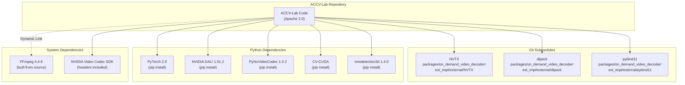
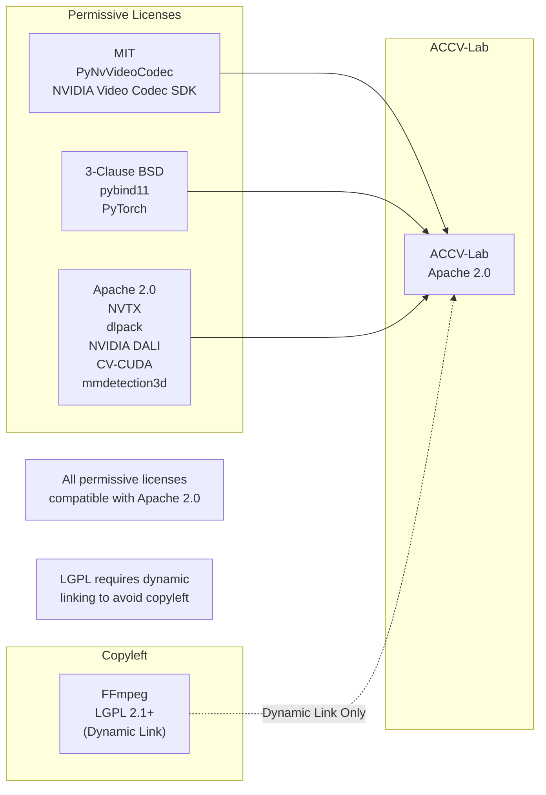
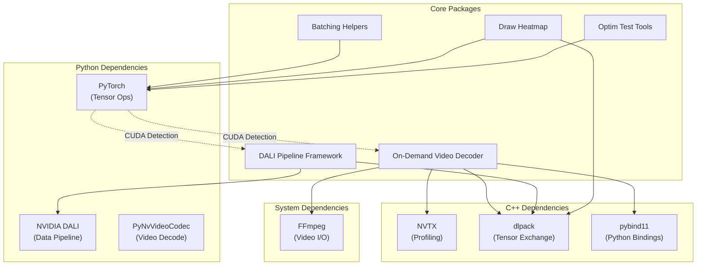

<!-- source: DeepWiki mcp.deepwiki.com · repo NVIDIA/ACCV-Lab · page 6.2 Third-Party Dependencies · fetched 2026-10-26 -->

# Third-Party Dependencies

<details>
<summary>Relevant source files</summary>

The following files were used as context for generating this wiki page:

- [.gitmodules](.gitmodules)
- [THIRD_PARTY_LICENSES.md](THIRD_PARTY_LICENSES.md)

</details>


This document provides a comprehensive reference of all third-party libraries and dependencies used in ACCV-Lab, including their licenses, versions, management methods, and compliance requirements. For information about ACCV-Lab's own Apache 2.0 license, see [Apache License 2.0](#6.1).

## Overview

ACCV-Lab depends on multiple third-party libraries that enable GPU-accelerated video processing, tensor operations, and Python bindings. These dependencies are managed through three primary mechanisms: git submodules for build-time C++ dependencies, Python package managers for runtime dependencies, and system-level libraries for multimedia processing. The licensing landscape includes permissive licenses (MIT, BSD, Apache 2.0) that are compatible with ACCV-Lab's Apache 2.0 license, with one notable exception: FFmpeg, which requires special attention due to its LGPL 2.1+ copyleft provisions.

## Dependency Management Architecture



**Sources:** [.gitmodules:1-12](), [THIRD_PARTY_LICENSES.md:1-14]()

### Git Submodules

Git submodules provide version-locked C++ dependencies required at build time. These are initialized using `git submodule update --init --recursive` and are located within the repository structure.

| Submodule | Path | Commit | License |
|-----------|------|--------|---------|
| NVTX | `packages/on_demand_video_decoder/ext_impl/external/NVTX` | e170594a | Apache 2.0 with LLVM Exceptions |
| dlpack | `packages/on_demand_video_decoder/ext_impl/external/dlpack` | 365b823c | Apache 2.0 |
| pybind11 | `packages/on_demand_video_decoder/ext_impl/external/pybind11` | aa304c9c | 3-Clause BSD |

**Sources:** [.gitmodules:1-12](), [THIRD_PARTY_LICENSES.md:6-8]()

### Python Package Dependencies

Python dependencies are installed via pip and provide runtime functionality. These are typically installed in the Docker environment or during local installation.

| Package | Version | License | Purpose |
|---------|---------|---------|---------|
| PyTorch | 2.6 | 3-Clause BSD | Tensor operations, CUDA detection |
| NVIDIA DALI | 1.51.2 | Apache 2.0 | GPU-accelerated data loading |
| PyNvVideoCodec | 1.0.2 | MIT | NVIDIA video codec Python bindings |
| CV-CUDA | da51fc96 | Apache 2.0 | Computer vision operations |
| mmdetection3d | 1.4.0 | Apache 2.0 | 3D object detection |

**Sources:** [THIRD_PARTY_LICENSES.md:9-14]()

### System Dependencies

System-level dependencies are built and installed separately, primarily in the Docker environment.

| Dependency | Version | License | Integration Method |
|------------|---------|---------|-------------------|
| FFmpeg | 4.4.6 | LGPL 2.1+ | Dynamic linking |
| NVIDIA Video Codec SDK | 11.1.5 | MIT (partial) | Header-only inclusion |

**Sources:** [THIRD_PARTY_LICENSES.md:5,11]()

## License Compatibility Matrix



**Sources:** [THIRD_PARTY_LICENSES.md:1-1797]()

All dependencies use permissive open-source licenses that are compatible with Apache 2.0, except for FFmpeg which uses LGPL 2.1 or later. The LGPL license has copyleft provisions that would require ACCV-Lab to be licensed under LGPL if FFmpeg were statically linked. To avoid this, ACCV-Lab dynamically links to FFmpeg, maintaining license compatibility.

## FFmpeg LGPL Compliance

FFmpeg is the only dependency with copyleft licensing requirements. ACCV-Lab maintains LGPL compliance through dynamic linking.

### Compliance Requirements

The LGPL 2.1+ license applied to FFmpeg as configured in ACCV-Lab requires:

1. **Dynamic Linking**: FFmpeg must be dynamically linked, not statically linked
2. **Source Availability**: FFmpeg source code must remain available
3. **License Distribution**: LGPL license text must be distributed with binaries
4. **Modification Rights**: Users must be able to replace the FFmpeg library

**Implementation**: ACCV-Lab dynamically links to the system FFmpeg library installed in the Docker container. The FFmpeg build configuration is documented in the Dockerfile.

**Sources:** [THIRD_PARTY_LICENSES.md:18-526]()

### FFmpeg Build Configuration

FFmpeg is built from source in the Docker environment with a specific configuration. The build flags determine which codecs and features are enabled, which in turn affects the license that applies.

```
Configuration used: LGPL 2.1 or later
Location: docker/Dockerfile (FFmpeg build section)
Version: 4.4.6
Source: https://github.com/FFmpeg/FFmpeg/tree/n4.4.6
```

**Sources:** [THIRD_PARTY_LICENSES.md:5,19]()

## Dependency Usage by Package



**Sources:** [THIRD_PARTY_LICENSES.md:1-14](), [.gitmodules:1-12]()

### On-Demand Video Decoder Dependencies

The On-Demand Video Decoder package uses the most dependencies, as it performs GPU-accelerated video decoding with Python bindings.

- **NVTX**: Performance profiling and instrumentation
- **dlpack**: Zero-copy tensor exchange between C++ and Python
- **pybind11**: C++ to Python bindings generation
- **FFmpeg**: Video container demuxing and codec initialization
- **NVIDIA Video Codec SDK**: GPU video decoding headers

**Sources:** [.gitmodules:1-11](), [THIRD_PARTY_LICENSES.md:5-12]()

### DALI Pipeline Framework Dependencies

The DALI Pipeline Framework builds on NVIDIA DALI for GPU-accelerated data augmentation and preprocessing.

- **NVIDIA DALI**: Core data pipeline functionality
- **dlpack**: Tensor exchange with other packages
- **PyTorch**: CUDA context management

**Sources:** [THIRD_PARTY_LICENSES.md:9]()

### Other Package Dependencies

- **Batching Helpers**: Uses PyTorch for tensor operations
- **Draw Heatmap**: Uses PyTorch and dlpack for GPU heatmap generation
- **Optim Test Tools**: Uses PyTorch for profiling and testing

**Sources:** [THIRD_PARTY_LICENSES.md:10]()

## Detailed Dependency Information

### NVTX (NVIDIA Tools Extension)

```
License: Apache 2.0 with LLVM Exceptions
Version: Commit e170594a
Location: packages/on_demand_video_decoder/ext_impl/external/NVTX
Management: Git submodule
```

NVTX provides performance profiling markers that integrate with NVIDIA Nsight Systems. The LLVM exceptions allow compiled forms to be embedded in object code without full license compliance requirements.

**Key Features:**
- Performance marker API for profiling
- CUDA stream annotations
- Range instrumentation

**LLVM Exceptions:** Allow embedding portions of NVTX in compiled object code without requiring sections 4(a), 4(b), and 4(d) of the Apache 2.0 license to be satisfied.

**Sources:** [THIRD_PARTY_LICENSES.md:8,938-1160]()

### dlpack

```
License: Apache 2.0
Version: Commit 365b823c
Location: packages/on_demand_video_decoder/ext_impl/external/dlpack
Management: Git submodule
```

DLPack is a tensor exchange standard enabling zero-copy tensor sharing between different frameworks (PyTorch, NumPy, etc.) without serialization overhead.

**Key Features:**
- Zero-copy tensor exchange
- Framework-agnostic tensor representation
- GPU memory support

**Sources:** [THIRD_PARTY_LICENSES.md:7,732-936](), [.gitmodules:5-7]()

### pybind11

```
License: 3-Clause BSD
Version: Commit aa304c9c
Location: packages/on_demand_video_decoder/ext_impl/external/pybind11
Management: Git submodule
```

Pybind11 generates Python bindings for C++ code, enabling seamless interoperability between C++ GPU code and Python APIs.

**Key Features:**
- Header-only C++ library
- Automatic type conversions
- Exception translation between C++ and Python

**Sources:** [THIRD_PARTY_LICENSES.md:6,698-730](), [.gitmodules:9-11]()

### PyTorch

```
License: 3-Clause BSD
Version: 2.6
Management: pip install
```

PyTorch provides tensor operations, CUDA context management, and is used throughout ACCV-Lab for GPU memory management and CUDA device detection.

**Key Uses in ACCV-Lab:**
- CUDA device detection in build system
- Tensor operations in Batching Helpers
- GPU memory management
- Integration with other GPU libraries

**Sources:** [THIRD_PARTY_LICENSES.md:10,1341-1424]()

### NVIDIA DALI

```
License: Apache 2.0
Version: 1.51.2
Management: pip install
```

NVIDIA DALI (Data Loading Library) provides GPU-accelerated data augmentation and preprocessing pipelines. The DALI Pipeline Framework package extends DALI with custom operators.

**Key Features:**
- GPU-accelerated image/video processing
- Custom operator framework
- Integration with PyTorch and TensorFlow

**Sources:** [THIRD_PARTY_LICENSES.md:9,1162-1339]()

### FFmpeg

```
License: LGPL 2.1 or later (as configured)
Version: 4.4.6
Management: Built from source in Docker
Source: https://github.com/FFmpeg/FFmpeg/tree/n4.4.6
```

FFmpeg provides video container demuxing and codec initialization. The specific configuration used in ACCV-Lab results in LGPL 2.1+ licensing.

**Build Configuration:** Defined in `docker/Dockerfile`

**Important:** FFmpeg is dynamically linked to maintain LGPL compliance. Static linking would trigger copyleft provisions requiring ACCV-Lab to be licensed under LGPL.

**Sources:** [THIRD_PARTY_LICENSES.md:5,18-696]()

### NVIDIA Video Codec SDK

```
License: MIT (for included portions)
Version: 11.1.5
Management: Headers included in repository
```

The NVIDIA Video Codec SDK provides header files for GPU-accelerated video encoding and decoding. Only header files are included; the actual codec libraries are provided by the NVIDIA driver.

**Note:** The MIT license applies only to the header files included in ACCV-Lab, not to the complete SDK.

**Sources:** [THIRD_PARTY_LICENSES.md:11,1426-1451]()

### PyNvVideoCodec

```
License: MIT
Version: 1.0.2
Management: pip install
```

PyNvVideoCodec provides Python bindings for NVIDIA video codec operations.

**Sources:** [THIRD_PARTY_LICENSES.md:12,1453-1476]()

### CV-CUDA

```
License: Apache 2.0
Version: Commit da51fc96
Management: pip install
```

CV-CUDA provides GPU-accelerated computer vision operations optimized for NVIDIA GPUs.

**Sources:** [THIRD_PARTY_LICENSES.md:13,1478-1588]()

### mmdetection3d

```
License: Apache 2.0
Version: 1.4.0
Management: pip install
```

MMDetection3D provides 3D object detection algorithms and utilities, used in ADAS applications.

**Sources:** [THIRD_PARTY_LICENSES.md:14,1590-1797]()

## License Attribution Requirements

ACCV-Lab maintains complete license attribution in [THIRD_PARTY_LICENSES.md:1-1797](), which includes:

1. **License Summaries**: Table listing all dependencies with versions and licenses
2. **Full License Texts**: Complete text of each dependency's license
3. **Special Notices**: FFmpeg LGPL configuration notes and NVTX LLVM exceptions

All binary distributions of ACCV-Lab must include the `THIRD_PARTY_LICENSES.md` file to satisfy attribution requirements.

**Sources:** [THIRD_PARTY_LICENSES.md:1-1797]()

## Verification and Updates

### Checking Submodule Status

```bash
# Verify submodules are initialized
git submodule status

# Expected output:
# e170594a... packages/on_demand_video_decoder/ext_impl/external/NVTX (...)
# 365b823c... packages/on_demand_video_decoder/ext_impl/external/dlpack (...)
# aa304c9c... packages/on_demand_video_decoder/ext_impl/external/pybind11 (...)
```

### Updating Dependencies

- **Git Submodules**: Update commit hashes in [.gitmodules:1-12]() and run `git submodule update`
- **Python Packages**: Update version requirements in package `setup.py` files
- **License Documentation**: Update [THIRD_PARTY_LICENSES.md:1-1797]() with new versions and license texts

**Sources:** [.gitmodules:1-12](), [THIRD_PARTY_LICENSES.md:1-14]()

## Summary

ACCV-Lab's third-party dependency management follows these principles:

1. **Permissive Licensing**: All dependencies use permissive licenses compatible with Apache 2.0
2. **LGPL Compliance**: FFmpeg is dynamically linked to maintain license separation
3. **Version Locking**: Git submodules provide reproducible C++ dependency versions
4. **Complete Attribution**: All licenses are documented in `THIRD_PARTY_LICENSES.md`
5. **Dependency Isolation**: Different dependency types (submodules, pip, system) serve distinct purposes

For build system integration details, see [Build Configuration Package](#3.1). For Docker environment setup including FFmpeg compilation, see [Docker Environment](#2.1).

**Sources:** [THIRD_PARTY_LICENSES.md:1-1797](), [.gitmodules:1-12]()

---

