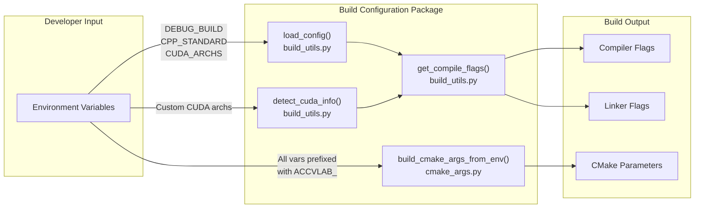
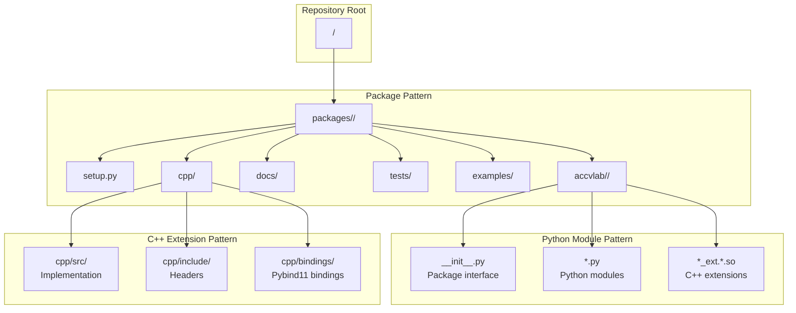
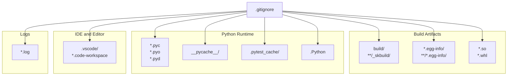

<!-- source: DeepWiki mcp.deepwiki.com · repo NVIDIA/ACCV-Lab · page 7 Reference · fetched 2026-10-26 -->

# Reference

<details>
<summary>Relevant source files</summary>

The following files were used as context for generating this wiki page:

- [.gitignore](.gitignore)
- [README.md](README.md)

</details>


## Purpose and Scope

This section provides technical reference material for the ACCV-Lab repository, including configuration files, environment variables, file organization patterns, and other reference information needed for advanced usage and development.

For detailed information about specific topics, see:
- Repository configuration files (`.gitignore`, `.gitmodules`, etc.): see [Repository Configuration Files](#7.1)
- The `namespace_packages_config.py` shared configuration system: see [Shared Configuration System](#7.2)
- Build system configuration: see [Build System](#3)
- Documentation system configuration: see [Documentation System](#4)

## Configuration Files Overview

The ACCV-Lab repository uses several configuration files that control various aspects of the system. These files are located at different levels of the repository hierarchy and serve different purposes.

### Configuration File Hierarchy

```mermaid
graph TD
    ROOT["Repository Root"]
    
    subgraph "Version Control Config"
        GITIGNORE[".gitignore<br/>Build artifacts, IDE files"]
        GITMODULES[".gitmodules<br/>Submodule definitions"]
        GITATTRIBUTES[".gitattributes<br/>Git attributes"]
    end
    
    subgraph "Build Configuration"
        NS_CONFIG["namespace_packages_config.py<br/>Shared package registry"]
        BUILD_PKG["build_config/accvlab_build_config<br/>Build utilities package"]
        PKG_SETUP["packages/*/setup.py<br/>Package-specific setup"]
    end
    
    subgraph "Code Quality Config"
        CLANG_FORMAT[".clang-format<br/>C++ formatting rules"]
        PYPROJECT["pyproject.toml<br/>Python formatting rules"]
    end
    
    subgraph "Documentation Config"
        SPHINX_CONF["docs/conf.py<br/>Sphinx configuration"]
        MAKEFILE["docs/Makefile<br/>Doc build commands"]
    end
    
    subgraph "Container Config"
        DOCKERFILE["docker/Dockerfile<br/>Development environment"]
    end
    
    subgraph "Legal Config"
        LICENSE["LICENSE<br/>Apache 2.0"]
        THIRD_PARTY["THIRD_PARTY_LICENSES.md<br/>Dependency licenses"]
    end
    
    ROOT --> GITIGNORE
    ROOT --> GITMODULES
    ROOT --> GITATTRIBUTES
    ROOT --> NS_CONFIG
    ROOT --> BUILD_PKG
    ROOT --> CLANG_FORMAT
    ROOT --> PYPROJECT
    ROOT --> SPHINX_CONF
    ROOT --> DOCKERFILE
    ROOT --> LICENSE
    
    NS_CONFIG -.->|"configures"| PKG_SETUP
    NS_CONFIG -.->|"configures"| SPHINX_CONF
    BUILD_PKG -.->|"used by"| PKG_SETUP
```



**Sources:** [README.md:1-176](), [.gitignore:1-22]()

### Configuration File Reference Table

| File | Location | Purpose | Type |
|------|----------|---------|------|
| `.gitignore` | Repository root | Defines files to exclude from version control | Version Control |
| `.gitmodules` | Repository root | Defines git submodules (NVTX, DLPack, Pybind11) | Version Control |
| `.gitattributes` | Repository root | Defines git attributes for file handling | Version Control |
| `namespace_packages_config.py` | Repository root | Central registry of all namespace packages | Build/Docs |
| `.clang-format` | Repository root | C++ code formatting rules | Code Quality |
| `pyproject.toml` | Repository root | Python project configuration and formatting | Code Quality |
| `setup.py` | Each package directory | Package-specific build configuration | Build |
| `docs/conf.py` | docs/ | Sphinx documentation configuration | Documentation |
| `docs/Makefile` | docs/ | Documentation build commands | Documentation |
| `Dockerfile` | docker/ | Development environment specification | Container |
| `LICENSE` | Repository root | Apache 2.0 license text | Legal |
| `THIRD_PARTY_LICENSES.md` | Repository root | Third-party dependency licenses | Legal |

**Sources:** [README.md:103-111]()

## Environment Variables Reference

The ACCV-Lab build system uses environment variables to configure compilation, linking, and other build aspects. These variables are processed by the `accvlab_build_config` package and can be set before running package installation.

### Build Environment Variables



**Sources:** [README.md:1-176]()

### Environment Variable Table

| Variable | Default | Purpose | Used By |
|----------|---------|---------|---------|
| `DEBUG_BUILD` | `0` | Enable debug build with debug symbols | `load_config()` |
| `CPP_STANDARD` | `17` | C++ standard version (11, 14, 17, 20) | `load_config()` |
| `CUSTOM_CUDA_ARCHS` | Auto-detect | Override CUDA architectures (e.g., "8.0;8.6") | `detect_cuda_info()` |
| `ACCVLAB_*` | N/A | Prefix for custom CMake variables | `build_cmake_args_from_env()` |
| `ENABLE_NVTX` | `0` | Enable NVTX profiling instrumentation | `load_config()` |
| `MAX_JOBS` | CPU count | Maximum parallel build jobs | Build systems |

**Sources:** [README.md:1-176]()

### Environment Variable Usage Example

To configure a debug build with C++20 and specific CUDA architectures:

```bash
DEBUG_BUILD=1 CPP_STANDARD=20 CUSTOM_CUDA_ARCHS="8.0;8.6" ./scripts/install_local.sh
```

For CMake-based packages, pass custom CMake variables:

```bash
ACCVLAB_MY_OPTION=ON ACCVLAB_BUILD_TESTS=OFF ./scripts/install_local.sh
```

The `ACCVLAB_` prefix is stripped and the remaining variable name is passed to CMake.

**Sources:** [README.md:1-176]()

## File Organization Patterns

The ACCV-Lab repository follows consistent file organization patterns across all namespace packages and subsystems.

### Directory Structure Pattern



**Sources:** [README.md:103-111]()

### Naming Conventions

| Pattern | Convention | Example |
|---------|-----------|---------|
| Package directory | `packages/<package_name>/` | `packages/on_demand_video_decoder/` |
| Python namespace | `accvlab.<subsystem>` | `accvlab.video_decoder` |
| C++ extension | `<name>_ext` | `decoder_ext` |
| Documentation | `docs/` inside package | `packages/on_demand_video_decoder/docs/` |
| Tests | `tests/` inside package | `packages/batching_helpers/tests/` |
| Examples | `examples/` inside package | `packages/dali_pipeline_framework/examples/` |

**Sources:** [README.md:103-111]()

## Ignored Files and Build Artifacts

The `.gitignore` file defines patterns for files that should not be tracked in version control. These include build artifacts, Python cache files, and IDE-specific files.

### Ignored Pattern Categories



**Sources:** [.gitignore:1-22]()

### Ignored Patterns Reference

| Pattern | Category | Purpose |
|---------|----------|---------|
| `build/`, `**/build/` | Build artifacts | Exclude package build directories |
| `**/_skbuild/` | Build artifacts | Exclude scikit-build intermediate files |
| `*.egg-info/`, `**/*.egg-info/` | Package metadata | Exclude setuptools metadata directories |
| `*.pyc`, `*.pyo`, `*.pyd` | Python bytecode | Exclude compiled Python files |
| `__pycache__/` | Python cache | Exclude Python bytecode cache directories |
| `.pytest_cache/` | Testing | Exclude pytest cache |
| `.Python` | Virtual environment | Exclude Python virtual environment marker |
| `*.so` | Native binaries | Exclude compiled C++ extensions |
| `*.whl` | Distribution | Exclude built wheel packages |
| `.vscode/`, `*.code-workspace` | IDE | Exclude VSCode configuration |
| `*.log` | Logging | Exclude log files |

**Sources:** [.gitignore:1-22]()

## Build Artifact Locations

Understanding where build artifacts are created helps with troubleshooting and cleanup operations.

### Build Directory Structure

| Artifact Type | Location Pattern | Cleanup Method |
|--------------|------------------|----------------|
| Setuptools build | `packages/*/build/` | Remove `build/` directories |
| Scikit-build output | `packages/*/_skbuild/` | Remove `_skbuild/` directories |
| Package metadata | `packages/*/*.egg-info/` | Remove `*.egg-info/` directories |
| Compiled extensions | `packages/*/accvlab/*/*.so` | Remove `*.so` files |
| Python bytecode | `**/__pycache__/` | Remove `__pycache__/` directories |
| Wheel packages | `*.whl` | Remove from build locations |
| Documentation | `docs/_build/` | `make clean` in docs/ |

**Sources:** [.gitignore:1-22](), [README.md:85-88]()

### Cleanup Commands

```bash
# Remove all build artifacts
find . -type d -name "build" -exec rm -rf {} +
find . -type d -name "_skbuild" -exec rm -rf {} +
find . -type d -name "*.egg-info" -exec rm -rf {} +
find . -type d -name "__pycache__" -exec rm -rf {} +
find . -name "*.pyc" -delete
find . -name "*.so" -delete

# Clean documentation build
cd docs && make clean
```

**Sources:** [.gitignore:1-22]()

## Repository Scripts

The `scripts/` directory contains utility scripts for common development tasks. These scripts provide a consistent interface for building, testing, and managing the repository.

### Script Reference Table

| Script | Purpose | Key Options |
|--------|---------|-------------|
| `scripts/install_local.sh` | Install all namespace packages | `-e` for editable mode |
| `scripts/build_docs.sh` | Build Sphinx documentation | None |
| `scripts/run_tests.sh` | Run test suite | Package-specific |
| `scripts/format_code.sh` | Format code (if exists) | Target directories |

**Sources:** [README.md:76-93]()

### Script Usage Notes

- **Editable Installation**: The `-e` flag for `install_local.sh` enables development mode, but may not work for packages using scikit-build (those with native C++ extensions)
- **Documentation Prerequisites**: Documentation must be built after package installation, as API documentation relies on importable packages
- **Submodule Requirement**: All scripts assume git submodules are initialized (`git submodule update --init --recursive`)

**Sources:** [README.md:69-73](), [README.md:90-93]()

## Advanced Topics

For more detailed information on specific reference topics, consult the following subsections:

- **[Repository Configuration Files](#7.1)**: Detailed documentation of `.gitignore`, `.gitmodules`, and other configuration files
- **[Shared Configuration System](#7.2)**: In-depth explanation of `namespace_packages_config.py` and its role in synchronizing build and documentation systems

For configuration of specific subsystems:

- **[Build System](#3)**: Build utilities, CMake integration, and compilation configuration
- **[Documentation System](#4)**: Sphinx configuration, custom extensions, and documentation generation
- **[Contributing](#5)**: Development workflows, code quality standards, and submission requirements

**Sources:** [README.md:1-176]()

---

