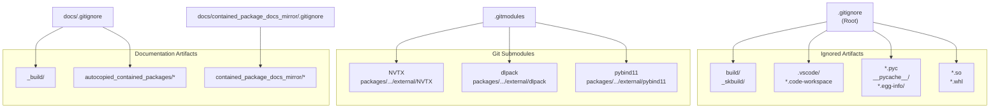
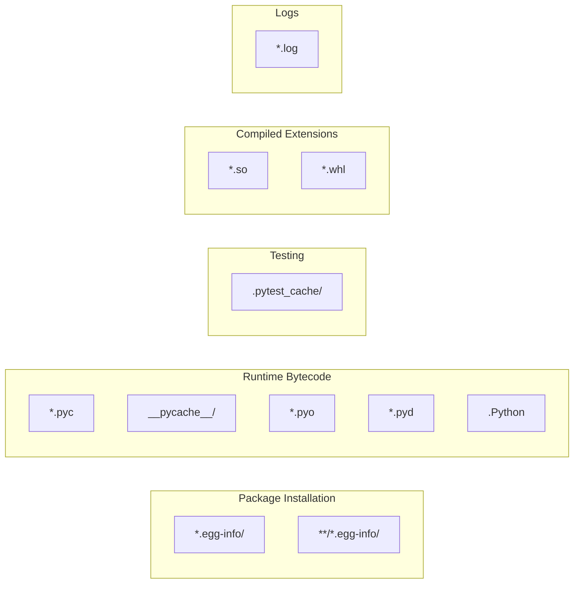
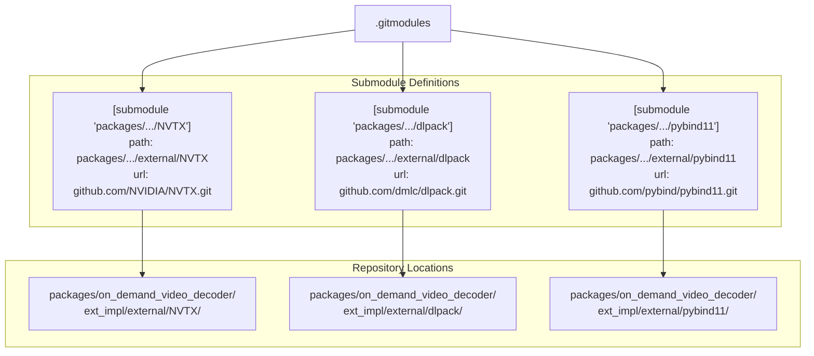
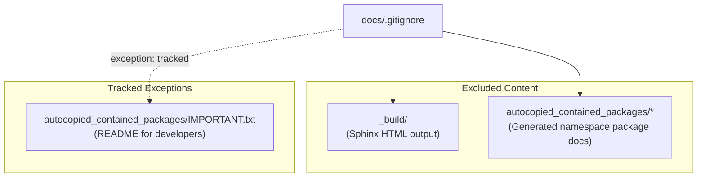
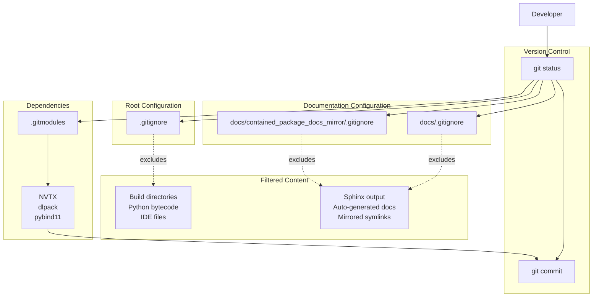

<!-- source: DeepWiki mcp.deepwiki.com · repo NVIDIA/ACCV-Lab · page 7.1 Repository Configuration Files · fetched 2026-10-26 -->

# Repository Configuration Files

<details>
<summary>Relevant source files</summary>

The following files were used as context for generating this wiki page:

- [.gitignore](.gitignore)
- [.gitmodules](.gitmodules)
- [docs/.gitignore](docs/.gitignore)
- [docs/contained_package_docs_mirror/.gitignore](docs/contained_package_docs_mirror/.gitignore)

</details>


## Purpose and Scope

This document provides a comprehensive reference for the repository-level configuration files in ACCV-Lab that control version control behavior, dependency management, and build artifact exclusion. These files define what content is tracked by Git, how external dependencies are integrated as submodules, and which generated files are excluded from version control.

For information about build system configuration, see [Build System](#3). For details on external dependencies managed through submodules, see [External Dependencies](#2.3). For documentation system configuration, see [Documentation System](#4).

## Configuration File Overview

The repository contains several configuration files that work together to manage version control and dependency tracking:



**Sources:** [.gitignore:1-22](), [.gitmodules:1-12](), [docs/.gitignore:1-10](), [docs/contained_package_docs_mirror/.gitignore:1-8]()

## Root .gitignore

The root `.gitignore` file defines patterns for excluding build artifacts, IDE configurations, and Python-generated files from version control across the entire repository.

### Build Artifacts

Build-related directories are excluded at both the root level and recursively throughout the repository:

| Pattern | Scope | Purpose |
|---------|-------|---------|
| `build/` | Root directory | Excludes top-level build output |
| `**/build/` | All subdirectories | Excludes package-level build directories |
| `**/_skbuild/` | All subdirectories | Excludes scikit-build temporary directories used by packages with native extensions |

**Sources:** [.gitignore:1-3]()

### IDE and Editor Files

IDE-specific files are excluded to prevent personal development environment configurations from being committed:

| Pattern | Purpose |
|---------|---------|
| `.vscode/` | Visual Studio Code workspace settings |
| `*.code-workspace` | VS Code workspace files |

**Sources:** [.gitignore:5-6]()

### Python Build and Runtime Artifacts

Python generates numerous files during package installation, runtime execution, and testing. These are excluded to keep the repository clean:



| Pattern | Description |
|---------|-------------|
| `*.egg-info/`, `**/*.egg-info/` | Python package metadata directories created during `pip install` |
| `*.pyc`, `*.pyo`, `*.pyd` | Python bytecode files (compiled, optimized, and Windows DLL) |
| `__pycache__/` | Python 3+ bytecode cache directories |
| `.Python` | Python virtual environment marker |
| `.pytest_cache/` | pytest test result cache |
| `*.so` | Compiled shared object files (native extensions) |
| `*.whl` | Python wheel distribution files |
| `*.log` | Log files from various tools |

**Sources:** [.gitignore:8-21]()

## Git Submodules Configuration

The `.gitmodules` file defines three external dependencies that are integrated into the repository as Git submodules. All submodules are located under the On-Demand Video Decoder package's external dependencies directory.

### Submodule Structure



### Submodule Definitions

| Submodule | Path | Repository URL | Purpose |
|-----------|------|----------------|---------|
| NVTX | `packages/on_demand_video_decoder/ext_impl/external/NVTX` | `https://github.com/NVIDIA/NVTX.git` | Performance instrumentation and profiling markers |
| dlpack | `packages/on_demand_video_decoder/ext_impl/external/dlpack` | `https://github.com/dmlc/dlpack.git` | Zero-copy tensor exchange format |
| pybind11 | `packages/on_demand_video_decoder/ext_impl/external/pybind11` | `https://github.com/pybind/pybind11.git` | C++/Python binding generation |

**Sources:** [.gitmodules:1-12]()

### Initialization Command

All submodules must be initialized after cloning the repository:

```bash
git submodule update --init --recursive
```

This command is required before building any packages that depend on these external libraries. See [Local Installation](#2.2) for complete setup instructions.

**Sources:** [.gitmodules:1-12]()

## Documentation .gitignore Files

The documentation system uses two additional `.gitignore` files to manage generated content and mirrored documentation directories.

### docs/.gitignore

The `docs/.gitignore` file excludes Sphinx build output and auto-copied package documentation:



| Pattern | Purpose |
|---------|---------|
| `_build/` | Sphinx-generated HTML documentation output |
| `autocopied_contained_packages/*` | Auto-generated namespace package documentation structure |
| `!autocopied_contained_packages/IMPORTANT.txt` | Exception: documentation for developers explaining the directory |

The pattern `autocopied_contained_packages/*` uses a trailing `/*` rather than just the directory name. This is a critical distinction - it allows the directory itself to be tracked while ignoring its contents, enabling the `!` exception rule for `IMPORTANT.txt`.

**Sources:** [docs/.gitignore:1-10]()

### docs/contained_package_docs_mirror/.gitignore

The documentation mirror directory uses a blanket ignore pattern to exclude all mirrored documentation symlinks while preserving essential tracked files:

| Pattern | Purpose |
|---------|---------|
| `*` | Ignore all files in the directory |
| `!.gitignore` | Exception: track the `.gitignore` file itself |
| `!IMPORTANT.txt` | Exception: track developer documentation |

This configuration ensures that the mirror directory structure exists in version control while excluding all dynamically created symlinks or copied documentation files. For details on how this directory is used, see [Documentation Mirror System](#4.5).

**Sources:** [docs/contained_package_docs_mirror/.gitignore:1-8]()

## Configuration File Relationships

The repository configuration files work together to create a clean version control workflow:



**Sources:** [.gitignore:1-22](), [.gitmodules:1-12](), [docs/.gitignore:1-10](), [docs/contained_package_docs_mirror/.gitignore:1-8]()

## Pattern Reference Summary

### Recursive vs. Non-Recursive Patterns

The `.gitignore` file uses different pattern types to control scope:

| Pattern Type | Example | Behavior |
|--------------|---------|----------|
| Root-only | `build/` | Matches only at root level |
| Recursive (explicit) | `**/build/` | Matches in any subdirectory |
| Recursive (implicit) | `*.pyc` | Matches in any directory (no `/` in pattern) |

### Exception Patterns

Both documentation `.gitignore` files use the `!` prefix to create exceptions to broader ignore rules. This enables selective tracking of important files within otherwise ignored directories:

```
# Ignore all contents
autocopied_contained_packages/*
# But track this file
!autocopied_contained_packages/IMPORTANT.txt
```

The exception pattern only works when the parent directory is matched with `/*` rather than being completely ignored. This is explicitly noted in the inline comment at [docs/.gitignore:3-6]().

**Sources:** [.gitignore:1-22](), [docs/.gitignore:1-10](), [docs/contained_package_docs_mirror/.gitignore:1-8]()

---

