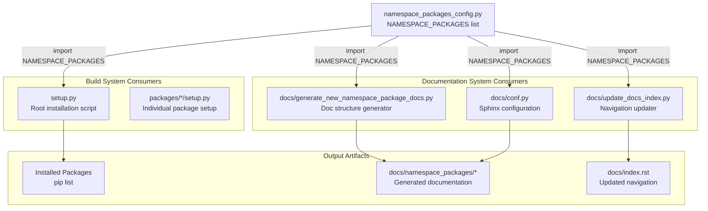
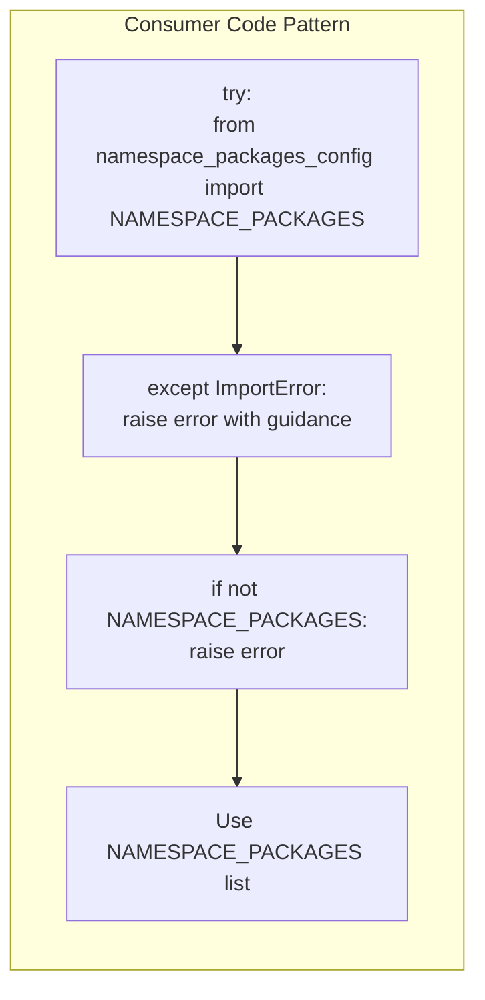
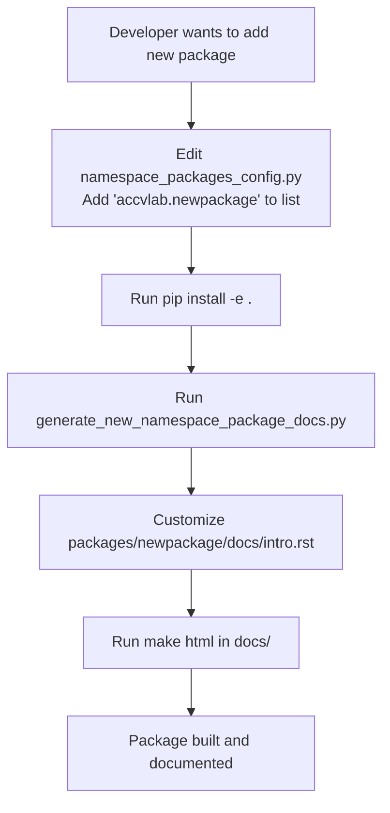
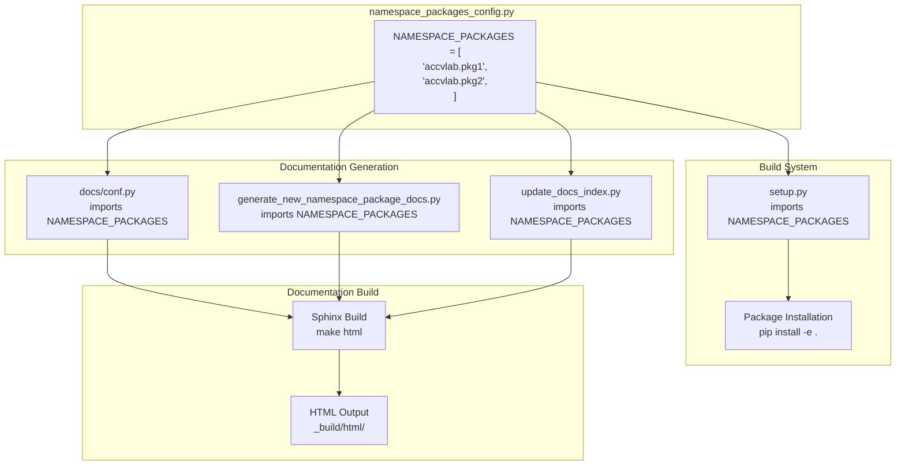

<!-- source: DeepWiki mcp.deepwiki.com · repo NVIDIA/ACCV-Lab · page 7.2 Shared Configuration System · fetched 2026-10-26 -->

# Shared Configuration System

<details>
<summary>Relevant source files</summary>

The following files were used as context for generating this wiki page:

- [docs/NAMESPACE_PACKAGE_DOCS_GUIDE.txt](docs/NAMESPACE_PACKAGE_DOCS_GUIDE.txt)
- [docs/SHARED_CONFIG_GUIDE.txt](docs/SHARED_CONFIG_GUIDE.txt)

</details>


## Purpose and Scope

The Shared Configuration System provides a centralized mechanism for defining and managing namespace packages across the ACCV-Lab repository. The system ensures that the build system and documentation system remain synchronized by consuming configuration from a single source of truth. This document explains the structure, usage, and integration points of the shared configuration.

For information about using this configuration to add documentation to namespace packages, see [Writing Package Documentation](#4.4). For build system integration details, see [Build Configuration Package](#3.1).

## Overview

The shared configuration system centers around a single Python file, `namespace_packages_config.py`, located in the repository root. This file contains a simple list that defines all namespace packages managed by ACCV-Lab. Multiple systems throughout the repository import and use this configuration to maintain consistency.

The configuration is intentionally manual rather than automatic. There is no filesystem discovery or convention-based detection. This explicit approach ensures predictable behavior and complete developer control.

**Sources:** [docs/SHARED_CONFIG_GUIDE.txt:1-57]()

## Configuration File Structure

The `namespace_packages_config.py` file contains a single module-level constant:

```python
NAMESPACE_PACKAGES = [
    'accvlab.examples',
    'accvlab.algorithms',
    'accvlab.utilities',
    # Additional namespace packages...
]
```

### File Location

The configuration file must be located at the repository root, adjacent to the main `setup.py` file. This location allows it to be imported by both build scripts and documentation generation tools.

### Data Structure

| Field | Type | Description |
|-------|------|-------------|
| `NAMESPACE_PACKAGES` | `list[str]` | List of fully-qualified namespace package names |

Each entry follows Python package naming conventions (e.g., `accvlab.package_name`). The list order does not affect build or documentation generation behavior.

**Sources:** [docs/NAMESPACE_PACKAGE_DOCS_GUIDE.txt:36-44](), [docs/SHARED_CONFIG_GUIDE.txt:6-14]()

## System Architecture



The diagram above illustrates how the central `namespace_packages_config.py` file is imported by multiple systems. The build system uses it to determine which packages to install, while the documentation system uses it to generate API documentation and navigation structures.

**Sources:** [docs/SHARED_CONFIG_GUIDE.txt:16-28](), [docs/NAMESPACE_PACKAGE_DOCS_GUIDE.txt:33-50]()

## Configuration Consumers

### Build System Integration

The root `setup.py` imports `NAMESPACE_PACKAGES` to configure which namespace packages to install:

```python
from namespace_packages_config import NAMESPACE_PACKAGES
```

This ensures that the `pip install` command processes exactly the packages defined in the configuration. Individual package `setup.py` files (located in `packages/*/setup.py`) may also reference this configuration for consistency checks.

**Sources:** [docs/SHARED_CONFIG_GUIDE.txt:18](), [docs/NAMESPACE_PACKAGE_DOCS_GUIDE.txt:48-50]()

### Documentation System Integration

Three documentation scripts consume the shared configuration:

#### 1. Sphinx Configuration (`docs/conf.py`)

The Sphinx configuration imports `NAMESPACE_PACKAGES` to:
- Configure autodoc search paths
- Set up intersphinx mapping
- Define documentation structure

```python
from namespace_packages_config import NAMESPACE_PACKAGES
```

#### 2. Namespace Package Documentation Generator

The script `docs/generate_new_namespace_package_docs.py` uses `NAMESPACE_PACKAGES` to:
- Create `packages/*/docs/` directory structures
- Generate `index.rst`, `intro.rst`, and `api.rst` templates
- Establish autodoc directives for each package

#### 3. Documentation Index Updater

The script `docs/update_docs_index.py` references `NAMESPACE_PACKAGES` to:
- Regenerate the main `docs/index.rst` navigation
- Create toctree entries for each namespace package
- Maintain consistent documentation structure

**Sources:** [docs/SHARED_CONFIG_GUIDE.txt:19-21](), [docs/NAMESPACE_PACKAGE_DOCS_GUIDE.txt:54-61]()

## Configuration Import Pattern



All consumers implement defensive imports with error handling. The standard pattern:

1. Attempt to import `NAMESPACE_PACKAGES` from `namespace_packages_config`
2. Catch `ImportError` if the configuration file is missing
3. Validate that `NAMESPACE_PACKAGES` exists and is non-empty
4. Provide clear error messages directing users to create or fix the configuration

**Sources:** [docs/NAMESPACE_PACKAGE_DOCS_GUIDE.txt:98-105]()

## Adding New Namespace Packages

### Workflow



### Step-by-Step Process

1. **Update Configuration File**

   Open `namespace_packages_config.py` and add the new namespace package to the list:
   
   ```python
   NAMESPACE_PACKAGES = [
       'accvlab.examples',
       'accvlab.algorithms',
       'accvlab.newpackage',  # New entry
   ]
   ```

2. **Install the Package**

   The build system automatically recognizes the new package:
   
   ```bash
   pip install -e .
   ```

3. **Generate Documentation Structure**

   The documentation generator creates the initial structure:
   
   ```bash
   cd docs
   python3 generate_new_namespace_package_docs.py
   ```

   This creates:
   - `packages/newpackage/docs/index.rst` (auto-generated navigation)
   - `packages/newpackage/docs/intro.rst` (editable template)
   - `packages/newpackage/docs/api.rst` (auto-generated API reference)

4. **Customize Documentation**

   Edit `packages/newpackage/docs/intro.rst` with package-specific content. Add additional manual pages as needed.

5. **Build Documentation**

   The updated configuration is reflected in the final documentation:
   
   ```bash
   make html
   ```

**Sources:** [docs/SHARED_CONFIG_GUIDE.txt:29-43](), [docs/NAMESPACE_PACKAGE_DOCS_GUIDE.txt:106-137]()

## Automatic Synchronization

The shared configuration system guarantees synchronization between build and documentation:

| System | Configuration File | Consumer | Output |
|--------|-------------------|----------|--------|
| Build | `namespace_packages_config.py` | `setup.py` | Installed packages via pip |
| Documentation | `namespace_packages_config.py` | `docs/generate_new_namespace_package_docs.py` | Generated `packages/*/docs/` structure |
| Documentation | `namespace_packages_config.py` | `docs/conf.py` | Sphinx autodoc configuration |
| Documentation | `namespace_packages_config.py` | `docs/update_docs_index.py` | Updated `docs/index.rst` navigation |

All systems read from the same source, eliminating the possibility of drift. When a namespace package is added to `NAMESPACE_PACKAGES`, it becomes available in both the build output and documentation without requiring manual updates to multiple configuration files.

**Sources:** [docs/NAMESPACE_PACKAGE_DOCS_GUIDE.txt:138-144](), [docs/SHARED_CONFIG_GUIDE.txt:22-28]()

## Error Handling

The configuration system implements multiple validation layers:

### Import Errors

If `namespace_packages_config.py` is missing or cannot be imported, consumers raise an `ImportError` with the message:

```
Could not import NAMESPACE_PACKAGES from namespace_packages_config.py
```

This indicates the configuration file does not exist or is not in the Python path.

### Missing Variable

If the file exists but does not define `NAMESPACE_PACKAGES`, consumers raise an error:

```
NAMESPACE_PACKAGES not found in namespace_packages_config.py
```

This typically occurs when the file is empty or the variable name is misspelled.

### Empty Configuration

If `NAMESPACE_PACKAGES` exists but is an empty list, the system raises:

```
NAMESPACE_PACKAGES list is empty in namespace_packages_config.py
```

This prevents accidental builds or documentation generation with no packages configured.

**Sources:** [docs/NAMESPACE_PACKAGE_DOCS_GUIDE.txt:98-105]()

## Configuration Validation

The configuration file can be validated independently:

```bash
python3 namespace_packages_config.py
```

This executes the module directly, allowing inspection of the `NAMESPACE_PACKAGES` list. The command exits successfully if the configuration is valid, or raises an exception if there are syntax errors.

**Sources:** [docs/SHARED_CONFIG_GUIDE.txt:47-49]()

## Integration Points Summary



The diagram above maps code-level entities (Python module names, script names, make targets) to their functional roles in the system. This illustrates how a single configuration variable propagates through multiple subsystems to produce consistent outputs.

**Sources:** [docs/SHARED_CONFIG_GUIDE.txt:16-28](), [docs/NAMESPACE_PACKAGE_DOCS_GUIDE.txt:33-61]()

## Best Practices

### Configuration Management

1. **Always update `namespace_packages_config.py` first** before creating new package directories
2. **Keep the list alphabetically sorted** for easier maintenance
3. **Use complete namespace paths** (e.g., `accvlab.package_name`, not just `package_name`)
4. **Verify imports** after adding new entries using `python3 namespace_packages_config.py`

### Build and Documentation Workflow

1. **Never manually edit auto-generated files** such as `packages/*/docs/index.rst` or `packages/*/docs/api.rst`
2. **Run `generate_new_namespace_package_docs.py`** after adding entries to `NAMESPACE_PACKAGES`
3. **Rebuild documentation** with `make html` to verify changes
4. **Test package installation** with `pip install -e .` to ensure build system integration

### Error Prevention

1. **Check for syntax errors** in `namespace_packages_config.py` before committing
2. **Ensure the configuration file is committed** to version control
3. **Document package-specific requirements** in the package's `intro.rst` file
4. **Validate configuration** in CI/CD pipelines

**Sources:** [docs/NAMESPACE_PACKAGE_DOCS_GUIDE.txt:155-180](), [docs/SHARED_CONFIG_GUIDE.txt:29-57]()

## Benefits

The shared configuration system provides several architectural advantages:

| Benefit | Description |
|---------|-------------|
| **Single Source of Truth** | All systems reference one configuration file, eliminating conflicting definitions |
| **Zero Duplication** | The `NAMESPACE_PACKAGES` list is defined exactly once |
| **Automatic Synchronization** | Build and documentation systems cannot diverge because they share the same configuration |
| **Simple Maintenance** | Adding a new package requires editing only one file |
| **Predictable Behavior** | Manual configuration means no surprises from filesystem changes |
| **Clear Error Messages** | Validation errors provide actionable guidance |
| **Version Control Friendly** | Changes to namespace packages are tracked in a single file |

**Sources:** [docs/NAMESPACE_PACKAGE_DOCS_GUIDE.txt:138-180](), [docs/SHARED_CONFIG_GUIDE.txt:22-28]()