# Page: Overview

# Overview

<details>
<summary>Relevant source files</summary>

The following files were used as context for generating this wiki page:

- [.nav](.nav)
- [README.md](README.md)

</details>


This page provides a high-level introduction to ACCV-Lab, its purpose in accelerating ADAS training workflows, and its overall system architecture. For detailed information about repository organization and directory structure, see [Project Structure](#1.1). For in-depth coverage of the individual namespace packages and their functionality, see [Core Packages](#1.2).

## Purpose and Scope

ACCV-Lab (Accelerated Computer Vision Lab) is a systematic collection of Python packages designed to facilitate end-to-end efficient training workflows in the ADAS (Advanced Driver Assistance Systems) domain. Each package provides GPU-accelerated tools and best practices for a specific aspect of ADAS model training, from video frame extraction to data preprocessing, batching, and visualization.

The repository is structured as a monorepo containing five namespace packages under `accvlab.*`, along with shared build configuration, documentation infrastructure, and development tooling.

**Sources:** [README.md:1-5]()

## System Architecture

ACCV-Lab consists of five core namespace packages that form a training pipeline, supported by three infrastructure subsystems: a centralized build system, an automated documentation system, and a Docker-based development environment.

### High-Level Component Organization

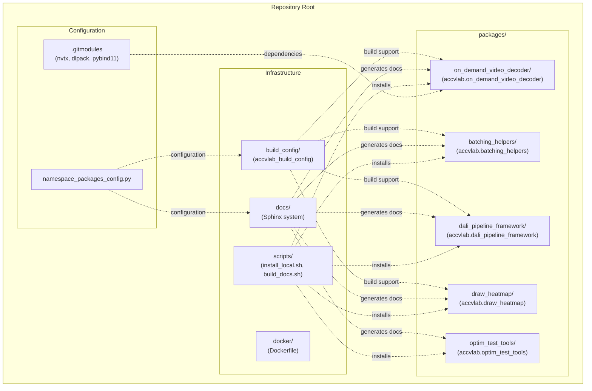

**Sources:** [README.md:103-110](), [.nav:1]()

## Core Package Pipeline

The five namespace packages work together to create an efficient ADAS training pipeline. Video frames are decoded on-demand, processed through GPU-accelerated augmentation pipelines, batched to handle non-uniform sample sizes, and visualized with generated heatmaps for training.

### Data Flow Through Core Packages

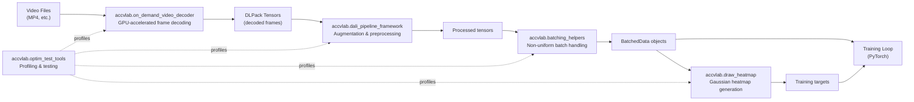

**Sources:** [README.md:19-33]()

## Package Descriptions

| Package | Namespace | Primary Function |
|---------|-----------|------------------|
| **On-Demand Video Decoder** | `accvlab.on_demand_video_decoder` | GPU-accelerated video frame extraction optimized for training access patterns. Enables training directly from video files with performance comparable to image-based training. |
| **Batching Helpers** | `accvlab.batching_helpers` | Facilitates batching of non-uniform sample sizes common in ADAS domain (e.g., varying numbers of objects per frame). Provides `BatchedData` structure for efficient loss computation. |
| **DALI Pipeline Framework** | `accvlab.dali_pipeline_framework` | Framework built on NVIDIA DALI for creating GPU-accelerated augmentation pipelines for typical ADAS use-cases. Simplifies integration into existing training code. |
| **Draw Heatmap** | `accvlab.draw_heatmap` | GPU-based Gaussian heatmap generation for object detection training. Supports batched data format from Batching Helpers. |
| **Optim Test Tools** | `accvlab.optim_test_tools` | Utilities for testing and profiling optimizations during development and evaluation. |

**Sources:** [README.md:19-36]()

## Supporting Infrastructure

### Build System

The `build_config/` directory contains the `accvlab_build_config` package, which provides centralized build configuration and utilities used by all namespace packages that contain C++/CUDA extensions.

Key components:
- `accvlab_build_config/helpers/build_utils.py` - Configuration loading, CUDA detection, compilation flag generation
- `accvlab_build_config/helpers/cmake_args.py` - CMake argument generation from environment variables
- Environment variable support: `DEBUG_BUILD`, `CPP_STANDARD`, `CUSTOM_CUDA_ARCHS`, etc.

For complete details, see [Build System](#3).

**Sources:** [README.md:106]()

### Documentation System

The `docs/` directory implements a Sphinx-based documentation system with:
- Automatic API documentation generation via `sphinx.ext.autodoc`
- Package documentation mirroring via `mirror_referenced_dirs.py`
- Custom extensions for enhanced documentation features
- Unified build script: `scripts/build_docs.sh`

The system uses `namespace_packages_config.py` as a single source of truth for package discovery and configuration synchronization.

For complete details, see [Documentation System](#4).

**Sources:** [README.md:85-101](), [README.md:107]()

### Development Environment

The `docker/` directory provides a Dockerfile that sets up a complete development environment including:
- CUDA Toolkit (12.3)
- PyTorch with CUDA support
- NVIDIA DALI
- FFmpeg with NVENC support
- LaTeX for documentation generation
- All build tools and dependencies

The Docker image can be built for root usage or configured for a specific user.

For complete details, see [Docker Environment](#2.1).

**Sources:** [README.md:44-67](), [README.md:110]()

## Key Technologies and Dependencies

ACCV-Lab integrates with several key technologies:

| Technology | Purpose | Integration Method |
|------------|---------|-------------------|
| **DLPack** | Zero-copy tensor exchange between packages | Git submodule at `.gitmodules` |
| **NVTX** | Performance profiling instrumentation | Git submodule at `.gitmodules` |
| **Pybind11** | C++/Python bindings for extensions | Git submodule at `.gitmodules` |
| **PyTorch** | CUDA detection and tensor operations | Third-party dependency |
| **NVIDIA DALI** | Base for DALI Pipeline Framework | Third-party dependency |
| **FFmpeg** | Video decoding backend (LGPL 2.1+) | Third-party dependency (dynamic linking) |
| **PyNvVideoCodec** | NVIDIA GPU video decoding | Third-party dependency (MIT) |

Git submodules must be initialized before building:
```bash
git submodule update --init --recursive
```

**Sources:** [README.md:69-73]()

## Repository Layout

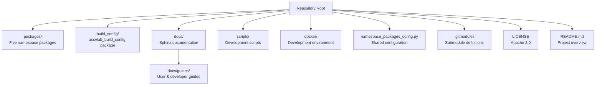

**Sources:** [README.md:103-110]()

## Installation and Usage

ACCV-Lab packages can be installed using the provided installation script after initializing git submodules:

```bash
# Initialize git submodules
git submodule update --init --recursive

# Install all namespace packages
./scripts/install_local.sh

# Install in editable/development mode (limited support for packages with compiled extensions)
./scripts/install_local.sh -e
```

Each namespace package can also be installed independently. For detailed installation instructions including Docker setup and dependency requirements, see [Getting Started](#2).

**Sources:** [README.md:69-93]()

## License and Compliance

ACCV-Lab is licensed under Apache License 2.0. The repository includes dependencies with various permissive licenses (MIT, Apache 2.0, BSD 3-Clause) and one copyleft dependency (FFmpeg under LGPL 2.1+) which is dynamically linked to maintain license compliance.

All third-party licenses are documented in `THIRD_PARTY_LICENSES.md`. Contributors must sign off commits with Developer Certificate of Origin (DCO) using `git commit -s`.

For complete licensing details, see [License and Legal](#6).

**Sources:** [README.md:173-175]()

---

# Page: Project Structure

# Project Structure

<details>
<summary>Relevant source files</summary>

The following files were used as context for generating this wiki page:

- [.gitignore](.gitignore)
- [README.md](README.md)

</details>


## Purpose and Scope

This document explains the physical organization of the ACCV-Lab repository, including the directory layout and how major components relate to each other. For information about individual packages and their functionality, see [Core Packages](#1.2). For detailed build system information, see [Build System](#3). For documentation system details, see [Documentation System](#4).

## Repository Root Structure

The ACCV-Lab repository follows a monorepo structure with clearly separated subsystems. Each top-level directory serves a specific purpose in the development, build, or deployment workflow.

### Top-Level Directory Layout

| Directory | Purpose | Key Contents |
|-----------|---------|--------------|
| `packages/` | Core functionality packages | Five namespace packages, each with `setup.py` |
| `build_config/` | Shared build infrastructure | `accvlab_build_config` package with build utilities |
| `docs/` | Documentation system | Sphinx configuration, custom extensions, guides |
| `scripts/` | Repository management scripts | Installation, testing, documentation build scripts |
| `docker/` | Containerized development environment | Dockerfile and build scripts |
| `third_party/` | External dependencies as submodules | NVTX, DLPack, Pybind11 |

**Sources:** [README.md:103-110]()

### Repository Root Files

Several configuration files at the repository root define project-wide settings:

| File | Purpose |
|------|---------|
| `.gitignore` | Defines build artifacts, Python cache, and IDE files to exclude from version control |
| `.gitmodules` | Configures git submodules for external dependencies |
| `.clang-format` | Defines C++ code formatting rules |
| `LICENSE` | Apache License 2.0 for the project |
| `CONTRIBUTING.MD` | Contribution guidelines and DCO requirements |
| `THIRD_PARTY_LICENSES.md` | Attribution for all third-party dependencies |
| `README.md` | Project overview and quick start guide |
| `namespace_packages_config.py` | Central configuration for all namespace packages |

**Sources:** [README.md:1-176](), [.gitignore:1-22]()

## Core Packages Directory Structure

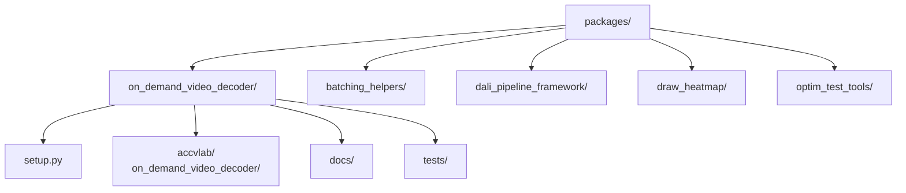

**Namespace Package Structure**

The `packages/` directory contains five independent namespace packages, each following a consistent structure:

```
packages/<package_name>/
├── setup.py                          # Package build configuration
├── accvlab/<package_name>/           # Python source code (namespace package)
│   ├── __init__.py
│   ├── <module_files>.py
│   └── cpp/                          # C++/CUDA extensions (if applicable)
├── docs/                             # Package-specific documentation
│   ├── index.rst
│   ├── examples/
│   └── api/
└── tests/                            # Unit and integration tests
    └── test_<module>.py
```

Each package is independently installable via its own `setup.py` and contributes to the `accvlab` namespace. This structure allows packages to be used together or separately based on project requirements.

**Packages:**
- **on_demand_video_decoder** - GPU-accelerated video decoding for training workflows
- **batching_helpers** - Utilities for batching non-uniform samples
- **dali_pipeline_framework** - NVIDIA DALI pipeline abstractions for ADAS use cases
- **draw_heatmap** - GPU-based Gaussian heatmap generation
- **optim_test_tools** - Profiling and testing utilities

For detailed information about each package's functionality, see [Core Packages](#1.2).

**Sources:** [README.md:19-36](), [README.md:105]()

## Build Configuration System

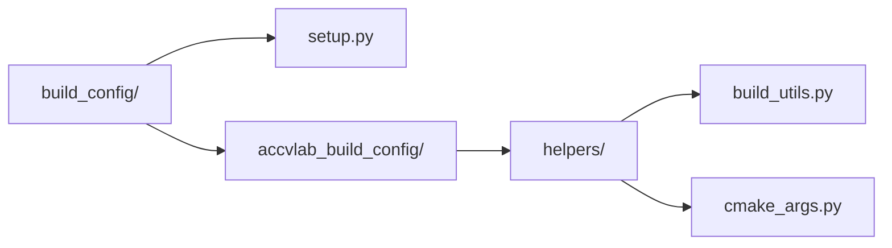

The `build_config/` directory contains the `accvlab_build_config` package, which provides shared build utilities used by all namespace packages. This centralized approach ensures consistent build behavior across packages.

**Key Components:**

| Component | File | Functions |
|-----------|------|-----------|
| Configuration loading | `helpers/build_utils.py` | `load_config()` - Reads from `namespace_packages_config.py` |
| CUDA detection | `helpers/build_utils.py` | `detect_cuda_info()` - Queries PyTorch for CUDA capabilities |
| Compilation flags | `helpers/build_utils.py` | `get_compile_flags()` - Generates C++ compiler flags |
| External builds | `helpers/build_utils.py` | `run_external_build()` - Executes external build systems |
| CMake arguments | `helpers/cmake_args.py` | `build_cmake_args_from_env()` - Converts environment variables to CMake args |

The build system is designed to support both native Python extensions (via setuptools/scikit-build) and external CMake-based builds. It respects environment variables for build customization (e.g., `DEBUG_BUILD`, `CPP_STANDARD`, `CUSTOM_CUDA_ARCHS`).

For comprehensive build system documentation, see [Build System](#3).

**Sources:** [README.md:106]()

## Documentation System

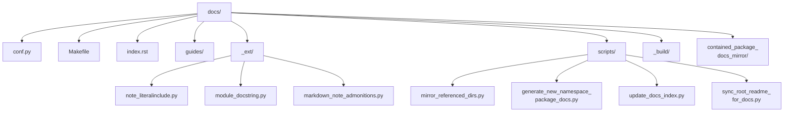

The `docs/` directory implements a sophisticated Sphinx-based documentation system that aggregates documentation from all namespace packages.

**Key Components:**

| Component | Purpose |
|-----------|---------|
| `conf.py` | Sphinx configuration, extensions, and theme settings |
| `Makefile` | Documentation build targets (`html`, `clean`, etc.) |
| `guides/` | Repository-wide guides (installation, development, contribution) |
| `_ext/` | Custom Sphinx extensions for enhanced documentation features |
| `scripts/` | Preprocessing scripts that aggregate package documentation |
| `contained_package_docs_mirror/` | Aggregated view of all package documentation |
| `_build/` | Generated HTML documentation output |

**Documentation Preprocessing Flow:**

1. `mirror_referenced_dirs.py` - Creates unified view of package docs in `contained_package_docs_mirror/`
2. `generate_new_namespace_package_docs.py` - Auto-generates API documentation structure
3. `sync_root_readme_for_docs.py` - Integrates root README into documentation
4. `update_docs_index.py` - Updates main documentation index

**Custom Sphinx Extensions:**

- `note_literalinclude.py` - Enhanced code inclusion with note formatting
- `module_docstring.py` - Extracts and formats module-level docstrings
- `markdown_note_admonitions.py` - Converts Markdown note syntax to Sphinx admonitions

For detailed documentation system information, see [Documentation System](#4).

**Sources:** [README.md:107]()

## Development Support Infrastructure

### Scripts Directory

The `scripts/` directory contains automation scripts for common development tasks:

| Script | Purpose |
|--------|---------|
| `install_local.sh` | Installs all namespace packages (supports `-e` for editable mode) |
| `build_docs.sh` | Builds Sphinx documentation |
| `run_tests.sh` | Executes test suite across all packages |
| `format_code.sh` | Applies code formatting (clang-format, black) |

These scripts provide a consistent interface for development operations and are referenced throughout the repository guides.

**Sources:** [README.md:75-88](), [README.md:108]()

### Docker Development Environment

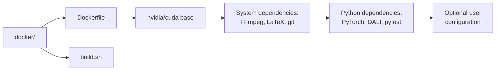

The `docker/` directory provides a complete containerized development environment with all dependencies pre-installed. The Dockerfile supports two build modes:

- **Root mode** (default): Container runs as root user
- **User mode**: Container configured for specific user (via build arguments `USER_ID`, `USER_NAME`, `GROUP_ID`, `GROUP_NAME`)

The Docker image includes FFmpeg (with LGPL compliance), CUDA toolkit, PyTorch, NVIDIA DALI, and all development tools required for building and testing ACCV-Lab packages.

For detailed Docker usage information, see [Docker Environment](#2.1).

**Sources:** [README.md:46-67](), [README.md:110]()

## Configuration and External Dependencies

### Ignored Artifacts

The [.gitignore:1-22]() file excludes build artifacts and development files from version control:

| Pattern | Purpose |
|---------|---------|
| `build/`, `**/_skbuild/` | Build output directories |
| `*.egg-info/` | Python package metadata |
| `__pycache__/`, `*.pyc`, `*.pyo` | Python bytecode |
| `*.so`, `*.whl` | Compiled binaries and wheels |
| `.vscode/`, `*.code-workspace` | IDE configuration |

**Sources:** [.gitignore:1-22]()

### Git Submodules

The repository uses git submodules in the `third_party/` directory for critical external dependencies:

| Submodule | Purpose | License |
|-----------|---------|---------|
| `nvtx` | NVIDIA Tools Extension Library for profiling | Apache 2.0 |
| `dlpack` | Zero-copy tensor exchange format | Apache 2.0 |
| `pybind11` | C++ to Python bindings | 3-Clause BSD |

These submodules must be initialized before building packages:
```bash
git submodule update --init --recursive
```

For more information about external dependencies, see [External Dependencies](#2.3) and [Repository Configuration Files](#7.1).

**Sources:** [README.md:69-73]()

### Shared Configuration System

The `namespace_packages_config.py` file at the repository root serves as the single source of truth for package metadata. This configuration is consumed by both the build system and documentation system to ensure consistency.

The file defines package names, descriptions, dependencies, and documentation structure. Changes to this file automatically propagate to build configurations and generated documentation.

For detailed information about the shared configuration system, see [Shared Configuration System](#7.2).

**Sources:** [README.md:1-176]()

## Component Interaction Overview

```mermaid
graph TB
    subgraph "Repository Root"
        ns_config["namespace_packages_<br/>config.py"]
        scripts["scripts/"]
    end
    
    subgraph "Namespace Packages"
        pkg1["on_demand_video_<br/>decoder/setup.py"]
        pkg2["batching_helpers/<br/>setup.py"]
        pkg3["dali_pipeline_<br/>framework/setup.py"]
        pkg4["draw_heatmap/<br/>setup.py"]
        pkg5["optim_test_tools/<br/>setup.py"]
    end
    
    subgraph "Build System"
        build_pkg["build_config/<br/>accvlab_build_config"]
        build_utils["helpers/build_utils.py"]
        cmake_args["helpers/cmake_args.py"]
    end
    
    subgraph "Documentation System"
        sphinx_conf["docs/conf.py"]
        doc_scripts["docs/scripts/"]
        mirror["contained_package_<br/>docs_mirror/"]
    end
    
    subgraph "Development"
        docker["docker/Dockerfile"]
        git_sub["third_party/<br/>submodules"]
    end
    
    ns_config -.->|"defines packages"| pkg1
    ns_config -.->|"defines packages"| pkg2
    ns_config -.->|"defines packages"| pkg3
    ns_config -.->|"defines packages"| pkg4
    ns_config -.->|"defines packages"| pkg5
    
    ns_config -.->|"configures"| sphinx_conf
    ns_config -.->|"used by"| doc_scripts
    
    build_pkg -->|"provides utilities to"| pkg1
    build_pkg -->|"provides utilities to"| pkg2
    build_pkg -->|"provides utilities to"| pkg3
    build_pkg -->|"provides utilities to"| pkg4
    build_pkg -->|"provides utilities to"| pkg5
    
    build_utils -->|"detects CUDA"| pkg1
    cmake_args -->|"generates args"| pkg1
    
    scripts -->|"install_local.sh<br/>installs"| pkg1
    scripts -->|"install_local.sh<br/>installs"| pkg2
    scripts -->|"install_local.sh<br/>installs"| pkg3
    scripts -->|"install_local.sh<br/>installs"| pkg4
    scripts -->|"install_local.sh<br/>installs"| pkg5
    
    scripts -->|"build_docs.sh<br/>generates"| sphinx_conf
    
    doc_scripts -->|"mirrors docs from"| pkg1
    doc_scripts -->|"mirrors docs from"| pkg2
    doc_scripts -->|"mirrors docs from"| pkg3
    doc_scripts -->|"mirrors docs from"| pkg4
    doc_scripts -->|"mirrors docs from"| pkg5
    
    doc_scripts -->|"creates"| mirror
    
    docker -->|"includes"| git_sub
    docker -->|"environment for"| pkg1
    docker -->|"environment for"| pkg2
    
    git_sub -->|"used by"| pkg1
```

**Interaction Patterns:**

1. **Shared Configuration Flow**: `namespace_packages_config.py` drives both package builds and documentation generation
2. **Build System Flow**: `build_config` package provides utilities consumed by all namespace package `setup.py` files
3. **Documentation Flow**: Scripts in `docs/scripts/` aggregate package documentation into `contained_package_docs_mirror/`
4. **Development Flow**: Scripts in `scripts/` orchestrate installation, testing, and documentation builds
5. **Dependency Flow**: Git submodules in `third_party/` provide headers and libraries for package compilation

**Sources:** [README.md:1-176]()

---

# Page: Core Packages

# Core Packages

<details>
<summary>Relevant source files</summary>

The following files were used as context for generating this wiki page:

- [.gitmodules](.gitmodules)
- [README.md](README.md)
- [THIRD_PARTY_LICENSES.md](THIRD_PARTY_LICENSES.md)

</details>


This document provides an overview of the five namespace packages that comprise the ACCV-Lab toolkit. Each package addresses a specific aspect of the ADAS (Advanced Driver Assistance Systems) training workflow, from video decoding to data augmentation to visualization. For information about the repository structure and organization, see [Project Structure](#1.1). For installation instructions, see [Getting Started](#2).

## Overview

ACCV-Lab consists of five independently installable namespace packages located in the [packages/]() directory. These packages are designed to work together to create efficient end-to-end ADAS training pipelines while remaining modular enough to be used independently.

| Package Name | Location | Primary Function | Key Technologies |
|--------------|----------|------------------|------------------|
| On-Demand Video Decoder | `packages/on_demand_video_decoder/` | GPU-accelerated video frame extraction | FFmpeg, NVIDIA Video Codec SDK, DLPack |
| Batching Helpers | `packages/batching_helpers/` | Non-uniform sample size batching | PyTorch, DLPack |
| DALI Pipeline Framework | `packages/dali_pipeline_framework/` | Data augmentation and preprocessing | NVIDIA DALI, DLPack |
| Draw Heatmap | `packages/draw_heatmap/` | GPU heatmap generation | CUDA, DLPack |
| Optim Test Tools | `packages/optim_test_tools/` | Profiling and testing utilities | NVTX, Python profiling tools |

**Sources:** [README.md:19-33]()

## Package Architecture

The following diagram illustrates how the core packages relate to each other and to external dependencies in a typical ADAS training workflow:

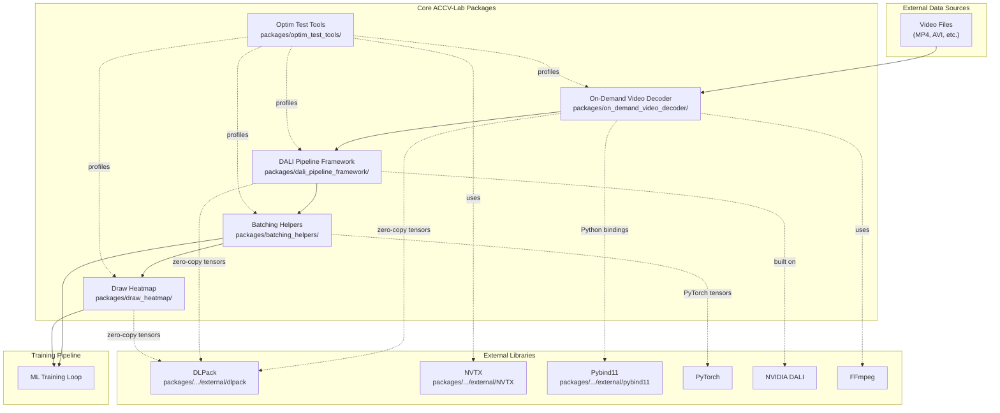

**Sources:** [README.md:19-36](), Diagram 4 from high-level architecture

## On-Demand Video Decoder

The On-Demand Video Decoder package provides GPU-accelerated video frame extraction optimized for training workloads. It is designed to enable training directly from video files with performance comparable to image-based training.

### Key Features

- **GPU-accelerated decoding** using NVIDIA Video Codec SDK
- **DLPack tensor output** for zero-copy integration with other frameworks
- **Access patterns optimized for training** including random frame access and sequential streaming
- **NVTX instrumentation** for detailed performance profiling
- **FFmpeg integration** for broad video format support

### Architecture

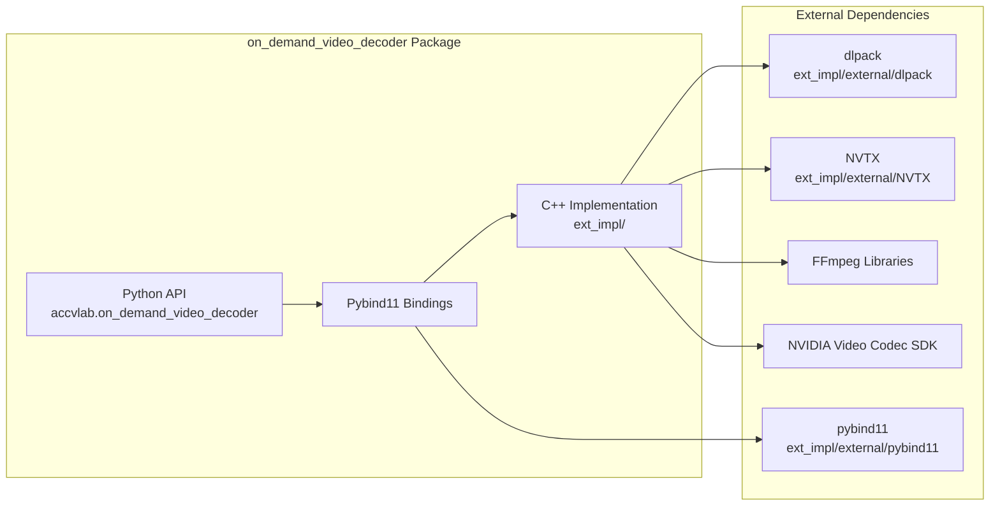

### Git Submodules

The On-Demand Video Decoder package includes three critical dependencies as git submodules:

- **NVTX** at [packages/on_demand_video_decoder/ext_impl/external/NVTX]()
- **dlpack** at [packages/on_demand_video_decoder/ext_impl/external/dlpack]()
- **pybind11** at [packages/on_demand_video_decoder/ext_impl/external/pybind11]()

These submodules must be initialized before building the package using `git submodule update --init --recursive`.

**Sources:** [.gitmodules:1-11](), [README.md:20-23](), [THIRD_PARTY_LICENSES.md:5-8]()

## Batching Helpers

The Batching Helpers package facilitates batching of samples with non-uniform sizes, a common challenge in ADAS domain loss computation. This package enables efficient GPU memory utilization when dealing with variable-sized inputs.

### Key Features

- **Non-uniform sample batching** for variable-sized data structures
- **PyTorch integration** for seamless use in existing training code
- **Minimal overhead** with efficient memory management
- **Common ADAS patterns** addressing typical use cases in autonomous driving

### Use Cases

The package is particularly useful for:
- Object detection with variable numbers of objects per frame
- Point cloud processing with varying point counts
- Multi-scale feature maps
- Variable-length sequence data

**Sources:** [README.md:24-25]()

## DALI Pipeline Framework

The DALI Pipeline Framework is built on top of NVIDIA DALI and simplifies the creation of data processing pipelines for typical ADAS use cases. It provides high-level abstractions that enable integration into existing training implementations with minimal code changes.

### Key Features

- **NVIDIA DALI foundation** leveraging GPU-accelerated data loading and augmentation
- **ADAS-specific operators** tailored for autonomous driving workflows
- **Simplified pipeline creation** with high-level APIs
- **DLPack integration** for zero-copy tensor exchange
- **Minimal integration overhead** allowing drop-in replacement of existing data loaders

### Integration Pattern

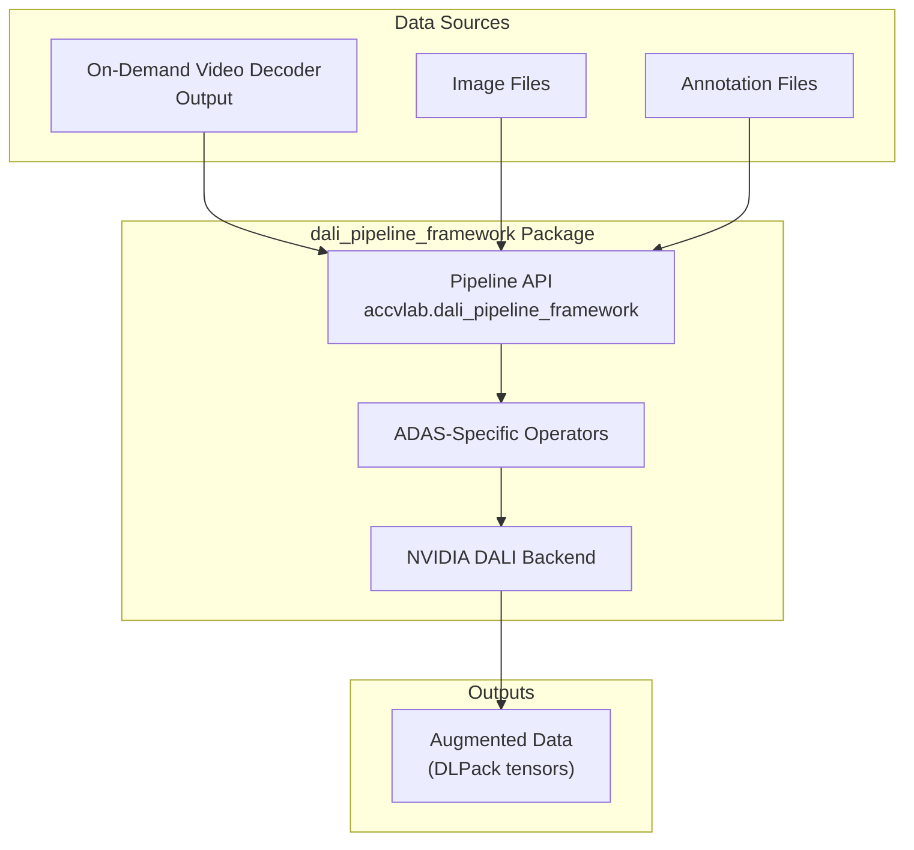

**Sources:** [README.md:26-29](), [THIRD_PARTY_LICENSES.md:9]()

## Draw Heatmap

The Draw Heatmap package provides GPU-accelerated generation of Gaussian heatmaps, commonly used as training targets in object detection and keypoint estimation tasks.

### Key Features

- **GPU implementation** for high-throughput heatmap generation
- **Gaussian heatmap rendering** with configurable parameters
- **Batching Helpers integration** supporting non-uniform batch formats
- **DLPack output** for zero-copy integration
- **Flexible API** supporting various heatmap generation patterns

### Typical Workflow

The package is typically used in the following sequence:

1. Receive detection/keypoint annotations
2. Generate Gaussian heatmaps on GPU
3. Output as training targets for the model
4. Optionally batch using Batching Helpers for non-uniform sizes

**Sources:** [README.md:30-31]()

## Optim Test Tools

The Optim Test Tools package provides utilities for testing and profiling optimization implementations. This is particularly useful during development and evaluation phases.

### Key Features

- **NVTX integration** for detailed GPU profiling
- **Benchmarking utilities** for performance measurement
- **Testing helpers** for validation of optimizations
- **Profiling support** for all other ACCV-Lab packages

### Cross-Package Profiling

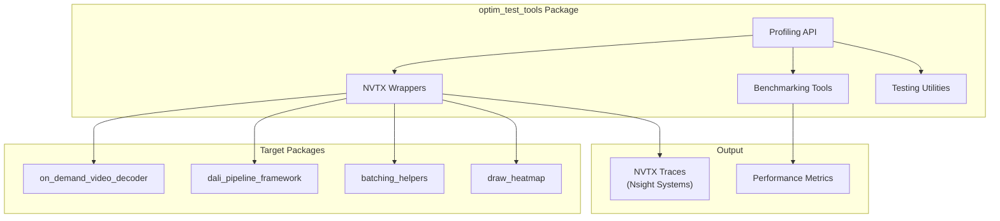

**Sources:** [README.md:32-33](), [THIRD_PARTY_LICENSES.md:8]()

## Shared Dependencies

All core packages share common dependencies managed at the repository level.

### Git Submodules

The following dependencies are included as git submodules and must be initialized before building:

| Submodule | Location | License | Purpose |
|-----------|----------|---------|---------|
| NVTX | `packages/on_demand_video_decoder/ext_impl/external/NVTX` | Apache 2.0 with LLVM Exceptions | Performance profiling instrumentation |
| dlpack | `packages/on_demand_video_decoder/ext_impl/external/dlpack` | Apache 2.0 | Zero-copy tensor exchange standard |
| pybind11 | `packages/on_demand_video_decoder/ext_impl/external/pybind11` | 3-Clause BSD | Python-C++ binding generation |

### Third-Party Libraries

The packages depend on the following external libraries installed in the environment:

| Library | Version | License | Used By |
|---------|---------|---------|---------|
| FFmpeg | 4.4.6 | LGPL 2.1+ | On-Demand Video Decoder |
| PyTorch | 2.6 | 3-Clause BSD | Batching Helpers, training integration |
| NVIDIA DALI | 1.51.2 | Apache 2.0 | DALI Pipeline Framework |
| PyNvVideoCodec | 1.0.2 | MIT | On-Demand Video Decoder |
| CV-CUDA | da51fc96 | Apache 2.0 | Optional DALI operations |

**Sources:** [.gitmodules:1-11](), [THIRD_PARTY_LICENSES.md:1-14]()

## Build Configuration

All core packages use the shared build configuration system provided by the `build_config` package. This ensures consistent compilation flags, CUDA architecture targeting, and dependency management across all packages. For detailed information about the build system, see [Build System](#3).

### Common Build Process

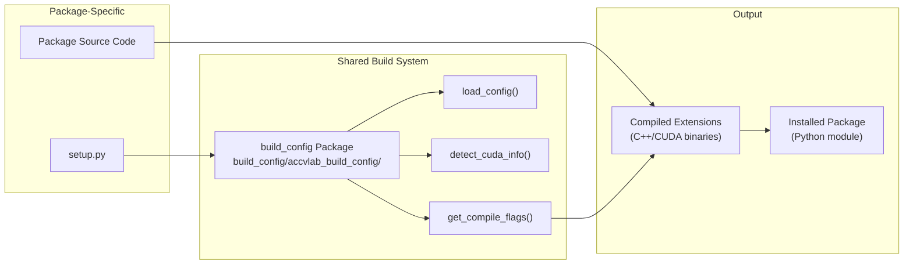

Each package's `setup.py` imports utilities from `accvlab_build_config` to configure the build process, ensuring consistency across all packages.

**Sources:** [README.md:105-110](), Diagram 2 from high-level architecture

## Package Installation

All packages can be installed using the provided installation script:

```bash
# Install all packages
./scripts/install_local.sh

# Install in editable/development mode (where supported)
./scripts/install_local.sh -e
```

**Note:** Some packages that use `scikit-build` for native C++ extensions may not support editable installation mode. In such cases, the package will be installed normally even when the `-e` flag is specified.

For detailed installation instructions including Docker setup and dependency management, see [Getting Started](#2) and [Local Installation](#2.2).

**Sources:** [README.md:78-93]()

## Data Flow and Integration

The following diagram shows how data flows through the core packages in a typical ADAS training pipeline:

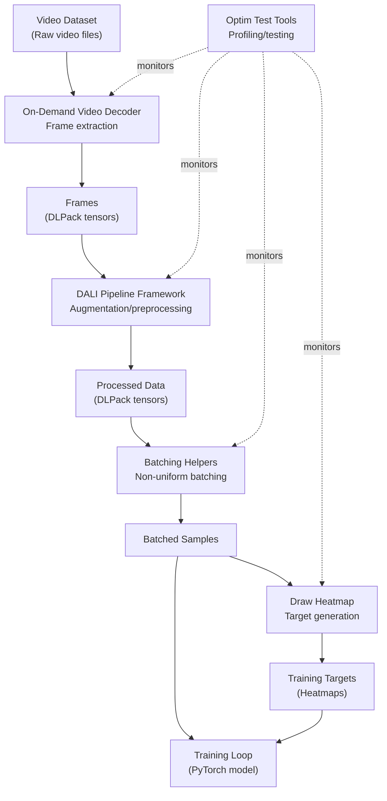

**Key Integration Points:**

- **DLPack tensors** enable zero-copy data transfer between packages
- **GPU memory** remains on device throughout the pipeline
- **NVTX instrumentation** allows end-to-end profiling
- **PyTorch compatibility** ensures seamless integration with training code

**Sources:** [README.md:19-36](), Diagram 4 from high-level architecture

## Documentation

Each package includes its own detailed documentation covering:

- API reference with function signatures and parameters
- Usage examples demonstrating typical workflows
- Performance benchmarks and evaluation results
- Implementation details and design decisions

The complete documentation can be built using:

```bash
./scripts/build_docs.sh
```

Online documentation is available at [NVIDIA.github.io/ACCV-Lab](https://NVIDIA.github.io/ACCV-Lab).

For information about the documentation system and how to contribute documentation, see [Documentation System](#4).

**Sources:** [README.md:35-42](), [README.md:85-101]()

---

# Page: Getting Started

# Getting Started

<details>
<summary>Relevant source files</summary>

The following files were used as context for generating this wiki page:

- [.gitmodules](.gitmodules)
- [README.md](README.md)

</details>


This document provides an overview of the initial setup process for ACCV-Lab, covering prerequisites, environment setup options, and the basic installation workflow. It serves as an entry point for both users who want to use ACCV-Lab packages and developers who plan to contribute.

For detailed instructions on specific setup methods, see:
- Docker environment setup: [Docker Environment](#2.1)
- Local installation procedures: [Local Installation](#2.2)
- External dependency management: [External Dependencies](#2.3)
- Full development workflow and contribution guidelines: [Contributing](#5)

## Prerequisites

Before installing ACCV-Lab, ensure the following requirements are met:

| Requirement | Purpose | Notes |
|-------------|---------|-------|
| Git | Repository cloning and submodule management | Required for initializing submodules |
| Git submodules | External dependencies (NVTX, DLPack, Pybind11) | Must be initialized before installation |
| CUDA-capable GPU | GPU-accelerated operations | Required for On-Demand Video Decoder |
| Docker (optional) | Containerized environment with all dependencies | Recommended for ease of setup |
| Python 3.x | Runtime environment | Version compatibility depends on PyTorch |
| PyTorch | Deep learning framework | Required by multiple packages |

## Setup Path Overview

ACCV-Lab supports two primary setup paths:

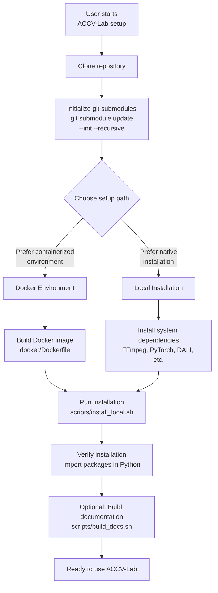

**Sources:** [README.md:44-101]()

## Git Submodule Initialization

ACCV-Lab relies on three external dependencies managed as git submodules. These must be initialized before any installation attempt.

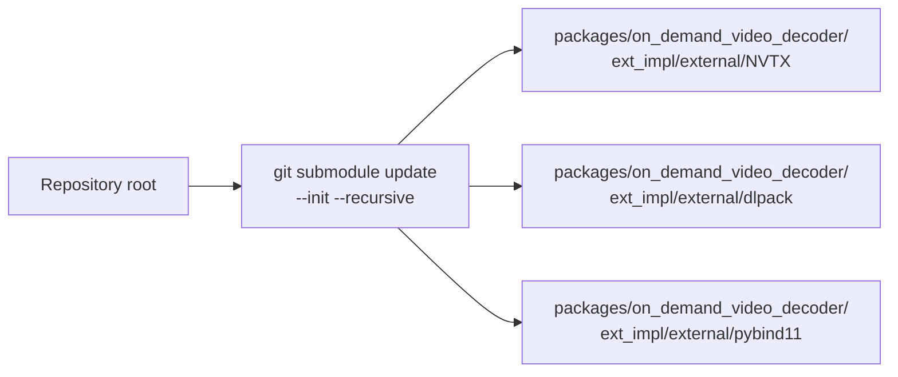

Execute the following command from the repository root:

```bash
git submodule update --init --recursive
```

This command initializes and fetches:
- **NVTX** ([packages/on_demand_video_decoder/ext_impl/external/NVTX]()): Performance profiling instrumentation
- **dlpack** ([packages/on_demand_video_decoder/ext_impl/external/dlpack]()): Zero-copy tensor exchange format
- **pybind11** ([packages/on_demand_video_decoder/ext_impl/external/pybind11]()): C++/Python binding library

**Sources:** [README.md:69-73](), [.gitmodules:1-12]()

## Installation Workflow

The installation process follows a consistent workflow regardless of the chosen setup path:

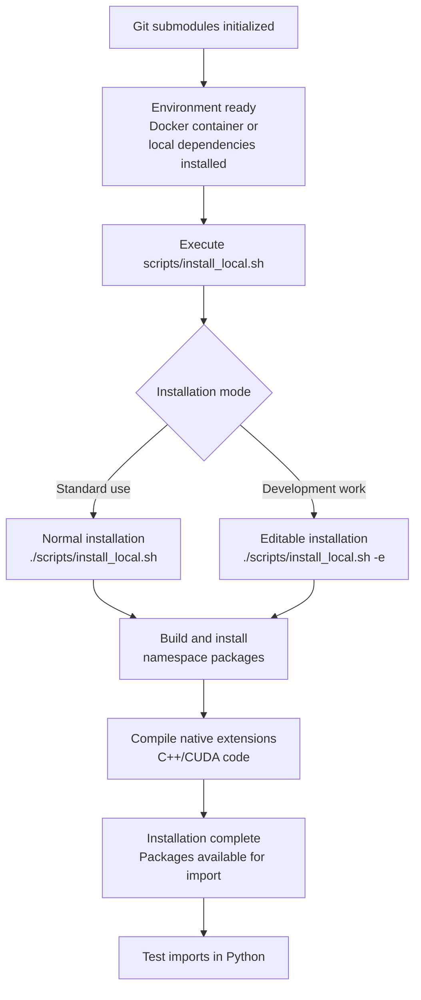

### Basic Installation Commands

Install all ACCV-Lab namespace packages:

```bash
./scripts/install_local.sh
```

Install in editable mode (for development):

```bash
./scripts/install_local.sh -e
```

**Important:** Editable installation mode is not supported for packages using `scikit-build`. Attempting editable installation for these packages will result in missing binaries and import errors. Refer to [Local Installation](#2.2) for details on installation mode limitations.

**Sources:** [README.md:76-93]()

## Installation Script Execution Flow

The `install_local.sh` script orchestrates the installation of all namespace packages:

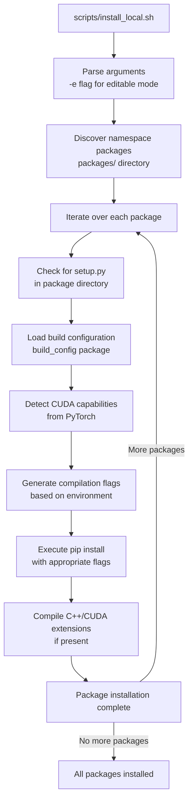

**Sources:** [README.md:76-93]()

## Verification

After installation, verify that packages can be imported:

```python
# Test core package imports
import accvlab.on_demand_video_decoder
import accvlab.batching_helpers
import accvlab.dali_pipeline_framework
import accvlab.draw_heatmap
import accvlab.optim_test_tools
```

If imports fail:
1. Verify git submodules were initialized ([External Dependencies](#2.3))
2. Check for missing system dependencies
3. Ensure CUDA toolkit is properly installed
4. Review installation logs for build errors

## Documentation Building

Documentation can be built after package installation:

```bash
./scripts/build_docs.sh
```

**Important:** Documentation generation requires installed packages because Sphinx's autodoc extension imports modules to extract docstrings and API information. This includes native C++/CUDA extensions, which must be compiled before documentation building.

The generated documentation will be available in `docs/_build/html/`.

**Sources:** [README.md:85-101]()

## Post-Installation Steps

| Task | Command/Location | Purpose |
|------|------------------|---------|
| View package documentation | `docs/_build/html/index.html` or [NVIDIA.github.io/ACCV-Lab](https://NVIDIA.github.io/ACCV-Lab) | Learn package APIs and usage examples |
| Run tests | `./scripts/run_tests.sh` | Verify installation correctness |
| Set up development tools | See [Contributing](#5) | Enable code formatting and quality checks |
| Configure build options | See [Build System](#3) | Customize compilation settings |

## Environment Options Comparison

| Aspect | Docker Environment | Local Installation |
|--------|-------------------|-------------------|
| Setup complexity | Low - pre-configured | High - manual dependency installation |
| Isolation | Complete - containerized | None - uses host system |
| Reproducibility | High - Dockerfile-defined | Variable - depends on host system |
| Performance | Near-native (with nvidia-docker) | Native |
| Development workflow | Requires container runtime | Direct file system access |
| Disk space | Higher - includes all dependencies | Lower - only required components |

For detailed setup instructions:
- **Docker approach**: [Docker Environment](#2.1)
- **Local approach**: [Local Installation](#2.2)

## Key Files and Directories

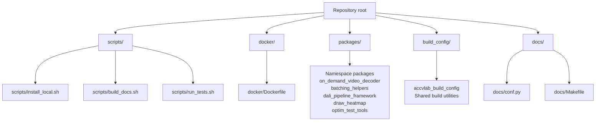

**Sources:** [README.md:103-110]()

## Common Setup Issues

| Issue | Symptoms | Solution |
|-------|----------|----------|
| Missing submodules | Import errors for NVTX, DLPack, or Pybind11 | Run `git submodule update --init --recursive` |
| CUDA not detected | Build warnings about missing CUDA | Verify CUDA toolkit installation and PyTorch CUDA support |
| FFmpeg missing | On-Demand Video Decoder build fails | Install FFmpeg with development headers |
| Permission errors | Cannot write to installation directory | Use virtual environment or check file permissions |
| Editable install failures | Missing binaries after editable install | Use normal installation mode for scikit-build packages |

## Next Steps

Once installation is complete:

1. **Explore package documentation**: Review the `CONTAINED PACKAGES` section for detailed information about each namespace package
2. **Review examples**: Study usage examples included in package documentation
3. **Understand the build system**: See [Build System](#3) for customization options
4. **Set up for development**: Follow [Contributing](#5) if planning to contribute

For specific setup paths:
- [Docker Environment](#2.1) - Containerized setup with all dependencies
- [Local Installation](#2.2) - Native installation on host system
- [External Dependencies](#2.3) - Details on git submodules and third-party libraries

**Sources:** [README.md:1-176]()

---

# Page: Docker Environment

# Docker Environment

<details>
<summary>Relevant source files</summary>

The following files were used as context for generating this wiki page:

- [README.md](README.md)
- [docker/Dockerfile](docker/Dockerfile)
- [docker/run_docker_build.sh](docker/run_docker_build.sh)

</details>


This page provides a comprehensive guide to building and using the Docker container for ACCV-Lab development and deployment. It covers the Dockerfile structure, build options for both root and user-specific configurations, and the complete environment setup including all dependencies required for ACCV-Lab packages.

For instructions on installing ACCV-Lab packages after setting up the Docker environment, see [Local Installation](#2.2). For details on the external dependencies managed through git submodules, see [External Dependencies](#2.3).

## Overview

The ACCV-Lab Docker environment is defined in [docker/Dockerfile:1-130]() and provides a complete development and runtime environment based on `nvidia/cuda:12.4.1-devel-ubuntu22.04`. The container includes all dependencies required for building and running ACCV-Lab packages, including CUDA toolkit, PyTorch, NVIDIA DALI, FFmpeg, and documentation generation tools.

The Docker environment supports two configuration modes:
- **Root mode**: Default build for use as root user
- **User-specific mode**: Configurable build that creates a user matching the host system's UID/GID to avoid permission issues

**Sources**: [README.md:44-67](), [docker/Dockerfile:15-26]()

## Docker Environment Architecture

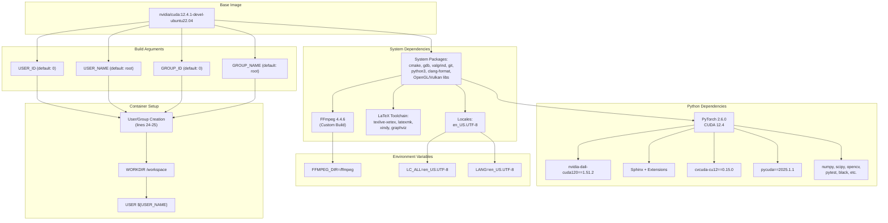

**Sources**: [docker/Dockerfile:15-130]()

## Building the Docker Image

### Basic Build (Root User)

To build the Docker image for use as the root user, run from the repository root:

```bash
docker build -t accvlab:latest -f docker/Dockerfile .
```

Or from inside the `docker/` directory:

```bash
docker build -t accvlab:latest .
```

This creates an image where the default user is `root` (UID 0, GID 0).

**Sources**: [README.md:50-54]()

### User-Specific Build

To build a Docker image configured for your current user (recommended for development to avoid permission issues):

```bash
docker build \
  --build-arg USER_ID=$(id -u) \
  --build-arg USER_NAME=$(id -un) \
  --build-arg GROUP_ID=$(id -g) \
  --build-arg GROUP_NAME=$(id -gn) \
  -t accvlab:latest \
  -f docker/Dockerfile .
```

This configuration ensures files created inside the container have the same ownership as your host user.

**Sources**: [README.md:56-63]()

### Using the Build Script

A convenience script [docker/run_docker_build.sh:1-38]() automates the user-specific build process:

```bash
cd docker
./run_docker_build.sh
```

The script accepts environment variables to customize the build:

| Environment Variable | Default Value | Description |
|---------------------|---------------|-------------|
| `TAG` | `accvlab` | Docker image tag |
| `USER_ID` | `$(id -u)` | User ID for container user |
| `USER_NAME` | `$(whoami)` | Username for container user |
| `GROUP_ID` | `$(id -g)` | Group ID for container user |
| `GROUP_NAME` | `$(id -gn)` | Group name for container user |

Example with custom tag:

```bash
TAG=accvlab:dev ./run_docker_build.sh
```

**Sources**: [docker/run_docker_build.sh:17-36]()

## Build Arguments and User Configuration

The Dockerfile defines four build arguments that control user creation:

```mermaid
graph LR
    subgraph "Build Arguments (Dockerfile:19-22)"
        ARG_USER_ID["ARG USER_ID=0"]
        ARG_USER_NAME["ARG USER_NAME=root"]
        ARG_GROUP_ID["ARG GROUP_ID=0"]
        ARG_GROUP_NAME["ARG GROUP_NAME=root"]
    end
    
    subgraph "User Creation Logic (Dockerfile:24-25)"
        GROUP_CREATE["getent group ${GROUP_ID} ||<br/>groupadd --gid ${GROUP_ID} ${GROUP_NAME}"]
        USER_CREATE["getent passwd ${USER_ID} ||<br/>useradd --gid ${GROUP_ID}<br/>--uid ${USER_ID}<br/>--create-home<br/>--no-log-init<br/>--shell /bin/bash<br/>${USER_NAME}"]
    end
    
    subgraph "Final User Switch (Dockerfile:130)"
        SWITCH_USER["USER ${USER_NAME}"]
    end
    
    ARG_USER_ID --> USER_CREATE
    ARG_USER_NAME --> USER_CREATE
    ARG_GROUP_ID --> GROUP_CREATE
    ARG_GROUP_ID --> USER_CREATE
    ARG_GROUP_NAME --> GROUP_CREATE
    
    GROUP_CREATE --> SWITCH_USER
    USER_CREATE --> SWITCH_USER
```

The user creation logic [docker/Dockerfile:24-25]() uses `getent` to check if the user/group already exists before attempting creation, making it safe for both root (UID 0) and custom user configurations.

**Sources**: [docker/Dockerfile:19-26](), [docker/Dockerfile:130]()

## Installed System Packages

The Dockerfile installs system packages in several stages:

### Development Tools

[docker/Dockerfile:32-55]() installs core development tools:

| Package Category | Packages | Purpose |
|-----------------|----------|---------|
| Build Tools | `cmake`, `ninja` | Build system tools |
| Debugging | `gdb`, `valgrind` | Runtime debugging |
| Version Control | `git`, `git-lfs` | Source control |
| Python Environment | `python3`, `python3-dev`, `python3-pip`, `python-is-python3` | Python runtime and development |
| Code Formatting | `clang-format` | C++ code formatting |
| Graphics Libraries | `freeglut3-dev`, `libglew-dev`, `mesa-*`, `libvulkan-dev` | OpenGL/Vulkan support for video decoding |
| Utilities | `htop`, `nano`, `pkg-config`, `enchant-2` | System utilities |

**Sources**: [docker/Dockerfile:32-55]()

### Documentation Tools

[docker/Dockerfile:70-72]() installs the LaTeX toolchain for PDF documentation generation:

- `latexmk`: LaTeX build automation
- `texlive-xetex`: XeLaTeX engine
- `texlive-latex-extra`, `texlive-fonts-*`: LaTeX packages and fonts
- `xindy`: Index generation
- `graphviz`: Diagram generation for Sphinx
- `fonts-dejavu`: TrueType fonts

**Sources**: [docker/Dockerfile:70-72]()

### Locale Configuration

[docker/Dockerfile:74-82]() configures UTF-8 locales required by Sphinx:

```bash
# Generate en_US.UTF-8 locale
sed -i -e 's/# en_US.UTF-8 UTF-8/en_US.UTF-8 UTF-8/' /etc/locale.gen && locale-gen

# Environment variables
ENV LC_ALL=en_US.UTF-8
ENV LANG=en_US.UTF-8
ENV LANGUAGE=en_US.UTF-8
```

**Sources**: [docker/Dockerfile:74-82]()

## FFmpeg Configuration

### Custom FFmpeg Build

The Dockerfile builds FFmpeg 4.4.6 from source with a minimal configuration [docker/Dockerfile:56-68]():

```bash
cd /tmp && mkdir ffmpeg && cd ffmpeg
wget https://ffmpeg.org/releases/ffmpeg-4.4.6.tar.xz
tar -xf ffmpeg-4.4.6.tar.xz && cd ffmpeg-4.4.6

LDSOFLAGS=-Wl,-rpath,'$$ORIGIN' ./configure \
  --enable-shared \
  --disable-encoders \
  --disable-decoders \
  --enable-decoder=vp9 \
  --arch=x86_64 \
  --prefix=/ffmpeg

make -j && make install
```

### Configuration Details

| Configure Flag | Purpose |
|----------------|---------|
| `--enable-shared` | Build shared libraries (`.so` files) |
| `--disable-encoders` | Disable all encoders (not needed for decoding) |
| `--disable-decoders` | Disable all decoders by default |
| `--enable-decoder=vp9` | Enable only VP9 decoder |
| `--arch=x86_64` | Target x86_64 architecture |
| `--prefix=/ffmpeg` | Install to `/ffmpeg` directory |
| `LDSOFLAGS=-Wl,-rpath,'$$ORIGIN'` | Set RPATH for runtime library loading |

The environment variable `FFMPEG_DIR=/ffmpeg` [docker/Dockerfile:68]() is set to help the On-Demand Video Decoder package locate FFmpeg libraries during build.

### LGPL Compliance

This configuration ensures LGPL 2.1+ compliance by:
1. Building as shared libraries (`--enable-shared`)
2. Allowing runtime dynamic linking
3. Minimal decoder support (only VP9 enabled)

The reduced functionality minimizes the FFmpeg dependency surface area while providing necessary video decoding capabilities for the On-Demand Video Decoder package.

**Sources**: [docker/Dockerfile:56-68]()

## Python Packages

### Installation Sequence

The Python packages are installed in a specific order to manage dependencies:

```mermaid
graph TD
    subgraph "Foundation Packages"
        NUMPY["numpy==1.23.5"]
        MATPLOTLIB["matplotlib==3.10.1"]
        SCIPY["scipy==1.15.3"]
        OPENCV["opencv-python-headless==4.5.5.64"]
    end
    
    subgraph "PyTorch Ecosystem"
        TORCH["torch==2.6.0<br/>torchvision==0.21.0<br/>torchaudio==2.6.0"]
        TORCH_INDEX["--index-url<br/>pytorch.org/whl/cu124"]
    end
    
    subgraph "Build Tools"
        BLACK["black"]
        NINJA["ninja"]
        SCIKIT["scikit-build"]
        SETUPTOOLS["setuptools==80.9.0"]
    end
    
    subgraph "Sphinx Documentation"
        SPHINX["sphinx"]
        SPHINX_RTD["sphinx-rtd-theme"]
        SPHINX_AUTO["sphinx-autodoc-typehints"]
        SPHINX_BUILD["sphinx-autobuild"]
        MYST["myst-parser"]
        LINKIFY["linkify-it-py"]
        SPELL["sphinxcontrib-spelling"]
    end
    
    subgraph "CUDA/GPU Packages"
        PYCUDA["pycuda==2025.1.1"]
        PYBIND11["pybind11==3.0.0"]
        CVCUDA["cvcuda-cu12==0.15.0"]
        DALI["nvidia-dali-cuda120==1.51.2"]
        CUPY["cupy"]
    end
    
    subgraph "Development/Testing"
        NVTX["nvtx"]
        PYTEST["pytest<br/>pytest-timeout"]
        PYNVML["pynvml"]
        PSUTIL["psutil"]
        NUMBA["numba==0.59"]
    end
    
    subgraph "ADAS/Domain Specific"
        NUSCENES["nuscenes-devkit"]
        PYQUATERNION["pyquaternion==0.9.9"]
        PANDAS["pandas==1.5.3"]
        SHAPELY["shapely"]
        NETWORKX["networkx"]
    end
    
    NUMPY --> TORCH
    TORCH_INDEX --> TORCH
    TORCH --> PYCUDA
    TORCH --> CVCUDA
    TORCH --> DALI
    SETUPTOOLS --> TORCH
    
    NINJA --> SCIKIT
    SCIKIT --> PYCUDA
    
    SPHINX --> SPHINX_RTD
    SPHINX --> SPHINX_AUTO
    SPHINX --> MYST
```

**Sources**: [docker/Dockerfile:84-127]()

### Package Categories

#### Core Scientific Computing
[docker/Dockerfile:84-87]()
- `numpy==1.23.5`: Array operations
- `matplotlib==3.10.1`: Plotting
- `scipy==1.15.3`: Scientific computing
- `opencv-python-headless==4.5.5.64`: Computer vision (headless for server environments)

#### PyTorch
[docker/Dockerfile:89]()
- `torch==2.6.0`, `torchvision==0.21.0`, `torchaudio==2.6.0`
- CUDA 12.4 builds from PyTorch's repository

#### Build and Development Tools
[docker/Dockerfile:91](), [docker/Dockerfile:101-102](), [docker/Dockerfile:124]()
- `black`: Python code formatter
- `ninja`: Fast build system
- `scikit-build`: CMake-based Python package builder
- `setuptools==80.9.0`: Package installation tool

#### Documentation Generation
[docker/Dockerfile:93-99]()
- `sphinx`: Documentation generator
- `sphinx-rtd-theme`: Read the Docs theme
- `sphinx-autodoc-typehints`: Type hint support
- `sphinx-autobuild`: Auto-rebuild on changes
- `myst-parser`: Markdown support
- `sphinxcontrib-spelling`: Spell checking

#### CUDA/GPU Acceleration
[docker/Dockerfile:104-106](), [docker/Dockerfile:126]()
- `pycuda==2025.1.1`: Python CUDA bindings
- `pybind11==3.0.0`: C++/Python binding library
- `cvcuda-cu12==0.15.0`: NVIDIA CV-CUDA
- `cupy`: NumPy-compatible GPU arrays

#### NVIDIA DALI and Related
[docker/Dockerfile:108-114]()
- `nvidia-dali-cuda120==1.51.2`: Data loading library
- `nvtx`: NVIDIA profiling markers
- `psutil`: System monitoring
- `numba==0.59`: JIT compiler
- `pyquaternion==0.9.9`: Quaternion math

#### Testing
[docker/Dockerfile:119-120]()
- `pytest`, `pytest-timeout`: Testing framework
- `pynvml`: NVIDIA Management Library bindings

#### ADAS Domain Dependencies
[docker/Dockerfile:116-117]()
- `nuscenes-devkit`: nuScenes dataset tools
- `shapely`, `tqdm`, `pillow`, `networkx`, `fire`: Supporting utilities
- `pandas==1.5.3`: Data manipulation

**Sources**: [docker/Dockerfile:84-127]()

## Container Runtime Requirements

### NVIDIA Container Runtime

To use the On-Demand Video Decoder package, the NVIDIA Container Runtime must be installed on the host system. This provides GPU access inside the container.

The README [README.md:65-67]() notes:

> **⚠️ Important**: If you want to run the On-Demand Video Decoder package inside the docker container, you need to install and use the Nvidia container runtime.

Without the NVIDIA Container Runtime, GPU-accelerated video decoding will not function.

**Sources**: [README.md:65-67]()

### Running the Container

To run the container with GPU support:

```bash
docker run --gpus all -it --rm -v $(pwd):/workspace accvlab:latest
```

Key docker run flags:
- `--gpus all`: Enable all GPUs in the container
- `-it`: Interactive terminal
- `--rm`: Remove container after exit
- `-v $(pwd):/workspace`: Mount current directory to `/workspace`

**Sources**: [docker/Dockerfile:128]() (workdir), [README.md:65-67]()

## Working Directory and User Context

The Dockerfile sets up the final container state:

1. **Working Directory** [docker/Dockerfile:128](): Set to `/workspace`
   ```dockerfile
   WORKDIR /workspace
   ```

2. **User Context** [docker/Dockerfile:130](): Switch to the configured user
   ```dockerfile
   USER ${USER_NAME}
   ```

This means:
- The container starts in `/workspace` directory
- All commands run as the user specified by `USER_NAME` build argument
- For user-specific builds, this matches the host user, avoiding permission issues
- For root builds, this is the `root` user

**Sources**: [docker/Dockerfile:128-130]()

## Post-Installation Steps

After building and running the Docker container, you need to:

1. **Initialize git submodules** [README.md:69-73]():
   ```bash
   git submodule update --init --recursive
   ```

2. **Install ACCV-Lab packages** [README.md:75-93]():
   ```bash
   ./scripts/install_local.sh
   ```

3. **Build documentation** (optional) [README.md:85-88]():
   ```bash
   ./scripts/build_docs.sh
   ```

For detailed installation instructions, see [Local Installation](#2.2).

**Sources**: [README.md:69-93]()

---

# Page: Local Installation

# Local Installation

<details>
<summary>Relevant source files</summary>

The following files were used as context for generating this wiki page:

- [.gitmodules](.gitmodules)
- [README.md](README.md)

</details>


## Purpose and Scope

This page provides instructions for installing ACCV-Lab packages directly on a local system without using Docker containers. Local installation is appropriate when you have an existing development environment with the necessary dependencies already configured, or when you need more control over the installation process.

For containerized deployment with pre-configured dependencies, see [Docker Environment](#2.1). For details on the external dependencies required by ACCV-Lab, see [External Dependencies](#2.3).

**Sources:** [README.md:44-101]()

---

## Prerequisites

Before installing ACCV-Lab locally, ensure your system meets the following requirements:

| Requirement | Details |
|------------|---------|
| **Operating System** | Linux (Ubuntu 20.04 or later recommended) |
| **Python** | Python 3.8 or later |
| **Git** | Git with submodule support |
| **CUDA Toolkit** | Required for GPU-accelerated packages (On-Demand Video Decoder, Draw Heatmap) |
| **PyTorch** | Required for CUDA detection during build |
| **Build Tools** | GCC/G++, CMake, pkg-config |
| **FFmpeg** | Required for On-Demand Video Decoder (dynamically linked) |

> **Note**: The exact dependency versions are configured in the Docker image. See [docker/Dockerfile]() for the reference configuration used in testing.

**Sources:** [README.md:46-48](), [.gitmodules:1-12]()

---

## Installation Workflow Overview

```mermaid
graph TD
    START["Clone Repository"]
    SUBMODULE["Initialize Git Submodules<br/>(git submodule update --init --recursive)"]
    CHECK_ENV["Verify Prerequisites<br/>(Python, CUDA, FFmpeg, etc.)"]
    CHOOSE["Choose Installation Mode"]
    STANDARD["Standard Installation<br/>(./scripts/install_local.sh)"]
    EDITABLE["Editable Installation<br/>(./scripts/install_local.sh -e)"]
    BUILD["Package Build Process<br/>(setup.py for each package)"]
    INSTALL["Install to Python Environment"]
    VERIFY["Verify Installation<br/>(import packages)"]
    COMPLETE["Installation Complete"]
    
    START --> SUBMODULE
    SUBMODULE --> CHECK_ENV
    CHECK_ENV --> CHOOSE
    CHOOSE -->|"Standard Mode"| STANDARD
    CHOOSE -->|"Development Mode"| EDITABLE
    STANDARD --> BUILD
    EDITABLE --> BUILD
    BUILD --> INSTALL
    INSTALL --> VERIFY
    VERIFY --> COMPLETE
```

**Sources:** [README.md:69-93]()

---

## Git Submodule Initialization

ACCV-Lab uses git submodules to manage critical external dependencies. These submodules **must** be initialized before installation.

### Submodule Structure

```mermaid
graph TB
    REPO["Repository Root"]
    OVDEC["packages/on_demand_video_decoder/"]
    EXT_IMPL["ext_impl/external/"]
    NVTX["NVTX<br/>(github.com/NVIDIA/NVTX.git)"]
    DLPACK["dlpack<br/>(github.com/dmlc/dlpack.git)"]
    PYBIND11["pybind11<br/>(github.com/pybind/pybind11.git)"]
    
    REPO --> OVDEC
    OVDEC --> EXT_IMPL
    EXT_IMPL --> NVTX
    EXT_IMPL --> DLPACK
    EXT_IMPL --> PYBIND11
```

### Initialization Command

To initialize all submodules recursively, run the following command from the repository root:

```bash
git submodule update --init --recursive
```

This command performs three operations:
1. **`update`** - Fetches the submodule content from the configured remote repositories
2. **`--init`** - Initializes any submodules that haven't been initialized yet
3. **`--recursive`** - Recursively initializes nested submodules (if any exist)

### Submodule Configuration

The submodule mappings are defined in [.gitmodules:1-12]():

| Submodule | Path | Remote URL |
|-----------|------|------------|
| NVTX | `packages/on_demand_video_decoder/ext_impl/external/NVTX` | https://github.com/NVIDIA/NVTX.git |
| dlpack | `packages/on_demand_video_decoder/ext_impl/external/dlpack` | https://github.com/dmlc/dlpack.git |
| pybind11 | `packages/on_demand_video_decoder/ext_impl/external/pybind11` | https://github.com/pybind/pybind11.git |

> **Important**: Forgetting to initialize submodules will cause build failures for packages that depend on them, particularly the On-Demand Video Decoder package.

**Sources:** [README.md:69-73](), [.gitmodules:1-12]()

---

## Installation Methods

ACCV-Lab provides a unified installation script that supports two installation modes: **standard** (regular) and **editable** (development).

### Installation Script Location

The installation script is located at:
- **Script Path**: `scripts/install_local.sh`
- **Execution**: Must be run from the repository root directory

### Standard Installation

Standard installation builds and installs all packages into your Python environment:

```bash
./scripts/install_local.sh
```

This mode:
- Builds all C++/CUDA extensions from source
- Installs packages to the Python site-packages directory
- Requires reinstallation after code changes
- Suitable for production use or when not actively developing

### Editable Installation

Editable installation (development mode) creates symbolic links to the package source directories:

```bash
./scripts/install_local.sh -e
```

This mode:
- Creates symbolic links to source directories
- Python changes take effect immediately without reinstallation
- **Cannot be used with scikit-build packages** (see limitations below)
- Suitable for active development on pure Python packages

### Package Installation Flow

```mermaid
graph LR
    SCRIPT["install_local.sh"]
    PKG1["packages/on_demand_video_decoder/"]
    PKG2["packages/batching_helpers/"]
    PKG3["packages/dali_pipeline_framework/"]
    PKG4["packages/draw_heatmap/"]
    PKG5["packages/optim_test_tools/"]
    BUILD_CFG["build_config/"]
    
    SETUP1["setup.py"]
    SETUP2["setup.py"]
    SETUP3["setup.py"]
    SETUP4["setup.py"]
    SETUP5["setup.py"]
    SETUP_BUILD["setup.py"]
    
    PIP["pip install"]
    
    SCRIPT --> BUILD_CFG
    BUILD_CFG --> SETUP_BUILD
    SETUP_BUILD --> PIP
    
    SCRIPT --> PKG1
    SCRIPT --> PKG2
    SCRIPT --> PKG3
    SCRIPT --> PKG4
    SCRIPT --> PKG5
    
    PKG1 --> SETUP1
    PKG2 --> SETUP2
    PKG3 --> SETUP3
    PKG4 --> SETUP4
    PKG5 --> SETUP5
    
    SETUP1 --> PIP
    SETUP2 --> PIP
    SETUP3 --> PIP
    SETUP4 --> PIP
    SETUP5 --> PIP
```

**Sources:** [README.md:78-93]()

---

## Known Limitations and Considerations

### Editable Installation Limitations

Not all packages support editable installation. Packages using `scikit-build` for C++/CUDA extension compilation cannot be installed in editable mode due to how scikit-build manages binary artifacts.

| Package | Build System | Editable Support |
|---------|--------------|------------------|
| on_demand_video_decoder | scikit-build (C++/CUDA) | ❌ No |
| batching_helpers | setuptools | ✅ Yes |
| dali_pipeline_framework | setuptools | ✅ Yes |
| draw_heatmap | scikit-build (C++/CUDA) | ❌ No |
| optim_test_tools | setuptools | ✅ Yes |

**Behavior with Unsupported Packages**: When running `./scripts/install_local.sh -e`, packages that use scikit-build will be registered in editable mode, but their compiled binaries will not be built. This leads to import errors when attempting to use these packages.

> **Recommendation**: Use editable installation only when actively developing specific pure-Python packages. For packages with native extensions, use standard installation and reinstall after changes.

### Installation Order

The installation script installs packages in the following order:

1. **build_config** package (provides build utilities used by other packages)
2. **namespace packages** in the `packages/` directory

This order ensures that build utilities are available when compiling packages that depend on them.

### Build Environment Variables

The installation process respects several environment variables for customizing builds. For a complete reference, see [Environment Variables](#3.4). Key variables include:

- `DEBUG_BUILD`: Enable debug symbols and disable optimizations
- `CPP_STANDARD`: Set C++ standard version
- `CUSTOM_CUDA_ARCHS`: Override CUDA architecture targets

**Sources:** [README.md:90-93]()

---

## Post-Installation Verification

After installation, verify that packages are correctly installed and importable:

```python
# Test importing core packages
import accvlab.on_demand_video_decoder
import accvlab.batching_helpers
import accvlab.dali_pipeline_framework
import accvlab.draw_heatmap
import accvlab.optim_test_tools

print("All packages imported successfully")
```

### Verification Steps

1. **Import Test**: Verify all packages can be imported without errors
2. **Binary Extensions**: For packages with C++/CUDA extensions (On-Demand Video Decoder, Draw Heatmap), verify that native modules are accessible
3. **CUDA Access**: For GPU-accelerated packages, verify CUDA device access if applicable

### Common Issues

| Issue | Cause | Solution |
|-------|-------|----------|
| Import errors for packages with extensions | Editable installation used for scikit-build packages | Reinstall using standard mode (`./scripts/install_local.sh`) |
| Module not found | Submodules not initialized | Run `git submodule update --init --recursive` |
| CUDA errors during build | CUDA toolkit not found or version mismatch | Verify CUDA installation and version compatibility with PyTorch |
| FFmpeg linking errors | FFmpeg not installed or not in library path | Install FFmpeg development libraries |

**Sources:** [README.md:90-93]()

---

## Relationship to Documentation Build

After installing packages locally, you can build the documentation. The documentation generation process imports installed packages to extract API documentation and docstrings.

```bash
# Build documentation after package installation
./scripts/build_docs.sh
```

> **Note**: Documentation build requires packages to be installed (not just available as source). This ensures that C++/CUDA extensions are compiled and their docstrings can be extracted.

For details on the documentation system, see [Building Documentation](#4.1).

**Sources:** [README.md:85-98]()

---

## Summary

Local installation provides direct control over the ACCV-Lab environment and is appropriate for development and production use on systems with pre-configured dependencies. Key points:

- **Prerequisite**: Initialize git submodules before installation
- **Script**: Use `./scripts/install_local.sh` for standard or `./scripts/install_local.sh -e` for editable installation
- **Limitation**: Editable mode does not work for packages with native extensions (scikit-build packages)
- **Verification**: Test imports after installation to ensure correct setup

For containerized environments with all dependencies pre-configured, see [Docker Environment](#2.1).

---

# Page: External Dependencies

# External Dependencies

<details>
<summary>Relevant source files</summary>

The following files were used as context for generating this wiki page:

- [.gitmodules](.gitmodules)
- [THIRD_PARTY_LICENSES.md](THIRD_PARTY_LICENSES.md)

</details>


This document describes the external dependencies required by ACCV-Lab, including git submodules and third-party libraries. It covers how these dependencies are managed, their purposes, and licensing information.

For information about building these dependencies into the project, see [Build System](#3). For information about the Docker environment which includes these dependencies pre-configured, see [Docker Environment](#2.1).

## Dependency Categories

ACCV-Lab relies on two categories of external dependencies:

1. **Git Submodules** - Source code dependencies managed via git submodules, checked into the repository
2. **Third-Party Libraries** - External libraries installed via package managers or built from source

## Git Submodules

Git submodules are located in [packages/on_demand_video_decoder/ext_impl/external/]() and must be initialized after cloning the repository:

```bash
git submodule update --init --recursive
```

### Submodule Dependencies

```mermaid
graph TB
    subgraph "Repository Root"
        GITMODULES[".gitmodules"]
    end
    
    subgraph "packages/on_demand_video_decoder/ext_impl/external/"
        NVTX["NVTX<br/>e170594a<br/>Apache 2.0 with LLVM"]
        DLPACK["dlpack<br/>365b823c<br/>Apache 2.0"]
        PYBIND11["pybind11<br/>aa304c9c<br/>3-Clause BSD"]
    end
    
    subgraph "On-Demand Video Decoder Package"
        DECODER_CPP["C++ Extension Code"]
        BINDINGS["Python Bindings"]
    end
    
    GITMODULES --> NVTX
    GITMODULES --> DLPACK
    GITMODULES --> PYBIND11
    
    NVTX --> DECODER_CPP
    DLPACK --> DECODER_CPP
    PYBIND11 --> BINDINGS
```

**Sources:** [.gitmodules:1-12]()

### NVTX (NVIDIA Tools Extension)

**Location:** `packages/on_demand_video_decoder/ext_impl/external/NVTX`  
**Repository:** https://github.com/NVIDIA/NVTX.git  
**Commit:** e170594a  
**License:** Apache 2.0 with LLVM Exceptions

NVTX provides performance profiling instrumentation. The On-Demand Video Decoder uses NVTX to mark performance-critical sections for analysis with NVIDIA Nsight Systems.

**Sources:** [.gitmodules:1-3](), [THIRD_PARTY_LICENSES.md:8]()

### DLPack

**Location:** `packages/on_demand_video_decoder/ext_impl/external/dlpack`  
**Repository:** https://github.com/dmlc/dlpack.git  
**Commit:** 365b823c  
**License:** Apache 2.0

DLPack provides a zero-copy tensor exchange protocol. ACCV-Lab packages use DLPack for efficient data transfer between components without memory copies, particularly for GPU tensors.

**Sources:** [.gitmodules:5-7](), [THIRD_PARTY_LICENSES.md:7]()

### Pybind11

**Location:** `packages/on_demand_video_decoder/ext_impl/external/pybind11`  
**Repository:** https://github.com/pybind/pybind11.git  
**Commit:** aa304c9c  
**License:** 3-Clause BSD

Pybind11 creates Python bindings for C++ code. The On-Demand Video Decoder uses Pybind11 to expose its C++/CUDA implementation to Python.

**Sources:** [.gitmodules:9-11](), [THIRD_PARTY_LICENSES.md:6]()

## Third-Party Libraries

Third-party libraries are installed via the Docker environment or must be installed separately for local development. These libraries are not checked into the repository.

### Core Dependencies

| Dependency | Version | License | Purpose |
|------------|---------|---------|---------|
| FFmpeg | 4.4.6 | LGPL 2.1+ | Video decoding (dynamically linked) |
| PyTorch | 2.6 | 3-Clause BSD | ML framework, CUDA detection |
| NVIDIA DALI | 1.51.2 | Apache 2.0 | Data augmentation pipelines |
| PyNvVideoCodec | 1.0.2 | MIT | Python video codec interface |
| CV-CUDA | da51fc96 | Apache 2.0 | GPU-accelerated computer vision |
| mmdetection3d | 1.4.0 | Apache 2.0 | 3D object detection |

**Sources:** [THIRD_PARTY_LICENSES.md:3-14]()

### Dependency Relationships

```mermaid
graph TB
    subgraph "ACCV-Lab Packages"
        OVDEC["on_demand_video_decoder"]
        DALI_PKG["dali_pipeline_framework"]
        HEATMAP["draw_heatmap"]
        BATCH["batching_helpers"]
    end
    
    subgraph "Third-Party Libraries"
        FFMPEG["FFmpeg<br/>Video I/O"]
        PYTORCH["PyTorch<br/>Tensor operations"]
        DALI["NVIDIA DALI<br/>Data augmentation"]
        PYNVCODEC["PyNvVideoCodec<br/>Hardware decoding"]
        CVCUDA["CV-CUDA<br/>CV operations"]
        MM3D["mmdetection3d<br/>3D detection"]
    end
    
    subgraph "System Libraries"
        CUDA["CUDA Toolkit"]
        CUDNN["cuDNN"]
    end
    
    OVDEC --> FFMPEG
    OVDEC --> PYNVCODEC
    OVDEC --> PYTORCH
    
    DALI_PKG --> DALI
    DALI_PKG --> PYTORCH
    DALI_PKG --> CVCUDA
    
    HEATMAP --> PYTORCH
    HEATMAP --> CUDA
    
    BATCH --> PYTORCH
    
    DALI --> CUDA
    PYTORCH --> CUDA
    PYTORCH --> CUDNN
    CVCUDA --> CUDA
    MM3D --> PYTORCH
```

**Sources:** [THIRD_PARTY_LICENSES.md:3-14]()

### FFmpeg

**Version:** 4.4.6  
**License:** LGPL 2.1 or later (as configured)  
**Dynamic Linking Required:** Yes

FFmpeg is used for video decoding in the On-Demand Video Decoder. Due to its LGPL license, ACCV-Lab dynamically links to FFmpeg libraries rather than statically linking, which would require the entire ACCV-Lab codebase to be LGPL-licensed.

The Dockerfile builds FFmpeg with specific configurations to maintain LGPL 2.1+ compliance.

**Sources:** [THIRD_PARTY_LICENSES.md:5,19]()

### PyTorch

**Version:** 2.6  
**License:** 3-Clause BSD

PyTorch provides:
- Tensor operations and data structures
- CUDA capability detection (used by the build system)
- GPU memory management
- Integration with ML training workflows

The build system's `detect_cuda_info` function queries PyTorch for CUDA architecture detection. See [Build Utilities](#3.2) for details.

**Sources:** [THIRD_PARTY_LICENSES.md:10]()

### NVIDIA DALI

**Version:** 1.51.2  
**License:** Apache 2.0

NVIDIA DALI (Data Loading Library) provides GPU-accelerated data augmentation. The DALI Pipeline Framework package builds custom operators on top of DALI for ADAS-specific data processing.

**Sources:** [THIRD_PARTY_LICENSES.md:9]()

### PyNvVideoCodec

**Version:** 1.0.2  
**License:** MIT

PyNvVideoCodec provides Python bindings to NVIDIA's hardware video decoding APIs. The On-Demand Video Decoder optionally uses this for hardware-accelerated video decoding on NVIDIA GPUs.

**Sources:** [THIRD_PARTY_LICENSES.md:12]()

### NVIDIA Video Codec SDK

**Version:** 11.1.5  
**License:** MIT (partial inclusion)

Partial headers and interfaces from the NVIDIA Video Codec SDK are included for video codec functionality. Only the MIT-licensed components are included.

**Sources:** [THIRD_PARTY_LICENSES.md:11]()

### CV-CUDA

**Version:** da51fc96  
**License:** Apache 2.0

CV-CUDA provides GPU-accelerated computer vision operations. The DALI Pipeline Framework integrates CV-CUDA operators for efficient preprocessing.

**Sources:** [THIRD_PARTY_LICENSES.md:13]()

### mmdetection3d

**Version:** 1.4.0  
**License:** Apache 2.0

mmdetection3d provides 3D object detection capabilities for ADAS applications. This is used in conjunction with the ACCV-Lab packages for complete detection pipelines.

**Sources:** [THIRD_PARTY_LICENSES.md:14]()

## License Compatibility

```mermaid
graph TB
    subgraph "ACCV-Lab Code"
        REPO["Repository Code<br/>Apache 2.0"]
    end
    
    subgraph "Permissive Dependencies"
        APACHE["Apache 2.0:<br/>dlpack, NVTX, DALI,<br/>CV-CUDA, mmdetection3d"]
        MIT["MIT:<br/>PyNvVideoCodec,<br/>Video Codec SDK (partial)"]
        BSD["3-Clause BSD:<br/>pybind11, PyTorch"]
    end
    
    subgraph "Copyleft Dependency"
        LGPL["FFmpeg<br/>LGPL 2.1+<br/>(Dynamic Link Only)"]
    end
    
    REPO --> APACHE
    REPO --> MIT
    REPO --> BSD
    REPO -.->|"Dynamic Link"| LGPL
    
    style LGPL fill:#f9f9f9,stroke:#333,stroke-width:2px
```

All dependencies use permissive licenses (Apache 2.0, MIT, BSD) except FFmpeg, which uses LGPL 2.1+. ACCV-Lab maintains license compatibility by:

1. **Apache 2.0 Main License** - The repository code is Apache 2.0 licensed
2. **Permissive Dependencies** - Most dependencies use compatible permissive licenses
3. **Dynamic Linking for LGPL** - FFmpeg is dynamically linked to avoid copyleft requirements on the main codebase

For complete license texts, see [THIRD_PARTY_LICENSES.md:1-1797]().

**Sources:** [THIRD_PARTY_LICENSES.md:1-1797]()

## Installation Methods

### Via Docker (Recommended)

The Docker environment includes all dependencies pre-configured. See [Docker Environment](#2.1) for details.

```bash
cd docker
./build.sh
```

### Local Installation

For local installation, dependencies must be installed manually:

1. **Initialize Git Submodules:**
   ```bash
   git submodule update --init --recursive
   ```

2. **Install System Dependencies:**
   - CUDA Toolkit (11.0+)
   - FFmpeg development libraries
   - cuDNN

3. **Install Python Dependencies:**
   - PyTorch
   - NVIDIA DALI
   - PyNvVideoCodec
   - CV-CUDA
   - mmdetection3d

See [Local Installation](#2.2) for complete instructions.

**Sources:** [.gitmodules:1-12]()

## Dependency Verification

The [THIRD_PARTY_LICENSES.md:1-1797]() file provides complete attribution and license texts for all dependencies. This file should be consulted for:

- Exact commit hashes of git submodule dependencies
- Complete license texts
- Copyright notices
- Compliance information

**Sources:** [THIRD_PARTY_LICENSES.md:1-1797]()

---

# Page: Build System

# Build System

<details>
<summary>Relevant source files</summary>

The following files were used as context for generating this wiki page:

- [README.md](README.md)
- [build_config/__init__.py](build_config/__init__.py)
- [build_config/accvlab_build_config/__init__.py](build_config/accvlab_build_config/__init__.py)
- [build_config/accvlab_build_config/helpers/__init__.py](build_config/accvlab_build_config/helpers/__init__.py)

</details>


## Purpose and Scope

The Build System provides centralized build configuration and utilities for all ACCV-Lab packages. This document covers the `build_config/` directory structure, the `accvlab_build_config` package, and how it supports building C++/CUDA extensions across the repository. For information about installing packages using these build utilities, see [Local Installation](#2.2). For details about configuring the development environment, see [Docker Environment](#2.1).

## Overview

The build system serves as a shared foundation that standardizes compilation across all ACCV-Lab packages. It handles CUDA architecture detection, compiler flag generation, and provides utilities for both setuptools-based extension builds and external CMake projects.

```mermaid
graph TB
    subgraph "Repository Structure"
        ROOT["Repository Root"]
        BUILD_CONFIG["build_config/"]
        PACKAGES["packages/"]
    end
    
    subgraph "Build Configuration Package"
        PKG["accvlab_build_config"]
        HELPERS["helpers/"]
        BUILD_UTILS["build_utils.py"]
        CMAKE_ARGS["cmake_args.py"]
    end
    
    subgraph "Consumer Packages"
        OVDEC["on_demand_video_decoder"]
        BATCH["batching_helpers"]
        DALI["dali_pipeline_framework"]
        HEATMAP["draw_heatmap"]
        OPTIM["optim_test_tools"]
    end
    
    ROOT --> BUILD_CONFIG
    ROOT --> PACKAGES
    
    BUILD_CONFIG --> PKG
    PKG --> HELPERS
    HELPERS --> BUILD_UTILS
    HELPERS --> CMAKE_ARGS
    
    PACKAGES --> OVDEC
    PACKAGES --> BATCH
    PACKAGES --> DALI
    PACKAGES --> HEATMAP
    PACKAGES --> OPTIM
    
    OVDEC -.->|imports| PKG
    BATCH -.->|imports| PKG
    DALI -.->|imports| PKG
    HEATMAP -.->|imports| PKG
    OPTIM -.->|imports| PKG
```

**Sources:** [build_config/__init__.py](), [build_config/accvlab_build_config/__init__.py](), [README.md:105-110]()

## Package Structure

The `build_config/` directory contains the `accvlab_build_config` package, which is structured as a standard Python package with helper modules.

| Directory/File | Purpose |
|----------------|---------|
| `build_config/` | Top-level directory for build configuration |
| `build_config/accvlab_build_config/` | Main package directory |
| `build_config/accvlab_build_config/helpers/` | Helper modules containing core functionality |
| `build_config/accvlab_build_config/helpers/build_utils.py` | Build utilities for configuration and compilation |
| `build_config/accvlab_build_config/helpers/cmake_args.py` | CMake argument generation from environment variables |

```mermaid
graph LR
    subgraph "accvlab_build_config Package"
        INIT["__init__.py"]
        HELPERS_INIT["helpers/__init__.py"]
        BUILD_UTILS["helpers/build_utils.py"]
        CMAKE_ARGS["helpers/cmake_args.py"]
    end
    
    subgraph "Exported Functions"
        LOAD["load_config()"]
        DETECT["detect_cuda_info()"]
        FLAGS["get_compile_flags()"]
        EXTERNAL["run_external_build()"]
        ABS_DIR["get_abs_setup_dir()"]
        CMAKE["build_cmake_args_from_env()"]
    end
    
    BUILD_UTILS --> LOAD
    BUILD_UTILS --> DETECT
    BUILD_UTILS --> FLAGS
    BUILD_UTILS --> EXTERNAL
    BUILD_UTILS --> ABS_DIR
    CMAKE_ARGS --> CMAKE
    
    HELPERS_INIT --> LOAD
    HELPERS_INIT --> DETECT
    HELPERS_INIT --> FLAGS
    HELPERS_INIT --> EXTERNAL
    HELPERS_INIT --> ABS_DIR
    HELPERS_INIT --> CMAKE
    
    INIT -.->|exports all| HELPERS_INIT
```

The package exports all helper functions through its top-level `__init__.py`, allowing consumers to import directly from `accvlab_build_config`.

**Sources:** [build_config/accvlab_build_config/__init__.py:15](), [build_config/accvlab_build_config/helpers/__init__.py:19-37]()

## Build Utilities

The `build_utils` module provides five core functions that support package compilation:

### Function Overview

| Function | Purpose | Returns |
|----------|---------|---------|
| `load_config()` | Loads build configuration from environment variables | Configuration dictionary |
| `detect_cuda_info()` | Detects CUDA architecture and version information from PyTorch | CUDA information dictionary |
| `get_compile_flags()` | Generates compiler flags for C++/CUDA compilation | List of compiler flags |
| `run_external_build()` | Executes external build processes (e.g., CMake builds) | None (side effect: builds artifacts) |
| `get_abs_setup_dir()` | Returns absolute path to the setup.py directory | Absolute path string |

### Build Workflow Using Utilities

```mermaid
graph TD
    START["Package setup.py Execution"]
    
    subgraph "Configuration Phase"
        GET_DIR["get_abs_setup_dir()"]
        LOAD["load_config()"]
        ENV["Environment Variables"]
    end
    
    subgraph "CUDA Detection Phase"
        DETECT["detect_cuda_info()"]
        TORCH["PyTorch CUDA Info"]
        CUDA_ARCH["CUDA Architectures"]
    end
    
    subgraph "Compilation Phase"
        FLAGS["get_compile_flags()"]
        COMPILER["C++ Compiler"]
        EXTENSION["Extension Modules"]
    end
    
    subgraph "External Build Phase"
        CMAKE["build_cmake_args_from_env()"]
        EXTERNAL["run_external_build()"]
        CMAKE_PROJECT["CMake Projects"]
    end
    
    START --> GET_DIR
    START --> LOAD
    ENV --> LOAD
    
    LOAD --> DETECT
    DETECT --> TORCH
    TORCH --> CUDA_ARCH
    
    LOAD --> FLAGS
    CUDA_ARCH --> FLAGS
    FLAGS --> COMPILER
    COMPILER --> EXTENSION
    
    ENV --> CMAKE
    CMAKE --> EXTERNAL
    EXTERNAL --> CMAKE_PROJECT
```

**Sources:** [build_config/accvlab_build_config/helpers/__init__.py:19-37]()

## Configuration Loading

The `load_config()` function reads environment variables to determine build settings. It serves as the entry point for all build configuration, parsing environment variables into a structured format that other build utilities can consume.

### Key Configuration Parameters

Based on the repository's build system design, the following environment variables are recognized:

| Environment Variable | Purpose | Default Behavior |
|---------------------|---------|------------------|
| `DEBUG_BUILD` | Enable debug symbols and disable optimizations | Release build |
| `CPP_STANDARD` | Set C++ standard version (e.g., 11, 14, 17, 20) | Compiler default |
| `CUSTOM_CUDA_ARCHS` | Override CUDA architecture targets | Auto-detected from PyTorch |

**Sources:** [build_config/accvlab_build_config/helpers/__init__.py:20](), README references to environment variables

## CUDA Detection

The `detect_cuda_info()` function queries CUDA-related information from the installed PyTorch version. This ensures that compiled extensions are compatible with the PyTorch CUDA environment.

### Detection Process

```mermaid
graph LR
    DETECT["detect_cuda_info()"]
    TORCH_CHECK["Check PyTorch Installation"]
    CUDA_VERSION["Extract CUDA Version"]
    CUDA_ARCHS["Extract CUDA Architectures"]
    INFO["Return CUDA Info Dict"]
    
    DETECT --> TORCH_CHECK
    TORCH_CHECK --> CUDA_VERSION
    TORCH_CHECK --> CUDA_ARCHS
    CUDA_VERSION --> INFO
    CUDA_ARCHS --> INFO
```

The function retrieves:
- CUDA version installed with PyTorch
- CUDA architectures that PyTorch was compiled for
- Whether CUDA is available in the current environment

This information is critical for ensuring that compiled extensions can interoperate with PyTorch tensors on CUDA devices.

**Sources:** [build_config/accvlab_build_config/helpers/__init__.py:21]()

## Compilation Flag Generation

The `get_compile_flags()` function generates appropriate compiler flags based on the loaded configuration and detected CUDA information.

### Flag Categories

```mermaid
graph TB
    GET_FLAGS["get_compile_flags()"]
    
    subgraph "Input Sources"
        CONFIG["load_config() Result"]
        CUDA_INFO["detect_cuda_info() Result"]
    end
    
    subgraph "Generated Flags"
        STD_FLAGS["C++ Standard Flags"]
        DEBUG_FLAGS["Debug/Optimization Flags"]
        CUDA_FLAGS["CUDA Architecture Flags"]
        INCLUDE_FLAGS["Include Path Flags"]
    end
    
    subgraph "Output"
        COMPILER_FLAGS["Compiler Flag List"]
    end
    
    CONFIG --> GET_FLAGS
    CUDA_INFO --> GET_FLAGS
    
    GET_FLAGS --> STD_FLAGS
    GET_FLAGS --> DEBUG_FLAGS
    GET_FLAGS --> CUDA_FLAGS
    GET_FLAGS --> INCLUDE_FLAGS
    
    STD_FLAGS --> COMPILER_FLAGS
    DEBUG_FLAGS --> COMPILER_FLAGS
    CUDA_FLAGS --> COMPILER_FLAGS
    INCLUDE_FLAGS --> COMPILER_FLAGS
```

The function ensures that:
- CUDA architecture flags match PyTorch's CUDA compilation targets
- Debug builds include appropriate symbols and disable optimizations
- C++ standard is set consistently across all extensions

**Sources:** [build_config/accvlab_build_config/helpers/__init__.py:22]()

## CMake Integration

The `cmake_args` module provides the `build_cmake_args_from_env()` function, which generates CMake command-line arguments from environment variables.

### CMake Argument Generation

```mermaid
graph TD
    ENV_VARS["Environment Variables"]
    BUILD_CMAKE["build_cmake_args_from_env()"]
    
    subgraph "Processed Variables"
        DEBUG["DEBUG_BUILD"]
        STD["CPP_STANDARD"]
        CUDA["CUSTOM_CUDA_ARCHS"]
        CUSTOM["Other CMake Variables"]
    end
    
    subgraph "Generated Arguments"
        BUILD_TYPE["-DCMAKE_BUILD_TYPE"]
        CXX_STD["-DCMAKE_CXX_STANDARD"]
        CUDA_ARCH["-DCMAKE_CUDA_ARCHITECTURES"]
        OTHERS["-D&lt;VAR&gt;=&lt;VALUE&gt;"]
    end
    
    CMAKE_ARGS["CMake Argument List"]
    
    ENV_VARS --> DEBUG
    ENV_VARS --> STD
    ENV_VARS --> CUDA
    ENV_VARS --> CUSTOM
    
    DEBUG --> BUILD_CMAKE
    STD --> BUILD_CMAKE
    CUDA --> BUILD_CMAKE
    CUSTOM --> BUILD_CMAKE
    
    BUILD_CMAKE --> BUILD_TYPE
    BUILD_CMAKE --> CXX_STD
    BUILD_CMAKE --> CUDA_ARCH
    BUILD_CMAKE --> OTHERS
    
    BUILD_TYPE --> CMAKE_ARGS
    CXX_STD --> CMAKE_ARGS
    CUDA_ARCH --> CMAKE_ARGS
    OTHERS --> CMAKE_ARGS
```

### Usage Pattern

Packages that use CMake for building external components call `build_cmake_args_from_env()` to obtain a list of CMake arguments, then pass these arguments to `run_external_build()` or directly invoke CMake:

```python
from accvlab_build_config import build_cmake_args_from_env, run_external_build

cmake_args = build_cmake_args_from_env()
run_external_build(cmake_args)
```

**Sources:** [build_config/accvlab_build_config/helpers/__init__.py:26-28]()

## External Build Execution

The `run_external_build()` function executes external build systems, typically CMake-based projects. This is used by packages that have native code organized as CMake projects rather than setuptools extensions.

### Build Execution Flow

```mermaid
graph TD
    SETUP["Package setup.py"]
    CMAKE_ARGS["build_cmake_args_from_env()"]
    RUN_BUILD["run_external_build()"]
    
    subgraph "External Build Process"
        CONFIG["CMake Configuration"]
        COMPILE["CMake Compilation"]
        INSTALL["CMake Installation"]
    end
    
    OUTPUT["Built Artifacts"]
    PACKAGE["Package Installation"]
    
    SETUP --> CMAKE_ARGS
    CMAKE_ARGS --> RUN_BUILD
    RUN_BUILD --> CONFIG
    CONFIG --> COMPILE
    COMPILE --> INSTALL
    INSTALL --> OUTPUT
    OUTPUT --> PACKAGE
```

The function handles:
- Setting up the build directory
- Running CMake configuration with generated arguments
- Executing the build process
- Ensuring artifacts are placed in the correct package directories

**Sources:** [build_config/accvlab_build_config/helpers/__init__.py:23]()

## Integration with Package Builds

Individual packages integrate with the build system by importing functions from `accvlab_build_config` in their `setup.py` files.

### Setuptools Extension Build Pattern

```mermaid
graph TB
    SETUP["Package setup.py"]
    
    subgraph "Build Configuration Import"
        IMPORT["from accvlab_build_config import *"]
    end
    
    subgraph "Configuration Steps"
        LOAD["config = load_config()"]
        DETECT["cuda_info = detect_cuda_info()"]
        FLAGS["flags = get_compile_flags(config, cuda_info)"]
    end
    
    subgraph "Extension Definition"
        EXT_DEF["Extension() with flags"]
        PYBIND["Pybind11Extension()"]
    end
    
    SETUPTOOLS["setuptools.setup()"]
    INSTALL["Installed Package"]
    
    SETUP --> IMPORT
    IMPORT --> LOAD
    LOAD --> DETECT
    DETECT --> FLAGS
    FLAGS --> EXT_DEF
    EXT_DEF --> PYBIND
    PYBIND --> SETUPTOOLS
    SETUPTOOLS --> INSTALL
```

### Scikit-build Pattern

Some packages use scikit-build for building with CMake:

```mermaid
graph TB
    SETUP["Package setup.py"]
    
    subgraph "Build Configuration Import"
        IMPORT["from accvlab_build_config import build_cmake_args_from_env"]
    end
    
    subgraph "CMake Integration"
        CMAKE_ARGS["args = build_cmake_args_from_env()"]
        SKBUILD["skbuild.setup(cmake_args=args)"]
    end
    
    CMAKE_BUILD["CMake Build Process"]
    INSTALL["Installed Package"]
    
    SETUP --> IMPORT
    IMPORT --> CMAKE_ARGS
    CMAKE_ARGS --> SKBUILD
    SKBUILD --> CMAKE_BUILD
    CMAKE_BUILD --> INSTALL
```

**Sources:** [build_config/accvlab_build_config/helpers/__init__.py:19-37](), [README.md:90-93]()

## Complete Build System Architecture

```mermaid
graph TB
    subgraph "User Input"
        ENV["Environment Variables<br/>DEBUG_BUILD, CPP_STANDARD,<br/>CUSTOM_CUDA_ARCHS"]
        NS_CONFIG["namespace_packages_config.py"]
    end
    
    subgraph "Build Configuration Package"
        BUILD_CONFIG["accvlab_build_config"]
        LOAD_CONFIG["load_config()"]
        DETECT_CUDA["detect_cuda_info()"]
        GET_FLAGS["get_compile_flags()"]
        CMAKE_BUILD["build_cmake_args_from_env()"]
        EXTERNAL_BUILD["run_external_build()"]
    end
    
    subgraph "External Dependencies"
        PYTORCH["PyTorch<br/>CUDA Info Source"]
        PYBIND["Pybind11<br/>Git Submodule"]
        DLPACK["DLPack<br/>Git Submodule"]
        NVTX["NVTX<br/>Git Submodule"]
    end
    
    subgraph "Package Builds"
        PKG_SETUP["Package setup.py"]
        CPP_CODE["C++/CUDA Source Code"]
        EXTENSIONS["Compiled Extensions"]
    end
    
    subgraph "Installation"
        INSTALLED["Installed Packages"]
        PYTHON_ENV["Python Environment"]
    end
    
    ENV --> LOAD_CONFIG
    NS_CONFIG --> PKG_SETUP
    
    BUILD_CONFIG --> LOAD_CONFIG
    BUILD_CONFIG --> DETECT_CUDA
    BUILD_CONFIG --> GET_FLAGS
    BUILD_CONFIG --> CMAKE_BUILD
    BUILD_CONFIG --> EXTERNAL_BUILD
    
    PYTORCH --> DETECT_CUDA
    
    PKG_SETUP --> LOAD_CONFIG
    PKG_SETUP --> DETECT_CUDA
    LOAD_CONFIG --> GET_FLAGS
    DETECT_CUDA --> GET_FLAGS
    
    GET_FLAGS --> CPP_CODE
    CMAKE_BUILD --> EXTERNAL_BUILD
    EXTERNAL_BUILD --> CPP_CODE
    
    PYBIND --> CPP_CODE
    DLPACK --> CPP_CODE
    NVTX --> CPP_CODE
    
    CPP_CODE --> EXTENSIONS
    EXTENSIONS --> INSTALLED
    INSTALLED --> PYTHON_ENV
```

This diagram shows the complete flow from user configuration through the build system to installed packages. The `accvlab_build_config` package serves as the central coordination point, consuming environment variables and PyTorch information to generate appropriate build configurations for all package builds.

**Sources:** [build_config/accvlab_build_config/__init__.py:15](), [build_config/accvlab_build_config/helpers/__init__.py](), [README.md:69-93]()

## Build System Benefits

The centralized build system provides several key advantages:

| Benefit | Description |
|---------|-------------|
| **Consistency** | All packages use the same CUDA architectures and compilation flags |
| **Maintainability** | Build logic is defined once and shared across all packages |
| **PyTorch Compatibility** | CUDA detection ensures extensions match PyTorch's CUDA configuration |
| **Flexibility** | Environment variables allow customization without code changes |
| **Dual Build Support** | Supports both setuptools extensions and external CMake builds |

The system handles the complexity of coordinating C++/CUDA compilation across multiple packages while exposing a simple interface for package developers.

**Sources:** [build_config/accvlab_build_config/__init__.py:15-18](), [README.md:105-110]()

---

# Page: Build Configuration Package

# Build Configuration Package

<details>
<summary>Relevant source files</summary>

The following files were used as context for generating this wiki page:

- [build_config/__init__.py](build_config/__init__.py)
- [build_config/accvlab_build_config/__init__.py](build_config/accvlab_build_config/__init__.py)
- [build_config/accvlab_build_config/helpers/__init__.py](build_config/accvlab_build_config/helpers/__init__.py)
- [build_config/pyproject.toml](build_config/pyproject.toml)
- [build_config/setup.py](build_config/setup.py)

</details>


## Purpose and Scope

The Build Configuration Package (`accvlab_build_config`) is a centralized Python package that provides build utilities and configuration management for all ACCV-Lab packages. It encapsulates common build logic for detecting CUDA capabilities, generating compilation flags, and managing external build processes. This page documents the package structure, organization, and how it integrates into the broader build system.

For detailed information about the specific utility functions provided, see [Build Utilities](#3.2). For CMake integration details, see [CMake Integration](#3.3). For environment variable configuration, see [Environment Variables](#3.4).

**Sources:** [build_config/__init__.py:15-18](), [build_config/accvlab_build_config/__init__.py](), High-Level Diagrams 1-2

---

## Package Organization

The `accvlab_build_config` package follows Python namespace package conventions and is organized as a standalone distributable package within the `build_config/` directory of the repository.

### Directory Structure

```mermaid
graph TD
    ROOT["build_config/"]
    INIT["__init__.py"]
    SETUP["setup.py"]
    PYPROJECT["pyproject.toml"]
    PKG["accvlab_build_config/"]
    PKG_INIT["accvlab_build_config/__init__.py"]
    HELPERS["accvlab_build_config/helpers/"]
    HELPERS_INIT["helpers/__init__.py"]
    BUILD_UTILS["helpers/build_utils.py"]
    CMAKE_ARGS["helpers/cmake_args.py"]
    
    ROOT --> INIT
    ROOT --> SETUP
    ROOT --> PYPROJECT
    ROOT --> PKG
    PKG --> PKG_INIT
    PKG --> HELPERS
    HELPERS --> HELPERS_INIT
    HELPERS --> BUILD_UTILS
    HELPERS --> CMAKE_ARGS
    
    PKG_INIT -.->|"imports from"| HELPERS_INIT
    HELPERS_INIT -.->|"exports functions from"| BUILD_UTILS
    HELPERS_INIT -.->|"exports functions from"| CMAKE_ARGS
```

**Sources:** [build_config/__init__.py](), [build_config/accvlab_build_config/__init__.py](), [build_config/accvlab_build_config/helpers/__init__.py]()

### Module Hierarchy

The package uses a three-level hierarchy:

| Level | Component | Purpose |
|-------|-----------|---------|
| 1 | `build_config/` | Root directory containing package metadata |
| 2 | `accvlab_build_config/` | Main package namespace |
| 3 | `accvlab_build_config.helpers/` | Submodule containing utility implementations |

The top-level `build_config/__init__.py` serves as a documentation entry point, while the actual package code resides under `accvlab_build_config/`.

**Sources:** [build_config/__init__.py:15-18](), [build_config/accvlab_build_config/__init__.py:15](), [build_config/accvlab_build_config/helpers/__init__.py:15-17]()

---

## Exported API

The package exports a clean API surface through its `__init__.py` hierarchy. All public functions are re-exported at the `accvlab_build_config` level for convenient importing.

### Public Functions

The following table lists all functions exported by the `accvlab_build_config` package:

| Function | Module | Purpose |
|----------|--------|---------|
| `load_config` | `helpers.build_utils` | Load package-specific build configuration |
| `detect_cuda_info` | `helpers.build_utils` | Detect CUDA version and compute capabilities |
| `get_compile_flags` | `helpers.build_utils` | Generate C++/CUDA compilation flags |
| `run_external_build` | `helpers.build_utils` | Execute external build processes (e.g., CMake) |
| `get_abs_setup_dir` | `helpers.build_utils` | Get absolute path to setup.py directory |
| `build_cmake_args_from_env` | `helpers.cmake_args` | Generate CMake arguments from environment variables |

**Sources:** [build_config/accvlab_build_config/helpers/__init__.py:19-37]()

### Import Pattern

The package follows a cascading import pattern where functions are defined in specific modules but re-exported at higher levels for convenience:

```mermaid
graph LR
    CONSUMER["Consumer Package<br/>(e.g., on_demand_video_decoder)"]
    PKG_API["accvlab_build_config<br/>Package API"]
    HELPERS_INIT["helpers/__init__.py<br/>Re-exports"]
    BUILD_UTILS["helpers/build_utils.py<br/>Implementation"]
    CMAKE_ARGS["helpers/cmake_args.py<br/>Implementation"]
    
    CONSUMER -->|"from accvlab_build_config import"| PKG_API
    PKG_API -->|"from .helpers import *"| HELPERS_INIT
    HELPERS_INIT -->|"imports and exports"| BUILD_UTILS
    HELPERS_INIT -->|"imports and exports"| CMAKE_ARGS
```

This design allows consumers to import directly from `accvlab_build_config` without needing to navigate the internal module structure:

```python
from accvlab_build_config import load_config, detect_cuda_info, get_compile_flags
```

**Sources:** [build_config/accvlab_build_config/__init__.py:15](), [build_config/accvlab_build_config/helpers/__init__.py:19-37]()

---

## Package Metadata and Configuration

### PyProject.toml

The package uses modern Python packaging standards with `pyproject.toml` as the primary configuration file. This follows PEP 517/518 for build system specification.

| Configuration | Value | Purpose |
|--------------|-------|---------|
| **Build System** | `setuptools>=64, wheel, torch>=1.7.0` | Declares build-time dependencies |
| **Build Backend** | `setuptools.build_meta` | Specifies the build backend |
| **Package Name** | `accvlab-build-config` | PyPI-compatible distribution name |
| **Version** | `0.1.0` | Package version |
| **Python Version** | `>=3.7` | Minimum Python version requirement |
| **Dependencies** | `torch>=1.7.0` | Runtime dependency for CUDA detection |

The package declares `torch>=1.7.0` as both a build-time and runtime dependency because CUDA detection relies on PyTorch's CUDA introspection capabilities.

**Sources:** [build_config/pyproject.toml:1-29]()

### Setup.py

A traditional `setup.py` file is also provided for compatibility with older build tools and for programmatic setup:

```mermaid
graph LR
    SETUPPY["setup.py"]
    SETUPTOOLS["setuptools.setup()"]
    FIND_PKG["find_packages()"]
    METADATA["Package Metadata"]
    
    SETUPPY -->|"calls"| SETUPTOOLS
    SETUPPY -->|"uses"| FIND_PKG
    SETUPTOOLS -->|"configures"| METADATA
    
    METADATA -->|"name"| NAME["accvlab_build_config"]
    METADATA -->|"version"| VER["0.1.0"]
    METADATA -->|"packages"| PKGS["Auto-discovered"]
    METADATA -->|"python_requires"| PY[">=3.7"]
```

Key configuration details in [build_config/setup.py:17-26]():
- Uses `find_packages()` for automatic package discovery
- Sets `package_dir={"": "."}` to locate packages in the current directory
- Specifies `zip_safe=False` to ensure proper installation

**Sources:** [build_config/setup.py:1-27]()

---

## Integration with Build System

The `accvlab_build_config` package serves as a shared dependency for all ACCV-Lab packages that require native extension building.

### Dependency Flow

```mermaid
graph TD
    BC["accvlab_build_config<br/>Package"]
    
    subgraph "Consumer Packages"
        OVDEC["on_demand_video_decoder"]
        BATCH["batching_helpers"]
        DALI["dali_pipeline_framework"]
        HEATMAP["draw_heatmap"]
    end
    
    subgraph "Build Processes"
        SETUP1["setup.py<br/>(Package 1)"]
        SETUP2["setup.py<br/>(Package 2)"]
        SETUP3["setup.py<br/>(Package 3)"]
        SETUP4["setup.py<br/>(Package 4)"]
    end
    
    subgraph "Build Operations"
        CUDA["CUDA Detection"]
        FLAGS["Compilation Flags"]
        CMAKE["CMake Execution"]
    end
    
    OVDEC --> SETUP1
    BATCH --> SETUP2
    DALI --> SETUP3
    HEATMAP --> SETUP4
    
    SETUP1 -->|"imports"| BC
    SETUP2 -->|"imports"| BC
    SETUP3 -->|"imports"| BC
    SETUP4 -->|"imports"| BC
    
    BC -->|"provides"| CUDA
    BC -->|"provides"| FLAGS
    BC -->|"provides"| CMAKE
```

Each consumer package's `setup.py` imports functions from `accvlab_build_config` to:
1. Detect CUDA capabilities via `detect_cuda_info()`
2. Generate appropriate compilation flags via `get_compile_flags()`
3. Execute CMake-based builds via `run_external_build()`
4. Process environment variable configuration via `build_cmake_args_from_env()`

**Sources:** High-Level Diagram 2, [build_config/accvlab_build_config/helpers/__init__.py:19-37]()

### Installation Order

Because `accvlab_build_config` is a dependency for building other packages, it must be installed before those packages. The typical installation sequence is:

| Step | Action | Command |
|------|--------|---------|
| 1 | Install build config | `pip install -e build_config/` |
| 2 | Install other packages | `pip install -e packages/on_demand_video_decoder/` |

The repository's `scripts/install_local.sh` handles this dependency order automatically.

**Sources:** High-Level Diagram 2

---

## Namespace Package Structure

The package uses a two-part namespace structure: `accvlab` as the top-level namespace and `build_config` as the package-specific identifier.

### Naming Convention

```mermaid
graph LR
    DIST["Distribution Name<br/>accvlab-build-config"]
    PKG["Import Name<br/>accvlab_build_config"]
    NS["Namespace<br/>accvlab"]
    SPECIFIC["Package<br/>build_config"]
    
    DIST -.->|"PyPI/pip name"| PKG
    PKG -->|"contains"| NS
    PKG -->|"contains"| SPECIFIC
```

- **Distribution Name**: `accvlab-build-config` (kebab-case, used in PyPI and pip commands)
- **Import Name**: `accvlab_build_config` (snake_case, used in Python imports)
- **Namespace**: `accvlab` (shared across all ACCV-Lab packages)

This naming follows Python namespace package conventions and maintains consistency with other packages in the repository.

**Sources:** [build_config/pyproject.toml:6](), [build_config/setup.py:18]()

---

## Dependencies

### Runtime Dependencies

The package has minimal runtime dependencies to reduce installation complexity:

| Dependency | Version Requirement | Purpose |
|------------|-------------------|---------|
| `torch` | `>=1.7.0` | CUDA introspection and version detection |

PyTorch is required because the `detect_cuda_info()` function uses `torch.cuda` APIs to query CUDA availability, version, and compute capabilities.

**Sources:** [build_config/pyproject.toml:13-15]()

### Development Dependencies

Optional development dependencies are specified in the `[project.optional-dependencies]` section:

| Dependency | Version | Purpose |
|------------|---------|---------|
| `pytest` | `>=6.0` | Unit testing framework |
| `black` | `>=22.0` | Code formatting |
| `flake8` | `>=4.0` | Code linting |

These can be installed with: `pip install accvlab-build-config[dev]`

**Sources:** [build_config/pyproject.toml:18-22]()

---

## Usage Pattern

Typical usage in a consumer package's `setup.py`:

```mermaid
sequenceDiagram
    participant Setup as Consumer setup.py
    participant BC as accvlab_build_config
    participant PyTorch as torch.cuda
    participant Compiler as C++ Compiler
    
    Setup->>BC: import load_config, detect_cuda_info, get_compile_flags
    Setup->>BC: config = load_config()
    BC-->>Setup: package configuration dict
    
    Setup->>BC: cuda_info = detect_cuda_info()
    BC->>PyTorch: query CUDA version & capabilities
    PyTorch-->>BC: CUDA info dict
    BC-->>Setup: cuda_info dict
    
    Setup->>BC: flags = get_compile_flags(config, cuda_info)
    BC-->>Setup: compilation flags list
    
    Setup->>Compiler: compile with flags
    Compiler-->>Setup: compiled extension
```

This pattern centralizes build logic, ensuring all packages use consistent CUDA detection, compilation flags, and build processes.

**Sources:** High-Level Diagram 2, [build_config/accvlab_build_config/helpers/__init__.py:19-37]()

---

## Package Installation

The package can be installed in two modes:

### Development Mode

For active development, install in editable mode:
```bash
pip install -e build_config/
```

This creates a symlink to the source directory, allowing changes to take effect without reinstallation.

### Standard Mode

For production use, install normally:
```bash
pip install build_config/
```

This copies the package to the Python site-packages directory.

Both modes respect the `pyproject.toml` configuration and install the required dependencies.

**Sources:** [build_config/pyproject.toml:1-29](), [build_config/setup.py:1-27]()

---

## Design Rationale

The Build Configuration Package follows several key design principles:

| Principle | Implementation | Benefit |
|-----------|---------------|---------|
| **Centralization** | Single source of build logic | Consistent build behavior across packages |
| **Separation of Concerns** | Build logic separated from package logic | Easier maintenance and testing |
| **Minimal Dependencies** | Only PyTorch as runtime dependency | Reduced installation complexity |
| **Clean API** | Functions re-exported at top level | Simple import statements |
| **Standard Packaging** | Uses pyproject.toml and setuptools | Compatible with modern Python tooling |

By centralizing build configuration, the package eliminates duplication of CUDA detection and compilation flag generation across multiple packages, ensuring consistent build behavior throughout the ACCV-Lab ecosystem.

**Sources:** High-Level Diagrams 1-2, [build_config/pyproject.toml](), [build_config/accvlab_build_config/__init__.py]()

---

# Page: Build Utilities

# Build Utilities

<details>
<summary>Relevant source files</summary>

The following files were used as context for generating this wiki page:

- [build_config/accvlab_build_config/helpers/__init__.py](build_config/accvlab_build_config/helpers/__init__.py)
- [build_config/accvlab_build_config/helpers/build_utils.py](build_config/accvlab_build_config/helpers/build_utils.py)

</details>


## Purpose and Scope

This page documents the build utility functions provided by the `accvlab_build_config.helpers.build_utils` module. These utilities provide reusable functions for configuration loading, CUDA detection, compilation flag generation, external build script execution, and path resolution. All ACCV-Lab packages use these utilities during their build processes to ensure consistent compilation behavior.

For information about the overall build configuration package structure, see [Build Configuration Package](#3.1). For CMake-specific argument generation, see [CMake Integration](#3.3). For a complete reference of supported environment variables, see [Environment Variables](#3.4).

**Sources:** [build_config/accvlab_build_config/helpers/build_utils.py:1-223]()

## Module Structure

The `build_utils` module is located at [build_config/accvlab_build_config/helpers/build_utils.py]() and exports five primary functions through [build_config/accvlab_build_config/helpers/__init__.py:19-25]():

| Function | Purpose |
|----------|---------|
| `load_config` | Load build configuration from environment variables with defaults |
| `detect_cuda_info` | Detect CUDA availability and GPU architectures using PyTorch |
| `get_compile_flags` | Generate C++ and NVCC compilation flags based on configuration |
| `run_external_build` | Execute external build scripts for packages with native extensions |
| `get_abs_setup_dir` | Resolve absolute path of setup.py parent directory |

**Sources:** [build_config/accvlab_build_config/helpers/__init__.py:19-37](), [build_config/accvlab_build_config/helpers/build_utils.py:1-223]()

## Function Dependency Flow

```mermaid
graph TD
    ENV["Environment Variables"]
    TORCH["torch.cuda module"]
    
    load_config["load_config()"]
    detect_cuda_info["detect_cuda_info()"]
    get_compile_flags["get_compile_flags()"]
    run_external_build["run_external_build()"]
    get_abs_setup_dir["get_abs_setup_dir()"]
    
    CONFIG["config dict"]
    CUDA_INFO["cuda_info dict"]
    FLAGS["flags dict"]
    
    SETUP["setup.py"]
    BUILD_SCRIPT["build_and_copy.sh"]
    
    ENV --> load_config
    TORCH --> detect_cuda_info
    
    load_config --> CONFIG
    detect_cuda_info --> CUDA_INFO
    
    CONFIG --> get_compile_flags
    CUDA_INFO --> get_compile_flags
    get_compile_flags --> FLAGS
    
    SETUP --> get_abs_setup_dir
    SETUP --> run_external_build
    run_external_build --> BUILD_SCRIPT
```

**Sources:** [build_config/accvlab_build_config/helpers/build_utils.py:27-223]()

## Configuration Loading

### load_config Function

The `load_config` function at [build_config/accvlab_build_config/helpers/build_utils.py:27-73]() loads build configuration from environment variables or uses default values. It accepts an optional `default_config` dictionary parameter and returns a configuration dictionary with environment variable overrides applied.

#### Default Configuration

When no default configuration is provided, the following defaults are used [build_config/accvlab_build_config/helpers/build_utils.py:48-56]():

| Configuration Key | Default Value | Type | Description |
|-------------------|---------------|------|-------------|
| `DEBUG_BUILD` | `False` | bool | Enable debug symbols and assertions |
| `OPTIMIZE_LEVEL` | `3` | int | Compiler optimization level (0-3) |
| `CPP_STANDARD` | `'c++17'` | str | C++ standard version |
| `VERBOSE_BUILD` | `False` | bool | Enable verbose build output |
| `CUSTOM_CUDA_ARCHS` | `None` | str/list | Comma-separated CUDA architectures |
| `USE_FAST_MATH` | `True` | bool | Enable fast math optimizations |
| `ENABLE_PROFILING` | `False` | bool | Enable profiling instrumentation |

#### Environment Variable Overrides

The function reads environment variables matching configuration keys [build_config/accvlab_build_config/helpers/build_utils.py:60-72]() and applies type-appropriate conversions:

- **Boolean values**: Converted from strings `'1'`, `'true'`, `'yes'`, `'on'` (case-insensitive)
- **Integer values**: Converted using `int()`
- **CUSTOM_CUDA_ARCHS**: Split by comma into a list
- **String values**: Used directly

#### Example Usage

```python
from accvlab_build_config.helpers import load_config

# Use default configuration
config = load_config()

# Override defaults with custom values
custom_defaults = {
    'DEBUG_BUILD': True,
    'CPP_STANDARD': 'c++20',
}
config = load_config(custom_defaults)
```

**Sources:** [build_config/accvlab_build_config/helpers/build_utils.py:27-73]()

## CUDA Detection

### detect_cuda_info Function

The `detect_cuda_info` function at [build_config/accvlab_build_config/helpers/build_utils.py:76-102]() detects CUDA availability and GPU compute architectures using PyTorch. The function requires PyTorch to be installed but gracefully handles its absence.

#### Return Value Structure

The function returns a dictionary with the following structure:

```python
{
    'cuda_available': bool,      # Whether CUDA is available
    'gpu_architectures': list,   # List of detected GPU architectures (e.g., ['75', '86'])
}
```

#### Detection Process

```mermaid
graph TD
    START["detect_cuda_info() called"]
    INIT["Initialize cuda_info dict<br/>cuda_available=False<br/>gpu_architectures=[]"]
    
    IMPORT{"Import torch"}
    IMPORT_FAIL["Return default cuda_info"]
    
    CHECK_CUDA{"torch.cuda.is_available()"}
    CUDA_FALSE["Return cuda_info"]
    
    SET_AVAIL["Set cuda_available=True"]
    DEVICE_COUNT["Get torch.cuda.device_count()"]
    
    LOOP["For each device i"]
    GET_CAP["Get torch.cuda.get_device_capability(i)"]
    FORMAT["Format as 'major' + 'minor'"]
    CHECK_DUP{"Architecture<br/>already in list?"}
    ADD_ARCH["Add to gpu_architectures"]
    
    RETURN["Return cuda_info"]
    
    START --> INIT
    INIT --> IMPORT
    IMPORT -->|ImportError| IMPORT_FAIL
    IMPORT -->|Success| CHECK_CUDA
    IMPORT_FAIL --> RETURN
    
    CHECK_CUDA -->|False| CUDA_FALSE
    CHECK_CUDA -->|True| SET_AVAIL
    CUDA_FALSE --> RETURN
    
    SET_AVAIL --> DEVICE_COUNT
    DEVICE_COUNT --> LOOP
    LOOP --> GET_CAP
    GET_CAP --> FORMAT
    FORMAT --> CHECK_DUP
    CHECK_DUP -->|No| ADD_ARCH
    CHECK_DUP -->|Yes| LOOP
    ADD_ARCH --> LOOP
    LOOP -->|Done| RETURN
```

#### Architecture Detection Logic

The function queries each GPU device using [torch.cuda.get_device_capability()]() [build_config/accvlab_build_config/helpers/build_utils.py:94-98](), which returns a tuple `(major, minor)`. These are concatenated to form architecture strings like `'75'` (Turing), `'86'` (Ampere), etc. Duplicate architectures are filtered to create a unique list.

#### Fallback Behavior

If PyTorch is not installed, the function returns `cuda_available=False` with an empty architecture list [build_config/accvlab_build_config/helpers/build_utils.py:99-100](). Packages can then use default architecture lists or skip CUDA-specific compilation.

**Sources:** [build_config/accvlab_build_config/helpers/build_utils.py:76-102]()

## Compilation Flag Generation

### get_compile_flags Function

The `get_compile_flags` function at [build_config/accvlab_build_config/helpers/build_utils.py:105-182]() constructs compilation flags for C++ and NVCC based on configuration and CUDA information.

#### Function Signature

```python
def get_compile_flags(config, cuda_info, include_dirs=None):
    """Construct compilation flags

    Args:
        config (dict): Build configuration from load_config()
        cuda_info (dict): CUDA information from detect_cuda_info()
        include_dirs (list): Additional include directories

    Returns:
        dict: Compilation flags with keys 'cxx', 'nvcc', 'include_dirs'
    """
```

#### Return Value Structure

The function returns a dictionary with three lists:

| Key | Type | Description |
|-----|------|-------------|
| `cxx` | list[str] | C++ compiler flags for host code |
| `nvcc` | list[str] | NVCC compiler flags for CUDA code |
| `include_dirs` | list[str] | Include directory paths |

### C++ Compiler Flags

Base C++ flags are constructed at [build_config/accvlab_build_config/helpers/build_utils.py:123-132]():

```mermaid
graph LR
    CONFIG["config dict"]
    
    STD["-std=CPP_STANDARD"]
    OPT["-O{OPTIMIZE_LEVEL}"]
    PIC["-fPIC"]
    WALL["-Wall"]
    WEXTRA["-Wextra"]
    PTHREAD["-pthread"]
    
    FAST_MATH{"-ffast-math"}
    DEBUG{"-g -DDEBUG"}
    PROFILE{"-pg"}
    
    CXX_FLAGS["cxx flags list"]
    
    CONFIG --> STD
    CONFIG --> OPT
    STD --> CXX_FLAGS
    OPT --> CXX_FLAGS
    PIC --> CXX_FLAGS
    WALL --> CXX_FLAGS
    WEXTRA --> CXX_FLAGS
    PTHREAD --> CXX_FLAGS
    
    CONFIG -->|USE_FAST_MATH| FAST_MATH
    CONFIG -->|DEBUG_BUILD| DEBUG
    CONFIG -->|ENABLE_PROFILING| PROFILE
    
    FAST_MATH -->|if True| CXX_FLAGS
    DEBUG -->|if True| CXX_FLAGS
    PROFILE -->|if True| CXX_FLAGS
```

#### Base C++ Flags

All builds include [build_config/accvlab_build_config/helpers/build_utils.py:123-132]():

- `-std={CPP_STANDARD}`: C++ standard (e.g., `c++17`)
- `-O{OPTIMIZE_LEVEL}`: Optimization level (0-3)
- `-fPIC`: Position-independent code for shared libraries
- `-Wall`: Enable all warnings
- `-Wextra`: Enable extra warnings
- `-pthread`: Enable POSIX thread support

#### Conditional C++ Flags

Additional flags are added based on configuration [build_config/accvlab_build_config/helpers/build_utils.py:134-146]():

- **Fast Math** (`USE_FAST_MATH=True`): Adds `-ffast-math` for aggressive floating-point optimizations
- **Debug Build** (`DEBUG_BUILD=True`): Adds `-g` (debug symbols) and `-DDEBUG` (debug macro)
- **Profiling** (`ENABLE_PROFILING=True`): Adds `-pg` for gprof profiling support

### NVCC Compiler Flags

NVCC flags are generated only when CUDA is available [build_config/accvlab_build_config/helpers/build_utils.py:154-181]().

#### CUDA Architecture Selection

The function determines target architectures using this priority [build_config/accvlab_build_config/helpers/build_utils.py:156-162]():

1. **CUSTOM_CUDA_ARCHS**: User-specified architectures from configuration
2. **Detected Architectures**: From `cuda_info['gpu_architectures']`
3. **Default Architectures**: `['70', '75', '80', '86']` if none detected

For each architecture, a `-gencode` flag is generated [build_config/accvlab_build_config/helpers/build_utils.py:165-166]():

```
-gencode=arch=compute_{arch},code=sm_{arch}
```

#### Base NVCC Flags

Standard NVCC flags include [build_config/accvlab_build_config/helpers/build_utils.py:168-177]():

- `-std={CPP_STANDARD}`: Match host C++ standard
- `-O{OPTIMIZE_LEVEL}`: Match host optimization level
- `--use_fast_math` or `--ftz=false`: Fast math behavior based on `USE_FAST_MATH`
- `--generate-line-info`: Enable line information for profiling
- `-Xptxas=-v`: Verbose PTX assembly output (if `VERBOSE_BUILD=True`)

#### NVCC Debug Flags

When `DEBUG_BUILD=True`, NVCC receives [build_config/accvlab_build_config/helpers/build_utils.py:140-141]():

- `-g`: Generate debug information
- `-G`: Enable device code debugging
- `-DDEBUG`: Define debug macro

### Include Directories

The function collects include directories from three sources [build_config/accvlab_build_config/helpers/build_utils.py:147-152]():

1. **User-provided**: From `include_dirs` parameter
2. **Default system**: `/usr/local/include`

**Sources:** [build_config/accvlab_build_config/helpers/build_utils.py:105-182]()

## External Build Execution

### run_external_build Function

The `run_external_build` function at [build_config/accvlab_build_config/helpers/build_utils.py:185-205]() executes external build scripts for packages that use CMake or other build systems instead of setuptools.

#### Function Signature

```python
def run_external_build(
    package_dir: str, 
    ext_impl_dir: str = 'ext_impl', 
    build_script_name: str = 'build_and_copy.sh'
):
    """Run the external build script if it exists.

    Args:
        package_dir (str): Path to the package directory.
        ext_impl_dir (str): Path to the external implementation directory 
                           (relative to package_dir).
        build_script_name (str): Name of the build script.
    """
```

#### Build Script Resolution

The function constructs the build script path as [build_config/accvlab_build_config/helpers/build_utils.py:197]():

```
{package_dir}/{ext_impl_dir}/{build_script_name}
```

With default parameters, this resolves to `{package_dir}/ext_impl/build_and_copy.sh`.

#### Execution Logic

```mermaid
graph TD
    START["run_external_build() called"]
    CONSTRUCT["Construct build_script path<br/>package_dir/ext_impl_dir/build_script_name"]
    
    CHECK{"build_script.exists()"}
    NO_SCRIPT["Print 'No external build script found'<br/>Return normally"]
    
    EXEC["subprocess.run(['bash', str(build_script)])"]
    CHECK_ERR{"CalledProcessError?"}
    PRINT_ERR["Print error message"]
    RAISE["Raise exception"]
    
    SUCCESS["Return normally"]
    
    START --> CONSTRUCT
    CONSTRUCT --> CHECK
    CHECK -->|False| NO_SCRIPT
    CHECK -->|True| EXEC
    NO_SCRIPT --> SUCCESS
    
    EXEC --> CHECK_ERR
    CHECK_ERR -->|Yes| PRINT_ERR
    CHECK_ERR -->|No| SUCCESS
    PRINT_ERR --> RAISE
```

The function [build_config/accvlab_build_config/helpers/build_utils.py:198-205]():

1. Checks if the build script exists
2. If not found, prints a message and returns normally
3. If found, executes it using `subprocess.run(['bash', str(build_script)], check=True)`
4. On failure, prints an error message and re-raises the exception

#### Use Cases

This function supports packages that:

- Use CMake for native extension builds
- Require complex multi-step build processes
- Need to compile and copy artifacts from external directories
- Generate code or resources before Python packaging

**Sources:** [build_config/accvlab_build_config/helpers/build_utils.py:185-205]()

## Path Utilities

### get_abs_setup_dir Function

The `get_abs_setup_dir` function at [build_config/accvlab_build_config/helpers/build_utils.py:208-222]() resolves the absolute path of a setup.py file's parent directory, handling edge cases where `__file__` may not be defined.

#### Function Signature

```python
def get_abs_setup_dir(filename: str) -> Path:
    """Get the absolute path of the setup.py file's parent directory.

    Args:
        filename (str): Path to the setup.py file 
                       (typically __file__ from setup.py).

    Returns:
        Path: Absolute path of the setup.py file's parent directory.
    """
```

#### Resolution Logic

The function handles two cases [build_config/accvlab_build_config/helpers/build_utils.py:218-222]():

1. **Normal case**: Uses `os.path.abspath(filename)` to resolve the provided path
2. **Fallback case**: If `NameError` occurs (e.g., `__file__` not defined), uses `os.path.abspath(sys.argv[0])` as fallback
3. Returns the parent directory using `Path(path).parent`

#### Typical Usage in setup.py

```python
from pathlib import Path
from accvlab_build_config.helpers import get_abs_setup_dir

# Get the directory containing this setup.py
package_dir = get_abs_setup_dir(__file__)

# Resolve paths relative to package directory
ext_impl_dir = package_dir / 'ext_impl'
config_file = package_dir / 'config.json'
```

**Sources:** [build_config/accvlab_build_config/helpers/build_utils.py:208-222]()

## Build Utility Integration

The following diagram shows how these utilities are used together in a typical package build process:

```mermaid
graph TD
    SETUP_PY["Package setup.py"]
    
    subgraph "Configuration Phase"
        LOAD["load_config()"]
        DETECT["detect_cuda_info()"]
        CONFIG_DICT["config dict"]
        CUDA_DICT["cuda_info dict"]
    end
    
    subgraph "Flag Generation Phase"
        GET_FLAGS["get_compile_flags(config, cuda_info)"]
        FLAGS_DICT["flags dict<br/>{cxx, nvcc, include_dirs}"]
    end
    
    subgraph "Build Phase"
        EXTERNAL{"External build<br/>required?"}
        RUN_EXT["run_external_build(package_dir)"]
        SETUPTOOLS["setuptools.Extension(extra_compile_args)"]
        BUILD_SCRIPT["ext_impl/build_and_copy.sh"]
    end
    
    subgraph "Path Resolution"
        GET_DIR["get_abs_setup_dir(__file__)"]
        PKG_DIR["package_dir Path"]
    end
    
    SETUP_PY --> GET_DIR
    GET_DIR --> PKG_DIR
    
    SETUP_PY --> LOAD
    LOAD --> CONFIG_DICT
    
    SETUP_PY --> DETECT
    DETECT --> CUDA_DICT
    
    CONFIG_DICT --> GET_FLAGS
    CUDA_DICT --> GET_FLAGS
    GET_FLAGS --> FLAGS_DICT
    
    FLAGS_DICT --> EXTERNAL
    PKG_DIR --> EXTERNAL
    
    EXTERNAL -->|Yes| RUN_EXT
    EXTERNAL -->|No| SETUPTOOLS
    
    RUN_EXT --> BUILD_SCRIPT
    FLAGS_DICT --> SETUPTOOLS
```

**Sources:** [build_config/accvlab_build_config/helpers/build_utils.py:1-223](), [build_config/accvlab_build_config/helpers/__init__.py:19-37]()

## Summary

The build utilities module provides five core functions that packages use to configure and execute their builds:

| Function | Primary Purpose | Key Output |
|----------|----------------|------------|
| `load_config` | Environment variable processing | Configuration dictionary with type-safe values |
| `detect_cuda_info` | GPU capability detection | CUDA availability and architecture list |
| `get_compile_flags` | Compiler flag generation | C++, NVCC flags, and include directories |
| `run_external_build` | External build orchestration | Execution of CMake or custom build scripts |
| `get_abs_setup_dir` | Path resolution | Absolute path to package directory |

These utilities are designed to be used sequentially in setup.py files, providing consistent build behavior across all ACCV-Lab packages. They abstract environment variable parsing, CUDA detection complexity, and flag generation logic into reusable components.

**Sources:** [build_config/accvlab_build_config/helpers/build_utils.py:1-223](), [build_config/accvlab_build_config/helpers/__init__.py:1-37]()

---

# Page: CMake Integration

# CMake Integration

<details>
<summary>Relevant source files</summary>

The following files were used as context for generating this wiki page:

- [build_config/accvlab_build_config/helpers/build_utils.py](build_config/accvlab_build_config/helpers/build_utils.py)
- [build_config/accvlab_build_config/helpers/cmake_args.py](build_config/accvlab_build_config/helpers/cmake_args.py)

</details>


## Purpose and Scope

This document describes how environment variables are converted to CMake arguments in the ACCV-Lab build system. The `cmake_args` module provides the `build_cmake_args_from_env()` function that generates a list of `-D` CMake arguments from environment variables, enabling consistent configuration across setuptools, external CMake, and scikit-build workflows.

For information about the environment variables themselves and their meanings, see [Environment Variables](#3.4). For information about other build utilities like `load_config()` and `detect_cuda_info()`, see [Build Utilities](#3.2).

**Sources**: [build_config/accvlab_build_config/helpers/cmake_args.py:1-121]()

## Overview

The CMake integration system translates environment-based build configuration into CMake-compatible arguments. This ensures that packages using CMake-based builds (whether through scikit-build, external build scripts, or direct CMake invocations) receive the same configuration as packages using setuptools with native extensions.

```mermaid
graph TD
    ENV["Environment Variables:<br/>DEBUG_BUILD<br/>CPP_STANDARD<br/>CUSTOM_CUDA_ARCHS<br/>VERBOSE_BUILD<br/>etc."]
    
    FUNC["build_cmake_args_from_env()"]
    
    HELPERS["Helper Functions:<br/>_parse_bool_env()<br/>_normalize_cpp_standard()<br/>_detect_cuda_architectures()"]
    
    CMAKE_ARGS["CMake Arguments List:<br/>-DCMAKE_BUILD_TYPE=...<br/>-DCMAKE_CXX_STANDARD=...<br/>-DCMAKE_CUDA_ARCHITECTURES=...<br/>etc."]
    
    CMAKE["CMake Build System"]
    
    ENV --> FUNC
    FUNC --> HELPERS
    HELPERS --> FUNC
    FUNC --> CMAKE_ARGS
    CMAKE_ARGS --> CMAKE
    
    style FUNC fill:#f9f9f9
    style CMAKE_ARGS fill:#f9f9f9
```

**Diagram: Environment Variable to CMake Argument Flow**

**Sources**: [build_config/accvlab_build_config/helpers/cmake_args.py:44-121]()

## Function Hierarchy

The `cmake_args` module contains one primary function and three helper functions:

```mermaid
graph TB
    MAIN["build_cmake_args_from_env()"]
    
    PARSE_BOOL["_parse_bool_env(value: str)<br/>Returns: bool"]
    NORMALIZE["_normalize_cpp_standard(value: str)<br/>Returns: str"]
    DETECT["_detect_cuda_architectures()<br/>Returns: List[str]"]
    
    TORCH["torch.cuda API"]
    
    MAIN --> PARSE_BOOL
    MAIN --> NORMALIZE
    MAIN --> DETECT
    
    DETECT --> TORCH
    
    PARSE_BOOL -.->|"parses 'true', '1', 'yes', 'on'"| MAIN
    NORMALIZE -.->|"converts 'c++17' to '17'"| MAIN
    DETECT -.->|"detects ['70', '75', '80']"| MAIN
```

**Diagram: Function Call Hierarchy in cmake_args Module**

| Function | Purpose | Input | Output |
|----------|---------|-------|--------|
| `build_cmake_args_from_env()` | Generate CMake arguments from environment | None (reads `os.environ`) | `List[str]` of CMake `-D` arguments |
| `_parse_bool_env()` | Parse boolean environment variable | `str` value | `bool` (True if "1", "true", "yes", "on") |
| `_normalize_cpp_standard()` | Normalize C++ standard format | `str` (e.g., "c++17" or "17") | `str` (e.g., "17") |
| `_detect_cuda_architectures()` | Auto-detect CUDA architectures | None (queries PyTorch) | `List[str]` (e.g., ["70", "75", "80"]) |

**Sources**: [build_config/accvlab_build_config/helpers/cmake_args.py:5-42](), [build_config/accvlab_build_config/helpers/cmake_args.py:44-114]()

## Environment Variable to CMake Mapping

The `build_cmake_args_from_env()` function maps environment variables to CMake definitions according to the following table:

| Environment Variable | CMake Variable(s) | Transformation | Example |
|---------------------|-------------------|----------------|---------|
| `DEBUG_BUILD` | `CMAKE_BUILD_TYPE` | "1"/"true"/"yes"/"on" → Debug, otherwise Release | `DEBUG_BUILD=1` → `-DCMAKE_BUILD_TYPE=Debug` |
| `CPP_STANDARD` | `CMAKE_CXX_STANDARD`<br/>`CMAKE_CUDA_STANDARD` | "c++17" → "17", applied to both C++ and CUDA | `CPP_STANDARD=c++17` → `-DCMAKE_CXX_STANDARD=17 -DCMAKE_CUDA_STANDARD=17` |
| `CUSTOM_CUDA_ARCHS` | `CMAKE_CUDA_ARCHITECTURES` | Comma or semicolon separated → semicolon separated | `CUSTOM_CUDA_ARCHS=70,75` → `-DCMAKE_CUDA_ARCHITECTURES=70;75` |
| `VERBOSE_BUILD` | `CMAKE_VERBOSE_MAKEFILE` | Boolean → ON/OFF | `VERBOSE_BUILD=1` → `-DCMAKE_VERBOSE_MAKEFILE=ON` |
| `OPTIMIZE_LEVEL` | `CMAKE_CXX_FLAGS`<br/>`CMAKE_CUDA_FLAGS` | Appends `-O{level}` | `OPTIMIZE_LEVEL=3` → `-DCMAKE_CXX_FLAGS=-O3 -DCMAKE_CUDA_FLAGS=-O3` |
| `USE_FAST_MATH` | `CMAKE_CXX_FLAGS`<br/>`CMAKE_CUDA_FLAGS` | Appends `-ffast-math` and `--use_fast_math` | `USE_FAST_MATH=1` → flags include `-ffast-math` and `--use_fast_math` |
| `ENABLE_PROFILING` | `CMAKE_CXX_FLAGS`<br/>`CMAKE_CUDA_FLAGS` | Appends `-pg` and `-Xcompiler=-pg` | `ENABLE_PROFILING=1` → flags include `-pg` and `-Xcompiler=-pg` |
| (always set) | `CMAKE_EXPORT_COMPILE_COMMANDS` | Always ON | `-DCMAKE_EXPORT_COMPILE_COMMANDS=ON` |

**Sources**: [build_config/accvlab_build_config/helpers/cmake_args.py:44-114]()

## CUDA Architecture Detection

When `CUSTOM_CUDA_ARCHS` is not set, the `_detect_cuda_architectures()` helper function attempts to auto-detect CUDA architectures from the available GPUs:

```mermaid
graph TD
    START["_detect_cuda_architectures()"]
    
    IMPORT["import torch"]
    CHECK_AVAIL["torch.cuda.is_available()"]
    
    ITER["for i in range(torch.cuda.device_count())"]
    GET_CAP["major, minor = torch.cuda.get_device_capability(i)"]
    ARCH["arch = f'{major}{minor}'"]
    APPEND["arches.append(arch)"]
    
    RETURN_EMPTY["return []"]
    RETURN_ARCHES["return arches"]
    
    START --> IMPORT
    IMPORT -->|"ImportError"| RETURN_EMPTY
    IMPORT -->|"success"| CHECK_AVAIL
    CHECK_AVAIL -->|"False"| RETURN_EMPTY
    CHECK_AVAIL -->|"True"| ITER
    ITER --> GET_CAP
    GET_CAP --> ARCH
    ARCH --> APPEND
    APPEND --> ITER
    ITER -->|"complete"| RETURN_ARCHES
```

**Diagram: CUDA Architecture Detection Logic**

The function queries PyTorch's CUDA API to determine the compute capability of each available GPU. For example, a GPU with compute capability 7.5 would be added to the list as `"75"`. Duplicate architectures are filtered out.

**Sources**: [build_config/accvlab_build_config/helpers/cmake_args.py:23-42]()

## Compiler Flag Aggregation

The `build_cmake_args_from_env()` function aggregates compiler flags from multiple environment variables into `CMAKE_CXX_FLAGS` and `CMAKE_CUDA_FLAGS`:

```mermaid
graph LR
    subgraph "Environment Variables"
        OPT["OPTIMIZE_LEVEL"]
        FAST["USE_FAST_MATH"]
        PROF["ENABLE_PROFILING"]
        VERB["VERBOSE_BUILD"]
    end
    
    subgraph "Flag Lists"
        CXX["cxx_flags: List[str]"]
        CUDA["cuda_flags: List[str]"]
    end
    
    subgraph "CMake Arguments"
        CXX_ARG["-DCMAKE_CXX_FLAGS=..."]
        CUDA_ARG["-DCMAKE_CUDA_FLAGS=..."]
    end
    
    OPT --> CXX
    OPT --> CUDA
    FAST --> CXX
    FAST --> CUDA
    PROF --> CXX
    PROF --> CUDA
    VERB --> CUDA
    
    CXX --> CXX_ARG
    CUDA --> CUDA_ARG
```

**Diagram: Compiler Flag Aggregation Process**

The aggregation logic at [build_config/accvlab_build_config/helpers/cmake_args.py:83-112]() builds separate flag lists for C++ and CUDA compilers:

| Environment Variable | C++ Flag | CUDA Flag | Notes |
|---------------------|----------|-----------|-------|
| `OPTIMIZE_LEVEL=3` | `-O3` | `-O3` | Direct optimization level |
| `USE_FAST_MATH=1` | `-ffast-math` | `--use_fast_math` | Platform-specific syntax |
| `ENABLE_PROFILING=1` | `-pg` | `-Xcompiler=-pg` | CUDA uses `-Xcompiler` to pass to host |
| `VERBOSE_BUILD=1` | (none) | `-Xptxas=-v` | CUDA PTX assembler verbosity |

**Sources**: [build_config/accvlab_build_config/helpers/cmake_args.py:83-112]()

## Usage Patterns

### Direct Invocation

The module can be used as a Python module or invoked directly from the command line:

```python
from accvlab_build_config.helpers.cmake_args import build_cmake_args_from_env

cmake_args = build_cmake_args_from_env()
# Returns list like:
# ['-DCMAKE_EXPORT_COMPILE_COMMANDS=ON',
#  '-DCMAKE_BUILD_TYPE=Release',
#  '-DCMAKE_CXX_STANDARD=17',
#  '-DCMAKE_CUDA_STANDARD=17',
#  '-DCMAKE_CUDA_ARCHITECTURES=70;75;80']
```

When run as a script, it prints one argument per line for easy consumption in bash arrays:

```bash
$ python -m accvlab_build_config.helpers.cmake_args
-DCMAKE_EXPORT_COMPILE_COMMANDS=ON
-DCMAKE_BUILD_TYPE=Release
-DCMAKE_CXX_STANDARD=17
...
```

The `if __name__ == "__main__"` block at [build_config/accvlab_build_config/helpers/cmake_args.py:117-120]() enables this command-line usage.

**Sources**: [build_config/accvlab_build_config/helpers/cmake_args.py:117-120]()

### Integration in Build Scripts

The function is typically called from external build scripts (e.g., `build_and_copy.sh`) that invoke CMake:

```bash
#!/bin/bash
# Example external build script pattern

# Get CMake args from environment
readarray -t CMAKE_ARGS < <(python -m accvlab_build_config.helpers.cmake_args)

# Configure with CMake
cmake -B build "${CMAKE_ARGS[@]}" .

# Build
cmake --build build
```

This pattern is used by packages that have external CMake-based implementations, which are invoked via `run_external_build()` from [build_config/accvlab_build_config/helpers/build_utils.py:185-205]().

**Sources**: [build_config/accvlab_build_config/helpers/build_utils.py:185-205]()

### Integration with scikit-build

Packages using scikit-build can pass the generated arguments to CMake:

```python
from setuptools import setup
from skbuild import setup as skbuild_setup
from accvlab_build_config.helpers.cmake_args import build_cmake_args_from_env

cmake_args = build_cmake_args_from_env()

skbuild_setup(
    name="example_package",
    cmake_args=cmake_args,
    # ... other setup parameters
)
```

This ensures that scikit-build-based packages receive the same configuration as other build methods.

**Sources**: [build_config/accvlab_build_config/helpers/cmake_args.py:44-114]()

## Default Behaviors

The function includes several default behaviors to ensure robust builds:

1. **Compile Commands Export**: Always sets `-DCMAKE_EXPORT_COMPILE_COMMANDS=ON` at [build_config/accvlab_build_config/helpers/cmake_args.py:50-51]() to support tooling and validation.

2. **Release by Default**: If `DEBUG_BUILD` is not set or is falsy, defaults to `-DCMAKE_BUILD_TYPE=Release` at [build_config/accvlab_build_config/helpers/cmake_args.py:54-57]().

3. **Architecture Auto-Detection**: If `CUSTOM_CUDA_ARCHS` is not provided, attempts to detect architectures from PyTorch at [build_config/accvlab_build_config/helpers/cmake_args.py:73-77](). If detection fails, CMake's default architecture selection applies.

4. **Graceful Degradation**: The `_detect_cuda_architectures()` function returns an empty list on any exception at [build_config/accvlab_build_config/helpers/cmake_args.py:40-41](), allowing builds to proceed even if PyTorch is unavailable.

**Sources**: [build_config/accvlab_build_config/helpers/cmake_args.py:50-77](), [build_config/accvlab_build_config/helpers/cmake_args.py:23-41]()

## Relationship to Build Utilities

The `cmake_args` module complements the functions in `build_utils.py`:

| Module | Function | Primary Use Case |
|--------|----------|------------------|
| `build_utils.py` | `load_config()` | Load configuration dictionary for setuptools builds |
| `build_utils.py` | `detect_cuda_info()` | Detect CUDA info for setuptools extension builds |
| `build_utils.py` | `get_compile_flags()` | Generate flags for setuptools `extra_compile_args` |
| `cmake_args.py` | `build_cmake_args_from_env()` | Generate `-D` arguments for CMake-based builds |

The `cmake_args` module uses similar detection logic to `detect_cuda_info()` but outputs CMake-compatible arguments instead of a configuration dictionary. Both use PyTorch's CUDA API for GPU detection.

**Sources**: [build_config/accvlab_build_config/helpers/build_utils.py:76-102](), [build_config/accvlab_build_config/helpers/cmake_args.py:23-42]()

---

# Page: Environment Variables

# Environment Variables

<details>
<summary>Relevant source files</summary>

The following files were used as context for generating this wiki page:

- [build_config/accvlab_build_config/helpers/build_utils.py](build_config/accvlab_build_config/helpers/build_utils.py)
- [build_config/accvlab_build_config/helpers/cmake_args.py](build_config/accvlab_build_config/helpers/cmake_args.py)

</details>


## Purpose and Scope

This document provides a comprehensive reference for all environment variables that control the build configuration of ACCV-Lab packages. These variables affect compilation flags, optimization levels, CUDA architecture targeting, and debugging options across both setuptools-based and CMake-based build systems.

For information about the build utilities that consume these variables, see [Build Utilities](#3.2). For CMake-specific integration details, see [CMake Integration](#3.3). For overall build system architecture, see [Build System](#3).

## Environment Variables Overview

The following table summarizes all supported build configuration environment variables:

| Variable | Type | Default | Description |
|----------|------|---------|-------------|
| `DEBUG_BUILD` | Boolean | `False` | Enable debug build mode with symbols and assertions |
| `OPTIMIZE_LEVEL` | Integer | `3` | Compiler optimization level (0-3) |
| `CPP_STANDARD` | String | `c++17` | C++ language standard version |
| `VERBOSE_BUILD` | Boolean | `False` | Enable verbose compilation output |
| `CUSTOM_CUDA_ARCHS` | String (comma-separated) | Auto-detected | Target CUDA compute architectures |
| `USE_FAST_MATH` | Boolean | `True` | Enable fast math optimizations |
| `ENABLE_PROFILING` | Boolean | `False` | Enable profiling instrumentation |

**Sources:** [build_config/accvlab_build_config/helpers/build_utils.py:27-73](), [build_config/accvlab_build_config/helpers/cmake_args.py:44-114]()

## Variable Processing Architecture

The environment variables are processed differently depending on the build system being used:

### Environment Variable Flow Diagram

```mermaid
graph TD
    subgraph "Environment Variables"
        DEBUG["DEBUG_BUILD"]
        OPT["OPTIMIZE_LEVEL"]
        STD["CPP_STANDARD"]
        VERB["VERBOSE_BUILD"]
        ARCHS["CUSTOM_CUDA_ARCHS"]
        FMATH["USE_FAST_MATH"]
        PROF["ENABLE_PROFILING"]
    end
    
    subgraph "Setuptools Build Path"
        load_config["load_config()"]
        detect_cuda["detect_cuda_info()"]
        get_flags["get_compile_flags()"]
        cxx_flags["CXX Flags"]
        nvcc_flags["NVCC Flags"]
    end
    
    subgraph "CMake Build Path"
        build_cmake_args["build_cmake_args_from_env()"]
        cmake_build_type["CMAKE_BUILD_TYPE"]
        cmake_std["CMAKE_CXX_STANDARD<br/>CMAKE_CUDA_STANDARD"]
        cmake_archs["CMAKE_CUDA_ARCHITECTURES"]
        cmake_cxx_flags["CMAKE_CXX_FLAGS"]
        cmake_cuda_flags["CMAKE_CUDA_FLAGS"]
    end
    
    DEBUG --> load_config
    OPT --> load_config
    STD --> load_config
    VERB --> load_config
    ARCHS --> load_config
    FMATH --> load_config
    PROF --> load_config
    
    load_config --> get_flags
    detect_cuda --> get_flags
    get_flags --> cxx_flags
    get_flags --> nvcc_flags
    
    DEBUG --> build_cmake_args
    OPT --> build_cmake_args
    STD --> build_cmake_args
    VERB --> build_cmake_args
    ARCHS --> build_cmake_args
    FMATH --> build_cmake_args
    PROF --> build_cmake_args
    
    build_cmake_args --> cmake_build_type
    build_cmake_args --> cmake_std
    build_cmake_args --> cmake_archs
    build_cmake_args --> cmake_cxx_flags
    build_cmake_args --> cmake_cuda_flags
```

**Sources:** [build_config/accvlab_build_config/helpers/build_utils.py:27-182](), [build_config/accvlab_build_config/helpers/cmake_args.py:44-114]()

## Detailed Variable Reference

### DEBUG_BUILD

**Type:** Boolean  
**Default:** `False`  
**Valid Values:** `1`, `true`, `yes`, `on` (case-insensitive) for true; any other value for false

Controls whether packages are built in debug mode or release mode.

**Effects on Setuptools Build:**
- Adds `-g` and `-DDEBUG` to C++ compiler flags [build_config/accvlab_build_config/helpers/build_utils.py:140]()
- Adds `-g`, `-G`, and `-DDEBUG` to NVCC flags [build_config/accvlab_build_config/helpers/build_utils.py:141]()

**Effects on CMake Build:**
- Sets `CMAKE_BUILD_TYPE=Debug` when true [build_config/accvlab_build_config/helpers/cmake_args.py:54-55]()
- Sets `CMAKE_BUILD_TYPE=Release` when false [build_config/accvlab_build_config/helpers/cmake_args.py:56-57]()

**Example:**
```bash
export DEBUG_BUILD=1
pip install -e packages/accvlab-on-demand-video-decoder/
```

### OPTIMIZE_LEVEL

**Type:** Integer  
**Default:** `3`  
**Valid Values:** `0`, `1`, `2`, `3`

Controls the compiler optimization level. Higher values enable more aggressive optimizations.

**Effects on Setuptools Build:**
- Adds `-O{OPTIMIZE_LEVEL}` to C++ compiler flags [build_config/accvlab_build_config/helpers/build_utils.py:126]()
- Adds `-O{OPTIMIZE_LEVEL}` to NVCC flags [build_config/accvlab_build_config/helpers/build_utils.py:172]()

**Effects on CMake Build:**
- Adds `-O{OPTIMIZE_LEVEL}` to `CMAKE_CXX_FLAGS` [build_config/accvlab_build_config/helpers/cmake_args.py:92-94]()
- Adds `-O{OPTIMIZE_LEVEL}` to `CMAKE_CUDA_FLAGS` [build_config/accvlab_build_config/helpers/cmake_args.py:92-94]()

**Example:**
```bash
export OPTIMIZE_LEVEL=0
pip install -e packages/accvlab-on-demand-video-decoder/
```

### CPP_STANDARD

**Type:** String  
**Default:** `c++17`  
**Valid Values:** `c++11`, `c++14`, `c++17`, `c++20`, or numeric equivalents (`11`, `14`, `17`, `20`)

Specifies the C++ language standard version to use for compilation.

**Effects on Setuptools Build:**
- Adds `-std={CPP_STANDARD}` to C++ compiler flags [build_config/accvlab_build_config/helpers/build_utils.py:125]()
- Adds `-std={CPP_STANDARD}` to NVCC flags [build_config/accvlab_build_config/helpers/build_utils.py:171]()

**Effects on CMake Build:**
- Normalized by `_normalize_cpp_standard()` to remove `c++` prefix [build_config/accvlab_build_config/helpers/cmake_args.py:11-20]()
- Sets `CMAKE_CXX_STANDARD` [build_config/accvlab_build_config/helpers/cmake_args.py:64]()
- Sets `CMAKE_CUDA_STANDARD` [build_config/accvlab_build_config/helpers/cmake_args.py:65]()

**Example:**
```bash
export CPP_STANDARD=c++20
pip install -e packages/accvlab-on-demand-video-decoder/
```

### VERBOSE_BUILD

**Type:** Boolean  
**Default:** `False`  
**Valid Values:** `1`, `true`, `yes`, `on` (case-insensitive) for true; any other value for false

Enables verbose compilation output for debugging build issues.

**Effects on Setuptools Build:**
- Adds `-Xptxas=-v` to NVCC flags to show register usage [build_config/accvlab_build_config/helpers/build_utils.py:175]()

**Effects on CMake Build:**
- Sets `CMAKE_VERBOSE_MAKEFILE=ON` [build_config/accvlab_build_config/helpers/cmake_args.py:80-81]()
- Adds `-Xptxas=-v` to `CMAKE_CUDA_FLAGS` [build_config/accvlab_build_config/helpers/cmake_args.py:105-107]()

**Example:**
```bash
export VERBOSE_BUILD=1
pip install -e packages/accvlab-on-demand-video-decoder/
```

### CUSTOM_CUDA_ARCHS

**Type:** String (comma-separated list)  
**Default:** Auto-detected from available GPUs  
**Valid Values:** Comma-separated list of CUDA compute capabilities (e.g., `70,75,80,86`)

Specifies target CUDA compute architectures for compilation. When not set, architectures are auto-detected using PyTorch.

**Effects on Setuptools Build:**
- Parsed as comma-separated list [build_config/accvlab_build_config/helpers/build_utils.py:68-69]()
- Used to generate `-gencode=arch=compute_{arch},code=sm_{arch}` flags [build_config/accvlab_build_config/helpers/build_utils.py:156-166]()
- Falls back to `['70', '75', '80', '86']` if not set and auto-detection fails [build_config/accvlab_build_config/helpers/build_utils.py:162]()

**Effects on CMake Build:**
- Accepts comma or semicolon-separated values [build_config/accvlab_build_config/helpers/cmake_args.py:70-71]()
- Sets `CMAKE_CUDA_ARCHITECTURES` [build_config/accvlab_build_config/helpers/cmake_args.py:72]()
- Auto-detected via `_detect_cuda_architectures()` if not set [build_config/accvlab_build_config/helpers/cmake_args.py:73-77]()

**Example:**
```bash
export CUSTOM_CUDA_ARCHS=75,80,86
pip install -e packages/accvlab-on-demand-video-decoder/
```

### USE_FAST_MATH

**Type:** Boolean  
**Default:** `True`  
**Valid Values:** `1`, `true`, `yes`, `on` (case-insensitive) for true; any other value for false

Enables fast math optimizations, which trade precision for performance in floating-point operations.

**Effects on Setuptools Build:**
- Adds `-ffast-math` to C++ compiler flags [build_config/accvlab_build_config/helpers/build_utils.py:135-136]()
- Adds `--use_fast_math` to NVCC flags when true [build_config/accvlab_build_config/helpers/build_utils.py:173]()
- Adds `--ftz=false` to NVCC flags when false [build_config/accvlab_build_config/helpers/build_utils.py:173]()

**Effects on CMake Build:**
- Adds `-ffast-math` to `CMAKE_CXX_FLAGS` [build_config/accvlab_build_config/helpers/cmake_args.py:96-98]()
- Adds `--use_fast_math` to `CMAKE_CUDA_FLAGS` [build_config/accvlab_build_config/helpers/cmake_args.py:96-98]()

**Example:**
```bash
export USE_FAST_MATH=0
pip install -e packages/accvlab-on-demand-video-decoder/
```

### ENABLE_PROFILING

**Type:** Boolean  
**Default:** `False`  
**Valid Values:** `1`, `true`, `yes`, `on` (case-insensitive) for true; any other value for false

Enables profiling instrumentation for performance analysis with tools like gprof.

**Effects on Setuptools Build:**
- Adds `-pg` to C++ compiler flags [build_config/accvlab_build_config/helpers/build_utils.py:144-145]()

**Effects on CMake Build:**
- Adds `-pg` to `CMAKE_CXX_FLAGS` [build_config/accvlab_build_config/helpers/cmake_args.py:100-101]()
- Adds `-Xcompiler=-pg` to `CMAKE_CUDA_FLAGS` to pass through to host compiler [build_config/accvlab_build_config/helpers/cmake_args.py:102-103]()

**Example:**
```bash
export ENABLE_PROFILING=1
pip install -e packages/accvlab-on-demand-video-decoder/
```

## Code Entity Mapping

### Setuptools Build Functions

```mermaid
graph LR
    subgraph "build_utils.py Functions"
        load_config_func["load_config()"]
        detect_cuda_func["detect_cuda_info()"]
        get_compile_flags_func["get_compile_flags()"]
    end
    
    subgraph "Configuration Dictionary"
        config_dict["config dict"]
        debug_key["'DEBUG_BUILD'"]
        opt_key["'OPTIMIZE_LEVEL'"]
        std_key["'CPP_STANDARD'"]
        verb_key["'VERBOSE_BUILD'"]
        archs_key["'CUSTOM_CUDA_ARCHS'"]
        fmath_key["'USE_FAST_MATH'"]
        prof_key["'ENABLE_PROFILING'"]
    end
    
    subgraph "CUDA Info Dictionary"
        cuda_dict["cuda_info dict"]
        avail_key["'cuda_available'"]
        gpu_archs_key["'gpu_architectures'"]
    end
    
    subgraph "Flags Dictionary"
        flags_dict["flags dict"]
        cxx_key["'cxx'"]
        nvcc_key["'nvcc'"]
        inc_key["'include_dirs'"]
    end
    
    load_config_func --> config_dict
    config_dict --> debug_key
    config_dict --> opt_key
    config_dict --> std_key
    config_dict --> verb_key
    config_dict --> archs_key
    config_dict --> fmath_key
    config_dict --> prof_key
    
    detect_cuda_func --> cuda_dict
    cuda_dict --> avail_key
    cuda_dict --> gpu_archs_key
    
    config_dict --> get_compile_flags_func
    cuda_dict --> get_compile_flags_func
    get_compile_flags_func --> flags_dict
    flags_dict --> cxx_key
    flags_dict --> nvcc_key
    flags_dict --> inc_key
```

**Sources:** [build_config/accvlab_build_config/helpers/build_utils.py:27-182]()

### CMake Build Functions

```mermaid
graph TD
    subgraph "cmake_args.py Functions"
        build_cmake_args_func["build_cmake_args_from_env()"]
        parse_bool["_parse_bool_env()"]
        normalize_std["_normalize_cpp_standard()"]
        detect_archs["_detect_cuda_architectures()"]
    end
    
    subgraph "Environment Access"
        os_environ["os.environ.get()"]
        debug_env["DEBUG_BUILD"]
        opt_env["OPTIMIZE_LEVEL"]
        std_env["CPP_STANDARD"]
        verb_env["VERBOSE_BUILD"]
        archs_env["CUSTOM_CUDA_ARCHS"]
        fmath_env["USE_FAST_MATH"]
        prof_env["ENABLE_PROFILING"]
    end
    
    subgraph "CMake Arguments"
        args_list["args: List[str]"]
        build_type["-DCMAKE_BUILD_TYPE"]
        cxx_std["-DCMAKE_CXX_STANDARD"]
        cuda_std["-DCMAKE_CUDA_STANDARD"]
        cuda_archs["-DCMAKE_CUDA_ARCHITECTURES"]
        verbose["-DCMAKE_VERBOSE_MAKEFILE"]
        cxx_flags_arg["-DCMAKE_CXX_FLAGS"]
        cuda_flags_arg["-DCMAKE_CUDA_FLAGS"]
    end
    
    debug_env --> os_environ
    opt_env --> os_environ
    std_env --> os_environ
    verb_env --> os_environ
    archs_env --> os_environ
    fmath_env --> os_environ
    prof_env --> os_environ
    
    os_environ --> parse_bool
    os_environ --> normalize_std
    os_environ --> detect_archs
    
    parse_bool --> build_cmake_args_func
    normalize_std --> build_cmake_args_func
    detect_archs --> build_cmake_args_func
    
    build_cmake_args_func --> args_list
    args_list --> build_type
    args_list --> cxx_std
    args_list --> cuda_std
    args_list --> cuda_archs
    args_list --> verbose
    args_list --> cxx_flags_arg
    args_list --> cuda_flags_arg
```

**Sources:** [build_config/accvlab_build_config/helpers/cmake_args.py:5-114]()

## Boolean Value Parsing

Both build systems use consistent parsing for boolean environment variables:

| Input Value | Parsed Result |
|-------------|---------------|
| `1` | `True` |
| `true` (case-insensitive) | `True` |
| `yes` (case-insensitive) | `True` |
| `on` (case-insensitive) | `True` |
| Any other value | `False` |
| Not set | `False` |

**Setuptools Implementation:** [build_config/accvlab_build_config/helpers/build_utils.py:64-65]()  
**CMake Implementation:** [build_config/accvlab_build_config/helpers/cmake_args.py:5-8]()

## CUDA Architecture Auto-Detection

When `CUSTOM_CUDA_ARCHS` is not set, both build systems attempt to auto-detect available GPU architectures:

### Detection Process

```mermaid
graph TD
    check_custom["Check CUSTOM_CUDA_ARCHS"]
    check_custom -->|Set| use_custom["Use custom architectures"]
    check_custom -->|Not set| try_torch["Import torch"]
    
    try_torch -->|Success| check_cuda["torch.cuda.is_available()"]
    try_torch -->|ImportError| use_defaults_setup["Use defaults<br/>['70','75','80','86']<br/>(setuptools only)"]
    
    check_cuda -->|True| get_devices["torch.cuda.device_count()"]
    check_cuda -->|False| use_defaults_cmake["Empty list<br/>(CMake only)"]
    
    get_devices --> iterate["For each device:<br/>get_device_capability()"]
    iterate --> format["Format as '{major}{minor}'"]
    format --> collect["Collect unique archs"]
    
    collect --> return_detected["Return detected list"]
    use_custom --> return_detected
    use_defaults_setup --> return_detected
    use_defaults_cmake --> return_detected
```

**Setuptools Implementation:** [build_config/accvlab_build_config/helpers/build_utils.py:76-102](), [build_config/accvlab_build_config/helpers/build_utils.py:156-166]()  
**CMake Implementation:** [build_config/accvlab_build_config/helpers/cmake_args.py:23-41](), [build_config/accvlab_build_config/helpers/cmake_args.py:68-77]()

## Usage Examples

### Development Build

For active development with debug symbols and verbose output:

```bash
export DEBUG_BUILD=1
export VERBOSE_BUILD=1
export OPTIMIZE_LEVEL=0
pip install -e packages/accvlab-on-demand-video-decoder/
```

### Production Build

For optimized production builds:

```bash
export DEBUG_BUILD=0
export OPTIMIZE_LEVEL=3
export USE_FAST_MATH=1
pip install packages/accvlab-on-demand-video-decoder/
```

### Targeting Specific GPUs

For building on a machine with Ampere GPUs but targeting multiple architectures:

```bash
export CUSTOM_CUDA_ARCHS=75,80,86
pip install packages/accvlab-on-demand-video-decoder/
```

### Profiling Build

For performance profiling with gprof:

```bash
export ENABLE_PROFILING=1
export DEBUG_BUILD=1
pip install -e packages/accvlab-on-demand-video-decoder/
```

### Using with CMake Directly

The `cmake_args.py` module can be used directly to generate CMake arguments:

```bash
# Export environment variables
export DEBUG_BUILD=1
export CPP_STANDARD=c++20
export CUSTOM_CUDA_ARCHS=80,86

# Generate CMake arguments
python -m accvlab_build_config.helpers.cmake_args
```

This outputs CMake arguments one per line [build_config/accvlab_build_config/helpers/cmake_args.py:117-120]():

```
-DCMAKE_EXPORT_COMPILE_COMMANDS=ON
-DCMAKE_BUILD_TYPE=Debug
-DCMAKE_CXX_STANDARD=20
-DCMAKE_CUDA_STANDARD=20
-DCMAKE_CUDA_ARCHITECTURES=80;86
```

**Sources:** [build_config/accvlab_build_config/helpers/build_utils.py:27-182](), [build_config/accvlab_build_config/helpers/cmake_args.py:44-120]()

## Environment Variable Precedence

Environment variables always override default values. The precedence is:

1. **Environment Variable:** Value from `os.environ[KEY]`
2. **Default Configuration:** Default value specified in `load_config()` [build_config/accvlab_build_config/helpers/build_utils.py:48-56]()
3. **Fallback Defaults:** Hard-coded fallbacks (e.g., CUDA architectures)

The `load_config()` function implements this precedence by copying the default configuration and then overriding with environment variables [build_config/accvlab_build_config/helpers/build_utils.py:58-72]().

**Sources:** [build_config/accvlab_build_config/helpers/build_utils.py:27-73]()

## Integration with External Build Scripts

Some packages use external build scripts that may invoke CMake. The environment variables are automatically available to these scripts through the `run_external_build()` function [build_config/accvlab_build_config/helpers/build_utils.py:185-206]().

The external build script (typically `build_and_copy.sh`) can use the `cmake_args.py` module to generate consistent CMake arguments:

```bash
#!/bin/bash
# Example external build script
cmake_args=$(python -m accvlab_build_config.helpers.cmake_args)
cmake $cmake_args ..
make -j
```

**Sources:** [build_config/accvlab_build_config/helpers/build_utils.py:185-206](), [build_config/accvlab_build_config/helpers/cmake_args.py:117-120]()

---

# Page: Documentation System

# Documentation System

<details>
<summary>Relevant source files</summary>

The following files were used as context for generating this wiki page:

- [README.md](README.md)
- [docs/Makefile](docs/Makefile)
- [docs/conf.py](docs/conf.py)

</details>


## Purpose and Scope

The Documentation System provides a Sphinx-based infrastructure for automatically generating and managing comprehensive documentation for all ACCV-Lab packages. It aggregates documentation from individual namespace packages, generates API references, processes markdown guides, and applies custom extensions to create a unified documentation website.

This page covers the documentation infrastructure itself—the build system, Sphinx configuration, preprocessing scripts, and custom extensions. For step-by-step instructions on building documentation, see [Building Documentation](#4.1). For guidance on writing documentation for namespace packages, see [Writing Package Documentation](#4.4). For information on the shared configuration that synchronizes documentation with the build system, see [Shared Configuration System](#7.2).

## Architecture Overview

The documentation system consists of four main components: preprocessing scripts that prepare source files, Sphinx configuration that defines build behavior, custom extensions that enhance Sphinx functionality, and a mirror system that aggregates package documentation.

```mermaid
graph TB
    subgraph "Input Sources"
        PKG_DOCS["packages/*/docs/"]
        PKG_CODE["packages/*/accvlab/*"]
        ROOT_README["README.md"]
        GUIDES["docs/guides/"]
        NS_CONFIG["namespace_packages_config.py"]
    end
    
    subgraph "Preprocessing Scripts"
        MIRROR_SCRIPT["mirror_referenced_dirs.py"]
        GEN_NS_SCRIPT["generate_new_namespace_package_docs.py"]
        UPDATE_INDEX["update_docs_index.py"]
        SYNC_README["sync_root_readme_for_docs.py"]
    end
    
    subgraph "Sphinx Build System"
        CONF_PY["conf.py"]
        MAKEFILE["Makefile"]
        
        subgraph "Extensions"
            AUTODOC["sphinx.ext.autodoc"]
            NAPOLEON["sphinx.ext.napoleon"]
            MYST["myst_parser"]
            NOTE_LIT["note_literalinclude"]
            MOD_DOC["module_docstring"]
            MD_NOTE["markdown_note_admonitions"]
        end
    end
    
    subgraph "Intermediate Outputs"
        MIRROR_DIR["contained_package_docs_mirror/"]
        GEN_DIRS["packages/*/docs/generated/"]
    end
    
    subgraph "Final Output"
        BUILD_HTML["_build/html/"]
    end
    
    NS_CONFIG --> GEN_NS_SCRIPT
    NS_CONFIG --> CONF_PY
    
    PKG_DOCS --> MIRROR_SCRIPT
    ROOT_README --> SYNC_README
    
    MIRROR_SCRIPT --> MIRROR_DIR
    GEN_NS_SCRIPT --> GEN_DIRS
    SYNC_README --> MIRROR_DIR
    UPDATE_INDEX --> CONF_PY
    
    MIRROR_DIR --> AUTODOC
    GEN_DIRS --> AUTODOC
    PKG_CODE --> AUTODOC
    GUIDES --> MYST
    
    CONF_PY --> AUTODOC
    CONF_PY --> NAPOLEON
    CONF_PY --> MYST
    CONF_PY --> NOTE_LIT
    CONF_PY --> MOD_DOC
    CONF_PY --> MD_NOTE
    
    MAKEFILE --> MIRROR_SCRIPT
    MAKEFILE --> GEN_NS_SCRIPT
    MAKEFILE --> UPDATE_INDEX
    MAKEFILE --> SYNC_README
    MAKEFILE --> CONF_PY
    
    AUTODOC --> BUILD_HTML
    NAPOLEON --> BUILD_HTML
    MYST --> BUILD_HTML
    NOTE_LIT --> BUILD_HTML
    MOD_DOC --> BUILD_HTML
    MD_NOTE --> BUILD_HTML
```

**Sources**: [docs/conf.py:1-236](), [docs/Makefile:1-45](), Diagram 3 from high-level architecture

## Build Workflow

The documentation build process is orchestrated by the `Makefile` in the `docs/` directory. The build follows a three-stage pipeline: preprocessing, generation, and compilation.

```mermaid
graph LR
    subgraph "Stage 1: Sync"
        MAKE_SYNC["make sync-readme"]
        SYNC_SCRIPT["sync_root_readme_for_docs.py"]
    end
    
    subgraph "Stage 2: Generate"
        MAKE_GEN["make generate"]
        MIRROR["mirror_referenced_dirs.py"]
        GEN_NS["generate_new_namespace_package_docs.py"]
        UPDATE["update_docs_index.py"]
    end
    
    subgraph "Stage 3: Build"
        SPHINX_BUILD["sphinx-build"]
        HTML_OUT["_build/html/"]
    end
    
    MAKE_SYNC --> SYNC_SCRIPT
    SYNC_SCRIPT --> MAKE_GEN
    
    MAKE_GEN --> MIRROR
    MIRROR --> GEN_NS
    GEN_NS --> UPDATE
    UPDATE --> SPHINX_BUILD
    
    SPHINX_BUILD --> HTML_OUT
```

**Sources**: [docs/Makefile:18-30]()

### Build Targets

The `Makefile` defines several targets for different build scenarios:

| Target | Command | Purpose |
|--------|---------|---------|
| `html` | `make html` | Full build with sync and generation |
| `sync-readme` | `make sync-readme` | Sync root README into docs tree |
| `generate` | `make generate` | Run all preprocessing scripts |
| `clean` | `make clean` | Remove build artifacts and generated files |
| `livehtml` | `make livehtml` | Auto-rebuild on file changes |

The standard build command `make html` executes the complete pipeline:
1. Syncs `README.md` into the documentation tree via `sync_root_readme_for_docs.py`
2. Runs preprocessing scripts via the `generate` target
3. Invokes `sphinx-build` to compile documentation

**Sources**: [docs/Makefile:24-40]()

### Preprocessing Scripts

Four Python scripts prepare source files before Sphinx compilation:

#### sync_root_readme_for_docs.py

Copies the root `README.md` into the documentation tree, making it available as part of the project overview. This ensures the main README content is included in the generated documentation.

**Sources**: [docs/Makefile:24-26]()

#### mirror_referenced_dirs.py

Creates the `contained_package_docs_mirror/` directory structure by symlinking or copying package documentation directories. This aggregates all package-level documentation into a single location where Sphinx can process it.

**Sources**: [docs/Makefile:19](), Diagram 3 from high-level architecture

#### generate_new_namespace_package_docs.py

Auto-generates API documentation structure for namespace packages based on `namespace_packages_config.py`. It creates RST files with `automodule` directives to document Python modules.

**Sources**: [docs/Makefile:20](), Diagram 3 from high-level architecture

#### update_docs_index.py

Updates the main documentation index based on the namespace packages defined in `namespace_packages_config.py`. This ensures the table of contents reflects all available packages.

**Sources**: [docs/Makefile:21](), Diagram 3 from high-level architecture

## Sphinx Configuration

The Sphinx configuration is centralized in `conf.py`, which defines project metadata, extensions, themes, and build behavior.

### Project Metadata

Basic project information is defined at the top of the configuration:

| Configuration | Value | Source |
|--------------|-------|--------|
| `project` | `'ACCV-Lab'` | [docs/conf.py:16]() |
| `copyright` | `'2025, NVIDIA Corporation'` | [docs/conf.py:17]() |
| `author` | `'NVIDIA Corporation'` | [docs/conf.py:18]() |
| `version` | Extracted from `accvlab.__version__` | [docs/conf.py:21-28]() |

**Sources**: [docs/conf.py:15-28]()

### Extension Configuration

The documentation system uses eleven Sphinx extensions, divided into three categories:

```mermaid
graph TD
    subgraph "Standard Extensions"
        AUTODOC["sphinx.ext.autodoc<br/>Automatic API documentation"]
        AUTOSUMMARY["sphinx.ext.autosummary<br/>Summary tables"]
        VIEWCODE["sphinx.ext.viewcode<br/>Source code links"]
        NAPOLEON["sphinx.ext.napoleon<br/>Google/NumPy docstrings"]
        INTERSPHINX["sphinx.ext.intersphinx<br/>Cross-project links"]
        MATHJAX["sphinx.ext.mathjax<br/>Math rendering"]
        GRAPHVIZ["sphinx.ext.graphviz<br/>Diagram support"]
        TODO["sphinx.ext.todo<br/>TODO tracking"]
        COVERAGE["sphinx.ext.coverage<br/>Documentation coverage"]
        TYPEHINTS["sphinx_autodoc_typehints<br/>Type annotation support"]
        MYST["myst_parser<br/>Markdown support"]
    end
    
    subgraph "Custom Extensions"
        NOTE_LIT["note_literalinclude<br/>Enhanced code inclusion"]
        MOD_DOC["module_docstring<br/>Module-level docs"]
        MD_NOTE["markdown_note_admonitions<br/>Markdown note conversion"]
    end
    
    subgraph "Optional Extensions"
        SPELLING["sphinxcontrib.spelling<br/>Spell checking"]
    end
```

**Sources**: [docs/conf.py:31-65]()

#### Core Extensions

- **autodoc**: Generates API documentation from Python docstrings. Configured to include all members, maintain source order, and document undocumented members ([docs/conf.py:154-159]()).
- **autosummary**: Creates summary tables but does not generate separate files (`autosummary_generate = False`) ([docs/conf.py:165-166]()).
- **napoleon**: Parses Google and NumPy style docstrings ([docs/conf.py:169-180]()).
- **myst_parser**: Enables markdown file processing with 18 extensions enabled ([docs/conf.py:86-103]()).

**Sources**: [docs/conf.py:31-46](), [docs/conf.py:153-180]()

#### Third-Party Extensions

- **sphinx_autodoc_typehints**: Documents type annotations with configuration to show fully qualified names and default values ([docs/conf.py:193-202]()).
- **sphinxcontrib.spelling**: Optional spell checking with custom word list in `spelling_wordlist.txt` ([docs/conf.py:49-64]()).

**Sources**: [docs/conf.py:41](), [docs/conf.py:49-64](), [docs/conf.py:192-202]()

### Theme Configuration

The documentation uses the Read the Docs theme (`sphinx_rtd_theme`) with specific customizations:

| Option | Value | Purpose |
|--------|-------|---------|
| `collapse_navigation` | `True` | Collapse sidebar navigation |
| `sticky_navigation` | `True` | Keep navigation visible when scrolling |
| `navigation_depth` | `5` | Show up to 5 levels in navigation |
| `includehidden` | `True` | Include hidden toctree entries |

**Sources**: [docs/conf.py:106-124]()

### LaTeX Output Configuration

For PDF generation, the system uses `xelatex` engine with DejaVu fonts for Unicode support:

```python
latex_engine = 'xelatex'
latex_elements = {
    'inputenc': '',
    'utf8extra': '',
    'preamble': r'''
\usepackage{fontspec}
\usepackage{unicode-math}
\setmainfont{DejaVu Serif}
\setsansfont{DejaVu Sans}
\setmonofont{DejaVu Sans Mono}
\setmathfont{Latin Modern Math}
'''
}
```

**Sources**: [docs/conf.py:126-149]()

## Custom Sphinx Extensions

Three custom extensions in the `docs/_ext/` directory enhance Sphinx functionality for ACCV-Lab documentation.

### Extension Loading

Extensions are loaded by adding the `_ext` directory to `sys.path` and listing them in the `extensions` list:

```python
sys.path.insert(0, str(Path(__file__).parent / '_ext'))
extensions = [
    # ... standard extensions ...
    'note_literalinclude',
    'module_docstring',
    'markdown_note_admonitions',
]
```

**Sources**: [docs/conf.py:13](), [docs/conf.py:43-45]()

### note_literalinclude Extension

Provides a directive that wraps code snippets in note admonitions. Useful for highlighting important code examples with contextual information.

**Sources**: [docs/conf.py:43]()

### module_docstring Extension

Extracts and processes module-level docstrings, making it easier to document entire modules with a single directive.

**Sources**: [docs/conf.py:44]()

### markdown_note_admonitions Extension

Automatically converts markdown blockquotes (lines starting with `>`) into Sphinx admonition directives. This allows markdown files to use a simpler syntax while still producing styled note/warning boxes in the output.

**Sources**: [docs/conf.py:45]()

## Custom Docstring Processing

The configuration includes a custom handler for device annotations that processes special fields in docstrings:

```mermaid
graph LR
    DOCSTRING["Docstring with<br/>:gpu: or :cpu: field"]
    HANDLER["process_device_annotation"]
    MODIFIED["Docstring with<br/>device-note container"]
    OUTPUT["Rendered HTML<br/>with highlighted note"]
    
    DOCSTRING --> HANDLER
    HANDLER --> MODIFIED
    MODIFIED --> OUTPUT
```

The `process_device_annotation` function searches for `:gpu:`, `:cpu:`, or `:device:` fields in docstrings and converts them into a highlighted container note at the top of the documentation. This provides clear visual indication of device requirements for functions.

**Sources**: [docs/conf.py:207-230](), [docs/conf.py:232-235]()

### Field Processing Logic

| Field | Processed As | Output |
|-------|-------------|--------|
| `:gpu:` | Device = `'GPU'` | "This function expects input data to be on the **GPU**." |
| `:cpu:` | Device = `'CPU'` | "This function expects input data to be on the **CPU**." |
| `:device: XYZ` | Device = `'XYZ'` (uppercase) | "This function expects input data to be on the **XYZ**." |

**Sources**: [docs/conf.py:207-229]()

## MyST Parser Configuration

MyST (Markedly Structured Text) enables advanced markdown features in documentation. The configuration enables 18 extensions:

| Extension | Purpose |
|-----------|---------|
| `colon_fence` | Use `:::` for code fences |
| `deflist` | Definition lists |
| `dollarmath` | Math in `$...$` and `$$...$$` |
| `fieldlist` | Field lists like RST |
| `html_admonition` | HTML-style admonitions |
| `html_image` | HTML image syntax |
| `linkify` | Auto-convert URLs to links |
| `replacements` | Text replacements |
| `smartquotes` | Smart quote conversion |
| `strikethrough` | `~~text~~` syntax |
| `substitution` | Variable substitutions |
| `tasklist` | GitHub-style task lists |

Additionally, `myst_heading_anchors = 6` generates HTML anchor IDs for headings up to 6 levels deep, enabling hash links within documents.

**Sources**: [docs/conf.py:86-103]()

## Intersphinx Mapping

The documentation system links to external project documentation using intersphinx:

```python
intersphinx_mapping = {
    'python': ('https://docs.python.org/3/', None),
    'numpy': ('https://numpy.org/doc/stable/', None),
    'torch': ('https://pytorch.org/docs/stable/', None),
    'nvidia.dali': ('https://docs.nvidia.com/deeplearning/dali/user-guide/docs/', None),
}
```

This enables cross-references to Python standard library, NumPy, PyTorch, and NVIDIA DALI documentation without manual URL specification.

**Sources**: [docs/conf.py:182-187]()

## Build Artifacts and Output Structure

The build process produces several intermediate and final outputs:

```mermaid
graph TD
    subgraph "Intermediate Files"
        MIRROR["contained_package_docs_mirror/<br/>Aggregated package docs"]
        GEN_API["api/generated/<br/>Auto-generated API docs"]
        PKG_GEN["packages/*/docs/generated/<br/>Per-package generated docs"]
    end
    
    subgraph "Final Output"
        HTML["_build/html/<br/>Complete HTML documentation"]
        DOCTREES["_build/doctrees/<br/>Parsed document cache"]
    end
    
    subgraph "Clean Target"
        CLEAN["make clean"]
    end
    
    MIRROR --> HTML
    GEN_API --> HTML
    PKG_GEN --> HTML
    
    CLEAN -.->|removes| MIRROR
    CLEAN -.->|removes| GEN_API
    CLEAN -.->|removes| PKG_GEN
    CLEAN -.->|removes| HTML
    CLEAN -.->|removes| DOCTREES
```

The `make clean` target removes all build artifacts, ensuring a fresh build:

```bash
rm -rf _build/
rm -rf api/generated/
rm -rf ../packages/*/docs/generated/
```

**Sources**: [docs/Makefile:33-36]()

## Source File Discovery

Sphinx discovers source files based on configuration settings:

| Setting | Value | Purpose |
|---------|-------|---------|
| `source_suffix` | `{'.rst': 'restructuredtext', '.md': 'myst'}` | Accept both RST and MD files |
| `master_doc` | `'index'` | Root document for navigation |
| `exclude_patterns` | `['_build', 'Thumbs.db', '.DS_Store', 'generated']` | Ignore build artifacts |
| `followlinks` | `True` | Follow symbolic links when discovering files |

The `followlinks = True` setting is crucial for the mirror system, allowing Sphinx to traverse symlinks created by `mirror_referenced_dirs.py`.

**Sources**: [docs/conf.py:67](), [docs/conf.py:74-83]()

## Integration with Namespace Packages

The documentation system is tightly integrated with the namespace package structure through `namespace_packages_config.py`:

```mermaid
graph TB
    NS_CONFIG["namespace_packages_config.py"]
    
    subgraph "Build System Integration"
        SETUP["packages/*/setup.py"]
        BUILD_SCRIPTS["Build configuration"]
    end
    
    subgraph "Documentation Integration"
        GEN_SCRIPT["generate_new_namespace_package_docs.py"]
        UPDATE_SCRIPT["update_docs_index.py"]
        MIRROR_SCRIPT["mirror_referenced_dirs.py"]
        CONF_PY["conf.py"]
    end
    
    NS_CONFIG --> SETUP
    NS_CONFIG --> GEN_SCRIPT
    NS_CONFIG --> UPDATE_SCRIPT
    NS_CONFIG --> MIRROR_SCRIPT
    NS_CONFIG --> CONF_PY
    
    GEN_SCRIPT --> BUILD_SCRIPTS
```

This shared configuration ensures consistency between the build system and documentation, as both systems reference the same package definitions.

**Sources**: Diagram 2 from high-level architecture, [README.md:95-98]()

---

# Page: Building Documentation

# Building Documentation

<details>
<summary>Relevant source files</summary>

The following files were used as context for generating this wiki page:

- [README.md](README.md)
- [docs/Makefile](docs/Makefile)
- [docs/conf.py](docs/conf.py)

</details>


This page provides step-by-step instructions for building the ACCV-Lab documentation locally using Sphinx and the provided build system. It covers the available make commands, prerequisites, build workflow, and output structure.

For detailed information about the Sphinx configuration and extensions used, see [Sphinx Configuration](#4.2). For guidance on writing documentation for individual packages, see [Writing Package Documentation](#4.4).

---

## Prerequisites

Before building the documentation, you must ensure the following requirements are met:

| Requirement | Description | Reason |
|-------------|-------------|--------|
| **Packages Installed** | All ACCV-Lab packages must be installed (not just source code present) | API documentation generation requires importing packages to extract docstrings |
| **Git Submodules** | Submodules initialized via `git submodule update --init --recursive` | Required for package dependencies |
| **Python Environment** | Python 3.x with Sphinx and extensions installed | Sphinx is the documentation generator |
| **LaTeX (Optional)** | XeLaTeX for PDF generation | Only needed if building PDF documentation |

> **⚠️ Important**: The packages must be installed (not editable mode for packages with native extensions), as the documentation generation process imports them to extract API documentation. If packages are not properly installed, autodoc will fail to generate API references.

**Sources:** [README.md:95-98](), [README.md:78-93]()

---

## Build System Overview

The documentation build system uses a Makefile that orchestrates multiple preprocessing scripts before invoking Sphinx. The following diagram shows the complete build pipeline:

```mermaid
graph TD
    User["User invokes make command"]
    
    subgraph "Makefile Targets (docs/Makefile)"
        MakeHTML["make html"]
        MakeClean["make clean"]
        MakeLiveHTML["make livehtml"]
        MakeGenerate["make generate"]
        MakeSyncReadme["make sync-readme"]
    end
    
    subgraph "Preprocessing Scripts"
        SyncReadme["sync_root_readme_for_docs.py"]
        MirrorDirs["mirror_referenced_dirs.py"]
        GenerateDocs["generate_new_namespace_package_docs.py"]
        UpdateIndex["update_docs_index.py"]
    end
    
    subgraph "Sphinx Build"
        SphinxBuild["sphinx-build"]
        SphinxAutorebuild["sphinx-autobuild"]
    end
    
    subgraph "Output"
        HTMLOutput["_build/html/"]
        CleanedFiles["Removed: _build/, api/generated/, packages/*/docs/generated/"]
    end
    
    User --> MakeHTML
    User --> MakeClean
    User --> MakeLiveHTML
    
    MakeHTML --> MakeSyncReadme
    MakeHTML --> MakeGenerate
    MakeLiveHTML --> MakeSyncReadme
    MakeLiveHTML --> MakeGenerate
    
    MakeSyncReadme --> SyncReadme
    MakeGenerate --> MirrorDirs
    MakeGenerate --> GenerateDocs
    MakeGenerate --> UpdateIndex
    
    MirrorDirs --> GenerateDocs
    GenerateDocs --> UpdateIndex
    
    MakeHTML --> SphinxBuild
    MakeLiveHTML --> SphinxAutorebuild
    
    SphinxBuild --> HTMLOutput
    SphinxAutorebuild --> HTMLOutput
    MakeClean --> CleanedFiles
```

**Sources:** [docs/Makefile:1-45]()

---

## Available Make Commands

The documentation build system provides several make targets for different use cases:

### Primary Commands

| Command | Description | Use Case |
|---------|-------------|----------|
| `make html` | Build complete HTML documentation | Standard documentation build |
| `make clean` | Remove all build artifacts | Clean slate before rebuild |
| `make livehtml` | Auto-rebuild on file changes | Active documentation development |

### Helper Commands

| Command | Description | When to Use |
|---------|-------------|-------------|
| `make generate` | Run preprocessing scripts only | Debugging preprocessing issues |
| `make sync-readme` | Sync root README into docs tree | Testing README integration |
| `make help` | Show all available targets | Discover other Sphinx targets |

**Sources:** [docs/Makefile:1-45]()

---

## Build Workflow

### Standard Build Process

To build the documentation from scratch, execute the following steps:

```bash
# Navigate to the docs directory
cd docs/

# Build HTML documentation
make html
```

The `make html` command executes the following sequence:

```mermaid
graph LR
    Start["make html invoked"]
    
    subgraph "Phase 1: Sync README"
        SyncScript["sync_root_readme_for_docs.py"]
        CopyReadme["Copy README.md → contained_package_docs_mirror/project_overview/"]
    end
    
    subgraph "Phase 2: Generate Documentation Structure"
        Mirror["mirror_referenced_dirs.py"]
        Generate["generate_new_namespace_package_docs.py"]
        UpdateIdx["update_docs_index.py"]
        
        CreateMirror["Create contained_package_docs_mirror/"]
        AutoGenDocs["Auto-generate index.rst files"]
        UpdateToc["Update docs/index.rst"]
    end
    
    subgraph "Phase 3: Sphinx Build"
        SphinxBuild["sphinx-build -M html"]
        ParseRST["Parse .rst and .md files"]
        RunAutodoc["Run autodoc on Python modules"]
        ApplyTheme["Apply sphinx_rtd_theme"]
        GenerateHTML["Generate _build/html/"]
    end
    
    Start --> SyncScript
    SyncScript --> CopyReadme
    CopyReadme --> Mirror
    
    Mirror --> CreateMirror
    CreateMirror --> Generate
    Generate --> AutoGenDocs
    AutoGenDocs --> UpdateIdx
    UpdateIdx --> UpdateToc
    
    UpdateToc --> SphinxBuild
    SphinxBuild --> ParseRST
    ParseRST --> RunAutodoc
    RunAutodoc --> ApplyTheme
    ApplyTheme --> GenerateHTML
```

**Sources:** [docs/Makefile:23-30]()

---

## Preprocessing Scripts

The build process executes three preprocessing scripts before Sphinx runs. Understanding their roles helps when debugging documentation issues:

### Script Execution Order

```mermaid
graph TD
    subgraph "Script 1: mirror_referenced_dirs.py"
        Script1["mirror_referenced_dirs.py"]
        Mirror1["Read namespace_packages_config.py"]
        Mirror2["Copy package docs/ → contained_package_docs_mirror/"]
        Mirror3["Create symlinks for cross-references"]
    end
    
    subgraph "Script 2: generate_new_namespace_package_docs.py"
        Script2["generate_new_namespace_package_docs.py"]
        Gen1["For each package in config"]
        Gen2["Generate index.rst with API autodoc directives"]
        Gen3["Create module structure documentation"]
    end
    
    subgraph "Script 3: update_docs_index.py"
        Script3["update_docs_index.py"]
        Idx1["Parse namespace_packages_config.py"]
        Idx2["Update main docs/index.rst"]
        Idx3["Add toctree entries for all packages"]
    end
    
    Script1 --> Mirror1
    Mirror1 --> Mirror2
    Mirror2 --> Mirror3
    
    Mirror3 --> Script2
    Script2 --> Gen1
    Gen1 --> Gen2
    Gen2 --> Gen3
    
    Gen3 --> Script3
    Script3 --> Idx1
    Idx1 --> Idx2
    Idx2 --> Idx3
```

### Script Details

| Script | Input | Output | Purpose |
|--------|-------|--------|---------|
| `mirror_referenced_dirs.py` | Package `docs/` directories | `contained_package_docs_mirror/` | Aggregate package documentation into unified structure |
| `generate_new_namespace_package_docs.py` | `namespace_packages_config.py` | Package `index.rst` files | Auto-generate API documentation structure |
| `update_docs_index.py` | `namespace_packages_config.py` | Updated `docs/index.rst` | Maintain main documentation index |

**Sources:** [docs/Makefile:18-21]()

---

## Live Rebuild Mode

For active documentation development, the `livehtml` target provides automatic rebuilding:

```bash
# Start live rebuild server
make livehtml
```

This command:
1. Runs all preprocessing scripts (`sync-readme` and `generate`)
2. Starts `sphinx-autobuild` which:
   - Builds initial documentation
   - Watches for file changes
   - Rebuilds automatically on changes
   - Serves documentation on `http://127.0.0.1:8000`

The live server automatically refreshes your browser when documentation rebuilds, providing immediate feedback during editing.

**Sources:** [docs/Makefile:39-40]()

---

## Output Structure

After a successful build, the documentation artifacts are organized as follows:

```
docs/
├── _build/
│   └── html/                          # Final HTML documentation
│       ├── index.html                 # Main entry point
│       ├── _static/                   # CSS, JS, images
│       ├── _sources/                  # Source file copies
│       └── [package_docs]/            # Per-package documentation
│
├── contained_package_docs_mirror/     # Aggregated package docs (generated)
│   ├── project_overview/
│   │   └── README.md                  # Synced from root
│   └── [package_name]/                # Mirrored from packages/*/docs/
│
└── api/
    └── generated/                     # Auto-generated API docs (generated)
```

### Accessing Built Documentation

To view the built documentation:

```bash
# Open in default browser (Linux)
xdg-open docs/_build/html/index.html

# Open in default browser (macOS)
open docs/_build/html/index.html

# Open in default browser (Windows)
start docs/_build/html/index.html
```

Alternatively, serve it with a simple HTTP server:

```bash
cd docs/_build/html
python3 -m http.server 8000
# Navigate to http://localhost:8000
```

**Sources:** [docs/Makefile:8-9](), [README.md:100-101]()

---

## Cleaning Build Artifacts

To remove all generated documentation files and start fresh:

```bash
make clean
```

This command removes:
- `docs/_build/` - Sphinx build output directory
- `docs/api/generated/` - Auto-generated API documentation
- `packages/*/docs/generated/` - Per-package generated files

The clean target is useful when:
- Switching between documentation branches
- Resolving build cache issues
- Ensuring a completely fresh build

**Sources:** [docs/Makefile:33-36]()

---

## Environment Variables

The following environment variables affect documentation building:

| Variable | Default | Description |
|----------|---------|-------------|
| `SPHINXOPTS` | (empty) | Additional options passed to `sphinx-build` |
| `SPHINXBUILD` | `sphinx-build` | Path to sphinx-build executable |
| `SOURCEDIR` | `.` | Source directory for documentation |
| `BUILDDIR` | `_build` | Output directory for built documentation |

Example with custom options:

```bash
# Build with verbose output and warnings as errors
make html SPHINXOPTS="-v -W"

# Build to custom output directory
make html BUILDDIR="/tmp/docs_output"
```

**Sources:** [docs/Makefile:4-9]()

---

## Troubleshooting

### Common Issues and Solutions

| Issue | Symptom | Solution |
|-------|---------|----------|
| **Import Errors During Build** | `WARNING: autodoc: failed to import module` | Install packages: `./scripts/install_local.sh` |
| **Stale Documentation** | Old content appears in build | Run `make clean` then `make html` |
| **Missing Package Docs** | Package section empty or missing | Ensure package listed in `namespace_packages_config.py` |
| **Broken Cross-References** | `WARNING: undefined label` | Check that target exists and spelling is correct |
| **Native Extension Docstrings Missing** | C++/CUDA function docs not appearing | Rebuild packages (not in editable mode) to generate bindings |

### Debugging Preprocessing Scripts

To debug individual preprocessing steps:

```bash
# Run only preprocessing scripts
make generate

# Run individual scripts manually
python3 mirror_referenced_dirs.py
python3 generate_new_namespace_package_docs.py
python3 update_docs_index.py
```

### Verbose Build Output

For detailed build information:

```bash
# Verbose mode
make html SPHINXOPTS="-v"

# Very verbose mode (shows all processed files)
make html SPHINXOPTS="-vv"

# Treat warnings as errors (strict mode)
make html SPHINXOPTS="-W"
```

**Sources:** [docs/Makefile:1-45](), [README.md:95-98]()

---

## Build Script Alternative

Instead of using make directly, you can use the provided build script:

```bash
# From repository root
./scripts/build_docs.sh
```

This script:
1. Changes to the `docs/` directory
2. Executes `make html`
3. Provides consistent behavior across environments

The script is particularly useful in CI/CD pipelines or when building from the repository root.

**Sources:** [README.md:85-88]()

---

## Integration with Development Workflow

Documentation building integrates with the development workflow as follows:

```mermaid
graph LR
    subgraph "Development Cycle"
        CodeChanges["Make code changes"]
        InstallPackages["./scripts/install_local.sh"]
        BuildDocs["./scripts/build_docs.sh<br/>or<br/>cd docs && make html"]
        ReviewDocs["Review in browser"]
        IterateCode["Iterate on code"]
    end
    
    subgraph "Active Doc Development"
        EditDocs["Edit .rst or .md files"]
        LiveRebuild["make livehtml<br/>(auto-rebuilds)"]
        BrowserRefresh["Browser auto-refreshes"]
    end
    
    CodeChanges --> InstallPackages
    InstallPackages --> BuildDocs
    BuildDocs --> ReviewDocs
    ReviewDocs --> IterateCode
    IterateCode --> CodeChanges
    
    EditDocs --> LiveRebuild
    LiveRebuild --> BrowserRefresh
    BrowserRefresh --> EditDocs
```

> **ℹ️ Note**: For packages with native extensions, you must reinstall (not use editable mode) after code changes to ensure docstrings from C++/CUDA code are available to autodoc.

**Sources:** [README.md:78-98]()

---

# Page: Sphinx Configuration

# Sphinx Configuration

<details>
<summary>Relevant source files</summary>

The following files were used as context for generating this wiki page:

- [docs/_static/css/custom.css](docs/_static/css/custom.css)
- [docs/conf.py](docs/conf.py)

</details>


## Purpose and Scope

This page documents the Sphinx configuration file that controls documentation generation for the ACCV-Lab repository. The configuration defines project metadata, enables extensions for autodoc and Markdown support, customizes the HTML theme, and implements custom processing for device annotations.

For information about building the documentation, see [Building Documentation](#4.1). For details on the custom extensions referenced in this configuration, see [Custom Sphinx Extensions](#4.3).

## Configuration File Location

The Sphinx configuration is defined in [docs/conf.py:1-236](), which serves as the entry point for all documentation builds. When `sphinx-build` executes, it reads this file to determine how to process source files and generate output.

**Sources:** [docs/conf.py:1-236]()

## Project Metadata and Path Setup

The configuration begins by establishing project metadata and configuring Python's module search path:

```mermaid
graph TB
    conf["docs/conf.py"]
    
    subgraph "Path Configuration"
        project_root["project_root<br/>(repository root)"]
        ext_path["sys.path[0]<br/>(docs/_ext)"]
    end
    
    subgraph "Project Metadata"
        project_name["project = 'ACCV-Lab'"]
        copyright["copyright = '2025, NVIDIA Corporation'"]
        author["author = 'NVIDIA Corporation'"]
        version["version/release<br/>(from accvlab.__version__)"]
    end
    
    subgraph "Import Resolution"
        installed_pkgs["Installed Packages<br/>(for autodoc)"]
        custom_ext["Custom Extensions<br/>(docs/_ext)"]
    end
    
    conf --> project_root
    conf --> ext_path
    conf --> project_name
    conf --> copyright
    conf --> author
    conf --> version
    
    project_root -.->|"not added to sys.path"| installed_pkgs
    ext_path --> custom_ext
```

The path setup [docs/conf.py:9-13]() intentionally excludes the project root from `sys.path`, relying on installed packages for autodoc. Only the custom extensions directory (`docs/_ext`) is added to ensure Sphinx can import the three custom extensions.

Version information is dynamically extracted from the installed `accvlab` package [docs/conf.py:21-28](), falling back to `'0.1.0'` if the import fails.

**Sources:** [docs/conf.py:9-28]()

## Extension Configuration

The configuration enables 12 Sphinx extensions, organized by functionality:

| Extension | Purpose | Configuration Section |
|-----------|---------|----------------------|
| `sphinx.ext.autodoc` | Automatic API documentation from docstrings | [docs/conf.py:153-159]() |
| `sphinx.ext.autosummary` | Generate summary tables (file generation disabled) | [docs/conf.py:164-166]() |
| `sphinx.ext.viewcode` | Add source code links to documentation | None required |
| `sphinx.ext.napoleon` | Parse Google/NumPy style docstrings | [docs/conf.py:168-180]() |
| `sphinx.ext.intersphinx` | Link to external documentation (Python, NumPy, PyTorch, DALI) | [docs/conf.py:181-187]() |
| `sphinx.ext.mathjax` | Render mathematical notation | None required |
| `sphinx.ext.graphviz` | Support for Graphviz diagrams | None required |
| `sphinx.ext.todo` | Include TODO items in documentation | [docs/conf.py:189-190]() |
| `sphinx.ext.coverage` | Track documentation coverage | None required |
| `sphinx_autodoc_typehints` | Enhanced type hint rendering | [docs/conf.py:192-202]() |
| `myst_parser` | Parse Markdown files | [docs/conf.py:85-103]() |
| `note_literalinclude` | Custom directive for annotated code includes | See [Custom Sphinx Extensions](#4.3) |
| `module_docstring` | Custom directive for module docstring inclusion | See [Custom Sphinx Extensions](#4.3) |
| `markdown_note_admonitions` | Convert Markdown blockquotes to admonitions | See [Custom Sphinx Extensions](#4.3) |

The extension list [docs/conf.py:31-46]() also conditionally includes `sphinxcontrib.spelling` if available [docs/conf.py:49-64](), with graceful degradation and a warning if dependencies are missing.

**Sources:** [docs/conf.py:31-65]()

## Autodoc Configuration

The `autodoc` extension generates API documentation from Python docstrings. Default options are configured in [docs/conf.py:154-159]():

```python
autodoc_default_options = {
    'members': True,              # Document all members
    'member-order': 'bysource',   # Order by source code appearance
    'undoc-members': True,        # Include members without docstrings
    'exclude-members': '__weakref__',  # Exclude internal members
}
```

Additional autodoc behavior is controlled by `autoclass_content = 'both'` [docs/conf.py:162](), which concatenates class-level docstrings with `__init__` docstrings for comprehensive class documentation.

The `autosummary` extension is configured to disable file generation [docs/conf.py:165-166](), as the documentation structure uses manual organization rather than auto-generated stub files.

**Sources:** [docs/conf.py:153-166]()

## Napoleon Docstring Processing

The Napoleon extension [docs/conf.py:168-180]() parses both Google and NumPy style docstrings, converting them to reStructuredText:

| Option | Value | Effect |
|--------|-------|--------|
| `napoleon_google_docstring` | `True` | Enable Google style (preferred) |
| `napoleon_numpy_docstring` | `True` | Enable NumPy style |
| `napoleon_include_init_with_doc` | `False` | Don't duplicate `__init__` docs |
| `napoleon_include_private_with_doc` | `False` | Exclude private members |
| `napoleon_include_special_with_doc` | `True` | Include special methods (`__call__`, etc.) |
| `napoleon_use_admonition_for_examples` | `True` | Render Examples section as admonition |
| `napoleon_use_admonition_for_notes` | `True` | Render Notes section as admonition |
| `napoleon_use_admonition_for_references` | `True` | Render References section as admonition |
| `napoleon_use_ivar` | `False` | Use `:ivar:` instead of `:attribute:` |
| `napoleon_use_param` | `True` | Use `:param:` for parameters |
| `napoleon_use_rtype` | `True` | Use `:rtype:` for return types |

**Sources:** [docs/conf.py:168-180]()

## MyST Parser Configuration

The MyST parser enables Markdown support with 14 extensions [docs/conf.py:86-99]():

```mermaid
graph LR
    subgraph "MyST Extensions"
        colon["colon_fence<br/>(code blocks)"]
        deflist["deflist<br/>(definition lists)"]
        math["dollarmath<br/>(LaTeX math)"]
        field["fieldlist<br/>(field lists)"]
        html_adm["html_admonition"]
        html_img["html_image"]
        link["linkify<br/>(auto-link URLs)"]
        replace["replacements"]
        quotes["smartquotes"]
        strike["strikethrough"]
        subst["substitution"]
        task["tasklist"]
    end
    
    markdown["Markdown Files<br/>(.md)"] --> colon
    markdown --> deflist
    markdown --> math
    markdown --> field
    markdown --> html_adm
    markdown --> html_img
    markdown --> link
    markdown --> replace
    markdown --> quotes
    markdown --> strike
    markdown --> subst
    markdown --> task
    
    colon --> output["Parsed<br/>reStructuredText"]
    deflist --> output
    math --> output
    field --> output
    html_adm --> output
    html_img --> output
    link --> output
    replace --> output
    quotes --> output
    strike --> output
    subst --> output
    task --> output
```

The configuration also enables heading anchor generation [docs/conf.py:103]() with `myst_heading_anchors = 6`, creating HTML anchor IDs for all heading levels 1-6. This allows Markdown hash links (`[Text](#section-slug)`) to be validated during the build.

Source file suffixes are defined [docs/conf.py:77-80]() to process both `.rst` (reStructuredText) and `.md` (Markdown) files.

**Sources:** [docs/conf.py:77-103]()

## HTML Theme Configuration

The documentation uses the Read the Docs theme (`sphinx_rtd_theme`) with extensive customization:

```mermaid
graph TB
    theme["sphinx_rtd_theme"]
    
    subgraph "Theme Options"
        nav["Navigation Settings"]
        collapse["collapse_navigation: True"]
        sticky["sticky_navigation: True"]
        depth["navigation_depth: 5"]
        hidden["includehidden: True"]
        titles["titles_only: False"]
    end
    
    subgraph "Static Assets"
        css_dir["docs/_static/css/"]
        custom_css["custom.css"]
    end
    
    subgraph "CSS Customizations"
        width["Content max-width: 1200px"]
        sidebar["Sidebar width: 380px"]
        colors["NVIDIA green branding"]
        device["Device note styling"]
        tables["Table wrapping behavior"]
        autosummary["Autosummary table layout"]
    end
    
    theme --> nav
    nav --> collapse
    nav --> sticky
    nav --> depth
    nav --> hidden
    nav --> titles
    
    css_dir --> custom_css
    custom_css --> width
    custom_css --> sidebar
    custom_css --> colors
    custom_css --> device
    custom_css --> tables
    custom_css --> autosummary
```

Theme options are configured in [docs/conf.py:111-124]():
- `collapse_navigation: True` - Collapsible sidebar sections
- `sticky_navigation: True` - Sidebar remains visible during scrolling
- `navigation_depth: 5` - Show up to 5 levels in sidebar
- `includehidden: True` - Include hidden toctree items
- `titles_only: False` - Show subsections in sidebar

Custom CSS is loaded from [docs/_static/css/custom.css:1-160]() via [docs/conf.py:108](), providing:
- Content max-width of 1200px [docs/_static/css/custom.css:3]()
- Wider sidebar (380px) [docs/_static/css/custom.css:31-50]()
- NVIDIA green color scheme (#76B900) [docs/_static/css/custom.css:111-160]()
- Device note styling (yellow background) [docs/_static/css/custom.css:10-15]()
- Table wrapping and autosummary optimizations [docs/_static/css/custom.css:57-109]()

**Sources:** [docs/conf.py:106-124](), [docs/_static/css/custom.css:1-160]()

## LaTeX and PDF Configuration

For PDF generation, the configuration uses XeLaTeX engine with Unicode-capable fonts:

| Configuration | Value | Purpose |
|--------------|-------|---------|
| `latex_engine` | `'xelatex'` | Unicode support for special characters |
| Font packages | `fontspec`, `unicode-math` | Advanced font handling |
| `\setmainfont` | `DejaVu Serif` | Main document font |
| `\setsansfont` | `DejaVu Sans` | Sans-serif font |
| `\setmonofont` | `DejaVu Sans Mono` | Code font |
| `\setmathfont` | `Latin Modern Math` | Mathematical notation |

The LaTeX configuration [docs/conf.py:128-149]() ensures that special characters (like box-drawing Unicode characters U+250C) render correctly in PDF output. The preamble [docs/conf.py:136-148]() disables legacy `inputenc` and `utf8extra` packages, replacing them with modern font specification.

**Sources:** [docs/conf.py:126-149]()

## Intersphinx Mapping

Cross-referencing to external documentation is configured in [docs/conf.py:182-187]():

```mermaid
graph LR
    accvlab["ACCV-Lab Docs"]
    
    python["Python 3 Docs<br/>docs.python.org"]
    numpy["NumPy Docs<br/>numpy.org"]
    torch["PyTorch Docs<br/>pytorch.org"]
    dali["NVIDIA DALI Docs<br/>docs.nvidia.com"]
    
    accvlab -->|"intersphinx"| python
    accvlab -->|"intersphinx"| numpy
    accvlab -->|"intersphinx"| torch
    accvlab -->|"intersphinx"| dali
```

This allows docstrings to reference types like `torch.Tensor` or `numpy.ndarray`, and Sphinx will automatically generate hyperlinks to the official documentation for those projects.

**Sources:** [docs/conf.py:181-187]()

## Type Hints Configuration

The `sphinx_autodoc_typehints` extension is configured in [docs/conf.py:192-202]():

| Option | Value | Effect |
|--------|-------|--------|
| `typehints_fully_qualified` | `False` | Use short type names (e.g., `Tensor` instead of `torch.Tensor`) |
| `typehints_document_rtype` | `True` | Show return type in Returns section |
| `typehints_defaults` | `'comma'` | Show default values inline with commas |
| `typehints_use_signature` | `False` | Hide type hints in function signature to reduce clutter |
| `typehints_use_rtype` | `False` | Hide return type in signature |

This configuration keeps function signatures clean while documenting type information in the parameter and returns sections.

**Sources:** [docs/conf.py:192-202]()

## Custom Device Annotation Processing

The configuration implements a custom docstring processor for device annotations [docs/conf.py:207-236]():

```mermaid
graph TD
    docstring["Function Docstring"]
    processor["process_device_annotation()"]
    
    subgraph "Supported Annotations"
        gpu[":gpu:"]
        cpu[":cpu:"]
        device[":device: CUSTOM"]
    end
    
    subgraph "Processing"
        detect["Detect device field"]
        extract["Extract device name"]
        remove["Remove field line"]
        inject["Inject device-note container"]
    end
    
    container[".. container:: device-note<br/><br/>This function expects input<br/>data to be on the **DEVICE**."]
    
    docstring --> processor
    processor --> detect
    
    gpu --> detect
    cpu --> detect
    device --> detect
    
    detect --> extract
    extract --> remove
    remove --> inject
    inject --> container
    
    container -.->|"styled by"| css["custom.css<br/>lines 10-15"]
```

The `process_device_annotation` function [docs/conf.py:207-230]() scans docstring lines for device fields:
- `:gpu:` → Displays "**GPU**"
- `:cpu:` → Displays "**CPU**"
- `:device: CUSTOM` → Displays "**CUSTOM**"

When detected, the field is removed from its original location and replaced with a prominent note at the top of the docstring. The note is rendered as a `device-note` container, which custom.css styles with a yellow background [docs/_static/css/custom.css:10-15]().

The processor is connected to autodoc via [docs/conf.py:235]()'s `app.connect('autodoc-process-docstring', process_device_annotation)` call in the `setup()` function [docs/conf.py:232-236]().

**Sources:** [docs/conf.py:207-236](), [docs/_static/css/custom.css:10-15]()

## File Discovery and Build Control

Additional configuration controls which files are processed:

| Setting | Value | Purpose |
|---------|-------|---------|
| `followlinks` | `True` | Follow symbolic links when discovering source files [docs/conf.py:67]() |
| `exclude_patterns` | `['_build', 'Thumbs.db', '.DS_Store', 'generated']` | Ignore build artifacts and system files [docs/conf.py:74]() |
| `master_doc` | `'index'` | Root document for documentation tree [docs/conf.py:83]() |
| `templates_path` | `['_templates']` | Custom template directory [docs/conf.py:70]() |

The `followlinks = True` setting [docs/conf.py:67]() is critical for the documentation mirror system (see [Documentation Mirror System](#4.5)), which uses symbolic links to aggregate package documentation.

**Sources:** [docs/conf.py:67-83]()

## Configuration Summary

The Sphinx configuration provides:

1. **Comprehensive Extension Support** - 12 extensions covering autodoc, Markdown, math, and custom directives
2. **Multi-Format Input** - Both reStructuredText and Markdown with rich MyST extensions
3. **Customized Theme** - Read the Docs theme with NVIDIA branding and layout optimizations
4. **External Integration** - Intersphinx linking to Python, NumPy, PyTorch, and DALI documentation
5. **PDF Generation** - XeLaTeX configuration with Unicode font support
6. **Custom Processing** - Device annotation handler for highlighting execution context
7. **Type Hint Rendering** - Clean signatures with detailed type documentation in parameter sections

**Sources:** [docs/conf.py:1-236](), [docs/_static/css/custom.css:1-160]()

---

# Page: Custom Sphinx Extensions

# Custom Sphinx Extensions

<details>
<summary>Relevant source files</summary>

The following files were used as context for generating this wiki page:

- [docs/_ext/markdown_note_admonitions.py](docs/_ext/markdown_note_admonitions.py)
- [docs/_ext/module_docstring.py](docs/_ext/module_docstring.py)
- [docs/_ext/note_literalinclude.py](docs/_ext/note_literalinclude.py)

</details>


## Purpose and Scope

This document describes the three custom Sphinx extensions developed for the ACCV-Lab documentation system. These extensions enhance Sphinx's capabilities to improve documentation quality and maintainability. The extensions are located in [docs/_ext/]() and provide functionality for Markdown note conversion, module docstring extraction, and code annotation highlighting.

For general Sphinx configuration and setup, see [Sphinx Configuration](#4.2). For guidance on building documentation, see [Building Documentation](#4.1).

## Extension Overview

The ACCV-Lab documentation system includes three custom Sphinx extensions:

| Extension | File | Primary Function |
|-----------|------|------------------|
| `markdown_note_admonitions` | [docs/_ext/markdown_note_admonitions.py]() | Converts Markdown blockquotes with "Note:" or "Important:" prefixes into Sphinx admonition nodes |
| `module_docstring` | [docs/_ext/module_docstring.py]() | Provides a directive to extract and include module-level docstrings from Python files |
| `note_literalinclude` | [docs/_ext/note_literalinclude.py]() | Extends `literalinclude` to automatically highlight code annotation comments |

**Sources:** [docs/_ext/markdown_note_admonitions.py](), [docs/_ext/module_docstring.py](), [docs/_ext/note_literalinclude.py]()

## Extension Registration and Lifecycle

All custom extensions are registered in the Sphinx configuration through their `setup()` functions. Each extension connects to specific Sphinx events or registers new directives.

### Extension Registration Flow

```mermaid
graph TD
    CONF["docs/conf.py<br/>sys.path insert"]
    
    LOAD_MNA["Load markdown_note_admonitions"]
    LOAD_MD["Load module_docstring"]
    LOAD_NLI["Load note_literalinclude"]
    
    SETUP_MNA["setup(app)<br/>markdown_note_admonitions.py:95"]
    SETUP_MD["setup(app)<br/>module_docstring.py:46"]
    SETUP_NLI["setup(app)<br/>note_literalinclude.py:72"]
    
    CONNECT_EVENT["app.connect('doctree-read', on_doctree_read)"]
    ADD_DIR_MD["app.add_directive('module-docstring', ...)"]
    ADD_DIR_NLI["app.add_directive('note-literalinclude', ...)"]
    
    EVENT_HANDLER["on_doctree_read(app, doctree)<br/>markdown_note_admonitions.py:87"]
    DIR_MD["ModuleDocstringInclude.run()<br/>module_docstring.py:18"]
    DIR_NLI["NoteLiteralInclude.run()<br/>note_literalinclude.py:19"]
    
    CONF --> LOAD_MNA
    CONF --> LOAD_MD
    CONF --> LOAD_NLI
    
    LOAD_MNA --> SETUP_MNA
    LOAD_MD --> SETUP_MD
    LOAD_NLI --> SETUP_NLI
    
    SETUP_MNA --> CONNECT_EVENT
    SETUP_MD --> ADD_DIR_MD
    SETUP_NLI --> ADD_DIR_NLI
    
    CONNECT_EVENT --> EVENT_HANDLER
    ADD_DIR_MD --> DIR_MD
    ADD_DIR_NLI --> DIR_NLI
```

**Sources:** [docs/_ext/markdown_note_admonitions.py:95-101](), [docs/_ext/module_docstring.py:46-52](), [docs/_ext/note_literalinclude.py:72-78]()

## markdown_note_admonitions Extension

### Purpose and Behavior

The `markdown_note_admonitions` extension automatically converts Markdown blockquotes that begin with "Note:" or "Important:" into proper Sphinx admonition nodes (`nodes.note` or `nodes.important`). This allows documentation writers to use natural Markdown syntax while producing semantically correct reStructuredText admonitions in the output.

### Pattern Matching

The extension uses two regular expressions to identify qualifying blockquotes:

| Pattern | Regex | Matches |
|---------|-------|---------|
| `NOTE_RE` | `r"^\s*(?:ℹ️\|ⓘ\|\(i\)\|i\|!\|‼️)?\s*Note\s*:?\s*"` | Lines starting with optional emoji/symbol, "Note", and optional colon |
| `IMPORTANT_RE` | `r"^\s*(?:⚠️\|!\|‼️)?\s*Important\s*:?\s*"` | Lines starting with optional warning symbol, "Important", and optional colon |

Both patterns are case-insensitive [docs/_ext/markdown_note_admonitions.py:10-11]().

### Transformation Process

```mermaid
graph TB
    DOCTREE["doctree-read event<br/>Sphinx calls on_doctree_read()"]
    
    TRAVERSE["doctree.traverse(nodes.block_quote)<br/>markdown_note_admonitions.py:89"]
    
    CHECK_BQ["_convert_block_quote(bq)<br/>markdown_note_admonitions.py:54"]
    
    GET_TEXT["_gather_text(first_par)<br/>Extract all text from paragraph<br/>markdown_note_admonitions.py:14"]
    
    MATCH_PATTERN["Pattern matching<br/>NOTE_RE.match() or IMPORTANT_RE.match()<br/>markdown_note_admonitions.py:63-68"]
    
    STRIP_PREFIX["_strip_left_chars_inplace(first_par, prefix_len)<br/>Remove prefix while preserving formatting<br/>markdown_note_admonitions.py:77"]
    
    CREATE_NODE["Create nodes.note() or nodes.important()<br/>markdown_note_admonitions.py:80"]
    
    MOVE_CHILDREN["Move children from block_quote to new node<br/>markdown_note_admonitions.py:81-83"]
    
    REPLACE["bq.replace_self(new_node)<br/>markdown_note_admonitions.py:92"]
    
    DOCTREE --> TRAVERSE
    TRAVERSE --> CHECK_BQ
    CHECK_BQ --> GET_TEXT
    GET_TEXT --> MATCH_PATTERN
    
    MATCH_PATTERN -->|No match| SKIP["Return None<br/>Keep as blockquote"]
    MATCH_PATTERN -->|Match| STRIP_PREFIX
    
    STRIP_PREFIX --> CREATE_NODE
    CREATE_NODE --> MOVE_CHILDREN
    MOVE_CHILDREN --> REPLACE
```

The `_strip_left_chars_inplace()` function [docs/_ext/markdown_note_admonitions.py:18-51]() carefully removes the prefix text character-by-character while preserving inline formatting elements like bold or emphasis. This ensures that if "Note:" is in bold, only the prefix is removed, not the entire bold element.

### Implementation Details

The extension operates on the document tree after it has been parsed but before rendering. Key implementation characteristics:

- **Text Gathering**: The `_gather_text()` function [docs/_ext/markdown_note_admonitions.py:14-15]() traverses all `nodes.Text` children to extract the full text content for pattern matching.

- **Prefix Stripping**: The `_strip_left_chars_inplace()` function removes exactly the number of characters matched by the regex pattern, working recursively through inline elements to preserve formatting structure [docs/_ext/markdown_note_admonitions.py:18-51]().

- **Node Creation**: After stripping the prefix, a new `nodes.note` or `nodes.important` node is created, and all children from the original blockquote are moved to the new node [docs/_ext/markdown_note_admonitions.py:80-84]().

### Parallel Safety

The extension declares itself as parallel-safe for both reading and writing [docs/_ext/markdown_note_admonitions.py:99-100](), allowing Sphinx to process multiple documents concurrently.

**Sources:** [docs/_ext/markdown_note_admonitions.py:1-101]()

## module_docstring Extension

### Purpose and Behavior

The `module_docstring` extension provides a custom directive `.. module-docstring::` that extracts and includes the module-level docstring from a Python file. This is useful for including package-level documentation that exists in `__init__.py` files without duplicating content.

### Directive Usage

The directive accepts a single required argument: the path to a Python file.

```rst
.. module-docstring:: ../path/to/module.py
```

The directive extracts the module's docstring, parses it as reStructuredText, and includes it in the documentation.

### Implementation Architecture

```mermaid
graph TB
    DIRECTIVE[".. module-docstring:: path/to/file.py<br/>Directive invocation"]
    
    RUN["ModuleDocstringInclude.run()<br/>module_docstring.py:18"]
    
    RESOLVE["env.relfn2path(argument)<br/>Resolve file path<br/>module_docstring.py:20"]
    
    NOTE_DEP["env.note_dependency(rel_filename)<br/>Track dependency for rebuilds<br/>module_docstring.py:21"]
    
    READ["open(filename, 'r')<br/>Read file contents<br/>module_docstring.py:24-28"]
    
    PARSE["ast.parse(source)<br/>Parse Python AST<br/>module_docstring.py:31"]
    
    EXTRACT["ast.get_docstring(module)<br/>Extract module docstring<br/>module_docstring.py:32"]
    
    CONTAINER["nodes.container()<br/>Create container node<br/>module_docstring.py:40"]
    
    NESTED_PARSE["state.nested_parse(lines, 0, container)<br/>Parse docstring as reST<br/>module_docstring.py:42"]
    
    RETURN["return [container]<br/>module_docstring.py:43"]
    
    DIRECTIVE --> RUN
    RUN --> RESOLVE
    RESOLVE --> NOTE_DEP
    NOTE_DEP --> READ
    
    READ -->|Success| PARSE
    READ -->|Error| LOG_WARN["LOGGER.warning()<br/>Return empty list"]
    
    PARSE --> EXTRACT
    PARSE -->|Error| LOG_WARN
    
    EXTRACT -->|Empty docstring| RETURN_EMPTY["return []<br/>module_docstring.py:38"]
    EXTRACT -->|Has docstring| CONTAINER
    
    CONTAINER --> NESTED_PARSE
    NESTED_PARSE --> RETURN
```

### ModuleDocstringInclude Class

The `ModuleDocstringInclude` class [docs/_ext/module_docstring.py:12-43]() extends `SphinxDirective` and implements the directive behavior:

- **Configuration**: Requires exactly one argument (file path), no optional arguments, no whitespace splitting [docs/_ext/module_docstring.py:13-16]().

- **Dependency Tracking**: Calls `env.note_dependency()` [docs/_ext/module_docstring.py:21]() to ensure the document is rebuilt when the source Python file changes.

- **Error Handling**: Catches and logs errors during file reading or parsing, returning an empty list rather than failing the build [docs/_ext/module_docstring.py:26-28](), [docs/_ext/module_docstring.py:33-35]().

- **AST Parsing**: Uses Python's `ast` module to parse the file and extract the module-level docstring without executing the code [docs/_ext/module_docstring.py:31-32]().

- **reStructuredText Processing**: The extracted docstring is parsed as reStructuredText using `state.nested_parse()` [docs/_ext/module_docstring.py:42](), allowing the docstring to contain Sphinx directives and inline markup.

**Sources:** [docs/_ext/module_docstring.py:1-52]()

## note_literalinclude Extension

### Purpose and Behavior

The `note_literalinclude` extension provides an enhanced version of Sphinx's built-in `literalinclude` directive. It automatically detects and highlights code comment blocks marked with special tags (like `#@NOTE`) to draw attention to important annotations in code examples.

### Directive Options

The `NoteLiteralInclude` class [docs/_ext/note_literalinclude.py:7-69]() extends `LiteralInclude` and adds three custom options:

| Option | Type | Default | Description |
|--------|------|---------|-------------|
| `note-tag` | string | `'#@NOTE;# @NOTE'` | Semicolon-separated list of comment prefixes that start a note block |
| `note-cont` | string | `'#'` | Comment prefix for continuation lines in a note block |
| `highlight-notes` | boolean | `True` | Enable/disable automatic note highlighting |

The directive inherits all standard `literalinclude` options (`:lines:`, `:linenos:`, `:language:`, etc.) from the base class [docs/_ext/note_literalinclude.py:8]().

### Highlighting Algorithm

```mermaid
graph TB
    RUN["NoteLiteralInclude.run()<br/>note_literalinclude.py:19"]
    
    SUPER["super().run()<br/>Execute base LiteralInclude<br/>note_literalinclude.py:20"]
    
    GET_OPTS["Get options:<br/>note-tag, note-cont, highlight-notes<br/>note_literalinclude.py:22-25"]
    
    CHECK_ENABLED{"highlight-notes<br/>enabled?"}
    
    TRAVERSE["Traverse nodes to find<br/>literal_block nodes<br/>note_literalinclude.py:30-39"]
    
    INIT_STATE["Initialize:<br/>hl_lines = []<br/>in_block = False<br/>note_literalinclude.py:44-45"]
    
    ITERATE["For each line in code<br/>note_literalinclude.py:47"]
    
    CHECK_TAG{"Line starts with<br/>any note-tag?<br/>note_literalinclude.py:48-52"}
    
    SET_BLOCK["in_block = True<br/>hl_lines.append(i)<br/>note_literalinclude.py:53-54"]
    
    CHECK_IN_BLOCK{"in_block?<br/>note_literalinclude.py:56"}
    
    CHECK_CONT{"Line starts with<br/>note-cont?<br/>note_literalinclude.py:57"}
    
    APPEND_LINE["hl_lines.append(i)<br/>note_literalinclude.py:58"]
    
    END_BLOCK["in_block = False<br/>note_literalinclude.py:60"]
    
    UPDATE_HL["Merge hl_lines with existing<br/>highlight_args['hl_lines']<br/>note_literalinclude.py:63-67"]
    
    RETURN["return nodes_list<br/>note_literalinclude.py:69"]
    
    RUN --> SUPER
    SUPER --> GET_OPTS
    GET_OPTS --> CHECK_ENABLED
    
    CHECK_ENABLED -->|False| RETURN
    CHECK_ENABLED -->|True| TRAVERSE
    
    TRAVERSE --> INIT_STATE
    INIT_STATE --> ITERATE
    
    ITERATE --> CHECK_TAG
    
    CHECK_TAG -->|Yes| SET_BLOCK
    CHECK_TAG -->|No| CHECK_IN_BLOCK
    
    SET_BLOCK --> ITERATE
    
    CHECK_IN_BLOCK -->|Yes| CHECK_CONT
    CHECK_IN_BLOCK -->|No| ITERATE
    
    CHECK_CONT -->|Yes| APPEND_LINE
    CHECK_CONT -->|No| END_BLOCK
    
    APPEND_LINE --> ITERATE
    END_BLOCK --> ITERATE
    
    ITERATE -->|More lines| CHECK_TAG
    ITERATE -->|Done| UPDATE_HL
    
    UPDATE_HL --> RETURN
```

### Line Highlighting Logic

The extension implements a state machine to detect note blocks [docs/_ext/note_literalinclude.py:46-60]():

1. **Start Detection**: When a line's stripped content starts with any of the `note-tag` values, the extension enters "in_block" mode and marks the line for highlighting.

2. **Continuation Detection**: While "in_block" is true, lines starting with `note-cont` (default `'#'`) are also highlighted.

3. **Block Termination**: When a line doesn't start with `note-cont`, "in_block" is set to false, ending the note block.

4. **Highlight Merging**: The detected line numbers are merged with any existing `highlight_args['hl_lines']` from other sources (like `:emphasize-lines:`) [docs/_ext/note_literalinclude.py:63-67]().

### Usage Examples

Basic usage with default settings:

```rst
.. note-literalinclude:: example.py
   :language: python
```

Custom note tag configuration:

```rst
.. note-literalinclude:: example.cpp
   :language: cpp
   :note-tag: //@NOTE;//@ NOTE
   :note-cont: //
```

Disable automatic highlighting:

```rst
.. note-literalinclude:: example.py
   :language: python
   :highlight-notes: false
```

### Container Handling

The directive handles cases where `literalinclude` with a caption wraps the code block in a container node. It traverses the node tree to find all `literal_block` nodes [docs/_ext/note_literalinclude.py:30-39](), ensuring note highlighting works correctly regardless of the node structure.

**Sources:** [docs/_ext/note_literalinclude.py:1-78]()

## Extension Setup Functions

Each extension provides a `setup()` function that Sphinx calls to register the extension. The setup functions follow a consistent pattern:

### Return Value Structure

All extensions return a dictionary with metadata [docs/_ext/markdown_note_admonitions.py:97-101](), [docs/_ext/module_docstring.py:48-52](), [docs/_ext/note_literalinclude.py:74-78]():

```python
{
    "version": "...",              # Extension version string
    "parallel_read_safe": True,     # Can process documents in parallel
    "parallel_write_safe": True,    # Can write output in parallel
}
```

### Registration Methods

The extensions use two different Sphinx API methods for registration:

| Extension | Registration Method | Purpose |
|-----------|-------------------|---------|
| `markdown_note_admonitions` | `app.connect('doctree-read', on_doctree_read)` | Register event handler for doctree transformation |
| `module_docstring` | `app.add_directive('module-docstring', ModuleDocstringInclude)` | Register new directive |
| `note_literalinclude` | `app.add_directive('note-literalinclude', NoteLiteralInclude)` | Register new directive |

**Sources:** [docs/_ext/markdown_note_admonitions.py:95-101](), [docs/_ext/module_docstring.py:46-52](), [docs/_ext/note_literalinclude.py:72-78]()

## Extension Integration Architecture

```mermaid
graph TB
    subgraph "Sphinx Build Process"
        CONF_PY["docs/conf.py<br/>Extensions loaded"]
        
        PARSE["Document parsing<br/>(Markdown/reST)"]
        
        DOCTREE["Doctree created<br/>nodes.document"]
        
        EVENT["doctree-read event fired"]
        
        RENDER["Rendering to HTML"]
    end
    
    subgraph "markdown_note_admonitions"
        MNA_SETUP["setup(app)<br/>Register event handler"]
        MNA_HANDLER["on_doctree_read(app, doctree)<br/>Transform blockquotes"]
    end
    
    subgraph "module_docstring"
        MD_SETUP["setup(app)<br/>Register directive"]
        MD_DIRECTIVE["ModuleDocstringInclude<br/>Process during parse"]
    end
    
    subgraph "note_literalinclude"
        NLI_SETUP["setup(app)<br/>Register directive"]
        NLI_DIRECTIVE["NoteLiteralInclude<br/>Process during parse"]
    end
    
    CONF_PY --> MNA_SETUP
    CONF_PY --> MD_SETUP
    CONF_PY --> NLI_SETUP
    
    PARSE --> MD_DIRECTIVE
    PARSE --> NLI_DIRECTIVE
    PARSE --> DOCTREE
    
    DOCTREE --> EVENT
    EVENT --> MNA_HANDLER
    MNA_HANDLER --> RENDER
```

The extensions integrate at different points in the Sphinx build pipeline:

- **Directive Extensions** (`module_docstring`, `note_literalinclude`): Process during document parsing when their directive syntax is encountered.

- **Event Handler Extensions** (`markdown_note_admonitions`): Process the entire doctree after parsing is complete, before rendering.

**Sources:** [docs/_ext/markdown_note_admonitions.py](), [docs/_ext/module_docstring.py](), [docs/_ext/note_literalinclude.py]()

---

# Page: Writing Package Documentation

# Writing Package Documentation

<details>
<summary>Relevant source files</summary>

The following files were used as context for generating this wiki page:

- [docs/Makefile](docs/Makefile)
- [docs/NAMESPACE_PACKAGE_DOCS_GUIDE.txt](docs/NAMESPACE_PACKAGE_DOCS_GUIDE.txt)
- [docs/SHARED_CONFIG_GUIDE.txt](docs/SHARED_CONFIG_GUIDE.txt)

</details>


## Purpose and Scope

This guide explains how to create and maintain documentation for ACCV-Lab namespace packages. It covers the package-specific documentation structure, the shared configuration system, auto-generated API documentation, and manual page authoring. This page focuses on the content and structure of individual package documentation sites.

For information about the overall documentation build process, see [Building Documentation](#4.1). For details about Sphinx configuration and extensions, see [Sphinx Configuration](#4.2) and [Custom Sphinx Extensions](#4.3). For understanding how package documentation is aggregated, see [Documentation Mirror System](#4.5).

## Overview

ACCV-Lab uses a modular documentation system where each namespace package maintains its own documentation within a `docs/` directory. The system combines auto-generated API reference documentation with manually authored content, controlled through a single shared configuration file.

**Key Characteristics:**

| Feature | Description |
|---------|-------------|
| **Location** | Each package has `packages/<package_name>/docs/` |
| **Configuration** | Single `namespace_packages_config.py` in repository root |
| **Auto-generation** | API reference and navigation structure |
| **Manual Content** | Introduction, examples, tutorials, guides |
| **Synchronization** | Build and documentation systems share configuration |

**Sources:** [docs/NAMESPACE_PACKAGE_DOCS_GUIDE.txt:1-180](), [docs/SHARED_CONFIG_GUIDE.txt:1-57]()

## Package Documentation Structure

Each namespace package follows a consistent directory structure:

```mermaid
graph TB
    subgraph "packages/"
        subgraph "example_package/"
            SETUP["setup.py"]
            
            subgraph "docs/"
                INDEX["index.rst<br/>(auto-generated)"]
                INTRO["intro.rst<br/>(template once)"]
                API["api.rst<br/>(auto-generated)"]
                EXAMPLES["examples.rst<br/>(manual)"]
                TUTORIALS["tutorials.rst<br/>(manual)"]
            end
            
            subgraph "example_package/"
                SOURCE["__init__.py"]
                MODULES["module.py"]
            end
        end
    end
    
    SETUP -.->|"references"| SOURCE
    API -.->|"documents"| SOURCE
    API -.->|"documents"| MODULES
    INDEX -.->|"includes"| INTRO
    INDEX -.->|"includes"| API
    INDEX -.->|"includes"| EXAMPLES
    INDEX -.->|"includes"| TUTORIALS
```

**File Roles:**

| File | Type | Purpose |
|------|------|---------|
| `index.rst` | Auto-generated | Package entry point with navigation toctree |
| `intro.rst` | Template | Package introduction (created once, then manual) |
| `api.rst` | Auto-generated | Complete API reference using Sphinx autodoc |
| `*.rst` (other) | Manual | User-created pages for examples, tutorials, guides |

**Sources:** [docs/NAMESPACE_PACKAGE_DOCS_GUIDE.txt:7-30](), [docs/NAMESPACE_PACKAGE_DOCS_GUIDE.txt:52-62]()

## The Shared Configuration System

All package documentation is controlled through `namespace_packages_config.py` in the repository root. This file provides a single source of truth for both the build system and documentation generation.

```mermaid
graph LR
    CONFIG["namespace_packages_config.py<br/>NAMESPACE_PACKAGES list"]
    
    subgraph "Build System"
        SETUP["setup.py"]
        INSTALL["pip install"]
    end
    
    subgraph "Documentation System"
        CONFPY["docs/conf.py"]
        GENERATE["generate_new_namespace_package_docs.py"]
        SPHINX["sphinx-build"]
    end
    
    CONFIG -->|"imports"| SETUP
    CONFIG -->|"imports"| CONFPY
    CONFIG -->|"imports"| GENERATE
    
    SETUP --> INSTALL
    CONFPY --> SPHINX
    GENERATE --> SPHINX
```

**Configuration File Structure:**

The `namespace_packages_config.py` file contains a single list:

```python
# namespace_packages_config.py (in project root)
NAMESPACE_PACKAGES = [
    'accvlab.on_demand_video_decoder',
    'accvlab.batching_helpers',
    'accvlab.dali_pipeline',
    'accvlab.draw_heatmap',
    'accvlab.optim_test_tools',
    # Add new namespace packages here
]
```

**Consumers of Configuration:**

| File | Usage |
|------|-------|
| `setup.py` | Imports `NAMESPACE_PACKAGES` for package installation |
| `docs/conf.py` | Imports `NAMESPACE_PACKAGES` for Sphinx configuration |
| `docs/generate_new_namespace_package_docs.py` | Imports `NAMESPACE_PACKAGES` to create docs structure |

**Sources:** [docs/SHARED_CONFIG_GUIDE.txt:1-57](), [docs/NAMESPACE_PACKAGE_DOCS_GUIDE.txt:32-50]()

## Auto-Generated Documentation Files

Three files are automatically generated or updated by the `generate_new_namespace_package_docs.py` script:

### index.rst (Package Entry Point)

**Regeneration:** Always regenerated on every documentation build.

This file creates the navigation structure for the package documentation:

```rst
Package Name
============

.. toctree::
   :maxdepth: 2

   intro
   api
   examples
   # Additional manual pages listed here
```

**Location:** `packages/<package_name>/docs/index.rst`

**Do Not Edit:** This file is completely regenerated each time.

### intro.rst (Introduction Template)

**Regeneration:** Created only if it doesn't exist.

Provides a basic introduction template:

```rst
Introduction
============

This package provides...

Installation
------------

Features
--------

Quick Start
-----------
```

**Location:** `packages/<package_name>/docs/intro.rst`

**Manual Customization:** Edit this file to describe your package. Once created, it will not be overwritten.

### api.rst (API Reference)

**Regeneration:** Always regenerated on every documentation build.

Uses Sphinx `automodule` directives to document all Python modules:

```rst
API Reference
=============

.. automodule:: accvlab.package_name
   :members:
   :undoc-members:
   :show-inheritance:
```

**Location:** `packages/<package_name>/docs/api.rst`

**Do Not Edit:** This file is regenerated to reflect current code structure.

**Sources:** [docs/NAMESPACE_PACKAGE_DOCS_GUIDE.txt:52-62](), [docs/NAMESPACE_PACKAGE_DOCS_GUIDE.txt:156-166]()

## Adding Manual Documentation Pages

Manual documentation pages provide examples, tutorials, installation guides, and other content beyond API reference.

### Creating a New Page

**Step 1: Create the RST file**

Create a new `.rst` file in the package's `docs/` directory:

```rst
# packages/example_package/docs/tutorials.rst
Tutorials
=========

Basic Usage
-----------

Example code here...

Advanced Topics
---------------

More examples...
```

**Step 2: Add to the toctree**

Edit the package's `index.rst` to include the new page in the navigation. Since `index.rst` is auto-generated, you need to ensure the generation script knows about it. The generation script includes all `.rst` files it finds, or you can manually edit after generation (though this will be overwritten on next generation).

**Alternative approach:** Manually add the page to the toctree after running the generation script, understanding it will be regenerated.

**Common Manual Pages:**

| Page Type | Filename | Content |
|-----------|----------|---------|
| Examples | `examples.rst` | Code examples and use cases |
| Tutorials | `tutorials.rst` | Step-by-step guides |
| Installation | `installation.rst` | Package-specific installation notes |
| Performance | `performance.rst` | Benchmarks and optimization tips |
| Integration | `integration.rst` | How to use with other packages |

**Sources:** [docs/NAMESPACE_PACKAGE_DOCS_GUIDE.txt:63-86](), [docs/NAMESPACE_PACKAGE_DOCS_GUIDE.txt:156-166]()

## Creating Documentation for a New Package

When adding a new namespace package to ACCV-Lab, follow this workflow to set up its documentation:

```mermaid
graph TD
    START["New namespace package<br/>packages/new_package/"]
    
    CONFIG["1. Update<br/>namespace_packages_config.py"]
    
    VERIFY["2. Verify configuration"]
    
    RUN_GEN["3. Run generation script<br/>generate_new_namespace_package_docs.py"]
    
    subgraph "Auto-Generated"
        CREATE_INDEX["Creates index.rst"]
        CREATE_INTRO["Creates intro.rst"]
        CREATE_API["Creates api.rst"]
    end
    
    CUSTOM_INTRO["4. Customize intro.rst"]
    
    ADD_MANUAL["5. Add manual pages<br/>examples.rst, tutorials.rst, etc."]
    
    BUILD["6. Build documentation<br/>make html"]
    
    DONE["Documentation complete"]
    
    START --> CONFIG
    CONFIG --> VERIFY
    VERIFY --> RUN_GEN
    RUN_GEN --> CREATE_INDEX
    RUN_GEN --> CREATE_INTRO
    RUN_GEN --> CREATE_API
    CREATE_INDEX --> CUSTOM_INTRO
    CREATE_INTRO --> CUSTOM_INTRO
    CREATE_API --> CUSTOM_INTRO
    CUSTOM_INTRO --> ADD_MANUAL
    ADD_MANUAL --> BUILD
    BUILD --> DONE
```

### Detailed Steps

**Step 1: Update Shared Configuration**

Add the new package to `namespace_packages_config.py`:

```python
# namespace_packages_config.py
NAMESPACE_PACKAGES = [
    'accvlab.existing_package',
    'accvlab.new_package',  # Add this line
]
```

**Location:** [namespace_packages_config.py]() in repository root.

**Step 2: Verify Configuration**

Check that the configuration is valid:

```bash
python3 namespace_packages_config.py
```

This should display the list of packages without errors.

**Step 3: Run Generation Script**

Generate the documentation structure:

```bash
cd docs
python3 generate_new_namespace_package_docs.py
```

This script:
- Reads `NAMESPACE_PACKAGES` from the shared config
- Creates `packages/new_package/docs/` directory if needed
- Generates `index.rst`, `intro.rst`, and `api.rst`
- Updates the main `docs/index.rst` to include the new package

**Step 4: Customize Introduction**

Edit the generated introduction template:

```bash
# Edit packages/new_package/docs/intro.rst
```

Replace the placeholder content with:
- Package overview and purpose
- Installation instructions (if package-specific)
- Key features
- Quick start example

**Step 5: Add Manual Pages**

Create additional documentation as needed:

```bash
# Create examples
touch packages/new_package/docs/examples.rst

# Create tutorials
touch packages/new_package/docs/tutorials.rst
```

**Step 6: Build Documentation**

Build the complete documentation to verify:

```bash
cd docs
make html
```

The new package documentation will be available at `_build/html/namespace_packages/new_package/index.html`.

**Sources:** [docs/NAMESPACE_PACKAGE_DOCS_GUIDE.txt:106-137](), [docs/SHARED_CONFIG_GUIDE.txt:29-56]()

## Documentation Generation Process

The documentation generation is integrated into the Makefile build targets:

```mermaid
graph LR
    USER["make html"]
    
    SYNC["sync-readme<br/>sync_root_readme_for_docs.py"]
    
    subgraph "generate target"
        MIRROR["mirror_referenced_dirs.py"]
        GENERATE["generate_new_namespace_package_docs.py"]
        UPDATE["update_docs_index.py"]
    end
    
    SPHINX["sphinx-build"]
    
    OUTPUT["_build/html/"]
    
    USER --> SYNC
    USER --> MIRROR
    SYNC --> GENERATE
    MIRROR --> GENERATE
    GENERATE --> UPDATE
    UPDATE --> SPHINX
    SPHINX --> OUTPUT
```

### Generation Scripts

**Script Execution Order:**

| Order | Script | Purpose |
|-------|--------|---------|
| 1 | `sync_root_readme_for_docs.py` | Syncs root README into docs tree |
| 2 | `mirror_referenced_dirs.py` | Creates documentation mirror (see [Documentation Mirror System](#4.5)) |
| 3 | `generate_new_namespace_package_docs.py` | Generates namespace package docs structure |
| 4 | `update_docs_index.py` | Updates main documentation index |
| 5 | `sphinx-build` | Builds HTML documentation |

**Manual Generation:**

You can run the generation step independently:

```bash
cd docs
make generate
```

This runs steps 2-4 without building the full documentation.

**Makefile Targets:**

| Target | Command | Description |
|--------|---------|-------------|
| `make html` | Default | Full build with generation |
| `make generate` | Generation only | Run generation scripts without building |
| `make clean` | Cleanup | Remove build artifacts and generated files |
| `make livehtml` | Live rebuild | Auto-rebuild on file changes |

**Sources:** [docs/Makefile:1-45](), [docs/NAMESPACE_PACKAGE_DOCS_GUIDE.txt:87-96]()

## Error Handling

The shared configuration system provides clear error messages when misconfigured:

**Configuration File Missing:**

```
Error: Could not import NAMESPACE_PACKAGES from namespace_packages_config.py
```

**Solution:** Create `namespace_packages_config.py` in the repository root.

**NAMESPACE_PACKAGES Variable Missing:**

```
Error: NAMESPACE_PACKAGES not found in namespace_packages_config.py
```

**Solution:** Add the `NAMESPACE_PACKAGES = [...]` definition to the file.

**Empty Package List:**

```
Error: NAMESPACE_PACKAGES list is empty in namespace_packages_config.py
```

**Solution:** Add at least one namespace package to the list.

**Package Directory Not Found:**

If a package is listed in `NAMESPACE_PACKAGES` but its directory doesn't exist, the generation script will skip it with a warning but continue processing other packages.

**Sources:** [docs/NAMESPACE_PACKAGE_DOCS_GUIDE.txt:98-105]()

## Best Practices

### Documentation File Management

| Practice | Rationale |
|----------|-----------|
| **Do not edit `index.rst`** | Always regenerated; edits will be lost |
| **Do not edit `api.rst`** | Always regenerated from code structure |
| **Customize `intro.rst` immediately** | Provides context for package users |
| **Use descriptive filenames** | `examples.rst`, `tutorials.rst`, `performance.rst` |

### Content Organization

**What to Include in Manual Pages:**

1. **Examples (`examples.rst`):**
   - Common use cases
   - Code snippets with explanations
   - Integration patterns

2. **Tutorials (`tutorials.rst`):**
   - Step-by-step guides
   - Complete workflows
   - Troubleshooting tips

3. **Installation (`installation.rst`):**
   - Package-specific dependencies
   - Build configuration options
   - Platform-specific notes

4. **Performance (`performance.rst`):**
   - Benchmarks and comparisons
   - Optimization guidelines
   - Hardware requirements

5. **Integration (`integration.rst`):**
   - Using with other ACCV-Lab packages
   - External library integration
   - Pipeline examples

### Configuration Management

**Single Source of Truth:**

Always update `namespace_packages_config.py` for new packages. This ensures:
- Build system includes the package
- Documentation is generated automatically
- Build and docs remain synchronized
- No manual index editing required

**Adding Packages:**

```python
# Good: Add to shared config
NAMESPACE_PACKAGES = [
    'accvlab.existing',
    'accvlab.new_package',  # Added here
]

# Bad: Do not manually edit docs/index.rst or setup.py
# They both read from namespace_packages_config.py
```

### Documentation Style

**Clarity and Precision:**
- Use concrete examples over abstract descriptions
- Include actual code snippets
- Provide expected outputs
- Link to related documentation

**Code References:**
- Use `.. code-block:: python` for code examples
- Use `.. literalinclude::` for external code files (see [Custom Sphinx Extensions](#4.3))
- Reference specific functions/classes with `:func:` and `:class:` roles

**Navigation:**
- Keep toctree depth reasonable (`maxdepth: 2`)
- Group related pages together
- Use descriptive section titles

**Sources:** [docs/NAMESPACE_PACKAGE_DOCS_GUIDE.txt:156-180]()

## Summary

The ACCV-Lab package documentation system provides:

**Automation:**
- Auto-generated API reference from code
- Auto-generated navigation structure
- Synchronized build and documentation configuration

**Flexibility:**
- Manual content for examples, tutorials, guides
- Per-package documentation organization
- Customizable introduction and additional pages

**Maintainability:**
- Single configuration file for all packages
- Clear separation of auto-generated vs manual files
- Predictable regeneration behavior

**Workflow:**
1. Add package to `namespace_packages_config.py`
2. Run `generate_new_namespace_package_docs.py`
3. Customize `intro.rst`
4. Add manual pages as needed
5. Build with `make html`

**Sources:** [docs/NAMESPACE_PACKAGE_DOCS_GUIDE.txt:167-180](), [docs/SHARED_CONFIG_GUIDE.txt:22-28]()

---

# Page: Documentation Mirror System

# Documentation Mirror System

<details>
<summary>Relevant source files</summary>

The following files were used as context for generating this wiki page:

- [docs/NAMESPACE_PACKAGE_DOCS_GUIDE.txt](docs/NAMESPACE_PACKAGE_DOCS_GUIDE.txt)
- [docs/contained_package_docs_mirror/.gitignore](docs/contained_package_docs_mirror/.gitignore)
- [docs/contained_package_docs_mirror/IMPORTANT.txt](docs/contained_package_docs_mirror/IMPORTANT.txt)

</details>


The Documentation Mirror System creates a unified view of all namespace package documentation in a centralized location (`docs/contained_package_docs_mirror/`) to enable Sphinx to build comprehensive documentation from distributed package sources. This system uses symlinks or file copies to aggregate documentation from individual packages under `packages/` into a single directory structure that Sphinx can traverse efficiently.

For information about building the documentation, see [Building Documentation](#4.1). For details on writing documentation for individual packages, see [Writing Package Documentation](#4.4).

## Purpose and Design

The mirror system solves a fundamental architectural challenge: namespace packages in ACCV-Lab are distributed across separate directories under `packages/`, each with its own `docs/` subdirectory. Sphinx requires a unified directory structure to generate cross-referenced documentation. Rather than moving documentation away from its source code or configuring complex Sphinx paths, the mirror system creates a temporary aggregated view.

The mirror is:
- **Ephemeral**: Regenerated on every documentation build
- **Source-agnostic**: Never edited directly; all changes occur in package source directories
- **Transparent**: Uses symlinks by default for zero storage overhead
- **Version-controlled excluded**: Ignored by Git to prevent confusion about source of truth

**Sources**: [docs/contained_package_docs_mirror/IMPORTANT.txt:1-21]()

## Mirror Directory Structure

The `contained_package_docs_mirror/` directory contains one subdirectory per namespace package. Each package subdirectory contains symlinks (or copies) to the package's documentation directories and any additional directories referenced within that documentation.

```mermaid
graph TB
    subgraph "Source Location"
        PKG["packages/&lt;package_name&gt;/"]
        PKG_DOCS["packages/&lt;package_name&gt;/docs/"]
        PKG_OTHER["packages/&lt;package_name&gt;/&lt;other_dirs&gt;/"]
    end
    
    subgraph "Mirror Location"
        MIRROR["contained_package_docs_mirror/"]
        MIRROR_PKG["contained_package_docs_mirror/&lt;package_name&gt;/"]
        MIRROR_DOCS["contained_package_docs_mirror/&lt;package_name&gt;/docs/"]
        MIRROR_OTHER["contained_package_docs_mirror/&lt;package_name&gt;/&lt;other_dirs&gt;/"]
    end
    
    subgraph "Build System"
        SCRIPT["mirror_referenced_dirs.py"]
        SPHINX["Sphinx Builder"]
    end
    
    PKG_DOCS -.->|"symlink/copy"| SCRIPT
    PKG_OTHER -.->|"symlink/copy"| SCRIPT
    SCRIPT --> MIRROR_DOCS
    SCRIPT --> MIRROR_OTHER
    MIRROR --> SPHINX
    
    MIRROR_PKG --> MIRROR_DOCS
    MIRROR_PKG --> MIRROR_OTHER
```

**Structure example from IMPORTANT.txt**:
```
contained_package_docs_mirror/
├── <package_name>/
│   ├── docs/              # symlink to packages/<package_name>/docs/
│   └── <other_dirs>/      # symlinks to other referenced dirs (if any)
├── .gitignore             # Tracked: ignores all except IMPORTANT.txt
└── IMPORTANT.txt          # Tracked: explains mirror purpose
```

**Sources**: [docs/contained_package_docs_mirror/IMPORTANT.txt:13-18](), [docs/NAMESPACE_PACKAGE_DOCS_GUIDE.txt:7-30]()

## Mirror Creation Process

The mirror is created by the `mirror_referenced_dirs.py` script, which is automatically invoked during the documentation build process. This script reads the namespace package configuration and creates the appropriate directory structure.

```mermaid
graph LR
    subgraph "Configuration"
        NS_CONFIG["namespace_packages_config.py<br/>NAMESPACE_PACKAGES list"]
    end
    
    subgraph "Mirror Script"
        SCRIPT["mirror_referenced_dirs.py"]
        READ_CONFIG["Read NAMESPACE_PACKAGES"]
        FOREACH["For each package"]
        CREATE_DIRS["Create mirror subdirectory"]
        LINK_DOCS["Create symlink to docs/"]
        LINK_REFS["Create symlinks to referenced dirs"]
    end
    
    subgraph "Output"
        MIRROR_DIR["contained_package_docs_mirror/<br/>with all package mirrors"]
    end
    
    NS_CONFIG --> READ_CONFIG
    READ_CONFIG --> FOREACH
    FOREACH --> CREATE_DIRS
    CREATE_DIRS --> LINK_DOCS
    LINK_DOCS --> LINK_REFS
    LINK_REFS --> MIRROR_DIR
    
    SCRIPT --> READ_CONFIG
```

The script executes the following steps:

1. **Read Configuration**: Load the `NAMESPACE_PACKAGES` list from `namespace_packages_config.py`
2. **Iterate Packages**: For each package name in the list
3. **Create Mirror Subdirectory**: Create `contained_package_docs_mirror/<package_name>/`
4. **Mirror Documentation**: Create symlink/copy from `packages/<package_name>/docs/` to mirror
5. **Mirror Referenced Directories**: Identify and mirror any additional directories referenced in the documentation (e.g., example code directories)

**Sources**: [docs/contained_package_docs_mirror/IMPORTANT.txt:3-6](), [docs/NAMESPACE_PACKAGE_DOCS_GUIDE.txt:33-50]()

## Mirroring Modes

The `mirror_referenced_dirs.py` script supports two operational modes, controlled by command-line arguments:

| Mode | Description | Use Case | Storage Impact |
|------|-------------|----------|----------------|
| **Symlink** (default) | Creates symbolic links to source directories | Normal development and CI builds | Zero additional storage |
| **Copy** | Creates physical copies of source files | Environments where symlinks are problematic | Duplicates all documentation files |

### Symlink Mode (Default)

```bash
python3 mirror_referenced_dirs.py
# or explicitly
python3 mirror_referenced_dirs.py --mode symlink
```

Creates symbolic links from the mirror to package source directories. This is the preferred mode because:
- No storage duplication
- Changes in source directories immediately visible in mirror
- Fast execution
- Clear separation between source and build artifact

### Copy Mode

```bash
python3 mirror_referenced_dirs.py --mode copy
```

Creates physical file copies. Use this mode when:
- Deployment environment doesn't support symlinks
- Documentation needs to be packaged separately
- Working on filesystems without symlink support

**Sources**: [docs/contained_package_docs_mirror/IMPORTANT.txt:5-6]()

## Git Version Control Integration

The mirror directory has special version control handling to prevent confusion about the source of truth for documentation content.

### Exclusion Rules

The `.gitignore` file in the mirror directory excludes all content except its own metadata:

[docs/contained_package_docs_mirror/.gitignore:1-8]()

```
# Mirror directory of package docs (symlinks by default)
# Ignore all mirrored entries; keep this file tracked
*
!.gitignore
!IMPORTANT.txt
```

This configuration ensures:
- All mirrored package directories are ignored (`*`)
- The `.gitignore` file itself is tracked (`!.gitignore`)
- The `IMPORTANT.txt` explanation file is tracked (`!IMPORTANT.txt`)

### Tracked Files

Only two files in the mirror directory are version-controlled:

| File | Purpose |
|------|---------|
| `.gitignore` | Defines exclusion rules for the directory |
| `IMPORTANT.txt` | Documents the mirror system for developers |

**Sources**: [docs/contained_package_docs_mirror/.gitignore:1-8](), [docs/contained_package_docs_mirror/IMPORTANT.txt:10-11]()

## Integration with Sphinx Build

The mirror system integrates seamlessly into the Sphinx documentation build pipeline, as illustrated in Diagram 3 of the high-level architecture.

```mermaid
graph LR
    subgraph "Pre-Build Phase"
        MAKEFILE["Makefile<br/>'make html' target"]
        MIRROR_SCRIPT["mirror_referenced_dirs.py"]
        SYNC_README["sync_root_readme_for_docs.py"]
    end
    
    subgraph "Mirror Directory"
        MIRROR["contained_package_docs_mirror/"]
        PKG_MIRRORS["Package subdirectories<br/>with docs/ symlinks"]
    end
    
    subgraph "Sphinx Build"
        SPHINX_CONF["conf.py"]
        AUTODOC["sphinx.ext.autodoc"]
        BUILD["sphinx-build"]
    end
    
    subgraph "Output"
        HTML["_build/html/"]
    end
    
    MAKEFILE --> MIRROR_SCRIPT
    MAKEFILE --> SYNC_README
    MIRROR_SCRIPT --> MIRROR
    MIRROR --> PKG_MIRRORS
    
    PKG_MIRRORS --> SPHINX_CONF
    SPHINX_CONF --> AUTODOC
    AUTODOC --> BUILD
    BUILD --> HTML
```

### Build Sequence

1. **Makefile invocation**: Developer runs `make html` or `make clean html`
2. **Mirror creation**: `mirror_referenced_dirs.py` executes before Sphinx
3. **Symlink establishment**: Package `docs/` directories appear under mirror
4. **Sphinx configuration**: `conf.py` configures paths to include the mirror
5. **Autodoc processing**: Sphinx extensions traverse mirrored documentation
6. **HTML generation**: Final documentation built in `_build/html/`

The mirror is recreated on every build to ensure it reflects current package structure and content.

**Sources**: [docs/contained_package_docs_mirror/IMPORTANT.txt:19-20](), [docs/NAMESPACE_PACKAGE_DOCS_GUIDE.txt:89-96]()

## Developer Workflow

### Making Documentation Changes

To modify documentation content, developers must edit files in the original package directories, not in the mirror:

```mermaid
graph TB
    subgraph "Correct Workflow"
        EDIT_SOURCE["Edit packages/&lt;pkg&gt;/docs/page.rst"]
        BUILD_DOCS["Run 'make html' in docs/"]
        MIRROR_REFRESH["mirror_referenced_dirs.py<br/>recreates symlinks"]
        VIEW["View updated docs in browser"]
        
        EDIT_SOURCE --> BUILD_DOCS
        BUILD_DOCS --> MIRROR_REFRESH
        MIRROR_REFRESH --> VIEW
    end
    
    subgraph "Incorrect Workflow"
        EDIT_MIRROR["❌ Edit contained_package_docs_mirror/"]
        LOST["❌ Changes lost on next build"]
        
        EDIT_MIRROR --> LOST
    end
```

### Source of Truth

| Location | Role | Edit? |
|----------|------|-------|
| `packages/<package_name>/docs/` | Source of truth | ✅ Yes - Make all changes here |
| `contained_package_docs_mirror/<package_name>/docs/` | Build artifact | ❌ No - Regenerated automatically |

**Warning from IMPORTANT.txt**:
> Source of truth: Do NOT edit files here. Make changes in the respective package source directories under packages/<package_name>/...

**Sources**: [docs/contained_package_docs_mirror/IMPORTANT.txt:7-8]()

## Troubleshooting

### Stale Mirror Detection

If the mirror appears out of sync with package documentation:

**Symptoms**:
- Documentation changes not appearing in built output
- Missing package documentation in Sphinx build
- Broken symlinks in mirror directory

**Solution**:
```bash
cd docs
make clean html
```

The `make clean` command removes the mirror entirely, and `make html` recreates it from scratch.

**Sources**: [docs/contained_package_docs_mirror/IMPORTANT.txt:19-20]()

### Symlink Issues

On filesystems or environments that don't support symlinks:

**Symptoms**:
- Permission errors when creating symlinks
- Symlinks appearing as regular files
- Documentation build failing to find content

**Solution**:
```bash
cd docs
python3 mirror_referenced_dirs.py --mode copy
make html
```

Switch to copy mode for the mirror creation.

**Sources**: [docs/contained_package_docs_mirror/IMPORTANT.txt:5-6]()

### Missing Package Documentation

If a namespace package doesn't appear in the built documentation:

**Diagnosis**:
1. Verify package is listed in `namespace_packages_config.py` `NAMESPACE_PACKAGES` list
2. Check that `packages/<package_name>/docs/` directory exists
3. Confirm `packages/<package_name>/docs/index.rst` is present

**Solution**:
Add the package to the configuration and regenerate documentation structure:
```bash
# Edit namespace_packages_config.py to add package
cd docs
python3 generate_new_namespace_package_docs.py
make html
```

**Sources**: [docs/NAMESPACE_PACKAGE_DOCS_GUIDE.txt:106-115]()

## Relationship to Other Documentation Systems

The mirror system is one component in the larger documentation architecture:

| System Component | Page Reference | Relationship to Mirror |
|------------------|----------------|------------------------|
| Namespace Package Documentation | [4.4](#4.4) | Mirror aggregates these per-package documentation directories |
| Sphinx Configuration | [4.2](#4.2) | Configures Sphinx to read from the mirror location |
| Building Documentation | [4.1](#4.1) | Includes mirror creation as a pre-build step |
| Auto-generation Scripts | [4.4](#4.4) | Create documentation structure that the mirror then aggregates |

The mirror system enables the modular documentation architecture where each namespace package maintains its own documentation alongside its source code, while Sphinx receives a unified view for cross-referencing and site generation.

**Sources**: [docs/NAMESPACE_PACKAGE_DOCS_GUIDE.txt:1-180]()

---

# Page: Contributing

# Contributing

<details>
<summary>Relevant source files</summary>

The following files were used as context for generating this wiki page:

- [.github/PULL_REQUEST_TEMPLATE.md](.github/PULL_REQUEST_TEMPLATE.md)
- [CONTRIBUTING.MD](CONTRIBUTING.MD)
- [README.md](README.md)

</details>


This page provides a comprehensive overview of the contribution process for ACCV-Lab. It covers the prerequisites, workflow, and key requirements for submitting contributions. For detailed information on specific aspects of the contribution process, see:
- Developer Certificate of Origin and sign-off requirements: [DCO](#5.1)
- Code formatting standards and tools: [Code Formatting Standards](#5.2)
- Pull request submission workflow: [Pull Request Process](#5.3)
- Testing requirements and quality gates: [Testing and Quality Gates](#5.4)

For general development setup and environment configuration, see [Getting Started](#2).

**Sources:** [README.md:159-167](), [CONTRIBUTING.MD:1-46](), [.github/PULL_REQUEST_TEMPLATE.md:1-68]()

## Overview

Contributing to ACCV-Lab requires understanding the repository structure, following code quality standards, and adhering to legal requirements. All contributions must be signed off under the Developer Certificate of Origin (DCO), properly formatted, tested, and documented.

The repository uses a namespace package structure with shared build configuration and documentation systems. Contributors should familiarize themselves with these systems before making changes.

**Sources:** [README.md:103-111](), [README.md:143-150]()

## Contribution Workflow

The following diagram illustrates the complete contribution workflow from initial setup through pull request submission:

```mermaid
graph TD
    subgraph "Prerequisites"
        CLONE["git clone"]
        SUBMODULES["git submodule update<br/>--init --recursive"]
        SETUP["Environment Setup<br/>Docker or Local"]
    end
    
    subgraph "Development"
        BRANCH["Create Feature Branch"]
        CODE["Make Changes"]
        INSTALL["./scripts/install_local.sh -e"]
        TEST["./scripts/run_tests.sh"]
        FORMAT["Code Formatting<br/>.clang-format, black"]
        DOCS["./scripts/build_docs.sh"]
    end
    
    subgraph "Quality Checks"
        TEST_PASS["Tests Pass"]
        FORMAT_CHECK["Formatting Verified"]
        DOC_BUILD["Docs Build Successfully"]
        DEPS_UPDATE["pyproject.toml Updated"]
    end
    
    subgraph "Commit & Submit"
        DCO_SIGNOFF["git commit -s"]
        PUSH["git push"]
        PR["Create Pull Request<br/>.github/PULL_REQUEST_TEMPLATE.md"]
        CHECKLIST["Complete PR Checklist"]
    end
    
    CLONE --> SUBMODULES
    SUBMODULES --> SETUP
    SETUP --> BRANCH
    BRANCH --> CODE
    CODE --> INSTALL
    INSTALL --> FORMAT
    FORMAT --> TEST
    TEST --> DOCS
    
    TEST --> TEST_PASS
    FORMAT --> FORMAT_CHECK
    DOCS --> DOC_BUILD
    CODE --> DEPS_UPDATE
    
    TEST_PASS --> DCO_SIGNOFF
    FORMAT_CHECK --> DCO_SIGNOFF
    DOC_BUILD --> DCO_SIGNOFF
    DEPS_UPDATE --> DCO_SIGNOFF
    
    DCO_SIGNOFF --> PUSH
    PUSH --> PR
    PR --> CHECKLIST
```

**Sources:** [README.md:69-102](), [.github/PULL_REQUEST_TEMPLATE.md:1-68](), [CONTRIBUTING.MD:12-19]()

## Prerequisites

Before contributing, ensure the following prerequisites are met:

| Prerequisite | Description | Reference |
|--------------|-------------|-----------|
| Git Submodules | Initialize all submodules (NVTX, DLPack, Pybind11) | [README.md:69-73]() |
| Development Environment | Docker container or local environment with dependencies | [Docker Environment](#2.1) or [Local Installation](#2.2) |
| Build Configuration | Understanding of `accvlab_build_config` package | [Build System](#3) |
| Documentation System | Familiarity with Sphinx-based documentation | [Documentation System](#4) |

The git submodules must be initialized before installation:

```bash
git submodule update --init --recursive
```

**Sources:** [README.md:69-73](), [README.md:45-68]()

## Key Requirements

All contributions must satisfy the following requirements before submission:

### Legal Requirements

- **DCO Sign-off**: All commits must include a `Signed-off-by` line added using `git commit -s`
- **Copyright**: Contributions must be original work or properly licensed
- **License Compatibility**: Dependencies must be compatible with Apache 2.0 license

See [Developer Certificate of Origin](#5.1) for detailed requirements.

**Sources:** [CONTRIBUTING.MD:6-46](), [.github/PULL_REQUEST_TEMPLATE.md:52-55]()

### Code Quality Requirements

- **Formatting**: C++ code formatted with `.clang-format`, Python code with `black`
- **Testing**: All tests pass via `scripts/run_tests.sh`
- **Documentation**: User-facing documentation updated, API docs current, documentation builds successfully
- **Dependencies**: Changes to `pyproject.toml` files reflect new or updated dependencies

See [Code Formatting Standards](#5.2) and [Testing and Quality Gates](#5.4) for details.

**Sources:** [.github/PULL_REQUEST_TEMPLATE.md:38-44](), [.github/PULL_REQUEST_TEMPLATE.md:19-36]()

## Contribution Files and Locations

The following diagram shows the key files and directories involved in the contribution process:

```mermaid
graph TB
    subgraph "Root Level"
        CONTRIB["CONTRIBUTING.MD<br/>DCO Requirements"]
        README["README.md<br/>Quick Start"]
    end
    
    subgraph "Documentation Guides"
        CONTRIB_GUIDE["docs/guides/CONTRIBUTION_GUIDE.md<br/>Detailed Contribution Guide"]
        DEV_GUIDE["docs/guides/DEVELOPMENT_GUIDE.md<br/>Development Setup"]
        FORMAT_GUIDE["docs/guides/FORMATTING_GUIDE.md<br/>Formatting Standards"]
        DOC_GUIDE["docs/guides/DOCUMENTATION_SETUP_GUIDE.md<br/>Documentation Setup"]
    end
    
    subgraph "GitHub Configuration"
        PR_TEMPLATE[".github/PULL_REQUEST_TEMPLATE.md<br/>PR Checklist"]
    end
    
    subgraph "Scripts"
        INSTALL["scripts/install_local.sh<br/>Install Packages"]
        TEST["scripts/run_tests.sh<br/>Run Tests"]
        BUILD_DOCS["scripts/build_docs.sh<br/>Build Documentation"]
    end
    
    subgraph "Format Configuration"
        CLANG_FORMAT[".clang-format<br/>C++ Formatting Rules"]
    end
    
    subgraph "Package Configuration"
        PYPROJECT["packages/*/pyproject.toml<br/>Dependencies"]
        SETUP["packages/*/setup.py<br/>Build Configuration"]
    end
    
    README --> CONTRIB_GUIDE
    CONTRIB --> CONTRIB_GUIDE
    PR_TEMPLATE --> CONTRIB_GUIDE
    PR_TEMPLATE --> FORMAT_GUIDE
    PR_TEMPLATE --> DOC_GUIDE
    
    CONTRIB_GUIDE --> DEV_GUIDE
    CONTRIB_GUIDE --> FORMAT_GUIDE
    CONTRIB_GUIDE --> DOC_GUIDE
    
    FORMAT_GUIDE --> CLANG_FORMAT
    
    DEV_GUIDE --> INSTALL
    DEV_GUIDE --> TEST
    DEV_GUIDE --> BUILD_DOCS
```

**Sources:** [README.md:119-141](), [.github/PULL_REQUEST_TEMPLATE.md:57-65]()

## Development Cycle

The typical development cycle follows these steps:

### 1. Setup

```bash
# Clone repository
git clone https://github.com/NVIDIA/ACCV-Lab.git
cd ACCV-Lab

# Initialize submodules
git submodule update --init --recursive

# Create development environment (Docker or local)
# Docker: docker build -t accvlab:dev docker/
# Local: Install dependencies per Installation Guide
```

### 2. Installation

```bash
# Install packages in editable mode
./scripts/install_local.sh -e
```

Note: Some packages using `scikit-build` may not support editable mode. In such cases, reinstall after changes.

### 3. Development

```bash
# Create feature branch
git checkout -b feature/my-contribution

# Make changes to code
# ...

# Format code (see Code Formatting Standards)
# Run formatter for affected packages

# Run tests
./scripts/run_tests.sh

# Build documentation
./scripts/build_docs.sh
```

### 4. Commit and Submit

```bash
# Stage changes
git add .

# Commit with DCO sign-off
git commit -s -m "Add feature: description"

# Push to fork
git push origin feature/my-contribution

# Create pull request on GitHub
# Fill out PR template checklist
```

**Sources:** [README.md:75-102](), [CONTRIBUTING.MD:12-19](), [.github/PULL_REQUEST_TEMPLATE.md:1-68]()

## Pull Request Checklist

The pull request template at [.github/PULL_REQUEST_TEMPLATE.md:1-68]() includes the following sections that must be completed:

| Section | Requirements |
|---------|-------------|
| Description | Clear description of changes, problem solved, affected packages |
| Type of Change | Select change type (bug fix, feature, breaking change, docs, etc.) |
| Testing | Tests added/updated, `scripts/run_tests.sh` executed |
| Documentation | User-facing docs updated, examples added, API docs current, docs build successfully |
| Code Quality | Dependencies in `pyproject.toml` updated, code formatted per formatting guide |
| DCO/Sign-Off | All commits signed off with `git commit -s` |
| Related Issues | Links to related issues or discussions |

**Sources:** [.github/PULL_REQUEST_TEMPLATE.md:1-68]()

## Repository-Specific Considerations

### Namespace Packages

ACCV-Lab uses a namespace package structure under `packages/`. Each package:
- Contains its own `setup.py` and `pyproject.toml`
- Can be installed independently
- Shares build configuration via `build_config/accvlab_build_config`
- Shares documentation configuration via `namespace_packages_config.py`

When contributing to a specific package, ensure changes maintain independence while leveraging shared utilities.

**Sources:** [README.md:103-111](), [README.md:143-150]()

### Shared Configuration

The `namespace_packages_config.py` file serves as a single source of truth for:
- Package discovery during documentation generation
- Build system configuration
- Package metadata

Changes that add or modify packages must update this file accordingly.

**Sources:** [README.md:103-111]()

### Documentation Integration

Documentation is centrally managed in `docs/` but references package-specific documentation in `packages/*/docs/`. The system uses:
- `docs/scripts/mirror_referenced_dirs.py` to aggregate package docs
- Sphinx with custom extensions for API generation
- Shared configuration from `namespace_packages_config.py`

Contributors must ensure package documentation follows the established patterns and builds successfully.

**Sources:** [README.md:95-101]()

## Types of Contributions

The following table outlines common contribution types and their specific requirements:

| Contribution Type | Key Requirements | Related Section |
|-------------------|-----------------|-----------------|
| Bug Fix | Tests demonstrating fix, documentation if behavior changes | [Testing](#5.4) |
| New Feature | Tests, documentation, examples, performance notes | [Documentation System](#4) |
| Breaking Change | Clear migration guide, deprecation warnings | [PR Process](#5.3) |
| Documentation | Build verification, accuracy checks, formatting | [Documentation System](#4) |
| Build System | Test across packages, environment variable documentation | [Build System](#3) |
| C++ Extension | Formatting with `.clang-format`, Pybind11 bindings | [Code Formatting](#5.2) |

**Sources:** [.github/PULL_REQUEST_TEMPLATE.md:8-17]()

## Environment Variables for Testing

Contributors may use environment variables to control build behavior during testing:

| Variable | Purpose | Default |
|----------|---------|---------|
| `DEBUG_BUILD` | Enable debug symbols and disable optimization | Not set |
| `CPP_STANDARD` | Set C++ standard version | Package-specific |
| `CUSTOM_CUDA_ARCHS` | Specify CUDA architectures to build for | Auto-detected |

See [Environment Variables](#3.4) for complete reference.

**Sources:** [README.md:75-94]()

## Related Documentation

The following documentation pages provide additional context for contributors:

- [Development Guide](docs/guides/DEVELOPMENT_GUIDE.md) - Project architecture, adding packages
- [Formatting Guide](docs/guides/FORMATTING_GUIDE.md) - Code formatting standards and tools
- [Documentation Setup Guide](docs/guides/DOCUMENTATION_SETUP_GUIDE.md) - Documentation structure and generation
- [Contribution Guide](docs/guides/CONTRIBUTION_GUIDE.md) - Comprehensive contribution guide with detailed checklists

**Sources:** [README.md:119-141](), [.github/PULL_REQUEST_TEMPLATE.md:57-67]()

---

# Page: Developer Certificate of Origin

# Developer Certificate of Origin

<details>
<summary>Relevant source files</summary>

The following files were used as context for generating this wiki page:

- [CONTRIBUTING.MD](CONTRIBUTING.MD)

</details>


## Purpose and Scope

This page explains the Developer Certificate of Origin (DCO) requirement for contributing to ACCV-Lab. The DCO is a legal attestation that you have the right to submit your contribution under the project's license. All commits must be signed off to certify compliance with the DCO.

For the overall contribution workflow and pull request process, see [Contributing](#5). For specific PR submission requirements, see [Pull Request Process](#5.3). For licensing details, see [License and Legal](#6).

**Sources**: [CONTRIBUTING.MD:1-46]()

---

## What is the DCO?

The Developer Certificate of Origin (DCO) is a lightweight mechanism for contributors to certify that they wrote or have the right to submit code to an open source project. By signing off on commits, contributors agree to the terms specified in DCO version 1.1.

### DCO Requirement Policy

| Aspect | Requirement |
|--------|-------------|
| **Mandatory** | Yes - all commits must be signed off |
| **Scope** | Every commit in a pull request |
| **Enforcement** | PRs with unsigned commits will not be accepted |
| **Method** | Git sign-off flag (`-s` or `--signoff`) |

The DCO certifies that your contribution is either:
- (a) Your original work with rights to submit under the project license
- (b) Based on prior open source work you have rights to modify and submit
- (c) Provided by someone else who certified (a) or (b)
- (d) You understand the contribution is public and permanently recorded

**Sources**: [CONTRIBUTING.MD:6-21]()

---

## Sign-Off Process

### Basic Git Sign-Off

To sign off on a commit, use the `--signoff` or `-s` flag with `git commit`:

```bash
git commit -s -m "Add cool feature."
```

This automatically appends the following to your commit message:

```
Signed-off-by: Your Name <your@email.com>
```

The sign-off uses your Git configuration (`user.name` and `user.email`) to populate the signature.

### Sign-Off Workflow Diagram

```mermaid
graph TB
    subgraph "Developer Workspace"
        DEV["Developer"]
        CHANGES["Code Changes"]
        GIT_CONFIG["Git Configuration<br/>user.name<br/>user.email"]
    end
    
    subgraph "Commit Process"
        COMMIT_CMD["git commit -s"]
        MSG["Commit Message"]
        SIGNOFF["Signed-off-by:<br/>Name &lt;email&gt;"]
    end
    
    subgraph "Commit Object"
        COMMIT_OBJ["Git Commit"]
        AUTHOR["Author metadata"]
        DCO_CERT["DCO Certification<br/>in commit message"]
    end
    
    subgraph "Repository"
        LOCAL_REPO["Local Repository"]
        PUSH["git push"]
        REMOTE_REPO["Remote Repository"]
    end
    
    DEV --> CHANGES
    CHANGES --> COMMIT_CMD
    GIT_CONFIG --> COMMIT_CMD
    MSG --> COMMIT_CMD
    
    COMMIT_CMD --> SIGNOFF
    SIGNOFF --> COMMIT_OBJ
    MSG --> COMMIT_OBJ
    
    COMMIT_OBJ --> AUTHOR
    COMMIT_OBJ --> DCO_CERT
    
    COMMIT_OBJ --> LOCAL_REPO
    LOCAL_REPO --> PUSH
    PUSH --> REMOTE_REPO
    
    style DCO_CERT fill:#f0f0f0
    style REMOTE_REPO fill:#f0f0f0
```

**Sources**: [CONTRIBUTING.MD:12-19]()

---

## Signing Multiple Commits

### Interactive Rebase for Retroactive Sign-Off

If you have existing commits without sign-off, you can add sign-off retroactively using interactive rebase:

```bash
# Sign off last N commits
git rebase --signoff HEAD~N

# Or sign off all commits on current branch vs main
git rebase --signoff main
```

### Amending the Last Commit

To add sign-off to the most recent commit:

```bash
git commit --amend --signoff --no-edit
```

### Git Command Options

| Command | Flag | Purpose |
|---------|------|---------|
| `git commit` | `-s` or `--signoff` | Add DCO sign-off to commit message |
| `git commit` | `--amend` | Modify the last commit |
| `git commit` | `--no-edit` | Keep existing commit message |
| `git rebase` | `--signoff` | Add sign-off to all commits being rebased |

**Sources**: [CONTRIBUTING.MD:12-19]()

---

## DCO Certification Details

### What You Certify

When you sign off a commit, you certify the following according to DCO 1.1:

```mermaid
graph TD
    subgraph "DCO Certification"
        SIGNOFF["Signed-off-by:<br/>Name &lt;email&gt;"]
    end
    
    subgraph "Certification Options"
        CERT_A["(a) Original Work<br/>I created this contribution<br/>and have rights to submit it"]
        CERT_B["(b) Derivative Work<br/>Based on open source work<br/>I have rights to modify/submit"]
        CERT_C["(c) Pass-Through<br/>Received from someone<br/>who certified (a) or (b)"]
        CERT_D["(d) Public Record<br/>I understand contribution<br/>is public and permanent"]
    end
    
    SIGNOFF --> CERT_A
    SIGNOFF --> CERT_B
    SIGNOFF --> CERT_C
    SIGNOFF --> CERT_D
    
    CERT_A -.->|OR| CERT_B
    CERT_B -.->|OR| CERT_C
    CERT_A -.->|AND| CERT_D
    CERT_B -.->|AND| CERT_D
    CERT_C -.->|AND| CERT_D
    
    style SIGNOFF fill:#f0f0f0
```

### Certification Scenarios

| Scenario | DCO Clause | Requirements |
|----------|-----------|--------------|
| You wrote the code from scratch | (a) | You own the copyright or have rights to contribute |
| You modified existing open source code | (b) | Original work is open source licensed; you have rights to submit modifications |
| Someone gave you code with their DCO | (c) | You did not modify it; original contributor certified (a) or (b) |
| All contributions | (d) | You accept the contribution is public and permanent |

**Sources**: [CONTRIBUTING.MD:37-45]()

---

## Enforcement and Compliance

### Pull Request Requirements

```mermaid
graph LR
    subgraph "Pull Request Submission"
        PR["Pull Request"]
        COMMITS["All Commits"]
    end
    
    subgraph "DCO Validation"
        CHECK["Check Sign-Off"]
        VALID{"All commits<br/>signed off?"}
    end
    
    subgraph "Outcomes"
        ACCEPT["PR Accepted<br/>for Review"]
        REJECT["PR Rejected<br/>Not Accepted"]
    end
    
    PR --> COMMITS
    COMMITS --> CHECK
    CHECK --> VALID
    
    VALID -->|Yes| ACCEPT
    VALID -->|No| REJECT
    
    style REJECT fill:#f0f0f0
    style ACCEPT fill:#f0f0f0
```

### Enforcement Policy

| Aspect | Policy |
|--------|--------|
| **Check Timing** | Before PR review begins |
| **Scope** | Every commit in the PR |
| **Failure Action** | PR will not be accepted |
| **Remediation** | Use `git rebase --signoff` to add missing sign-offs |
| **Force Push** | Allowed to fix unsigned commits |

The policy is absolute: **any contribution which contains commits that are not signed off will not be accepted**. This ensures legal clarity for all contributions to the project.

**Sources**: [CONTRIBUTING.MD:8-10]()

---

## Full DCO Text

The complete Developer Certificate of Origin version 1.1 is reproduced below:

```
Developer Certificate of Origin
Version 1.1

Copyright (C) 2004, 2006 The Linux Foundation and its contributors.
1 Letterman Drive
Suite D4700
San Francisco, CA, 94129

Everyone is permitted to copy and distribute verbatim copies of this
license document, but changing it is not allowed.


Developer's Certificate of Origin 1.1

By making a contribution to this project, I certify that:

(a) The contribution was created in whole or in part by me and I
    have the right to submit it under the open source license
    indicated in the file; or

(b) The contribution is based upon previous work that, to the best
    of my knowledge, is covered under an appropriate open source
    license and I have the right under that license to submit that
    work with modifications, whether created in whole or in part
    by me, under the same open source license (unless I am
    permitted to submit under a different license), as indicated
    in the file; or

(c) The contribution was provided directly to me by some other
    person who certified (a), (b) or (c) and I have not modified
    it.

(d) I understand and agree that this project and the contribution
    are public and that a record of the contribution (including all
    personal information I submit with it, including my sign-off) is
    maintained indefinitely and may be redistributed consistent with
    this project or the open source license(s) involved.
```

### DCO Metadata

| Property | Value |
|----------|-------|
| **Version** | 1.1 |
| **Copyright** | The Linux Foundation (2004, 2006) |
| **Modification** | Not allowed (verbatim distribution only) |
| **Origin** | Linux kernel development process |

**Sources**: [CONTRIBUTING.MD:21-46]()

---

## Git Configuration Setup

### Configuring Your Identity

Before signing off commits, ensure your Git identity is correctly configured:

```bash
# Set your name (appears in sign-off)
git config user.name "Your Name"

# Set your email (appears in sign-off)
git config user.email "your@email.com"

# Verify configuration
git config --get user.name
git config --get user.email
```

### Configuration Scope

| Scope | Command Flag | Location |
|-------|-------------|----------|
| **Global** (all repos) | `--global` | `~/.gitconfig` |
| **Local** (current repo) | None | `.git/config` |
| **System** (all users) | `--system` | `/etc/gitconfig` |

The sign-off will use the configured name and email at commit time. Use your real name and a valid email address that you monitor.

**Sources**: [CONTRIBUTING.MD:12-19]()

---

## Integration with Contribution Workflow

### DCO in the Development Lifecycle

```mermaid
graph TB
    subgraph "Development"
        CLONE["git clone"]
        BRANCH["git checkout -b<br/>feature-branch"]
        CODE["Write Code"]
    end
    
    subgraph "Commit Stage"
        STAGE["git add"]
        COMMIT_S["git commit -s"]
        DCO_SIGN["DCO Sign-Off<br/>Added"]
    end
    
    subgraph "Pre-Push Validation"
        FORMAT["Code Formatting<br/>clang-format, black"]
        TEST["Run Tests<br/>pytest"]
        DOCS["Build Docs"]
    end
    
    subgraph "Submission"
        PUSH["git push"]
        PR["Create Pull Request"]
        DCO_CHECK["DCO Validation"]
    end
    
    subgraph "Outcomes"
        REVIEW["Code Review"]
        FIX["Fix Missing Sign-Offs<br/>git rebase --signoff"]
    end
    
    CLONE --> BRANCH
    BRANCH --> CODE
    CODE --> STAGE
    STAGE --> COMMIT_S
    COMMIT_S --> DCO_SIGN
    
    DCO_SIGN --> FORMAT
    FORMAT --> TEST
    TEST --> DOCS
    
    DOCS --> PUSH
    PUSH --> PR
    PR --> DCO_CHECK
    
    DCO_CHECK -->|Pass| REVIEW
    DCO_CHECK -->|Fail| FIX
    FIX --> PUSH
    
    style DCO_SIGN fill:#f0f0f0
    style DCO_CHECK fill:#f0f0f0
```

The DCO sign-off is a critical quality gate in the contribution process. It must be completed for every commit before a pull request can be accepted for review.

For complete contribution workflow details, see [Contributing](#5). For formatting and testing requirements, see [Code Formatting Standards](#5.2) and [Testing and Quality Gates](#5.4).

**Sources**: [CONTRIBUTING.MD:1-46]()

---

# Page: Code Formatting Standards

# Code Formatting Standards

<details>
<summary>Relevant source files</summary>

The following files were used as context for generating this wiki page:

- [.clang-format](.clang-format)
- [.github/PULL_REQUEST_TEMPLATE.md](.github/PULL_REQUEST_TEMPLATE.md)

</details>


## Purpose and Scope

This document defines the code formatting standards required for all contributions to ACCV-Lab. It specifies the formatting tools, configuration, and verification procedures for C++ and Python code.

For the broader contribution process including DCO requirements, see [Developer Certificate of Origin](#5.1). For the complete PR submission workflow, see [Pull Request Process](#5.3).

## Overview

ACCV-Lab enforces consistent code formatting across all packages using automated formatting tools. Properly formatted code is a requirement for all pull requests.

| Language | Tool | Configuration File | Enforcement |
|----------|------|-------------------|-------------|
| C++ | `clang-format` | `.clang-format` | Required for PR |
| Python | `black` | Default configuration | Required for PR |

**Sources:** [.github/PULL_REQUEST_TEMPLATE.md:42](), [.clang-format:1-19]()

## Formatting Workflow

The following diagram illustrates how code formatting integrates into the development workflow:

```mermaid
graph TD
    DEV["Developer writes code"]
    MODIFY["Code modifications in:<br/>*.cpp, *.h, *.py files"]
    CHECK["Check current formatting"]
    FORMAT["Run formatting tools"]
    VERIFY["Verify formatting applied"]
    COMMIT["git commit -s"]
    PR["Submit PR"]
    CI["PR formatting checks"]
    
    DEV --> MODIFY
    MODIFY --> CHECK
    CHECK --> FORMAT
    FORMAT --> VERIFY
    VERIFY --> COMMIT
    COMMIT --> PR
    PR --> CI
    
    CHECK -.->|"already formatted"| COMMIT
    VERIFY -.->|"issues found"| FORMAT
    CI -.->|"formatting issues"| FORMAT
```

**Sources:** [.github/PULL_REQUEST_TEMPLATE.md:38-44]()

## C++ Formatting with clang-format

### Configuration

C++ code formatting is controlled by the `.clang-format` configuration file at the repository root. This configuration is based on Google style with specific overrides for ACCV-Lab conventions.

#### Key Configuration Settings

The following table summarizes the primary formatting rules:

| Setting | Value | Purpose |
|---------|-------|---------|
| `BasedOnStyle` | `Google` | Foundation style guide |
| `Language` | `Cpp` | Applies to C++ code |
| `IndentWidth` | `4` | Four-space indentation |
| `PointerAlignment` | `Left` | Pointer asterisks align left: `int* ptr` |
| `ReferenceAlignment` | `Left` | Reference symbols align left: `int& ref` |
| `ColumnLimit` | `110` | Maximum line length |
| `SortIncludes` | `false` | Preserves manual include ordering |
| `ReflowComments` | `false` | Preserves original comment formatting |

**Sources:** [.clang-format:1-18]()

#### Rationale for Key Overrides

**Indent Width (4 spaces):** [.clang-format:5]()  
Overrides Google's default 2-space indentation to improve readability in CUDA/C++ code with nested structures.

**Pointer/Reference Alignment:** [.clang-format:6-8]()  
Aligns pointer and reference symbols to the left (`int* ptr` rather than `int *ptr`) for consistency with common C++ conventions.

**Column Limit (110):** [.clang-format:9]()  
Allows longer lines than Google's 80-character limit to accommodate modern wide displays while maintaining readability.

**Disabled Include Sorting:** [.clang-format:11-13]()  
Preserves developer-specified include ordering, which may be intentionally grouped by scope (standard library, third-party, local headers).

**Disabled Comment Reflow:** [.clang-format:15-17]()  
Prevents reformatting of comments that may contain license headers, ASCII art, or deliberately formatted content.

**Sources:** [.clang-format:1-18]()

### Usage

#### Formatting Individual Files

```bash
clang-format -i path/to/file.cpp
clang-format -i path/to/file.h
```

#### Formatting Multiple Files

```bash
find packages/ -name "*.cpp" -o -name "*.h" | xargs clang-format -i
```

#### Checking Format Without Modification

```bash
clang-format --dry-run --Werror path/to/file.cpp
```

**Sources:** [.clang-format:1]()

## Python Formatting

### Configuration

Python code uses `black` with its default configuration. Black is an opinionated formatter that requires minimal configuration.

#### Black Default Settings

| Setting | Default Value |
|---------|--------------|
| Line length | 88 characters |
| String quotes | Double quotes preferred |
| Trailing commas | Added when beneficial |
| Magic trailing comma | Respected |

### Usage

#### Formatting Individual Files

```bash
black path/to/file.py
```

#### Formatting Entire Package

```bash
black packages/package_name/
```

#### Checking Format Without Modification

```bash
black --check path/to/file.py
```

#### Showing Format Differences

```bash
black --diff path/to/file.py
```

**Sources:** Referenced in repository development practices

## Code Entities and File Mapping

The following diagram maps formatting concepts to specific code entities and files in the repository:

```mermaid
graph LR
    subgraph "Repository Root"
        CLANG_FORMAT[".clang-format<br/>Configuration file"]
    end
    
    subgraph "C++ Source Files"
        CPP_FILES["*.cpp, *.h, *.cu<br/>in packages/*/src/"]
    end
    
    subgraph "Python Source Files"
        PY_FILES["*.py<br/>in packages/*/"]
        PY_TESTS["test_*.py<br/>in packages/*/tests/"]
        BUILD_FILES["setup.py, pyproject.toml"]
    end
    
    subgraph "Formatting Tools"
        CLANG_TOOL["clang-format CLI"]
        BLACK_TOOL["black CLI"]
    end
    
    subgraph "PR Template"
        PR_CHECK["PULL_REQUEST_TEMPLATE.md:42<br/>Code Quality checklist"]
        FORMAT_GUIDE_REF["References FORMATTING_GUIDE.md"]
    end
    
    CLANG_FORMAT --> CLANG_TOOL
    CLANG_TOOL --> CPP_FILES
    
    BLACK_TOOL --> PY_FILES
    BLACK_TOOL --> PY_TESTS
    BLACK_TOOL --> BUILD_FILES
    
    PR_CHECK --> FORMAT_GUIDE_REF
    FORMAT_GUIDE_REF -.-> CLANG_FORMAT
    FORMAT_GUIDE_REF -.-> BLACK_TOOL
```

**Sources:** [.clang-format:1](), [.github/PULL_REQUEST_TEMPLATE.md:42]()

## Verification Before Submission

### Pre-Commit Verification Workflow

Before submitting a pull request, all code must pass formatting verification:

```mermaid
graph TD
    START["Ready to commit"]
    CPP_CHECK["Run clang-format --dry-run --Werror<br/>on modified *.cpp, *.h files"]
    PY_CHECK["Run black --check<br/>on modified *.py files"]
    
    CPP_PASS{"C++ formatting<br/>correct?"}
    PY_PASS{"Python formatting<br/>correct?"}
    
    CPP_FIX["Run clang-format -i<br/>to fix C++ files"]
    PY_FIX["Run black<br/>to fix Python files"]
    
    COMMIT["git commit -s"]
    PR["Submit PR"]
    
    START --> CPP_CHECK
    START --> PY_CHECK
    
    CPP_CHECK --> CPP_PASS
    PY_CHECK --> PY_PASS
    
    CPP_PASS -->|"No"| CPP_FIX
    CPP_PASS -->|"Yes"| COMMIT
    
    PY_PASS -->|"No"| PY_FIX
    PY_PASS -->|"Yes"| COMMIT
    
    CPP_FIX --> CPP_CHECK
    PY_FIX --> PY_CHECK
    
    COMMIT --> PR
```

**Sources:** [.github/PULL_REQUEST_TEMPLATE.md:38-44]()

## Integration with Pull Request Process

Code formatting is verified as part of the PR quality checklist:

### PR Template Code Quality Section

The PR template includes a specific checklist item for code formatting:

```markdown
## Code Quality

Checklist for dependencies:
  - [ ] Dependencies updated in the relevant `pyproject.toml` if/as needed
  - [ ] Code formatted according to the [Code Formatting Guide]
```

This checklist item references `docs/guides/FORMATTING_GUIDE.md` for detailed formatting instructions.

**Sources:** [.github/PULL_REQUEST_TEMPLATE.md:38-44]()

## Common Formatting Scenarios

### Scenario 1: New C++ Extension

When adding a new C++ extension to a package:

1. Write the C++ code in `packages/package_name/src/`
2. Apply formatting: `clang-format -i packages/package_name/src/*.cpp`
3. Apply formatting: `clang-format -i packages/package_name/src/*.h`
4. Verify: `clang-format --dry-run --Werror packages/package_name/src/*.cpp`

### Scenario 2: Python Package Code

When modifying Python code:

1. Edit Python files in `packages/package_name/`
2. Apply formatting: `black packages/package_name/`
3. Verify: `black --check packages/package_name/`

### Scenario 3: Build Configuration Changes

When modifying build system files:

1. Edit `setup.py` or `pyproject.toml`
2. Apply formatting: `black setup.py`
3. Verify: `black --check setup.py`

**Sources:** [.clang-format:1](), [.github/PULL_REQUEST_TEMPLATE.md:42]()

## Docker Environment Integration

The Docker development environment includes both `clang-format` and `black` pre-installed. When working in the Docker container, formatting tools are immediately available:

```bash
# Inside Docker container
clang-format --version
black --version
```

The Docker setup ensures all developers use consistent tool versions for formatting.

**Sources:** Referenced in Docker development environment (see [Docker Environment](#2.1))

## Summary

| Action | Command | Purpose |
|--------|---------|---------|
| Format C++ file | `clang-format -i file.cpp` | Apply formatting in-place |
| Check C++ format | `clang-format --dry-run --Werror file.cpp` | Verify without changes |
| Format Python file | `black file.py` | Apply formatting in-place |
| Check Python format | `black --check file.py` | Verify without changes |
| Format package | `black packages/package_name/` | Format entire Python package |

All formatting must be applied before committing code and submitting pull requests. The PR template includes a checklist item to verify formatting compliance.

**Sources:** [.clang-format:1-18](), [.github/PULL_REQUEST_TEMPLATE.md:42]()

---

# Page: Pull Request Process

# Pull Request Process

<details>
<summary>Relevant source files</summary>

The following files were used as context for generating this wiki page:

- [.github/PULL_REQUEST_TEMPLATE.md](.github/PULL_REQUEST_TEMPLATE.md)
- [README.md](README.md)

</details>


This page provides a detailed walkthrough of the pull request submission workflow for ACCV-Lab contributions. It covers the PR template structure, required information, quality checklist items, and the complete submission process.

For information about code formatting requirements before PR submission, see [Code Formatting Standards](#5.2). For DCO sign-off requirements, see [Developer Certificate of Origin](#5.1). For testing requirements, see [Testing and Quality Gates](#5.4).

**Sources:** [.github/PULL_REQUEST_TEMPLATE.md:1-68]()

---

## Overview

The ACCV-Lab repository uses a structured PR template to ensure contributions meet quality standards and include necessary documentation. The template is automatically populated when creating a new pull request and serves as a checklist for contributors to verify their submission is complete.

The PR template is located at [.github/PULL_REQUEST_TEMPLATE.md:1-68]() and is divided into seven major sections, each addressing a specific aspect of the contribution.

**Sources:** [.github/PULL_REQUEST_TEMPLATE.md:1-68](), [README.md:159-167]()

---

## PR Template Structure

The following diagram shows the complete structure of the PR template and the relationships between its sections:

```mermaid
graph TD
    PR_TEMPLATE[".github/PULL_REQUEST_TEMPLATE.md"]
    
    DESCRIPTION["Description Section"]
    TYPE["Type of Change Section"]
    TESTING["Testing Section"]
    DOCUMENTATION["Documentation Section"]
    CODE_QUALITY["Code Quality Section"]
    RELATED["Related Issues/Context"]
    DCO["DCO/Sign-Off Section"]
    REFERENCES["References Section"]
    
    PR_TEMPLATE --> DESCRIPTION
    PR_TEMPLATE --> TYPE
    PR_TEMPLATE --> TESTING
    PR_TEMPLATE --> DOCUMENTATION
    PR_TEMPLATE --> CODE_QUALITY
    PR_TEMPLATE --> RELATED
    PR_TEMPLATE --> DCO
    PR_TEMPLATE --> REFERENCES
    
    DESCRIPTION --> DESC_FIELDS["- What does change do?<br/>- What problem solved?<br/>- Which packages affected?"]
    
    TYPE --> TYPE_OPTIONS["- Bug fix<br/>- New feature<br/>- Breaking change<br/>- Documentation<br/>- Supporting functionality<br/>- Refactoring<br/>- Other"]
    
    TESTING --> TEST_CHECKS["- Tests added/updated<br/>- scripts/run_tests.sh executed"]
    
    DOCUMENTATION --> DOC_CHECKS["- User-facing docs updated<br/>- Examples/tutorials updated<br/>- Limitations documented<br/>- Performance documented<br/>- Documentation built successfully"]
    
    CODE_QUALITY --> QUALITY_CHECKS["- Dependencies in pyproject.toml updated<br/>- Code formatted per FORMATTING_GUIDE.md"]
    
    DCO --> DCO_LINK["Link to CONTRIBUTION_GUIDE.md<br/>DCO section"]
    
    REFERENCES --> GUIDE_LINKS["Links to:<br/>- CONTRIBUTION_GUIDE.md<br/>- DEVELOPMENT_GUIDE.md<br/>- DOCUMENTATION_SETUP_GUIDE.md<br/>- FORMATTING_GUIDE.md"]
```

**Sources:** [.github/PULL_REQUEST_TEMPLATE.md:1-68]()

---

## Description Section

The description section is the first part of the PR template and requires a clear explanation of the contribution.

### Required Information

[.github/PULL_REQUEST_TEMPLATE.md:1-7]() defines three key questions that must be answered:

| Question | Purpose |
|----------|---------|
| What does this change do? | Explain the functionality or fix being introduced |
| What problem does it solve and why is it needed? | Provide context and justification for the change |
| Which namespace packages or components are affected? | Identify the scope of the change across the repository |

The namespace packages that may be affected include:
- `accvlab.on_demand_video_decoder`
- `accvlab.batching_helpers`
- `accvlab.dali_pipeline_framework`
- `accvlab.draw_heatmap`
- `accvlab.optim_test_tools`
- Build system components (`build_config/`)
- Documentation system (`docs/`)

**Sources:** [.github/PULL_REQUEST_TEMPLATE.md:1-7](), [README.md:19-36]()

---

## Type of Change Section

The type of change section categorizes the contribution to help reviewers understand the nature of the changes.

### Change Type Categories

[.github/PULL_REQUEST_TEMPLATE.md:8-17]() defines the following categories:

```mermaid
graph LR
    CHANGE_TYPES["Type of Change Categories"]
    
    BUG_FIX["Bug fix<br/>(non-breaking)"]
    NEW_FEATURE["New feature<br/>(non-breaking)"]
    BREAKING["Breaking change"]
    DOCS["Documentation/<br/>examples/tutorials"]
    SUPPORTING["Supporting functionality"]
    REFACTOR["Refactoring/<br/>internal change"]
    OTHER["Other"]
    
    CHANGE_TYPES --> BUG_FIX
    CHANGE_TYPES --> NEW_FEATURE
    CHANGE_TYPES --> BREAKING
    CHANGE_TYPES --> DOCS
    CHANGE_TYPES --> SUPPORTING
    CHANGE_TYPES --> REFACTOR
    CHANGE_TYPES --> OTHER
```

### Category Definitions

| Category | Definition | Examples |
|----------|------------|----------|
| Bug fix | Non-breaking change that fixes an issue | Fixing incorrect behavior in decoder, correcting memory leak |
| New feature | Non-breaking change that adds functionality | Adding new augmentation operator, new API method |
| Breaking change | Fix or feature that changes existing functionality | Changing function signatures, modifying return types |
| Documentation | Changes to docs, examples, tutorials, demos | Adding package documentation, updating examples |
| Supporting functionality | Changes to build, test, or doc generation systems | Updating `build_config/`, modifying Sphinx extensions |
| Refactoring | Internal changes without functional impact | Code reorganization, performance improvements |
| Other | Changes not fitting above categories | Must provide description |

**Sources:** [.github/PULL_REQUEST_TEMPLATE.md:8-17]()

---

## Testing Section

The testing section ensures that changes are properly validated before submission.

### Testing Checklist

[.github/PULL_REQUEST_TEMPLATE.md:19-25]() defines the testing requirements:

| Requirement | Command/Action | Purpose |
|-------------|----------------|---------|
| Tests added or updated | Add/modify tests in package test directories | Ensure new functionality is tested or bugs have regression tests |
| Repository test runner executed | `scripts/run_tests.sh` | Verify all tests pass across all packages |

### Test Execution Workflow

```mermaid
graph TD
    CODE_CHANGE["Code Changes Made"]
    ADD_TESTS["Add/Update Tests<br/>(if needed)"]
    RUN_TESTS["Execute scripts/run_tests.sh"]
    TESTS_PASS{"All Tests<br/>Pass?"}
    FIX_ISSUES["Fix Test Failures"]
    CHECK_BOX["Check Testing<br/>Checkboxes in PR"]
    
    CODE_CHANGE --> ADD_TESTS
    ADD_TESTS --> RUN_TESTS
    RUN_TESTS --> TESTS_PASS
    TESTS_PASS -->|No| FIX_ISSUES
    FIX_ISSUES --> RUN_TESTS
    TESTS_PASS -->|Yes| CHECK_BOX
```

The `scripts/run_tests.sh` script executes tests across all namespace packages and ensures consistent test execution. Contributors may also add optional descriptions of their testing approach in this section.

**Sources:** [.github/PULL_REQUEST_TEMPLATE.md:19-25](), [README.md:159-167]()

---

## Documentation Section

The documentation section ensures that user-facing and internal documentation stays synchronized with code changes.

### Documentation Checklist

[.github/PULL_REQUEST_TEMPLATE.md:27-36]() defines five documentation requirements:

```mermaid
graph TD
    DOC_CHANGES["Documentation Requirements"]
    
    USER_DOCS["User-facing<br/>documentation updated"]
    EXAMPLES["Examples/tutorials/<br/>demos updated"]
    LIMITATIONS["Limitations and<br/>constraints documented"]
    PERFORMANCE["Performance<br/>documented"]
    BUILD_SUCCESS["Documentation building<br/>successful"]
    
    DOC_CHANGES --> USER_DOCS
    DOC_CHANGES --> EXAMPLES
    DOC_CHANGES --> LIMITATIONS
    DOC_CHANGES --> PERFORMANCE
    DOC_CHANGES --> BUILD_SUCCESS
    
    USER_DOCS --> API_DOCS["API documentation<br/>in package docs/"]
    USER_DOCS --> GUIDES["Guide updates in<br/>docs/guides/"]
    
    BUILD_SUCCESS --> BUILD_CMD["scripts/build_docs.sh"]
    BUILD_SUCCESS --> DOC_CHECKS["Documentation Checks<br/>in CONTRIBUTION_GUIDE.md"]
```

### Documentation Requirements Table

| Requirement | When Required | Location |
|-------------|---------------|----------|
| User-facing documentation | When API changes or new features added | Package `docs/` directories, `docs/guides/` |
| Examples/tutorials/demos | When new functionality added or existing examples affected | Package `docs/examples/`, tutorial files |
| Limitations/constraints | When functionality has known limitations | Package documentation, API reference |
| Performance | When performance characteristics are important | Package documentation, evaluation sections |
| Documentation build successful | Always | Execute `scripts/build_docs.sh` and verify build completes |

### Documentation Checks Reference

[.github/PULL_REQUEST_TEMPLATE.md:34]() references the Documentation Checks section in the Contribution Guide, which provides detailed verification steps for documentation quality.

**Sources:** [.github/PULL_REQUEST_TEMPLATE.md:27-36](), [README.md:85-101]()

---

## Code Quality Section

The code quality section ensures that code meets project standards and dependency management requirements.

### Code Quality Checklist

[.github/PULL_REQUEST_TEMPLATE.md:38-44]() defines two primary quality requirements:

| Requirement | File Location | Purpose |
|-------------|---------------|---------|
| Dependencies updated in `pyproject.toml` | Each package's `pyproject.toml` | Ensure all new dependencies are declared |
| Code formatted per FORMATTING_GUIDE.md | All source files | Maintain consistent code style |

### Code Formatting Standards

The formatting requirement references [docs/guides/FORMATTING_GUIDE.md](), which specifies:
- C++ code formatting using `.clang-format` configuration
- Python code formatting requirements
- Unified formatting script usage

For detailed formatting requirements, see [Code Formatting Standards](#5.2).

**Sources:** [.github/PULL_REQUEST_TEMPLATE.md:38-44]()

---

## Related Issues and Context

[.github/PULL_REQUEST_TEMPLATE.md:46-48]() provides a section for linking related issues and discussions. This section helps reviewers understand the broader context of the contribution.

Contributors should include:
- Links to related GitHub issues using `#issue_number` syntax
- References to relevant discussions or planning documents
- Context from previous related PRs

**Sources:** [.github/PULL_REQUEST_TEMPLATE.md:46-48]()

---

## DCO Sign-Off Section

The DCO (Developer Certificate of Origin) section is mandatory for all contributions.

[.github/PULL_REQUEST_TEMPLATE.md:52-55]() references the DCO requirements in the Contribution Guide. All commits must be signed off using the `-s` flag:

```bash
git commit -s -m "Your commit message"
```

For complete DCO requirements and legal implications, see [Developer Certificate of Origin](#5.1).

**Sources:** [.github/PULL_REQUEST_TEMPLATE.md:52-55]()

---

## References Section

[.github/PULL_REQUEST_TEMPLATE.md:57-67]() provides links to comprehensive guides that support the PR process:

| Guide | Purpose |
|-------|---------|
| `docs/guides/CONTRIBUTION_GUIDE.md` | Complete contribution workflow and requirements |
| `docs/guides/DEVELOPMENT_GUIDE.md` | Development environment and project structure |
| `docs/guides/DOCUMENTATION_SETUP_GUIDE.md` | Documentation system and writing guidelines |
| `docs/guides/FORMATTING_GUIDE.md` | Code formatting standards and tools |

The section also references [.github/PULL_REQUEST_TEMPLATE.md:66]() the summary checklist in the Contribution Guide, which consolidates all PR requirements.

**Sources:** [.github/PULL_REQUEST_TEMPLATE.md:57-67]()

---

## Complete PR Submission Workflow

The following diagram shows the complete workflow from initial development to PR submission:

```mermaid
graph TD
    START["Start Development"]
    
    subgraph "Development Phase"
        CLONE["Clone Repository<br/>git submodule update --init"]
        BRANCH["Create Feature Branch"]
        CODE["Write Code Changes"]
        FORMAT["Format Code<br/>(FORMATTING_GUIDE.md)"]
    end
    
    subgraph "Quality Verification"
        ADD_TESTS["Add/Update Tests"]
        RUN_TESTS["Execute scripts/run_tests.sh"]
        UPDATE_DOCS["Update Documentation"]
        BUILD_DOCS["Execute scripts/build_docs.sh"]
        UPDATE_DEPS["Update pyproject.toml<br/>if needed"]
    end
    
    subgraph "Commit Phase"
        COMMIT["Git Commit with DCO<br/>git commit -s"]
        PUSH["Push to Fork"]
    end
    
    subgraph "PR Creation"
        CREATE_PR["Create Pull Request"]
        FILL_TEMPLATE["Fill PR Template Sections"]
        CHECK_DESC["Complete Description"]
        CHECK_TYPE["Select Type of Change"]
        CHECK_TEST["Check Testing Items"]
        CHECK_DOCS["Check Documentation Items"]
        CHECK_QUALITY["Check Code Quality Items"]
        CHECK_DCO["Verify DCO Sign-off"]
        SUBMIT["Submit Pull Request"]
    end
    
    START --> CLONE
    CLONE --> BRANCH
    BRANCH --> CODE
    CODE --> FORMAT
    FORMAT --> ADD_TESTS
    ADD_TESTS --> RUN_TESTS
    RUN_TESTS --> UPDATE_DOCS
    UPDATE_DOCS --> BUILD_DOCS
    BUILD_DOCS --> UPDATE_DEPS
    UPDATE_DEPS --> COMMIT
    COMMIT --> PUSH
    PUSH --> CREATE_PR
    CREATE_PR --> FILL_TEMPLATE
    FILL_TEMPLATE --> CHECK_DESC
    CHECK_DESC --> CHECK_TYPE
    CHECK_TYPE --> CHECK_TEST
    CHECK_TEST --> CHECK_DOCS
    CHECK_DOCS --> CHECK_QUALITY
    CHECK_QUALITY --> CHECK_DCO
    CHECK_DCO --> SUBMIT
```

**Sources:** [.github/PULL_REQUEST_TEMPLATE.md:1-68](), [README.md:159-167]()

---

## PR Template Section Mapping

The following table maps each PR template section to its file location and related documentation:

| Section | Template Lines | Related Guide | Related Wiki Page |
|---------|----------------|---------------|-------------------|
| Description | [1-7]() | CONTRIBUTION_GUIDE.md | N/A |
| Type of Change | [8-17]() | CONTRIBUTION_GUIDE.md | N/A |
| Testing | [19-25]() | DEVELOPMENT_GUIDE.md | [Testing and Quality Gates](#5.4) |
| Documentation | [27-36]() | DOCUMENTATION_SETUP_GUIDE.md | [Documentation System](#4) |
| Code Quality | [38-44]() | FORMATTING_GUIDE.md | [Code Formatting Standards](#5.2) |
| Related Issues | [46-48]() | CONTRIBUTION_GUIDE.md | N/A |
| DCO/Sign-Off | [52-55]() | CONTRIBUTION_GUIDE.md | [Developer Certificate of Origin](#5.1) |
| References | [57-67]() | CONTRIBUTION_GUIDE.md | N/A |

**Sources:** [.github/PULL_REQUEST_TEMPLATE.md:1-68]()

---

## Conditional Requirements

Not all checklist items apply to every PR. The following table clarifies when each requirement is mandatory:

| Requirement | Always Required | Conditionally Required | Not Required |
|-------------|-----------------|------------------------|--------------|
| Description completed | ✓ | | |
| Type of change selected | ✓ | | |
| `scripts/run_tests.sh` executed | ✓ | | |
| Tests added/updated | | When code changes affect functionality | Documentation-only changes |
| User-facing docs updated | | When API changes or features added | Internal refactoring |
| Examples updated | | When examples are affected | Unrelated changes |
| Limitations documented | | When new limitations exist | Changes without new limitations |
| Performance documented | | When performance-critical | Non-performance changes |
| Documentation build successful | ✓ | | |
| Dependencies updated | | When new dependencies added | No dependency changes |
| Code formatted | ✓ | | |
| DCO sign-off | ✓ | | |

**Sources:** [.github/PULL_REQUEST_TEMPLATE.md:19-44]()

---

## After Submission

Once a PR is submitted with the completed template:

1. **Automated Checks**: CI/CD systems may run automated checks (if configured)
2. **Maintainer Review**: Project maintainers review the PR against the checklist
3. **Feedback Iteration**: Contributors address feedback and update the PR
4. **Approval**: Maintainers approve when all requirements are met
5. **Merge**: PR is merged into the main branch

Reviewers verify that:
- All checklist items are appropriately checked
- Description clearly explains the changes
- Tests cover the changes adequately
- Documentation is complete and builds successfully
- Code follows formatting standards
- DCO sign-off is present on all commits

**Sources:** [.github/PULL_REQUEST_TEMPLATE.md:1-68](), [README.md:159-167]()

---

# Page: Testing and Quality Gates

# Testing and Quality Gates

<details>
<summary>Relevant source files</summary>

The following files were used as context for generating this wiki page:

- [.github/PULL_REQUEST_TEMPLATE.md](.github/PULL_REQUEST_TEMPLATE.md)
- [README.md](README.md)

</details>


## Purpose and Scope

This document describes the testing requirements and quality gates that must be satisfied before submitting a pull request to the ACCV-Lab repository. It covers test execution procedures, quality verification steps, and the automated checks that validate code quality, documentation, and formatting standards.

For information about code formatting standards and tools, see [Code Formatting Standards](#5.2). For the complete pull request submission process, see [Pull Request Process](#5.3). For DCO requirements, see [Developer Certificate of Origin](#5.1).

---

## Quality Gates Overview

All contributions to ACCV-Lab must pass a series of quality gates before submission. These gates ensure code quality, correctness, documentation completeness, and adherence to project standards.

### Quality Gate Pipeline

```mermaid
graph TB
    START["Contribution Development"]
    
    subgraph "Primary Quality Gates"
        TEST_EXEC["Test Execution<br/>scripts/run_tests.sh"]
        TEST_ADD["Test Coverage<br/>Add/Update Tests"]
        DOC_BUILD["Documentation Build<br/>scripts/build_docs.sh"]
        DOC_VERIFY["Documentation Verification<br/>Manual Checks"]
        FORMAT_CHECK["Code Formatting<br/>clang-format, black"]
        DEP_CHECK["Dependency Updates<br/>pyproject.toml"]
    end
    
    subgraph "PR Template Verification"
        TESTING_BOX["Testing Checklist<br/>.github/PULL_REQUEST_TEMPLATE.md:19-25"]
        DOC_BOX["Documentation Checklist<br/>.github/PULL_REQUEST_TEMPLATE.md:27-36"]
        QUALITY_BOX["Code Quality Checklist<br/>.github/PULL_REQUEST_TEMPLATE.md:38-44"]
    end
    
    DCO["DCO Sign-off<br/>git commit -s"]
    SUBMIT["PR Submission"]
    
    START --> TEST_ADD
    START --> FORMAT_CHECK
    START --> DEP_CHECK
    
    TEST_ADD --> TEST_EXEC
    TEST_EXEC --> TESTING_BOX
    
    FORMAT_CHECK --> QUALITY_BOX
    DEP_CHECK --> QUALITY_BOX
    
    START --> DOC_BUILD
    DOC_BUILD --> DOC_VERIFY
    DOC_VERIFY --> DOC_BOX
    
    TESTING_BOX --> DCO
    DOC_BOX --> DCO
    QUALITY_BOX --> DCO
    
    DCO --> SUBMIT
```

**Sources:** [.github/PULL_REQUEST_TEMPLATE.md]()

---

## Test Execution

### Repository Test Runner

The primary mechanism for executing tests is the `scripts/run_tests.sh` script, which runs the test suite across all namespace packages in the repository.

#### Running Tests

To execute all tests in the repository:

```bash
./scripts/run_tests.sh
```

This script executes tests for all namespace packages and reports any failures. All tests must pass before submitting a pull request.

**Test Execution Requirements:**

| Requirement | Description | Verification |
|------------|-------------|--------------|
| **Test Runner Execution** | Run `scripts/run_tests.sh` | Required before PR submission |
| **All Tests Pass** | No test failures in output | Check script exit code and output |
| **Coverage Maintained** | Tests added/updated for changes | Manual review during PR submission |

**Sources:** [.github/PULL_REQUEST_TEMPLATE.md:19-25](), [README.md:75-88]()

### Test Framework

Individual namespace packages use `pytest` as the testing framework. Tests are typically located in package-specific test directories and can be run individually during development:

```bash
# Run tests for a specific package
cd packages/<package-name>
pytest
```

**Sources:** [.github/PULL_REQUEST_TEMPLATE.md:23]()

---

## Test Requirements

### When to Add or Update Tests

Tests must be added or updated in the following scenarios:

1. **New Features**: All new functionality must include corresponding tests that verify correct behavior
2. **Bug Fixes**: Add tests that reproduce the bug and verify the fix
3. **API Changes**: Update existing tests to reflect API modifications
4. **Breaking Changes**: Ensure tests cover both old and new behavior where applicable
5. **Performance Optimizations**: Add tests to prevent performance regressions when relevant

### Test Types

```mermaid
graph LR
    subgraph "Test Categories"
        UNIT["Unit Tests<br/>Individual components"]
        INTEGRATION["Integration Tests<br/>Component interactions"]
        PERFORMANCE["Performance Tests<br/>Optim Test Tools"]
        FUNCTIONAL["Functional Tests<br/>End-to-end workflows"]
    end
    
    subgraph "Test Locations"
        PKG_TESTS["packages/*/tests/"]
        PYTEST["pytest framework"]
    end
    
    subgraph "Verification"
        RUN_TESTS["scripts/run_tests.sh"]
        PASS_FAIL["Exit Code Verification"]
    end
    
    UNIT --> PKG_TESTS
    INTEGRATION --> PKG_TESTS
    PERFORMANCE --> PKG_TESTS
    FUNCTIONAL --> PKG_TESTS
    
    PKG_TESTS --> PYTEST
    PYTEST --> RUN_TESTS
    RUN_TESTS --> PASS_FAIL
```

**Sources:** [.github/PULL_REQUEST_TEMPLATE.md:19-25](), [README.md:32-33]()

### Testing Checklist

The pull request template requires the following testing checklist items to be completed:

- **Tests added or updated if/as needed**: New tests or modifications to existing tests that validate the contribution
- **Repository test runner executed**: Confirmation that `scripts/run_tests.sh` has been run successfully

**Sources:** [.github/PULL_REQUEST_TEMPLATE.md:21-23]()

---

## Documentation Checks

Documentation must be built successfully and verified before PR submission. This ensures that all documentation remains accurate and properly formatted.

### Building Documentation

Documentation is built using the `scripts/build_docs.sh` script:

```bash
./scripts/build_docs.sh
```

This script invokes Sphinx to generate HTML documentation from source files, API references, and package documentation. The build process must complete without errors.

**Sources:** [README.md:86-87](), [.github/PULL_REQUEST_TEMPLATE.md:34]()

### Documentation Quality Gates

The documentation quality gates include multiple verification steps:

| Check Type | Description | Verification Method |
|-----------|-------------|---------------------|
| **User-facing Documentation** | API docs, guides, and references updated | Manual review of affected documentation |
| **Examples/Tutorials** | Working examples demonstrating functionality | Manual verification of example code |
| **Limitations** | Known constraints and limitations documented | Review of documentation completeness |
| **Performance** | Performance characteristics documented when relevant | Review of performance documentation |
| **Build Success** | Documentation builds without errors or warnings | `scripts/build_docs.sh` exit code |
| **Documentation Checks** | Verification steps from Contribution Guide completed | Manual checklist completion |

**Sources:** [.github/PULL_REQUEST_TEMPLATE.md:27-36]()

### Documentation Verification Process

```mermaid
graph TB
    DOC_CHANGE["Documentation Changes<br/>Made by Contributor"]
    
    subgraph "Build Phase"
        BUILD_SCRIPT["scripts/build_docs.sh<br/>Sphinx Build Process"]
        BUILD_CHECK["Build Success Check<br/>No errors or warnings"]
    end
    
    subgraph "Content Verification"
        API_CHECK["API Documentation Review<br/>Completeness & Accuracy"]
        EXAMPLE_CHECK["Examples/Tutorials Check<br/>Functionality Verification"]
        LIMITATION_CHECK["Limitations Documentation<br/>Completeness Review"]
        PERF_CHECK["Performance Documentation<br/>Relevance & Accuracy"]
    end
    
    subgraph "PR Template"
        DOC_CHECKLIST["Documentation Checklist<br/>.github/PULL_REQUEST_TEMPLATE.md:27-36"]
    end
    
    CONTRIB_GUIDE["docs/guides/CONTRIBUTION_GUIDE.md<br/>Documentation Checks Section"]
    
    DOC_CHANGE --> BUILD_SCRIPT
    BUILD_SCRIPT --> BUILD_CHECK
    
    BUILD_CHECK --> API_CHECK
    BUILD_CHECK --> EXAMPLE_CHECK
    BUILD_CHECK --> LIMITATION_CHECK
    BUILD_CHECK --> PERF_CHECK
    
    API_CHECK --> DOC_CHECKLIST
    EXAMPLE_CHECK --> DOC_CHECKLIST
    LIMITATION_CHECK --> DOC_CHECKLIST
    PERF_CHECK --> DOC_CHECKLIST
    
    CONTRIB_GUIDE --> DOC_CHECKLIST
```

**Sources:** [.github/PULL_REQUEST_TEMPLATE.md:27-36](), [README.md:85-98]()

---

## Code Formatting Verification

Code must be formatted according to project standards before submission. The ACCV-Lab repository uses language-specific formatting tools to maintain consistent code style.

### Formatting Tools

| Language | Tool | Configuration |
|----------|------|---------------|
| **C++** | `clang-format` | `.clang-format` at repository root |
| **Python** | `black` (implied) | Project standards |

**Sources:** [.github/PULL_REQUEST_TEMPLATE.md:42](), [README.md:131-133]()

### Formatting Verification Process

```mermaid
graph LR
    CODE["Code Changes"]
    
    subgraph "Formatting Tools"
        CLANG["clang-format<br/>C++ Code"]
        PYTHON["Python Formatting<br/>black or similar"]
    end
    
    FORMAT_GUIDE["docs/guides/FORMATTING_GUIDE.md<br/>Formatting Standards"]
    
    subgraph "Verification"
        MANUAL_CHECK["Manual Format Check<br/>Compare against standards"]
        AUTO_APPLY["Apply Formatters<br/>Update code if needed"]
    end
    
    QUALITY_CHECK["Code Quality Checklist<br/>.github/PULL_REQUEST_TEMPLATE.md:38-44"]
    
    CODE --> CLANG
    CODE --> PYTHON
    
    FORMAT_GUIDE --> MANUAL_CHECK
    CLANG --> MANUAL_CHECK
    PYTHON --> MANUAL_CHECK
    
    MANUAL_CHECK --> AUTO_APPLY
    AUTO_APPLY --> QUALITY_CHECK
```

The pull request template requires verification that code is "formatted according to the Code Formatting Guide" referenced at `docs/guides/FORMATTING_GUIDE.md`.

**Sources:** [.github/PULL_REQUEST_TEMPLATE.md:38-44](), [README.md:131-133]()

---

## Dependency Management

When contributions introduce new dependencies or modify existing ones, the dependency declarations must be updated appropriately.

### Dependency Update Requirements

| Scenario | Action Required | Location |
|----------|----------------|----------|
| **New Dependency** | Add to dependencies list | `packages/*/pyproject.toml` |
| **Version Change** | Update version specifier | `packages/*/pyproject.toml` |
| **Removed Dependency** | Remove from dependencies list | `packages/*/pyproject.toml` |
| **Optional Dependency** | Add to optional dependencies | `packages/*/pyproject.toml` |

The pull request template includes a checklist item: "Dependencies updated in the relevant `pyproject.toml` if/as needed".

**Sources:** [.github/PULL_REQUEST_TEMPLATE.md:41]()

---

## Pre-Submission Quality Gate Summary

Before submitting a pull request, all contributors must verify completion of the following quality gates:

### Complete Quality Gate Checklist

```mermaid
graph TB
    START["Ready to Submit PR"]
    
    subgraph "Testing Gates"
        T1["✓ Tests added/updated"]
        T2["✓ scripts/run_tests.sh executed"]
        T3["✓ All tests pass"]
    end
    
    subgraph "Documentation Gates"
        D1["✓ User-facing docs updated"]
        D2["✓ Examples/tutorials updated"]
        D3["✓ Limitations documented"]
        D4["✓ Performance documented"]
        D5["✓ scripts/build_docs.sh successful"]
        D6["✓ Documentation checks completed"]
    end
    
    subgraph "Code Quality Gates"
        Q1["✓ Dependencies updated in pyproject.toml"]
        Q2["✓ Code formatted per FORMATTING_GUIDE.md"]
    end
    
    subgraph "Legal Gates"
        L1["✓ DCO sign-off on all commits"]
        L2["✓ git commit -s used"]
    end
    
    PR_SUBMIT["Submit Pull Request<br/>.github/PULL_REQUEST_TEMPLATE.md"]
    
    START --> T1
    START --> D1
    START --> Q1
    START --> L1
    
    T1 --> T2
    T2 --> T3
    
    D1 --> D2
    D2 --> D3
    D3 --> D4
    D4 --> D5
    D5 --> D6
    
    Q1 --> Q2
    
    L1 --> L2
    
    T3 --> PR_SUBMIT
    D6 --> PR_SUBMIT
    Q2 --> PR_SUBMIT
    L2 --> PR_SUBMIT
```

**Sources:** [.github/PULL_REQUEST_TEMPLATE.md:19-55]()

### PR Template Checklist Reference

The complete checklist is provided in the pull request template and covers:

1. **Testing** ([.github/PULL_REQUEST_TEMPLATE.md:19-25]()):
   - Tests added or updated if/as needed
   - Repository test runner executed: `scripts/run_tests.sh`

2. **Documentation** ([.github/PULL_REQUEST_TEMPLATE.md:27-36]()):
   - User-facing documentation updated if/as needed
   - Examples/tutorials/demos updated or added
   - Limitations and constraints documented
   - Performance documented
   - Documentation building successful & checks performed

3. **Code Quality** ([.github/PULL_REQUEST_TEMPLATE.md:38-44]()):
   - Dependencies updated in relevant `pyproject.toml`
   - Code formatted according to Formatting Guide

4. **DCO** ([.github/PULL_REQUEST_TEMPLATE.md:52-55]()):
   - All commits signed off with `git commit -s`

**Sources:** [.github/PULL_REQUEST_TEMPLATE.md]()

---

## Additional Resources

For detailed information on related topics, refer to:

- **Code Formatting**: See [Code Formatting Standards](#5.2) for detailed formatting requirements and tool usage
- **Pull Request Process**: See [Pull Request Process](#5.3) for the complete PR submission workflow
- **DCO Requirements**: See [Developer Certificate of Origin](#5.1) for legal sign-off requirements
- **Development Workflow**: See `docs/guides/DEVELOPMENT_GUIDE.md` for overall development practices
- **Documentation System**: See [Building Documentation](#4.1) for detailed documentation build procedures

**Sources:** [.github/PULL_REQUEST_TEMPLATE.md:58-67](), [README.md:112-167]()

---

# Page: License and Legal

# License and Legal

<details>
<summary>Relevant source files</summary>

The following files were used as context for generating this wiki page:

- [LICENSE](LICENSE)
- [THIRD_PARTY_LICENSES.md](THIRD_PARTY_LICENSES.md)

</details>


This document describes the licensing structure of the ACCV-Lab repository, including the main repository license, third-party dependency licenses, and legal requirements for contributions. This information is essential for understanding usage rights, redistribution requirements, and compliance obligations.

For information about the contribution process and Developer Certificate of Origin requirements, see [Contributing](#5) and [Developer Certificate of Origin](#5.1).

## Overview

The ACCV-Lab repository uses a multi-license structure where the core repository code is licensed under Apache License 2.0, while third-party dependencies use various permissive licenses. All license information is centralized in two key files:

- [LICENSE:1-175]() - Apache License 2.0 for the main repository
- [THIRD_PARTY_LICENSES.md:1-1797]() - Complete attribution for all third-party dependencies

The licensing architecture is designed to maintain compatibility with downstream projects while properly attributing all dependencies.

**Sources:** LICENSE, THIRD_PARTY_LICENSES.md

## Licensing Architecture

```mermaid
graph TB
    subgraph "Repository Files"
        LICENSE_FILE["LICENSE<br/>(Apache 2.0)"]
        THIRD_PARTY_FILE["THIRD_PARTY_LICENSES.md<br/>(All Dependencies)"]
        GITMODULES[".gitmodules<br/>(Submodule Refs)"]
    end
    
    subgraph "Main Code"
        REPO_CODE["ACCV-Lab Source Code<br/>packages/*, build_config/*, docs/*"]
    end
    
    subgraph "Apache 2.0 Licensed Dependencies"
        DLPACK["dlpack<br/>(Submodule)"]
        NVTX["NVTX<br/>(Submodule)"]
        DALI["NVIDIA DALI<br/>(External)"]
        CV_CUDA["CV-CUDA<br/>(External)"]
        MMDET["mmdetection3d<br/>(External)"]
    end
    
    subgraph "Other Permissive Licenses"
        PYBIND["Pybind11<br/>3-Clause BSD<br/>(Submodule)"]
        PYTORCH["PyTorch<br/>3-Clause BSD<br/>(External)"]
        NVCODEC["NVIDIA Video Codec SDK<br/>MIT<br/>(Partial)"]
        PYNVCODEC["PyNvVideoCodec<br/>MIT<br/>(External)"]
    end
    
    subgraph "Copyleft Dependencies"
        FFMPEG["FFmpeg<br/>LGPL 2.1+<br/>(Dynamic Link Only)"]
    end
    
    LICENSE_FILE --> REPO_CODE
    THIRD_PARTY_FILE --> DLPACK
    THIRD_PARTY_FILE --> NVTX
    THIRD_PARTY_FILE --> PYBIND
    THIRD_PARTY_FILE --> DALI
    THIRD_PARTY_FILE --> PYTORCH
    THIRD_PARTY_FILE --> NVCODEC
    THIRD_PARTY_FILE --> PYNVCODEC
    THIRD_PARTY_FILE --> CV_CUDA
    THIRD_PARTY_FILE --> MMDET
    THIRD_PARTY_FILE --> FFMPEG
    
    GITMODULES --> DLPACK
    GITMODULES --> NVTX
    GITMODULES --> PYBIND
    
    REPO_CODE --> DLPACK
    REPO_CODE --> NVTX
    REPO_CODE --> PYBIND
    REPO_CODE -.->|"Dynamic Link"| FFMPEG
```

**Licensing Architecture**

This diagram shows how license information is organized across repository files and how the main code relates to its dependencies. The distinction between submodules (tracked in `.gitmodules`) and external dependencies is shown, along with the critical dynamic linking relationship to FFmpeg.

**Sources:** LICENSE, THIRD_PARTY_LICENSES.md, .gitmodules

## Main Repository License: Apache 2.0

All original code in the ACCV-Lab repository is licensed under Apache License 2.0, January 2004. The complete license text is available at [LICENSE:1-175]().

### Key Terms

The Apache 2.0 license provides the following permissions:

| Permission | Description |
|------------|-------------|
| Use | Use the software for any purpose |
| Modification | Modify the source code |
| Distribution | Distribute original or modified versions |
| Patent Grant | Explicit patent license from contributors |
| Sublicensing | Sublicense to others |

### Redistribution Requirements

When redistributing ACCV-Lab code or derivative works, you must comply with [LICENSE:89-128]():

1. **Include License** - Provide a copy of the Apache 2.0 license [LICENSE:94-95]()
2. **Mark Changes** - Indicate modified files [LICENSE:97-98]()
3. **Preserve Notices** - Retain copyright, patent, trademark, and attribution notices [LICENSE:100-104]()
4. **NOTICE File** - If present, include attribution notices in redistributions [LICENSE:106-121]()

### Patent License and Termination

The Apache 2.0 license includes an explicit patent grant [LICENSE:73-87](). Patent licenses terminate if you initiate patent litigation against any entity alleging that the Work constitutes patent infringement [LICENSE:82-87]().

### Disclaimer of Warranty and Liability

The software is provided "AS IS" without warranties of any kind [LICENSE:143-151](). Contributors have limited liability [LICENSE:153-163]().

**Sources:** LICENSE

## Third-Party Dependencies

ACCV-Lab depends on several third-party libraries, each with its own license. The complete list and full license texts are maintained in [THIRD_PARTY_LICENSES.md:1-1797]().

### Dependency License Summary

| Dependency | Version/Commit | License | Type |
|------------|----------------|---------|------|
| FFmpeg | 4.4.6 | LGPL 2.1+ | External |
| Pybind11 | aa304c9c | 3-Clause BSD | Submodule |
| dlpack | 365b823c | Apache 2.0 | Submodule |
| NVTX | e170594a | Apache 2.0 w/ LLVM Exception | Submodule |
| NVIDIA DALI | 1.51.2 | Apache 2.0 | External |
| PyTorch | 2.6 | 3-Clause BSD | External |
| NVIDIA Video Codec SDK (partial) | 11.1.5 | MIT | External |
| PyNvVideoCodec | 1.0.2 | MIT | External |
| CV-CUDA | da51fc96 | Apache 2.0 | External |
| mmdetection3d | 1.4.0 | Apache 2.0 | External |

**Sources:** THIRD_PARTY_LICENSES.md:1-14

### Git Submodules

Three dependencies are managed as Git submodules:

```mermaid
graph LR
    subgraph "Git Submodules"
        DLPACK_SUB["dlpack<br/>365b823c<br/>Apache 2.0"]
        NVTX_SUB["NVTX<br/>e170594a<br/>Apache 2.0 + LLVM"]
        PYBIND_SUB["Pybind11<br/>aa304c9c<br/>3-Clause BSD"]
    end
    
    subgraph "Submodule Locations"
        DLPACK_PATH["third_party/dlpack/"]
        NVTX_PATH["third_party/NVTX/"]
        PYBIND_PATH["third_party/pybind11/"]
    end
    
    DLPACK_SUB --> DLPACK_PATH
    NVTX_SUB --> NVTX_PATH
    PYBIND_SUB --> PYBIND_PATH
```

**Git Submodule Structure**

These submodules are initialized using `git submodule update --init --recursive` as documented in the repository setup process.

**Sources:** .gitmodules, THIRD_PARTY_LICENSES.md:6-8

## Apache 2.0 Licensed Dependencies

Several dependencies use the same Apache 2.0 license as the main repository, ensuring full compatibility:

### dlpack

DLPack provides a zero-copy tensor exchange protocol. License details at [THIRD_PARTY_LICENSES.md:732-936]().

### NVTX

NVTX enables performance profiling with NVIDIA Nsight tools. Uses Apache 2.0 with LLVM Exceptions [THIRD_PARTY_LICENSES.md:938-1160]().

The LLVM Exception [THIRD_PARTY_LICENSES.md:1144-1159]() allows embedded portions in compiled object code without full redistribution compliance for certain sections.

### NVIDIA DALI

NVIDIA DALI provides GPU-accelerated data augmentation. Full Apache 2.0 license at [THIRD_PARTY_LICENSES.md:1162-1339]().

### CV-CUDA

CV-CUDA provides GPU-accelerated computer vision operations. License at [THIRD_PARTY_LICENSES.md:1478-1588]().

### mmdetection3d

3D object detection library from OpenMMLab. License at [THIRD_PARTY_LICENSES.md:1591-1797]().

**Sources:** THIRD_PARTY_LICENSES.md:7-9, THIRD_PARTY_LICENSES.md:13-14

## BSD Licensed Dependencies

Two critical dependencies use the 3-Clause BSD License:

### Pybind11

Pybind11 enables C++/Python bindings [THIRD_PARTY_LICENSES.md:698-730](). The 3-Clause BSD license permits redistribution with three conditions:

1. Retain copyright notice [THIRD_PARTY_LICENSES.md:706-707]()
2. Reproduce notice in binary distributions [THIRD_PARTY_LICENSES.md:709-711]()
3. Do not use endorsements without permission [THIRD_PARTY_LICENSES.md:713-715]()

### PyTorch

PyTorch provides tensor computation and deep learning frameworks [THIRD_PARTY_LICENSES.md:1341-1424](). The license includes multiple copyright holders from Facebook, Google, and other contributors [THIRD_PARTY_LICENSES.md:1344-1397]().

**Sources:** THIRD_PARTY_LICENSES.md:6, THIRD_PARTY_LICENSES.md:10, THIRD_PARTY_LICENSES.md:698-730, THIRD_PARTY_LICENSES.md:1341-1424

## MIT Licensed Dependencies

### NVIDIA Video Codec SDK (Partial)

Only specific header files from the NVIDIA Video Codec SDK are included in the repository [THIRD_PARTY_LICENSES.md:1426-1451](). The MIT license applies only to these included portions [THIRD_PARTY_LICENSES.md:1428]().

### PyNvVideoCodec

Python bindings for NVIDIA video codec functionality [THIRD_PARTY_LICENSES.md:1453-1476]().

**Sources:** THIRD_PARTY_LICENSES.md:11-12, THIRD_PARTY_LICENSES.md:1426-1476

## FFmpeg and LGPL Compliance

FFmpeg is the only dependency using a copyleft license (LGPL 2.1+) [THIRD_PARTY_LICENSES.md:5](), requiring special handling to maintain license compatibility.

### LGPL Compliance Strategy

```mermaid
graph TB
    subgraph "Compliance Approach"
        DYNAMIC["Dynamic Linking Only"]
        DOCKERFILE_CONFIG["docker/Dockerfile<br/>FFmpeg Build Config"]
        RUNTIME_LINK["Runtime Library Loading"]
    end
    
    subgraph "LGPL 2.1+ Requirements"
        SOURCE_AVAIL["Source Code Availability"]
        RELINK_ABILITY["User Re-linking Rights"]
        NO_STATIC["No Static Linking"]
    end
    
    subgraph "ACCV-Lab Code"
        OVDEC["On-Demand Video Decoder"]
        NO_FFMPEG_CODE["No FFmpeg Code Included"]
    end
    
    DYNAMIC --> SOURCE_AVAIL
    DYNAMIC --> RELINK_ABILITY
    DYNAMIC --> NO_STATIC
    
    DOCKERFILE_CONFIG --> DYNAMIC
    RUNTIME_LINK --> DYNAMIC
    
    OVDEC --> RUNTIME_LINK
    OVDEC --> NO_FFMPEG_CODE
    
    NO_FFMPEG_CODE -.->|"Maintains"| NO_STATIC
```

**FFmpeg LGPL Compliance Architecture**

### LGPL 2.1 Key Provisions

The LGPL 2.1 license [THIRD_PARTY_LICENSES.md:21-526]() distinguishes between:

- **"Work that uses the Library"** - Programs that dynamically link with the library [THIRD_PARTY_LICENSES.md:263-267]()
- **"Work based on the Library"** - Derivative works containing library code [THIRD_PARTY_LICENSES.md:151-157]()

ACCV-Lab qualifies as a "work that uses the Library" through dynamic linking.

### Docker Configuration

The FFmpeg build configuration in the Docker environment ensures LGPL compliance. Users building locally must similarly ensure dynamic linking to FFmpeg libraries.

### Distribution Obligations

When distributing ACCV-Lab with FFmpeg, the following LGPL requirements apply [THIRD_PARTY_LICENSES.md:294-339]():

1. **Prominent Notice** - Indicate FFmpeg is used and covered by LGPL [THIRD_PARTY_LICENSES.md:301-305]()
2. **License Copy** - Include LGPL license text [THIRD_PARTY_LICENSES.md:306]()
3. **Relinking Capability** - Enable users to replace FFmpeg with modified versions [THIRD_PARTY_LICENSES.md:321-327]()

The dynamic linking approach satisfies option (b) of Section 6 [THIRD_PARTY_LICENSES.md:321-327](), using shared library mechanisms.

### LGPL 3.0 Compatibility

FFmpeg may be distributed under LGPL 2.1 or later [THIRD_PARTY_LICENSES.md:5](). LGPL 3.0 provisions are included at [THIRD_PARTY_LICENSES.md:528-696]() for reference.

**Sources:** THIRD_PARTY_LICENSES.md:5, THIRD_PARTY_LICENSES.md:18-526

## Contribution Licensing

All contributions to ACCV-Lab must comply with the Developer Certificate of Origin (DCO) process. For detailed contribution requirements, see [Developer Certificate of Origin](#5.1).

### Contribution License Terms

Contributions are submitted under Apache 2.0 terms [LICENSE:130-136]():

> "Unless You explicitly state otherwise, any Contribution intentionally submitted for inclusion in the Work by You to the Licensor shall be under the terms and conditions of this License, without any additional terms or conditions."

### Sign-off Requirement

Contributors must sign off commits using `git commit -s` to indicate acceptance of the DCO. This legal requirement ensures:

1. Right to submit the contribution
2. Submission under Apache 2.0 terms
3. Understanding of public availability

**Sources:** LICENSE:130-136, CONTRIBUTING.MD

## License Compatibility Matrix

The following matrix shows compatibility between ACCV-Lab's Apache 2.0 license and its dependencies:

| Dependency License | Compatible with Apache 2.0 | Static Linking Allowed | Dynamic Linking Allowed | Notes |
|--------------------|----------------------------|------------------------|------------------------|-------|
| Apache 2.0 | ✓ | ✓ | ✓ | Same license |
| Apache 2.0 w/ LLVM | ✓ | ✓ | ✓ | Additional exceptions for compiled code |
| 3-Clause BSD | ✓ | ✓ | ✓ | Permissive, requires attribution |
| MIT | ✓ | ✓ | ✓ | Very permissive |
| LGPL 2.1+ | ⚠️ | ✗ | ✓ | Dynamic linking only |

### Redistribution Checklist

When redistributing ACCV-Lab or creating derivative works:

- [ ] Include [LICENSE]() file (Apache 2.0)
- [ ] Include [THIRD_PARTY_LICENSES.md]() with all attributions
- [ ] Mark any modified files
- [ ] Ensure FFmpeg is dynamically linked only
- [ ] Preserve all copyright notices
- [ ] Include NOTICE file if present
- [ ] Verify all contributions are DCO signed-off

**Sources:** LICENSE, THIRD_PARTY_LICENSES.md

## File Location Reference

```mermaid
graph TD
    ROOT["Repository Root"]
    
    subgraph "License Files"
        LICENSE["LICENSE<br/>(Apache 2.0 Text)"]
        THIRD_PARTY["THIRD_PARTY_LICENSES.md<br/>(All Dependencies)"]
    end
    
    subgraph "Contribution Docs"
        CONTRIBUTING["CONTRIBUTING.MD<br/>(DCO Requirements)"]
    end
    
    subgraph "Submodule Config"
        GITMODULES[".gitmodules<br/>(Submodule References)"]
    end
    
    subgraph "Submodule Directories"
        THIRD_PARTY_DIR["third_party/<br/>dlpack/<br/>NVTX/<br/>pybind11/"]
    end
    
    ROOT --> LICENSE
    ROOT --> THIRD_PARTY
    ROOT --> CONTRIBUTING
    ROOT --> GITMODULES
    ROOT --> THIRD_PARTY_DIR
    
    GITMODULES -.->|"References"| THIRD_PARTY_DIR
```

**License File Organization**

All legal and licensing documentation is located at the repository root for easy discovery.

**Sources:** LICENSE, THIRD_PARTY_LICENSES.md, CONTRIBUTING.MD, .gitmodules

---

# Page: Apache License 2.0

# Apache License 2.0

<details>
<summary>Relevant source files</summary>

The following files were used as context for generating this wiki page:

- [LICENSE](LICENSE)

</details>


## Purpose and Scope

This document explains the Apache License 2.0 that governs all original code in the ACCV-Lab repository. The Apache 2.0 license provides permissive terms for using, modifying, and distributing ACCV-Lab software. This page covers the main license terms, permissions, obligations, and how they apply to ACCV-Lab code.

For information about third-party dependency licenses, see [Third-Party Dependencies](#6.2). For contribution legal requirements including the DCO, see [Developer Certificate of Origin](#5.1).

**Sources:** [LICENSE:1-175]()

## License Overview

ACCV-Lab is licensed under the Apache License, Version 2.0, dated January 2004. This is a permissive open-source license approved by the Open Source Initiative (OSI) and widely used in enterprise and academic projects. The license provides broad permissions to users while including patent protection clauses and requiring attribution.

The full license text is located at [LICENSE:1-175]().

**Sources:** [LICENSE:1-3]()

## License Application Scope

The Apache 2.0 license applies to all original ACCV-Lab code, including:

| Component Type | Coverage |
|---|---|
| **Core Packages** | All Python and C++/CUDA code in `packages/` directories |
| **Build System** | The `build_config` package and build utilities |
| **Documentation** | Sphinx configuration, custom extensions, and documentation content |
| **Docker Configuration** | Dockerfiles and build scripts |
| **Scripts** | Installation, testing, and utility scripts |
| **Configuration Files** | Shared configuration files like `namespace_packages_config.py` |

```mermaid
graph TB
    LICENSE["LICENSE<br/>(Apache 2.0)"]
    
    subgraph COVERED["Covered by Apache 2.0"]
        PACKAGES["packages/<br/>(5 namespace packages)"]
        BUILD["build_config/<br/>accvlab_build_config"]
        DOCS["docs/<br/>(Sphinx config & extensions)"]
        DOCKER["docker/<br/>(Dockerfile)"]
        SCRIPTS["scripts/<br/>(*.sh)"]
        CONFIG["namespace_packages_config.py"]
    end
    
    subgraph NOT_COVERED["Not Covered (Third-Party)"]
        SUBMODULES["third_party/<br/>(nvtx, dlpack, pybind11)"]
        THIRD_PARTY["External Dependencies<br/>(FFmpeg, PyTorch, DALI)"]
    end
    
    LICENSE --> COVERED
    LICENSE -.->|"does not apply"| NOT_COVERED
    
    PACKAGES --> LICENSE
    BUILD --> LICENSE
    DOCS --> LICENSE
    DOCKER --> LICENSE
    SCRIPTS --> LICENSE
    CONFIG --> LICENSE
```

**Sources:** [LICENSE:1-175]()

## Permissions Granted

The Apache 2.0 license grants users the following permissions:

### Copyright License (Section 2)

Users receive a perpetual, worldwide, non-exclusive, no-charge, royalty-free, irrevocable copyright license to:

- **Reproduce** the Work
- **Prepare Derivative Works**
- **Publicly display** the Work
- **Publicly perform** the Work
- **Sublicense** the Work
- **Distribute** the Work and Derivative Works in Source or Object form

These permissions apply to both the original Work and any Derivative Works created from it.

**Sources:** [LICENSE:66-71]()

### Patent License (Section 3)

Users receive a perpetual, worldwide, non-exclusive, no-charge, royalty-free, irrevocable patent license to:

- **Make** the Work
- **Have made** the Work
- **Use** the Work
- **Offer to sell** the Work
- **Sell** the Work
- **Import** the Work
- **Otherwise transfer** the Work

The patent license applies only to patent claims necessarily infringed by Contributions. The license includes a defensive termination clause: if you initiate patent litigation alleging that the Work infringes, your patent licenses terminate.

**Sources:** [LICENSE:73-87]()

## Redistribution Requirements

When redistributing ACCV-Lab code or derivative works, you must comply with the following requirements from Section 4:

### Required Actions

| Requirement | Description |
|---|---|
| **Include License** | Provide a copy of the Apache 2.0 license with distributions |
| **Mark Modifications** | Modified files must carry prominent notices stating the changes |
| **Retain Notices** | Keep all copyright, patent, trademark, and attribution notices from the Source form |
| **Include NOTICE** | If a NOTICE file exists, include its contents in distributions |

### Modification and Sublicensing

You may add your own copyright statement to modifications and provide different license terms for your modifications, provided your use of the original Work complies with Apache 2.0 terms.

**Sources:** [LICENSE:89-128]()

## Contribution Terms

Section 5 establishes default terms for contributions:

```mermaid
graph LR
    CONTRIBUTOR["Contributor"]
    CONTRIBUTION["Contribution<br/>(Code, Documentation)"]
    LICENSE_TERMS["Apache 2.0 Terms<br/>(Sections 1-9)"]
    WORK["ACCV-Lab Work"]
    DCO["DCO Sign-off<br/>(git commit -s)"]
    
    CONTRIBUTOR -->|"submits"| CONTRIBUTION
    CONTRIBUTION -->|"governed by"| LICENSE_TERMS
    CONTRIBUTION -->|"requires"| DCO
    CONTRIBUTION -->|"incorporated into"| WORK
    LICENSE_TERMS -->|"applies to"| WORK
```

Unless explicitly stated otherwise, any Contribution intentionally submitted for inclusion is under Apache 2.0 terms without additional conditions. This does not supersede separate license agreements you may have with the Licensor.

ACCV-Lab additionally requires DCO sign-off for all contributions. See [Developer Certificate of Origin](#5.1) for details.

**Sources:** [LICENSE:130-136]()

## Key Definitions

The license defines several critical terms in Section 1:

### Core Terms

| Term | Definition |
|---|---|
| **License** | The terms and conditions for use, reproduction, and distribution (Sections 1-9) |
| **Licensor** | Copyright owner or authorized entity granting the License (NVIDIA for ACCV-Lab) |
| **You/Your** | Individual or Legal Entity exercising permissions under the License |
| **Work** | Work of authorship made available under the License (ACCV-Lab code) |
| **Derivative Works** | Works based on or derived from the Work |
| **Contribution** | Work intentionally submitted to Licensor for inclusion |
| **Contributor** | Licensor and individuals/entities whose Contributions are incorporated |

### Form Types

| Form | Definition |
|---|---|
| **Source Form** | Preferred form for modifications (source code, documentation source, configuration files) |
| **Object Form** | Result of mechanical transformation (compiled code, generated docs, conversions) |

**Sources:** [LICENSE:7-64]()

## Legal Entity Control

The license defines "Legal Entity" for organizational contributors:

A Legal Entity includes the acting entity and all entities that control, are controlled by, or are under common control with that entity. "Control" means:

1. Power to direct management by contract or otherwise
2. Ownership of 50% or more of outstanding shares
3. Beneficial ownership of the entity

**Sources:** [LICENSE:15-21]()

## Trademark Restrictions

Section 6 explicitly limits trademark usage:

The Apache 2.0 license **does not grant permission** to use:
- Trade names of the Licensor
- Trademarks
- Service marks  
- Product names

Exception: reasonable and customary use for describing the Work's origin and reproducing NOTICE file content.

**Sources:** [LICENSE:138-141]()

## Disclaimers and Limitations

### Warranty Disclaimer (Section 7)

The Work is provided on an **"AS IS" BASIS**, without warranties or conditions of any kind, including:

- Title
- Non-infringement
- Merchantability
- Fitness for a particular purpose

Users are solely responsible for determining the appropriateness of using or redistributing the Work and assume all risks.

**Sources:** [LICENSE:143-151]()

### Liability Limitation (Section 8)

Contributors shall not be liable for damages, including:
- Direct, indirect, special, incidental, or consequential damages
- Loss of goodwill
- Work stoppage
- Computer failure or malfunction
- Other commercial damages or losses

This limitation applies unless required by applicable law (such as deliberate and grossly negligent acts).

**Sources:** [LICENSE:153-163]()

### Accepting Additional Liability (Section 9)

When redistributing, you may offer support, warranty, or indemnity for a fee. However, you act only on your own behalf and must indemnify and hold harmless all Contributors for any liability incurred.

**Sources:** [LICENSE:165-174]()

## Relationship to Third-Party Licenses

```mermaid
graph TB
    APACHE["ACCV-Lab Code<br/>(Apache 2.0)"]
    
    subgraph COMPATIBLE["Compatible Permissive Licenses"]
        MIT["MIT Libraries<br/>(PyNvVideoCodec, Video Codec SDK)"]
        APACHE_DEPS["Apache 2.0 Dependencies<br/>(dlpack, NVTX, DALI)"]
        BSD["BSD Dependencies<br/>(pybind11, PyTorch)"]
    end
    
    subgraph COPYLEFT["Copyleft (Dynamic Linking Only)"]
        FFMPEG["FFmpeg<br/>(LGPL 2.1+)"]
    end
    
    APACHE -->|"compatible with"| COMPATIBLE
    APACHE -.->|"dynamic link only"| COPYLEFT
    
    MIT -->|"can be combined"| APACHE
    APACHE_DEPS -->|"can be combined"| APACHE
    BSD -->|"can be combined"| APACHE
    FFMPEG -.->|"separate process/library"| APACHE
```

Apache 2.0 is compatible with most permissive open-source licenses (MIT, BSD, other Apache 2.0). However, it requires careful handling of copyleft dependencies like FFmpeg (LGPL 2.1+), which ACCV-Lab dynamically links to avoid license conflicts.

For complete third-party license information, see [Third-Party Dependencies](#6.2).

**Sources:** [LICENSE:1-175]()

## Application in ACCV-Lab Repository

### License File Location

The complete Apache 2.0 license text is stored at the repository root:

- **Path:** [LICENSE:1-175]()
- **Format:** Plain text
- **Version:** Apache License 2.0, January 2004

### Copyright Attribution

ACCV-Lab code is copyrighted by NVIDIA Corporation. Contributors retain copyright to their contributions but license them under Apache 2.0 terms through the DCO process.

### Contribution Workflow Integration

```mermaid
graph TD
    DEVELOPER["Developer"]
    COMMIT["git commit -s"]
    DCO_SIGNOFF["DCO Sign-off<br/>(Developer Certificate of Origin)"]
    APACHE_TERMS["Apache 2.0 Terms<br/>(LICENSE)"]
    PR["Pull Request"]
    MERGE["Merged Code"]
    
    DEVELOPER -->|"creates commit"| COMMIT
    COMMIT -->|"includes"| DCO_SIGNOFF
    DCO_SIGNOFF -->|"certifies agreement to"| APACHE_TERMS
    COMMIT --> PR
    PR -->|"reviewed & approved"| MERGE
    MERGE -->|"governed by"| APACHE_TERMS
```

All contributions follow this workflow:

1. Developer signs commits using `git commit -s` (see [Developer Certificate of Origin](#5.1))
2. DCO sign-off certifies agreement to contribute under Apache 2.0 terms
3. Pull request is reviewed per [Pull Request Process](#5.3)
4. Merged code becomes part of the Apache 2.0 licensed Work

**Sources:** [LICENSE:130-136]()

## Usage Scenarios

### Academic Research

Apache 2.0 permits use in academic research without restrictions:
- Use ACCV-Lab in research projects
- Modify code for experiments
- Publish results and modifications
- No requirement to release modifications (though encouraged)

### Commercial Use

Apache 2.0 permits commercial use:
- Use ACCV-Lab in commercial products
- Modify and integrate into proprietary systems
- Distribute as part of commercial offerings
- Patent license provides defensive protection

Requirements:
- Include Apache 2.0 license copy with distributions
- Retain copyright and attribution notices
- Mark modified files

### Derived Works

When creating derived works:
- You may license modifications under different terms
- Original Apache 2.0 code must remain Apache 2.0 licensed
- Must comply with redistribution requirements (Section 4)
- Attribution notices must be preserved

**Sources:** [LICENSE:66-128]()

## Summary of Key Points

| Aspect | Summary |
|---|---|
| **License Type** | Apache License 2.0 (permissive) |
| **Permissions** | Use, modify, distribute, sublicense, sell |
| **Patent Grant** | Explicit patent license with defensive termination |
| **Requirements** | Include license, mark modifications, retain notices |
| **Warranty** | None - provided "AS IS" |
| **Liability** | Limited - contributors not liable for damages |
| **Trademark** | No permission to use NVIDIA trademarks |
| **Contributions** | Submitted under Apache 2.0 via DCO |
| **Compatibility** | Compatible with MIT, BSD, other Apache 2.0 |

**Sources:** [LICENSE:1-175]()

---

# Page: Third-Party Dependencies

# Third-Party Dependencies

<details>
<summary>Relevant source files</summary>

The following files were used as context for generating this wiki page:

- [.gitmodules](.gitmodules)
- [THIRD_PARTY_LICENSES.md](THIRD_PARTY_LICENSES.md)

</details>


This document provides a comprehensive reference of all third-party libraries and dependencies used in ACCV-Lab, including their licenses, versions, management methods, and compliance requirements. For information about ACCV-Lab's own Apache 2.0 license, see [Apache License 2.0](#6.1).

## Overview

ACCV-Lab depends on multiple third-party libraries that enable GPU-accelerated video processing, tensor operations, and Python bindings. These dependencies are managed through three primary mechanisms: git submodules for build-time C++ dependencies, Python package managers for runtime dependencies, and system-level libraries for multimedia processing. The licensing landscape includes permissive licenses (MIT, BSD, Apache 2.0) that are compatible with ACCV-Lab's Apache 2.0 license, with one notable exception: FFmpeg, which requires special attention due to its LGPL 2.1+ copyleft provisions.

## Dependency Management Architecture

```mermaid
graph TB
    subgraph "ACCV-Lab Repository"
        REPO["ACCV-Lab Code<br/>(Apache 2.0)"]
    end
    
    subgraph "Git Submodules"
        NVTX_SUB["NVTX<br/>packages/on_demand_video_decoder/<br/>ext_impl/external/NVTX"]
        DLPACK_SUB["dlpack<br/>packages/on_demand_video_decoder/<br/>ext_impl/external/dlpack"]
        PYBIND_SUB["pybind11<br/>packages/on_demand_video_decoder/<br/>ext_impl/external/pybind11"]
    end
    
    subgraph "Python Dependencies"
        PYTORCH["PyTorch 2.6<br/>(pip install)"]
        DALI["NVIDIA DALI 1.51.2<br/>(pip install)"]
        PYNVCODEC["PyNvVideoCodec 1.0.2<br/>(pip install)"]
        CVCUDA["CV-CUDA<br/>(pip install)"]
        MMDET3D["mmdetection3d 1.4.0<br/>(pip install)"]
    end
    
    subgraph "System Dependencies"
        FFMPEG["FFmpeg 4.4.6<br/>(built from source)"]
        NVCODEC["NVIDIA Video Codec SDK<br/>(headers included)"]
    end
    
    REPO --> NVTX_SUB
    REPO --> DLPACK_SUB
    REPO --> PYBIND_SUB
    REPO --> PYTORCH
    REPO --> DALI
    REPO --> PYNVCODEC
    REPO --> CVCUDA
    REPO --> MMDET3D
    REPO -.->|Dynamic Link| FFMPEG
    REPO --> NVCODEC
```

**Sources:** [.gitmodules:1-12](), [THIRD_PARTY_LICENSES.md:1-14]()

### Git Submodules

Git submodules provide version-locked C++ dependencies required at build time. These are initialized using `git submodule update --init --recursive` and are located within the repository structure.

| Submodule | Path | Commit | License |
|-----------|------|--------|---------|
| NVTX | `packages/on_demand_video_decoder/ext_impl/external/NVTX` | e170594a | Apache 2.0 with LLVM Exceptions |
| dlpack | `packages/on_demand_video_decoder/ext_impl/external/dlpack` | 365b823c | Apache 2.0 |
| pybind11 | `packages/on_demand_video_decoder/ext_impl/external/pybind11` | aa304c9c | 3-Clause BSD |

**Sources:** [.gitmodules:1-12](), [THIRD_PARTY_LICENSES.md:6-8]()

### Python Package Dependencies

Python dependencies are installed via pip and provide runtime functionality. These are typically installed in the Docker environment or during local installation.

| Package | Version | License | Purpose |
|---------|---------|---------|---------|
| PyTorch | 2.6 | 3-Clause BSD | Tensor operations, CUDA detection |
| NVIDIA DALI | 1.51.2 | Apache 2.0 | GPU-accelerated data loading |
| PyNvVideoCodec | 1.0.2 | MIT | NVIDIA video codec Python bindings |
| CV-CUDA | da51fc96 | Apache 2.0 | Computer vision operations |
| mmdetection3d | 1.4.0 | Apache 2.0 | 3D object detection |

**Sources:** [THIRD_PARTY_LICENSES.md:9-14]()

### System Dependencies

System-level dependencies are built and installed separately, primarily in the Docker environment.

| Dependency | Version | License | Integration Method |
|------------|---------|---------|-------------------|
| FFmpeg | 4.4.6 | LGPL 2.1+ | Dynamic linking |
| NVIDIA Video Codec SDK | 11.1.5 | MIT (partial) | Header-only inclusion |

**Sources:** [THIRD_PARTY_LICENSES.md:5,11]()

## License Compatibility Matrix

```mermaid
graph LR
    subgraph "Permissive Licenses"
        MIT["MIT<br/>PyNvVideoCodec<br/>NVIDIA Video Codec SDK"]
        BSD["3-Clause BSD<br/>pybind11<br/>PyTorch"]
        APACHE["Apache 2.0<br/>NVTX<br/>dlpack<br/>NVIDIA DALI<br/>CV-CUDA<br/>mmdetection3d"]
    end
    
    subgraph "ACCV-Lab"
        REPO["ACCV-Lab<br/>Apache 2.0"]
    end
    
    subgraph "Copyleft"
        LGPL["FFmpeg<br/>LGPL 2.1+<br/>(Dynamic Link)"]
    end
    
    MIT --> REPO
    BSD --> REPO
    APACHE --> REPO
    LGPL -.->|Dynamic Link Only| REPO
    
    REPO_LICENSE["All permissive licenses<br/>compatible with Apache 2.0"]
    LGPL_NOTE["LGPL requires dynamic<br/>linking to avoid copyleft"]
```

**Sources:** [THIRD_PARTY_LICENSES.md:1-1797]()

All dependencies use permissive open-source licenses that are compatible with Apache 2.0, except for FFmpeg which uses LGPL 2.1 or later. The LGPL license has copyleft provisions that would require ACCV-Lab to be licensed under LGPL if FFmpeg were statically linked. To avoid this, ACCV-Lab dynamically links to FFmpeg, maintaining license compatibility.

## FFmpeg LGPL Compliance

FFmpeg is the only dependency with copyleft licensing requirements. ACCV-Lab maintains LGPL compliance through dynamic linking.

### Compliance Requirements

The LGPL 2.1+ license applied to FFmpeg as configured in ACCV-Lab requires:

1. **Dynamic Linking**: FFmpeg must be dynamically linked, not statically linked
2. **Source Availability**: FFmpeg source code must remain available
3. **License Distribution**: LGPL license text must be distributed with binaries
4. **Modification Rights**: Users must be able to replace the FFmpeg library

**Implementation**: ACCV-Lab dynamically links to the system FFmpeg library installed in the Docker container. The FFmpeg build configuration is documented in the Dockerfile.

**Sources:** [THIRD_PARTY_LICENSES.md:18-526]()

### FFmpeg Build Configuration

FFmpeg is built from source in the Docker environment with a specific configuration. The build flags determine which codecs and features are enabled, which in turn affects the license that applies.

```
Configuration used: LGPL 2.1 or later
Location: docker/Dockerfile (FFmpeg build section)
Version: 4.4.6
Source: https://github.com/FFmpeg/FFmpeg/tree/n4.4.6
```

**Sources:** [THIRD_PARTY_LICENSES.md:5,19]()

## Dependency Usage by Package

```mermaid
graph TB
    subgraph "Core Packages"
        OVDEC["On-Demand Video Decoder"]
        BATCH["Batching Helpers"]
        DALI_PKG["DALI Pipeline Framework"]
        HEATMAP["Draw Heatmap"]
        OPTIM["Optim Test Tools"]
    end
    
    subgraph "C++ Dependencies"
        NVTX_DEP["NVTX<br/>(Profiling)"]
        DLPACK_DEP["dlpack<br/>(Tensor Exchange)"]
        PYBIND_DEP["pybind11<br/>(Python Bindings)"]
    end
    
    subgraph "Python Dependencies"
        TORCH_DEP["PyTorch<br/>(Tensor Ops)"]
        DALI_DEP["NVIDIA DALI<br/>(Data Pipeline)"]
        NVCODEC_DEP["PyNvVideoCodec<br/>(Video Decode)"]
    end
    
    subgraph "System Dependencies"
        FFMPEG_DEP["FFmpeg<br/>(Video I/O)"]
    end
    
    OVDEC --> NVTX_DEP
    OVDEC --> DLPACK_DEP
    OVDEC --> PYBIND_DEP
    OVDEC --> FFMPEG_DEP
    
    DALI_PKG --> DALI_DEP
    DALI_PKG --> DLPACK_DEP
    
    BATCH --> TORCH_DEP
    HEATMAP --> TORCH_DEP
    HEATMAP --> DLPACK_DEP
    
    OPTIM --> TORCH_DEP
    
    TORCH_DEP -.->|CUDA Detection| OVDEC
    TORCH_DEP -.->|CUDA Detection| DALI_PKG
```

**Sources:** [THIRD_PARTY_LICENSES.md:1-14](), [.gitmodules:1-12]()

### On-Demand Video Decoder Dependencies

The On-Demand Video Decoder package uses the most dependencies, as it performs GPU-accelerated video decoding with Python bindings.

- **NVTX**: Performance profiling and instrumentation
- **dlpack**: Zero-copy tensor exchange between C++ and Python
- **pybind11**: C++ to Python bindings generation
- **FFmpeg**: Video container demuxing and codec initialization
- **NVIDIA Video Codec SDK**: GPU video decoding headers

**Sources:** [.gitmodules:1-11](), [THIRD_PARTY_LICENSES.md:5-12]()

### DALI Pipeline Framework Dependencies

The DALI Pipeline Framework builds on NVIDIA DALI for GPU-accelerated data augmentation and preprocessing.

- **NVIDIA DALI**: Core data pipeline functionality
- **dlpack**: Tensor exchange with other packages
- **PyTorch**: CUDA context management

**Sources:** [THIRD_PARTY_LICENSES.md:9]()

### Other Package Dependencies

- **Batching Helpers**: Uses PyTorch for tensor operations
- **Draw Heatmap**: Uses PyTorch and dlpack for GPU heatmap generation
- **Optim Test Tools**: Uses PyTorch for profiling and testing

**Sources:** [THIRD_PARTY_LICENSES.md:10]()

## Detailed Dependency Information

### NVTX (NVIDIA Tools Extension)

```
License: Apache 2.0 with LLVM Exceptions
Version: Commit e170594a
Location: packages/on_demand_video_decoder/ext_impl/external/NVTX
Management: Git submodule
```

NVTX provides performance profiling markers that integrate with NVIDIA Nsight Systems. The LLVM exceptions allow compiled forms to be embedded in object code without full license compliance requirements.

**Key Features:**
- Performance marker API for profiling
- CUDA stream annotations
- Range instrumentation

**LLVM Exceptions:** Allow embedding portions of NVTX in compiled object code without requiring sections 4(a), 4(b), and 4(d) of the Apache 2.0 license to be satisfied.

**Sources:** [THIRD_PARTY_LICENSES.md:8,938-1160]()

### dlpack

```
License: Apache 2.0
Version: Commit 365b823c
Location: packages/on_demand_video_decoder/ext_impl/external/dlpack
Management: Git submodule
```

DLPack is a tensor exchange standard enabling zero-copy tensor sharing between different frameworks (PyTorch, NumPy, etc.) without serialization overhead.

**Key Features:**
- Zero-copy tensor exchange
- Framework-agnostic tensor representation
- GPU memory support

**Sources:** [THIRD_PARTY_LICENSES.md:7,732-936](), [.gitmodules:5-7]()

### pybind11

```
License: 3-Clause BSD
Version: Commit aa304c9c
Location: packages/on_demand_video_decoder/ext_impl/external/pybind11
Management: Git submodule
```

Pybind11 generates Python bindings for C++ code, enabling seamless interoperability between C++ GPU code and Python APIs.

**Key Features:**
- Header-only C++ library
- Automatic type conversions
- Exception translation between C++ and Python

**Sources:** [THIRD_PARTY_LICENSES.md:6,698-730](), [.gitmodules:9-11]()

### PyTorch

```
License: 3-Clause BSD
Version: 2.6
Management: pip install
```

PyTorch provides tensor operations, CUDA context management, and is used throughout ACCV-Lab for GPU memory management and CUDA device detection.

**Key Uses in ACCV-Lab:**
- CUDA device detection in build system
- Tensor operations in Batching Helpers
- GPU memory management
- Integration with other GPU libraries

**Sources:** [THIRD_PARTY_LICENSES.md:10,1341-1424]()

### NVIDIA DALI

```
License: Apache 2.0
Version: 1.51.2
Management: pip install
```

NVIDIA DALI (Data Loading Library) provides GPU-accelerated data augmentation and preprocessing pipelines. The DALI Pipeline Framework package extends DALI with custom operators.

**Key Features:**
- GPU-accelerated image/video processing
- Custom operator framework
- Integration with PyTorch and TensorFlow

**Sources:** [THIRD_PARTY_LICENSES.md:9,1162-1339]()

### FFmpeg

```
License: LGPL 2.1 or later (as configured)
Version: 4.4.6
Management: Built from source in Docker
Source: https://github.com/FFmpeg/FFmpeg/tree/n4.4.6
```

FFmpeg provides video container demuxing and codec initialization. The specific configuration used in ACCV-Lab results in LGPL 2.1+ licensing.

**Build Configuration:** Defined in `docker/Dockerfile`

**Important:** FFmpeg is dynamically linked to maintain LGPL compliance. Static linking would trigger copyleft provisions requiring ACCV-Lab to be licensed under LGPL.

**Sources:** [THIRD_PARTY_LICENSES.md:5,18-696]()

### NVIDIA Video Codec SDK

```
License: MIT (for included portions)
Version: 11.1.5
Management: Headers included in repository
```

The NVIDIA Video Codec SDK provides header files for GPU-accelerated video encoding and decoding. Only header files are included; the actual codec libraries are provided by the NVIDIA driver.

**Note:** The MIT license applies only to the header files included in ACCV-Lab, not to the complete SDK.

**Sources:** [THIRD_PARTY_LICENSES.md:11,1426-1451]()

### PyNvVideoCodec

```
License: MIT
Version: 1.0.2
Management: pip install
```

PyNvVideoCodec provides Python bindings for NVIDIA video codec operations.

**Sources:** [THIRD_PARTY_LICENSES.md:12,1453-1476]()

### CV-CUDA

```
License: Apache 2.0
Version: Commit da51fc96
Management: pip install
```

CV-CUDA provides GPU-accelerated computer vision operations optimized for NVIDIA GPUs.

**Sources:** [THIRD_PARTY_LICENSES.md:13,1478-1588]()

### mmdetection3d

```
License: Apache 2.0
Version: 1.4.0
Management: pip install
```

MMDetection3D provides 3D object detection algorithms and utilities, used in ADAS applications.

**Sources:** [THIRD_PARTY_LICENSES.md:14,1590-1797]()

## License Attribution Requirements

ACCV-Lab maintains complete license attribution in [THIRD_PARTY_LICENSES.md:1-1797](), which includes:

1. **License Summaries**: Table listing all dependencies with versions and licenses
2. **Full License Texts**: Complete text of each dependency's license
3. **Special Notices**: FFmpeg LGPL configuration notes and NVTX LLVM exceptions

All binary distributions of ACCV-Lab must include the `THIRD_PARTY_LICENSES.md` file to satisfy attribution requirements.

**Sources:** [THIRD_PARTY_LICENSES.md:1-1797]()

## Verification and Updates

### Checking Submodule Status

```bash
# Verify submodules are initialized
git submodule status

# Expected output:
# e170594a... packages/on_demand_video_decoder/ext_impl/external/NVTX (...)
# 365b823c... packages/on_demand_video_decoder/ext_impl/external/dlpack (...)
# aa304c9c... packages/on_demand_video_decoder/ext_impl/external/pybind11 (...)
```

### Updating Dependencies

- **Git Submodules**: Update commit hashes in [.gitmodules:1-12]() and run `git submodule update`
- **Python Packages**: Update version requirements in package `setup.py` files
- **License Documentation**: Update [THIRD_PARTY_LICENSES.md:1-1797]() with new versions and license texts

**Sources:** [.gitmodules:1-12](), [THIRD_PARTY_LICENSES.md:1-14]()

## Summary

ACCV-Lab's third-party dependency management follows these principles:

1. **Permissive Licensing**: All dependencies use permissive licenses compatible with Apache 2.0
2. **LGPL Compliance**: FFmpeg is dynamically linked to maintain license separation
3. **Version Locking**: Git submodules provide reproducible C++ dependency versions
4. **Complete Attribution**: All licenses are documented in `THIRD_PARTY_LICENSES.md`
5. **Dependency Isolation**: Different dependency types (submodules, pip, system) serve distinct purposes

For build system integration details, see [Build Configuration Package](#3.1). For Docker environment setup including FFmpeg compilation, see [Docker Environment](#2.1).

**Sources:** [THIRD_PARTY_LICENSES.md:1-1797](), [.gitmodules:1-12]()

---

# Page: Reference

# Reference

<details>
<summary>Relevant source files</summary>

The following files were used as context for generating this wiki page:

- [.gitignore](.gitignore)
- [README.md](README.md)

</details>


## Purpose and Scope

This section provides technical reference material for the ACCV-Lab repository, including configuration files, environment variables, file organization patterns, and other reference information needed for advanced usage and development.

For detailed information about specific topics, see:
- Repository configuration files (`.gitignore`, `.gitmodules`, etc.): see [Repository Configuration Files](#7.1)
- The `namespace_packages_config.py` shared configuration system: see [Shared Configuration System](#7.2)
- Build system configuration: see [Build System](#3)
- Documentation system configuration: see [Documentation System](#4)

## Configuration Files Overview

The ACCV-Lab repository uses several configuration files that control various aspects of the system. These files are located at different levels of the repository hierarchy and serve different purposes.

### Configuration File Hierarchy

```mermaid
graph TD
    ROOT["Repository Root"]
    
    subgraph "Version Control Config"
        GITIGNORE[".gitignore<br/>Build artifacts, IDE files"]
        GITMODULES[".gitmodules<br/>Submodule definitions"]
        GITATTRIBUTES[".gitattributes<br/>Git attributes"]
    end
    
    subgraph "Build Configuration"
        NS_CONFIG["namespace_packages_config.py<br/>Shared package registry"]
        BUILD_PKG["build_config/accvlab_build_config<br/>Build utilities package"]
        PKG_SETUP["packages/*/setup.py<br/>Package-specific setup"]
    end
    
    subgraph "Code Quality Config"
        CLANG_FORMAT[".clang-format<br/>C++ formatting rules"]
        PYPROJECT["pyproject.toml<br/>Python formatting rules"]
    end
    
    subgraph "Documentation Config"
        SPHINX_CONF["docs/conf.py<br/>Sphinx configuration"]
        MAKEFILE["docs/Makefile<br/>Doc build commands"]
    end
    
    subgraph "Container Config"
        DOCKERFILE["docker/Dockerfile<br/>Development environment"]
    end
    
    subgraph "Legal Config"
        LICENSE["LICENSE<br/>Apache 2.0"]
        THIRD_PARTY["THIRD_PARTY_LICENSES.md<br/>Dependency licenses"]
    end
    
    ROOT --> GITIGNORE
    ROOT --> GITMODULES
    ROOT --> GITATTRIBUTES
    ROOT --> NS_CONFIG
    ROOT --> BUILD_PKG
    ROOT --> CLANG_FORMAT
    ROOT --> PYPROJECT
    ROOT --> SPHINX_CONF
    ROOT --> DOCKERFILE
    ROOT --> LICENSE
    
    NS_CONFIG -.->|"configures"| PKG_SETUP
    NS_CONFIG -.->|"configures"| SPHINX_CONF
    BUILD_PKG -.->|"used by"| PKG_SETUP
```

**Sources:** [README.md:1-176](), [.gitignore:1-22]()

### Configuration File Reference Table

| File | Location | Purpose | Type |
|------|----------|---------|------|
| `.gitignore` | Repository root | Defines files to exclude from version control | Version Control |
| `.gitmodules` | Repository root | Defines git submodules (NVTX, DLPack, Pybind11) | Version Control |
| `.gitattributes` | Repository root | Defines git attributes for file handling | Version Control |
| `namespace_packages_config.py` | Repository root | Central registry of all namespace packages | Build/Docs |
| `.clang-format` | Repository root | C++ code formatting rules | Code Quality |
| `pyproject.toml` | Repository root | Python project configuration and formatting | Code Quality |
| `setup.py` | Each package directory | Package-specific build configuration | Build |
| `docs/conf.py` | docs/ | Sphinx documentation configuration | Documentation |
| `docs/Makefile` | docs/ | Documentation build commands | Documentation |
| `Dockerfile` | docker/ | Development environment specification | Container |
| `LICENSE` | Repository root | Apache 2.0 license text | Legal |
| `THIRD_PARTY_LICENSES.md` | Repository root | Third-party dependency licenses | Legal |

**Sources:** [README.md:103-111]()

## Environment Variables Reference

The ACCV-Lab build system uses environment variables to configure compilation, linking, and other build aspects. These variables are processed by the `accvlab_build_config` package and can be set before running package installation.

### Build Environment Variables

```mermaid
graph LR
    subgraph "Developer Input"
        ENV_VARS["Environment Variables"]
    end
    
    subgraph "Build Configuration Package"
        LOAD_CONFIG["load_config()<br/>build_utils.py"]
        DETECT_CUDA["detect_cuda_info()<br/>build_utils.py"]
        GET_FLAGS["get_compile_flags()<br/>build_utils.py"]
        CMAKE_ARGS["build_cmake_args_from_env()<br/>cmake_args.py"]
    end
    
    subgraph "Build Output"
        COMPILE_FLAGS["Compiler Flags"]
        LINKER_FLAGS["Linker Flags"]
        CMAKE_PARAMS["CMake Parameters"]
    end
    
    ENV_VARS -->|"DEBUG_BUILD<br/>CPP_STANDARD<br/>CUDA_ARCHS"| LOAD_CONFIG
    ENV_VARS -->|"Custom CUDA archs"| DETECT_CUDA
    
    LOAD_CONFIG --> GET_FLAGS
    DETECT_CUDA --> GET_FLAGS
    
    GET_FLAGS --> COMPILE_FLAGS
    GET_FLAGS --> LINKER_FLAGS
    
    ENV_VARS -->|"All vars prefixed<br/>with ACCVLAB_"| CMAKE_ARGS
    CMAKE_ARGS --> CMAKE_PARAMS
```

**Sources:** [README.md:1-176]()

### Environment Variable Table

| Variable | Default | Purpose | Used By |
|----------|---------|---------|---------|
| `DEBUG_BUILD` | `0` | Enable debug build with debug symbols | `load_config()` |
| `CPP_STANDARD` | `17` | C++ standard version (11, 14, 17, 20) | `load_config()` |
| `CUSTOM_CUDA_ARCHS` | Auto-detect | Override CUDA architectures (e.g., "8.0;8.6") | `detect_cuda_info()` |
| `ACCVLAB_*` | N/A | Prefix for custom CMake variables | `build_cmake_args_from_env()` |
| `ENABLE_NVTX` | `0` | Enable NVTX profiling instrumentation | `load_config()` |
| `MAX_JOBS` | CPU count | Maximum parallel build jobs | Build systems |

**Sources:** [README.md:1-176]()

### Environment Variable Usage Example

To configure a debug build with C++20 and specific CUDA architectures:

```bash
DEBUG_BUILD=1 CPP_STANDARD=20 CUSTOM_CUDA_ARCHS="8.0;8.6" ./scripts/install_local.sh
```

For CMake-based packages, pass custom CMake variables:

```bash
ACCVLAB_MY_OPTION=ON ACCVLAB_BUILD_TESTS=OFF ./scripts/install_local.sh
```

The `ACCVLAB_` prefix is stripped and the remaining variable name is passed to CMake.

**Sources:** [README.md:1-176]()

## File Organization Patterns

The ACCV-Lab repository follows consistent file organization patterns across all namespace packages and subsystems.

### Directory Structure Pattern

```mermaid
graph TB
    subgraph "Repository Root"
        ROOT["/"]
    end
    
    subgraph "Package Pattern"
        PKG_DIR["packages/<package_name>/"]
        PKG_SETUP["setup.py"]
        PKG_SRC["accvlab/<subsystem>/"]
        PKG_DOCS["docs/"]
        PKG_TESTS["tests/"]
        PKG_EXAMPLES["examples/"]
        PKG_CPP["cpp/"]
    end
    
    subgraph "Python Module Pattern"
        PY_INIT["__init__.py<br/>Package interface"]
        PY_MOD["*.py<br/>Python modules"]
        PY_EXT["*_ext.*.so<br/>C++ extensions"]
    end
    
    subgraph "C++ Extension Pattern"
        CPP_SRC["cpp/src/<br/>Implementation"]
        CPP_INC["cpp/include/<br/>Headers"]
        CPP_BIND["cpp/bindings/<br/>Pybind11 bindings"]
    end
    
    ROOT --> PKG_DIR
    PKG_DIR --> PKG_SETUP
    PKG_DIR --> PKG_SRC
    PKG_DIR --> PKG_DOCS
    PKG_DIR --> PKG_TESTS
    PKG_DIR --> PKG_EXAMPLES
    PKG_DIR --> PKG_CPP
    
    PKG_SRC --> PY_INIT
    PKG_SRC --> PY_MOD
    PKG_SRC --> PY_EXT
    
    PKG_CPP --> CPP_SRC
    PKG_CPP --> CPP_INC
    PKG_CPP --> CPP_BIND
```

**Sources:** [README.md:103-111]()

### Naming Conventions

| Pattern | Convention | Example |
|---------|-----------|---------|
| Package directory | `packages/<package_name>/` | `packages/on_demand_video_decoder/` |
| Python namespace | `accvlab.<subsystem>` | `accvlab.video_decoder` |
| C++ extension | `<name>_ext` | `decoder_ext` |
| Documentation | `docs/` inside package | `packages/on_demand_video_decoder/docs/` |
| Tests | `tests/` inside package | `packages/batching_helpers/tests/` |
| Examples | `examples/` inside package | `packages/dali_pipeline_framework/examples/` |

**Sources:** [README.md:103-111]()

## Ignored Files and Build Artifacts

The `.gitignore` file defines patterns for files that should not be tracked in version control. These include build artifacts, Python cache files, and IDE-specific files.

### Ignored Pattern Categories

```mermaid
graph TD
    GITIGNORE[".gitignore"]
    
    subgraph "Build Artifacts"
        BUILD["build/<br/>**/_skbuild/"]
        EGGS["*.egg-info/<br/>**/*.egg-info/"]
        COMPILED["*.so<br/>*.whl"]
    end
    
    subgraph "Python Runtime"
        PYC["*.pyc<br/>*.pyo<br/>*.pyd"]
        PYCACHE["__pycache__/"]
        PYTEST[".pytest_cache/"]
        PYTHON_ENV[".Python"]
    end
    
    subgraph "IDE and Editor"
        VSCODE[".vscode/<br/>*.code-workspace"]
    end
    
    subgraph "Logs"
        LOGS["*.log"]
    end
    
    GITIGNORE --> BUILD
    GITIGNORE --> EGGS
    GITIGNORE --> COMPILED
    GITIGNORE --> PYC
    GITIGNORE --> PYCACHE
    GITIGNORE --> PYTEST
    GITIGNORE --> PYTHON_ENV
    GITIGNORE --> VSCODE
    GITIGNORE --> LOGS
```

**Sources:** [.gitignore:1-22]()

### Ignored Patterns Reference

| Pattern | Category | Purpose |
|---------|----------|---------|
| `build/`, `**/build/` | Build artifacts | Exclude package build directories |
| `**/_skbuild/` | Build artifacts | Exclude scikit-build intermediate files |
| `*.egg-info/`, `**/*.egg-info/` | Package metadata | Exclude setuptools metadata directories |
| `*.pyc`, `*.pyo`, `*.pyd` | Python bytecode | Exclude compiled Python files |
| `__pycache__/` | Python cache | Exclude Python bytecode cache directories |
| `.pytest_cache/` | Testing | Exclude pytest cache |
| `.Python` | Virtual environment | Exclude Python virtual environment marker |
| `*.so` | Native binaries | Exclude compiled C++ extensions |
| `*.whl` | Distribution | Exclude built wheel packages |
| `.vscode/`, `*.code-workspace` | IDE | Exclude VSCode configuration |
| `*.log` | Logging | Exclude log files |

**Sources:** [.gitignore:1-22]()

## Build Artifact Locations

Understanding where build artifacts are created helps with troubleshooting and cleanup operations.

### Build Directory Structure

| Artifact Type | Location Pattern | Cleanup Method |
|--------------|------------------|----------------|
| Setuptools build | `packages/*/build/` | Remove `build/` directories |
| Scikit-build output | `packages/*/_skbuild/` | Remove `_skbuild/` directories |
| Package metadata | `packages/*/*.egg-info/` | Remove `*.egg-info/` directories |
| Compiled extensions | `packages/*/accvlab/*/*.so` | Remove `*.so` files |
| Python bytecode | `**/__pycache__/` | Remove `__pycache__/` directories |
| Wheel packages | `*.whl` | Remove from build locations |
| Documentation | `docs/_build/` | `make clean` in docs/ |

**Sources:** [.gitignore:1-22](), [README.md:85-88]()

### Cleanup Commands

```bash
# Remove all build artifacts
find . -type d -name "build" -exec rm -rf {} +
find . -type d -name "_skbuild" -exec rm -rf {} +
find . -type d -name "*.egg-info" -exec rm -rf {} +
find . -type d -name "__pycache__" -exec rm -rf {} +
find . -name "*.pyc" -delete
find . -name "*.so" -delete

# Clean documentation build
cd docs && make clean
```

**Sources:** [.gitignore:1-22]()

## Repository Scripts

The `scripts/` directory contains utility scripts for common development tasks. These scripts provide a consistent interface for building, testing, and managing the repository.

### Script Reference Table

| Script | Purpose | Key Options |
|--------|---------|-------------|
| `scripts/install_local.sh` | Install all namespace packages | `-e` for editable mode |
| `scripts/build_docs.sh` | Build Sphinx documentation | None |
| `scripts/run_tests.sh` | Run test suite | Package-specific |
| `scripts/format_code.sh` | Format code (if exists) | Target directories |

**Sources:** [README.md:76-93]()

### Script Usage Notes

- **Editable Installation**: The `-e` flag for `install_local.sh` enables development mode, but may not work for packages using scikit-build (those with native C++ extensions)
- **Documentation Prerequisites**: Documentation must be built after package installation, as API documentation relies on importable packages
- **Submodule Requirement**: All scripts assume git submodules are initialized (`git submodule update --init --recursive`)

**Sources:** [README.md:69-73](), [README.md:90-93]()

## Advanced Topics

For more detailed information on specific reference topics, consult the following subsections:

- **[Repository Configuration Files](#7.1)**: Detailed documentation of `.gitignore`, `.gitmodules`, and other configuration files
- **[Shared Configuration System](#7.2)**: In-depth explanation of `namespace_packages_config.py` and its role in synchronizing build and documentation systems

For configuration of specific subsystems:

- **[Build System](#3)**: Build utilities, CMake integration, and compilation configuration
- **[Documentation System](#4)**: Sphinx configuration, custom extensions, and documentation generation
- **[Contributing](#5)**: Development workflows, code quality standards, and submission requirements

**Sources:** [README.md:1-176]()

---

# Page: Repository Configuration Files

# Repository Configuration Files

<details>
<summary>Relevant source files</summary>

The following files were used as context for generating this wiki page:

- [.gitignore](.gitignore)
- [.gitmodules](.gitmodules)
- [docs/.gitignore](docs/.gitignore)
- [docs/contained_package_docs_mirror/.gitignore](docs/contained_package_docs_mirror/.gitignore)

</details>


## Purpose and Scope

This document provides a comprehensive reference for the repository-level configuration files in ACCV-Lab that control version control behavior, dependency management, and build artifact exclusion. These files define what content is tracked by Git, how external dependencies are integrated as submodules, and which generated files are excluded from version control.

For information about build system configuration, see [Build System](#3). For details on external dependencies managed through submodules, see [External Dependencies](#2.3). For documentation system configuration, see [Documentation System](#4).

## Configuration File Overview

The repository contains several configuration files that work together to manage version control and dependency tracking:

```mermaid
graph TD
    ROOT[".gitignore<br/>(Root)"]
    GITMOD[".gitmodules"]
    DOCS_IGNORE["docs/.gitignore"]
    MIRROR_IGNORE["docs/contained_package_docs_mirror/.gitignore"]
    
    subgraph "Ignored Artifacts"
        BUILD["build/<br/>_skbuild/"]
        IDE[".vscode/<br/>*.code-workspace"]
        PYTHON["*.pyc<br/>__pycache__/<br/>*.egg-info/"]
        COMPILED["*.so<br/>*.whl"]
    end
    
    subgraph "Git Submodules"
        NVTX["NVTX<br/>packages/.../external/NVTX"]
        DLPACK["dlpack<br/>packages/.../external/dlpack"]
        PYBIND["pybind11<br/>packages/.../external/pybind11"]
    end
    
    subgraph "Documentation Artifacts"
        BUILD_DIR["_build/"]
        AUTOCOPIED["autocopied_contained_packages/*"]
        MIRRORED["contained_package_docs_mirror/*"]
    end
    
    ROOT --> BUILD
    ROOT --> IDE
    ROOT --> PYTHON
    ROOT --> COMPILED
    
    GITMOD --> NVTX
    GITMOD --> DLPACK
    GITMOD --> PYBIND
    
    DOCS_IGNORE --> BUILD_DIR
    DOCS_IGNORE --> AUTOCOPIED
    
    MIRROR_IGNORE --> MIRRORED
```

**Sources:** [.gitignore:1-22](), [.gitmodules:1-12](), [docs/.gitignore:1-10](), [docs/contained_package_docs_mirror/.gitignore:1-8]()

## Root .gitignore

The root `.gitignore` file defines patterns for excluding build artifacts, IDE configurations, and Python-generated files from version control across the entire repository.

### Build Artifacts

Build-related directories are excluded at both the root level and recursively throughout the repository:

| Pattern | Scope | Purpose |
|---------|-------|---------|
| `build/` | Root directory | Excludes top-level build output |
| `**/build/` | All subdirectories | Excludes package-level build directories |
| `**/_skbuild/` | All subdirectories | Excludes scikit-build temporary directories used by packages with native extensions |

**Sources:** [.gitignore:1-3]()

### IDE and Editor Files

IDE-specific files are excluded to prevent personal development environment configurations from being committed:

| Pattern | Purpose |
|---------|---------|
| `.vscode/` | Visual Studio Code workspace settings |
| `*.code-workspace` | VS Code workspace files |

**Sources:** [.gitignore:5-6]()

### Python Build and Runtime Artifacts

Python generates numerous files during package installation, runtime execution, and testing. These are excluded to keep the repository clean:

```mermaid
graph LR
    subgraph "Package Installation"
        EGG_INFO["*.egg-info/"]
        EGG_INFO_NESTED["**/*.egg-info/"]
    end
    
    subgraph "Runtime Bytecode"
        PYC["*.pyc"]
        PYCACHE["__pycache__/"]
        PYO["*.pyo"]
        PYD["*.pyd"]
        PYTHON_ENV[".Python"]
    end
    
    subgraph "Testing"
        PYTEST[".pytest_cache/"]
    end
    
    subgraph "Compiled Extensions"
        SO["*.so"]
        WHL["*.whl"]
    end
    
    subgraph "Logs"
        LOG["*.log"]
    end
```

| Pattern | Description |
|---------|-------------|
| `*.egg-info/`, `**/*.egg-info/` | Python package metadata directories created during `pip install` |
| `*.pyc`, `*.pyo`, `*.pyd` | Python bytecode files (compiled, optimized, and Windows DLL) |
| `__pycache__/` | Python 3+ bytecode cache directories |
| `.Python` | Python virtual environment marker |
| `.pytest_cache/` | pytest test result cache |
| `*.so` | Compiled shared object files (native extensions) |
| `*.whl` | Python wheel distribution files |
| `*.log` | Log files from various tools |

**Sources:** [.gitignore:8-21]()

## Git Submodules Configuration

The `.gitmodules` file defines three external dependencies that are integrated into the repository as Git submodules. All submodules are located under the On-Demand Video Decoder package's external dependencies directory.

### Submodule Structure

```mermaid
graph TD
    GITMODULES[".gitmodules"]
    
    subgraph "Submodule Definitions"
        NVTX_DEF["[submodule 'packages/.../NVTX']<br/>path: packages/.../external/NVTX<br/>url: github.com/NVIDIA/NVTX.git"]
        DLPACK_DEF["[submodule 'packages/.../dlpack']<br/>path: packages/.../external/dlpack<br/>url: github.com/dmlc/dlpack.git"]
        PYBIND_DEF["[submodule 'packages/.../pybind11']<br/>path: packages/.../external/pybind11<br/>url: github.com/pybind/pybind11.git"]
    end
    
    subgraph "Repository Locations"
        NVTX_PATH["packages/on_demand_video_decoder/<br/>ext_impl/external/NVTX/"]
        DLPACK_PATH["packages/on_demand_video_decoder/<br/>ext_impl/external/dlpack/"]
        PYBIND_PATH["packages/on_demand_video_decoder/<br/>ext_impl/external/pybind11/"]
    end
    
    GITMODULES --> NVTX_DEF
    GITMODULES --> DLPACK_DEF
    GITMODULES --> PYBIND_DEF
    
    NVTX_DEF --> NVTX_PATH
    DLPACK_DEF --> DLPACK_PATH
    PYBIND_DEF --> PYBIND_PATH
```

### Submodule Definitions

| Submodule | Path | Repository URL | Purpose |
|-----------|------|----------------|---------|
| NVTX | `packages/on_demand_video_decoder/ext_impl/external/NVTX` | `https://github.com/NVIDIA/NVTX.git` | Performance instrumentation and profiling markers |
| dlpack | `packages/on_demand_video_decoder/ext_impl/external/dlpack` | `https://github.com/dmlc/dlpack.git` | Zero-copy tensor exchange format |
| pybind11 | `packages/on_demand_video_decoder/ext_impl/external/pybind11` | `https://github.com/pybind/pybind11.git` | C++/Python binding generation |

**Sources:** [.gitmodules:1-12]()

### Initialization Command

All submodules must be initialized after cloning the repository:

```bash
git submodule update --init --recursive
```

This command is required before building any packages that depend on these external libraries. See [Local Installation](#2.2) for complete setup instructions.

**Sources:** [.gitmodules:1-12]()

## Documentation .gitignore Files

The documentation system uses two additional `.gitignore` files to manage generated content and mirrored documentation directories.

### docs/.gitignore

The `docs/.gitignore` file excludes Sphinx build output and auto-copied package documentation:

```mermaid
graph TD
    DOCS_IGNORE["docs/.gitignore"]
    
    subgraph "Excluded Content"
        BUILD["_build/<br/>(Sphinx HTML output)"]
        AUTOCOPIED["autocopied_contained_packages/*<br/>(Generated namespace package docs)"]
    end
    
    subgraph "Tracked Exceptions"
        IMPORTANT["autocopied_contained_packages/IMPORTANT.txt<br/>(README for developers)"]
    end
    
    DOCS_IGNORE --> BUILD
    DOCS_IGNORE --> AUTOCOPIED
    DOCS_IGNORE -.->|"exception: tracked"| IMPORTANT
```

| Pattern | Purpose |
|---------|---------|
| `_build/` | Sphinx-generated HTML documentation output |
| `autocopied_contained_packages/*` | Auto-generated namespace package documentation structure |
| `!autocopied_contained_packages/IMPORTANT.txt` | Exception: documentation for developers explaining the directory |

The pattern `autocopied_contained_packages/*` uses a trailing `/*` rather than just the directory name. This is a critical distinction - it allows the directory itself to be tracked while ignoring its contents, enabling the `!` exception rule for `IMPORTANT.txt`.

**Sources:** [docs/.gitignore:1-10]()

### docs/contained_package_docs_mirror/.gitignore

The documentation mirror directory uses a blanket ignore pattern to exclude all mirrored documentation symlinks while preserving essential tracked files:

| Pattern | Purpose |
|---------|---------|
| `*` | Ignore all files in the directory |
| `!.gitignore` | Exception: track the `.gitignore` file itself |
| `!IMPORTANT.txt` | Exception: track developer documentation |

This configuration ensures that the mirror directory structure exists in version control while excluding all dynamically created symlinks or copied documentation files. For details on how this directory is used, see [Documentation Mirror System](#4.5).

**Sources:** [docs/contained_package_docs_mirror/.gitignore:1-8]()

## Configuration File Relationships

The repository configuration files work together to create a clean version control workflow:

```mermaid
graph TB
    DEVELOPER["Developer"]
    
    subgraph "Version Control"
        GIT_STATUS["git status"]
        GIT_COMMIT["git commit"]
    end
    
    subgraph "Root Configuration"
        ROOT_IGNORE[".gitignore"]
    end
    
    subgraph "Documentation Configuration"
        DOCS_IGNORE["docs/.gitignore"]
        MIRROR_IGNORE["docs/contained_package_docs_mirror/.gitignore"]
    end
    
    subgraph "Filtered Content"
        BUILD_ARTIFACTS["Build directories<br/>Python bytecode<br/>IDE files"]
        DOC_ARTIFACTS["Sphinx output<br/>Auto-generated docs<br/>Mirrored symlinks"]
    end
    
    subgraph "Dependencies"
        GITMODULES[".gitmodules"]
        SUBMODULES["NVTX<br/>dlpack<br/>pybind11"]
    end
    
    DEVELOPER --> GIT_STATUS
    GIT_STATUS --> ROOT_IGNORE
    GIT_STATUS --> DOCS_IGNORE
    GIT_STATUS --> MIRROR_IGNORE
    GIT_STATUS --> GITMODULES
    
    ROOT_IGNORE -.->|"excludes"| BUILD_ARTIFACTS
    DOCS_IGNORE -.->|"excludes"| DOC_ARTIFACTS
    MIRROR_IGNORE -.->|"excludes"| DOC_ARTIFACTS
    
    GITMODULES --> SUBMODULES
    
    GIT_STATUS --> GIT_COMMIT
    SUBMODULES --> GIT_COMMIT
```

**Sources:** [.gitignore:1-22](), [.gitmodules:1-12](), [docs/.gitignore:1-10](), [docs/contained_package_docs_mirror/.gitignore:1-8]()

## Pattern Reference Summary

### Recursive vs. Non-Recursive Patterns

The `.gitignore` file uses different pattern types to control scope:

| Pattern Type | Example | Behavior |
|--------------|---------|----------|
| Root-only | `build/` | Matches only at root level |
| Recursive (explicit) | `**/build/` | Matches in any subdirectory |
| Recursive (implicit) | `*.pyc` | Matches in any directory (no `/` in pattern) |

### Exception Patterns

Both documentation `.gitignore` files use the `!` prefix to create exceptions to broader ignore rules. This enables selective tracking of important files within otherwise ignored directories:

```
# Ignore all contents
autocopied_contained_packages/*
# But track this file
!autocopied_contained_packages/IMPORTANT.txt
```

The exception pattern only works when the parent directory is matched with `/*` rather than being completely ignored. This is explicitly noted in the inline comment at [docs/.gitignore:3-6]().

**Sources:** [.gitignore:1-22](), [docs/.gitignore:1-10](), [docs/contained_package_docs_mirror/.gitignore:1-8]()

---

# Page: Shared Configuration System

# Shared Configuration System

<details>
<summary>Relevant source files</summary>

The following files were used as context for generating this wiki page:

- [docs/NAMESPACE_PACKAGE_DOCS_GUIDE.txt](docs/NAMESPACE_PACKAGE_DOCS_GUIDE.txt)
- [docs/SHARED_CONFIG_GUIDE.txt](docs/SHARED_CONFIG_GUIDE.txt)

</details>


## Purpose and Scope

The Shared Configuration System provides a centralized mechanism for defining and managing namespace packages across the ACCV-Lab repository. The system ensures that the build system and documentation system remain synchronized by consuming configuration from a single source of truth. This document explains the structure, usage, and integration points of the shared configuration.

For information about using this configuration to add documentation to namespace packages, see [Writing Package Documentation](#4.4). For build system integration details, see [Build Configuration Package](#3.1).

## Overview

The shared configuration system centers around a single Python file, `namespace_packages_config.py`, located in the repository root. This file contains a simple list that defines all namespace packages managed by ACCV-Lab. Multiple systems throughout the repository import and use this configuration to maintain consistency.

The configuration is intentionally manual rather than automatic. There is no filesystem discovery or convention-based detection. This explicit approach ensures predictable behavior and complete developer control.

**Sources:** [docs/SHARED_CONFIG_GUIDE.txt:1-57]()

## Configuration File Structure

The `namespace_packages_config.py` file contains a single module-level constant:

```python
NAMESPACE_PACKAGES = [
    'accvlab.examples',
    'accvlab.algorithms',
    'accvlab.utilities',
    # Additional namespace packages...
]
```

### File Location

The configuration file must be located at the repository root, adjacent to the main `setup.py` file. This location allows it to be imported by both build scripts and documentation generation tools.

### Data Structure

| Field | Type | Description |
|-------|------|-------------|
| `NAMESPACE_PACKAGES` | `list[str]` | List of fully-qualified namespace package names |

Each entry follows Python package naming conventions (e.g., `accvlab.package_name`). The list order does not affect build or documentation generation behavior.

**Sources:** [docs/NAMESPACE_PACKAGE_DOCS_GUIDE.txt:36-44](), [docs/SHARED_CONFIG_GUIDE.txt:6-14]()

## System Architecture

```mermaid
graph TD
    CONFIG["namespace_packages_config.py<br/>NAMESPACE_PACKAGES list"]
    
    subgraph "Build System Consumers"
        SETUP["setup.py<br/>Root installation script"]
        PKG_SETUP["packages/*/setup.py<br/>Individual package setup"]
    end
    
    subgraph "Documentation System Consumers"
        SPHINX_CONF["docs/conf.py<br/>Sphinx configuration"]
        GEN_NS["docs/generate_new_namespace_package_docs.py<br/>Doc structure generator"]
        UPDATE_INDEX["docs/update_docs_index.py<br/>Navigation updater"]
    end
    
    subgraph "Output Artifacts"
        INSTALLED["Installed Packages<br/>pip list"]
        DOC_STRUCTURE["docs/namespace_packages/*<br/>Generated documentation"]
        DOC_NAV["docs/index.rst<br/>Updated navigation"]
    end
    
    CONFIG -->|"import NAMESPACE_PACKAGES"| SETUP
    CONFIG -->|"import NAMESPACE_PACKAGES"| SPHINX_CONF
    CONFIG -->|"import NAMESPACE_PACKAGES"| GEN_NS
    CONFIG -->|"import NAMESPACE_PACKAGES"| UPDATE_INDEX
    
    SETUP --> INSTALLED
    GEN_NS --> DOC_STRUCTURE
    UPDATE_INDEX --> DOC_NAV
    SPHINX_CONF --> DOC_STRUCTURE
```

The diagram above illustrates how the central `namespace_packages_config.py` file is imported by multiple systems. The build system uses it to determine which packages to install, while the documentation system uses it to generate API documentation and navigation structures.

**Sources:** [docs/SHARED_CONFIG_GUIDE.txt:16-28](), [docs/NAMESPACE_PACKAGE_DOCS_GUIDE.txt:33-50]()

## Configuration Consumers

### Build System Integration

The root `setup.py` imports `NAMESPACE_PACKAGES` to configure which namespace packages to install:

```python
from namespace_packages_config import NAMESPACE_PACKAGES
```

This ensures that the `pip install` command processes exactly the packages defined in the configuration. Individual package `setup.py` files (located in `packages/*/setup.py`) may also reference this configuration for consistency checks.

**Sources:** [docs/SHARED_CONFIG_GUIDE.txt:18](), [docs/NAMESPACE_PACKAGE_DOCS_GUIDE.txt:48-50]()

### Documentation System Integration

Three documentation scripts consume the shared configuration:

#### 1. Sphinx Configuration (`docs/conf.py`)

The Sphinx configuration imports `NAMESPACE_PACKAGES` to:
- Configure autodoc search paths
- Set up intersphinx mapping
- Define documentation structure

```python
from namespace_packages_config import NAMESPACE_PACKAGES
```

#### 2. Namespace Package Documentation Generator

The script `docs/generate_new_namespace_package_docs.py` uses `NAMESPACE_PACKAGES` to:
- Create `packages/*/docs/` directory structures
- Generate `index.rst`, `intro.rst`, and `api.rst` templates
- Establish autodoc directives for each package

#### 3. Documentation Index Updater

The script `docs/update_docs_index.py` references `NAMESPACE_PACKAGES` to:
- Regenerate the main `docs/index.rst` navigation
- Create toctree entries for each namespace package
- Maintain consistent documentation structure

**Sources:** [docs/SHARED_CONFIG_GUIDE.txt:19-21](), [docs/NAMESPACE_PACKAGE_DOCS_GUIDE.txt:54-61]()

## Configuration Import Pattern

```mermaid
graph LR
    subgraph "Consumer Code Pattern"
        TRY["try:<br/>from namespace_packages_config import NAMESPACE_PACKAGES"]
        EXCEPT["except ImportError:<br/>raise error with guidance"]
        VALIDATE["if not NAMESPACE_PACKAGES:<br/>raise error"]
        USE["Use NAMESPACE_PACKAGES list"]
    end
    
    TRY --> EXCEPT
    EXCEPT --> VALIDATE
    VALIDATE --> USE
```

All consumers implement defensive imports with error handling. The standard pattern:

1. Attempt to import `NAMESPACE_PACKAGES` from `namespace_packages_config`
2. Catch `ImportError` if the configuration file is missing
3. Validate that `NAMESPACE_PACKAGES` exists and is non-empty
4. Provide clear error messages directing users to create or fix the configuration

**Sources:** [docs/NAMESPACE_PACKAGE_DOCS_GUIDE.txt:98-105]()

## Adding New Namespace Packages

### Workflow

```mermaid
graph TD
    START["Developer wants to add new package"]
    EDIT["Edit namespace_packages_config.py<br/>Add 'accvlab.newpackage' to list"]
    BUILD["Run pip install -e ."]
    GEN_DOCS["Run generate_new_namespace_package_docs.py"]
    CUSTOM["Customize packages/newpackage/docs/intro.rst"]
    REBUILD["Run make html in docs/"]
    DONE["Package built and documented"]
    
    START --> EDIT
    EDIT --> BUILD
    BUILD --> GEN_DOCS
    GEN_DOCS --> CUSTOM
    CUSTOM --> REBUILD
    REBUILD --> DONE
```

### Step-by-Step Process

1. **Update Configuration File**

   Open `namespace_packages_config.py` and add the new namespace package to the list:
   
   ```python
   NAMESPACE_PACKAGES = [
       'accvlab.examples',
       'accvlab.algorithms',
       'accvlab.newpackage',  # New entry
   ]
   ```

2. **Install the Package**

   The build system automatically recognizes the new package:
   
   ```bash
   pip install -e .
   ```

3. **Generate Documentation Structure**

   The documentation generator creates the initial structure:
   
   ```bash
   cd docs
   python3 generate_new_namespace_package_docs.py
   ```

   This creates:
   - `packages/newpackage/docs/index.rst` (auto-generated navigation)
   - `packages/newpackage/docs/intro.rst` (editable template)
   - `packages/newpackage/docs/api.rst` (auto-generated API reference)

4. **Customize Documentation**

   Edit `packages/newpackage/docs/intro.rst` with package-specific content. Add additional manual pages as needed.

5. **Build Documentation**

   The updated configuration is reflected in the final documentation:
   
   ```bash
   make html
   ```

**Sources:** [docs/SHARED_CONFIG_GUIDE.txt:29-43](), [docs/NAMESPACE_PACKAGE_DOCS_GUIDE.txt:106-137]()

## Automatic Synchronization

The shared configuration system guarantees synchronization between build and documentation:

| System | Configuration File | Consumer | Output |
|--------|-------------------|----------|--------|
| Build | `namespace_packages_config.py` | `setup.py` | Installed packages via pip |
| Documentation | `namespace_packages_config.py` | `docs/generate_new_namespace_package_docs.py` | Generated `packages/*/docs/` structure |
| Documentation | `namespace_packages_config.py` | `docs/conf.py` | Sphinx autodoc configuration |
| Documentation | `namespace_packages_config.py` | `docs/update_docs_index.py` | Updated `docs/index.rst` navigation |

All systems read from the same source, eliminating the possibility of drift. When a namespace package is added to `NAMESPACE_PACKAGES`, it becomes available in both the build output and documentation without requiring manual updates to multiple configuration files.

**Sources:** [docs/NAMESPACE_PACKAGE_DOCS_GUIDE.txt:138-144](), [docs/SHARED_CONFIG_GUIDE.txt:22-28]()

## Error Handling

The configuration system implements multiple validation layers:

### Import Errors

If `namespace_packages_config.py` is missing or cannot be imported, consumers raise an `ImportError` with the message:

```
Could not import NAMESPACE_PACKAGES from namespace_packages_config.py
```

This indicates the configuration file does not exist or is not in the Python path.

### Missing Variable

If the file exists but does not define `NAMESPACE_PACKAGES`, consumers raise an error:

```
NAMESPACE_PACKAGES not found in namespace_packages_config.py
```

This typically occurs when the file is empty or the variable name is misspelled.

### Empty Configuration

If `NAMESPACE_PACKAGES` exists but is an empty list, the system raises:

```
NAMESPACE_PACKAGES list is empty in namespace_packages_config.py
```

This prevents accidental builds or documentation generation with no packages configured.

**Sources:** [docs/NAMESPACE_PACKAGE_DOCS_GUIDE.txt:98-105]()

## Configuration Validation

The configuration file can be validated independently:

```bash
python3 namespace_packages_config.py
```

This executes the module directly, allowing inspection of the `NAMESPACE_PACKAGES` list. The command exits successfully if the configuration is valid, or raises an exception if there are syntax errors.

**Sources:** [docs/SHARED_CONFIG_GUIDE.txt:47-49]()

## Integration Points Summary

```mermaid
graph TB
    subgraph "namespace_packages_config.py"
        VAR["NAMESPACE_PACKAGES = [<br/>'accvlab.pkg1',<br/>'accvlab.pkg2',<br/>]"]
    end
    
    subgraph "Build System"
        SETUP_PY["setup.py<br/>imports NAMESPACE_PACKAGES"]
        PKG_INSTALL["Package Installation<br/>pip install -e ."]
    end
    
    subgraph "Documentation Generation"
        CONF_PY["docs/conf.py<br/>imports NAMESPACE_PACKAGES"]
        GEN_SCRIPT["generate_new_namespace_package_docs.py<br/>imports NAMESPACE_PACKAGES"]
        UPDATE_SCRIPT["update_docs_index.py<br/>imports NAMESPACE_PACKAGES"]
    end
    
    subgraph "Documentation Build"
        SPHINX["Sphinx Build<br/>make html"]
        HTML["HTML Output<br/>_build/html/"]
    end
    
    VAR --> SETUP_PY
    VAR --> CONF_PY
    VAR --> GEN_SCRIPT
    VAR --> UPDATE_SCRIPT
    
    SETUP_PY --> PKG_INSTALL
    CONF_PY --> SPHINX
    GEN_SCRIPT --> SPHINX
    UPDATE_SCRIPT --> SPHINX
    SPHINX --> HTML
```

The diagram above maps code-level entities (Python module names, script names, make targets) to their functional roles in the system. This illustrates how a single configuration variable propagates through multiple subsystems to produce consistent outputs.

**Sources:** [docs/SHARED_CONFIG_GUIDE.txt:16-28](), [docs/NAMESPACE_PACKAGE_DOCS_GUIDE.txt:33-61]()

## Best Practices

### Configuration Management

1. **Always update `namespace_packages_config.py` first** before creating new package directories
2. **Keep the list alphabetically sorted** for easier maintenance
3. **Use complete namespace paths** (e.g., `accvlab.package_name`, not just `package_name`)
4. **Verify imports** after adding new entries using `python3 namespace_packages_config.py`

### Build and Documentation Workflow

1. **Never manually edit auto-generated files** such as `packages/*/docs/index.rst` or `packages/*/docs/api.rst`
2. **Run `generate_new_namespace_package_docs.py`** after adding entries to `NAMESPACE_PACKAGES`
3. **Rebuild documentation** with `make html` to verify changes
4. **Test package installation** with `pip install -e .` to ensure build system integration

### Error Prevention

1. **Check for syntax errors** in `namespace_packages_config.py` before committing
2. **Ensure the configuration file is committed** to version control
3. **Document package-specific requirements** in the package's `intro.rst` file
4. **Validate configuration** in CI/CD pipelines

**Sources:** [docs/NAMESPACE_PACKAGE_DOCS_GUIDE.txt:155-180](), [docs/SHARED_CONFIG_GUIDE.txt:29-57]()

## Benefits

The shared configuration system provides several architectural advantages:

| Benefit | Description |
|---------|-------------|
| **Single Source of Truth** | All systems reference one configuration file, eliminating conflicting definitions |
| **Zero Duplication** | The `NAMESPACE_PACKAGES` list is defined exactly once |
| **Automatic Synchronization** | Build and documentation systems cannot diverge because they share the same configuration |
| **Simple Maintenance** | Adding a new package requires editing only one file |
| **Predictable Behavior** | Manual configuration means no surprises from filesystem changes |
| **Clear Error Messages** | Validation errors provide actionable guidance |
| **Version Control Friendly** | Changes to namespace packages are tracked in a single file |

**Sources:** [docs/NAMESPACE_PACKAGE_DOCS_GUIDE.txt:138-180](), [docs/SHARED_CONFIG_GUIDE.txt:22-28]()