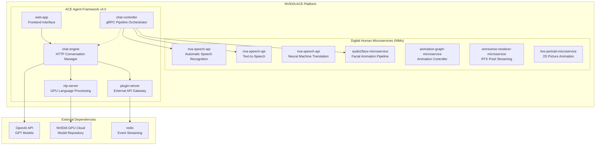
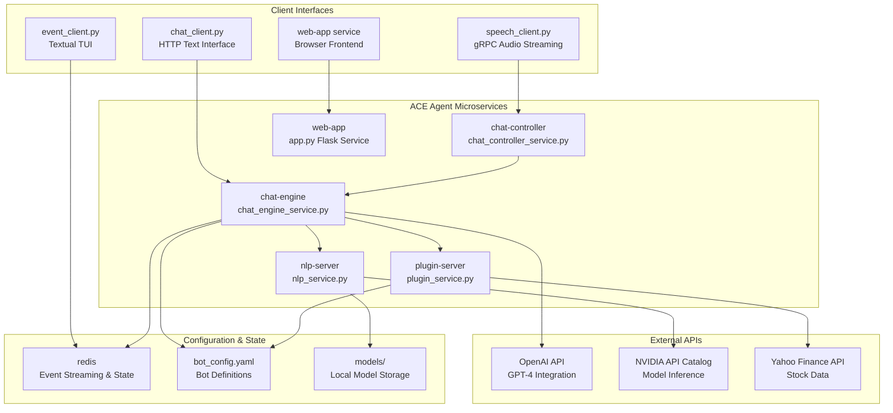
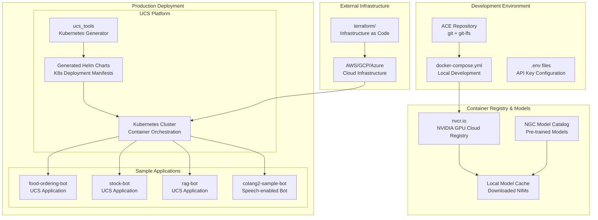
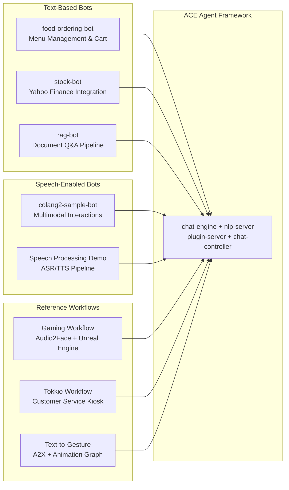

<!-- source: DeepWiki mcp.deepwiki.com · repo NVIDIA/ACE · page 1 NVIDIA ACE Overview · fetched 2026-10-26 -->

# NVIDIA ACE Overview

Relevant source files

The following files were used as context for generating this wiki page:

- [LICENSE](LICENSE)
- [README.md](README.md)

## Purpose and Scope

This document provides a comprehensive overview of the NVIDIA ACE repository, which contains a suite of technologies for building digital humans and conversational AI agents using generative AI. The material covers the core digital human microservices (NIMs), the ACE Agent framework architecture, deployment patterns, and sample applications.

For detailed information about specific microservices implementations, see [Core Digital Human Technologies](#2). For comprehensive documentation of the ACE Agent framework components, see [ACE Agent Framework](#3). For deployment strategies and infrastructure setup, see [Deployment & Infrastructure](#4).

Sources: [README.md:1-95]()

## NVIDIA ACE Platform Architecture

NVIDIA ACE is structured as a comprehensive platform combining digital human technologies with conversational AI capabilities. The platform consists of two primary architectural layers: the Digital Human Microservices layer for speech, animation, and rendering, and the ACE Agent Framework layer for conversational AI orchestration.

### Digital Human Technology Stack

The platform provides state-of-the-art AI models with real-time performance, commercially safe training data, and flexible deployment options supporting public/private cloud, Windows PC, or hybrid configurations.

Sources: [README.md:4-49](), [README.md:32-46]()

## Core Technology Components

NVIDIA ACE integrates multiple specialized microservices, each designed for specific aspects of digital human creation and interaction:

| Technology | Service Name | Description | Deployment Support |
|------------|--------------|-------------|-------------------|
| Riva ASR | `riva-speech-api` | Speech → Text conversion | Cloud, Windows (Coming Soon) |
| Riva TTS | `riva-speech-api` | Text → Speech synthesis | Cloud, Windows (Coming Soon) |
| Riva NMT | `riva-speech-api` | Multi-language text translation | Cloud Only |
| Audio2Face | `audio2face-microservice` | Audio → Facial blendshapes | Cloud, Windows (Coming Soon) |
| AnimGraph | `animation-graph-microservice` | Animation state management | Cloud Only |
| RTX Renderer | `omniverse-renderer-microservice` | Omniverse-based pixel streaming | Cloud Only |
| ACE Agent | `ace-agent` | Conversational AI with RAG | Cloud Only |
| Live Portrait | `live-portrait-microservice` | 2D facial animation | Cloud Only |

Sources: [README.md:15-30]()

## ACE Agent Framework Architecture

The ACE Agent Framework provides a microservices-based architecture for building scalable conversational AI applications. The framework consists of five core services that work together to handle speech processing, natural language understanding, and business logic integration.

### Core Services Architecture

Each microservice operates independently with well-defined interfaces, enabling horizontal scaling and independent deployment cycles. The `chat-controller` orchestrates speech processing pipelines, while the `chat-engine` handles conversational logic and integrates with external AI services.

Sources: [README.md:25](), [README.md:75]()

## Deployment Ecosystem

NVIDIA ACE supports multiple deployment patterns designed for different use cases and infrastructure requirements. The repository provides both containerized local development environments and production-ready Kubernetes deployments through the NVIDIA UCS (Unified Cloud Services) platform.

### Deployment Architecture Overview

The deployment ecosystem leverages NVIDIA's container registry (`nvcr.io`) for microservice distribution and supports both Docker Compose for local development and Kubernetes for production scalability. UCS tools generate Helm charts for streamlined Kubernetes deployments.

Sources: [README.md:8-13](), [README.md:70]()

## Sample Applications Overview

The repository includes multiple sample applications demonstrating different ACE capabilities, from text-based conversational bots to speech-enabled multimodal interactions. These samples serve as reference implementations for common digital human use cases.

### Application Architecture Patterns

Each sample application demonstrates specific integration patterns with external APIs, different conversation management approaches using Colang/NeMo Guardrails, and various deployment configurations suitable for different production scenarios.

Sources: [README.md:51-62](), [README.md:81-88]()

## Key Benefits and Capabilities

NVIDIA ACE provides three primary advantages for digital human development:

- **State-of-the-Art Models and Microservices**: Pre-trained NVIDIA models deliver industry-leading quality with real-time performance optimization
- **Safe and Consistent Results**: AI models trained on commercially safe, responsibly licensed data with fine-tuning and guardrails for appropriate responses
- **Flexible Deployment Options**: Support for inference across public/private cloud, Windows PC, or hybrid configurations

The platform enables developers to build custom digital human solutions from scratch or leverage domain-specific workflows for gaming NPCs, customer service assistants, and real-time communication avatars.

Sources: [README.md:32-62]()

---

