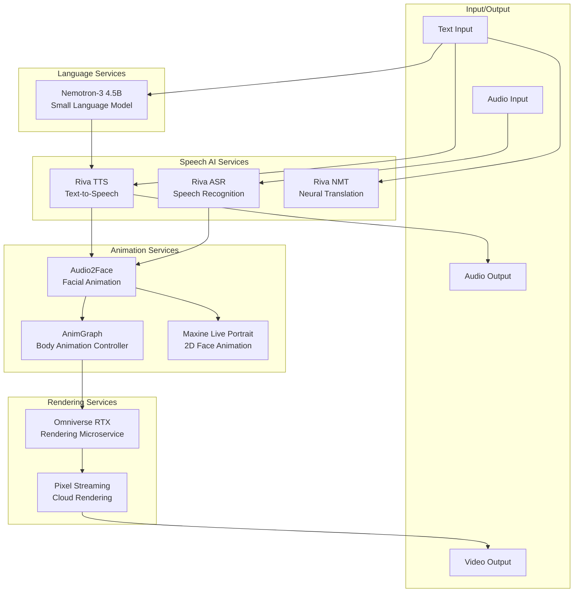
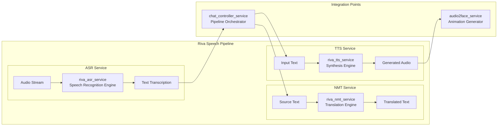
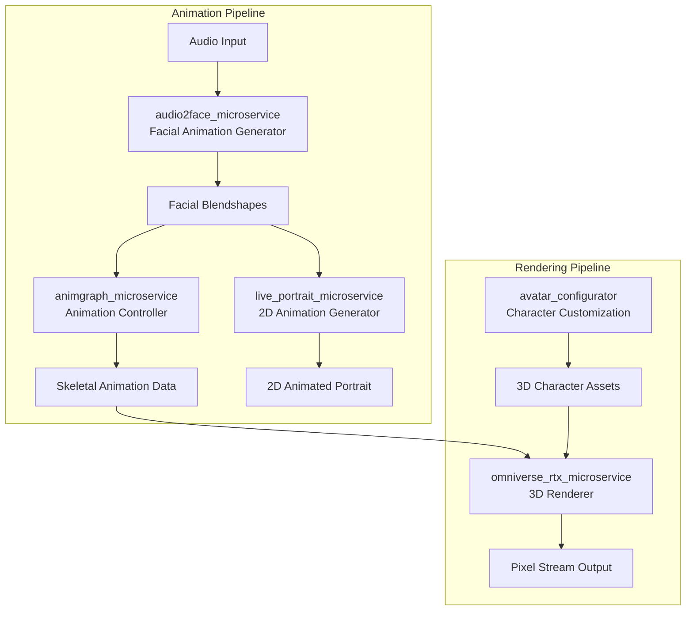
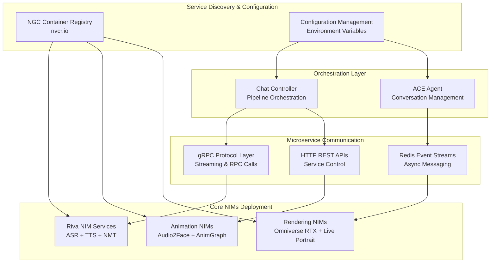

<!-- source: DeepWiki mcp.deepwiki.com · repo NVIDIA/ACE · page 2 Core Digital Human Technologies · fetched 2026-10-26 -->

# Core Digital Human Technologies

Relevant source files

The following files were used as context for generating this wiki page:

- [README.md](README.md)

## Purpose and Scope

This page documents the core NVIDIA ACE NIMs (NVIDIA Inference Microservices) that provide the foundational digital human capabilities for speech processing, facial animation, body animation, and rendering. These microservices form the building blocks for creating interactive digital humans and avatars.

For information about the ACE Agent framework that orchestrates these technologies, see [ACE Agent Framework](#3). For deployment and infrastructure details, see [Deployment & Infrastructure](#4).

## Overview of Digital Human Technology Stack

The NVIDIA ACE platform consists of several core microservices that work together to enable realistic digital human interactions. Each microservice provides specialized AI capabilities that can be combined to create complete digital human experiences.

**Core Technologies Architecture**

Sources: [README.md:15-29]()

| Technology | Primary Function | Input | Output | Enterprise Support |
|------------|------------------|--------|--------|-------------------|
| Riva ASR | Speech Recognition | Audio | Text | NVIDIA AI Enterprise |
| Riva TTS | Speech Synthesis | Text | Audio | NVIDIA AI Enterprise |
| Riva NMT | Language Translation | Text | Translated Text | NVIDIA AI Enterprise |
| Audio2Face | Facial Animation | Audio | Blendshapes | NVIDIA AI Enterprise |
| AnimGraph | Animation Control | Animation Data | Skeletal Animation | NVIDIA AI Enterprise |
| Omniverse RTX | 3D Rendering | 3D Scene | Rendered Video | NVIDIA AI Enterprise |
| Live Portrait | 2D Face Animation | Audio + Image | Animated 2D Video | Early Access |
| Nemotron-3 4.5B | Language Model | Text Prompt | Generated Text | Early Access |

Sources: [README.md:17-29]()

## Speech AI Services (Riva)

NVIDIA Riva provides the speech AI foundation for digital humans through three core microservices that handle the complete speech processing pipeline.

**Riva Microservices Integration**

### Automatic Speech Recognition (ASR)

The Riva ASR service converts spoken audio into text transcriptions with real-time processing capabilities. It supports multiple languages and acoustic models optimized for different use cases.

**Key Capabilities:**
- Real-time streaming speech recognition
- Batch audio processing
- Multiple language support
- Custom vocabulary and language model adaptation
- Speaker diarization

**Integration Pattern:**
- Receives audio streams via gRPC
- Outputs text transcriptions to chat controllers
- Supports both streaming and batch processing modes

Sources: [README.md:19](), [README.md:72]()

### Text-to-Speech (TTS) 

The Riva TTS service generates natural-sounding speech from text input using advanced neural vocoding techniques. It provides high-quality voice synthesis with customizable speaking styles.

**Key Capabilities:**
- Multi-speaker voice synthesis
- Custom voice cloning
- SSML markup support for pronunciation control
- Real-time audio generation
- Multiple output audio formats

**Integration Pattern:**
- Receives text input from chat engines
- Generates audio output for facial animation services
- Supports streaming audio delivery

Sources: [README.md:21](), [README.md:73]()

### Neural Machine Translation (NMT)

The Riva NMT service provides high-quality text translation between multiple language pairs using transformer-based neural models.

**Key Capabilities:**
- Multi-language translation support
- Domain-specific translation models
- Batch and real-time translation
- Custom terminology integration

Sources: [README.md:20](), [README.md:74]()

## Animation and Rendering Services

The animation pipeline transforms audio and text inputs into realistic digital human movements and expressions through specialized microservices.

**Animation and Rendering Microservices**

### Audio2Face

Audio2Face generates facial blendshapes and lip-sync animation from audio input, enabling realistic facial expressions that match speech patterns.

**Core Functionality:**
- Real-time facial animation generation
- Blendshape coefficient output
- Multiple character rig support
- Emotion and expression control
- Integration with Unreal Engine and other 3D platforms

**Technical Integration:**
- Processes audio from TTS services
- Outputs animation data to rendering pipelines
- Supports streaming and batch processing

Sources: [README.md:22](), [README.md:71]()

### AnimGraph

The AnimGraph microservice provides sophisticated animation control and blending capabilities for full-body character animation.

**Core Functionality:**
- Animation state machine management
- Motion blending and transitions
- Procedural animation generation
- Integration with external animation systems

Sources: [README.md:23](), [README.md:78]()

### Omniverse RTX Rendering

The Omniverse RTX Rendering microservice delivers high-quality, real-time 3D rendering with ray tracing capabilities optimized for digital human applications.

**Core Functionality:**
- Real-time ray-traced rendering
- Pixel streaming for cloud deployment
- Multi-user collaborative rendering
- USD-based scene management
- Integration with Omniverse ecosystem

Sources: [README.md:24](), [README.md:79]()

### Maxine Live Portrait

The Live Portrait service provides 2D facial animation capabilities for portrait-style digital human applications.

**Core Functionality:**
- 2D portrait animation from audio
- Real-time face animation
- Photo-realistic lip-sync
- Minimal computational requirements

Sources: [README.md:26](), [README.md:76]()

## Technology Integration Patterns

The core digital human technologies follow established integration patterns that enable flexible composition of different AI capabilities.

**Digital Human Technology Integration Architecture**

### Deployment Patterns

The core technologies support multiple deployment patterns optimized for different use cases:

| Deployment Pattern | Use Case | Technologies | Scaling Approach |
|-------------------|----------|--------------|------------------|
| Cloud-Native | Enterprise applications | All NIMs via NGC | Kubernetes orchestration |
| Edge Deployment | Gaming/Real-time | Selected NIMs | Docker containerization |
| Hybrid Cloud | Customer service | Riva + ACE Agent | Mixed cloud/on-premise |
| Development | Research/Prototyping | Local containers | Docker Compose |

### Service Communication

**gRPC Streaming:**
- Real-time audio processing (ASR, TTS)
- Low-latency animation data transfer
- Bidirectional streaming support

**HTTP REST APIs:**
- Service configuration and control
- Batch processing workflows
- Health monitoring and metrics

**Redis Event Streams:**
- Asynchronous pipeline coordination
- Event-driven architecture support
- Scalable message queuing

Sources: [README.md:8-12](), [README.md:65-79]()

## Access and Licensing

The core digital human technologies are available through NVIDIA's commercial licensing and evaluation programs:

**NVIDIA AI Enterprise License:**
- Production deployment rights
- Enterprise support and SLA
- Access to all core NIMs
- Integration with NGC catalog

**Early Access Evaluation:**
- Preview access to emerging technologies
- Development and testing licenses
- Limited production use

**NGC Container Registry:**
- Containerized microservice distribution
- Version management and updates
- Integration with Kubernetes deployments

Sources: [README.md:8-12](), [README.md:94-95]()

---

