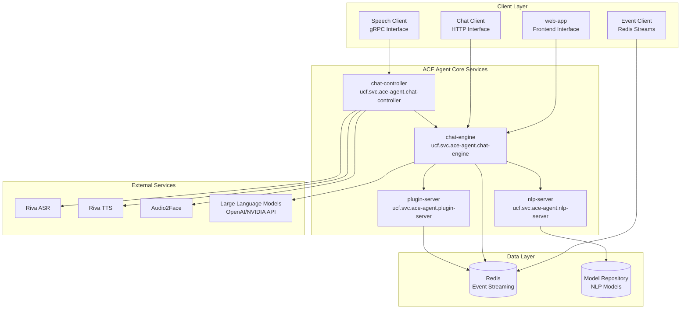
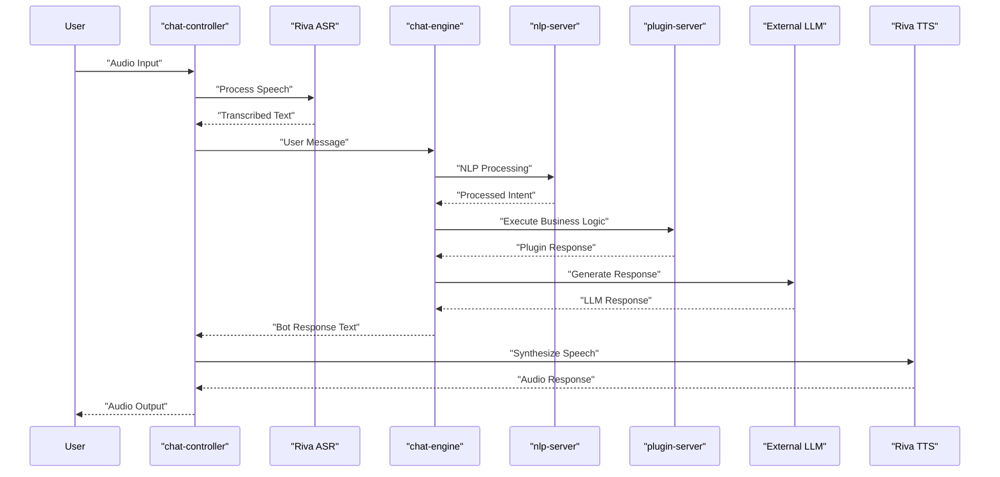

<!-- source: DeepWiki mcp.deepwiki.com · repo NVIDIA/ACE · page 3 ACE Agent Framework · fetched 2026-10-26 -->

# ACE Agent Framework

Relevant source files

The following files were used as context for generating this wiki page:

- [microservices/ace_agent/4.0/README.md](microservices/ace_agent/4.0/README.md)

The ACE Agent Framework is a microservices-based platform for building LLM-driven, scalable conversational AI agents that support multi-turn and multi-user contextual conversations. This document covers the framework's architecture, core microservices, and integration patterns for deploying conversational AI applications with speech processing, natural language understanding, and custom business logic capabilities.

For information about the broader NVIDIA ACE ecosystem including digital human technologies like Riva Speech AI and Audio2Face, see [Core Digital Human Technologies](#2). For specific deployment strategies and infrastructure setup, see [Deployment & Infrastructure](#4). For sample implementations and use cases, see [Sample Applications](#5).

## Architecture Overview

The ACE Agent Framework consists of five core UCS (Unified Cloud Services) microservices that work together to provide a complete conversational AI pipeline. These microservices are designed to be composable, scalable, and customizable for various use cases.

### ACE Agent Microservices Architecture

Sources: [microservices/ace_agent/4.0/README.md:19-32]()

## Core Microservices

### Chat Controller (`ucf.svc.ace-agent.chat-controller`)

The Chat Controller serves as the orchestration layer for speech-based conversational AI pipelines. It manages the end-to-end flow of audio and text data between Automatic Speech Recognition (ASR), Chat Engine, Text-To-Speech (TTS), and NVIDIA Omniverse Audio2Face services.

**Key Responsibilities:**
- Pipeline orchestration for speech processing workflows
- Audio data streaming and management
- Integration with Riva Speech AI services
- Audio2Face client management for avatar animation

### Chat Engine (`ucf.svc.ace-agent.chat-engine`)

The Chat Engine is built on NVIDIA NeMo Guardrails and provides the core conversational flow management using Colang. It handles natural language understanding, dialog management, and response generation.

**Key Responsibilities:**
- Colang-based conversation flow design
- NeMo Guardrails integration for safe AI interactions
- Multi-turn conversation context management
- LLM integration and response orchestration

### NLP Server (`ucf.svc.ace-agent.nlp-server`)

The NLP Server exposes unified RESTful interfaces for integrating various NLP models and tasks within the ACE Agent pipeline. It provides GPU-accelerated model serving capabilities.

**Key Responsibilities:**
- Unified NLP model API endpoints
- TensorRT optimized model serving
- Natural language processing task coordination
- Model lifecycle management

### Plugin Server (`ucf.svc.ace-agent.plugin-server`)

The Plugin Server enables integration of domain-specific business logic and external systems. It supports custom plugins for weather APIs, database integrations, and third-party agent frameworks like LangChain or LlamaIndex.

**Key Responsibilities:**
- Custom business logic integration
- External API connectivity
- Third-party framework integration
- Domain-specific functionality extension

### Web Application (`ucf.svc.ace-agent.web-app`)

The Web Application provides a sample frontend interface for interacting with deployed bots, supporting both voice capture/playback and text input/output interactions.

**Key Responsibilities:**
- Web-based user interface
- Voice input/output handling
- Real-time conversation display
- Frontend integration patterns demonstration

Sources: [microservices/ace_agent/4.0/README.md:23-29]()

## Service Integration Workflow

### Conversational AI Pipeline

Sources: [microservices/ace_agent/4.0/README.md:25]()

## Key Framework Features

### In-built LLM Integration

ACE Agent provides out-of-the-box integration with large language models, offering hooks to connect with various LLM providers including OpenAI, NVIDIA API Catalog, and custom on-premise deployments using NVIDIA NIM for LLMs.

### On-premise Model Deployment

The framework supports complete on-premise deployment of both ACE Agent models and community/custom models. NVIDIA NIM brings GPU-accelerated LLM serving capabilities for deploying models locally while maintaining performance and security requirements.

### High Customizability with Colang

ACE Agent uses Colang for complete behavior customization based on specific use cases. The framework also supports integration of agents and bots built using LangChain, LlamaIndex, or similar frameworks within the ACE Agent pipeline for multi-modal use cases.

### RAG Integration

The framework provides easy integration with Retrieval Augmented Generation (RAG) workflows, enabling the building of agents using existing knowledge documents with minimal development effort.

### Low Latency Architecture

ACE Agent leverages NVIDIA TensorRT optimized models, NVIDIA Triton Inference Server for model deployment, and optimized chat controller components to ensure low latency and high throughput bot interactions.

Sources: [microservices/ace_agent/4.0/README.md:5-16]()

## Deployment Architecture

### UCS Microservices Deployment

ACE Agent provides Kubernetes deployment using NVIDIA Unified Cloud Services (UCS) Tools, a low-code framework for developing cloud-native, real-time, and multimodal AI applications.

| Microservice Name | Version | UCS Service Identifier |
|---|---|---|
| Chat Controller | 4.0.0 | `ucf.svc.ace-agent.chat-controller` |
| Chat Engine | 4.0.0 | `ucf.svc.ace-agent.chat-engine` |
| NLP Server | 4.0.0 | `ucf.svc.ace-agent.nlp-server` |
| Plugin Server | 4.0.0 | `ucf.svc.ace-agent.plugin-server` |
| Web App | 4.0.0 | `ucf.svc.ace-agent.web-app` |

### Custom Application Development

Developers can create custom application Helm charts using ACE Agent microservices through UCS applications. The framework includes sample UCS applications for various bot implementations located in the `./deploy/ucs_apps/` directory.

Sources: [microservices/ace_agent/4.0/README.md:19-32]()

## Sample Bot Integration

The ACE Agent Framework comes with multiple sample bot implementations in the `./samples/` directory, demonstrating various features and use cases across different industries. These samples showcase the framework's flexibility and provide reference implementations for common conversational AI patterns.

The sample bots demonstrate different aspects of the framework including:
- Text-based conversational flows
- Speech-enabled interactions
- RAG-powered question answering
- Domain-specific business logic integration
- Multi-modal interaction patterns

Sources: [microservices/ace_agent/4.0/README.md:34-38]()

---

