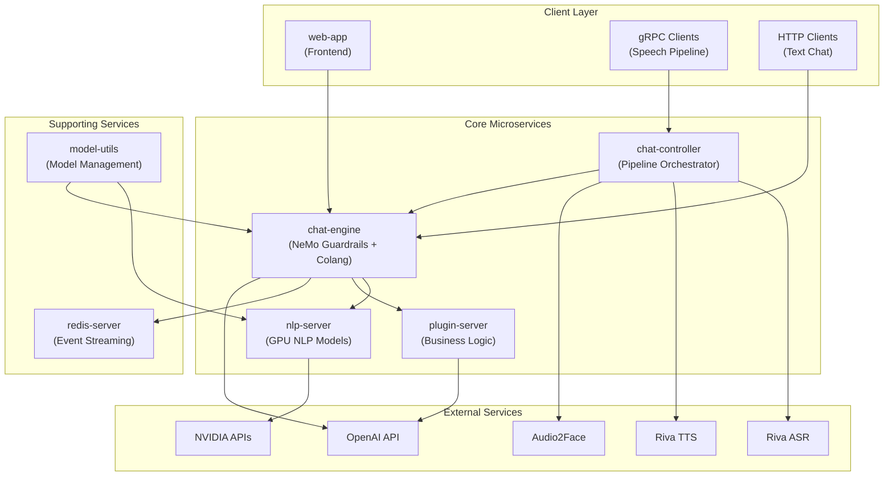
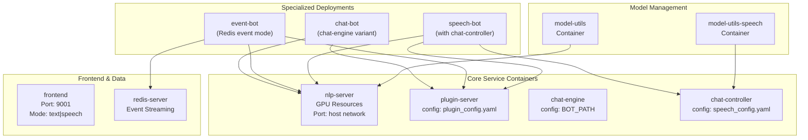

<!-- source: DeepWiki mcp.deepwiki.com · repo NVIDIA/ACE · page 3.1 Microservices Architecture · fetched 2026-10-26 -->

# Microservices Architecture

Relevant source files

The following files were used as context for generating this wiki page:

- [microservices/ace_agent/4.0/README.md](microservices/ace_agent/4.0/README.md)
- [microservices/ace_agent/4.0/deploy/docker/docker-compose.yml](microservices/ace_agent/4.0/deploy/docker/docker-compose.yml)

This document provides a comprehensive overview of the ACE Agent 4.0 microservices architecture. It details the five core microservices that comprise the ACE Agent framework, their interactions, deployment patterns, and integration points. This architecture enables scalable, customizable conversational AI agents with support for multi-turn conversations, speech processing, and external service integration.

For information about client applications that interact with these microservices, see [Client Applications](#3.2). For deployment strategies and infrastructure management, see [Deployment & Infrastructure](#4).

## Core Microservices Overview

ACE Agent 4.0 consists of five primary microservices that work together to provide a complete conversational AI platform. Each microservice is containerized and can be deployed independently using Docker or Kubernetes.

| Microservice | UCS Service Name | Version | Primary Function |
|---|---|---|---|
| **Chat Controller** | `ucf.svc.ace-agent.chat-controller` | 4.0.0 | Pipeline orchestration for speech-based interactions |
| **Chat Engine** | `ucf.svc.ace-agent.chat-engine` | 4.0.0 | Conversational flow management with Colang/NeMo Guardrails |
| **NLP Server** | `ucf.svc.ace-agent.nlp-server` | 4.0.0 | Unified NLP model interfaces and GPU-accelerated inference |
| **Plugin Server** | `ucf.svc.ace-agent.plugin-server` | 4.0.0 | Business logic integration and external service connectors |
| **Web App** | `ucf.svc.ace-agent.web-app` | 4.0.0 | Frontend interface with voice and text interaction support |

**Sources:** [microservices/ace_agent/4.0/README.md:19-30]()

## Service Architecture and Dependencies

The following diagram illustrates the core microservices architecture and their interactions within the ACE Agent ecosystem:

**Sources:** [microservices/ace_agent/4.0/README.md:23-29](), [microservices/ace_agent/4.0/deploy/docker/docker-compose.yml:1-159]()

## Docker Deployment Configuration

The microservices are orchestrated using Docker Compose, with specific container configurations and dependencies. The following diagram shows the actual container deployment structure:

**Sources:** [microservices/ace_agent/4.0/deploy/docker/docker-compose.yml:26-159]()

## Service Specifications

### Chat Controller

The `chat-controller` service orchestrates the complete speech processing pipeline, managing data flow between ASR, TTS, Audio2Face, and the chat engine.

**Key Configuration:**
- Container: `chat-controller` [microservices/ace_agent/4.0/deploy/docker/docker-compose.yml:93-105]()
- Command: `run_pipeline.sh --pipeline ${PIPELINE} --speech_config /workspace/config/speech_config.yaml`
- Network: Host mode for low-latency communication

### Chat Engine

The `chat-engine` service implements conversational flow using NVIDIA NeMo Guardrails and Colang, providing the core dialogue management capabilities.

**Key Configuration:**
- Container: `chat-engine` [microservices/ace_agent/4.0/deploy/docker/docker-compose.yml:69-86]()
- Command: `aceagent chat server -c ${PWD}/${BOT_PATH} --log-path ${PWD}/log`
- Dependencies: Requires `nlp-server` and `plugin-server`

**Deployment Variants:**
- `chat-bot`: Standard HTTP server mode [microservices/ace_agent/4.0/deploy/docker/docker-compose.yml:107-113]()
- `event-bot`: Redis event-driven mode [microservices/ace_agent/4.0/deploy/docker/docker-compose.yml:119-126]()

### NLP Server

The `nlp-server` provides GPU-accelerated NLP model inference with unified RESTful interfaces for various NLP tasks.

**Key Configuration:**
- Container: `nlp-server` [microservices/ace_agent/4.0/deploy/docker/docker-compose.yml:26-50]()
- Command: `aceagent nlp-server deploy --timeout 200 --workers 1 --config ${PWD}/${BOT_PATH}/model_config.yaml`
- Resources: GPU allocation with 2GB shared memory

### Plugin Server

The `plugin-server` enables integration of domain-specific business logic and external service connectors.

**Key Configuration:**
- Container: `plugin-server` [microservices/ace_agent/4.0/deploy/docker/docker-compose.yml:51-67]()
- Command: `aceagent plugin-server deploy -c ${PWD}/${BOT_PATH}/plugin_config.yaml --log-path ${PWD}/log`
- Configuration: Uses `plugin_config.yaml` for service definitions

### Web App Frontend

The `frontend` service provides a web-based interface supporting both text and speech interactions.

**Key Configuration:**
- Container: `frontend` [microservices/ace_agent/4.0/deploy/docker/docker-compose.yml:128-141]()
- Command: `python3.10 -m frontend --port 9001 --mode text` (or `speech`)
- Port: 9001 for web interface access

**Sources:** [microservices/ace_agent/4.0/deploy/docker/docker-compose.yml:26-159]()

## Communication Patterns

The microservices communicate through multiple protocols optimized for different interaction types:

| Communication Type | Protocol | Services | Purpose |
|---|---|---|---|
| **Speech Pipeline** | gRPC | chat-controller ↔ External Speech Services | Low-latency audio streaming |
| **Chat API** | HTTP/REST | chat-engine ↔ Clients | Text-based conversations |
| **Event Streaming** | Redis Streams | chat-engine ↔ Redis | Asynchronous event processing |
| **Model Inference** | HTTP/REST | nlp-server ↔ chat-engine | NLP model requests |
| **Plugin Integration** | HTTP/REST | plugin-server ↔ chat-engine | Business logic execution |

All services use host networking mode for optimal performance and simplified service discovery within the Docker Compose environment.

**Sources:** [microservices/ace_agent/4.0/deploy/docker/docker-compose.yml:14,39,64,83,91,103,131]()

---

