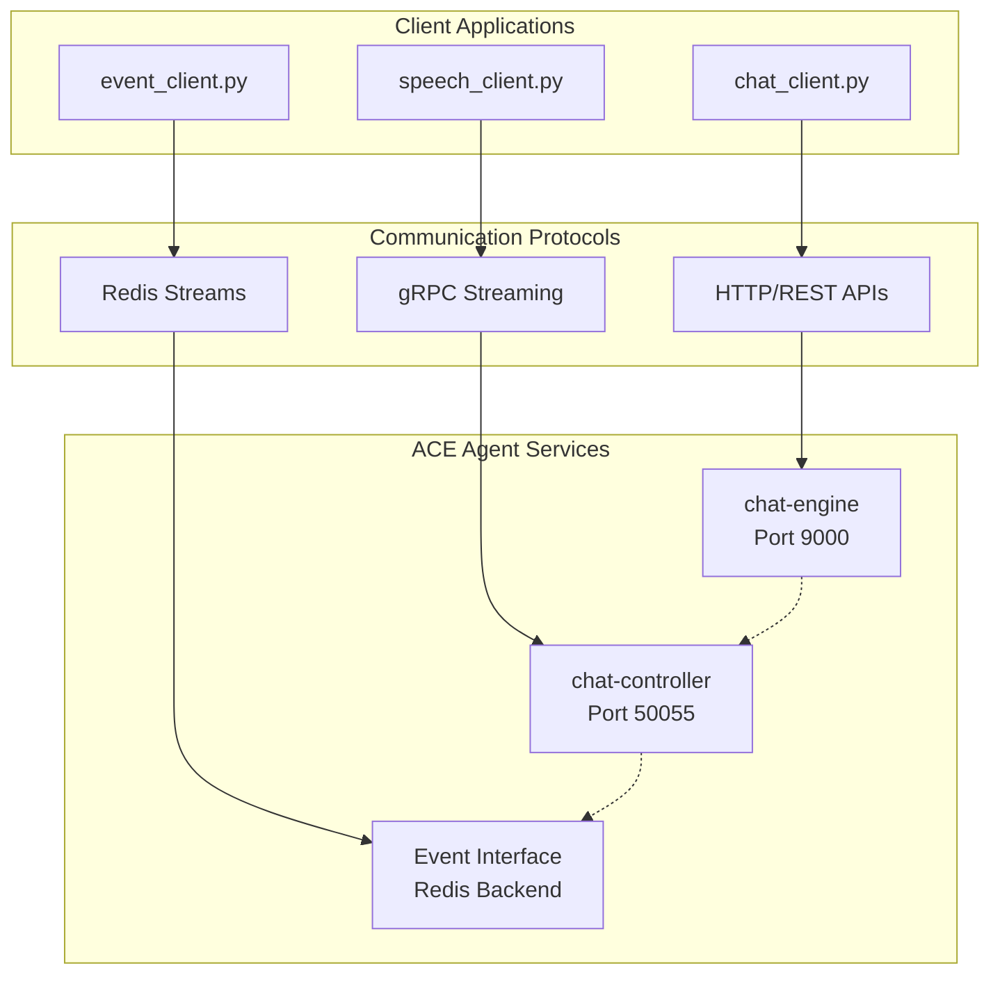
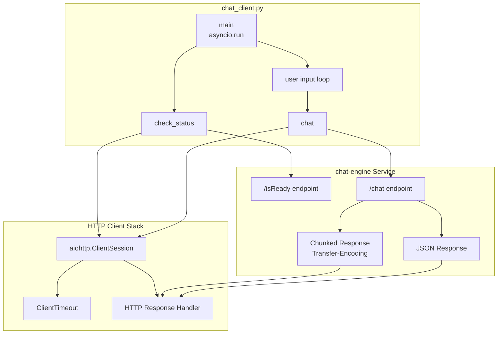
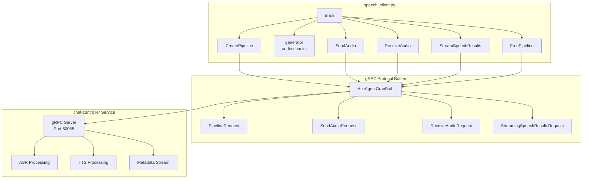
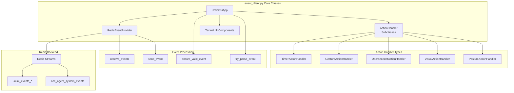
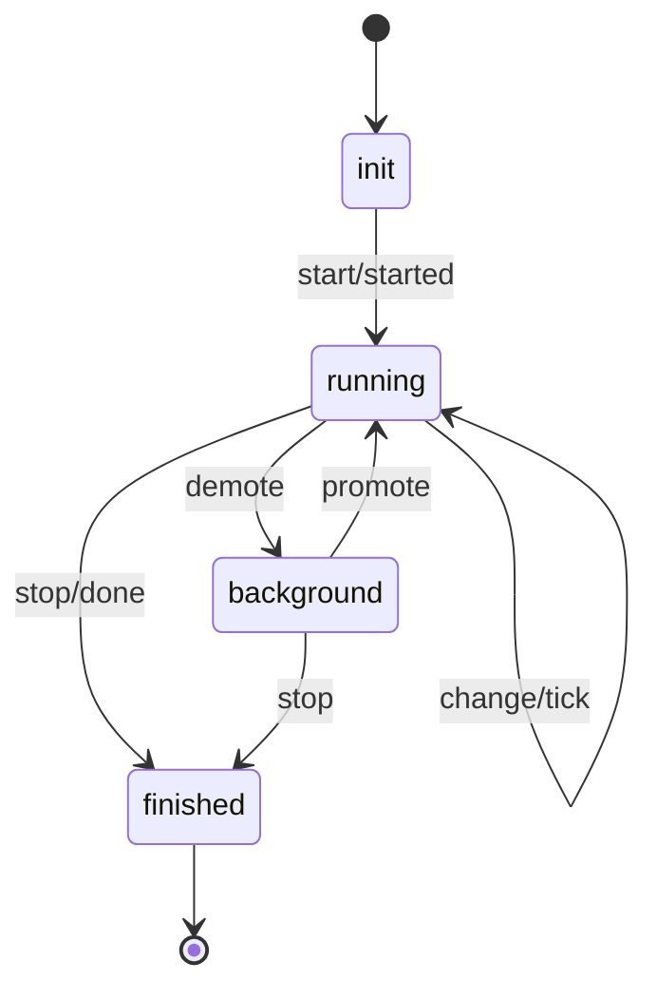
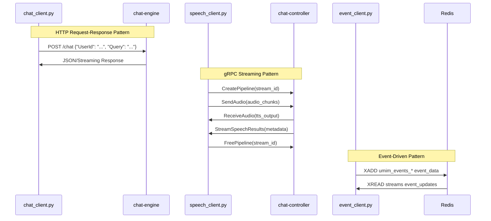

<!-- source: DeepWiki mcp.deepwiki.com · repo NVIDIA/ACE · page 3.2 Client Applications · fetched 2026-10-26 -->

# Client Applications

Relevant source files

The following files were used as context for generating this wiki page:

- [microservices/ace_agent/4.0/clients/chat_client/chat_client.py](microservices/ace_agent/4.0/clients/chat_client/chat_client.py)
- [microservices/ace_agent/4.0/clients/event_client/event_client.py](microservices/ace_agent/4.0/clients/event_client/event_client.py)
- [microservices/ace_agent/4.0/clients/speech_client/speech_client.py](microservices/ace_agent/4.0/clients/speech_client/speech_client.py)

This document covers the various client applications provided for interacting with the ACE Agent framework. These clients demonstrate different interaction patterns and protocols for accessing ACE Agent services, including HTTP-based text conversations, gRPC-based speech processing, and Redis-based event simulation.

For information about the ACE Agent microservices that these clients connect to, see [Microservices Architecture](#3.1). For specific sample bot implementations, see [Sample Applications](#5).

## Overview

The ACE Agent framework provides three primary client applications, each designed for different interaction scenarios and technical requirements:

| Client Type | Protocol | Primary Use Case | Target Service |
|-------------|----------|------------------|----------------|
| Chat Client | HTTP/REST | Text-based conversations | chat-engine service |
| Speech Client | gRPC | Audio processing pipelines | chat-controller service |  
| Event Client | Redis Streams | Event simulation and monitoring | ACE Agent event interface |

**Sources:** [microservices/ace_agent/4.0/clients/chat_client/chat_client.py:1-120](), [microservices/ace_agent/4.0/clients/speech_client/speech_client.py:1-157](), [microservices/ace_agent/4.0/clients/event_client/event_client.py:1-1920]()

## Chat Client Architecture

The `chat_client.py` implements an HTTP-based client for text conversations with the ACE Agent chat engine service.

### Key Implementation Details

The chat client uses `aiohttp` for asynchronous HTTP communication and handles both streaming and non-streaming responses from the chat engine:

- **Server Health Check:** [`check_status()`]() function validates server availability via `/isReady` endpoint [microservices/ace_agent/4.0/clients/chat_client/chat_client.py:31-51]()
- **Message Processing:** [`chat()`]() function sends user queries and processes responses [microservices/ace_agent/4.0/clients/chat_client/chat_client.py:54-99]()
- **Streaming Support:** Handles chunked responses for real-time conversation flow [microservices/ace_agent/4.0/clients/chat_client/chat_client.py:74-86]()

**Sources:** [microservices/ace_agent/4.0/clients/chat_client/chat_client.py:31-99]()

## Speech Client Architecture  

The `speech_client.py` implements a gRPC-based client for audio processing pipelines including ASR and TTS capabilities.

### Pipeline Management

The speech client follows a structured pipeline lifecycle:

1. **Pipeline Acquisition:** Creates dedicated processing pipeline via `CreatePipeline` RPC [microservices/ace_agent/4.0/clients/speech_client/speech_client.py:48-55]()
2. **Audio Streaming:** Sends chunked audio data using `generator()` function [microservices/ace_agent/4.0/clients/speech_client/speech_client.py:60-93]()
3. **Response Processing:** Handles ASR transcripts, chat responses, and TTS metadata [microservices/ace_agent/4.0/clients/speech_client/speech_client.py:128-151]()
4. **Pipeline Release:** Frees resources via `FreePipeline` RPC [microservices/ace_agent/4.0/clients/speech_client/speech_client.py:153-156]()

**Sources:** [microservices/ace_agent/4.0/clients/speech_client/speech_client.py:48-156]()

## Event Client Architecture

The `event_client.py` implements a comprehensive Terminal UI application for simulating and monitoring ACE Agent event interfaces using Redis streams.

### Event Handler State Machine

The event client implements complex state machines for managing different action types:

### Key Components

- **RedisEventProvider:** Handles Redis stream communication [microservices/ace_agent/4.0/clients/event_client/event_client.py:100-140]()
- **ActionHandler:** Base class for action state machines [microservices/ace_agent/4.0/clients/event_client/event_client.py:533-705]()
- **UmimTuiApp:** Main Textual application with interactive UI [microservices/ace_agent/4.0/clients/event_client/event_client.py:1469-1848]()

**Sources:** [microservices/ace_agent/4.0/clients/event_client/event_client.py:100-1848]()

## Client Communication Patterns

Each client application uses distinct communication patterns optimized for their specific use cases:

| Pattern | Client | Implementation | Key Features |
|---------|--------|----------------|--------------|
| Request-Response | Chat Client | `aiohttp` HTTP calls | Synchronous/async queries, JSON payloads |
| Streaming RPC | Speech Client | gRPC bidirectional streams | Real-time audio, pipeline management |
| Event-Driven | Event Client | Redis streams + pub/sub | Asynchronous events, state machines |

**Sources:** [microservices/ace_agent/4.0/clients/chat_client/chat_client.py:62-91](), [microservices/ace_agent/4.0/clients/speech_client/speech_client.py:94-131](), [microservices/ace_agent/4.0/clients/event_client/event_client.py:114-139]()

## Configuration and Usage

### Connection Configuration

All clients support configurable connection parameters:

- **Chat Client:** `--host`, `--port`, `--timeout` parameters [microservices/ace_agent/4.0/clients/chat_client/chat_client.py:21-26]()
- **Speech Client:** `--server` parameter for gRPC endpoint [microservices/ace_agent/4.0/clients/speech_client/speech_client.py:31-32]()
- **Event Client:** `--event_provider_host`, `--event_provider_port` for Redis [microservices/ace_agent/4.0/clients/event_client/event_client.py:1889-1908]()

### Protocol Buffer Integration

The speech client relies on generated protocol buffer classes for gRPC communication:

- `ace_agent_pb2`: Message definitions [microservices/ace_agent/4.0/clients/speech_client/speech_client.py:21]()
- `ace_agent_pb2_grpc`: Service stubs [microservices/ace_agent/4.0/clients/speech_client/speech_client.py:22]()

**Sources:** [microservices/ace_agent/4.0/clients/chat_client/chat_client.py:21-26](), [microservices/ace_agent/4.0/clients/speech_client/speech_client.py:21-32](), [microservices/ace_agent/4.0/clients/event_client/event_client.py:1882-1908]()

---

