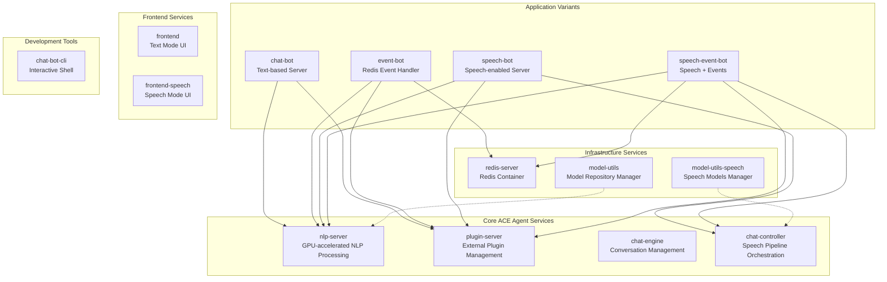
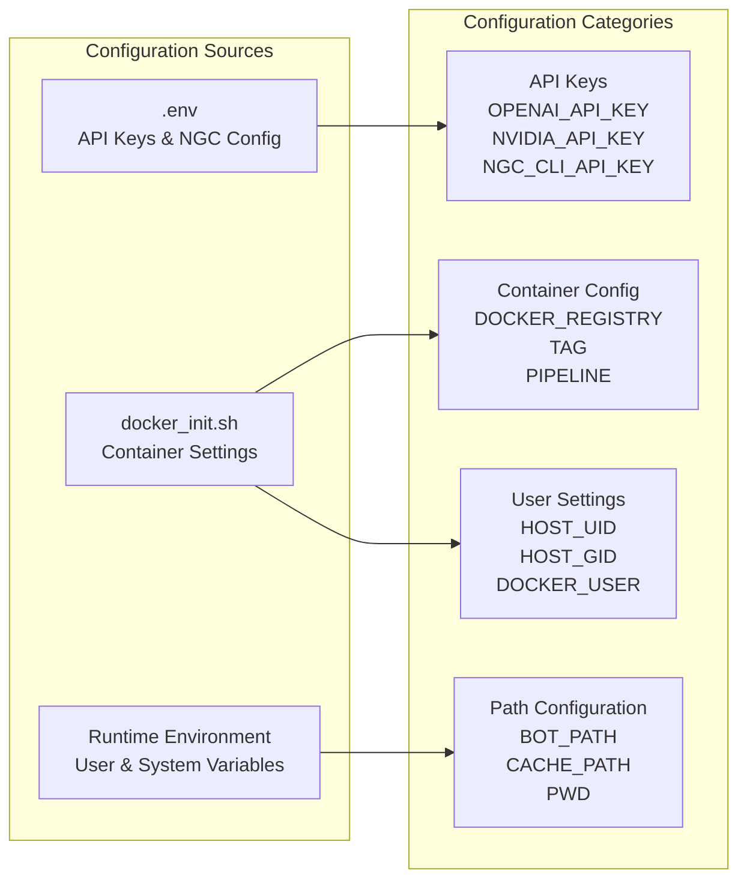
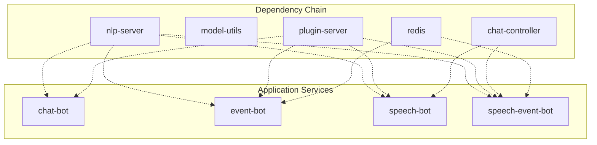

<!-- source: DeepWiki mcp.deepwiki.com · repo NVIDIA/ACE · page 4 Deployment & Infrastructure · fetched 2026-10-26 -->

# Deployment & Infrastructure

<details>
<summary>Relevant source files</summary>

The following files were used as context for generating this wiki page:

- [microservices/ace_agent/4.0/deploy/docker/.env](microservices/ace_agent/4.0/deploy/docker/.env)
- [microservices/ace_agent/4.0/deploy/docker/docker-compose.yml](microservices/ace_agent/4.0/deploy/docker/docker-compose.yml)
- [microservices/ace_agent/4.0/deploy/docker/docker_init.sh](microservices/ace_agent/4.0/deploy/docker/docker_init.sh)

</details>


## Purpose and Scope

This document covers the deployment and infrastructure strategies for ACE Agent applications, focusing on containerized deployment using Docker and Docker Compose. The deployment infrastructure provides orchestration for the core ACE Agent microservices and their dependencies, including GPU resource management, environment configuration, and service networking.

For information about the individual microservices being deployed, see [Microservices Architecture](#3.1). For details about Kubernetes-based deployments using UCS applications, see [UCS Applications](#4.2).

## Docker-Based Deployment Architecture

The ACE Agent deployment infrastructure is built around Docker containerization with Docker Compose orchestration. The deployment system manages multiple interconnected services that work together to provide conversational AI capabilities.

### Core Deployment Services



*Sources: [microservices/ace_agent/4.0/deploy/docker/docker-compose.yml:1-159]()*

## Service Configuration and Resource Management

### Container Registry and Image Management

The deployment uses NVIDIA's container registry for base images:

| Service | Base Image | Purpose |
|---------|------------|---------|
| `model-utils` | `${DOCKER_REGISTRY}/model-utils:${TAG}` | Model repository management |
| `nlp-server` | `${DOCKER_REGISTRY}/nlp-server:${TAG}` | GPU-accelerated NLP processing |
| `plugin-server` | `${DOCKER_REGISTRY}/plugin-server:${TAG}` | Plugin execution environment |
| `chat-engine` | `${DOCKER_REGISTRY}/chat-engine:${TAG}` | Conversation engine |
| `chat-controller` | `${DOCKER_REGISTRY}/chat-controller:${TAG}` | Speech pipeline coordination |
| `frontend` | `nvcr.io/nvidia/ucs-ms/frontend:4.0.0` | Web application interface |

*Sources: [microservices/ace_agent/4.0/deploy/docker/docker_init.sh:4](), [microservices/ace_agent/4.0/deploy/docker/docker-compose.yml:4,28,53,71,95,130]()*

### GPU Resource Allocation

GPU resources are managed through Docker's device reservation system:

```yaml
deploy:
  resources:
    reservations:
      devices:
        - driver: nvidia
          count: 1
          capabilities: [gpu]
```

The `nlp-server` service specifically reserves one GPU for neural language processing tasks, while other services access GPU resources through the NVIDIA Container Toolkit.

*Sources: [microservices/ace_agent/4.0/deploy/docker/docker-compose.yml:44-50]()*

## Environment Configuration System

### Environment Variable Management



*Sources: [microservices/ace_agent/4.0/deploy/docker/.env:1-11](), [microservices/ace_agent/4.0/deploy/docker/docker_init.sh:1-9]()*

### Key Configuration Variables

| Variable | Purpose | Source |
|----------|---------|---------|
| `OPENAI_API_KEY` | OpenAI API authentication | `.env` file |
| `NVIDIA_API_KEY` | NVIDIA API Catalog access | `.env` file |
| `NGC_CLI_API_KEY` | NGC container registry access | `.env` file |
| `DOCKER_REGISTRY` | Base container registry URL | `docker_init.sh` |
| `TAG` | Container image version tag | `docker_init.sh` |
| `PIPELINE` | Speech processing pipeline type | `docker_init.sh` |
| `BOT_PATH` | Bot configuration directory path | Runtime |

*Sources: [microservices/ace_agent/4.0/deploy/docker/.env:2,11](), [microservices/ace_agent/4.0/deploy/docker/docker_init.sh:1-2,4]()*

## Container Orchestration Patterns

### Service Dependencies and Startup Order

The deployment defines explicit service dependencies to ensure proper startup sequencing:



*Sources: [microservices/ace_agent/4.0/deploy/docker/docker-compose.yml:110-112,123-126,146-149,154-158]()*

### Networking and Port Management

All services use `network_mode: 'host'` for simplified networking and direct port access. This configuration allows services to communicate directly through localhost without Docker's network isolation.

### Volume Mounting Strategy

| Mount Pattern | Purpose | Services |
|---------------|---------|----------|
| `${PWD}:${PWD}` | Workspace access | Most services |
| `${HOME}/.docker:/.docker` | Docker credentials | `model-utils` |
| `/var/run/docker.sock:/var/run/docker.sock` | Docker daemon access | `model-utils` |
| `${PWD}/${BOT_PATH}:/workspace/config` | Bot configuration | `chat-controller` |

*Sources: [microservices/ace_agent/4.0/deploy/docker/docker-compose.yml:10-13,37-38,61-62,80-81,100-101]()*

## Command Execution Patterns

### Service Command Structure

Each service uses specific command patterns for execution:

```bash
# NLP Server
aceagent nlp-server deploy --timeout 200 --workers 1 --config ${PWD}/${BOT_PATH}/model_config.yaml

# Plugin Server  
aceagent plugin-server deploy -c ${PWD}/${BOT_PATH}/plugin_config.yaml --log-path ${PWD}/log

# Chat Engine
aceagent chat server -c ${PWD}/${BOT_PATH} --log-path ${PWD}/log

# Chat Controller
bash run_pipeline.sh --pipeline ${PIPELINE} --speech_config /workspace/config/speech_config.yaml
```

*Sources: [microservices/ace_agent/4.0/deploy/docker/docker-compose.yml:43,67,86,105]()*

### Model Deployment Commands

The `model-utils` service handles model deployment with GPU allocation:

- Standard deployment: `deploy --model_config_path ${PWD}/${BOT_PATH}/model_config.yaml --model_repository_path ./model_repository --gpus 1`
- Speech-enabled deployment: `deploy --model_config_path ${PWD}/${BOT_PATH}/model_config.yaml --model_repository_path ./model_repository --gpus 1 --speech`

*Sources: [microservices/ace_agent/4.0/deploy/docker/docker-compose.yml:19,24]()*

## Development and Production Variants

The deployment configuration provides multiple service variants for different use cases:

| Variant | Purpose | Dependencies |
|---------|---------|-------------|
| `chat-bot` | Production text chat server | `nlp-server`, `plugin-server` |
| `chat-bot-cli` | Development interactive shell | Same as `chat-bot` |
| `event-bot` | Event-driven chat processing | `nlp-server`, `plugin-server`, `redis` |
| `speech-bot` | Speech-enabled chat server | `nlp-server`, `plugin-server`, `chat-controller` |
| `speech-event-bot` | Speech + event processing | All core services |
| `frontend` / `frontend-speech` | Web UI in text/speech modes | None (client-side) |

*Sources: [microservices/ace_agent/4.0/deploy/docker/docker-compose.yml:107-158]()*

---

