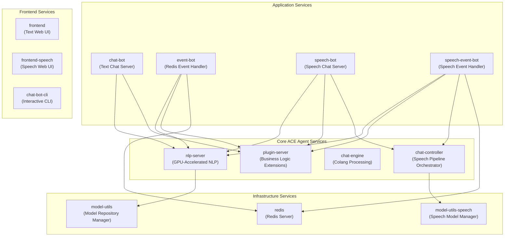
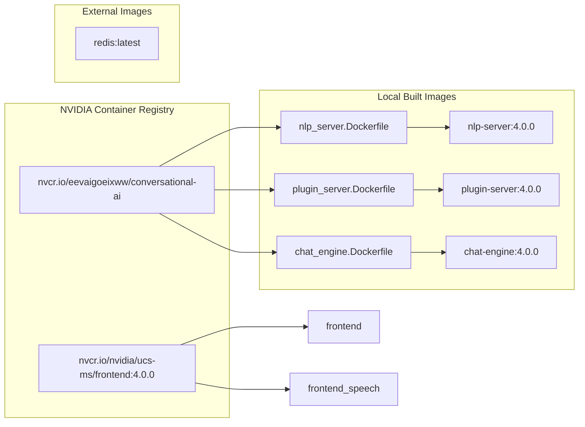
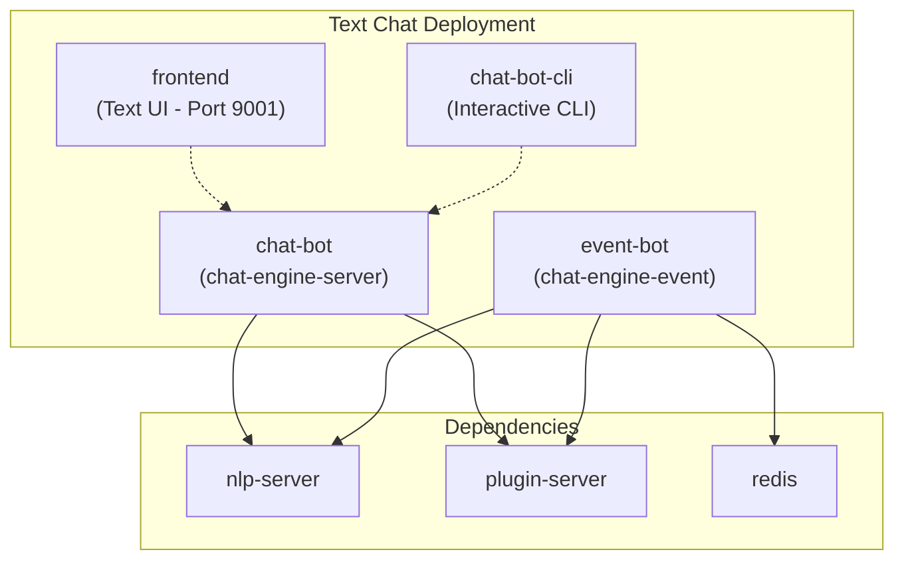
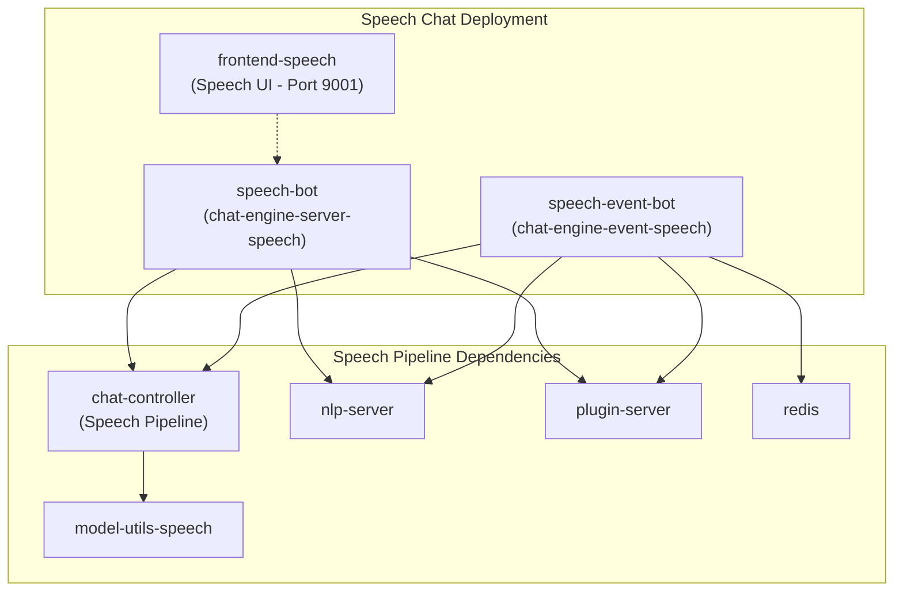

<!-- source: DeepWiki mcp.deepwiki.com · repo NVIDIA/ACE · page 4.1 Docker Deployment · fetched 2026-10-26 -->

# Docker Deployment

<details>
<summary>Relevant source files</summary>

The following files were used as context for generating this wiki page:

- [microservices/ace_agent/4.0/deploy/docker/.env](microservices/ace_agent/4.0/deploy/docker/.env)
- [microservices/ace_agent/4.0/deploy/docker/docker-compose.yml](microservices/ace_agent/4.0/deploy/docker/docker-compose.yml)
- [microservices/ace_agent/4.0/deploy/docker/docker_init.sh](microservices/ace_agent/4.0/deploy/docker/docker_init.sh)
- [microservices/ace_agent/4.0/deploy/docker/dockerfiles/chat_engine.Dockerfile](microservices/ace_agent/4.0/deploy/docker/dockerfiles/chat_engine.Dockerfile)
- [microservices/ace_agent/4.0/deploy/docker/dockerfiles/nlp_server.Dockerfile](microservices/ace_agent/4.0/deploy/docker/dockerfiles/nlp_server.Dockerfile)
- [microservices/ace_agent/4.0/deploy/docker/dockerfiles/plugin_server.Dockerfile](microservices/ace_agent/4.0/deploy/docker/dockerfiles/plugin_server.Dockerfile)

</details>


This document covers the Docker-based deployment architecture for ACE Agent microservices using Docker Compose. The deployment system provides containerized orchestration for all ACE Agent services including chat engines, NLP servers, plugin servers, and speech processing pipelines.

For Kubernetes-based deployment using UCS applications, see [UCS Applications](#4.2). For sample bot configurations and setup, see [Sample Applications](#5).

## Architecture Overview

The Docker deployment architecture consists of containerized microservices orchestrated through Docker Compose. The system supports both text-only and speech-enabled deployment modes with shared infrastructure services.

### Docker Compose Service Architecture



**Sources:** [microservices/ace_agent/4.0/deploy/docker/docker-compose.yml:1-159]()

### Container Registry and Base Images



**Sources:** [microservices/ace_agent/4.0/deploy/docker/docker-compose.yml:4](), [microservices/ace_agent/4.0/deploy/docker/docker-compose.yml:130](), [microservices/ace_agent/4.0/deploy/docker/docker_init.sh:4]()

## Service Definitions

### Core Infrastructure Services

#### Model Utils Services
The `model-utils` and `model-utils-speech` services manage AI model deployment and repository management.

| Service | Container Name | Purpose | GPU Required |
|---------|---------------|---------|--------------|
| `model-utils` | `model-utils` | Standard model deployment | Yes (1 GPU) |
| `model-utils-speech` | `model-utils-speech` | Speech pipeline models | Yes (1 GPU) |

Key configuration:
- Volume mounts: `${PWD}:${PWD}`, `${HOME}/.docker:/.docker`
- Docker socket access: `/var/run/docker.sock`
- Command: `deploy --model_config_path ${PWD}/${BOT_PATH}/model_config.yaml`

**Sources:** [microservices/ace_agent/4.0/deploy/docker/docker-compose.yml:2-24]()

#### Redis Service
Simple Redis container for event streaming and session management.

```yaml
redis:
  container_name: redis-server
  image: redis
  network_mode: 'host'
```

**Sources:** [microservices/ace_agent/4.0/deploy/docker/docker-compose.yml:88-91]()

### ACE Agent Core Services

#### NLP Server
GPU-accelerated natural language processing service with NVIDIA driver support.

| Configuration | Value |
|---------------|--------|
| Base Image | `${DOCKER_REGISTRY}/nlp-server:${TAG}` |
| GPU Reservation | 1 GPU with NVIDIA capabilities |
| Shared Memory | 2GB |
| Workers | 1 |
| Timeout | 200 seconds |

Command: `aceagent nlp-server deploy --timeout 200 --workers 1 --config ${PWD}/${BOT_PATH}/model_config.yaml`

**Sources:** [microservices/ace_agent/4.0/deploy/docker/docker-compose.yml:26-50]()

#### Plugin Server
Business logic extensions and external integrations service.

Command: `aceagent plugin-server deploy -c ${PWD}/${BOT_PATH}/plugin_config.yaml --log-path ${PWD}/log`

**Sources:** [microservices/ace_agent/4.0/deploy/docker/docker-compose.yml:51-67]()

#### Chat Engine Base
Core Colang processing service that serves as the foundation for all chat applications.

Command: `aceagent chat server -c ${PWD}/${BOT_PATH} --log-path ${PWD}/log`

**Sources:** [microservices/ace_agent/4.0/deploy/docker/docker-compose.yml:69-86]()

#### Chat Controller
Speech pipeline orchestrator service for handling audio processing workflows.

| Configuration | Value |
|---------------|--------|
| Base Image | `${DOCKER_REGISTRY}/chat-controller:${TAG}` |
| Pipeline Mode | `${PIPELINE}` (default: `speech_lite`) |
| Config Path | `/workspace/config` |
| Log Path | `/workspace/log` |

Command: `bash run_pipeline.sh --pipeline ${PIPELINE} --speech_config /workspace/config/speech_config.yaml`

**Sources:** [microservices/ace_agent/4.0/deploy/docker/docker-compose.yml:93-105](), [microservices/ace_agent/4.0/deploy/docker/docker_init.sh:1]()

## Configuration Management

### Environment Variables
The deployment uses a `.env` file for sensitive configuration and API keys.

```bash
# API Configuration
OPENAI_API_KEY=${OPENAI_API_KEY}
NVIDIA_API_KEY=${NVIDIA_API_KEY}

# NGC CLI Configuration  
NGC_CLI_API_KEY=${NGC_CLI_API_KEY}
NGC_CLI_ORG=nvidia
NGC_CLI_TEAM=${NGC_CLI_TEAM}
NGC_ORGANIZATION_ID=${NGC_ORGANIZATION_ID}
```

**Sources:** [microservices/ace_agent/4.0/deploy/docker/.env:1-11]()

### Docker Initialization Script
The `docker_init.sh` script sets up deployment-specific environment variables:

```bash
export PIPELINE=speech_lite
export TAG=4.0.0
export DOCKER_REGISTRY=nvcr.io/eevaigoeixww/conversational-ai
export DOCKER_USER=$(id -u):$(id -g)
```

**Sources:** [microservices/ace_agent/4.0/deploy/docker/docker_init.sh:1-9]()

### Volume Mounts and Networking
All services use `network_mode: 'host'` for simplified networking and mount the current working directory for configuration access.

Common volume pattern:
- `${PWD}:${PWD}` - Full workspace access
- `${PWD}/${BOT_PATH}:/workspace/config` - Bot configuration
- `${PWD}/log:/workspace/log` - Logging output

**Sources:** [microservices/ace_agent/4.0/deploy/docker/docker-compose.yml:37-38](), [microservices/ace_agent/4.0/deploy/docker/docker-compose.yml:100-101]()

## Deployment Modes

### Text-Only Deployment Mode



Services included:
- `chat-bot` (depends on `nlp-server`, `plugin-server`)
- `event-bot` (depends on `nlp-server`, `plugin-server`, `redis`)
- `frontend` (text mode on port 9001)
- `chat-bot-cli` (bash shell access)

**Sources:** [microservices/ace_agent/4.0/deploy/docker/docker-compose.yml:107-117](), [microservices/ace_agent/4.0/deploy/docker/docker-compose.yml:128-136]()

### Speech-Enabled Deployment Mode



Services included:
- `speech-bot` (depends on `nlp-server`, `plugin-server`, `chat-controller`)
- `speech-event-bot` (depends on `nlp-server`, `plugin-server`, `chat-controller`, `redis`)
- `frontend-speech` (speech mode on port 9001)
- `model-utils-speech` (speech model deployment)

**Sources:** [microservices/ace_agent/4.0/deploy/docker/docker-compose.yml:143-158](), [microservices/ace_agent/4.0/deploy/docker/docker-compose.yml:138-141]()

## Container Build Process

### Dockerfile Structure
All ACE Agent services use a common pattern for user management and dependency installation:

```dockerfile
ARG BASE_IMAGE
FROM $BASE_IMAGE

ARG HOST_UID
ARG HOST_GID

# Create specified user with home directory
RUN mkdir -p /home/ace-agent
RUN groupadd ace-agent --gid $HOST_GID \
    && useradd ace-agent --uid $HOST_UID --gid $HOST_GID -d /home/ace-agent \
    && chown -R $HOST_UID:$HOST_GID /home/ace-agent

WORKDIR /home/ace-agent
USER $HOST_UID:$HOST_GID
```

This pattern ensures containers run with the host user's UID/GID for proper file permissions.

**Sources:** [microservices/ace_agent/4.0/deploy/docker/dockerfiles/chat_engine.Dockerfile:1-21](), [microservices/ace_agent/4.0/deploy/docker/dockerfiles/nlp_server.Dockerfile:1-21](), [microservices/ace_agent/4.0/deploy/docker/dockerfiles/plugin_server.Dockerfile:1-21]()

### Build Arguments
Docker Compose passes host user information to maintain consistent file ownership:

```yaml
build:
  context: .
  dockerfile: dockerfiles/nlp_server.Dockerfile
  args:
    BASE_IMAGE: ${DOCKER_REGISTRY}/nlp-server:${TAG}
    HOST_UID: ${HOST_UID}
    HOST_GID: ${HOST_GID}
```

**Sources:** [microservices/ace_agent/4.0/deploy/docker/docker-compose.yml:29-34]()

## Usage Patterns

### Standard Deployment Commands
1. Initialize environment: `source docker_init.sh`
2. Set bot path: `export BOT_PATH=path/to/bot/config`
3. Deploy text services: `docker compose up chat-bot event-bot frontend`
4. Deploy speech services: `docker compose up speech-bot speech-event-bot frontend-speech model-utils-speech`

### CLI Access Pattern
The `chat-bot-cli` service provides interactive access to the chat engine:

```yaml
chat-bot-cli:
  <<: *chat-bot
  container_name: chat-engine-cli
  command: bash
```

This allows direct CLI interaction with the running chat engine environment.

**Sources:** [microservices/ace_agent/4.0/deploy/docker/docker-compose.yml:114-117]()

---

