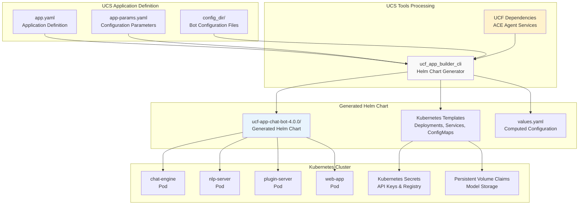
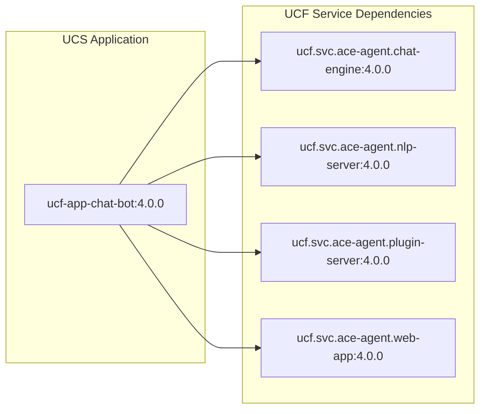
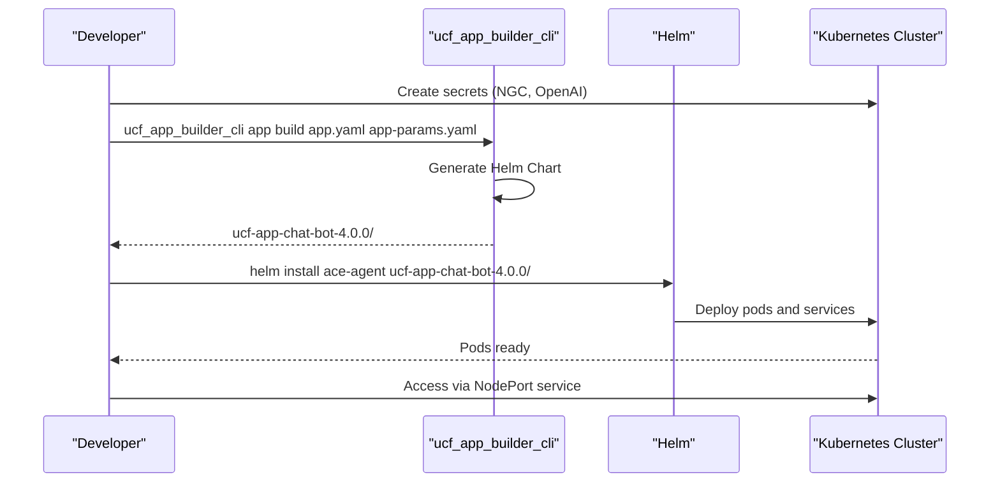
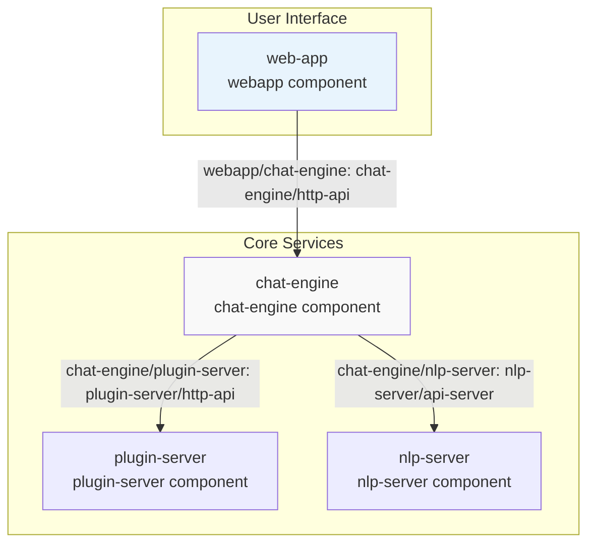
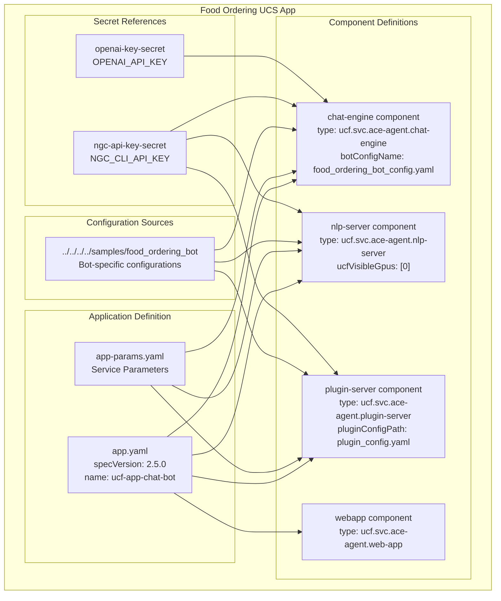

<!-- source: DeepWiki mcp.deepwiki.com · repo NVIDIA/ACE · page 4.2 UCS Applications · fetched 2026-10-26 -->

# UCS Applications

<details>
<summary>Relevant source files</summary>

The following files were used as context for generating this wiki page:

- [microservices/ace_agent/4.0/deploy/ucs_apps/chat_bot/food_ordering_bot/README.md](microservices/ace_agent/4.0/deploy/ucs_apps/chat_bot/food_ordering_bot/README.md)
- [microservices/ace_agent/4.0/deploy/ucs_apps/chat_bot/food_ordering_bot/app-params.yaml](microservices/ace_agent/4.0/deploy/ucs_apps/chat_bot/food_ordering_bot/app-params.yaml)
- [microservices/ace_agent/4.0/deploy/ucs_apps/chat_bot/food_ordering_bot/app.yaml](microservices/ace_agent/4.0/deploy/ucs_apps/chat_bot/food_ordering_bot/app.yaml)

</details>


UCS Applications provide a Kubernetes-based deployment mechanism for ACE Agent systems using NVIDIA's Unified Cloud Services (UCS) tools. These applications generate Helm charts that orchestrate the deployment of multiple ACE Agent microservices with their dependencies, configurations, and interconnections. For Docker-based deployments, see [Docker Deployment](#4.1).

## Architecture Overview

UCS Applications abstract the complexity of Kubernetes deployments by providing declarative YAML configurations that automatically generate Helm charts for ACE Agent microservice deployments.

### UCS Application Structure



Sources: [microservices/ace_agent/4.0/deploy/ucs_apps/chat_bot/food_ordering_bot/app.yaml:1-65](), [microservices/ace_agent/4.0/deploy/ucs_apps/chat_bot/food_ordering_bot/README.md:38-46]()

## Application Definition Structure

### Core Application Manifest

The `app.yaml` file defines the UCS application structure with the following key sections:

| Section | Purpose | Example |
|---------|---------|---------|
| `specVersion` | UCS specification version | `2.5.0` |
| `name` | Application identifier | `ucf-app-chat-bot` |
| `dependencies` | Required UCF services | `ucf.svc.ace-agent.chat-engine:4.0.0` |
| `components` | Service component definitions | `chat-engine`, `nlp-server`, `plugin-server`, `web-app` |
| `connections` | Inter-service connectivity | `chat-engine/plugin-server: plugin-server/http-api` |
| `secrets` | Kubernetes secret mappings | `ngc-api-key-secret`, `openai-key-secret` |

### Service Dependencies

UCS applications declare dependencies on specific ACE Agent microservices:



Sources: [microservices/ace_agent/4.0/deploy/ucs_apps/chat_bot/food_ordering_bot/app.yaml:9-13]()

## Deployment Workflow

### Pre-Deployment Setup

UCS applications require specific Kubernetes secrets for authentication and API access:

| Secret Name | Purpose | Environment Variable |
|-------------|---------|---------------------|
| `ngc-docker-reg-secret` | NGC container registry access | `NGC_CLI_API_KEY` |
| `ngc-api-key-secret` | NGC model downloads | `NGC_CLI_API_KEY` |
| `openai-key-secret` | OpenAI API access | `OPENAI_API_KEY` |

### Build and Deploy Process



Sources: [microservices/ace_agent/4.0/deploy/ucs_apps/chat_bot/food_ordering_bot/README.md:20-53]()

## Configuration Management

### Service Parameters

The `app-params.yaml` file provides service-specific configuration parameters:

```yaml
chat-engine:
  botConfigName: food_ordering_bot_config.yaml
  logLevel: "DEBUG"
  gunicornWorkers: "1"
  gunicornTimeout: "150"

nlp-server:
  ucfVisibleGpus: [0]
  modelConfigPath: "model_config.yaml"
  gunicornWorkers: "4"
  gunicornTimeout: "120"

plugin-server:
  pluginConfigPath: "plugin_config.yaml"
```

### File Mapping

UCS applications map configuration directories to service containers using the `files` section:

| Component | Config Source | Purpose |
|-----------|---------------|---------|
| `nlp-server` | `../../../../samples/food_ordering_bot` | Model and NLP configurations |
| `chat-engine` | `../../../../samples/food_ordering_bot` | Bot conversation logic |
| `plugin-server` | `../../../../samples/food_ordering_bot` | External plugin configurations |

Sources: [microservices/ace_agent/4.0/deploy/ucs_apps/chat_bot/food_ordering_bot/app-params.yaml:1-18](), [microservices/ace_agent/4.0/deploy/ucs_apps/chat_bot/food_ordering_bot/app.yaml:34-53]()

## Service Interconnections

### Component Communication

UCS applications define inter-service connections through the `connections` section:



Sources: [microservices/ace_agent/4.0/deploy/ucs_apps/chat_bot/food_ordering_bot/app.yaml:60-63]()

## Food Ordering Bot Example

### Application Structure

The food ordering bot UCS application demonstrates a complete ACE Agent deployment with the following structure:



### Deployment Commands

The food ordering bot follows the standard UCS deployment workflow:

1. **Secret Creation**: Create required Kubernetes secrets for NGC and OpenAI access
2. **Chart Generation**: Use `ucf_app_builder_cli app build app.yaml app-params.yaml` to generate Helm chart
3. **Deployment**: Execute `helm install ace-agent ucf-app-chat-bot-4.0.0/` to deploy
4. **Access**: Connect via NodePort service on the `ace-agent-webapp-deployment-service`
5. **Cleanup**: Remove with `helm uninstall ace-agent` and `kubectl delete pvc --all`

Sources: [microservices/ace_agent/4.0/deploy/ucs_apps/chat_bot/food_ordering_bot/README.md:1-61](), [microservices/ace_agent/4.0/deploy/ucs_apps/chat_bot/food_ordering_bot/app.yaml:1-65](), [microservices/ace_agent/4.0/deploy/ucs_apps/chat_bot/food_ordering_bot/app-params.yaml:1-18]()

---

