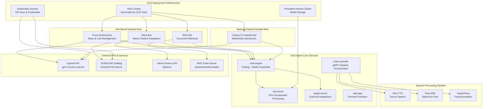
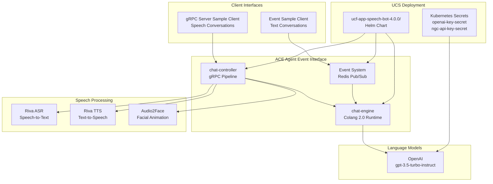

<!-- source: DeepWiki mcp.deepwiki.com · repo NVIDIA/ACE · page 5 Sample Applications · fetched 2026-10-26 -->

# Sample Applications

Relevant source files

The following files were used as context for generating this wiki page:

- [microservices/ace_agent/4.0/deploy/ucs_apps/chat_bot/food_ordering_bot/README.md](microservices/ace_agent/4.0/deploy/ucs_apps/chat_bot/food_ordering_bot/README.md)
- [microservices/ace_agent/4.0/deploy/ucs_apps/chat_bot/rag_bot/README.md](microservices/ace_agent/4.0/deploy/ucs_apps/chat_bot/rag_bot/README.md)
- [microservices/ace_agent/4.0/deploy/ucs_apps/chat_bot/stock_bot/README.md](microservices/ace_agent/4.0/deploy/ucs_apps/chat_bot/stock_bot/README.md)
- [microservices/ace_agent/4.0/deploy/ucs_apps/speech_bot/colang2_sample_bot/README.md](microservices/ace_agent/4.0/deploy/ucs_apps/speech_bot/colang2_sample_bot/README.md)

This document provides an overview of the sample bot implementations included with the NVIDIA ACE Agent framework. These applications demonstrate different capabilities and use cases, ranging from simple text-based conversational bots to advanced speech-enabled multimodal interactions. The samples serve as reference implementations for building custom conversational AI agents using the ACE Agent microservices architecture.

For details on the underlying ACE Agent microservices that power these applications, see [ACE Agent Framework](#3). For deployment infrastructure and Kubernetes-based UCS applications, see [UCS Applications](#4.2).

## Sample Application Architecture

The following diagram shows how the sample applications integrate with the ACE Agent framework components:

**Sample Applications Integration with ACE Agent Framework**

Sources: [microservices/ace_agent/4.0/deploy/ucs_apps/chat_bot/food_ordering_bot/README.md:1-61](), [microservices/ace_agent/4.0/deploy/ucs_apps/chat_bot/stock_bot/README.md:1-61](), [microservices/ace_agent/4.0/deploy/ucs_apps/chat_bot/rag_bot/README.md:1-56](), [microservices/ace_agent/4.0/deploy/ucs_apps/speech_bot/colang2_sample_bot/README.md:1-63]()

## Sample Bot Capabilities Overview

The following table summarizes the key capabilities and characteristics of each sample bot:

| Bot Name | Primary Use Case | Language Model | External APIs | Interface | Deployment Type |
|----------|------------------|----------------|---------------|-----------|----------------|
| Food Ordering Bot | Restaurant ordering system | `gpt-3.5-turbo-instruct` | None | Text/Web | `chat_bot` UCS app |
| Stock Bot | Financial market queries | `mixtral-8x7b-instruct-v0.1` | Yahoo Finance API | Text/Web | `chat_bot` UCS app |
| RAG Bot | Document-based Q&A | Configurable | RAG Chain Server | Text/Web | `chat_bot` UCS app |
| Colang 2.0 Sample Bot | Multimodal conversation | `gpt-3.5-turbo-instruct` | None | Speech/Event | `speech_bot` UCS app |

Sources: [microservices/ace_agent/4.0/deploy/ucs_apps/chat_bot/food_ordering_bot/README.md:30-36](), [microservices/ace_agent/4.0/deploy/ucs_apps/chat_bot/stock_bot/README.md:30-36](), [microservices/ace_agent/4.0/deploy/ucs_apps/chat_bot/rag_bot/README.md:30-32](), [microservices/ace_agent/4.0/deploy/ucs_apps/speech_bot/colang2_sample_bot/README.md:33-39]()

## Text-Based Chat Bots

The text-based sample bots demonstrate different patterns for building conversational AI applications using the ACE Agent `chat-engine` service. These bots utilize HTTP-based interfaces and can be accessed through the web application frontend.

### Food Ordering Bot

The food ordering bot implements a virtual assistant for restaurant ordering workflows. It demonstrates menu management, cart operations, and bill calculation capabilities.

**Key Features:**
- Menu item listing and browsing
- Shopping cart management with add/remove operations
- Order total calculation and bill generation
- OpenAI `gpt-3.5-turbo-instruct` integration for natural language understanding

**UCS Application Structure:**
- Located at [microservices/ace_agent/4.0/deploy/ucs_apps/chat_bot/food_ordering_bot/]()
- Uses `app.yaml` and `app-params.yaml` for UCS application configuration
- Generates Helm chart: `ucf-app-chat-bot-4.0.0/`
- Requires `openai-key-secret` Kubernetes secret

Sources: [microservices/ace_agent/4.0/deploy/ucs_apps/chat_bot/food_ordering_bot/README.md:1-6](), [microservices/ace_agent/4.0/deploy/ucs_apps/chat_bot/food_ordering_bot/README.md:30-46]()

### Stock Bot

The stock bot provides real-time financial market information and stock price queries using the Yahoo Finance API integration.

**Key Features:**
- Live stock price retrieval for specified companies
- Stock market related question answering
- Topic-focused guardrails (only stock-related queries)
- NVIDIA API Catalog `mixtral-8x7b-instruct-v0.1` model integration

**External Dependencies:**
- Yahoo Finance API via `yfinance` Python library
- NVIDIA API Catalog for model inference
- Requires `custom-env-secrets` with `NVIDIA_API_KEY`

Sources: [microservices/ace_agent/4.0/deploy/ucs_apps/chat_bot/stock_bot/README.md:1-6](), [microservices/ace_agent/4.0/deploy/ucs_apps/chat_bot/stock_bot/README.md:30-36]()

### RAG Bot

The RAG (Retrieval Augmented Generation) bot demonstrates document-based question answering using external knowledge sources through the NVIDIA GenerativeAIExamples framework.

**Key Features:**
- Integration with RAG Chain Server for document retrieval
- Support for external knowledge base queries
- Configurable model backends through RAG server
- Integration with NVIDIA Enterprise RAG LLM Operator

**Architecture Dependencies:**
- Requires deployed RAG Chain Server from GenerativeAIExamples repository
- `rag-server` component configuration in `app.yaml`
- Can integrate with NVIDIA API Catalog examples

Sources: [microservices/ace_agent/4.0/deploy/ucs_apps/chat_bot/rag_bot/README.md:1-6](), [microservices/ace_agent/4.0/deploy/ucs_apps/chat_bot/rag_bot/README.md:30-32]()

## Speech-Enabled Bots

Speech-enabled bots leverage the full ACE Agent pipeline including `chat-controller`, speech processing services (Riva ASR/TTS), and the event-based interface for multimodal interactions.

### Colang 2.0 Sample Bot

The Colang 2.0 sample bot showcases advanced conversational AI capabilities using the next-generation Colang runtime with multimodal interaction support.

**Colang 2.0 Features:**
- Parallel actions and hierarchical flows
- UMIM (Universal Multimodal Interaction Model) actions and events
- Advanced guardrailing with profanity handling
- Date/time context integration for recent information queries
- Asynchronous, event-based interaction patterns

**Technical Architecture:**

**Deployment Characteristics:**
- Uses `speech_bot` UCS application type instead of `chat_bot`
- Supports both gRPC speech interface and event-based text interface
- Requires Riva services for speech processing pipeline
- Generates `ucf-app-speech-bot-4.0.0/` Helm chart

Sources: [microservices/ace_agent/4.0/deploy/ucs_apps/speech_bot/colang2_sample_bot/README.md:1-8](), [microservices/ace_agent/4.0/deploy/ucs_apps/speech_bot/colang2_sample_bot/README.md:40-56]()

## Common Deployment Patterns

All sample applications follow standardized UCS deployment patterns with common prerequisites and infrastructure requirements:

**Prerequisites:**
- NVIDIA GPU Cloud (NGC) access and authentication
- UCS tools installation with Helm, Kubernetes, and GPU Operator
- Local Path Provisioner for persistent volume management
- NVIDIA datacenter GPU (Volta, Turing, Ampere, Ada Lovelace, or Hopper)

**Standard Kubernetes Secrets:**
- `ngc-docker-reg-secret`: Container registry authentication
- `ngc-api-key-secret`: NGC resource access
- Model-specific secrets: `openai-key-secret`, `custom-env-secrets`

**Deployment Workflow:**
1. Create required Kubernetes secrets
2. Configure model API keys
3. Generate Helm chart using `ucf_app_builder_cli app build`
4. Deploy with `helm install ace-agent <chart-name>/`
5. Monitor with `kubectl get pods`
6. Access via webapp service nodeport
7. Cleanup with `helm uninstall` and `kubectl delete pvc --all`

Sources: [microservices/ace_agent/4.0/deploy/ucs_apps/chat_bot/food_ordering_bot/README.md:7-61](), [microservices/ace_agent/4.0/deploy/ucs_apps/chat_bot/stock_bot/README.md:7-61](), [microservices/ace_agent/4.0/deploy/ucs_apps/chat_bot/rag_bot/README.md:7-56](), [microservices/ace_agent/4.0/deploy/ucs_apps/speech_bot/colang2_sample_bot/README.md:10-63]()

---

