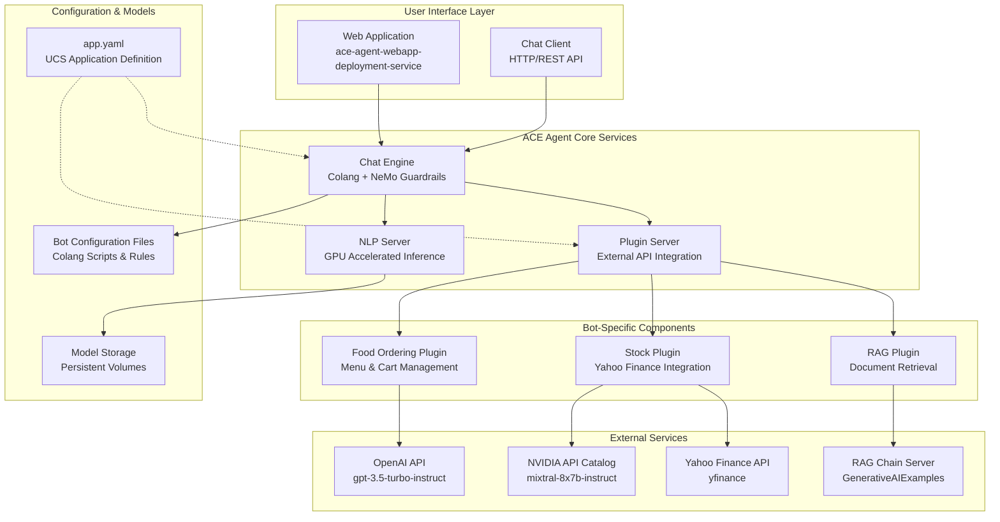
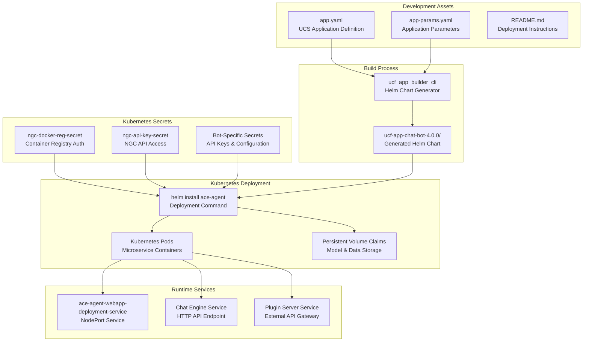

<!-- source: DeepWiki mcp.deepwiki.com · repo NVIDIA/ACE · page 5.1 Chat Bots · fetched 2026-10-26 -->

# Chat Bots

<details>
<summary>Relevant source files</summary>

The following files were used as context for generating this wiki page:

- [microservices/ace_agent/4.0/deploy/ucs_apps/chat_bot/food_ordering_bot/README.md](microservices/ace_agent/4.0/deploy/ucs_apps/chat_bot/food_ordering_bot/README.md)
- [microservices/ace_agent/4.0/deploy/ucs_apps/chat_bot/rag_bot/README.md](microservices/ace_agent/4.0/deploy/ucs_apps/chat_bot/rag_bot/README.md)
- [microservices/ace_agent/4.0/deploy/ucs_apps/chat_bot/stock_bot/README.md](microservices/ace_agent/4.0/deploy/ucs_apps/chat_bot/stock_bot/README.md)

</details>


## Purpose and Scope

This section covers the text-based conversational chat bots included in the ACE Agent sample applications. These bots demonstrate different conversation patterns and external service integrations using the ACE Agent framework. The chat bots are designed for text-to-text interactions through HTTP APIs and web interfaces.

For voice-enabled conversational bots with speech processing capabilities, see [Speech Bots](#5.2).

## Chat Bot Architecture

The ACE Agent chat bots are built on a microservices architecture that integrates with the core ACE Agent framework. Each bot consists of specialized components that handle conversation logic, external API integrations, and user interface presentation.

### Bot Integration with ACE Agent Framework



Sources: [microservices/ace_agent/4.0/deploy/ucs_apps/chat_bot/food_ordering_bot/README.md:1-61](), [microservices/ace_agent/4.0/deploy/ucs_apps/chat_bot/stock_bot/README.md:1-61](), [microservices/ace_agent/4.0/deploy/ucs_apps/chat_bot/rag_bot/README.md:1-56]()

## Deployment Architecture

All chat bots follow a consistent deployment pattern using NVIDIA's UCS (Unified Cloud Services) application framework with Kubernetes and Helm charts.

### UCS Application Deployment Structure



Sources: [microservices/ace_agent/4.0/deploy/ucs_apps/chat_bot/food_ordering_bot/README.md:38-46](), [microservices/ace_agent/4.0/deploy/ucs_apps/chat_bot/stock_bot/README.md:38-46](), [microservices/ace_agent/4.0/deploy/ucs_apps/chat_bot/rag_bot/README.md:33-40]()

## Chat Bot Types

### Food Ordering Bot

The Food Ordering Bot is a virtual assistant for restaurant ordering scenarios. It demonstrates conversation state management and business logic integration.

**Key Capabilities:**
- Menu item listing and search
- Shopping cart management  
- Order total calculation
- Multi-turn conversation handling

**Technology Stack:**
- OpenAI `gpt-3.5-turbo-instruct` for natural language processing
- Custom plugin for menu and cart operations
- Colang scripting for conversation flow

**Deployment Location:** [microservices/ace_agent/4.0/deploy/ucs_apps/chat_bot/food_ordering_bot/README.md:1-61]()

### Stock Bot

The Stock Bot provides real-time stock market information and financial query assistance using external financial APIs.

**Key Capabilities:**
- Live stock price retrieval
- Company stock information lookup
- Stock market general knowledge Q&A
- Topic filtering for financial queries only

**Technology Stack:**
- NVIDIA API Catalog `mixtral-8x7b-instruct-v0.1` model
- Yahoo Finance API (`yfinance` library)
- Custom financial data plugin

**Deployment Location:** [microservices/ace_agent/4.0/deploy/ucs_apps/chat_bot/stock_bot/README.md:1-61]()

### RAG Bot

The RAG (Retrieval Augmented Generation) Bot demonstrates document-based question answering using external knowledge sources.

**Key Capabilities:**
- Document retrieval from knowledge bases
- Context-aware answer generation
- Integration with GenerativeAIExamples framework
- Scalable knowledge source integration

**Technology Stack:**
- NVIDIA GenerativeAIExamples RAG framework
- External RAG Chain Server
- NVIDIA Enterprise RAG LLM Operator support

**Deployment Location:** [microservices/ace_agent/4.0/deploy/ucs_apps/chat_bot/rag_bot/README.md:1-56]()

## Common Deployment Requirements

All chat bots share the following infrastructure requirements and setup procedures:

### Prerequisites

| Requirement | Description |
|-------------|-------------|
| NGC Access | NVIDIA GPU Cloud account and API key |
| UCS Tools | Unified Cloud Services toolchain |
| Kubernetes | MicroK8s or equivalent cluster |
| GPU Support | NVIDIA Volta/Turing/Ampere/Ada/Hopper architecture |
| Storage | Local Path Provisioner for persistent volumes |

### Required Kubernetes Secrets

| Secret Name | Purpose | Used By |
|-------------|---------|---------|
| `ngc-docker-reg-secret` | Container registry authentication | All bots |
| `ngc-api-key-secret` | NGC API access | All bots |
| `openai-key-secret` | OpenAI API authentication | Food Ordering Bot |
| `custom-env-secrets` | NVIDIA API Catalog access | Stock Bot |

### Standard Deployment Commands

```bash
# Generate Helm chart from UCS application
ucf_app_builder_cli app build app.yaml app-params.yaml

# Deploy using Helm
helm install ace-agent ucf-app-chat-bot-4.0.0/

# Monitor deployment
watch kubectl get pods

# Access via web interface
kubectl get svc  # Get nodeport for ace-agent-webapp-deployment-service

# Cleanup deployment
helm uninstall ace-agent
kubectl delete pvc --all
```

Sources: [microservices/ace_agent/4.0/deploy/ucs_apps/chat_bot/food_ordering_bot/README.md:20-60](), [microservices/ace_agent/4.0/deploy/ucs_apps/chat_bot/stock_bot/README.md:20-60](), [microservices/ace_agent/4.0/deploy/ucs_apps/chat_bot/rag_bot/README.md:20-55]()

## Integration Points

### Web Interface Access

All chat bots provide web-based interaction through the `ace-agent-webapp-deployment-service` NodePort service. Users access the bot via `http://<workstation-ip>:<webapp-nodeport>` after deployment.

### API Integration

The bots integrate with the ACE Agent Chat Engine through standard HTTP REST APIs, enabling programmatic interaction and integration with external systems.

### Plugin Architecture

Each bot implements custom plugins through the Plugin Server component, allowing for specialized business logic and external service integration while maintaining the common ACE Agent framework.

Sources: [microservices/ace_agent/4.0/deploy/ucs_apps/chat_bot/food_ordering_bot/README.md:53](), [microservices/ace_agent/4.0/deploy/ucs_apps/chat_bot/stock_bot/README.md:53](), [microservices/ace_agent/4.0/deploy/ucs_apps/chat_bot/rag_bot/README.md:48]()

---

