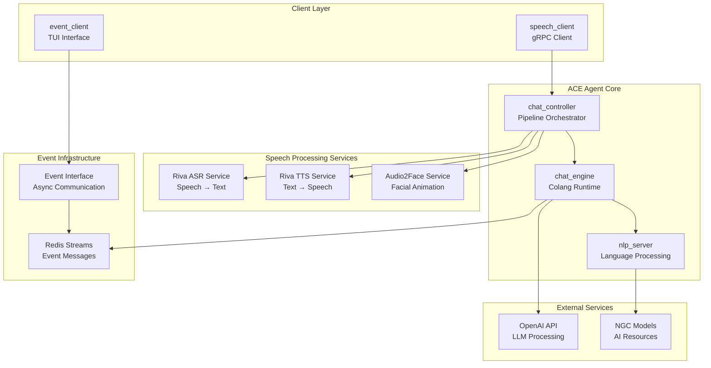
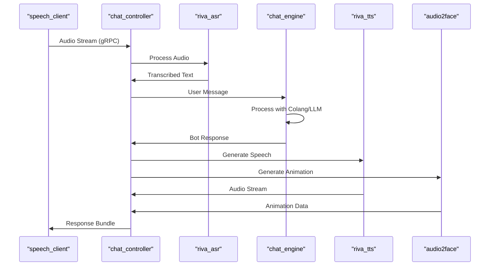
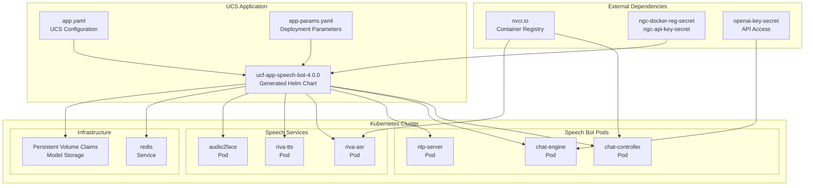

<!-- source: DeepWiki mcp.deepwiki.com · repo NVIDIA/ACE · page 5.2 Speech Bots · fetched 2026-10-26 -->

# Speech Bots

Relevant source files

The following files were used as context for generating this wiki page:

- [microservices/ace_agent/4.0/deploy/ucs_apps/speech_bot/colang2_sample_bot/README.md](microservices/ace_agent/4.0/deploy/ucs_apps/speech_bot/colang2_sample_bot/README.md)

This document covers voice-enabled conversational bots built on the NVIDIA ACE Agent framework that support speech processing pipelines including automatic speech recognition (ASR), text-to-speech (TTS), and multimodal interaction capabilities. Speech bots extend the basic text-based conversational capabilities by integrating with NVIDIA's Riva Speech AI services and Audio2Face animation systems.

For text-only conversational bots without speech capabilities, see [Chat Bots](#5.1). For specific implementation details of the Colang 2.0 speech bot sample, see [Colang 2.0 Sample Bot](#5.2.1).

## Architecture Overview

Speech bots in the ACE Agent ecosystem integrate multiple microservices to provide end-to-end voice interaction capabilities. The architecture supports both streaming audio processing and event-driven conversations.

**Speech Bot System Architecture**

Sources: [microservices/ace_agent/4.0/deploy/ucs_apps/speech_bot/colang2_sample_bot/README.md:1-63]()

## Core Components

Speech bots leverage several key components within the ACE Agent framework:

### Chat Controller Service
The `chat_controller` service orchestrates the entire speech processing pipeline, managing the flow between ASR, language processing, TTS, and animation services. It provides gRPC endpoints for streaming audio input and output.

### Speech Processing Pipeline
The speech pipeline integrates three main NVIDIA services:

| Service | Function | Input | Output |
|---------|----------|--------|---------|
| `Riva ASR` | Speech Recognition | Audio streams | Transcribed text |
| `Riva TTS` | Speech Synthesis | Text responses | Audio streams |
| `Audio2Face` | Facial Animation | Audio + metadata | Animation data |

### Event Interface Integration
Speech bots support asynchronous event-based interactions through Redis streams, enabling real-time multimodal conversations beyond simple request-response patterns.

**Speech Processing Flow**

Sources: [microservices/ace_agent/4.0/deploy/ucs_apps/speech_bot/colang2_sample_bot/README.md:8-9]()

## Colang 2.0 Integration

Speech bots leverage Colang 2.0's multimodal capabilities for advanced conversation management. Colang 2.0 provides:

- **Parallel Actions**: Multiple conversation flows executing simultaneously
- **Hierarchical Flows**: Nested conversation contexts and state management
- **UMIM Actions**: Unified multimodal interaction management
- **Event-driven Architecture**: Asynchronous message handling through Redis streams

The Colang 2.0 runtime processes both text and speech inputs through the same conversation engine, enabling seamless multimodal interactions.

Sources: [microservices/ace_agent/4.0/deploy/ucs_apps/speech_bot/colang2_sample_bot/README.md:4-8]()

## Deployment Architecture

Speech bots deploy as UCS (Unified Cloud Services) applications using Kubernetes and Helm charts. The deployment includes all required microservices and their dependencies.

**UCS Speech Bot Deployment**

Sources: [microservices/ace_agent/4.0/deploy/ucs_apps/speech_bot/colang2_sample_bot/README.md:21-48]()

## Client Interactions

Speech bots support multiple client interaction patterns:

### gRPC Speech Client
The `speech_client` provides streaming audio interface for real-time voice conversations using gRPC protocols.

### Event Client Interface  
The `event_client` offers text-based interaction through terminal UI for development and testing purposes, communicating via Redis event streams.

### API Requirements
Speech bot deployments require several API keys and secrets:

- `NGC_CLI_API_KEY`: Access to NVIDIA GPU Cloud resources
- `OPENAI_API_KEY`: Integration with OpenAI language models
- `ngc-docker-reg-secret`: Container registry access
- `ngc-api-key-secret`: NGC API access

Sources: [microservices/ace_agent/4.0/deploy/ucs_apps/speech_bot/colang2_sample_bot/README.md:23-39](), [microservices/ace_agent/4.0/deploy/ucs_apps/speech_bot/colang2_sample_bot/README.md:55-56]()

## Infrastructure Prerequisites

Speech bots require specific infrastructure components:

- **GPU Requirements**: NVIDIA Volta, Turing, Ampere, Ada Lovelace, or Hopper architecture GPUs
- **Kubernetes Setup**: UCS tools, Helm, GPU Operator
- **Storage**: Local Path Provisioner for persistent volume claims
- **Container Runtime**: Docker with NGC registry access

The deployment uses `mdx-local-path` storage provisioner for model persistence and requires NVIDIA data center GPUs for optimal performance.

Sources: [microservices/ace_agent/4.0/deploy/ucs_apps/speech_bot/colang2_sample_bot/README.md:10-19]()

---

