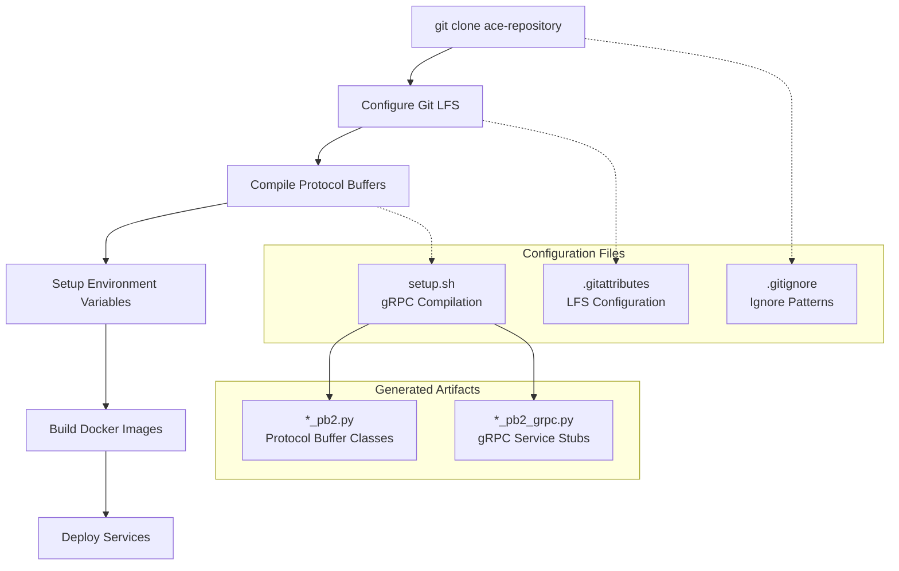
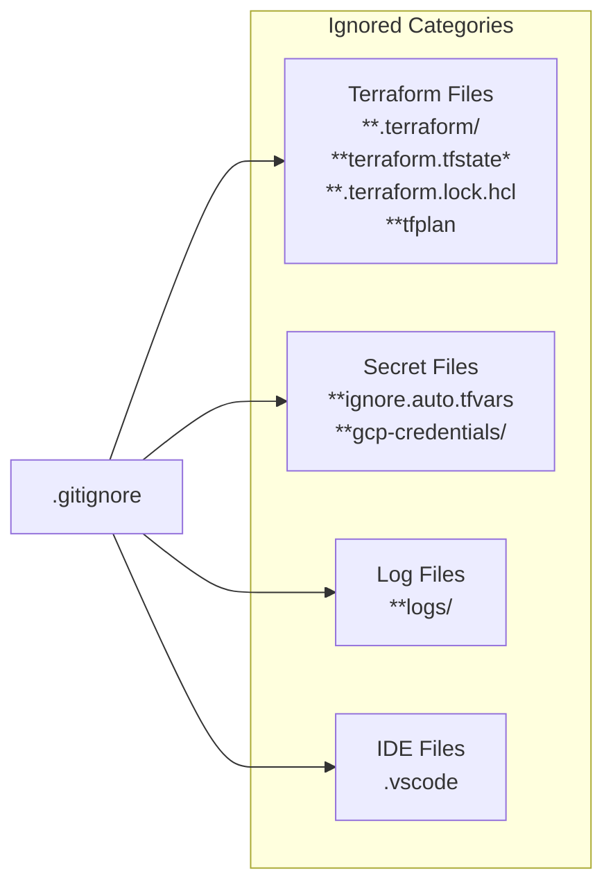
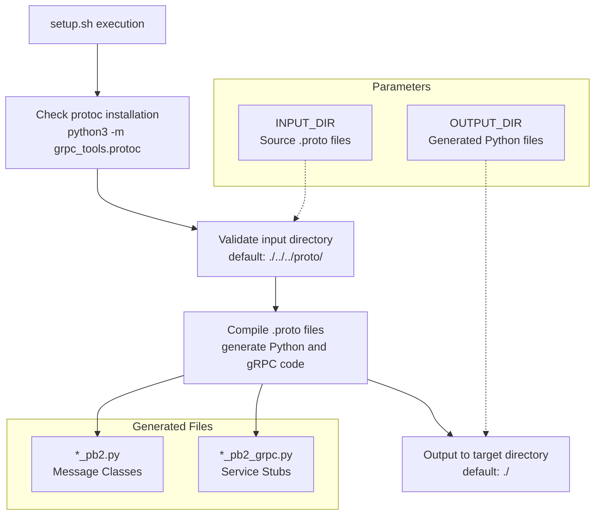

<!-- source: DeepWiki mcp.deepwiki.com · repo NVIDIA/ACE · page 6 Development & Setup · fetched 2026-10-26 -->

# Development & Setup

<details>
<summary>Relevant source files</summary>

The following files were used as context for generating this wiki page:

- [.gitattributes](.gitattributes)
- [.gitignore](.gitignore)
- [microservices/ace_agent/4.0/clients/speech_client/setup.sh](microservices/ace_agent/4.0/clients/speech_client/setup.sh)

</details>


This document covers the essential setup information for developers working with the NVIDIA ACE repository, including repository configuration, development environment preparation, and build processes. This page focuses on the foundational development setup required before deploying or running ACE Agent services.

For information about deploying ACE Agent services, see [Deployment & Infrastructure](#4). For details about the microservices architecture, see [ACE Agent Framework](#3).

## Development Workflow Overview

The NVIDIA ACE development environment involves several key components that developers must configure properly. The following diagram illustrates the primary development setup workflow:



**Sources:** [.gitattributes:1-25](), [.gitignore:1-9](), [microservices/ace_agent/4.0/clients/speech_client/setup.sh:1-29]()

## Repository Configuration

### Git LFS Setup

The repository uses Git Large File Storage (LFS) to manage large binary files efficiently. The LFS configuration is defined in `.gitattributes` and includes several file categories:

| File Type | Extensions | Purpose |
|-----------|------------|---------|
| Archives | `*.7z`, `*.br`, `*.gz`, `*.tar`, `*.zip` | Compressed distributions |
| Documents | `*.pdf` | Documentation files |
| Images | `*.gif`, `*.ico`, `*.jpg`, `*.png`, `*.psd`, `*.webp` | Graphics and UI assets |
| Fonts | `*.woff2` | Web font files |
| Binaries | `*.exe`, `*.bin`, `*.dll`, `*.lib` | Compiled executables and libraries |
| Audio | `*.wav` | Audio files (special handling) |

The audio files (`.wav`) are configured with `!text !filter !merge !diff` to prevent Git from processing them as text files while excluding them from LFS tracking.

**Sources:** [.gitattributes:1-25]()

### Repository Ignore Patterns

The `.gitignore` file defines patterns for files that should not be tracked by Git:



**Sources:** [.gitignore:1-9]()

## Build & Setup Scripts

### Protocol Buffer Compilation

The development environment includes automated scripts for compiling Protocol Buffer definitions into Python code. The primary script is located at `microservices/ace_agent/4.0/clients/speech_client/setup.sh`.

#### Script Functionality

The `setup.sh` script performs the following operations:



#### Script Parameters

| Parameter | Default Value | Description |
|-----------|---------------|-------------|
| `INPUT_DIR` | `./../../proto/` | Directory containing `.proto` files |
| `OUTPUT_DIR` | `./` | Target directory for generated Python files |

#### Compilation Command

The script executes the following `protoc` command:

```bash
python3 -m grpc_tools.protoc \
  --proto_path=${INPUT_DIR} \
  --python_out=${OUTPUT_DIR} \
  --grpc_python_out=${OUTPUT_DIR} \
  ${INPUT_DIR}*.proto
```

This command generates two types of files:
- `*_pb2.py`: Contains Protocol Buffer message classes
- `*_pb2_grpc.py`: Contains gRPC service stub implementations

**Sources:** [microservices/ace_agent/4.0/clients/speech_client/setup.sh:1-29]()

### Error Handling

The setup script includes comprehensive error checking:

1. **Dependency Validation**: Verifies `grpc_tools.protoc` is available [microservices/ace_agent/4.0/clients/speech_client/setup.sh:9-13]()
2. **Directory Validation**: Confirms input directory exists [microservices/ace_agent/4.0/clients/speech_client/setup.sh:16-19]()
3. **Compilation Verification**: Checks compilation success [microservices/ace_agent/4.0/clients/speech_client/setup.sh:24-27]()

Each validation step provides clear error messages and exits with appropriate status codes for integration with automated build systems.

**Sources:** [microservices/ace_agent/4.0/clients/speech_client/setup.sh:9-27]()

## Development Environment Requirements

Based on the repository configuration and build scripts, developers need the following tools and dependencies:

| Tool | Purpose | Validation Method |
|------|---------|------------------|
| `git` | Repository management | Standard Git installation |
| `git-lfs` | Large file handling | Required for binary assets |
| `python3` | Runtime environment | Version 3.6+ recommended |
| `grpc_tools` | Protocol buffer compilation | `python3 -m grpc_tools.protoc` |

The repository structure and configuration files ensure that developers can quickly establish a working environment for building and testing ACE Agent applications.

**Sources:** [.gitattributes:1-25](), [.gitignore:1-9](), [microservices/ace_agent/4.0/clients/speech_client/setup.sh:1-29]()

---

