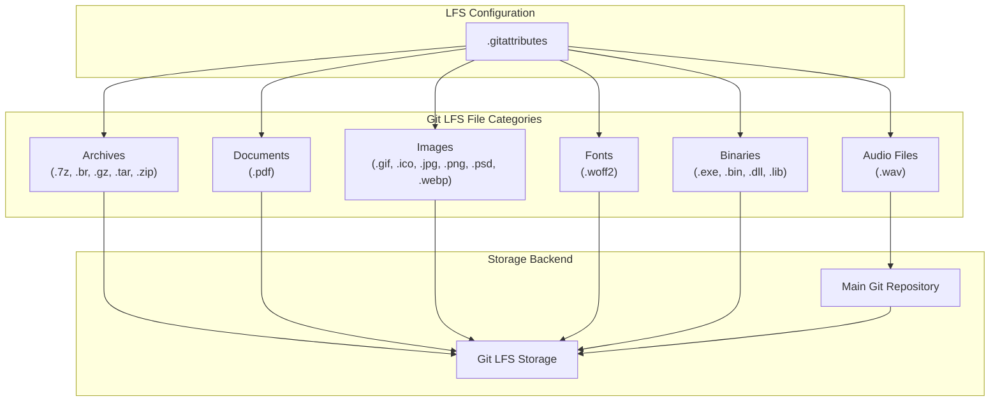
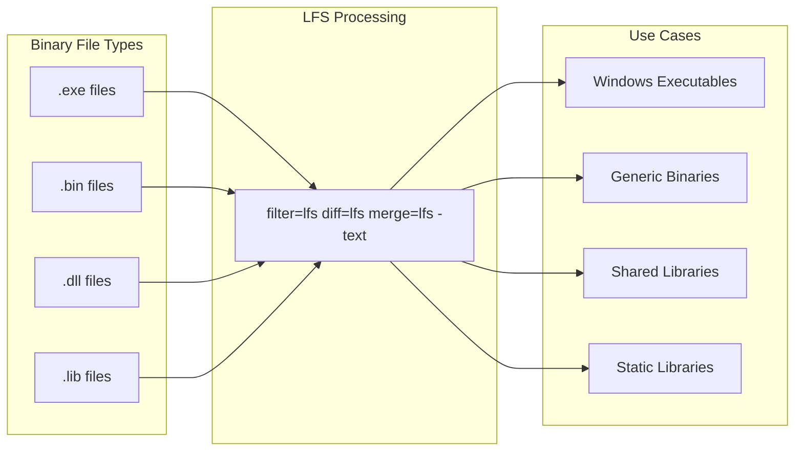
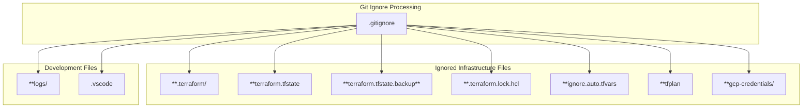

<!-- source: DeepWiki mcp.deepwiki.com · repo NVIDIA/ACE · page 6.1 Repository Configuration · fetched 2026-10-26 -->

# Repository Configuration

Relevant source files

The following files were used as context for generating this wiki page:

- [.gitattributes](.gitattributes)
- [.gitignore](.gitignore)

This document covers the Git repository configuration for the NVIDIA ACE codebase, including Large File Storage (LFS) setup for handling digital assets and ignore patterns for development artifacts. The configuration is designed to support the complex ecosystem of microservices, container images, and AI models that comprise the ACE Agent framework.

For information about setting up the development environment and build processes, see [Build & Setup Scripts](#6.2). For deployment configuration, see [Docker Deployment](#4.1) and [UCS Applications](#4.2).

## Git Large File Storage Configuration

The NVIDIA ACE repository is configured to use Git LFS to efficiently handle large binary files common in digital human applications. The LFS configuration ensures that media assets, pre-trained models, and compiled binaries are properly versioned without bloating the main repository.

### LFS File Type Mapping

The repository uses comprehensive LFS rules defined in `.gitattributes` to automatically track specific file types:

**Sources:** [.gitattributes:1-25]()

### Archive File Handling

Archive files are automatically tracked by LFS using the `filter=lfs diff=lfs merge=lfs -text` configuration:

| File Extension | LFS Tracking | Purpose in ACE |
|----------------|--------------|----------------|
| `.7z` | Yes | Compressed model archives |
| `.br` | Yes | Brotli compressed assets |  
| `.gz` | Yes | Gzipped deployment artifacts |
| `.tar` | Yes | Container layer archives |
| `.zip` | Yes | Sample data packages |

**Sources:** [.gitattributes:2-6]()

### Media Asset Management

Digital human applications require various media assets that are efficiently managed through LFS:

- **Documents**: PDF files for documentation and specifications [.gitattributes:9]()
- **Images**: Various formats for textures, UI assets, and reference materials [.gitattributes:11-16]() 
- **Fonts**: Web fonts for UI components [.gitattributes:18]()

### Binary Executable Tracking

Compiled binaries and libraries are tracked through LFS to support cross-platform deployment:

**Sources:** [.gitattributes:20-23]()

### Audio File Special Handling

Audio files receive special treatment in the configuration. The `.wav` files are configured with `!text !filter !merge !diff`, indicating they should be stored in the main repository without LFS processing, likely due to their use in testing or as small reference files.

**Sources:** [.gitattributes:24]()

## Repository Ignore Patterns

The `.gitignore` configuration is specifically tailored to exclude infrastructure-related artifacts and development environment files that should not be tracked in version control.

### Infrastructure Ignore Rules

**Sources:** [.gitignore:1-9]()

### Terraform State Exclusion

The repository excludes all Terraform-related state and configuration files to prevent sensitive infrastructure information from being committed:

| Pattern | Purpose |
|---------|---------|
| `**.terraform/` | Terraform working directories |
| `**terraform.tfstate` | Terraform state files |
| `**terraform.tfstate.backup**` | State backup files |
| `**.terraform.lock.hcl` | Dependency lock files |
| `**ignore.auto.tfvars` | Ignored variable files |
| `**tfplan` | Terraform execution plans |

This pattern supports the UCS application deployment model where infrastructure is managed separately from application code.

**Sources:** [.gitignore:1-6]()

### Credential and Log Exclusion

Sensitive files and runtime artifacts are excluded from version control:

- **GCP Credentials**: `**gcp-credentials/` directories containing service account keys [.gitignore:7]()
- **Log Files**: `**logs/` directories containing runtime logs [.gitignore:8]() 
- **IDE Configuration**: `.vscode` directories with personal development settings [.gitignore:9]()

**Sources:** [.gitignore:7-9]()

## Repository Structure Considerations

The Git configuration supports the multi-service architecture of the ACE Agent framework by enabling efficient handling of:

1. **Container Images**: Archive files for Docker layer caching
2. **AI Model Artifacts**: Large binary files for pre-trained models  
3. **Media Assets**: Images and fonts for web applications
4. **Cross-Platform Binaries**: Executable files for different deployment targets
5. **Infrastructure Isolation**: Terraform state separation for secure deployments

This configuration ensures that the repository remains performant while supporting the full spectrum of digital human technologies and deployment scenarios within the NVIDIA ACE ecosystem.

**Sources:** [.gitattributes:1-25](), [.gitignore:1-9]()

---

