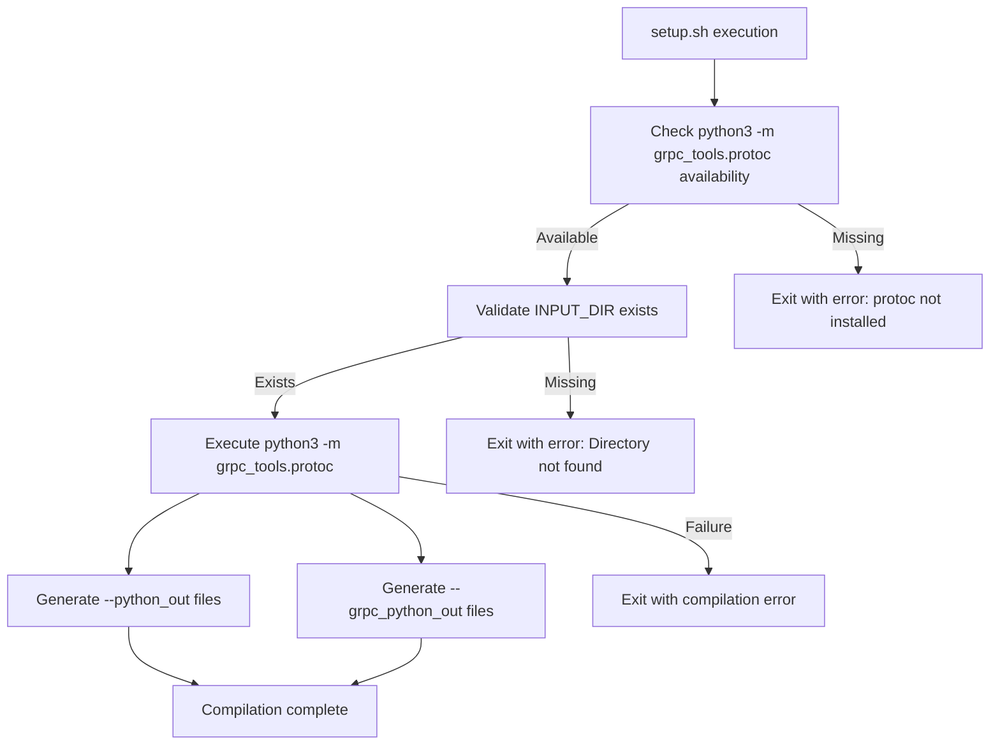
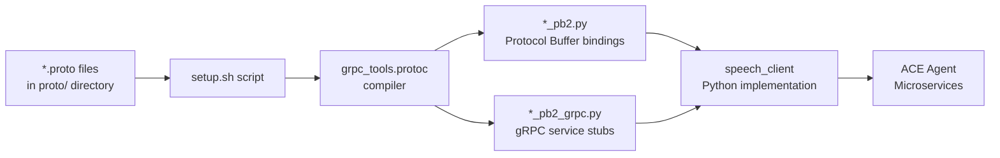
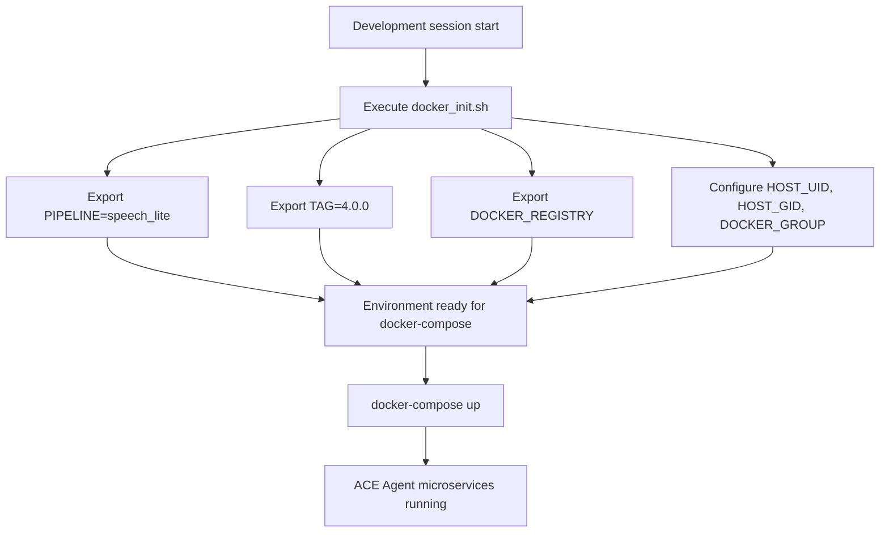

<!-- source: DeepWiki mcp.deepwiki.com · repo NVIDIA/ACE · page 6.2 Build & Setup Scripts · fetched 2026-10-26 -->

# Build & Setup Scripts

<details>
<summary>Relevant source files</summary>

The following files were used as context for generating this wiki page:

- [microservices/ace_agent/4.0/clients/speech_client/setup.sh](microservices/ace_agent/4.0/clients/speech_client/setup.sh)
- [microservices/ace_agent/4.0/deploy/docker/docker_init.sh](microservices/ace_agent/4.0/deploy/docker/docker_init.sh)

</details>


This document covers the essential build and setup scripts required for ACE Agent development, including gRPC protocol buffer compilation and Docker environment initialization. These scripts provide the foundational infrastructure for compiling service interfaces and configuring the development environment.

For information about repository structure and Git configuration, see [Repository Configuration](#6.1). For deployment-specific configurations, see [Docker Deployment](#4.1) and [UCS Applications](#4.2).

## gRPC Protocol Buffer Compilation

The ACE Agent framework relies heavily on gRPC communication between microservices, particularly for the speech processing pipeline. The protocol buffer compilation process is automated through dedicated setup scripts that generate Python bindings from `.proto` definitions.

### Speech Client Setup Script

The primary compilation script is located at `microservices/ace_agent/4.0/clients/speech_client/setup.sh`. This script handles the generation of Python gRPC stubs from protocol buffer definitions.

**Script Parameters and Configuration:**

| Parameter | Default Value | Purpose |
|-----------|---------------|---------|
| `INPUT_DIR` | `./../../proto/` | Directory containing `.proto` files |
| `OUTPUT_DIR` | `./` | Target directory for generated Python files |

**Compilation Process Flow:**



The script executes the following `grpc_tools.protoc` command with specific parameters [microservices/ace_agent/4.0/clients/speech_client/setup.sh:23]():

```bash
python3 -m grpc_tools.protoc --proto_path=${INPUT_DIR} --python_out=${OUTPUT_DIR} --grpc_python_out=${OUTPUT_DIR} ${INPUT_DIR}*.proto
```

**Sources:** microservices/ace_agent/4.0/clients/speech_client/setup.sh

## Docker Environment Initialization

Docker-based development and deployment requires specific environment variable configuration to ensure proper container networking, user permissions, and service integration. The initialization process is handled by dedicated setup scripts.

### Docker Initialization Script

The `docker_init.sh` script configures essential environment variables for Docker Compose operations and container execution.

**Environment Variable Configuration:**

| Variable | Value | Purpose |
|----------|-------|---------|
| `PIPELINE` | `speech_lite` | Defines the speech processing pipeline type |
| `TAG` | `4.0.0` | Specifies the ACE Agent framework version |
| `DOCKER_REGISTRY` | `nvcr.io/eevaigoeixww/conversational-ai` | NGC container registry location |
| `CLI_CMD` | `aceagent chat cli -c $PWD/$BOT_PATH --log-path ${PWD}/log` | Default CLI execution command |

**User and Permission Configuration:**

The script also handles Docker user permission mapping to ensure proper file system access between host and container environments [microservices/ace_agent/4.0/deploy/docker/docker_init.sh:5-8]():

- `DOCKER_GROUP`: Matches Docker socket group permissions
- `HOST_UID` and `HOST_GID`: Preserve host user identity
- `DOCKER_USER`: Combined user:group specification for containers

**Sources:** microservices/ace_agent/4.0/deploy/docker/docker_init.sh

## Development Workflow Integration

The build and setup scripts integrate into the broader ACE Agent development workflow, supporting both local development and containerized deployment scenarios.

### Protocol Buffer to Python Binding Workflow



### Docker Environment Setup Workflow



**Sources:** microservices/ace_agent/4.0/clients/speech_client/setup.sh, microservices/ace_agent/4.0/deploy/docker/docker_init.sh

## Script Execution Context

Both setup scripts are designed to be executed within their respective directory contexts and assume specific relative path structures within the ACE Agent repository.

### File System Dependencies

The setup scripts expect the following directory structure:

```
microservices/ace_agent/4.0/
├── proto/                          # Protocol buffer definitions
├── clients/speech_client/
│   ├── setup.sh                   # gRPC compilation script
│   └── [generated Python files]
└── deploy/docker/
    ├── docker_init.sh             # Environment variable setup
    └── docker-compose.yml
```

The scripts must be executed with appropriate working directories to ensure correct relative path resolution for input and output file locations.

**Sources:** microservices/ace_agent/4.0/clients/speech_client/setup.sh, microservices/ace_agent/4.0/deploy/docker/docker_init.sh