# Page: NVIDIA ACE Overview

# NVIDIA ACE Overview

<details>
<summary>Relevant source files</summary>

The following files were used as context for generating this wiki page:

- [LICENSE](LICENSE)
- [README.md](README.md)

</details>


## Purpose and Scope

This document provides a comprehensive overview of the NVIDIA ACE repository, which contains a suite of technologies for building digital humans and conversational AI agents using generative AI. The material covers the core digital human microservices (NIMs), the ACE Agent framework architecture, deployment patterns, and sample applications.

For detailed information about specific microservices implementations, see [Core Digital Human Technologies](#2). For comprehensive documentation of the ACE Agent framework components, see [ACE Agent Framework](#3). For deployment strategies and infrastructure setup, see [Deployment & Infrastructure](#4).

Sources: [README.md:1-95]()

## NVIDIA ACE Platform Architecture

NVIDIA ACE is structured as a comprehensive platform combining digital human technologies with conversational AI capabilities. The platform consists of two primary architectural layers: the Digital Human Microservices layer for speech, animation, and rendering, and the ACE Agent Framework layer for conversational AI orchestration.

### Digital Human Technology Stack

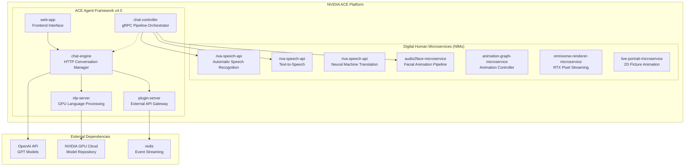

The platform provides state-of-the-art AI models with real-time performance, commercially safe training data, and flexible deployment options supporting public/private cloud, Windows PC, or hybrid configurations.

Sources: [README.md:4-49](), [README.md:32-46]()

## Core Technology Components

NVIDIA ACE integrates multiple specialized microservices, each designed for specific aspects of digital human creation and interaction:

| Technology | Service Name | Description | Deployment Support |
|------------|--------------|-------------|-------------------|
| Riva ASR | `riva-speech-api` | Speech → Text conversion | Cloud, Windows (Coming Soon) |
| Riva TTS | `riva-speech-api` | Text → Speech synthesis | Cloud, Windows (Coming Soon) |
| Riva NMT | `riva-speech-api` | Multi-language text translation | Cloud Only |
| Audio2Face | `audio2face-microservice` | Audio → Facial blendshapes | Cloud, Windows (Coming Soon) |
| AnimGraph | `animation-graph-microservice` | Animation state management | Cloud Only |
| RTX Renderer | `omniverse-renderer-microservice` | Omniverse-based pixel streaming | Cloud Only |
| ACE Agent | `ace-agent` | Conversational AI with RAG | Cloud Only |
| Live Portrait | `live-portrait-microservice` | 2D facial animation | Cloud Only |

Sources: [README.md:15-30]()

## ACE Agent Framework Architecture

The ACE Agent Framework provides a microservices-based architecture for building scalable conversational AI applications. The framework consists of five core services that work together to handle speech processing, natural language understanding, and business logic integration.

### Core Services Architecture

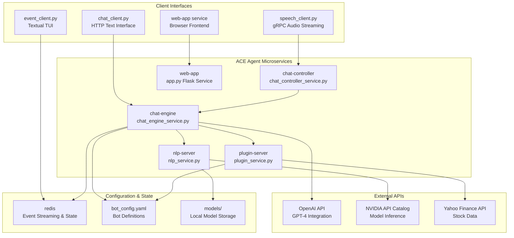

Each microservice operates independently with well-defined interfaces, enabling horizontal scaling and independent deployment cycles. The `chat-controller` orchestrates speech processing pipelines, while the `chat-engine` handles conversational logic and integrates with external AI services.

Sources: [README.md:25](), [README.md:75]()

## Deployment Ecosystem

NVIDIA ACE supports multiple deployment patterns designed for different use cases and infrastructure requirements. The repository provides both containerized local development environments and production-ready Kubernetes deployments through the NVIDIA UCS (Unified Cloud Services) platform.

### Deployment Architecture Overview

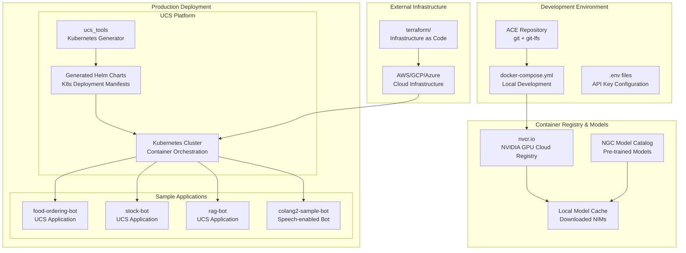

The deployment ecosystem leverages NVIDIA's container registry (`nvcr.io`) for microservice distribution and supports both Docker Compose for local development and Kubernetes for production scalability. UCS tools generate Helm charts for streamlined Kubernetes deployments.

Sources: [README.md:8-13](), [README.md:70]()

## Sample Applications Overview

The repository includes multiple sample applications demonstrating different ACE capabilities, from text-based conversational bots to speech-enabled multimodal interactions. These samples serve as reference implementations for common digital human use cases.

### Application Architecture Patterns

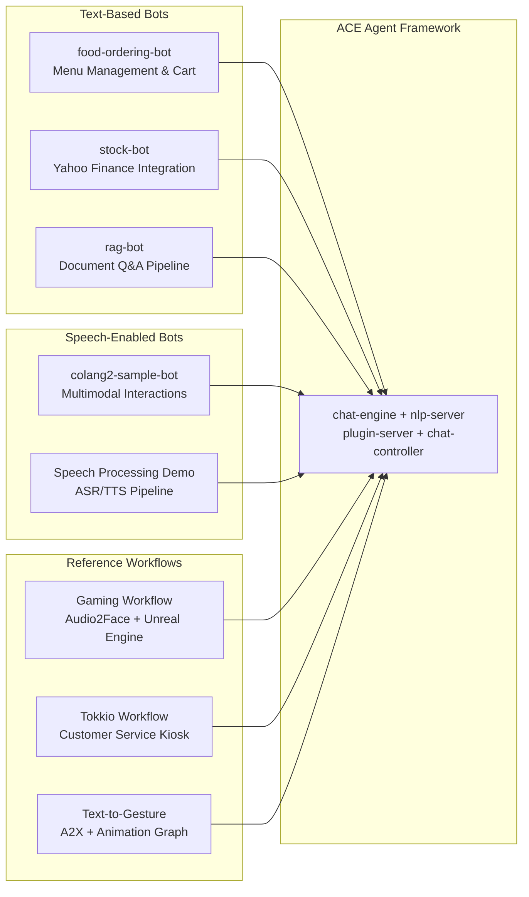

Each sample application demonstrates specific integration patterns with external APIs, different conversation management approaches using Colang/NeMo Guardrails, and various deployment configurations suitable for different production scenarios.

Sources: [README.md:51-62](), [README.md:81-88]()

## Key Benefits and Capabilities

NVIDIA ACE provides three primary advantages for digital human development:

- **State-of-the-Art Models and Microservices**: Pre-trained NVIDIA models deliver industry-leading quality with real-time performance optimization
- **Safe and Consistent Results**: AI models trained on commercially safe, responsibly licensed data with fine-tuning and guardrails for appropriate responses
- **Flexible Deployment Options**: Support for inference across public/private cloud, Windows PC, or hybrid configurations

The platform enables developers to build custom digital human solutions from scratch or leverage domain-specific workflows for gaming NPCs, customer service assistants, and real-time communication avatars.

Sources: [README.md:32-62]()

---

# Page: Core Digital Human Technologies

# Core Digital Human Technologies

<details>
<summary>Relevant source files</summary>

The following files were used as context for generating this wiki page:

- [README.md](README.md)

</details>


## Purpose and Scope

This page documents the core NVIDIA ACE NIMs (NVIDIA Inference Microservices) that provide the foundational digital human capabilities for speech processing, facial animation, body animation, and rendering. These microservices form the building blocks for creating interactive digital humans and avatars.

For information about the ACE Agent framework that orchestrates these technologies, see [ACE Agent Framework](#3). For deployment and infrastructure details, see [Deployment & Infrastructure](#4).

## Overview of Digital Human Technology Stack

The NVIDIA ACE platform consists of several core microservices that work together to enable realistic digital human interactions. Each microservice provides specialized AI capabilities that can be combined to create complete digital human experiences.

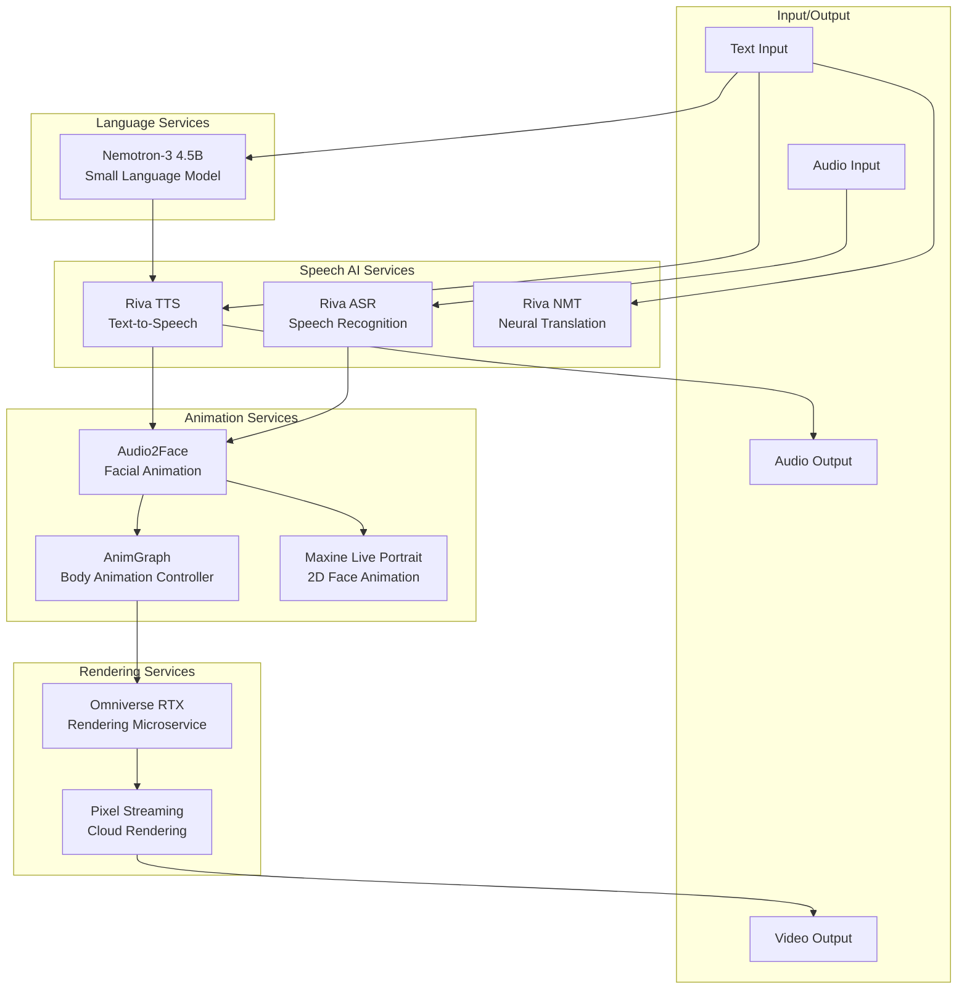

**Core Technologies Architecture**

Sources: [README.md:15-29]()

| Technology | Primary Function | Input | Output | Enterprise Support |
|------------|------------------|--------|--------|-------------------|
| Riva ASR | Speech Recognition | Audio | Text | NVIDIA AI Enterprise |
| Riva TTS | Speech Synthesis | Text | Audio | NVIDIA AI Enterprise |
| Riva NMT | Language Translation | Text | Translated Text | NVIDIA AI Enterprise |
| Audio2Face | Facial Animation | Audio | Blendshapes | NVIDIA AI Enterprise |
| AnimGraph | Animation Control | Animation Data | Skeletal Animation | NVIDIA AI Enterprise |
| Omniverse RTX | 3D Rendering | 3D Scene | Rendered Video | NVIDIA AI Enterprise |
| Live Portrait | 2D Face Animation | Audio + Image | Animated 2D Video | Early Access |
| Nemotron-3 4.5B | Language Model | Text Prompt | Generated Text | Early Access |

Sources: [README.md:17-29]()

## Speech AI Services (Riva)

NVIDIA Riva provides the speech AI foundation for digital humans through three core microservices that handle the complete speech processing pipeline.

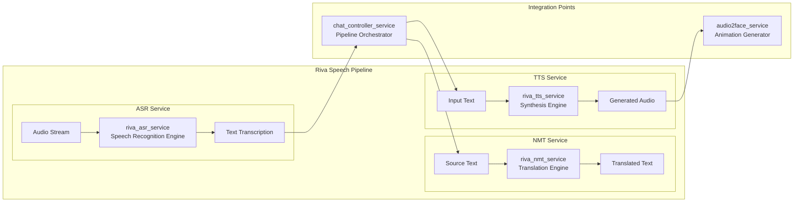

**Riva Microservices Integration**

### Automatic Speech Recognition (ASR)

The Riva ASR service converts spoken audio into text transcriptions with real-time processing capabilities. It supports multiple languages and acoustic models optimized for different use cases.

**Key Capabilities:**
- Real-time streaming speech recognition
- Batch audio processing
- Multiple language support
- Custom vocabulary and language model adaptation
- Speaker diarization

**Integration Pattern:**
- Receives audio streams via gRPC
- Outputs text transcriptions to chat controllers
- Supports both streaming and batch processing modes

Sources: [README.md:19](), [README.md:72]()

### Text-to-Speech (TTS) 

The Riva TTS service generates natural-sounding speech from text input using advanced neural vocoding techniques. It provides high-quality voice synthesis with customizable speaking styles.

**Key Capabilities:**
- Multi-speaker voice synthesis
- Custom voice cloning
- SSML markup support for pronunciation control
- Real-time audio generation
- Multiple output audio formats

**Integration Pattern:**
- Receives text input from chat engines
- Generates audio output for facial animation services
- Supports streaming audio delivery

Sources: [README.md:21](), [README.md:73]()

### Neural Machine Translation (NMT)

The Riva NMT service provides high-quality text translation between multiple language pairs using transformer-based neural models.

**Key Capabilities:**
- Multi-language translation support
- Domain-specific translation models
- Batch and real-time translation
- Custom terminology integration

Sources: [README.md:20](), [README.md:74]()

## Animation and Rendering Services

The animation pipeline transforms audio and text inputs into realistic digital human movements and expressions through specialized microservices.

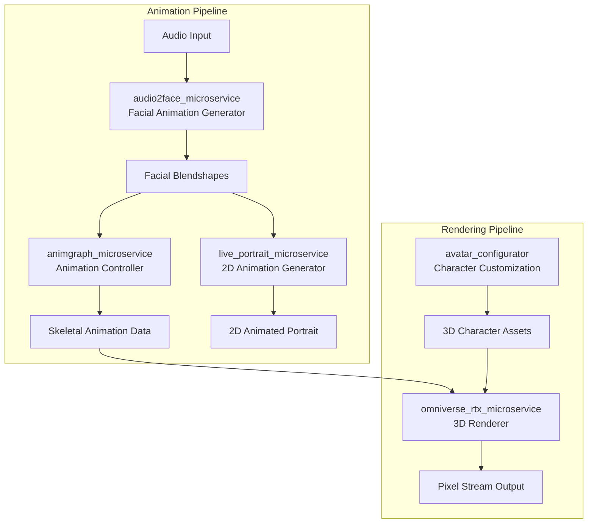

**Animation and Rendering Microservices**

### Audio2Face

Audio2Face generates facial blendshapes and lip-sync animation from audio input, enabling realistic facial expressions that match speech patterns.

**Core Functionality:**
- Real-time facial animation generation
- Blendshape coefficient output
- Multiple character rig support
- Emotion and expression control
- Integration with Unreal Engine and other 3D platforms

**Technical Integration:**
- Processes audio from TTS services
- Outputs animation data to rendering pipelines
- Supports streaming and batch processing

Sources: [README.md:22](), [README.md:71]()

### AnimGraph

The AnimGraph microservice provides sophisticated animation control and blending capabilities for full-body character animation.

**Core Functionality:**
- Animation state machine management
- Motion blending and transitions
- Procedural animation generation
- Integration with external animation systems

Sources: [README.md:23](), [README.md:78]()

### Omniverse RTX Rendering

The Omniverse RTX Rendering microservice delivers high-quality, real-time 3D rendering with ray tracing capabilities optimized for digital human applications.

**Core Functionality:**
- Real-time ray-traced rendering
- Pixel streaming for cloud deployment
- Multi-user collaborative rendering
- USD-based scene management
- Integration with Omniverse ecosystem

Sources: [README.md:24](), [README.md:79]()

### Maxine Live Portrait

The Live Portrait service provides 2D facial animation capabilities for portrait-style digital human applications.

**Core Functionality:**
- 2D portrait animation from audio
- Real-time face animation
- Photo-realistic lip-sync
- Minimal computational requirements

Sources: [README.md:26](), [README.md:76]()

## Technology Integration Patterns

The core digital human technologies follow established integration patterns that enable flexible composition of different AI capabilities.

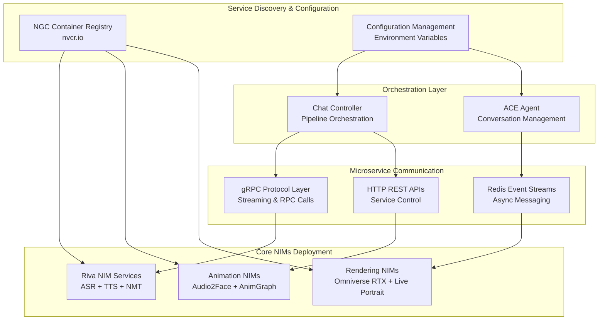

**Digital Human Technology Integration Architecture**

### Deployment Patterns

The core technologies support multiple deployment patterns optimized for different use cases:

| Deployment Pattern | Use Case | Technologies | Scaling Approach |
|-------------------|----------|--------------|------------------|
| Cloud-Native | Enterprise applications | All NIMs via NGC | Kubernetes orchestration |
| Edge Deployment | Gaming/Real-time | Selected NIMs | Docker containerization |
| Hybrid Cloud | Customer service | Riva + ACE Agent | Mixed cloud/on-premise |
| Development | Research/Prototyping | Local containers | Docker Compose |

### Service Communication

**gRPC Streaming:**
- Real-time audio processing (ASR, TTS)
- Low-latency animation data transfer
- Bidirectional streaming support

**HTTP REST APIs:**
- Service configuration and control
- Batch processing workflows
- Health monitoring and metrics

**Redis Event Streams:**
- Asynchronous pipeline coordination
- Event-driven architecture support
- Scalable message queuing

Sources: [README.md:8-12](), [README.md:65-79]()

## Access and Licensing

The core digital human technologies are available through NVIDIA's commercial licensing and evaluation programs:

**NVIDIA AI Enterprise License:**
- Production deployment rights
- Enterprise support and SLA
- Access to all core NIMs
- Integration with NGC catalog

**Early Access Evaluation:**
- Preview access to emerging technologies
- Development and testing licenses
- Limited production use

**NGC Container Registry:**
- Containerized microservice distribution
- Version management and updates
- Integration with Kubernetes deployments

Sources: [README.md:8-12](), [README.md:94-95]()

---

# Page: ACE Agent Framework

# ACE Agent Framework

<details>
<summary>Relevant source files</summary>

The following files were used as context for generating this wiki page:

- [microservices/ace_agent/4.0/README.md](microservices/ace_agent/4.0/README.md)

</details>


The ACE Agent Framework is a microservices-based platform for building LLM-driven, scalable conversational AI agents that support multi-turn and multi-user contextual conversations. This document covers the framework's architecture, core microservices, and integration patterns for deploying conversational AI applications with speech processing, natural language understanding, and custom business logic capabilities.

For information about the broader NVIDIA ACE ecosystem including digital human technologies like Riva Speech AI and Audio2Face, see [Core Digital Human Technologies](#2). For specific deployment strategies and infrastructure setup, see [Deployment & Infrastructure](#4). For sample implementations and use cases, see [Sample Applications](#5).

## Architecture Overview

The ACE Agent Framework consists of five core UCS (Unified Cloud Services) microservices that work together to provide a complete conversational AI pipeline. These microservices are designed to be composable, scalable, and customizable for various use cases.

### ACE Agent Microservices Architecture

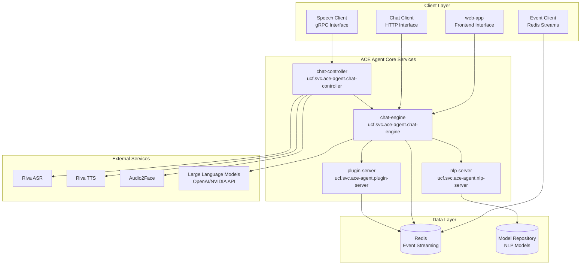

Sources: [microservices/ace_agent/4.0/README.md:19-32]()

## Core Microservices

### Chat Controller (`ucf.svc.ace-agent.chat-controller`)

The Chat Controller serves as the orchestration layer for speech-based conversational AI pipelines. It manages the end-to-end flow of audio and text data between Automatic Speech Recognition (ASR), Chat Engine, Text-To-Speech (TTS), and NVIDIA Omniverse Audio2Face services.

**Key Responsibilities:**
- Pipeline orchestration for speech processing workflows
- Audio data streaming and management
- Integration with Riva Speech AI services
- Audio2Face client management for avatar animation

### Chat Engine (`ucf.svc.ace-agent.chat-engine`)

The Chat Engine is built on NVIDIA NeMo Guardrails and provides the core conversational flow management using Colang. It handles natural language understanding, dialog management, and response generation.

**Key Responsibilities:**
- Colang-based conversation flow design
- NeMo Guardrails integration for safe AI interactions
- Multi-turn conversation context management
- LLM integration and response orchestration

### NLP Server (`ucf.svc.ace-agent.nlp-server`)

The NLP Server exposes unified RESTful interfaces for integrating various NLP models and tasks within the ACE Agent pipeline. It provides GPU-accelerated model serving capabilities.

**Key Responsibilities:**
- Unified NLP model API endpoints
- TensorRT optimized model serving
- Natural language processing task coordination
- Model lifecycle management

### Plugin Server (`ucf.svc.ace-agent.plugin-server`)

The Plugin Server enables integration of domain-specific business logic and external systems. It supports custom plugins for weather APIs, database integrations, and third-party agent frameworks like LangChain or LlamaIndex.

**Key Responsibilities:**
- Custom business logic integration
- External API connectivity
- Third-party framework integration
- Domain-specific functionality extension

### Web Application (`ucf.svc.ace-agent.web-app`)

The Web Application provides a sample frontend interface for interacting with deployed bots, supporting both voice capture/playback and text input/output interactions.

**Key Responsibilities:**
- Web-based user interface
- Voice input/output handling
- Real-time conversation display
- Frontend integration patterns demonstration

Sources: [microservices/ace_agent/4.0/README.md:23-29]()

## Service Integration Workflow

### Conversational AI Pipeline

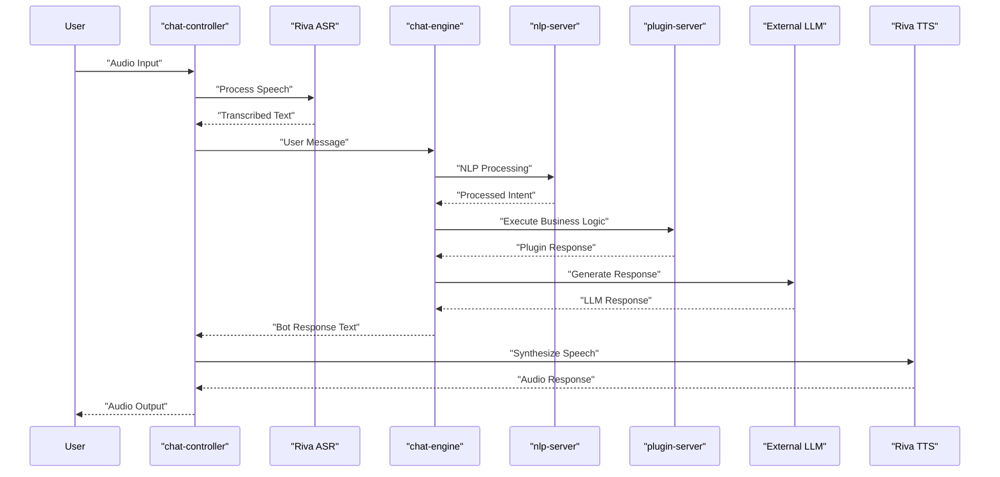

Sources: [microservices/ace_agent/4.0/README.md:25]()

## Key Framework Features

### In-built LLM Integration

ACE Agent provides out-of-the-box integration with large language models, offering hooks to connect with various LLM providers including OpenAI, NVIDIA API Catalog, and custom on-premise deployments using NVIDIA NIM for LLMs.

### On-premise Model Deployment

The framework supports complete on-premise deployment of both ACE Agent models and community/custom models. NVIDIA NIM brings GPU-accelerated LLM serving capabilities for deploying models locally while maintaining performance and security requirements.

### High Customizability with Colang

ACE Agent uses Colang for complete behavior customization based on specific use cases. The framework also supports integration of agents and bots built using LangChain, LlamaIndex, or similar frameworks within the ACE Agent pipeline for multi-modal use cases.

### RAG Integration

The framework provides easy integration with Retrieval Augmented Generation (RAG) workflows, enabling the building of agents using existing knowledge documents with minimal development effort.

### Low Latency Architecture

ACE Agent leverages NVIDIA TensorRT optimized models, NVIDIA Triton Inference Server for model deployment, and optimized chat controller components to ensure low latency and high throughput bot interactions.

Sources: [microservices/ace_agent/4.0/README.md:5-16]()

## Deployment Architecture

### UCS Microservices Deployment

ACE Agent provides Kubernetes deployment using NVIDIA Unified Cloud Services (UCS) Tools, a low-code framework for developing cloud-native, real-time, and multimodal AI applications.

| Microservice Name | Version | UCS Service Identifier |
|---|---|---|
| Chat Controller | 4.0.0 | `ucf.svc.ace-agent.chat-controller` |
| Chat Engine | 4.0.0 | `ucf.svc.ace-agent.chat-engine` |
| NLP Server | 4.0.0 | `ucf.svc.ace-agent.nlp-server` |
| Plugin Server | 4.0.0 | `ucf.svc.ace-agent.plugin-server` |
| Web App | 4.0.0 | `ucf.svc.ace-agent.web-app` |

### Custom Application Development

Developers can create custom application Helm charts using ACE Agent microservices through UCS applications. The framework includes sample UCS applications for various bot implementations located in the `./deploy/ucs_apps/` directory.

Sources: [microservices/ace_agent/4.0/README.md:19-32]()

## Sample Bot Integration

The ACE Agent Framework comes with multiple sample bot implementations in the `./samples/` directory, demonstrating various features and use cases across different industries. These samples showcase the framework's flexibility and provide reference implementations for common conversational AI patterns.

The sample bots demonstrate different aspects of the framework including:
- Text-based conversational flows
- Speech-enabled interactions
- RAG-powered question answering
- Domain-specific business logic integration
- Multi-modal interaction patterns

Sources: [microservices/ace_agent/4.0/README.md:34-38]()

---

# Page: Microservices Architecture

# Microservices Architecture

<details>
<summary>Relevant source files</summary>

The following files were used as context for generating this wiki page:

- [microservices/ace_agent/4.0/README.md](microservices/ace_agent/4.0/README.md)
- [microservices/ace_agent/4.0/deploy/docker/docker-compose.yml](microservices/ace_agent/4.0/deploy/docker/docker-compose.yml)

</details>


This document provides a comprehensive overview of the ACE Agent 4.0 microservices architecture. It details the five core microservices that comprise the ACE Agent framework, their interactions, deployment patterns, and integration points. This architecture enables scalable, customizable conversational AI agents with support for multi-turn conversations, speech processing, and external service integration.

For information about client applications that interact with these microservices, see [Client Applications](#3.2). For deployment strategies and infrastructure management, see [Deployment & Infrastructure](#4).

## Core Microservices Overview

ACE Agent 4.0 consists of five primary microservices that work together to provide a complete conversational AI platform. Each microservice is containerized and can be deployed independently using Docker or Kubernetes.

| Microservice | UCS Service Name | Version | Primary Function |
|---|---|---|---|
| **Chat Controller** | `ucf.svc.ace-agent.chat-controller` | 4.0.0 | Pipeline orchestration for speech-based interactions |
| **Chat Engine** | `ucf.svc.ace-agent.chat-engine` | 4.0.0 | Conversational flow management with Colang/NeMo Guardrails |
| **NLP Server** | `ucf.svc.ace-agent.nlp-server` | 4.0.0 | Unified NLP model interfaces and GPU-accelerated inference |
| **Plugin Server** | `ucf.svc.ace-agent.plugin-server` | 4.0.0 | Business logic integration and external service connectors |
| **Web App** | `ucf.svc.ace-agent.web-app` | 4.0.0 | Frontend interface with voice and text interaction support |

**Sources:** [microservices/ace_agent/4.0/README.md:19-30]()

## Service Architecture and Dependencies

The following diagram illustrates the core microservices architecture and their interactions within the ACE Agent ecosystem:

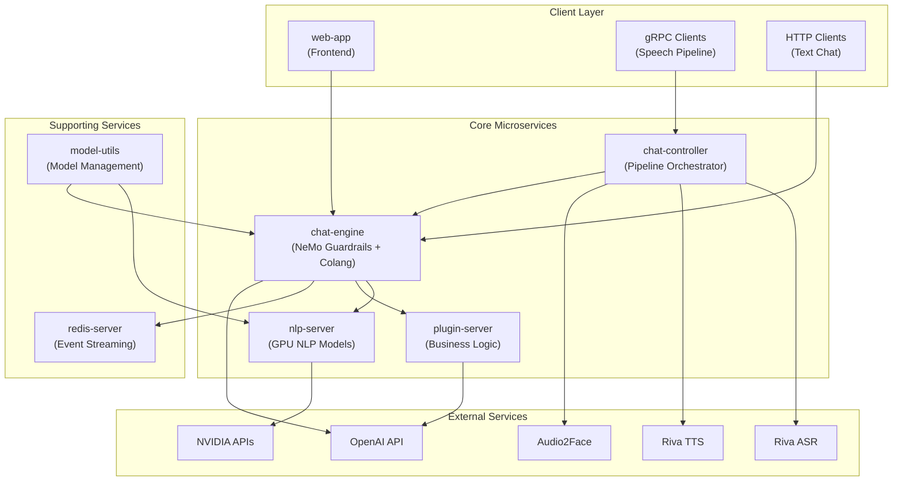

**Sources:** [microservices/ace_agent/4.0/README.md:23-29](), [microservices/ace_agent/4.0/deploy/docker/docker-compose.yml:1-159]()

## Docker Deployment Configuration

The microservices are orchestrated using Docker Compose, with specific container configurations and dependencies. The following diagram shows the actual container deployment structure:

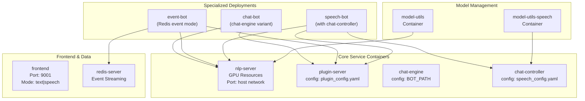

**Sources:** [microservices/ace_agent/4.0/deploy/docker/docker-compose.yml:26-159]()

## Service Specifications

### Chat Controller

The `chat-controller` service orchestrates the complete speech processing pipeline, managing data flow between ASR, TTS, Audio2Face, and the chat engine.

**Key Configuration:**
- Container: `chat-controller` [microservices/ace_agent/4.0/deploy/docker/docker-compose.yml:93-105]()
- Command: `run_pipeline.sh --pipeline ${PIPELINE} --speech_config /workspace/config/speech_config.yaml`
- Network: Host mode for low-latency communication

### Chat Engine

The `chat-engine` service implements conversational flow using NVIDIA NeMo Guardrails and Colang, providing the core dialogue management capabilities.

**Key Configuration:**
- Container: `chat-engine` [microservices/ace_agent/4.0/deploy/docker/docker-compose.yml:69-86]()
- Command: `aceagent chat server -c ${PWD}/${BOT_PATH} --log-path ${PWD}/log`
- Dependencies: Requires `nlp-server` and `plugin-server`

**Deployment Variants:**
- `chat-bot`: Standard HTTP server mode [microservices/ace_agent/4.0/deploy/docker/docker-compose.yml:107-113]()
- `event-bot`: Redis event-driven mode [microservices/ace_agent/4.0/deploy/docker/docker-compose.yml:119-126]()

### NLP Server

The `nlp-server` provides GPU-accelerated NLP model inference with unified RESTful interfaces for various NLP tasks.

**Key Configuration:**
- Container: `nlp-server` [microservices/ace_agent/4.0/deploy/docker/docker-compose.yml:26-50]()
- Command: `aceagent nlp-server deploy --timeout 200 --workers 1 --config ${PWD}/${BOT_PATH}/model_config.yaml`
- Resources: GPU allocation with 2GB shared memory

### Plugin Server

The `plugin-server` enables integration of domain-specific business logic and external service connectors.

**Key Configuration:**
- Container: `plugin-server` [microservices/ace_agent/4.0/deploy/docker/docker-compose.yml:51-67]()
- Command: `aceagent plugin-server deploy -c ${PWD}/${BOT_PATH}/plugin_config.yaml --log-path ${PWD}/log`
- Configuration: Uses `plugin_config.yaml` for service definitions

### Web App Frontend

The `frontend` service provides a web-based interface supporting both text and speech interactions.

**Key Configuration:**
- Container: `frontend` [microservices/ace_agent/4.0/deploy/docker/docker-compose.yml:128-141]()
- Command: `python3.10 -m frontend --port 9001 --mode text` (or `speech`)
- Port: 9001 for web interface access

**Sources:** [microservices/ace_agent/4.0/deploy/docker/docker-compose.yml:26-159]()

## Communication Patterns

The microservices communicate through multiple protocols optimized for different interaction types:

| Communication Type | Protocol | Services | Purpose |
|---|---|---|---|
| **Speech Pipeline** | gRPC | chat-controller ↔ External Speech Services | Low-latency audio streaming |
| **Chat API** | HTTP/REST | chat-engine ↔ Clients | Text-based conversations |
| **Event Streaming** | Redis Streams | chat-engine ↔ Redis | Asynchronous event processing |
| **Model Inference** | HTTP/REST | nlp-server ↔ chat-engine | NLP model requests |
| **Plugin Integration** | HTTP/REST | plugin-server ↔ chat-engine | Business logic execution |

All services use host networking mode for optimal performance and simplified service discovery within the Docker Compose environment.

**Sources:** [microservices/ace_agent/4.0/deploy/docker/docker-compose.yml:14,39,64,83,91,103,131]()

---

# Page: Client Applications

# Client Applications

<details>
<summary>Relevant source files</summary>

The following files were used as context for generating this wiki page:

- [microservices/ace_agent/4.0/clients/chat_client/chat_client.py](microservices/ace_agent/4.0/clients/chat_client/chat_client.py)
- [microservices/ace_agent/4.0/clients/event_client/event_client.py](microservices/ace_agent/4.0/clients/event_client/event_client.py)
- [microservices/ace_agent/4.0/clients/speech_client/speech_client.py](microservices/ace_agent/4.0/clients/speech_client/speech_client.py)

</details>


This document covers the various client applications provided for interacting with the ACE Agent framework. These clients demonstrate different interaction patterns and protocols for accessing ACE Agent services, including HTTP-based text conversations, gRPC-based speech processing, and Redis-based event simulation.

For information about the ACE Agent microservices that these clients connect to, see [Microservices Architecture](#3.1). For specific sample bot implementations, see [Sample Applications](#5).

## Overview

The ACE Agent framework provides three primary client applications, each designed for different interaction scenarios and technical requirements:

| Client Type | Protocol | Primary Use Case | Target Service |
|-------------|----------|------------------|----------------|
| Chat Client | HTTP/REST | Text-based conversations | chat-engine service |
| Speech Client | gRPC | Audio processing pipelines | chat-controller service |  
| Event Client | Redis Streams | Event simulation and monitoring | ACE Agent event interface |

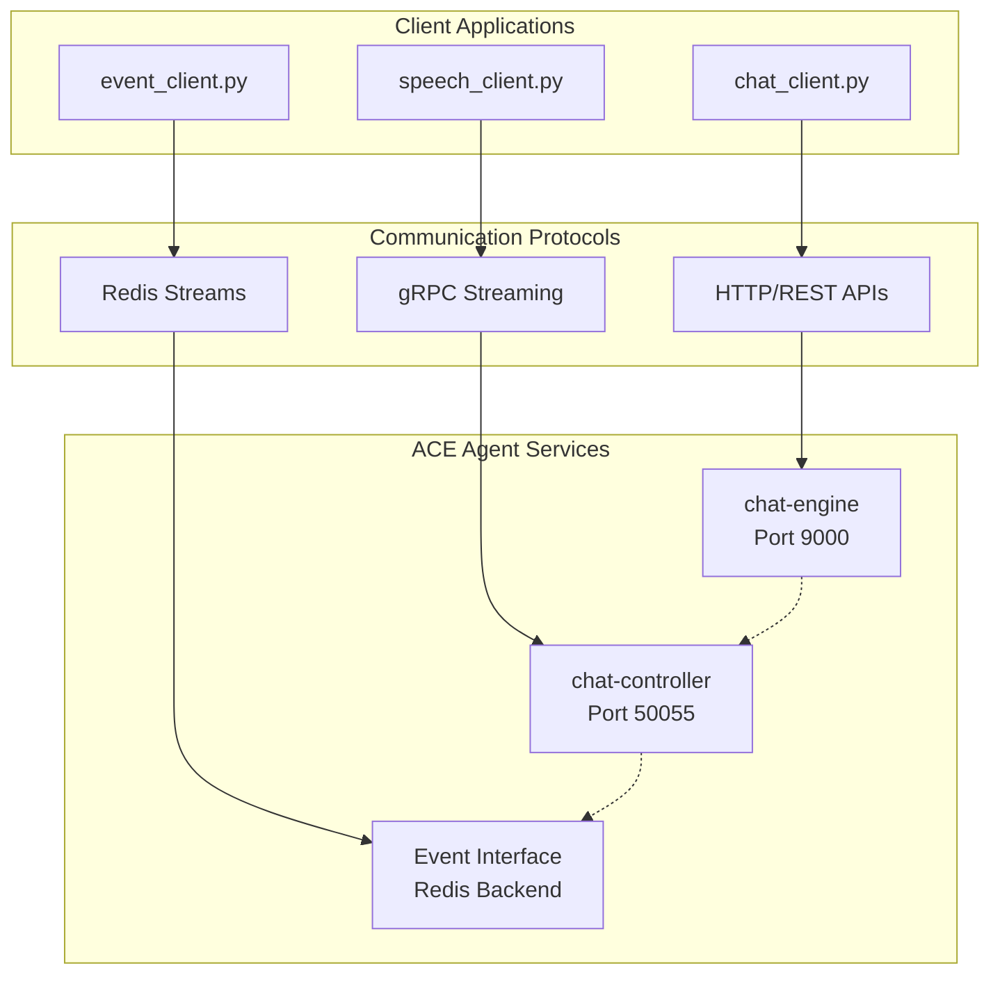

**Sources:** [microservices/ace_agent/4.0/clients/chat_client/chat_client.py:1-120](), [microservices/ace_agent/4.0/clients/speech_client/speech_client.py:1-157](), [microservices/ace_agent/4.0/clients/event_client/event_client.py:1-1920]()

## Chat Client Architecture

The `chat_client.py` implements an HTTP-based client for text conversations with the ACE Agent chat engine service.

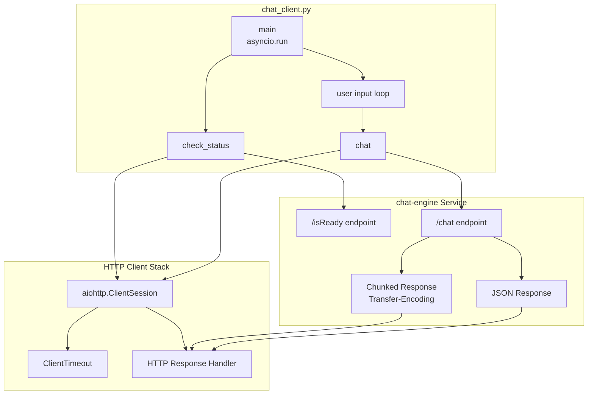

### Key Implementation Details

The chat client uses `aiohttp` for asynchronous HTTP communication and handles both streaming and non-streaming responses from the chat engine:

- **Server Health Check:** [`check_status()`]() function validates server availability via `/isReady` endpoint [microservices/ace_agent/4.0/clients/chat_client/chat_client.py:31-51]()
- **Message Processing:** [`chat()`]() function sends user queries and processes responses [microservices/ace_agent/4.0/clients/chat_client/chat_client.py:54-99]()
- **Streaming Support:** Handles chunked responses for real-time conversation flow [microservices/ace_agent/4.0/clients/chat_client/chat_client.py:74-86]()

**Sources:** [microservices/ace_agent/4.0/clients/chat_client/chat_client.py:31-99]()

## Speech Client Architecture  

The `speech_client.py` implements a gRPC-based client for audio processing pipelines including ASR and TTS capabilities.

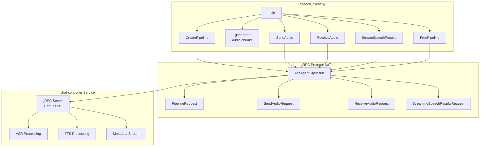

### Pipeline Management

The speech client follows a structured pipeline lifecycle:

1. **Pipeline Acquisition:** Creates dedicated processing pipeline via `CreatePipeline` RPC [microservices/ace_agent/4.0/clients/speech_client/speech_client.py:48-55]()
2. **Audio Streaming:** Sends chunked audio data using `generator()` function [microservices/ace_agent/4.0/clients/speech_client/speech_client.py:60-93]()
3. **Response Processing:** Handles ASR transcripts, chat responses, and TTS metadata [microservices/ace_agent/4.0/clients/speech_client/speech_client.py:128-151]()
4. **Pipeline Release:** Frees resources via `FreePipeline` RPC [microservices/ace_agent/4.0/clients/speech_client/speech_client.py:153-156]()

**Sources:** [microservices/ace_agent/4.0/clients/speech_client/speech_client.py:48-156]()

## Event Client Architecture

The `event_client.py` implements a comprehensive Terminal UI application for simulating and monitoring ACE Agent event interfaces using Redis streams.

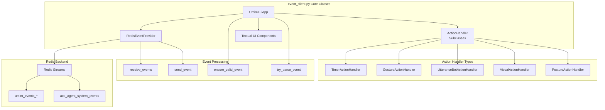

### Event Handler State Machine

The event client implements complex state machines for managing different action types:

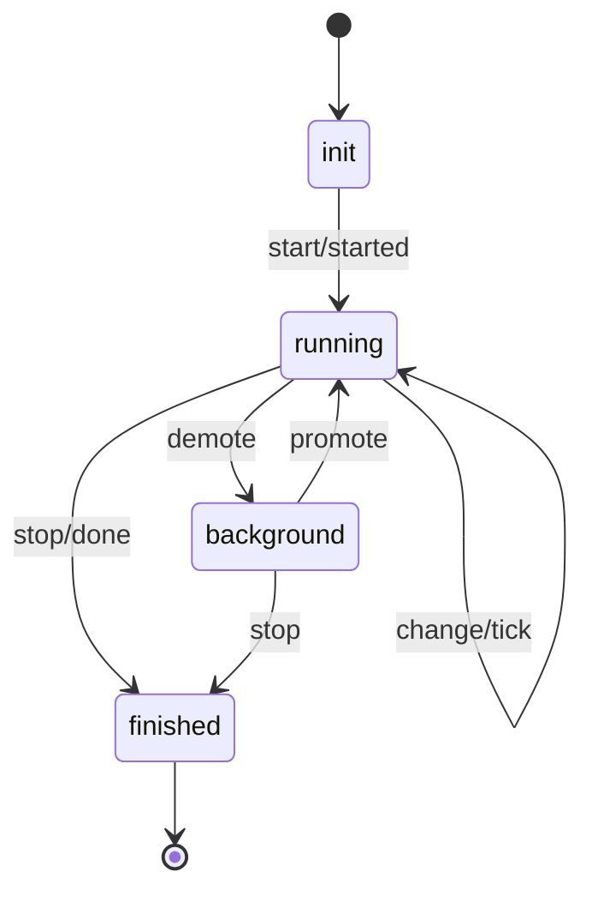

### Key Components

- **RedisEventProvider:** Handles Redis stream communication [microservices/ace_agent/4.0/clients/event_client/event_client.py:100-140]()
- **ActionHandler:** Base class for action state machines [microservices/ace_agent/4.0/clients/event_client/event_client.py:533-705]()
- **UmimTuiApp:** Main Textual application with interactive UI [microservices/ace_agent/4.0/clients/event_client/event_client.py:1469-1848]()

**Sources:** [microservices/ace_agent/4.0/clients/event_client/event_client.py:100-1848]()

## Client Communication Patterns

Each client application uses distinct communication patterns optimized for their specific use cases:

| Pattern | Client | Implementation | Key Features |
|---------|--------|----------------|--------------|
| Request-Response | Chat Client | `aiohttp` HTTP calls | Synchronous/async queries, JSON payloads |
| Streaming RPC | Speech Client | gRPC bidirectional streams | Real-time audio, pipeline management |
| Event-Driven | Event Client | Redis streams + pub/sub | Asynchronous events, state machines |

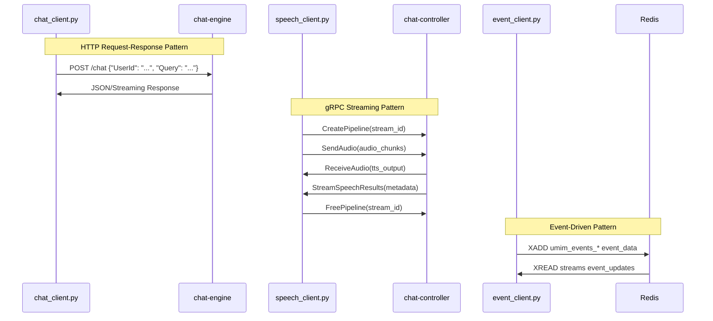

**Sources:** [microservices/ace_agent/4.0/clients/chat_client/chat_client.py:62-91](), [microservices/ace_agent/4.0/clients/speech_client/speech_client.py:94-131](), [microservices/ace_agent/4.0/clients/event_client/event_client.py:114-139]()

## Configuration and Usage

### Connection Configuration

All clients support configurable connection parameters:

- **Chat Client:** `--host`, `--port`, `--timeout` parameters [microservices/ace_agent/4.0/clients/chat_client/chat_client.py:21-26]()
- **Speech Client:** `--server` parameter for gRPC endpoint [microservices/ace_agent/4.0/clients/speech_client/speech_client.py:31-32]()
- **Event Client:** `--event_provider_host`, `--event_provider_port` for Redis [microservices/ace_agent/4.0/clients/event_client/event_client.py:1889-1908]()

### Protocol Buffer Integration

The speech client relies on generated protocol buffer classes for gRPC communication:

- `ace_agent_pb2`: Message definitions [microservices/ace_agent/4.0/clients/speech_client/speech_client.py:21]()
- `ace_agent_pb2_grpc`: Service stubs [microservices/ace_agent/4.0/clients/speech_client/speech_client.py:22]()

**Sources:** [microservices/ace_agent/4.0/clients/chat_client/chat_client.py:21-26](), [microservices/ace_agent/4.0/clients/speech_client/speech_client.py:21-32](), [microservices/ace_agent/4.0/clients/event_client/event_client.py:1882-1908]()

---

# Page: Chat Client

# Chat Client

<details>
<summary>Relevant source files</summary>

The following files were used as context for generating this wiki page:

- [microservices/ace_agent/4.0/clients/chat_client/chat_client.py](microservices/ace_agent/4.0/clients/chat_client/chat_client.py)
- [microservices/ace_agent/4.0/clients/chat_client/requirements.txt](microservices/ace_agent/4.0/clients/chat_client/requirements.txt)

</details>


## Purpose and Scope

The Chat Client is an HTTP-based Python application that demonstrates how to interact with the ACE Agent chat engine's REST API for text-based conversations. This client provides a simple command-line interface for sending queries and receiving responses from conversational AI agents.

For speech-based interactions, see [Speech Client](#3.2.2). For event-driven interfaces and monitoring, see [Event Client](#3.2.3). For the underlying chat engine microservice architecture, see [Microservices Architecture](#3.1).

## Architecture Overview

The Chat Client operates as a lightweight HTTP client that communicates with the chat-engine microservice within the ACE Agent framework. It provides both streaming and non-streaming conversation capabilities.

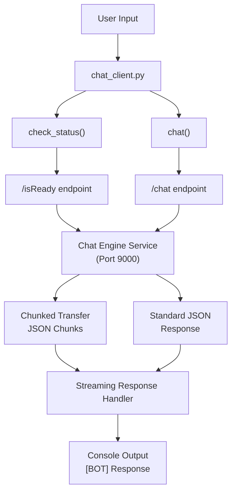

Sources: [microservices/ace_agent/4.0/clients/chat_client/chat_client.py:1-119]()

## Core Functionality

The Chat Client implements three primary functions that handle the complete conversation lifecycle:

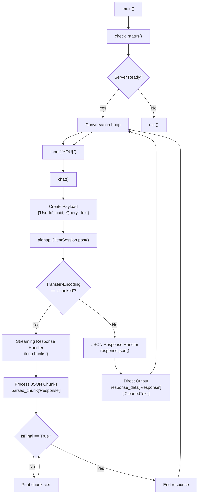

Sources: [microservices/ace_agent/4.0/clients/chat_client/chat_client.py:31-119]()

## API Communication

The Chat Client communicates with the chat-engine service through two REST endpoints:

| Endpoint | Method | Purpose | Response Type |
|----------|--------|---------|---------------|
| `/isReady` | GET | Server health check | JSON status |
| `/chat` | POST | Send conversation query | JSON or Chunked |

### Request Payload Structure

The `/chat` endpoint expects a JSON payload with the following mandatory fields:

| Field | Type | Description | Example |
|-------|------|-------------|---------|
| `UserId` | string | Unique user identifier | Generated via `uuid.uuid4()` |
| `Query` | string | User's text input | User-provided string |

Sources: [microservices/ace_agent/4.0/clients/chat_client/chat_client.py:62-67]()

### Response Handling

The client supports two response formats based on the `Transfer-Encoding` header:

**Streaming Response (Chunked)**
- Content delivered as JSON chunks via `iter_chunks()`
- Each chunk contains `Response.Text` and `Response.IsFinal` fields
- Chunks printed incrementally until `IsFinal` is true

**Standard JSON Response**
- Single JSON object with complete response
- Response content accessed via `Response.CleanedText` field

Sources: [microservices/ace_agent/4.0/clients/chat_client/chat_client.py:73-92]()

## Configuration and Usage

### Command Line Arguments

The Chat Client accepts the following configuration parameters:

| Argument | Default | Description |
|----------|---------|-------------|
| `--host` | localhost | Chat engine hostname |
| `--port` | 9000 | Chat engine port |
| `--timeout` | 15 | HTTP request timeout (seconds) |

### Dependencies

The application requires the following Python packages:

- `aiohttp==3.9.5` - Asynchronous HTTP client library

Sources: [microservices/ace_agent/4.0/clients/chat_client/requirements.txt:1]()

### Execution Flow

```mermaid
graph TD
    Start["python chat_client.py"] --> ParseArgs["argparse.ArgumentParser()"]
    ParseArgs --> GenerateUserId["user_id = str(uuid.uuid4())"]
    GenerateUserId --> AsyncMain["asyncio.run(main())"]
    
    AsyncMain --> HealthCheck["await check_status()"]
    HealthCheck --> HealthResult{"Server Ready?"}
    HealthResult -->|False| Exit["exit()"]
    HealthResult -->|True| InteractiveLoop["Interactive Chat Loop"]
    
    InteractiveLoop --> PromptUser["input('[YOU] ')"]
    PromptUser --> ValidateInput{"Input Valid?"}
    ValidateInput -->|Empty| PromptUser
    ValidateInput -->|Valid| SendChat["await chat()"]
    
    SendChat --> ProcessResponse["Process Response"]
    ProcessResponse --> PromptUser
    
    InteractiveLoop -.->|KeyboardInterrupt| Cleanup["Graceful Exit"]
```

Sources: [microservices/ace_agent/4.0/clients/chat_client/chat_client.py:21-119]()

## Error Handling

The Chat Client implements comprehensive error handling for common scenarios:

- **Connection Errors**: Catches exceptions when server is unreachable
- **HTTP Errors**: Uses `response.raise_for_status()` for HTTP error codes
- **Timeout Handling**: Configurable timeout via `aiohttp.ClientTimeout`
- **Keyboard Interrupts**: Graceful exit on Ctrl+C during conversation
- **JSON Parsing**: Handles malformed JSON responses in streaming mode

Sources: [microservices/ace_agent/4.0/clients/chat_client/chat_client.py:39-49](), [microservices/ace_agent/4.0/clients/chat_client/chat_client.py:68-98]()

---

# Page: Speech Client

# Speech Client

<details>
<summary>Relevant source files</summary>

The following files were used as context for generating this wiki page:

- [microservices/ace_agent/4.0/clients/speech_client/requirements.txt](microservices/ace_agent/4.0/clients/speech_client/requirements.txt)
- [microservices/ace_agent/4.0/clients/speech_client/setup.sh](microservices/ace_agent/4.0/clients/speech_client/setup.sh)
- [microservices/ace_agent/4.0/clients/speech_client/speech_client.py](microservices/ace_agent/4.0/clients/speech_client/speech_client.py)

</details>


## Purpose and Scope

The Speech Client is a gRPC-based Python client application that enables speech processing interactions with the ACE Agent Chat Controller service. It provides a complete audio processing pipeline that handles speech input, processes it through Automatic Speech Recognition (ASR), generates conversational responses, and returns synthesized speech output via Text-to-Speech (TTS).

This document covers the Speech Client's architecture, gRPC communication protocols, and audio streaming capabilities. For HTTP-based text conversations, see [Chat Client](#3.2.1). For event-based monitoring interfaces, see [Event Client](#3.2.3).

## Architecture Overview

The Speech Client operates as a standalone gRPC client that communicates with the Chat Controller microservice, which orchestrates the complete speech processing pipeline including ASR, NLP processing, and TTS services.

### Speech Client System Integration

```mermaid
graph TD
    SC["speech_client.py"] --> GRPC["gRPC Channel"]
    GRPC --> CC["Chat Controller<br/>:50055"]
    
    CC --> ASR["Riva ASR Service"]
    CC --> CE["Chat Engine"]
    CC --> TTS["Riva TTS Service"]
    
    SC --> AudioIn["Input WAV File"]
    SC --> AudioOut["Output WAV File"]
    
    CE --> NLP["NLP Server"]
    CE --> PS["Plugin Server"]
    
    subgraph "Speech Processing Pipeline"
        ASR --> Transcript["ASR Transcript"]
        Transcript --> CE
        CE --> Response["Bot Response"]
        Response --> TTS
        TTS --> AudioOut
    end
```

Sources: [microservices/ace_agent/4.0/clients/speech_client/speech_client.py:40-42](), [microservices/ace_agent/4.0/clients/speech_client/speech_client.py:94-95]()

## Core Functionality

### gRPC Protocol Buffer Integration

The Speech Client uses generated Python gRPC stubs from protocol buffer definitions to communicate with the ACE Agent services.

| Component | Purpose | Generated From |
|-----------|---------|----------------|
| `ace_agent_pb2` | Message definitions and data structures | Proto files in `../../proto/` |
| `ace_agent_pb2_grpc` | gRPC service stubs and client interfaces | Proto files in `../../proto/` |

The setup process generates these files using the `setup.sh` script which compiles `.proto` files into Python modules.

Sources: [microservices/ace_agent/4.0/clients/speech_client/speech_client.py:20-22](), [microservices/ace_agent/4.0/clients/speech_client/setup.sh:23]()

### Pipeline Management

The Speech Client manages pipeline lifecycles through dedicated gRPC calls:

```mermaid
graph LR
    Create["CreatePipeline()"] --> Process["Audio Processing"]
    Process --> Free["FreePipeline()"]
    
    subgraph "Pipeline States"
        Available["PIPELINE_AVAILABLE"]
        Processing["Processing Audio"]
        Released["Pipeline Released"]
    end
    
    Create --> Available
    Available --> Processing
    Processing --> Released
    Free --> Released
```

Each pipeline session requires a unique `stream_id` generated using `uuid.uuid4()` to isolate concurrent speech processing sessions.

Sources: [microservices/ace_agent/4.0/clients/speech_client/speech_client.py:46-55](), [microservices/ace_agent/4.0/clients/speech_client/speech_client.py:153-156]()

### Audio Streaming Protocol

The Speech Client implements bidirectional audio streaming using gRPC streaming APIs:

#### SendAudio Streaming

```mermaid
graph TD
    AudioFile["Input WAV File"] --> Reader["wave.open()"]
    Reader --> Generator["generator() function"]
    Generator --> Config["StreamingRecognitionConfig"]
    Generator --> Chunks["Audio Chunks<br/>(1600 frames)"]
    Generator --> Silence["Silence Padding<br/>(1 second)"]
    
    Config --> SendAudio["SendAudioRequest"]
    Chunks --> SendAudio
    Silence --> SendAudio
    SendAudio --> GRPC["stub.SendAudio()"]
    
    subgraph "Audio Configuration"
        Encoding["LINEAR_PCM"]
        SampleRate["sample_rate_hertz"]
        Channels["audio_channel_count"]
    end
    
    Config --> Encoding
    Config --> SampleRate
    Config --> Channels
```

The audio streaming generator function processes WAV files in chunks of 1600 frames with a 50ms delay between chunks to simulate real-time audio streaming.

Sources: [microservices/ace_agent/4.0/clients/speech_client/speech_client.py:58-94]()

#### ReceiveAudio Processing

The client receives TTS audio data and writes it to a WAV file using the `wave` module:

```mermaid
graph LR
    GRPC["stub.ReceiveAudio()"] --> Response["ReceiveAudioResponse"]
    Response --> FirstChunk{"First Chunk?"}
    FirstChunk -->|Yes| Config["Configure WAV Writer"]
    FirstChunk -->|No| Write["Write Audio Data"]
    Config --> Write
    Write --> Output["Output WAV File"]
    
    subgraph "WAV Configuration"
        Channels["setnchannels()"]
        Width["setsampwidth()"] 
        Rate["setframerate()"]
    end
    
    Config --> Channels
    Config --> Width
    Config --> Rate
```

Sources: [microservices/ace_agent/4.0/clients/speech_client/speech_client.py:97-124]()

## Streaming Speech Results

The Speech Client receives real-time processing results through the `StreamSpeechResults` API, which provides three types of responses:

| Message Type | Purpose | Data Structure |
|--------------|---------|----------------|
| `ASR_RESPONSE` | Speech transcription results | `asr_result.results.alternatives[0].transcript` |
| `CHAT_ENGINE_RESPONSE` | Bot conversational responses | `chat_engine_response.result` (JSON) |
| `TTS_RESPONSE` | Text-to-speech completion signal | Pipeline completion indicator |

### Message Processing Flow

```mermaid
graph TD
    Stream["StreamSpeechResults()"] --> Response["Streaming Response"]
    Response --> ASRCheck{"ASR_RESPONSE?"}
    Response --> ChatCheck{"CHAT_ENGINE_RESPONSE?"}
    Response --> TTSCheck{"TTS_RESPONSE?"}
    
    ASRCheck -->|Yes| Partial{"is_final?"}
    Partial -->|No| PartialPrint["Print [PARTIAL]"]
    Partial -->|Yes| FinalPrint["Print [FINAL]"]
    
    ChatCheck -->|Yes| JSONParse["JSON Parse"]
    JSONParse --> BotPrint["Print Bot Response"]
    
    TTSCheck -->|Yes| Break["Break Loop"]
```

The streaming loop continues until a `TTS_RESPONSE` is received, indicating the complete processing pipeline has finished.

Sources: [microservices/ace_agent/4.0/clients/speech_client/speech_client.py:125-151]()

## Implementation Details

### Command Line Interface

The Speech Client accepts the following command line arguments:

| Argument | Default | Purpose |
|----------|---------|---------|
| `--audio_file_path` | Required | Input WAV file for ASR processing |
| `--tts_output_path` | `tts_output.wav` | Output file for TTS audio |
| `--server` | `0.0.0.0:50055` | gRPC server endpoint |

Sources: [microservices/ace_agent/4.0/clients/speech_client/speech_client.py:26-32]()

### Error Handling

The client implements validation and exception handling for:

- Input audio file existence validation
- Pipeline creation status verification  
- gRPC timeout handling (10 second timeout)
- TTS audio reception exceptions
- Streaming response loop termination

Sources: [microservices/ace_agent/4.0/clients/speech_client/speech_client.py:34-38](), [microservices/ace_agent/4.0/clients/speech_client/speech_client.py:104-124](), [microservices/ace_agent/4.0/clients/speech_client/speech_client.py:136-151]()

### Protocol Buffer Setup

The client requires compiled protocol buffer files generated using `grpc_tools.protoc`. The `setup.sh` script automates this process:

- Input directory: `./../../proto/` (default)
- Output directory: `./` (current directory)
- Generates: `*_pb2.py` and `*_pb2_grpc.py` files

Sources: [microservices/ace_agent/4.0/clients/speech_client/setup.sh:1-29](), [microservices/ace_agent/4.0/clients/speech_client/requirements.txt:1]()

---

# Page: Event Client

# Event Client

<details>
<summary>Relevant source files</summary>

The following files were used as context for generating this wiki page:

- [microservices/ace_agent/4.0/clients/event_client/event_client.py](microservices/ace_agent/4.0/clients/event_client/event_client.py)
- [microservices/ace_agent/4.0/clients/event_client/requirements.txt](microservices/ace_agent/4.0/clients/event_client/requirements.txt)
- [microservices/ace_agent/4.0/clients/event_client/style.css](microservices/ace_agent/4.0/clients/event_client/style.css)

</details>


The Event Client is a terminal-based user interface (TUI) application that provides a simulation and monitoring environment for ACE Agent event interfaces. It serves as a development and testing tool for observing and interacting with the event-driven architecture of ACE Agent microservices through Redis-backed event streams.

For information about other client applications, see [Chat Client](#3.2.1) for HTTP-based text interactions and [Speech Client](#3.2.2) for gRPC-based speech processing pipelines. For broader context on the ACE Agent Framework architecture, see [Microservices Architecture](#3.1).

## Architecture Overview

The Event Client implements a sophisticated event simulation system built on the Textual TUI framework, providing real-time visualization and interaction capabilities for ACE Agent events.

### Core System Architecture

```mermaid
graph TD
    subgraph "Event Client Application"
        UmimTuiApp["UmimTuiApp<br/>Main TUI Application"]
        EventProvider["EventProvider<br/>Abstract Event Interface"]
        RedisEventProvider["RedisEventProvider<br/>Redis Stream Implementation"]
    end
    
    subgraph "Action Handling System"
        ActionHandler["ActionHandler<br/>Base Action State Machine"]
        TimerHandler["TimerActionHandler<br/>Timer Events"]
        GestureHandler["GestureActionHandler<br/>Gesture Animation"]
        UtteranceHandler["UtteranceBotActionHandler<br/>Speech Events"]
        VisualHandler["VisualActionHandler<br/>UI Scene Events"]
    end
    
    subgraph "UI Components"
        Sidebar["Sidebar<br/>Visual Scene Container"]
        UserChoice["UserChoice<br/>Choice Selection Widget"]
        InputForm["InputForm<br/>Form Input Widget"]
        TextLog["TextLog<br/>Event Display"]
    end
    
    subgraph "External Systems"
        Redis[("Redis<br/>ace_agent_system_events<br/>umim_events_1")]
        ACEAgent["ACE Agent<br/>Microservices"]
    end
    
    UmimTuiApp --> EventProvider
    EventProvider <|-- RedisEventProvider
    RedisEventProvider --> Redis
    
    UmimTuiApp --> ActionHandler
    ActionHandler <|-- TimerHandler
    ActionHandler <|-- GestureHandler
    ActionHandler <|-- UtteranceHandler
    ActionHandler <|-- VisualHandler
    
    UmimTuiApp --> Sidebar
    UmimTuiApp --> TextLog
    Sidebar --> UserChoice
    Sidebar --> InputForm
    
    Redis <--> ACEAgent
```

**Sources:** [microservices/ace_agent/4.0/clients/event_client/event_client.py:1-100]()

### Event Flow Architecture

```mermaid
graph LR
    subgraph "Event Sources"
        UserInput["User Input<br/>TUI Interactions"]
        ExternalEvents["External Events<br/>Redis Streams"]
        SystemEvents["System Events<br/>ace_agent_system_events"]
    end
    
    subgraph "Event Processing Pipeline"
        ReceiveEvents["receive_events()<br/>RedisEventProvider.xread()"]
        ProcessEvents["process_events()<br/>UmimTuiApp.add_event()"]
        EventParsing["try_parse_event()<br/>JSON Deserialization"]
        EventValidation["ensure_valid_event()<br/>UMIM Compliance"]
    end
    
    subgraph "Action State Management"
        TriggerMapping["trigger_to_handler<br/>Dict[str, ActionHandler]"]
        StateMachine["Machine<br/>transitions.Machine"]
        ActionStates["init → running → finished<br/>background"]
    end
    
    subgraph "Event Output"
        SendEvent["send_event()<br/>EventProvider.xadd()"]
        UIUpdate["UI Updates<br/>Textual Widgets"]
        EventLogging["Event History<br/>interaction_history"]
    end
    
    ExternalEvents --> ReceiveEvents
    UserInput --> ProcessEvents
    SystemEvents --> ReceiveEvents
    
    ReceiveEvents --> ProcessEvents
    ProcessEvents --> EventParsing
    EventParsing --> EventValidation
    
    EventValidation --> TriggerMapping
    TriggerMapping --> StateMachine
    StateMachine --> ActionStates
    
    ActionStates --> SendEvent
    ActionStates --> UIUpdate
    ProcessEvents --> EventLogging
    
    SendEvent --> SystemEvents
```

**Sources:** [microservices/ace_agent/4.0/clients/event_client/event_client.py:114-140](), [microservices/ace_agent/4.0/clients/event_client/event_client.py:615-620]()

## Core Components

### Event Provider System

The Event Client uses an abstract `EventProvider` interface with Redis-specific implementation for event streaming:

| Component | Purpose | Key Methods |
|-----------|---------|-------------|
| `EventProvider` | Abstract event interface | `receive_events()`, `send_event()` |
| `RedisEventProvider` | Redis Streams implementation | `xread()`, `xadd()` through Redis client |
| `event_provider_factory()` | Factory pattern for provider creation | Creates configured provider instances |

The `RedisEventProvider` manages channel state tracking and implements timeout-based event polling:

```python
# Channel state management for Redis streams
self._channel_state: Dict[str, str] = dict(
    map(lambda c: (c, "$" if discard_existing_events else "0"), channels)
)
```

**Sources:** [microservices/ace_agent/4.0/clients/event_client/event_client.py:88-98](), [microservices/ace_agent/4.0/clients/event_client/event_client.py:100-140](), [microservices/ace_agent/4.0/clients/event_client/event_client.py:142-154]()

### Action Handler Framework

The Action Handler system implements finite state machines for managing different types of ACE Agent actions:

#### Base ActionHandler Architecture

```mermaid
stateDiagram-v2
    [*] --> init
    init --> running : start/started
    running --> running : tick/change/promote
    running --> background : demote
    running --> finished : stop/finished/done
    background --> running : promote
    background --> finished : stop
    finished --> [*]
    
    note right of running
        on_start()
        on_tick() 
        send_action_started_event()
    end note
    
    note right of finished
        on_finished_from_running()
        send_action_finished_event()
    end note
```

#### Action Handler Implementations

| Handler Class | Action Types | UI Element | Special Behavior |
|---------------|--------------|------------|------------------|
| `TimerActionHandler` | StartTimerBotAction, TimerBotActionStarted | `#bot-timer` | Duration tracking, countdown display |
| `GestureActionHandler` | StartGestureBotAction, GestureBotActionStarted | `#bot-gesture` | Animation stack management |
| `UtteranceBotActionHandler` | StartUtteranceBotAction, UtteranceBotActionStarted | `#bot-utterance` | Progressive text display |
| `VisualActionHandler` | VisualChoiceSceneAction, VisualFormSceneAction | `#scene-ui` | Sidebar UI management |
| `PostureActionHandler` | StartPostureBotAction, PostureBotActionStarted | `#bot-posture` | Override action stack |

**Sources:** [microservices/ace_agent/4.0/clients/event_client/event_client.py:533-705](), [microservices/ace_agent/4.0/clients/event_client/event_client.py:707-761](), [microservices/ace_agent/4.0/clients/event_client/event_client.py:1099-1142]()

### Event Validation and UMIM Compliance

The system implements Universal Multimodal Interaction Model (UMIM) compliance validation:

```python
_event_validators = [
    Validator("Events need to provide 'type'", lambda e: "type" in e),
    Validator("Events need to provide 'uid'", lambda e: _has_property(e, Property("uid", str))),
    Validator("Events need to provide 'event_created_at' of type 'str'", 
              lambda e: _has_property(e, Property("event_created_at", str))),
    # ... additional validators
]
```

Event modality information is automatically added based on action type mappings:

| Action Type | Modality | Policy |
|-------------|----------|---------|
| UtteranceBotAction | bot_speech | replace |
| VisualChoiceSceneAction | information | override |
| GestureBotAction | bot_gesture | override |
| TimerBotAction | time | parallel |

**Sources:** [microservices/ace_agent/4.0/clients/event_client/event_client.py:171-219](), [microservices/ace_agent/4.0/clients/event_client/event_client.py:222-231]()

## User Interface Components

### Main Application Structure

The `UmimTuiApp` class extends Textual's `App` class and provides the primary interface:

| Key Properties | Purpose |
|----------------|---------|
| `show_sidebar` | Reactive property for UI scene visibility |
| `running_actions` | Dict tracking active ActionHandler instances |
| `trigger_to_handler` | Maps event types to handler classes |
| `interaction_history` | Event logging for session persistence |

### TUI Layout Components

```mermaid
graph TD
    subgraph "Main Container"
        Header["Header<br/>show_clock=True"]
        Sidebar["Sidebar<br/>classes='-hidden'"]
        MainContent["Horizontal Container"]
    end
    
    subgraph "Main Content Area"
        BotStatus["Bot Status Display"]
        UserControls["User Input Controls"]
        EventLog["TextLog<br/>Event Stream Display"]
    end
    
    subgraph "Sidebar Components"
        UIView["UIView<br/>Markdown Content"]
        UIControlsView["UIControlsView<br/>Interactive Elements"]
        UserChoice["UserChoice<br/>RadioButton Collection"]
        ConfirmationButtons["ConfirmationButtons<br/>OK/Cancel Actions"]
        InputForm["InputForm<br/>Form Input Fields"]
    end
    
    Header --> MainContent
    Sidebar --> UIView
    Sidebar --> UIControlsView
    
    MainContent --> BotStatus
    MainContent --> UserControls
    MainContent --> EventLog
    
    UIControlsView --> UserChoice
    UIControlsView --> ConfirmationButtons
    UIControlsView --> InputForm
```

### Interactive UI Widgets

The Event Client provides specialized widgets for different interaction patterns:

#### UserChoice Widget
Handles multiple choice selections with automatic event generation:

```python
def on_radio_button_changed(self, event: RadioButton.Changed) -> None:
    self.toggle_choice(event.radio_button.id)
    e = new_event(
        "VisualChoiceSceneActionChoiceUpdated",
        action_uid=self.action_handler.action_uid,
        current_choice=list(self.choices),
    )
    self.action_handler.send_event(e)
```

#### InputForm Widget
Manages form input with real-time event updates:

```python
def on_input_changed(self, event: Input.Changed) -> None:
    if event.input.id in self.inputs:
        self.inputs[event.input.id]["value"] = event.value
        e = new_event(
            "VisualFormSceneActionInputUpdated",
            action_uid=self.action_handler.action_uid,
            interim_inputs=list(self.inputs.values()),
        )
        self.action_handler.send_event(e)
```

**Sources:** [microservices/ace_agent/4.0/clients/event_client/event_client.py:1370-1395](), [microservices/ace_agent/4.0/clients/event_client/event_client.py:1397-1418](), [microservices/ace_agent/4.0/clients/event_client/event_client.py:1644-1700]()

## Configuration and Usage

### Application Configuration

The Event Client uses global configuration variables for Redis connectivity and operational modes:

| Configuration | Default Value | Purpose |
|---------------|---------------|---------|
| `redis_host` | "localhost" | Redis server hostname |
| `redis_port` | 6379 | Redis server port |
| `stream_id` | "1" | Pipeline stream identifier |
| `channel_id` | "umim_events_1" | Primary event channel |
| `SYSTEM_EVENTS_STREAM` | "ace_agent_system_events" | System-level events |

### Key Bindings

The application provides keyboard shortcuts for common operations:

| Binding | Action | Function |
|---------|--------|----------|
| `Ctrl+T` | toggle_timestamps | Show/hide event timestamps |
| `Ctrl+S` | save_interaction | Export event history |
| `Ctrl+C` | exit_app | Terminate application |
| `Ctrl+B` | toggle_sidebar | Show/hide visual UI panel |

### Event Processing Modes

The Event Client operates in two primary modes:

1. **Active Mode** (`app_in_active_mode = True`): Generates and sends events
2. **Passive Mode** (`app_in_active_mode = False`): Only receives and displays events

**Sources:** [microservices/ace_agent/4.0/clients/event_client/event_client.py:55-62](), [microservices/ace_agent/4.0/clients/event_client/event_client.py:1475-1481](), [microservices/ace_agent/4.0/clients/event_client/event_client.py:637-639]()

## Dependencies and Requirements

The Event Client requires the following Python packages as specified in the requirements:

| Package | Version | Purpose |
|---------|---------|---------|
| `textual` | 0.29.0 | TUI framework for terminal applications |
| `typer` | 0.9.0 | CLI argument parsing and commands |
| `redis` | 4.6.0 | Redis client for event streaming |
| `transitions` | 0.9.0 | Finite state machine implementation |
| `typing_extensions` | 4.7.1 | Enhanced type hints support |

**Sources:** [microservices/ace_agent/4.0/clients/event_client/requirements.txt:1-5]()

---

# Page: Deployment & Infrastructure

# Deployment & Infrastructure

<details>
<summary>Relevant source files</summary>

The following files were used as context for generating this wiki page:

- [microservices/ace_agent/4.0/deploy/docker/.env](microservices/ace_agent/4.0/deploy/docker/.env)
- [microservices/ace_agent/4.0/deploy/docker/docker-compose.yml](microservices/ace_agent/4.0/deploy/docker/docker-compose.yml)
- [microservices/ace_agent/4.0/deploy/docker/docker_init.sh](microservices/ace_agent/4.0/deploy/docker/docker_init.sh)

</details>


## Purpose and Scope

This document covers the deployment and infrastructure strategies for ACE Agent applications, focusing on containerized deployment using Docker and Docker Compose. The deployment infrastructure provides orchestration for the core ACE Agent microservices and their dependencies, including GPU resource management, environment configuration, and service networking.

For information about the individual microservices being deployed, see [Microservices Architecture](#3.1). For details about Kubernetes-based deployments using UCS applications, see [UCS Applications](#4.2).

## Docker-Based Deployment Architecture

The ACE Agent deployment infrastructure is built around Docker containerization with Docker Compose orchestration. The deployment system manages multiple interconnected services that work together to provide conversational AI capabilities.

### Core Deployment Services

```mermaid
graph TB
    subgraph "Infrastructure Services"
        Redis["redis-server<br/>Redis Container"]
        ModelUtils["model-utils<br/>Model Repository Manager"]
        ModelUtilsSpeech["model-utils-speech<br/>Speech Models Manager"]
    end
    
    subgraph "Core ACE Agent Services"
        NLPServer["nlp-server<br/>GPU-accelerated NLP Processing"]
        PluginServer["plugin-server<br/>External Plugin Management"]
        ChatEngine["chat-engine<br/>Conversation Management"]
        ChatController["chat-controller<br/>Speech Pipeline Orchestration"]
    end
    
    subgraph "Application Variants"
        ChatBot["chat-bot<br/>Text-based Server"]
        EventBot["event-bot<br/>Redis Event Handler"]
        SpeechBot["speech-bot<br/>Speech-enabled Server"]
        SpeechEventBot["speech-event-bot<br/>Speech + Events"]
    end
    
    subgraph "Frontend Services"
        Frontend["frontend<br/>Text Mode UI"]
        FrontendSpeech["frontend-speech<br/>Speech Mode UI"]
    end
    
    subgraph "Development Tools"
        ChatBotCLI["chat-bot-cli<br/>Interactive Shell"]
    end
    
    %% Dependencies
    ChatBot --> NLPServer
    ChatBot --> PluginServer
    EventBot --> NLPServer
    EventBot --> PluginServer
    EventBot --> Redis
    SpeechBot --> NLPServer
    SpeechBot --> PluginServer
    SpeechBot --> ChatController
    SpeechEventBot --> NLPServer
    SpeechEventBot --> PluginServer
    SpeechEventBot --> ChatController
    SpeechEventBot --> Redis
    
    ModelUtils -.-> NLPServer
    ModelUtilsSpeech -.-> ChatController
```

*Sources: [microservices/ace_agent/4.0/deploy/docker/docker-compose.yml:1-159]()*

## Service Configuration and Resource Management

### Container Registry and Image Management

The deployment uses NVIDIA's container registry for base images:

| Service | Base Image | Purpose |
|---------|------------|---------|
| `model-utils` | `${DOCKER_REGISTRY}/model-utils:${TAG}` | Model repository management |
| `nlp-server` | `${DOCKER_REGISTRY}/nlp-server:${TAG}` | GPU-accelerated NLP processing |
| `plugin-server` | `${DOCKER_REGISTRY}/plugin-server:${TAG}` | Plugin execution environment |
| `chat-engine` | `${DOCKER_REGISTRY}/chat-engine:${TAG}` | Conversation engine |
| `chat-controller` | `${DOCKER_REGISTRY}/chat-controller:${TAG}` | Speech pipeline coordination |
| `frontend` | `nvcr.io/nvidia/ucs-ms/frontend:4.0.0` | Web application interface |

*Sources: [microservices/ace_agent/4.0/deploy/docker/docker_init.sh:4](), [microservices/ace_agent/4.0/deploy/docker/docker-compose.yml:4,28,53,71,95,130]()*

### GPU Resource Allocation

GPU resources are managed through Docker's device reservation system:

```yaml
deploy:
  resources:
    reservations:
      devices:
        - driver: nvidia
          count: 1
          capabilities: [gpu]
```

The `nlp-server` service specifically reserves one GPU for neural language processing tasks, while other services access GPU resources through the NVIDIA Container Toolkit.

*Sources: [microservices/ace_agent/4.0/deploy/docker/docker-compose.yml:44-50]()*

## Environment Configuration System

### Environment Variable Management

```mermaid
graph LR
    subgraph "Configuration Sources"
        EnvFile[".env<br/>API Keys & NGC Config"]
        DockerInit["docker_init.sh<br/>Container Settings"]
        RuntimeEnv["Runtime Environment<br/>User & System Variables"]
    end
    
    subgraph "Configuration Categories"
        APIKeys["API Keys<br/>OPENAI_API_KEY<br/>NVIDIA_API_KEY<br/>NGC_CLI_API_KEY"]
        ContainerConfig["Container Config<br/>DOCKER_REGISTRY<br/>TAG<br/>PIPELINE"]
        UserConfig["User Settings<br/>HOST_UID<br/>HOST_GID<br/>DOCKER_USER"]
        PathConfig["Path Configuration<br/>BOT_PATH<br/>CACHE_PATH<br/>PWD"]
    end
    
    EnvFile --> APIKeys
    DockerInit --> ContainerConfig
    DockerInit --> UserConfig
    RuntimeEnv --> PathConfig
```

*Sources: [microservices/ace_agent/4.0/deploy/docker/.env:1-11](), [microservices/ace_agent/4.0/deploy/docker/docker_init.sh:1-9]()*

### Key Configuration Variables

| Variable | Purpose | Source |
|----------|---------|---------|
| `OPENAI_API_KEY` | OpenAI API authentication | `.env` file |
| `NVIDIA_API_KEY` | NVIDIA API Catalog access | `.env` file |
| `NGC_CLI_API_KEY` | NGC container registry access | `.env` file |
| `DOCKER_REGISTRY` | Base container registry URL | `docker_init.sh` |
| `TAG` | Container image version tag | `docker_init.sh` |
| `PIPELINE` | Speech processing pipeline type | `docker_init.sh` |
| `BOT_PATH` | Bot configuration directory path | Runtime |

*Sources: [microservices/ace_agent/4.0/deploy/docker/.env:2,11](), [microservices/ace_agent/4.0/deploy/docker/docker_init.sh:1-2,4]()*

## Container Orchestration Patterns

### Service Dependencies and Startup Order

The deployment defines explicit service dependencies to ensure proper startup sequencing:

```mermaid
graph TD
    subgraph "Dependency Chain"
        Redis["redis"]
        ModelUtils["model-utils"]
        NLPServer["nlp-server"]
        PluginServer["plugin-server"]
        ChatController["chat-controller"]
    end
    
    subgraph "Application Services"
        ChatBot["chat-bot"]
        EventBot["event-bot"] 
        SpeechBot["speech-bot"]
        SpeechEventBot["speech-event-bot"]
    end
    
    NLPServer -.-> ChatBot
    PluginServer -.-> ChatBot
    
    NLPServer -.-> EventBot
    PluginServer -.-> EventBot
    Redis -.-> EventBot
    
    NLPServer -.-> SpeechBot
    PluginServer -.-> SpeechBot
    ChatController -.-> SpeechBot
    
    NLPServer -.-> SpeechEventBot
    PluginServer -.-> SpeechEventBot
    ChatController -.-> SpeechEventBot
    Redis -.-> SpeechEventBot
```

*Sources: [microservices/ace_agent/4.0/deploy/docker/docker-compose.yml:110-112,123-126,146-149,154-158]()*

### Networking and Port Management

All services use `network_mode: 'host'` for simplified networking and direct port access. This configuration allows services to communicate directly through localhost without Docker's network isolation.

### Volume Mounting Strategy

| Mount Pattern | Purpose | Services |
|---------------|---------|----------|
| `${PWD}:${PWD}` | Workspace access | Most services |
| `${HOME}/.docker:/.docker` | Docker credentials | `model-utils` |
| `/var/run/docker.sock:/var/run/docker.sock` | Docker daemon access | `model-utils` |
| `${PWD}/${BOT_PATH}:/workspace/config` | Bot configuration | `chat-controller` |

*Sources: [microservices/ace_agent/4.0/deploy/docker/docker-compose.yml:10-13,37-38,61-62,80-81,100-101]()*

## Command Execution Patterns

### Service Command Structure

Each service uses specific command patterns for execution:

```bash
# NLP Server
aceagent nlp-server deploy --timeout 200 --workers 1 --config ${PWD}/${BOT_PATH}/model_config.yaml

# Plugin Server  
aceagent plugin-server deploy -c ${PWD}/${BOT_PATH}/plugin_config.yaml --log-path ${PWD}/log

# Chat Engine
aceagent chat server -c ${PWD}/${BOT_PATH} --log-path ${PWD}/log

# Chat Controller
bash run_pipeline.sh --pipeline ${PIPELINE} --speech_config /workspace/config/speech_config.yaml
```

*Sources: [microservices/ace_agent/4.0/deploy/docker/docker-compose.yml:43,67,86,105]()*

### Model Deployment Commands

The `model-utils` service handles model deployment with GPU allocation:

- Standard deployment: `deploy --model_config_path ${PWD}/${BOT_PATH}/model_config.yaml --model_repository_path ./model_repository --gpus 1`
- Speech-enabled deployment: `deploy --model_config_path ${PWD}/${BOT_PATH}/model_config.yaml --model_repository_path ./model_repository --gpus 1 --speech`

*Sources: [microservices/ace_agent/4.0/deploy/docker/docker-compose.yml:19,24]()*

## Development and Production Variants

The deployment configuration provides multiple service variants for different use cases:

| Variant | Purpose | Dependencies |
|---------|---------|-------------|
| `chat-bot` | Production text chat server | `nlp-server`, `plugin-server` |
| `chat-bot-cli` | Development interactive shell | Same as `chat-bot` |
| `event-bot` | Event-driven chat processing | `nlp-server`, `plugin-server`, `redis` |
| `speech-bot` | Speech-enabled chat server | `nlp-server`, `plugin-server`, `chat-controller` |
| `speech-event-bot` | Speech + event processing | All core services |
| `frontend` / `frontend-speech` | Web UI in text/speech modes | None (client-side) |

*Sources: [microservices/ace_agent/4.0/deploy/docker/docker-compose.yml:107-158]()*

---

# Page: Docker Deployment

# Docker Deployment

<details>
<summary>Relevant source files</summary>

The following files were used as context for generating this wiki page:

- [microservices/ace_agent/4.0/deploy/docker/.env](microservices/ace_agent/4.0/deploy/docker/.env)
- [microservices/ace_agent/4.0/deploy/docker/docker-compose.yml](microservices/ace_agent/4.0/deploy/docker/docker-compose.yml)
- [microservices/ace_agent/4.0/deploy/docker/docker_init.sh](microservices/ace_agent/4.0/deploy/docker/docker_init.sh)
- [microservices/ace_agent/4.0/deploy/docker/dockerfiles/chat_engine.Dockerfile](microservices/ace_agent/4.0/deploy/docker/dockerfiles/chat_engine.Dockerfile)
- [microservices/ace_agent/4.0/deploy/docker/dockerfiles/nlp_server.Dockerfile](microservices/ace_agent/4.0/deploy/docker/dockerfiles/nlp_server.Dockerfile)
- [microservices/ace_agent/4.0/deploy/docker/dockerfiles/plugin_server.Dockerfile](microservices/ace_agent/4.0/deploy/docker/dockerfiles/plugin_server.Dockerfile)

</details>


This document covers the Docker-based deployment architecture for ACE Agent microservices using Docker Compose. The deployment system provides containerized orchestration for all ACE Agent services including chat engines, NLP servers, plugin servers, and speech processing pipelines.

For Kubernetes-based deployment using UCS applications, see [UCS Applications](#4.2). For sample bot configurations and setup, see [Sample Applications](#5).

## Architecture Overview

The Docker deployment architecture consists of containerized microservices orchestrated through Docker Compose. The system supports both text-only and speech-enabled deployment modes with shared infrastructure services.

### Docker Compose Service Architecture

```mermaid
graph TB
    subgraph "Infrastructure Services"
        redis["redis<br/>(Redis Server)"]
        model_utils["model-utils<br/>(Model Repository Manager)"]
        model_utils_speech["model-utils-speech<br/>(Speech Model Manager)"]
    end
    
    subgraph "Core ACE Agent Services"
        nlp_server["nlp-server<br/>(GPU-Accelerated NLP)"]
        plugin_server["plugin-server<br/>(Business Logic Extensions)"]
        chat_engine["chat-engine<br/>(Colang Processing)"]
        chat_controller["chat-controller<br/>(Speech Pipeline Orchestrator)"]
    end
    
    subgraph "Application Services"
        chat_bot["chat-bot<br/>(Text Chat Server)"]
        event_bot["event-bot<br/>(Redis Event Handler)"]
        speech_bot["speech-bot<br/>(Speech Chat Server)"]
        speech_event_bot["speech-event-bot<br/>(Speech Event Handler)"]
    end
    
    subgraph "Frontend Services"
        frontend["frontend<br/>(Text Web UI)"]
        frontend_speech["frontend-speech<br/>(Speech Web UI)"]
        chat_bot_cli["chat-bot-cli<br/>(Interactive CLI)"]
    end
    
    chat_bot --> nlp_server
    chat_bot --> plugin_server
    event_bot --> nlp_server
    event_bot --> plugin_server
    event_bot --> redis
    
    speech_bot --> nlp_server
    speech_bot --> plugin_server
    speech_bot --> chat_controller
    
    speech_event_bot --> nlp_server
    speech_event_bot --> plugin_server
    speech_event_bot --> chat_controller
    speech_event_bot --> redis
    
    chat_controller --> model_utils_speech
    nlp_server --> model_utils
```

**Sources:** [microservices/ace_agent/4.0/deploy/docker/docker-compose.yml:1-159]()

### Container Registry and Base Images

```mermaid
graph LR
    subgraph "NVIDIA Container Registry"
        registry["nvcr.io/eevaigoeixww/conversational-ai"]
        frontend_base["nvcr.io/nvidia/ucs-ms/frontend:4.0.0"]
    end
    
    subgraph "Local Built Images"
        nlp_dockerfile["nlp_server.Dockerfile"]
        plugin_dockerfile["plugin_server.Dockerfile"]
        chat_dockerfile["chat_engine.Dockerfile"]
        
        nlp_image["nlp-server:4.0.0"]
        plugin_image["plugin-server:4.0.0"]
        chat_image["chat-engine:4.0.0"]
    end
    
    subgraph "External Images"
        redis_image["redis:latest"]
    end
    
    registry --> nlp_dockerfile
    registry --> plugin_dockerfile
    registry --> chat_dockerfile
    
    nlp_dockerfile --> nlp_image
    plugin_dockerfile --> plugin_image
    chat_dockerfile --> chat_image
    
    frontend_base --> frontend
    frontend_base --> frontend_speech
```

**Sources:** [microservices/ace_agent/4.0/deploy/docker/docker-compose.yml:4](), [microservices/ace_agent/4.0/deploy/docker/docker-compose.yml:130](), [microservices/ace_agent/4.0/deploy/docker/docker_init.sh:4]()

## Service Definitions

### Core Infrastructure Services

#### Model Utils Services
The `model-utils` and `model-utils-speech` services manage AI model deployment and repository management.

| Service | Container Name | Purpose | GPU Required |
|---------|---------------|---------|--------------|
| `model-utils` | `model-utils` | Standard model deployment | Yes (1 GPU) |
| `model-utils-speech` | `model-utils-speech` | Speech pipeline models | Yes (1 GPU) |

Key configuration:
- Volume mounts: `${PWD}:${PWD}`, `${HOME}/.docker:/.docker`
- Docker socket access: `/var/run/docker.sock`
- Command: `deploy --model_config_path ${PWD}/${BOT_PATH}/model_config.yaml`

**Sources:** [microservices/ace_agent/4.0/deploy/docker/docker-compose.yml:2-24]()

#### Redis Service
Simple Redis container for event streaming and session management.

```yaml
redis:
  container_name: redis-server
  image: redis
  network_mode: 'host'
```

**Sources:** [microservices/ace_agent/4.0/deploy/docker/docker-compose.yml:88-91]()

### ACE Agent Core Services

#### NLP Server
GPU-accelerated natural language processing service with NVIDIA driver support.

| Configuration | Value |
|---------------|--------|
| Base Image | `${DOCKER_REGISTRY}/nlp-server:${TAG}` |
| GPU Reservation | 1 GPU with NVIDIA capabilities |
| Shared Memory | 2GB |
| Workers | 1 |
| Timeout | 200 seconds |

Command: `aceagent nlp-server deploy --timeout 200 --workers 1 --config ${PWD}/${BOT_PATH}/model_config.yaml`

**Sources:** [microservices/ace_agent/4.0/deploy/docker/docker-compose.yml:26-50]()

#### Plugin Server
Business logic extensions and external integrations service.

Command: `aceagent plugin-server deploy -c ${PWD}/${BOT_PATH}/plugin_config.yaml --log-path ${PWD}/log`

**Sources:** [microservices/ace_agent/4.0/deploy/docker/docker-compose.yml:51-67]()

#### Chat Engine Base
Core Colang processing service that serves as the foundation for all chat applications.

Command: `aceagent chat server -c ${PWD}/${BOT_PATH} --log-path ${PWD}/log`

**Sources:** [microservices/ace_agent/4.0/deploy/docker/docker-compose.yml:69-86]()

#### Chat Controller
Speech pipeline orchestrator service for handling audio processing workflows.

| Configuration | Value |
|---------------|--------|
| Base Image | `${DOCKER_REGISTRY}/chat-controller:${TAG}` |
| Pipeline Mode | `${PIPELINE}` (default: `speech_lite`) |
| Config Path | `/workspace/config` |
| Log Path | `/workspace/log` |

Command: `bash run_pipeline.sh --pipeline ${PIPELINE} --speech_config /workspace/config/speech_config.yaml`

**Sources:** [microservices/ace_agent/4.0/deploy/docker/docker-compose.yml:93-105](), [microservices/ace_agent/4.0/deploy/docker/docker_init.sh:1]()

## Configuration Management

### Environment Variables
The deployment uses a `.env` file for sensitive configuration and API keys.

```bash
# API Configuration
OPENAI_API_KEY=${OPENAI_API_KEY}
NVIDIA_API_KEY=${NVIDIA_API_KEY}

# NGC CLI Configuration  
NGC_CLI_API_KEY=${NGC_CLI_API_KEY}
NGC_CLI_ORG=nvidia
NGC_CLI_TEAM=${NGC_CLI_TEAM}
NGC_ORGANIZATION_ID=${NGC_ORGANIZATION_ID}
```

**Sources:** [microservices/ace_agent/4.0/deploy/docker/.env:1-11]()

### Docker Initialization Script
The `docker_init.sh` script sets up deployment-specific environment variables:

```bash
export PIPELINE=speech_lite
export TAG=4.0.0
export DOCKER_REGISTRY=nvcr.io/eevaigoeixww/conversational-ai
export DOCKER_USER=$(id -u):$(id -g)
```

**Sources:** [microservices/ace_agent/4.0/deploy/docker/docker_init.sh:1-9]()

### Volume Mounts and Networking
All services use `network_mode: 'host'` for simplified networking and mount the current working directory for configuration access.

Common volume pattern:
- `${PWD}:${PWD}` - Full workspace access
- `${PWD}/${BOT_PATH}:/workspace/config` - Bot configuration
- `${PWD}/log:/workspace/log` - Logging output

**Sources:** [microservices/ace_agent/4.0/deploy/docker/docker-compose.yml:37-38](), [microservices/ace_agent/4.0/deploy/docker/docker-compose.yml:100-101]()

## Deployment Modes

### Text-Only Deployment Mode

```mermaid
graph TB
    subgraph "Text Chat Deployment"
        chat_bot_text["chat-bot<br/>(chat-engine-server)"]
        event_bot_text["event-bot<br/>(chat-engine-event)"]
        frontend_text["frontend<br/>(Text UI - Port 9001)"]
        cli_bot["chat-bot-cli<br/>(Interactive CLI)"]
    end
    
    subgraph "Dependencies"
        nlp["nlp-server"]
        plugin["plugin-server"]
        redis_dep["redis"]
    end
    
    chat_bot_text --> nlp
    chat_bot_text --> plugin
    event_bot_text --> nlp
    event_bot_text --> plugin
    event_bot_text --> redis_dep
    
    frontend_text -.-> chat_bot_text
    cli_bot -.-> chat_bot_text
```

Services included:
- `chat-bot` (depends on `nlp-server`, `plugin-server`)
- `event-bot` (depends on `nlp-server`, `plugin-server`, `redis`)
- `frontend` (text mode on port 9001)
- `chat-bot-cli` (bash shell access)

**Sources:** [microservices/ace_agent/4.0/deploy/docker/docker-compose.yml:107-117](), [microservices/ace_agent/4.0/deploy/docker/docker-compose.yml:128-136]()

### Speech-Enabled Deployment Mode

```mermaid
graph TB
    subgraph "Speech Chat Deployment"
        speech_bot_main["speech-bot<br/>(chat-engine-server-speech)"]
        speech_event_bot_main["speech-event-bot<br/>(chat-engine-event-speech)"]
        frontend_speech_main["frontend-speech<br/>(Speech UI - Port 9001)"]
    end
    
    subgraph "Speech Pipeline Dependencies"
        chat_controller_dep["chat-controller<br/>(Speech Pipeline)"]
        model_utils_speech_dep["model-utils-speech"]
        nlp_dep["nlp-server"]
        plugin_dep["plugin-server"]
        redis_dep["redis"]
    end
    
    speech_bot_main --> nlp_dep
    speech_bot_main --> plugin_dep
    speech_bot_main --> chat_controller_dep
    
    speech_event_bot_main --> nlp_dep
    speech_event_bot_main --> plugin_dep
    speech_event_bot_main --> chat_controller_dep
    speech_event_bot_main --> redis_dep
    
    chat_controller_dep --> model_utils_speech_dep
    
    frontend_speech_main -.-> speech_bot_main
```

Services included:
- `speech-bot` (depends on `nlp-server`, `plugin-server`, `chat-controller`)
- `speech-event-bot` (depends on `nlp-server`, `plugin-server`, `chat-controller`, `redis`)
- `frontend-speech` (speech mode on port 9001)
- `model-utils-speech` (speech model deployment)

**Sources:** [microservices/ace_agent/4.0/deploy/docker/docker-compose.yml:143-158](), [microservices/ace_agent/4.0/deploy/docker/docker-compose.yml:138-141]()

## Container Build Process

### Dockerfile Structure
All ACE Agent services use a common pattern for user management and dependency installation:

```dockerfile
ARG BASE_IMAGE
FROM $BASE_IMAGE

ARG HOST_UID
ARG HOST_GID

# Create specified user with home directory
RUN mkdir -p /home/ace-agent
RUN groupadd ace-agent --gid $HOST_GID \
    && useradd ace-agent --uid $HOST_UID --gid $HOST_GID -d /home/ace-agent \
    && chown -R $HOST_UID:$HOST_GID /home/ace-agent

WORKDIR /home/ace-agent
USER $HOST_UID:$HOST_GID
```

This pattern ensures containers run with the host user's UID/GID for proper file permissions.

**Sources:** [microservices/ace_agent/4.0/deploy/docker/dockerfiles/chat_engine.Dockerfile:1-21](), [microservices/ace_agent/4.0/deploy/docker/dockerfiles/nlp_server.Dockerfile:1-21](), [microservices/ace_agent/4.0/deploy/docker/dockerfiles/plugin_server.Dockerfile:1-21]()

### Build Arguments
Docker Compose passes host user information to maintain consistent file ownership:

```yaml
build:
  context: .
  dockerfile: dockerfiles/nlp_server.Dockerfile
  args:
    BASE_IMAGE: ${DOCKER_REGISTRY}/nlp-server:${TAG}
    HOST_UID: ${HOST_UID}
    HOST_GID: ${HOST_GID}
```

**Sources:** [microservices/ace_agent/4.0/deploy/docker/docker-compose.yml:29-34]()

## Usage Patterns

### Standard Deployment Commands
1. Initialize environment: `source docker_init.sh`
2. Set bot path: `export BOT_PATH=path/to/bot/config`
3. Deploy text services: `docker compose up chat-bot event-bot frontend`
4. Deploy speech services: `docker compose up speech-bot speech-event-bot frontend-speech model-utils-speech`

### CLI Access Pattern
The `chat-bot-cli` service provides interactive access to the chat engine:

```yaml
chat-bot-cli:
  <<: *chat-bot
  container_name: chat-engine-cli
  command: bash
```

This allows direct CLI interaction with the running chat engine environment.

**Sources:** [microservices/ace_agent/4.0/deploy/docker/docker-compose.yml:114-117]()

---

# Page: UCS Applications

# UCS Applications

<details>
<summary>Relevant source files</summary>

The following files were used as context for generating this wiki page:

- [microservices/ace_agent/4.0/deploy/ucs_apps/chat_bot/food_ordering_bot/README.md](microservices/ace_agent/4.0/deploy/ucs_apps/chat_bot/food_ordering_bot/README.md)
- [microservices/ace_agent/4.0/deploy/ucs_apps/chat_bot/food_ordering_bot/app-params.yaml](microservices/ace_agent/4.0/deploy/ucs_apps/chat_bot/food_ordering_bot/app-params.yaml)
- [microservices/ace_agent/4.0/deploy/ucs_apps/chat_bot/food_ordering_bot/app.yaml](microservices/ace_agent/4.0/deploy/ucs_apps/chat_bot/food_ordering_bot/app.yaml)

</details>


UCS Applications provide a Kubernetes-based deployment mechanism for ACE Agent systems using NVIDIA's Unified Cloud Services (UCS) tools. These applications generate Helm charts that orchestrate the deployment of multiple ACE Agent microservices with their dependencies, configurations, and interconnections. For Docker-based deployments, see [Docker Deployment](#4.1).

## Architecture Overview

UCS Applications abstract the complexity of Kubernetes deployments by providing declarative YAML configurations that automatically generate Helm charts for ACE Agent microservice deployments.

### UCS Application Structure

```mermaid
graph TD
    subgraph "UCS Application Definition"
        AppYAML["app.yaml<br/>Application Definition"]
        ParamsYAML["app-params.yaml<br/>Configuration Parameters"]
        ConfigDir["config_dir/<br/>Bot Configuration Files"]
    end
    
    subgraph "UCS Tools Processing"
        UCFBuilder["ucf_app_builder_cli<br/>Helm Chart Generator"]
        Dependencies["UCF Dependencies<br/>ACE Agent Services"]
    end
    
    subgraph "Generated Helm Chart"
        HelmChart["ucf-app-chat-bot-4.0.0/<br/>Generated Helm Chart"]
        Templates["Kubernetes Templates<br/>Deployments, Services, ConfigMaps"]
        Values["values.yaml<br/>Computed Configuration"]
    end
    
    subgraph "Kubernetes Cluster"
        ChatEngine["chat-engine<br/>Pod"]
        NLPServer["nlp-server<br/>Pod"]
        PluginServer["plugin-server<br/>Pod"]
        WebApp["web-app<br/>Pod"]
        Secrets["Kubernetes Secrets<br/>API Keys & Registry"]
        PVC["Persistent Volume Claims<br/>Model Storage"]
    end
    
    AppYAML --> UCFBuilder
    ParamsYAML --> UCFBuilder
    ConfigDir --> UCFBuilder
    Dependencies --> UCFBuilder
    
    UCFBuilder --> HelmChart
    UCFBuilder --> Templates
    UCFBuilder --> Values
    
    HelmChart --> ChatEngine
    HelmChart --> NLPServer
    HelmChart --> PluginServer
    HelmChart --> WebApp
    
    Templates --> Secrets
    Templates --> PVC
    
    style UCFBuilder fill:#f9f9f9
    style HelmChart fill:#e8f4fd
    style Dependencies fill:#fff2cc
```

Sources: [microservices/ace_agent/4.0/deploy/ucs_apps/chat_bot/food_ordering_bot/app.yaml:1-65](), [microservices/ace_agent/4.0/deploy/ucs_apps/chat_bot/food_ordering_bot/README.md:38-46]()

## Application Definition Structure

### Core Application Manifest

The `app.yaml` file defines the UCS application structure with the following key sections:

| Section | Purpose | Example |
|---------|---------|---------|
| `specVersion` | UCS specification version | `2.5.0` |
| `name` | Application identifier | `ucf-app-chat-bot` |
| `dependencies` | Required UCF services | `ucf.svc.ace-agent.chat-engine:4.0.0` |
| `components` | Service component definitions | `chat-engine`, `nlp-server`, `plugin-server`, `web-app` |
| `connections` | Inter-service connectivity | `chat-engine/plugin-server: plugin-server/http-api` |
| `secrets` | Kubernetes secret mappings | `ngc-api-key-secret`, `openai-key-secret` |

### Service Dependencies

UCS applications declare dependencies on specific ACE Agent microservices:

```mermaid
graph LR
    subgraph "UCS Application"
        App["ucf-app-chat-bot:4.0.0"]
    end
    
    subgraph "UCF Service Dependencies"
        ChatEngine["ucf.svc.ace-agent.chat-engine:4.0.0"]
        NLPServer["ucf.svc.ace-agent.nlp-server:4.0.0"]
        PluginServer["ucf.svc.ace-agent.plugin-server:4.0.0"]
        WebApp["ucf.svc.ace-agent.web-app:4.0.0"]
    end
    
    App --> ChatEngine
    App --> NLPServer
    App --> PluginServer
    App --> WebApp
```

Sources: [microservices/ace_agent/4.0/deploy/ucs_apps/chat_bot/food_ordering_bot/app.yaml:9-13]()

## Deployment Workflow

### Pre-Deployment Setup

UCS applications require specific Kubernetes secrets for authentication and API access:

| Secret Name | Purpose | Environment Variable |
|-------------|---------|---------------------|
| `ngc-docker-reg-secret` | NGC container registry access | `NGC_CLI_API_KEY` |
| `ngc-api-key-secret` | NGC model downloads | `NGC_CLI_API_KEY` |
| `openai-key-secret` | OpenAI API access | `OPENAI_API_KEY` |

### Build and Deploy Process

```mermaid
sequenceDiagram
    participant Dev as "Developer"
    participant UCF as "ucf_app_builder_cli"
    participant Helm as "Helm"
    participant K8s as "Kubernetes Cluster"
    
    Dev->>K8s: Create secrets (NGC, OpenAI)
    Dev->>UCF: ucf_app_builder_cli app build app.yaml app-params.yaml
    UCF->>UCF: Generate Helm Chart
    UCF-->>Dev: ucf-app-chat-bot-4.0.0/
    Dev->>Helm: helm install ace-agent ucf-app-chat-bot-4.0.0/
    Helm->>K8s: Deploy pods and services
    K8s-->>Dev: Pods ready
    Dev->>K8s: Access via NodePort service
```

Sources: [microservices/ace_agent/4.0/deploy/ucs_apps/chat_bot/food_ordering_bot/README.md:20-53]()

## Configuration Management

### Service Parameters

The `app-params.yaml` file provides service-specific configuration parameters:

```yaml
chat-engine:
  botConfigName: food_ordering_bot_config.yaml
  logLevel: "DEBUG"
  gunicornWorkers: "1"
  gunicornTimeout: "150"

nlp-server:
  ucfVisibleGpus: [0]
  modelConfigPath: "model_config.yaml"
  gunicornWorkers: "4"
  gunicornTimeout: "120"

plugin-server:
  pluginConfigPath: "plugin_config.yaml"
```

### File Mapping

UCS applications map configuration directories to service containers using the `files` section:

| Component | Config Source | Purpose |
|-----------|---------------|---------|
| `nlp-server` | `../../../../samples/food_ordering_bot` | Model and NLP configurations |
| `chat-engine` | `../../../../samples/food_ordering_bot` | Bot conversation logic |
| `plugin-server` | `../../../../samples/food_ordering_bot` | External plugin configurations |

Sources: [microservices/ace_agent/4.0/deploy/ucs_apps/chat_bot/food_ordering_bot/app-params.yaml:1-18](), [microservices/ace_agent/4.0/deploy/ucs_apps/chat_bot/food_ordering_bot/app.yaml:34-53]()

## Service Interconnections

### Component Communication

UCS applications define inter-service connections through the `connections` section:

```mermaid
graph TD
    subgraph "User Interface"
        WebApp["web-app<br/>webapp component"]
    end
    
    subgraph "Core Services"
        ChatEngine["chat-engine<br/>chat-engine component"]
        PluginServer["plugin-server<br/>plugin-server component"]
        NLPServer["nlp-server<br/>nlp-server component"]
    end
    
    WebApp -->|"webapp/chat-engine: chat-engine/http-api"| ChatEngine
    ChatEngine -->|"chat-engine/plugin-server: plugin-server/http-api"| PluginServer
    ChatEngine -->|"chat-engine/nlp-server: nlp-server/api-server"| NLPServer
    
    style ChatEngine fill:#f9f9f9
    style WebApp fill:#e8f4fd
```

Sources: [microservices/ace_agent/4.0/deploy/ucs_apps/chat_bot/food_ordering_bot/app.yaml:60-63]()

## Food Ordering Bot Example

### Application Structure

The food ordering bot UCS application demonstrates a complete ACE Agent deployment with the following structure:

```mermaid
graph TB
    subgraph "Food Ordering UCS App"
        subgraph "Application Definition"
            AppManifest["app.yaml<br/>specVersion: 2.5.0<br/>name: ucf-app-chat-bot"]
            AppParams["app-params.yaml<br/>Service Parameters"]
        end
        
        subgraph "Component Definitions"
            ChatEngineComp["chat-engine component<br/>type: ucf.svc.ace-agent.chat-engine<br/>botConfigName: food_ordering_bot_config.yaml"]
            NLPComp["nlp-server component<br/>type: ucf.svc.ace-agent.nlp-server<br/>ucfVisibleGpus: [0]"]
            PluginComp["plugin-server component<br/>type: ucf.svc.ace-agent.plugin-server<br/>pluginConfigPath: plugin_config.yaml"]
            WebAppComp["webapp component<br/>type: ucf.svc.ace-agent.web-app"]
        end
        
        subgraph "Configuration Sources"
            ConfigDir["../../../../samples/food_ordering_bot<br/>Bot-specific configurations"]
        end
        
        subgraph "Secret References"
            NGCSecret["ngc-api-key-secret<br/>NGC_CLI_API_KEY"]
            OpenAISecret["openai-key-secret<br/>OPENAI_API_KEY"]
        end
    end
    
    AppManifest --> ChatEngineComp
    AppManifest --> NLPComp
    AppManifest --> PluginComp
    AppManifest --> WebAppComp
    
    AppParams --> ChatEngineComp
    AppParams --> NLPComp
    AppParams --> PluginComp
    
    ConfigDir --> ChatEngineComp
    ConfigDir --> NLPComp
    ConfigDir --> PluginComp
    
    NGCSecret --> ChatEngineComp
    NGCSecret --> NLPComp
    NGCSecret --> PluginComp
    
    OpenAISecret --> ChatEngineComp
```

### Deployment Commands

The food ordering bot follows the standard UCS deployment workflow:

1. **Secret Creation**: Create required Kubernetes secrets for NGC and OpenAI access
2. **Chart Generation**: Use `ucf_app_builder_cli app build app.yaml app-params.yaml` to generate Helm chart
3. **Deployment**: Execute `helm install ace-agent ucf-app-chat-bot-4.0.0/` to deploy
4. **Access**: Connect via NodePort service on the `ace-agent-webapp-deployment-service`
5. **Cleanup**: Remove with `helm uninstall ace-agent` and `kubectl delete pvc --all`

Sources: [microservices/ace_agent/4.0/deploy/ucs_apps/chat_bot/food_ordering_bot/README.md:1-61](), [microservices/ace_agent/4.0/deploy/ucs_apps/chat_bot/food_ordering_bot/app.yaml:1-65](), [microservices/ace_agent/4.0/deploy/ucs_apps/chat_bot/food_ordering_bot/app-params.yaml:1-18]()

---

# Page: Sample Applications

# Sample Applications

<details>
<summary>Relevant source files</summary>

The following files were used as context for generating this wiki page:

- [microservices/ace_agent/4.0/deploy/ucs_apps/chat_bot/food_ordering_bot/README.md](microservices/ace_agent/4.0/deploy/ucs_apps/chat_bot/food_ordering_bot/README.md)
- [microservices/ace_agent/4.0/deploy/ucs_apps/chat_bot/rag_bot/README.md](microservices/ace_agent/4.0/deploy/ucs_apps/chat_bot/rag_bot/README.md)
- [microservices/ace_agent/4.0/deploy/ucs_apps/chat_bot/stock_bot/README.md](microservices/ace_agent/4.0/deploy/ucs_apps/chat_bot/stock_bot/README.md)
- [microservices/ace_agent/4.0/deploy/ucs_apps/speech_bot/colang2_sample_bot/README.md](microservices/ace_agent/4.0/deploy/ucs_apps/speech_bot/colang2_sample_bot/README.md)

</details>


This document provides an overview of the sample bot implementations included with the NVIDIA ACE Agent framework. These applications demonstrate different capabilities and use cases, ranging from simple text-based conversational bots to advanced speech-enabled multimodal interactions. The samples serve as reference implementations for building custom conversational AI agents using the ACE Agent microservices architecture.

For details on the underlying ACE Agent microservices that power these applications, see [ACE Agent Framework](#3). For deployment infrastructure and Kubernetes-based UCS applications, see [UCS Applications](#4.2).

## Sample Application Architecture

The following diagram shows how the sample applications integrate with the ACE Agent framework components:

**Sample Applications Integration with ACE Agent Framework**

```mermaid
graph TB
    subgraph "ACE Agent Core Services"
        ChatController["chat-controller<br/>gRPC Pipeline Orchestration"]
        ChatEngine["chat-engine<br/>Colang + NeMo Guardrails"]
        NLPServer["nlp-server<br/>GPU Accelerated Processing"]
        PluginServer["plugin-server<br/>External Integrations"]
        WebApp["web-app<br/>Frontend Interface"]
    end
    
    subgraph "Text-Based Sample Bots"
        FoodBot["Food Ordering Bot<br/>Menu & Cart Management"]
        StockBot["Stock Bot<br/>Yahoo Finance Integration"]
        RAGBot["RAG Bot<br/>Document Retrieval"]
    end
    
    subgraph "Speech-Enabled Sample Bots"
        Colang2Bot["Colang 2.0 Sample Bot<br/>Multimodal Interactions"]
    end
    
    subgraph "External APIs & Services"
        OpenAI["OpenAI API<br/>gpt-3.5-turbo-instruct"]
        NvidiaAPI["NVIDIA API Catalog<br/>mixtral-8x7b-instruct"]
        YahooFinance["Yahoo Finance API<br/>yfinance"]
        RAGServer["RAG Chain Server<br/>GenerativeAIExamples"]
    end
    
    subgraph "Speech Processing Pipeline"
        RivaTTS["Riva TTS<br/>Text-to-Speech"]
        RivaASR["Riva ASR<br/>Speech-to-Text"]
        Audio2Face["Audio2Face<br/>Facial Animation"]
    end
    
    subgraph "UCS Deployment Infrastructure"
        HelmCharts["Helm Charts<br/>Generated by UCS Tools"]
        K8sSecrets["Kubernetes Secrets<br/>API Keys & Credentials"]
        PVCs["Persistent Volume Claims<br/>Model Storage"]
    end
    
    %% Bot connections to core services
    FoodBot --> ChatEngine
    StockBot --> ChatEngine
    RAGBot --> ChatEngine
    Colang2Bot --> ChatEngine
    
    %% Core service connections
    ChatEngine --> NLPServer
    ChatEngine --> PluginServer
    ChatController --> RivaTTS
    ChatController --> RivaASR
    ChatController --> Audio2Face
    
    %% External API connections
    FoodBot --> OpenAI
    StockBot --> NvidiaAPI
    StockBot --> YahooFinance
    RAGBot --> RAGServer
    Colang2Bot --> OpenAI
    
    %% Deployment infrastructure
    HelmCharts --> FoodBot
    HelmCharts --> StockBot
    HelmCharts --> RAGBot
    HelmCharts --> Colang2Bot
    K8sSecrets --> OpenAI
    K8sSecrets --> NvidiaAPI
    PVCs --> NLPServer
```

Sources: [microservices/ace_agent/4.0/deploy/ucs_apps/chat_bot/food_ordering_bot/README.md:1-61](), [microservices/ace_agent/4.0/deploy/ucs_apps/chat_bot/stock_bot/README.md:1-61](), [microservices/ace_agent/4.0/deploy/ucs_apps/chat_bot/rag_bot/README.md:1-56](), [microservices/ace_agent/4.0/deploy/ucs_apps/speech_bot/colang2_sample_bot/README.md:1-63]()

## Sample Bot Capabilities Overview

The following table summarizes the key capabilities and characteristics of each sample bot:

| Bot Name | Primary Use Case | Language Model | External APIs | Interface | Deployment Type |
|----------|------------------|----------------|---------------|-----------|----------------|
| Food Ordering Bot | Restaurant ordering system | `gpt-3.5-turbo-instruct` | None | Text/Web | `chat_bot` UCS app |
| Stock Bot | Financial market queries | `mixtral-8x7b-instruct-v0.1` | Yahoo Finance API | Text/Web | `chat_bot` UCS app |
| RAG Bot | Document-based Q&A | Configurable | RAG Chain Server | Text/Web | `chat_bot` UCS app |
| Colang 2.0 Sample Bot | Multimodal conversation | `gpt-3.5-turbo-instruct` | None | Speech/Event | `speech_bot` UCS app |

Sources: [microservices/ace_agent/4.0/deploy/ucs_apps/chat_bot/food_ordering_bot/README.md:30-36](), [microservices/ace_agent/4.0/deploy/ucs_apps/chat_bot/stock_bot/README.md:30-36](), [microservices/ace_agent/4.0/deploy/ucs_apps/chat_bot/rag_bot/README.md:30-32](), [microservices/ace_agent/4.0/deploy/ucs_apps/speech_bot/colang2_sample_bot/README.md:33-39]()

## Text-Based Chat Bots

The text-based sample bots demonstrate different patterns for building conversational AI applications using the ACE Agent `chat-engine` service. These bots utilize HTTP-based interfaces and can be accessed through the web application frontend.

### Food Ordering Bot

The food ordering bot implements a virtual assistant for restaurant ordering workflows. It demonstrates menu management, cart operations, and bill calculation capabilities.

**Key Features:**
- Menu item listing and browsing
- Shopping cart management with add/remove operations
- Order total calculation and bill generation
- OpenAI `gpt-3.5-turbo-instruct` integration for natural language understanding

**UCS Application Structure:**
- Located at [microservices/ace_agent/4.0/deploy/ucs_apps/chat_bot/food_ordering_bot/]()
- Uses `app.yaml` and `app-params.yaml` for UCS application configuration
- Generates Helm chart: `ucf-app-chat-bot-4.0.0/`
- Requires `openai-key-secret` Kubernetes secret

Sources: [microservices/ace_agent/4.0/deploy/ucs_apps/chat_bot/food_ordering_bot/README.md:1-6](), [microservices/ace_agent/4.0/deploy/ucs_apps/chat_bot/food_ordering_bot/README.md:30-46]()

### Stock Bot

The stock bot provides real-time financial market information and stock price queries using the Yahoo Finance API integration.

**Key Features:**
- Live stock price retrieval for specified companies
- Stock market related question answering
- Topic-focused guardrails (only stock-related queries)
- NVIDIA API Catalog `mixtral-8x7b-instruct-v0.1` model integration

**External Dependencies:**
- Yahoo Finance API via `yfinance` Python library
- NVIDIA API Catalog for model inference
- Requires `custom-env-secrets` with `NVIDIA_API_KEY`

Sources: [microservices/ace_agent/4.0/deploy/ucs_apps/chat_bot/stock_bot/README.md:1-6](), [microservices/ace_agent/4.0/deploy/ucs_apps/chat_bot/stock_bot/README.md:30-36]()

### RAG Bot

The RAG (Retrieval Augmented Generation) bot demonstrates document-based question answering using external knowledge sources through the NVIDIA GenerativeAIExamples framework.

**Key Features:**
- Integration with RAG Chain Server for document retrieval
- Support for external knowledge base queries
- Configurable model backends through RAG server
- Integration with NVIDIA Enterprise RAG LLM Operator

**Architecture Dependencies:**
- Requires deployed RAG Chain Server from GenerativeAIExamples repository
- `rag-server` component configuration in `app.yaml`
- Can integrate with NVIDIA API Catalog examples

Sources: [microservices/ace_agent/4.0/deploy/ucs_apps/chat_bot/rag_bot/README.md:1-6](), [microservices/ace_agent/4.0/deploy/ucs_apps/chat_bot/rag_bot/README.md:30-32]()

## Speech-Enabled Bots

Speech-enabled bots leverage the full ACE Agent pipeline including `chat-controller`, speech processing services (Riva ASR/TTS), and the event-based interface for multimodal interactions.

### Colang 2.0 Sample Bot

The Colang 2.0 sample bot showcases advanced conversational AI capabilities using the next-generation Colang runtime with multimodal interaction support.

**Colang 2.0 Features:**
- Parallel actions and hierarchical flows
- UMIM (Universal Multimodal Interaction Model) actions and events
- Advanced guardrailing with profanity handling
- Date/time context integration for recent information queries
- Asynchronous, event-based interaction patterns

**Technical Architecture:**

```mermaid
graph TB
    subgraph "Client Interfaces"
        gRPCClient["gRPC Server Sample Client<br/>Speech Conversations"]
        EventClient["Event Sample Client<br/>Text Conversations"]
    end
    
    subgraph "ACE Agent Event Interface"
        EventSystem["Event System<br/>Redis Pub/Sub"]
        ChatController["chat-controller<br/>gRPC Pipeline"]
        ChatEngine["chat-engine<br/>Colang 2.0 Runtime"]
    end
    
    subgraph "Speech Processing"
        RivaASR["Riva ASR<br/>Speech-to-Text"]
        RivaTTS["Riva TTS<br/>Text-to-Speech"]
        Audio2Face["Audio2Face<br/>Facial Animation"]
    end
    
    subgraph "Language Models"
        OpenAIModel["OpenAI<br/>gpt-3.5-turbo-instruct"]
    end
    
    subgraph "UCS Deployment"
        SpeechBotHelm["ucf-app-speech-bot-4.0.0/<br/>Helm Chart"]
        K8sSecrets["Kubernetes Secrets<br/>openai-key-secret<br/>ngc-api-key-secret"]
    end
    
    %% Client connections
    gRPCClient --> ChatController
    EventClient --> EventSystem
    
    %% Internal connections
    ChatController --> RivaASR
    ChatController --> RivaTTS
    ChatController --> Audio2Face
    ChatController --> ChatEngine
    EventSystem --> ChatEngine
    ChatEngine --> OpenAIModel
    
    %% Deployment
    SpeechBotHelm --> EventSystem
    SpeechBotHelm --> ChatController
    SpeechBotHelm --> ChatEngine
    K8sSecrets --> OpenAIModel
```

**Deployment Characteristics:**
- Uses `speech_bot` UCS application type instead of `chat_bot`
- Supports both gRPC speech interface and event-based text interface
- Requires Riva services for speech processing pipeline
- Generates `ucf-app-speech-bot-4.0.0/` Helm chart

Sources: [microservices/ace_agent/4.0/deploy/ucs_apps/speech_bot/colang2_sample_bot/README.md:1-8](), [microservices/ace_agent/4.0/deploy/ucs_apps/speech_bot/colang2_sample_bot/README.md:40-56]()

## Common Deployment Patterns

All sample applications follow standardized UCS deployment patterns with common prerequisites and infrastructure requirements:

**Prerequisites:**
- NVIDIA GPU Cloud (NGC) access and authentication
- UCS tools installation with Helm, Kubernetes, and GPU Operator
- Local Path Provisioner for persistent volume management
- NVIDIA datacenter GPU (Volta, Turing, Ampere, Ada Lovelace, or Hopper)

**Standard Kubernetes Secrets:**
- `ngc-docker-reg-secret`: Container registry authentication
- `ngc-api-key-secret`: NGC resource access
- Model-specific secrets: `openai-key-secret`, `custom-env-secrets`

**Deployment Workflow:**
1. Create required Kubernetes secrets
2. Configure model API keys
3. Generate Helm chart using `ucf_app_builder_cli app build`
4. Deploy with `helm install ace-agent <chart-name>/`
5. Monitor with `kubectl get pods`
6. Access via webapp service nodeport
7. Cleanup with `helm uninstall` and `kubectl delete pvc --all`

Sources: [microservices/ace_agent/4.0/deploy/ucs_apps/chat_bot/food_ordering_bot/README.md:7-61](), [microservices/ace_agent/4.0/deploy/ucs_apps/chat_bot/stock_bot/README.md:7-61](), [microservices/ace_agent/4.0/deploy/ucs_apps/chat_bot/rag_bot/README.md:7-56](), [microservices/ace_agent/4.0/deploy/ucs_apps/speech_bot/colang2_sample_bot/README.md:10-63]()

---

# Page: Chat Bots

# Chat Bots

<details>
<summary>Relevant source files</summary>

The following files were used as context for generating this wiki page:

- [microservices/ace_agent/4.0/deploy/ucs_apps/chat_bot/food_ordering_bot/README.md](microservices/ace_agent/4.0/deploy/ucs_apps/chat_bot/food_ordering_bot/README.md)
- [microservices/ace_agent/4.0/deploy/ucs_apps/chat_bot/rag_bot/README.md](microservices/ace_agent/4.0/deploy/ucs_apps/chat_bot/rag_bot/README.md)
- [microservices/ace_agent/4.0/deploy/ucs_apps/chat_bot/stock_bot/README.md](microservices/ace_agent/4.0/deploy/ucs_apps/chat_bot/stock_bot/README.md)

</details>


## Purpose and Scope

This section covers the text-based conversational chat bots included in the ACE Agent sample applications. These bots demonstrate different conversation patterns and external service integrations using the ACE Agent framework. The chat bots are designed for text-to-text interactions through HTTP APIs and web interfaces.

For voice-enabled conversational bots with speech processing capabilities, see [Speech Bots](#5.2).

## Chat Bot Architecture

The ACE Agent chat bots are built on a microservices architecture that integrates with the core ACE Agent framework. Each bot consists of specialized components that handle conversation logic, external API integrations, and user interface presentation.

### Bot Integration with ACE Agent Framework

```mermaid
graph TB
    subgraph "User Interface Layer"
        WebApp["Web Application<br/>ace-agent-webapp-deployment-service"]
        ChatClient["Chat Client<br/>HTTP/REST API"]
    end
    
    subgraph "ACE Agent Core Services"
        ChatEngine["Chat Engine<br/>Colang + NeMo Guardrails"]
        PluginServer["Plugin Server<br/>External API Integration"]
        NLPServer["NLP Server<br/>GPU Accelerated Inference"]
    end
    
    subgraph "Bot-Specific Components"
        FoodPlugin["Food Ordering Plugin<br/>Menu & Cart Management"]
        StockPlugin["Stock Plugin<br/>Yahoo Finance Integration"]
        RAGPlugin["RAG Plugin<br/>Document Retrieval"]
    end
    
    subgraph "External Services"
        OpenAI["OpenAI API<br/>gpt-3.5-turbo-instruct"]
        NvidiaAPI["NVIDIA API Catalog<br/>mixtral-8x7b-instruct"]
        YahooFinance["Yahoo Finance API<br/>yfinance"]
        RAGServer["RAG Chain Server<br/>GenerativeAIExamples"]
    end
    
    subgraph "Configuration & Models"
        AppYaml["app.yaml<br/>UCS Application Definition"]
        BotConfigs["Bot Configuration Files<br/>Colang Scripts & Rules"]
        ModelStorage["Model Storage<br/>Persistent Volumes"]
    end
    
    WebApp --> ChatEngine
    ChatClient --> ChatEngine
    ChatEngine --> PluginServer
    ChatEngine --> NLPServer
    
    PluginServer --> FoodPlugin
    PluginServer --> StockPlugin
    PluginServer --> RAGPlugin
    
    FoodPlugin --> OpenAI
    StockPlugin --> NvidiaAPI
    StockPlugin --> YahooFinance
    RAGPlugin --> RAGServer
    
    ChatEngine --> BotConfigs
    NLPServer --> ModelStorage
    
    AppYaml -.-> ChatEngine
    AppYaml -.-> PluginServer
```

Sources: [microservices/ace_agent/4.0/deploy/ucs_apps/chat_bot/food_ordering_bot/README.md:1-61](), [microservices/ace_agent/4.0/deploy/ucs_apps/chat_bot/stock_bot/README.md:1-61](), [microservices/ace_agent/4.0/deploy/ucs_apps/chat_bot/rag_bot/README.md:1-56]()

## Deployment Architecture

All chat bots follow a consistent deployment pattern using NVIDIA's UCS (Unified Cloud Services) application framework with Kubernetes and Helm charts.

### UCS Application Deployment Structure

```mermaid
graph TD
    subgraph "Development Assets"
        AppYaml["app.yaml<br/>UCS Application Definition"]
        AppParams["app-params.yaml<br/>Application Parameters"]
        README["README.md<br/>Deployment Instructions"]
    end
    
    subgraph "Build Process"
        UCFBuilder["ucf_app_builder_cli<br/>Helm Chart Generator"]
        HelmChart["ucf-app-chat-bot-4.0.0/<br/>Generated Helm Chart"]
    end
    
    subgraph "Kubernetes Secrets"
        NgcDockerSecret["ngc-docker-reg-secret<br/>Container Registry Auth"]
        NgcApiSecret["ngc-api-key-secret<br/>NGC API Access"]
        BotSecrets["Bot-Specific Secrets<br/>API Keys & Configuration"]
    end
    
    subgraph "Kubernetes Deployment"
        HelmInstall["helm install ace-agent<br/>Deployment Command"]
        K8sPods["Kubernetes Pods<br/>Microservice Containers"]
        PVC["Persistent Volume Claims<br/>Model & Data Storage"]
    end
    
    subgraph "Runtime Services"
        WebappSvc["ace-agent-webapp-deployment-service<br/>NodePort Service"]
        ChatEngineSvc["Chat Engine Service<br/>HTTP API Endpoint"]
        PluginSvc["Plugin Server Service<br/>External API Gateway"]
    end
    
    AppYaml --> UCFBuilder
    AppParams --> UCFBuilder
    UCFBuilder --> HelmChart
    
    NgcDockerSecret --> HelmInstall
    NgcApiSecret --> HelmInstall
    BotSecrets --> HelmInstall
    HelmChart --> HelmInstall
    
    HelmInstall --> K8sPods
    HelmInstall --> PVC
    
    K8sPods --> WebappSvc
    K8sPods --> ChatEngineSvc
    K8sPods --> PluginSvc
```

Sources: [microservices/ace_agent/4.0/deploy/ucs_apps/chat_bot/food_ordering_bot/README.md:38-46](), [microservices/ace_agent/4.0/deploy/ucs_apps/chat_bot/stock_bot/README.md:38-46](), [microservices/ace_agent/4.0/deploy/ucs_apps/chat_bot/rag_bot/README.md:33-40]()

## Chat Bot Types

### Food Ordering Bot

The Food Ordering Bot is a virtual assistant for restaurant ordering scenarios. It demonstrates conversation state management and business logic integration.

**Key Capabilities:**
- Menu item listing and search
- Shopping cart management  
- Order total calculation
- Multi-turn conversation handling

**Technology Stack:**
- OpenAI `gpt-3.5-turbo-instruct` for natural language processing
- Custom plugin for menu and cart operations
- Colang scripting for conversation flow

**Deployment Location:** [microservices/ace_agent/4.0/deploy/ucs_apps/chat_bot/food_ordering_bot/README.md:1-61]()

### Stock Bot

The Stock Bot provides real-time stock market information and financial query assistance using external financial APIs.

**Key Capabilities:**
- Live stock price retrieval
- Company stock information lookup
- Stock market general knowledge Q&A
- Topic filtering for financial queries only

**Technology Stack:**
- NVIDIA API Catalog `mixtral-8x7b-instruct-v0.1` model
- Yahoo Finance API (`yfinance` library)
- Custom financial data plugin

**Deployment Location:** [microservices/ace_agent/4.0/deploy/ucs_apps/chat_bot/stock_bot/README.md:1-61]()

### RAG Bot

The RAG (Retrieval Augmented Generation) Bot demonstrates document-based question answering using external knowledge sources.

**Key Capabilities:**
- Document retrieval from knowledge bases
- Context-aware answer generation
- Integration with GenerativeAIExamples framework
- Scalable knowledge source integration

**Technology Stack:**
- NVIDIA GenerativeAIExamples RAG framework
- External RAG Chain Server
- NVIDIA Enterprise RAG LLM Operator support

**Deployment Location:** [microservices/ace_agent/4.0/deploy/ucs_apps/chat_bot/rag_bot/README.md:1-56]()

## Common Deployment Requirements

All chat bots share the following infrastructure requirements and setup procedures:

### Prerequisites

| Requirement | Description |
|-------------|-------------|
| NGC Access | NVIDIA GPU Cloud account and API key |
| UCS Tools | Unified Cloud Services toolchain |
| Kubernetes | MicroK8s or equivalent cluster |
| GPU Support | NVIDIA Volta/Turing/Ampere/Ada/Hopper architecture |
| Storage | Local Path Provisioner for persistent volumes |

### Required Kubernetes Secrets

| Secret Name | Purpose | Used By |
|-------------|---------|---------|
| `ngc-docker-reg-secret` | Container registry authentication | All bots |
| `ngc-api-key-secret` | NGC API access | All bots |
| `openai-key-secret` | OpenAI API authentication | Food Ordering Bot |
| `custom-env-secrets` | NVIDIA API Catalog access | Stock Bot |

### Standard Deployment Commands

```bash
# Generate Helm chart from UCS application
ucf_app_builder_cli app build app.yaml app-params.yaml

# Deploy using Helm
helm install ace-agent ucf-app-chat-bot-4.0.0/

# Monitor deployment
watch kubectl get pods

# Access via web interface
kubectl get svc  # Get nodeport for ace-agent-webapp-deployment-service

# Cleanup deployment
helm uninstall ace-agent
kubectl delete pvc --all
```

Sources: [microservices/ace_agent/4.0/deploy/ucs_apps/chat_bot/food_ordering_bot/README.md:20-60](), [microservices/ace_agent/4.0/deploy/ucs_apps/chat_bot/stock_bot/README.md:20-60](), [microservices/ace_agent/4.0/deploy/ucs_apps/chat_bot/rag_bot/README.md:20-55]()

## Integration Points

### Web Interface Access

All chat bots provide web-based interaction through the `ace-agent-webapp-deployment-service` NodePort service. Users access the bot via `http://<workstation-ip>:<webapp-nodeport>` after deployment.

### API Integration

The bots integrate with the ACE Agent Chat Engine through standard HTTP REST APIs, enabling programmatic interaction and integration with external systems.

### Plugin Architecture

Each bot implements custom plugins through the Plugin Server component, allowing for specialized business logic and external service integration while maintaining the common ACE Agent framework.

Sources: [microservices/ace_agent/4.0/deploy/ucs_apps/chat_bot/food_ordering_bot/README.md:53](), [microservices/ace_agent/4.0/deploy/ucs_apps/chat_bot/stock_bot/README.md:53](), [microservices/ace_agent/4.0/deploy/ucs_apps/chat_bot/rag_bot/README.md:48]()

---

# Page: Food Ordering Bot

# Food Ordering Bot

<details>
<summary>Relevant source files</summary>

The following files were used as context for generating this wiki page:

- [microservices/ace_agent/4.0/deploy/ucs_apps/chat_bot/food_ordering_bot/README.md](microservices/ace_agent/4.0/deploy/ucs_apps/chat_bot/food_ordering_bot/README.md)
- [microservices/ace_agent/4.0/deploy/ucs_apps/chat_bot/food_ordering_bot/app-params.yaml](microservices/ace_agent/4.0/deploy/ucs_apps/chat_bot/food_ordering_bot/app-params.yaml)
- [microservices/ace_agent/4.0/deploy/ucs_apps/chat_bot/food_ordering_bot/app.yaml](microservices/ace_agent/4.0/deploy/ucs_apps/chat_bot/food_ordering_bot/app.yaml)

</details>


## Purpose and Scope

This page documents the Food Ordering Bot, a sample conversational AI application that demonstrates the capabilities of the ACE Agent Framework for building domain-specific chatbots. The Food Ordering Bot serves as a virtual assistant capable of listing menu items, managing order carts, and calculating bill amounts through natural language interactions.

This documentation covers the bot's architecture, deployment configuration, and integration with ACE Agent microservices. For information about other sample bots, see [Stock Bot](#5.1.2) and [RAG Bot](#5.1.3). For broader ACE Agent framework concepts, see [ACE Agent Framework](#3).

## System Overview

The Food Ordering Bot is implemented as a UCS (Unified Cloud Services) application that orchestrates multiple ACE Agent microservices to provide conversational food ordering capabilities. The bot uses OpenAI's GPT-3.5-turbo-instruct model as its primary language model and operates entirely in text-to-text mode without speech processing.

### Core Capabilities

| Capability | Description |
|------------|-------------|
| Menu Browsing | Lists available food items and categories |
| Cart Management | Adds, removes, and modifies items in order cart |
| Order Calculation | Computes total bill amount with itemized breakdown |
| Natural Language Processing | Interprets user intents and maintains conversation context |

**Food Ordering Bot Component Architecture**
```mermaid
graph TB
    subgraph "Client Layer"
        WebApp["webapp<br/>(web-app component)"]
        WebBrowser["Web Browser<br/>Frontend UI"]
    end
    
    subgraph "ACE Agent Core Services"
        ChatEngine["chat-engine<br/>(ucf.svc.ace-agent.chat-engine)"]
        PluginServer["plugin-server<br/>(ucf.svc.ace-agent.plugin-server)"]
        NLPServer["nlp-server<br/>(ucf.svc.ace-agent.nlp-server)"]
    end
    
    subgraph "Configuration Files"
        BotConfig["food_ordering_bot_config.yaml<br/>(botConfigName)"]
        ModelConfig["model_config.yaml<br/>(modelConfigPath)"]
        PluginConfig["plugin_config.yaml<br/>(pluginConfigPath)"]
    end
    
    subgraph "External Services"
        OpenAI["OpenAI API<br/>(gpt-3.5-turbo-instruct)"]
        NGC["NGC API<br/>(Model Downloads)"]
    end
    
    subgraph "Kubernetes Secrets"
        OpenAISecret["openai-key-secret<br/>(OPENAI_API_KEY)"]
        NGCSecret["ngc-api-key-secret<br/>(NGC_CLI_API_KEY)"]
    end
    
    %% Client connections
    WebBrowser --> WebApp
    WebApp --> ChatEngine
    
    %% Core service connections  
    ChatEngine --> PluginServer
    ChatEngine --> NLPServer
    ChatEngine --> OpenAI
    
    %% Configuration connections
    ChatEngine -.-> BotConfig
    NLPServer -.-> ModelConfig
    PluginServer -.-> PluginConfig
    
    %% External service connections
    NLPServer --> NGC
    ChatEngine --> OpenAISecret
    NLPServer --> NGCSecret
    PluginServer --> NGCSecret
    
    style ChatEngine fill:#e8f5e8
    style PluginServer fill:#fff3e0
    style NLPServer fill:#e1f5fe
    style WebApp fill:#f3e5f5
```

Sources: [microservices/ace_agent/4.0/deploy/ucs_apps/chat_bot/food_ordering_bot/app.yaml:25-65](), [microservices/ace_agent/4.0/deploy/ucs_apps/chat_bot/food_ordering_bot/app-params.yaml:1-18]()

## UCS Application Configuration

The Food Ordering Bot is defined as a UCS application with specification version 2.5.0, containing four primary components that work together to provide conversational AI capabilities.

### Application Definition

**UCS Application Structure**
```mermaid
graph TD
    subgraph "UCS Application Definition"
        AppSpec["app.yaml<br/>specVersion: 2.5.0<br/>name: ucf-app-chat-bot"]
        AppParams["app-params.yaml<br/>Component Parameters"]
    end
    
    subgraph "Component Dependencies"
        ChatEngineDep["ucf.svc.ace-agent.chat-engine:4.0.0"]
        PluginServerDep["ucf.svc.ace-agent.plugin-server:4.0.0"]
        NLPServerDep["ucf.svc.ace-agent.nlp-server:4.0.0"]
        WebAppDep["ucf.svc.ace-agent.web-app:4.0.0"]
    end
    
    subgraph "Configuration Sources"
        ConfigDir["../../../../samples/food_ordering_bot<br/>(config_dir)"]
        BotConfigFile["food_ordering_bot_config.yaml<br/>(botConfigName)"]
        ModelConfigFile["model_config.yaml<br/>(modelConfigPath)"]
        PluginConfigFile["plugin_config.yaml<br/>(pluginConfigPath)"]
    end
    
    subgraph "Kubernetes Resources"
        DockerRegSecret["ngc-docker-reg-secret<br/>(imagePullSecrets)"]
        NGCAPISecret["ngc-api-key-secret<br/>(NGC_CLI_API_KEY)"]
        OpenAISecret["openai-key-secret<br/>(OPENAI_API_KEY)"]
    end
    
    AppSpec --> ChatEngineDep
    AppSpec --> PluginServerDep  
    AppSpec --> NLPServerDep
    AppSpec --> WebAppDep
    
    AppParams --> BotConfigFile
    AppParams --> ModelConfigFile
    AppParams --> PluginConfigFile
    
    ConfigDir --> BotConfigFile
    ConfigDir --> ModelConfigFile
    ConfigDir --> PluginConfigFile
    
    ChatEngineDep --> NGCAPISecret
    ChatEngineDep --> OpenAISecret
    PluginServerDep --> NGCAPISecret
    NLPServerDep --> NGCAPISecret
    
    ChatEngineDep --> DockerRegSecret
    PluginServerDep --> DockerRegSecret
    NLPServerDep --> DockerRegSecret
    WebAppDep --> DockerRegSecret
```

Sources: [microservices/ace_agent/4.0/deploy/ucs_apps/chat_bot/food_ordering_bot/app.yaml:1-65](), [microservices/ace_agent/4.0/deploy/ucs_apps/chat_bot/food_ordering_bot/app-params.yaml:1-18]()

### Component Configuration

The application parameters define specific configurations for each microservice component:

| Component | Key Configuration Parameters |
|-----------|----------------------------|
| `chat-engine` | `botConfigName: food_ordering_bot_config.yaml`<br/>`logLevel: "DEBUG"`<br/>`gunicornWorkers: "1"`<br/>`gunicornTimeout: "150"` |
| `nlp-server` | `ucfVisibleGpus: [0]`<br/>`modelConfigPath: "model_config.yaml"`<br/>`gunicornWorkers: "4"`<br/>`gunicornTimeout: "120"` |
| `plugin-server` | `pluginConfigPath: "plugin_config.yaml"` |

Sources: [microservices/ace_agent/4.0/deploy/ucs_apps/chat_bot/food_ordering_bot/app-params.yaml:1-18]()

## Service Connections and Data Flow

The UCS application defines explicit connections between components that establish the communication pathways for request processing.

**Inter-Service Communication Pattern**
```mermaid
graph LR
    subgraph "Request Flow"
        WebBrowser["Web Browser<br/>HTTP Request"]
        WebAppSvc["webapp component<br/>(web-app service)"]
        ChatEngineAPI["chat-engine/http-api<br/>(HTTP endpoint)"]
        PluginAPI["plugin-server/http-api<br/>(HTTP endpoint)"] 
        NLPServerAPI["nlp-server/api-server<br/>(HTTP endpoint)"]
    end
    
    subgraph "Connection Definitions"
        WebAppConn["webapp/chat-engine:<br/>chat-engine/http-api"]
        ChatPluginConn["chat-engine/plugin-server:<br/>plugin-server/http-api"]
        ChatNLPConn["chat-engine/nlp-server:<br/>nlp-server/api-server"]
    end
    
    WebBrowser --> WebAppSvc
    WebAppSvc --> ChatEngineAPI
    ChatEngineAPI --> PluginAPI
    ChatEngineAPI --> NLPServerAPI
    
    WebAppConn -.-> WebAppSvc
    WebAppConn -.-> ChatEngineAPI
    ChatPluginConn -.-> ChatEngineAPI
    ChatPluginConn -.-> PluginAPI
    ChatNLPConn -.-> ChatEngineAPI
    ChatNLPConn -.-> NLPServerAPI
```

Sources: [microservices/ace_agent/4.0/deploy/ucs_apps/chat_bot/food_ordering_bot/app.yaml:60-65]()

## Deployment Process

The Food Ordering Bot follows a multi-step deployment process using UCS tools and Helm charts for Kubernetes deployment.

### Prerequisites and Setup

The deployment requires several Kubernetes secrets to be configured before application deployment:

| Secret Name | Purpose | Key |
|-------------|---------|-----|
| `ngc-docker-reg-secret` | Docker registry authentication for NVIDIA container images | Docker registry credentials |
| `ngc-api-key-secret` | NGC API access for model downloads | `NGC_CLI_API_KEY` |
| `openai-key-secret` | OpenAI API access for GPT model inference | `OPENAI_API_KEY` |

### Build and Deployment Commands

The deployment process uses the following command sequence:

1. **Helm Chart Generation**: `ucf_app_builder_cli app build app.yaml app-params.yaml`
2. **Kubernetes Deployment**: `helm install ace-agent ucf-app-chat-bot-4.0.0/`
3. **Pod Status Monitoring**: `watch kubectl get pods`
4. **Web Access**: Access via `http://<workstation IP>:<Webapp_NodePort>`
5. **Cleanup**: `helm uninstall ace-agent && kubectl delete pvc --all`

Sources: [microservices/ace_agent/4.0/deploy/ucs_apps/chat_bot/food_ordering_bot/README.md:38-61]()

### Configuration File Locations

All configuration files are sourced from the `../../../../samples/food_ordering_bot` directory relative to the UCS application definition, establishing a standardized configuration layout for the bot's behavior, model settings, and plugin configurations.

Sources: [microservices/ace_agent/4.0/deploy/ucs_apps/chat_bot/food_ordering_bot/app.yaml:34-54]()

---

# Page: Stock Bot

# Stock Bot

<details>
<summary>Relevant source files</summary>

The following files were used as context for generating this wiki page:

- [microservices/ace_agent/4.0/deploy/ucs_apps/chat_bot/stock_bot/README.md](microservices/ace_agent/4.0/deploy/ucs_apps/chat_bot/stock_bot/README.md)
- [microservices/ace_agent/4.0/deploy/ucs_apps/chat_bot/stock_bot/app-params.yaml](microservices/ace_agent/4.0/deploy/ucs_apps/chat_bot/stock_bot/app-params.yaml)
- [microservices/ace_agent/4.0/deploy/ucs_apps/chat_bot/stock_bot/app.yaml](microservices/ace_agent/4.0/deploy/ucs_apps/chat_bot/stock_bot/app.yaml)

</details>


## Purpose and Scope

The Stock Bot is a specialized conversational AI agent designed to provide real-time stock market information and answer financial queries. This bot leverages the Yahoo Finance API for live stock price data and NVIDIA's Mixtral-8x7B-Instruct model for natural language processing of financial questions. The Stock Bot strictly limits its responses to stock market-related topics, rejecting off-topic queries to maintain focus.

This document covers the Stock Bot's architecture, configuration, and deployment as a UCS application. For information about the broader chat bot ecosystem, see [Chat Bots](#5.1). For details on other sample bots, see [Food Ordering Bot](#5.1.1) and [RAG Bot](#5.1.3).

Sources: [microservices/ace_agent/4.0/deploy/ucs_apps/chat_bot/stock_bot/README.md:1-6]()

## Architecture Overview

The Stock Bot implements the standard ACE Agent microservices architecture, consisting of three core components that work together to process financial queries and provide stock market information.

### Stock Bot Component Architecture

```mermaid
graph TB
    subgraph "User Interface Layer"
        WebUI["Web Application<br/>ace-agent-webapp-deployment-service"]
    end
    
    subgraph "ACE Agent Core Services"
        ChatEngine["chat-engine<br/>stock_bot_config.yml"]
        PluginServer["plugin-server<br/>plugin_config.yaml"]
    end
    
    subgraph "External APIs"
        YahooFinance["Yahoo Finance API<br/>yfinance library"]
        NvidiaAPI["NVIDIA API Catalog<br/>mixtral-8x7b-instruct-v0.1"]
    end
    
    subgraph "Configuration & Secrets"
        BotConfig["stock_bot_config.yml<br/>Bot behavior rules"]
        PluginConfig["plugin_config.yaml<br/>Worker configuration"]
        NgcSecret["ngc-api-key-secret<br/>NGC_CLI_API_KEY"]
        NvidiaSecret["custom-env-secrets<br/>NVIDIA_API_KEY"]
    end
    
    WebUI --> ChatEngine
    ChatEngine --> PluginServer
    PluginServer --> YahooFinance
    ChatEngine --> NvidiaAPI
    ChatEngine -.-> BotConfig
    PluginServer -.-> PluginConfig
    ChatEngine -.-> NgcSecret
    ChatEngine -.-> NvidiaSecret
```

The Stock Bot follows the standard ACE Agent pattern where the `chat-engine` orchestrates conversation flow while the `plugin-server` handles external API integrations. The configuration enforces strict topic boundaries, ensuring the bot only responds to financial queries.

Sources: [microservices/ace_agent/4.0/deploy/ucs_apps/chat_bot/stock_bot/app.yaml:24-52](), [microservices/ace_agent/4.0/deploy/ucs_apps/chat_bot/stock_bot/app-params.yaml:1-14]()

### Query Processing Flow

```mermaid
sequenceDiagram
    participant U as "User"
    participant W as "webapp"
    participant CE as "chat-engine"
    participant PS as "plugin-server"
    participant YF as "Yahoo Finance API"
    participant NV as "NVIDIA API"
    
    U->>W: "What's AAPL stock price?"
    W->>CE: HTTP request to chat-engine/http-api
    CE->>NV: Query analysis via mixtral-8x7b-instruct
    NV->>CE: Parsed intent: stock_price_query
    CE->>PS: Execute stock_price plugin
    PS->>YF: Fetch AAPL current price
    YF->>PS: Return price data
    PS->>CE: Formatted stock information
    CE->>NV: Generate natural response
    NV->>CE: "Apple Inc. (AAPL) is currently trading at $X.XX"
    CE->>W: JSON response with stock data
    W->>U: Display formatted response
```

This sequence illustrates how the Stock Bot processes financial queries through its microservices architecture, leveraging both the Yahoo Finance API for data retrieval and NVIDIA's Mixtral model for natural language understanding and generation.

Sources: [microservices/ace_agent/4.0/deploy/ucs_apps/chat_bot/stock_bot/README.md:1-2]()

## UCS Application Configuration

The Stock Bot is deployed as a UCS (Unified Cloud Services) application using Helm charts. The application definition specifies the required microservices, their configurations, and inter-service connections.

### Application Structure

| Component | Type | Purpose | Configuration File |
|-----------|------|---------|------------------|
| `chat-engine` | `ucf.svc.ace-agent.chat-engine:4.0.0` | Conversation orchestration | `stock_bot_config.yml` |
| `plugin-server` | `ucf.svc.ace-agent.plugin-server:4.0.0` | External API integration | `plugin_config.yaml` |
| `webapp` | `ucf.svc.ace-agent.web-app:4.0.0` | Web interface | Default configuration |

The `app.yaml` defines the UCS application structure with version `4.0.0` and name `ucf-app-chat-bot`. Configuration files are located in the `../../../../samples/stock_bot` directory relative to the UCS app definition.

Sources: [microservices/ace_agent/4.0/deploy/ucs_apps/chat_bot/stock_bot/app.yaml:1-54]()

### Service Connections and Parameters

```mermaid
graph LR
    subgraph "UCS Application: ucf-app-chat-bot"
        webapp["webapp<br/>ucf.svc.ace-agent.web-app"]
        chat_engine["chat-engine<br/>ucf.svc.ace-agent.chat-engine"]
        plugin_server["plugin-server<br/>ucf.svc.ace-agent.plugin-server"]
    end
    
    subgraph "Configuration Parameters"
        bot_config["botConfigName:<br/>stock_bot_config.yml"]
        plugin_config["pluginConfigPath:<br/>plugin_config.yaml"]
        workers["workers: 4<br/>timeout: 120"]
        gunicorn["gunicornWorkers: 1<br/>gunicornTimeout: 150"]
    end
    
    webapp -->|"webapp/chat-engine"| chat_engine
    chat_engine -->|"chat-engine/plugin-server"| plugin_server
    
    chat_engine -.-> bot_config
    chat_engine -.-> gunicorn
    plugin_server -.-> plugin_config
    plugin_server -.-> workers
```

The connection topology shows `webapp/chat-engine: chat-engine/http-api` and `chat-engine/plugin-server: plugin-server/http-api`, establishing the request flow through the microservices stack.

Sources: [microservices/ace_agent/4.0/deploy/ucs_apps/chat_bot/stock_bot/app.yaml:50-52](), [microservices/ace_agent/4.0/deploy/ucs_apps/chat_bot/stock_bot/app-params.yaml:1-14]()

## Deployment Requirements and Secrets

The Stock Bot requires specific Kubernetes secrets for authentication with external services and model access.

### Required Secrets Configuration

| Secret Name | Key | Purpose | Source |
|-------------|-----|---------|---------|
| `ngc-docker-reg-secret` | Docker registry credentials | Pull NGC container images | NGC CLI API Key |
| `ngc-api-key-secret` | `NGC_CLI_API_KEY` | Download models from NGC | NGC CLI API Key |
| `custom-env-secrets` | `ENV` | NVIDIA API access | Custom environment file |

The `custom-env-secrets` contains the `NVIDIA_API_KEY` required for accessing the mixtral-8x7b-instruct-v0.1 model through the NVIDIA API Catalog.

```yaml
# Example custom-env.txt format
NVIDIA_API_KEY="nvapi-XXX"
```

Sources: [microservices/ace_agent/4.0/deploy/ucs_apps/chat_bot/stock_bot/README.md:20-36](), [microservices/ace_agent/4.0/deploy/ucs_apps/chat_bot/stock_bot/app.yaml:14-22]()

### Deployment Process

The Stock Bot deployment follows the standard UCS application workflow:

1. **Secret Creation**: Establish required Kubernetes secrets for NGC and NVIDIA API access
2. **Chart Generation**: Execute `ucf_app_builder_cli app build app.yaml app-params.yaml`
3. **Helm Installation**: Deploy using `helm install ace-agent ucf-app-chat-bot-4.0.0/`
4. **Service Access**: Access via `ace-agent-webapp-deployment-service` NodePort

The deployment creates persistent volumes and requires the Local Path Provisioner for storage management. The generated Helm chart name follows the pattern `ucf-app-chat-bot-4.0.0/`.

Sources: [microservices/ace_agent/4.0/deploy/ucs_apps/chat_bot/stock_bot/README.md:38-61]()

## Model Integration and API Usage

The Stock Bot integrates two primary external services: Yahoo Finance for stock data retrieval and NVIDIA's API Catalog for natural language processing.

### NVIDIA Mixtral Integration

The bot uses the `mixtral-8x7b-instruct-v0.1` model deployed via the NVIDIA API Catalog for:
- Natural language understanding of financial queries
- Stock-related topic classification
- Response generation with financial context
- Off-topic query rejection

Access requires an API key from the [mixtral-8x7b-instruct-v0.1 model card](https://build.nvidia.com/mistralai/mixtral-8x7b-instruct) configured as `NVIDIA_API_KEY` in the `custom-env-secrets`.

### Yahoo Finance API Integration

Stock price data is retrieved using the `yfinance` Python library, which provides:
- Real-time stock price information
- Historical data access
- Company financial metrics
- Market data aggregation

The Yahoo Finance integration is handled through the `plugin-server` component with 4 workers and a 120-second timeout configuration.

Sources: [microservices/ace_agent/4.0/deploy/ucs_apps/chat_bot/stock_bot/README.md:2](), [microservices/ace_agent/4.0/deploy/ucs_apps/chat_bot/stock_bot/README.md:30-36](), [microservices/ace_agent/4.0/deploy/ucs_apps/chat_bot/stock_bot/app-params.yaml:8-14]()

---

# Page: RAG Bot

# RAG Bot

<details>
<summary>Relevant source files</summary>

The following files were used as context for generating this wiki page:

- [microservices/ace_agent/4.0/deploy/ucs_apps/chat_bot/rag_bot/README.md](microservices/ace_agent/4.0/deploy/ucs_apps/chat_bot/rag_bot/README.md)
- [microservices/ace_agent/4.0/deploy/ucs_apps/chat_bot/rag_bot/app-params.yaml](microservices/ace_agent/4.0/deploy/ucs_apps/chat_bot/rag_bot/app-params.yaml)
- [microservices/ace_agent/4.0/deploy/ucs_apps/chat_bot/rag_bot/app.yaml](microservices/ace_agent/4.0/deploy/ucs_apps/chat_bot/rag_bot/app.yaml)

</details>


This page documents the Retrieval Augmented Generation (RAG) Bot sample application, which demonstrates how to integrate external RAG services with the ACE Agent framework to enable document-based question answering capabilities. The RAG Bot leverages NVIDIA's GenerativeAIExamples repository for the retrieval and generation pipeline while using ACE Agent's microservices for conversation management and user interaction.

For information about other chat-based sample bots, see [Food Ordering Bot](#5.1.1) and [Stock Bot](#5.1.2).

## Architecture Overview

The RAG Bot implements a distributed architecture where the ACE Agent framework handles conversation orchestration while delegating retrieval and generation tasks to an external RAG server. This separation allows for flexible deployment of different RAG implementations while maintaining consistent conversation flow management.

**RAG Bot System Architecture**
```mermaid
graph TD
    subgraph "User Interface Layer"
        WebApp["webapp"]
        UserBrowser["User Browser"]
    end
    
    subgraph "ACE Agent Framework"
        ChatEngine["chat-engine"]
        PluginServer["plugin-server"]
    end
    
    subgraph "External RAG Infrastructure"
        RAGServer["rag-server<br/>(External Endpoint)"]
        VectorDB["Vector Database"]
        LLMService["LLM Service"]
    end
    
    subgraph "Configuration Files"
        BotConfig["rag_bot_config.yml"]
        PluginConfig["plugin_config.yaml"]
    end
    
    UserBrowser --> WebApp
    WebApp --> ChatEngine
    ChatEngine --> PluginServer
    PluginServer --> RAGServer
    RAGServer --> VectorDB
    RAGServer --> LLMService
    
    ChatEngine -.-> BotConfig
    PluginServer -.-> PluginConfig
```

Sources: [microservices/ace_agent/4.0/deploy/ucs_apps/chat_bot/rag_bot/app.yaml:1-56]()

## Component Configuration

The RAG Bot is deployed as a UCS application with specific component configurations that define the integration points and service dependencies.

### UCS Application Components

| Component | Type | Purpose | Configuration Source |
|-----------|------|---------|---------------------|
| `chat-engine` | `ucf.svc.ace-agent.chat-engine` | Conversation orchestration and Colang processing | `rag_bot_config.yml` |
| `plugin-server` | `ucf.svc.ace-agent.plugin-server` | Business logic and external service integration | `plugin_config.yaml` |
| `webapp` | `ucf.svc.ace-agent.web-app` | Web-based user interface | Default configuration |
| `rag-server` | `ucf.svc.external-endpoint` | External RAG service endpoint | Runtime configuration |

**Component Dependencies and File Mapping**
```mermaid
graph LR
    subgraph "Configuration Sources"
        ConfigDir["samples/rag_bot/"]
        BotConfigFile["rag_bot_config.yml"]
        PluginConfigFile["plugin_config.yaml"]
    end
    
    subgraph "UCS Components"
        ChatEngineComp["chat-engine<br/>ucf.svc.ace-agent.chat-engine"]
        PluginServerComp["plugin-server<br/>ucf.svc.ace-agent.plugin-server"] 
        WebAppComp["webapp<br/>ucf.svc.ace-agent.web-app"]
        RAGServerComp["rag-server<br/>ucf.svc.external-endpoint"]
    end
    
    ConfigDir --> ChatEngineComp
    ConfigDir --> PluginServerComp
    BotConfigFile --> ChatEngineComp
    PluginConfigFile --> PluginServerComp
    
    ChatEngineComp --> PluginServerComp
    PluginServerComp --> RAGServerComp
    WebAppComp --> ChatEngineComp
```

Sources: [microservices/ace_agent/4.0/deploy/ucs_apps/chat_bot/rag_bot/app.yaml:20-55](), [microservices/ace_agent/4.0/deploy/ucs_apps/chat_bot/rag_bot/app-params.yaml:1-6]()

## Deployment Architecture

The RAG Bot follows a two-phase deployment model where the external RAG infrastructure must be deployed separately before the ACE Agent components are configured to connect to it.

### Prerequisites and Dependencies

The deployment requires several external dependencies and configurations:

| Requirement | Purpose | Configuration Location |
|-------------|---------|----------------------|
| NGC API Key | Model and container access | `ngc-api-key-secret` Kubernetes secret |
| Docker Registry Access | Container image pulling | `ngc-docker-reg-secret` Kubernetes secret |
| RAG Server Deployment | Document retrieval and generation | External GenerativeAIExamples deployment |
| Local Path Provisioner | Persistent storage | Kubernetes cluster configuration |

**Deployment Flow**
```mermaid
sequenceDiagram
    participant Dev as Developer
    participant K8s as Kubernetes Cluster
    participant NGC as NVIDIA GPU Cloud
    participant RAG as External RAG Server
    participant UCS as UCS Tools
    
    Dev->>K8s: Create NGC secrets
    Note over K8s: ngc-docker-reg-secret<br/>ngc-api-key-secret
    
    Dev->>RAG: Deploy GenerativeAIExamples RAG Server
    RAG-->>Dev: RAG Server endpoint details
    
    Dev->>UCS: Update app.yaml with RAG endpoint
    Note over UCS: UPDATE_RAG_HOST_PORT parameter
    
    Dev->>UCS: ucf_app_builder_cli app build
    UCS-->>Dev: Generated Helm chart
    
    Dev->>K8s: helm install ace-agent
    K8s->>NGC: Pull container images
    K8s-->>Dev: Running ACE Agent pods
```

Sources: [microservices/ace_agent/4.0/deploy/ucs_apps/chat_bot/rag_bot/README.md:20-41]()

## External RAG Integration

The RAG Bot's core functionality depends on integration with an external RAG server that handles document indexing, vector search, and generation. This external server must be deployed from the NVIDIA GenerativeAIExamples repository.

### RAG Server Configuration

The external RAG server endpoint is configured as an `external-endpoint` component in the UCS application:

```yaml
- name: rag-server
  type: ucf.svc.external-endpoint
  parameters:
    service: UPDATE_RAG_HOST_PORT
    port: 8081
```

The `UPDATE_RAG_HOST_PORT` parameter must be manually updated with the actual deployed RAG server's host and port information before deployment.

### Service Connections

The RAG Bot establishes the following service connections for request routing:

| Connection | Source | Destination | Protocol |
|------------|--------|-------------|----------|
| User Interface | `webapp` | `chat-engine` | HTTP |
| Conversation Processing | `chat-engine` | `plugin-server` | HTTP |
| RAG Query Processing | `plugin-server` | `rag-server` | HTTP |

Sources: [microservices/ace_agent/4.0/deploy/ucs_apps/chat_bot/rag_bot/app.yaml:46-55]()

## Configuration Files

The RAG Bot utilizes two primary configuration files that define the bot's behavior and plugin integration:

### Bot Configuration

The `botConfigName` parameter references `rag_bot_config.yml`, which contains the Colang-based conversation flow definitions and guardrails specific to RAG-based interactions.

### Plugin Configuration

The `pluginConfigPath` parameter references `plugin_config.yaml`, which defines how the plugin-server integrates with the external RAG service, including API endpoints, authentication, and request formatting.

Sources: [microservices/ace_agent/4.0/deploy/ucs_apps/chat_bot/rag_bot/app-params.yaml:1-6]()

## Deployment Commands

The RAG Bot deployment follows standard UCS application deployment procedures with specific configuration steps:

1. **Secret Creation**: Establish NGC credentials for container and model access
2. **RAG Server Deployment**: Deploy external RAG infrastructure from GenerativeAIExamples
3. **Configuration Update**: Modify `app.yaml` with RAG server endpoint details
4. **Helm Chart Generation**: Build UCS application using `ucf_app_builder_cli`
5. **Deployment**: Install generated Helm chart with `helm install ace-agent`

The deployment creates a fully functional conversational AI system capable of answering questions based on indexed documents through the external RAG pipeline.

Sources: [microservices/ace_agent/4.0/deploy/ucs_apps/chat_bot/rag_bot/README.md:20-48]()

---

# Page: Speech Bots

# Speech Bots

<details>
<summary>Relevant source files</summary>

The following files were used as context for generating this wiki page:

- [microservices/ace_agent/4.0/deploy/ucs_apps/speech_bot/colang2_sample_bot/README.md](microservices/ace_agent/4.0/deploy/ucs_apps/speech_bot/colang2_sample_bot/README.md)

</details>


This document covers voice-enabled conversational bots built on the NVIDIA ACE Agent framework that support speech processing pipelines including automatic speech recognition (ASR), text-to-speech (TTS), and multimodal interaction capabilities. Speech bots extend the basic text-based conversational capabilities by integrating with NVIDIA's Riva Speech AI services and Audio2Face animation systems.

For text-only conversational bots without speech capabilities, see [Chat Bots](#5.1). For specific implementation details of the Colang 2.0 speech bot sample, see [Colang 2.0 Sample Bot](#5.2.1).

## Architecture Overview

Speech bots in the ACE Agent ecosystem integrate multiple microservices to provide end-to-end voice interaction capabilities. The architecture supports both streaming audio processing and event-driven conversations.

**Speech Bot System Architecture**

```mermaid
graph TD
    subgraph "Client Layer"
        SpeechClient["speech_client<br/>gRPC Client"]
        EventClient["event_client<br/>TUI Interface"]
    end
    
    subgraph "ACE Agent Core"
        ChatController["chat_controller<br/>Pipeline Orchestrator"]
        ChatEngine["chat_engine<br/>Colang Runtime"]
        NLPServer["nlp_server<br/>Language Processing"]
    end
    
    subgraph "Speech Processing Services"
        RivaASR["Riva ASR Service<br/>Speech → Text"]
        RivaTTS["Riva TTS Service<br/>Text → Speech"]
        Audio2Face["Audio2Face Service<br/>Facial Animation"]
    end
    
    subgraph "Event Infrastructure"
        RedisStreams["Redis Streams<br/>Event Messages"]
        EventInterface["Event Interface<br/>Async Communication"]
    end
    
    subgraph "External Services"
        OpenAI["OpenAI API<br/>LLM Processing"]
        NGCModels["NGC Models<br/>AI Resources"]
    end
    
    SpeechClient --> ChatController
    EventClient --> EventInterface
    ChatController --> RivaASR
    ChatController --> RivaTTS
    ChatController --> Audio2Face
    ChatController --> ChatEngine
    ChatEngine --> NLPServer
    ChatEngine --> OpenAI
    EventInterface --> RedisStreams
    ChatEngine --> RedisStreams
    NLPServer --> NGCModels
```

Sources: [microservices/ace_agent/4.0/deploy/ucs_apps/speech_bot/colang2_sample_bot/README.md:1-63]()

## Core Components

Speech bots leverage several key components within the ACE Agent framework:

### Chat Controller Service
The `chat_controller` service orchestrates the entire speech processing pipeline, managing the flow between ASR, language processing, TTS, and animation services. It provides gRPC endpoints for streaming audio input and output.

### Speech Processing Pipeline
The speech pipeline integrates three main NVIDIA services:

| Service | Function | Input | Output |
|---------|----------|--------|---------|
| `Riva ASR` | Speech Recognition | Audio streams | Transcribed text |
| `Riva TTS` | Speech Synthesis | Text responses | Audio streams |
| `Audio2Face` | Facial Animation | Audio + metadata | Animation data |

### Event Interface Integration
Speech bots support asynchronous event-based interactions through Redis streams, enabling real-time multimodal conversations beyond simple request-response patterns.

**Speech Processing Flow**

```mermaid
sequenceDiagram
    participant Client as "speech_client"
    participant Controller as "chat_controller"
    participant ASR as "riva_asr"
    participant Engine as "chat_engine"
    participant TTS as "riva_tts"
    participant A2F as "audio2face"
    
    Client->>Controller: Audio Stream (gRPC)
    Controller->>ASR: Process Audio
    ASR->>Controller: Transcribed Text
    Controller->>Engine: User Message
    Engine->>Engine: Process with Colang/LLM
    Engine->>Controller: Bot Response
    Controller->>TTS: Generate Speech
    Controller->>A2F: Generate Animation
    TTS->>Controller: Audio Stream
    A2F->>Controller: Animation Data
    Controller->>Client: Response Bundle
```

Sources: [microservices/ace_agent/4.0/deploy/ucs_apps/speech_bot/colang2_sample_bot/README.md:8-9]()

## Colang 2.0 Integration

Speech bots leverage Colang 2.0's multimodal capabilities for advanced conversation management. Colang 2.0 provides:

- **Parallel Actions**: Multiple conversation flows executing simultaneously
- **Hierarchical Flows**: Nested conversation contexts and state management
- **UMIM Actions**: Unified multimodal interaction management
- **Event-driven Architecture**: Asynchronous message handling through Redis streams

The Colang 2.0 runtime processes both text and speech inputs through the same conversation engine, enabling seamless multimodal interactions.

Sources: [microservices/ace_agent/4.0/deploy/ucs_apps/speech_bot/colang2_sample_bot/README.md:4-8]()

## Deployment Architecture

Speech bots deploy as UCS (Unified Cloud Services) applications using Kubernetes and Helm charts. The deployment includes all required microservices and their dependencies.

**UCS Speech Bot Deployment**

```mermaid
graph TB
    subgraph "UCS Application"
        AppYAML["app.yaml<br/>UCS Configuration"]
        AppParams["app-params.yaml<br/>Deployment Parameters"]
        HelmChart["ucf-app-speech-bot-4.0.0<br/>Generated Helm Chart"]
    end
    
    subgraph "Kubernetes Cluster"
        subgraph "Speech Bot Pods"
            ChatControllerPod["chat-controller<br/>Pod"]
            ChatEnginePod["chat-engine<br/>Pod"]
            NLPServerPod["nlp-server<br/>Pod"]
        end
        
        subgraph "Speech Services"
            RivaASRPod["riva-asr<br/>Pod"]
            RivaTTSPod["riva-tts<br/>Pod"]
            Audio2FacePod["audio2face<br/>Pod"]
        end
        
        subgraph "Infrastructure"
            RedisService["redis<br/>Service"]
            PVC["Persistent Volume Claims<br/>Model Storage"]
        end
    end
    
    subgraph "External Dependencies"
        NGCRegistry["nvcr.io<br/>Container Registry"]
        NGCSecrets["ngc-docker-reg-secret<br/>ngc-api-key-secret"]
        OpenAISecret["openai-key-secret<br/>API Access"]
    end
    
    AppYAML --> HelmChart
    AppParams --> HelmChart
    HelmChart --> ChatControllerPod
    HelmChart --> ChatEnginePod
    HelmChart --> NLPServerPod
    HelmChart --> RivaASRPod
    HelmChart --> RivaTTSPod
    HelmChart --> Audio2FacePod
    HelmChart --> RedisService
    HelmChart --> PVC
    
    NGCRegistry --> ChatControllerPod
    NGCRegistry --> RivaASRPod
    NGCSecrets --> HelmChart
    OpenAISecret --> ChatEnginePod
```

Sources: [microservices/ace_agent/4.0/deploy/ucs_apps/speech_bot/colang2_sample_bot/README.md:21-48]()

## Client Interactions

Speech bots support multiple client interaction patterns:

### gRPC Speech Client
The `speech_client` provides streaming audio interface for real-time voice conversations using gRPC protocols.

### Event Client Interface  
The `event_client` offers text-based interaction through terminal UI for development and testing purposes, communicating via Redis event streams.

### API Requirements
Speech bot deployments require several API keys and secrets:

- `NGC_CLI_API_KEY`: Access to NVIDIA GPU Cloud resources
- `OPENAI_API_KEY`: Integration with OpenAI language models
- `ngc-docker-reg-secret`: Container registry access
- `ngc-api-key-secret`: NGC API access

Sources: [microservices/ace_agent/4.0/deploy/ucs_apps/speech_bot/colang2_sample_bot/README.md:23-39](), [microservices/ace_agent/4.0/deploy/ucs_apps/speech_bot/colang2_sample_bot/README.md:55-56]()

## Infrastructure Prerequisites

Speech bots require specific infrastructure components:

- **GPU Requirements**: NVIDIA Volta, Turing, Ampere, Ada Lovelace, or Hopper architecture GPUs
- **Kubernetes Setup**: UCS tools, Helm, GPU Operator
- **Storage**: Local Path Provisioner for persistent volume claims
- **Container Runtime**: Docker with NGC registry access

The deployment uses `mdx-local-path` storage provisioner for model persistence and requires NVIDIA data center GPUs for optimal performance.

Sources: [microservices/ace_agent/4.0/deploy/ucs_apps/speech_bot/colang2_sample_bot/README.md:10-19]()

---

# Page: Colang 2.0 Sample Bot

# Colang 2.0 Sample Bot

<details>
<summary>Relevant source files</summary>

The following files were used as context for generating this wiki page:

- [microservices/ace_agent/4.0/deploy/ucs_apps/speech_bot/colang2_sample_bot/README.md](microservices/ace_agent/4.0/deploy/ucs_apps/speech_bot/colang2_sample_bot/README.md)

</details>


## Purpose and Scope

The Colang 2.0 Sample Bot demonstrates advanced conversational AI capabilities using NVIDIA's latest Colang 2.0 runtime within the ACE Agent framework. This sample application showcases multimodal interaction management, guardrailing mechanisms, and speech-enabled conversations through an event-driven architecture.

This documentation covers the speech-enabled bot implementation, deployment configuration, and integration patterns. For other sample bot implementations, see [Chat Bots](#5.1). For general ACE Agent microservices architecture, see [ACE Agent Framework](#3).

## Architecture Overview

The Colang 2.0 Sample Bot operates as a UCS (Unified Cloud Services) application that integrates multiple ACE Agent microservices to deliver speech-enabled conversational experiences.

### System Architecture

```mermaid
graph TB
    subgraph "Client Interfaces"
        grpcClient["gRPC Speech Client"]
        eventClient["Event Client"]
    end
    
    subgraph "ACE Agent Services"
        chatController["chat-controller<br/>Speech Pipeline Orchestration"]
        chatEngine["chat-engine<br/>Colang 2.0 Runtime"]
        nlpServer["nlp-server<br/>GPU Accelerated Processing"]
    end
    
    subgraph "Speech Processing"
        rivaASR["Riva ASR<br/>Speech-to-Text"]
        rivaTTS["Riva TTS<br/>Text-to-Speech"]
        audio2face["Audio2Face<br/>Facial Animation"]
    end
    
    subgraph "External Services"
        openaiAPI["OpenAI API<br/>gpt-3.5-turbo-instruct"]
        redisEvents["Redis<br/>Event Streaming"]
    end
    
    subgraph "Bot Configuration"
        colangFlows["Colang 2.0 Flows<br/>Conversation Logic"]
        appYaml["app.yaml<br/>UCS Configuration"]
        appParams["app-params.yaml<br/>Deployment Parameters"]
    end
    
    grpcClient --> chatController
    eventClient --> redisEvents
    
    chatController --> rivaASR
    chatController --> rivaTTS
    chatController --> audio2face
    chatController --> chatEngine
    
    chatEngine --> nlpServer
    chatEngine --> openaiAPI
    chatEngine --> redisEvents
    chatEngine --> colangFlows
    
    appYaml --> chatEngine
    appParams --> chatEngine
```

Sources: [microservices/ace_agent/4.0/deploy/ucs_apps/speech_bot/colang2_sample_bot/README.md:1-63]()

### Colang 2.0 Runtime Components

```mermaid
graph LR
    subgraph "Colang 2.0 Runtime"
        flowEngine["Flow Engine<br/>Hierarchical Flow Management"]
        actionExecutor["Action Executor<br/>Parallel Action Support"]
        eventBus["Event Bus<br/>UMIM Actions/Events"]
        guardrails["Guardrails<br/>Profanity & Content Filtering"]
    end
    
    subgraph "Conversation Features"
        chitChat["Chit-Chat<br/>General Conversation"]
        nvidiaQA["NVIDIA Q&A<br/>Company Information"]
        dateTime["Date/Time Queries<br/>Recent Information Integration"]
        profanityFilter["Profanity Handling<br/>Content Moderation"]
    end
    
    subgraph "External Integrations"
        llmModel["OpenAI Model<br/>gpt-3.5-turbo-instruct"]
        knowledgeBase["Knowledge Sources<br/>NVIDIA Information"]
    end
    
    flowEngine --> actionExecutor
    actionExecutor --> eventBus
    eventBus --> guardrails
    
    guardrails --> chitChat
    guardrails --> nvidiaQA
    guardrails --> dateTime
    guardrails --> profanityFilter
    
    chitChat --> llmModel
    nvidiaQA --> knowledgeBase
    dateTime --> llmModel
```

Sources: [microservices/ace_agent/4.0/deploy/ucs_apps/speech_bot/colang2_sample_bot/README.md:4-8]()

## Colang 2.0 Features

### Core Capabilities

Colang 2.0 represents a significant evolution from Colang 1.0, introducing multimodal interaction support at its foundation. The runtime provides several advanced features:

| Feature | Description | Use Case |
|---------|-------------|----------|
| **Parallel Actions** | Execute multiple conversation flows simultaneously | Handle interruptions and multi-threaded dialogues |
| **Hierarchical Flows** | Nested conversation structures with parent-child relationships | Complex conversation management |
| **UMIM Actions/Events** | Unified Multimodal Interaction Model support | Cross-modal event handling |
| **Guardrailing** | Built-in content filtering and conversation boundaries | Profanity detection and topic constraints |
| **Multimodal Core** | Native support for text, speech, and gesture inputs | Speech-enabled conversational AI |

### Conversation Management

The bot demonstrates practical implementations of Colang 2.0's conversation management capabilities:

- **Chit-Chat Experience**: General conversation handling using LLM-based responses
- **Domain-Specific Q&A**: NVIDIA-focused question answering with specialized knowledge
- **Content Filtering**: Automatic profanity detection and response moderation
- **Temporal Awareness**: Integration of current date/time information for relevant responses

Sources: [microservices/ace_agent/4.0/deploy/ucs_apps/speech_bot/colang2_sample_bot/README.md:4-8]()

## Deployment Configuration

### UCS Application Structure

The Colang 2.0 Sample Bot is packaged as a UCS application with the following configuration files:

```mermaid
graph TB
    subgraph "UCS Configuration"
        appYaml["app.yaml<br/>Application Definition"]
        appParams["app-params.yaml<br/>Deployment Parameters"]
    end
    
    subgraph "Generated Artifacts"
        helmChart["ucf-app-speech-bot-4.0.0/<br/>Generated Helm Chart"]
        k8sManifests["Kubernetes Manifests<br/>Service Definitions"]
    end
    
    subgraph "Kubernetes Resources"
        pods["ACE Agent Pods<br/>Microservice Containers"]
        secrets["Kubernetes Secrets<br/>API Keys & Credentials"]
        pvc["Persistent Volume Claims<br/>Model Storage"]
    end
    
    appYaml --> helmChart
    appParams --> helmChart
    
    helmChart --> k8sManifests
    k8sManifests --> pods
    k8sManifests --> secrets
    k8sManifests --> pvc
```

Sources: [microservices/ace_agent/4.0/deploy/ucs_apps/speech_bot/colang2_sample_bot/README.md:40-48]()

### Prerequisites and Dependencies

The deployment requires several prerequisite configurations:

| Requirement | Purpose | Configuration Command |
|-------------|---------|----------------------|
| **NGC Docker Registry Secret** | Access to NVIDIA container images | `kubectl create secret docker-registry ngc-docker-reg-secret` |
| **NGC API Key Secret** | Download models and resources from NGC | `kubectl create secret generic ngc-api-key-secret` |
| **OpenAI API Key Secret** | Access to OpenAI gpt-3.5-turbo-instruct model | `kubectl create secret generic openai-key-secret` |
| **Local Path Provisioner** | Persistent volume storage for models | `microk8s kubectl apply -f local-path-storage.yaml` |

### Build and Deployment Process

The deployment follows a standard UCS application lifecycle:

1. **Configuration Setup**: Environment variables and Kubernetes secrets
2. **Helm Chart Generation**: `ucf_app_builder_cli app build app.yaml app-params.yaml`
3. **Application Deployment**: `helm install ace-agent ucf-app-speech-bot-4.0.0/`
4. **Pod Readiness Verification**: `watch kubectl get pods`
5. **Client Interaction**: gRPC or event-based client connections

Sources: [microservices/ace_agent/4.0/deploy/ucs_apps/speech_bot/colang2_sample_bot/README.md:23-56]()

## Client Interaction Patterns

### Supported Client Interfaces

The Colang 2.0 Sample Bot supports two primary interaction patterns:

```mermaid
graph TB
    subgraph "Speech Interactions"
        speechClient["gRPC Server Sample Client"]
        speechPipeline["Speech Processing Pipeline"]
        audioInput["Audio Input Stream"]
        audioOutput["Audio Output Stream"]
    end
    
    subgraph "Text Interactions"
        eventClient["Event Sample Client"]
        eventInterface["ACE Agent Event Interface"]
        textInput["Text Messages"]
        textOutput["Text Responses"]
    end
    
    subgraph "Bot Processing"
        colangRuntime["Colang 2.0 Runtime"]
        chatEngine["Chat Engine"]
        eventBus["Redis Event Streaming"]
    end
    
    audioInput --> speechClient
    speechClient --> speechPipeline
    speechPipeline --> chatEngine
    chatEngine --> colangRuntime
    colangRuntime --> speechPipeline
    speechPipeline --> audioOutput
    
    textInput --> eventClient
    eventClient --> eventInterface
    eventInterface --> eventBus
    eventBus --> chatEngine
    chatEngine --> colangRuntime
    colangRuntime --> eventBus
    eventBus --> textOutput
```

Sources: [microservices/ace_agent/4.0/deploy/ucs_apps/speech_bot/colang2_sample_bot/README.md:55-56]()

### Event-Based Architecture

The bot leverages the ACE Agent event interface for asynchronous, event-driven interactions. This architecture supports:

- **Real-time Conversation Flow**: Immediate response to user inputs
- **Parallel Processing**: Multiple conversation threads and background tasks
- **State Management**: Persistent conversation context across interactions
- **Multimodal Coordination**: Synchronization between speech, text, and gesture inputs

Sources: [microservices/ace_agent/4.0/deploy/ucs_apps/speech_bot/colang2_sample_bot/README.md:8]()

## Integration with ACE Agent Services

### Service Dependencies

The Colang 2.0 Sample Bot integrates with multiple ACE Agent microservices:

| Service | Role | Integration Point |
|---------|------|-------------------|
| **chat-controller** | Speech pipeline orchestration | gRPC endpoint for audio processing |
| **chat-engine** | Colang 2.0 runtime hosting | HTTP API for conversation management |
| **nlp-server** | GPU-accelerated language processing | Internal service calls for NLP tasks |
| **Redis** | Event streaming and state management | Event bus for asynchronous communication |

### Model and Resource Management

The bot requires access to several external models and resources:

- **OpenAI gpt-3.5-turbo-instruct**: Primary language model for conversation generation
- **Riva ASR/TTS Models**: Speech processing models from NGC catalog  
- **NVIDIA Knowledge Base**: Specialized information for NVIDIA-related queries
- **Guardrail Models**: Content filtering and moderation capabilities

Sources: [microservices/ace_agent/4.0/deploy/ucs_apps/speech_bot/colang2_sample_bot/README.md:33-39]()

---

# Page: Development & Setup

# Development & Setup

<details>
<summary>Relevant source files</summary>

The following files were used as context for generating this wiki page:

- [.gitattributes](.gitattributes)
- [.gitignore](.gitignore)
- [microservices/ace_agent/4.0/clients/speech_client/setup.sh](microservices/ace_agent/4.0/clients/speech_client/setup.sh)

</details>


This document covers the essential setup information for developers working with the NVIDIA ACE repository, including repository configuration, development environment preparation, and build processes. This page focuses on the foundational development setup required before deploying or running ACE Agent services.

For information about deploying ACE Agent services, see [Deployment & Infrastructure](#4). For details about the microservices architecture, see [ACE Agent Framework](#3).

## Development Workflow Overview

The NVIDIA ACE development environment involves several key components that developers must configure properly. The following diagram illustrates the primary development setup workflow:

```mermaid
flowchart TD
    Clone["git clone ace-repository"] --> LFS["Configure Git LFS"]
    LFS --> Proto["Compile Protocol Buffers"]
    Proto --> Env["Setup Environment Variables"]
    Env --> Docker["Build Docker Images"]
    Docker --> Deploy["Deploy Services"]
    
    subgraph "Configuration Files"
        GitAttrs[".gitattributes<br/>LFS Configuration"]
        GitIgnore[".gitignore<br/>Ignore Patterns"]
        SetupScript["setup.sh<br/>gRPC Compilation"]
    end
    
    subgraph "Generated Artifacts"
        ProtoPython["*_pb2.py<br/>Protocol Buffer Classes"]
        ProtoGRPC["*_pb2_grpc.py<br/>gRPC Service Stubs"]
    end
    
    LFS -.-> GitAttrs
    Clone -.-> GitIgnore
    Proto -.-> SetupScript
    SetupScript --> ProtoPython
    SetupScript --> ProtoGRPC
```

**Sources:** [.gitattributes:1-25](), [.gitignore:1-9](), [microservices/ace_agent/4.0/clients/speech_client/setup.sh:1-29]()

## Repository Configuration

### Git LFS Setup

The repository uses Git Large File Storage (LFS) to manage large binary files efficiently. The LFS configuration is defined in `.gitattributes` and includes several file categories:

| File Type | Extensions | Purpose |
|-----------|------------|---------|
| Archives | `*.7z`, `*.br`, `*.gz`, `*.tar`, `*.zip` | Compressed distributions |
| Documents | `*.pdf` | Documentation files |
| Images | `*.gif`, `*.ico`, `*.jpg`, `*.png`, `*.psd`, `*.webp` | Graphics and UI assets |
| Fonts | `*.woff2` | Web font files |
| Binaries | `*.exe`, `*.bin`, `*.dll`, `*.lib` | Compiled executables and libraries |
| Audio | `*.wav` | Audio files (special handling) |

The audio files (`.wav`) are configured with `!text !filter !merge !diff` to prevent Git from processing them as text files while excluding them from LFS tracking.

**Sources:** [.gitattributes:1-25]()

### Repository Ignore Patterns

The `.gitignore` file defines patterns for files that should not be tracked by Git:

```mermaid
graph LR
    subgraph "Ignored Categories"
        Terraform["Terraform Files<br/>**.terraform/<br/>**terraform.tfstate*<br/>**.terraform.lock.hcl<br/>**tfplan"]
        Secrets["Secret Files<br/>**ignore.auto.tfvars<br/>**gcp-credentials/"]
        Logs["Log Files<br/>**logs/"]
        IDE["IDE Files<br/>.vscode"]
    end
    
    GitIgnore[".gitignore"] --> Terraform
    GitIgnore --> Secrets
    GitIgnore --> Logs
    GitIgnore --> IDE
```

**Sources:** [.gitignore:1-9]()

## Build & Setup Scripts

### Protocol Buffer Compilation

The development environment includes automated scripts for compiling Protocol Buffer definitions into Python code. The primary script is located at `microservices/ace_agent/4.0/clients/speech_client/setup.sh`.

#### Script Functionality

The `setup.sh` script performs the following operations:

```mermaid
flowchart TD
    Start["setup.sh execution"] --> CheckProtoc["Check protoc installation<br/>python3 -m grpc_tools.protoc"]
    CheckProtoc --> ValidateInput["Validate input directory<br/>default: ./../../proto/"]
    ValidateInput --> Compile["Compile .proto files<br/>generate Python and gRPC code"]
    Compile --> Output["Output to target directory<br/>default: ./"]
    
    subgraph "Parameters"
        InputDir["INPUT_DIR<br/>Source .proto files"]
        OutputDir["OUTPUT_DIR<br/>Generated Python files"]
    end
    
    subgraph "Generated Files"
        PythonOut["*_pb2.py<br/>Message Classes"]
        GrpcOut["*_pb2_grpc.py<br/>Service Stubs"]
    end
    
    InputDir -.-> ValidateInput
    OutputDir -.-> Output
    Compile --> PythonOut
    Compile --> GrpcOut
```

#### Script Parameters

| Parameter | Default Value | Description |
|-----------|---------------|-------------|
| `INPUT_DIR` | `./../../proto/` | Directory containing `.proto` files |
| `OUTPUT_DIR` | `./` | Target directory for generated Python files |

#### Compilation Command

The script executes the following `protoc` command:

```bash
python3 -m grpc_tools.protoc \
  --proto_path=${INPUT_DIR} \
  --python_out=${OUTPUT_DIR} \
  --grpc_python_out=${OUTPUT_DIR} \
  ${INPUT_DIR}*.proto
```

This command generates two types of files:
- `*_pb2.py`: Contains Protocol Buffer message classes
- `*_pb2_grpc.py`: Contains gRPC service stub implementations

**Sources:** [microservices/ace_agent/4.0/clients/speech_client/setup.sh:1-29]()

### Error Handling

The setup script includes comprehensive error checking:

1. **Dependency Validation**: Verifies `grpc_tools.protoc` is available [microservices/ace_agent/4.0/clients/speech_client/setup.sh:9-13]()
2. **Directory Validation**: Confirms input directory exists [microservices/ace_agent/4.0/clients/speech_client/setup.sh:16-19]()
3. **Compilation Verification**: Checks compilation success [microservices/ace_agent/4.0/clients/speech_client/setup.sh:24-27]()

Each validation step provides clear error messages and exits with appropriate status codes for integration with automated build systems.

**Sources:** [microservices/ace_agent/4.0/clients/speech_client/setup.sh:9-27]()

## Development Environment Requirements

Based on the repository configuration and build scripts, developers need the following tools and dependencies:

| Tool | Purpose | Validation Method |
|------|---------|------------------|
| `git` | Repository management | Standard Git installation |
| `git-lfs` | Large file handling | Required for binary assets |
| `python3` | Runtime environment | Version 3.6+ recommended |
| `grpc_tools` | Protocol buffer compilation | `python3 -m grpc_tools.protoc` |

The repository structure and configuration files ensure that developers can quickly establish a working environment for building and testing ACE Agent applications.

**Sources:** [.gitattributes:1-25](), [.gitignore:1-9](), [microservices/ace_agent/4.0/clients/speech_client/setup.sh:1-29]()

---

# Page: Repository Configuration

# Repository Configuration

<details>
<summary>Relevant source files</summary>

The following files were used as context for generating this wiki page:

- [.gitattributes](.gitattributes)
- [.gitignore](.gitignore)

</details>


This document covers the Git repository configuration for the NVIDIA ACE codebase, including Large File Storage (LFS) setup for handling digital assets and ignore patterns for development artifacts. The configuration is designed to support the complex ecosystem of microservices, container images, and AI models that comprise the ACE Agent framework.

For information about setting up the development environment and build processes, see [Build & Setup Scripts](#6.2). For deployment configuration, see [Docker Deployment](#4.1) and [UCS Applications](#4.2).

## Git Large File Storage Configuration

The NVIDIA ACE repository is configured to use Git LFS to efficiently handle large binary files common in digital human applications. The LFS configuration ensures that media assets, pre-trained models, and compiled binaries are properly versioned without bloating the main repository.

### LFS File Type Mapping

The repository uses comprehensive LFS rules defined in `.gitattributes` to automatically track specific file types:

```mermaid
graph TD
    subgraph "Git LFS File Categories"
        Archives["Archives<br/>(.7z, .br, .gz, .tar, .zip)"]
        Documents["Documents<br/>(.pdf)"]
        Images["Images<br/>(.gif, .ico, .jpg, .png, .psd, .webp)"]
        Fonts["Fonts<br/>(.woff2)"]
        Binaries["Binaries<br/>(.exe, .bin, .dll, .lib)"]
        Audio["Audio Files<br/>(.wav)"]
    end
    
    subgraph "LFS Configuration"
        GitAttributes[".gitattributes"]
    end
    
    subgraph "Storage Backend"
        LFSStore["Git LFS Storage"]
        MainRepo["Main Git Repository"]
    end
    
    GitAttributes --> Archives
    GitAttributes --> Documents  
    GitAttributes --> Images
    GitAttributes --> Fonts
    GitAttributes --> Binaries
    GitAttributes --> Audio
    
    Archives --> LFSStore
    Documents --> LFSStore
    Images --> LFSStore
    Fonts --> LFSStore
    Binaries --> LFSStore
    Audio --> MainRepo
    
    MainRepo --> LFSStore
```

**Sources:** [.gitattributes:1-25]()

### Archive File Handling

Archive files are automatically tracked by LFS using the `filter=lfs diff=lfs merge=lfs -text` configuration:

| File Extension | LFS Tracking | Purpose in ACE |
|----------------|--------------|----------------|
| `.7z` | Yes | Compressed model archives |
| `.br` | Yes | Brotli compressed assets |  
| `.gz` | Yes | Gzipped deployment artifacts |
| `.tar` | Yes | Container layer archives |
| `.zip` | Yes | Sample data packages |

**Sources:** [.gitattributes:2-6]()

### Media Asset Management

Digital human applications require various media assets that are efficiently managed through LFS:

- **Documents**: PDF files for documentation and specifications [.gitattributes:9]()
- **Images**: Various formats for textures, UI assets, and reference materials [.gitattributes:11-16]() 
- **Fonts**: Web fonts for UI components [.gitattributes:18]()

### Binary Executable Tracking

Compiled binaries and libraries are tracked through LFS to support cross-platform deployment:

```mermaid
graph LR
    subgraph "Binary File Types"
        EXE[".exe files"]
        BIN[".bin files"] 
        DLL[".dll files"]
        LIB[".lib files"]
    end
    
    subgraph "LFS Processing"
        LFSFilter["filter=lfs diff=lfs merge=lfs -text"]
    end
    
    subgraph "Use Cases"
        Windows["Windows Executables"]
        Generic["Generic Binaries"]
        SharedLibs["Shared Libraries"]  
        StaticLibs["Static Libraries"]
    end
    
    EXE --> LFSFilter
    BIN --> LFSFilter
    DLL --> LFSFilter
    LIB --> LFSFilter
    
    LFSFilter --> Windows
    LFSFilter --> Generic
    LFSFilter --> SharedLibs
    LFSFilter --> StaticLibs
```

**Sources:** [.gitattributes:20-23]()

### Audio File Special Handling

Audio files receive special treatment in the configuration. The `.wav` files are configured with `!text !filter !merge !diff`, indicating they should be stored in the main repository without LFS processing, likely due to their use in testing or as small reference files.

**Sources:** [.gitattributes:24]()

## Repository Ignore Patterns

The `.gitignore` configuration is specifically tailored to exclude infrastructure-related artifacts and development environment files that should not be tracked in version control.

### Infrastructure Ignore Rules

```mermaid
graph TD
    subgraph "Ignored Infrastructure Files"
        TerraformDir["**.terraform/"]
        TFState["**terraform.tfstate"]
        TFBackup["**terraform.tfstate.backup**"]
        TFLock["**.terraform.lock.hcl"]
        TFVars["**ignore.auto.tfvars"]
        TFPlan["**tfplan"]
        GCPCreds["**gcp-credentials/"]
    end
    
    subgraph "Development Files"
        Logs["**logs/"]
        VSCode[".vscode"]
    end
    
    subgraph "Git Ignore Processing"
        GitIgnore[".gitignore"]
    end
    
    GitIgnore --> TerraformDir
    GitIgnore --> TFState
    GitIgnore --> TFBackup
    GitIgnore --> TFLock
    GitIgnore --> TFVars
    GitIgnore --> TFPlan
    GitIgnore --> GCPCreds
    GitIgnore --> Logs
    GitIgnore --> VSCode
```

**Sources:** [.gitignore:1-9]()

### Terraform State Exclusion

The repository excludes all Terraform-related state and configuration files to prevent sensitive infrastructure information from being committed:

| Pattern | Purpose |
|---------|---------|
| `**.terraform/` | Terraform working directories |
| `**terraform.tfstate` | Terraform state files |
| `**terraform.tfstate.backup**` | State backup files |
| `**.terraform.lock.hcl` | Dependency lock files |
| `**ignore.auto.tfvars` | Ignored variable files |
| `**tfplan` | Terraform execution plans |

This pattern supports the UCS application deployment model where infrastructure is managed separately from application code.

**Sources:** [.gitignore:1-6]()

### Credential and Log Exclusion

Sensitive files and runtime artifacts are excluded from version control:

- **GCP Credentials**: `**gcp-credentials/` directories containing service account keys [.gitignore:7]()
- **Log Files**: `**logs/` directories containing runtime logs [.gitignore:8]() 
- **IDE Configuration**: `.vscode` directories with personal development settings [.gitignore:9]()

**Sources:** [.gitignore:7-9]()

## Repository Structure Considerations

The Git configuration supports the multi-service architecture of the ACE Agent framework by enabling efficient handling of:

1. **Container Images**: Archive files for Docker layer caching
2. **AI Model Artifacts**: Large binary files for pre-trained models  
3. **Media Assets**: Images and fonts for web applications
4. **Cross-Platform Binaries**: Executable files for different deployment targets
5. **Infrastructure Isolation**: Terraform state separation for secure deployments

This configuration ensures that the repository remains performant while supporting the full spectrum of digital human technologies and deployment scenarios within the NVIDIA ACE ecosystem.

**Sources:** [.gitattributes:1-25](), [.gitignore:1-9]()

---

# Page: Build & Setup Scripts

# Build & Setup Scripts

<details>
<summary>Relevant source files</summary>

The following files were used as context for generating this wiki page:

- [microservices/ace_agent/4.0/clients/speech_client/setup.sh](microservices/ace_agent/4.0/clients/speech_client/setup.sh)
- [microservices/ace_agent/4.0/deploy/docker/docker_init.sh](microservices/ace_agent/4.0/deploy/docker/docker_init.sh)

</details>


This document covers the essential build and setup scripts required for ACE Agent development, including gRPC protocol buffer compilation and Docker environment initialization. These scripts provide the foundational infrastructure for compiling service interfaces and configuring the development environment.

For information about repository structure and Git configuration, see [Repository Configuration](#6.1). For deployment-specific configurations, see [Docker Deployment](#4.1) and [UCS Applications](#4.2).

## gRPC Protocol Buffer Compilation

The ACE Agent framework relies heavily on gRPC communication between microservices, particularly for the speech processing pipeline. The protocol buffer compilation process is automated through dedicated setup scripts that generate Python bindings from `.proto` definitions.

### Speech Client Setup Script

The primary compilation script is located at `microservices/ace_agent/4.0/clients/speech_client/setup.sh`. This script handles the generation of Python gRPC stubs from protocol buffer definitions.

**Script Parameters and Configuration:**

| Parameter | Default Value | Purpose |
|-----------|---------------|---------|
| `INPUT_DIR` | `./../../proto/` | Directory containing `.proto` files |
| `OUTPUT_DIR` | `./` | Target directory for generated Python files |

**Compilation Process Flow:**

```mermaid
graph TD
    START["setup.sh execution"] --> CHECK_PROTOC["Check python3 -m grpc_tools.protoc availability"]
    CHECK_PROTOC -->|Available| CHECK_DIR["Validate INPUT_DIR exists"]
    CHECK_PROTOC -->|Missing| ERROR1["Exit with error: protoc not installed"]
    
    CHECK_DIR -->|Exists| COMPILE["Execute python3 -m grpc_tools.protoc"]
    CHECK_DIR -->|Missing| ERROR2["Exit with error: Directory not found"]
    
    COMPILE --> GENERATE_PY["Generate --python_out files"]
    COMPILE --> GENERATE_GRPC["Generate --grpc_python_out files"]
    
    GENERATE_PY --> SUCCESS["Compilation complete"]
    GENERATE_GRPC --> SUCCESS
    
    COMPILE -->|Failure| ERROR3["Exit with compilation error"]
```

The script executes the following `grpc_tools.protoc` command with specific parameters [microservices/ace_agent/4.0/clients/speech_client/setup.sh:23]():

```bash
python3 -m grpc_tools.protoc --proto_path=${INPUT_DIR} --python_out=${OUTPUT_DIR} --grpc_python_out=${OUTPUT_DIR} ${INPUT_DIR}*.proto
```

**Sources:** microservices/ace_agent/4.0/clients/speech_client/setup.sh

## Docker Environment Initialization

Docker-based development and deployment requires specific environment variable configuration to ensure proper container networking, user permissions, and service integration. The initialization process is handled by dedicated setup scripts.

### Docker Initialization Script

The `docker_init.sh` script configures essential environment variables for Docker Compose operations and container execution.

**Environment Variable Configuration:**

| Variable | Value | Purpose |
|----------|-------|---------|
| `PIPELINE` | `speech_lite` | Defines the speech processing pipeline type |
| `TAG` | `4.0.0` | Specifies the ACE Agent framework version |
| `DOCKER_REGISTRY` | `nvcr.io/eevaigoeixww/conversational-ai` | NGC container registry location |
| `CLI_CMD` | `aceagent chat cli -c $PWD/$BOT_PATH --log-path ${PWD}/log` | Default CLI execution command |

**User and Permission Configuration:**

The script also handles Docker user permission mapping to ensure proper file system access between host and container environments [microservices/ace_agent/4.0/deploy/docker/docker_init.sh:5-8]():

- `DOCKER_GROUP`: Matches Docker socket group permissions
- `HOST_UID` and `HOST_GID`: Preserve host user identity
- `DOCKER_USER`: Combined user:group specification for containers

**Sources:** microservices/ace_agent/4.0/deploy/docker/docker_init.sh

## Development Workflow Integration

The build and setup scripts integrate into the broader ACE Agent development workflow, supporting both local development and containerized deployment scenarios.

### Protocol Buffer to Python Binding Workflow

```mermaid
graph LR
    PROTO_FILES["*.proto files<br/>in proto/ directory"] --> SETUP_SCRIPT["setup.sh script"]
    SETUP_SCRIPT --> PROTOC_TOOL["grpc_tools.protoc<br/>compiler"]
    
    PROTOC_TOOL --> PY_BINDINGS["*_pb2.py<br/>Protocol Buffer bindings"]
    PROTOC_TOOL --> GRPC_BINDINGS["*_pb2_grpc.py<br/>gRPC service stubs"]
    
    PY_BINDINGS --> CLIENT_CODE["speech_client<br/>Python implementation"]
    GRPC_BINDINGS --> CLIENT_CODE
    
    CLIENT_CODE --> MICROSERVICES["ACE Agent<br/>Microservices"]
```

### Docker Environment Setup Workflow

```mermaid
graph TD
    DEV_START["Development session start"] --> DOCKER_INIT["Execute docker_init.sh"]
    DOCKER_INIT --> SET_PIPELINE["Export PIPELINE=speech_lite"]
    DOCKER_INIT --> SET_TAG["Export TAG=4.0.0"]
    DOCKER_INIT --> SET_REGISTRY["Export DOCKER_REGISTRY"]
    DOCKER_INIT --> SET_PERMISSIONS["Configure HOST_UID, HOST_GID, DOCKER_GROUP"]
    
    SET_PIPELINE --> ENV_READY["Environment ready for docker-compose"]
    SET_TAG --> ENV_READY
    SET_REGISTRY --> ENV_READY
    SET_PERMISSIONS --> ENV_READY
    
    ENV_READY --> DOCKER_COMPOSE["docker-compose up"]
    DOCKER_COMPOSE --> ACE_SERVICES["ACE Agent microservices running"]
```

**Sources:** microservices/ace_agent/4.0/clients/speech_client/setup.sh, microservices/ace_agent/4.0/deploy/docker/docker_init.sh

## Script Execution Context

Both setup scripts are designed to be executed within their respective directory contexts and assume specific relative path structures within the ACE Agent repository.

### File System Dependencies

The setup scripts expect the following directory structure:

```
microservices/ace_agent/4.0/
├── proto/                          # Protocol buffer definitions
├── clients/speech_client/
│   ├── setup.sh                   # gRPC compilation script
│   └── [generated Python files]
└── deploy/docker/
    ├── docker_init.sh             # Environment variable setup
    └── docker-compose.yml
```

The scripts must be executed with appropriate working directories to ensure correct relative path resolution for input and output file locations.

**Sources:** microservices/ace_agent/4.0/clients/speech_client/setup.sh, microservices/ace_agent/4.0/deploy/docker/docker_init.sh