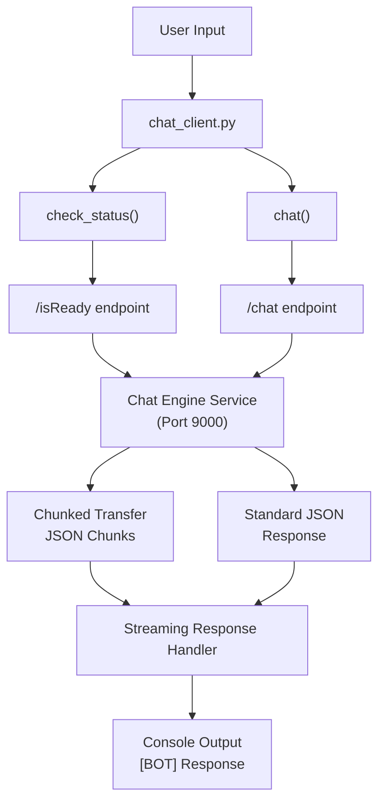
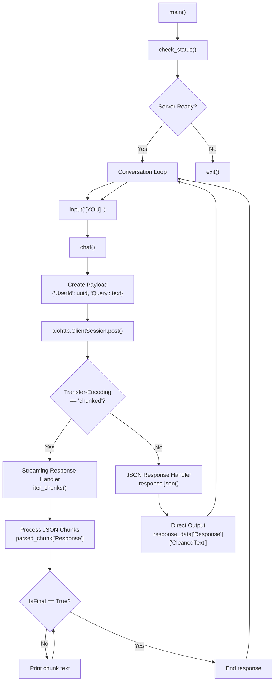
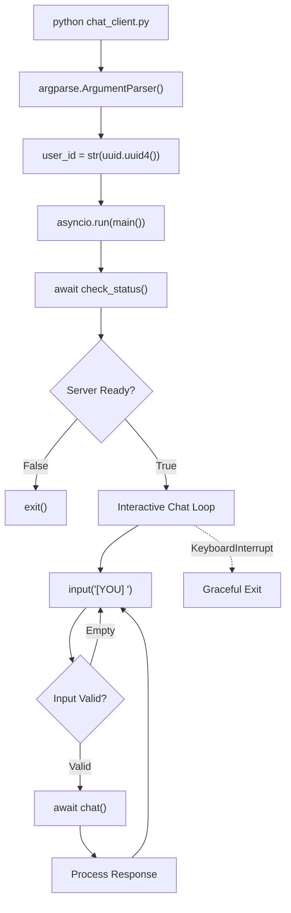

<!-- source: DeepWiki mcp.deepwiki.com · repo NVIDIA/ACE · extra page Chat Client · fetched 2026-10-26 -->

# Chat Client

Relevant source files

The following files were used as context for generating this wiki page:

- [microservices/ace_agent/4.0/clients/chat_client/chat_client.py](microservices/ace_agent/4.0/clients/chat_client/chat_client.py)
- [microservices/ace_agent/4.0/clients/chat_client/requirements.txt](microservices/ace_agent/4.0/clients/chat_client/requirements.txt)

## Purpose and Scope

The Chat Client is an HTTP-based Python application that demonstrates how to interact with the ACE Agent chat engine's REST API for text-based conversations. This client provides a simple command-line interface for sending queries and receiving responses from conversational AI agents.

For speech-based interactions, see [Speech Client](#3.2.2). For event-driven interfaces and monitoring, see [Event Client](#3.2.3). For the underlying chat engine microservice architecture, see [Microservices Architecture](#3.1).

## Architecture Overview

The Chat Client operates as a lightweight HTTP client that communicates with the chat-engine microservice within the ACE Agent framework. It provides both streaming and non-streaming conversation capabilities.

Sources: [microservices/ace_agent/4.0/clients/chat_client/chat_client.py:1-119]()

## Core Functionality

The Chat Client implements three primary functions that handle the complete conversation lifecycle:

Sources: [microservices/ace_agent/4.0/clients/chat_client/chat_client.py:31-119]()

## API Communication

The Chat Client communicates with the chat-engine service through two REST endpoints:

| Endpoint | Method | Purpose | Response Type |
|----------|--------|---------|---------------|
| `/isReady` | GET | Server health check | JSON status |
| `/chat` | POST | Send conversation query | JSON or Chunked |

### Request Payload Structure

The `/chat` endpoint expects a JSON payload with the following mandatory fields:

| Field | Type | Description | Example |
|-------|------|-------------|---------|
| `UserId` | string | Unique user identifier | Generated via `uuid.uuid4()` |
| `Query` | string | User's text input | User-provided string |

Sources: [microservices/ace_agent/4.0/clients/chat_client/chat_client.py:62-67]()

### Response Handling

The client supports two response formats based on the `Transfer-Encoding` header:

**Streaming Response (Chunked)**
- Content delivered as JSON chunks via `iter_chunks()`
- Each chunk contains `Response.Text` and `Response.IsFinal` fields
- Chunks printed incrementally until `IsFinal` is true

**Standard JSON Response**
- Single JSON object with complete response
- Response content accessed via `Response.CleanedText` field

Sources: [microservices/ace_agent/4.0/clients/chat_client/chat_client.py:73-92]()

## Configuration and Usage

### Command Line Arguments

The Chat Client accepts the following configuration parameters:

| Argument | Default | Description |
|----------|---------|-------------|
| `--host` | localhost | Chat engine hostname |
| `--port` | 9000 | Chat engine port |
| `--timeout` | 15 | HTTP request timeout (seconds) |

### Dependencies

The application requires the following Python packages:

- `aiohttp==3.9.5` - Asynchronous HTTP client library

Sources: [microservices/ace_agent/4.0/clients/chat_client/requirements.txt:1]()

### Execution Flow

Sources: [microservices/ace_agent/4.0/clients/chat_client/chat_client.py:21-119]()

## Error Handling

The Chat Client implements comprehensive error handling for common scenarios:

- **Connection Errors**: Catches exceptions when server is unreachable
- **HTTP Errors**: Uses `response.raise_for_status()` for HTTP error codes
- **Timeout Handling**: Configurable timeout via `aiohttp.ClientTimeout`
- **Keyboard Interrupts**: Graceful exit on Ctrl+C during conversation
- **JSON Parsing**: Handles malformed JSON responses in streaming mode

Sources: [microservices/ace_agent/4.0/clients/chat_client/chat_client.py:39-49](), [microservices/ace_agent/4.0/clients/chat_client/chat_client.py:68-98]()

---

