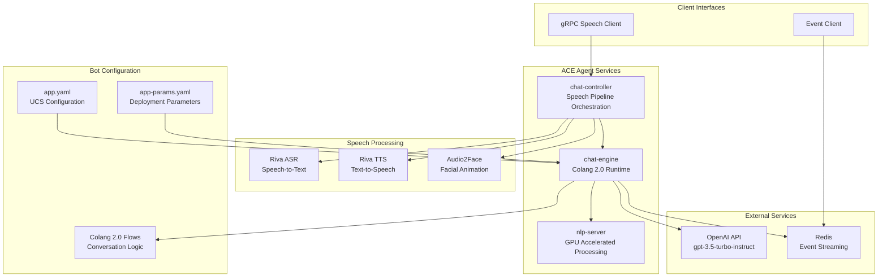
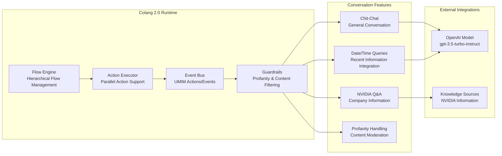
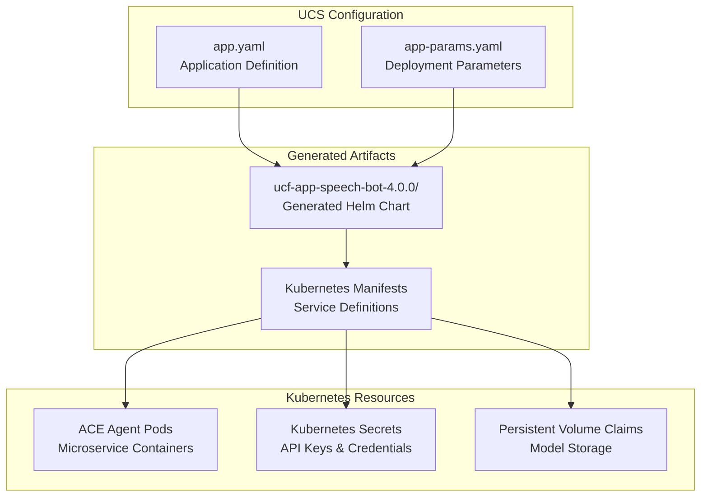
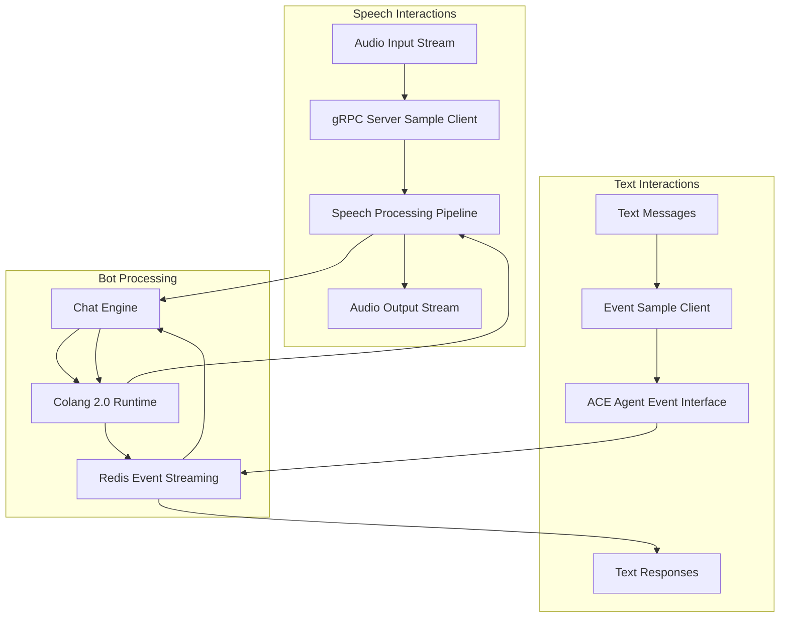

<!-- source: DeepWiki mcp.deepwiki.com · repo NVIDIA/ACE · extra page Colang 2.0 Sample Bot · fetched 2026-10-26 -->

# Colang 2.0 Sample Bot

Relevant source files

The following files were used as context for generating this wiki page:

- [microservices/ace_agent/4.0/deploy/ucs_apps/speech_bot/colang2_sample_bot/README.md](microservices/ace_agent/4.0/deploy/ucs_apps/speech_bot/colang2_sample_bot/README.md)

## Purpose and Scope

The Colang 2.0 Sample Bot demonstrates advanced conversational AI capabilities using NVIDIA's latest Colang 2.0 runtime within the ACE Agent framework. This sample application showcases multimodal interaction management, guardrailing mechanisms, and speech-enabled conversations through an event-driven architecture.

This documentation covers the speech-enabled bot implementation, deployment configuration, and integration patterns. For other sample bot implementations, see [Chat Bots](#5.1). For general ACE Agent microservices architecture, see [ACE Agent Framework](#3).

## Architecture Overview

The Colang 2.0 Sample Bot operates as a UCS (Unified Cloud Services) application that integrates multiple ACE Agent microservices to deliver speech-enabled conversational experiences.

### System Architecture

Sources: [microservices/ace_agent/4.0/deploy/ucs_apps/speech_bot/colang2_sample_bot/README.md:1-63]()

### Colang 2.0 Runtime Components

Sources: [microservices/ace_agent/4.0/deploy/ucs_apps/speech_bot/colang2_sample_bot/README.md:4-8]()

## Colang 2.0 Features

### Core Capabilities

Colang 2.0 represents a significant evolution from Colang 1.0, introducing multimodal interaction support at its foundation. The runtime provides several advanced features:

| Feature | Description | Use Case |
|---------|-------------|----------|
| **Parallel Actions** | Execute multiple conversation flows simultaneously | Handle interruptions and multi-threaded dialogues |
| **Hierarchical Flows** | Nested conversation structures with parent-child relationships | Complex conversation management |
| **UMIM Actions/Events** | Unified Multimodal Interaction Model support | Cross-modal event handling |
| **Guardrailing** | Built-in content filtering and conversation boundaries | Profanity detection and topic constraints |
| **Multimodal Core** | Native support for text, speech, and gesture inputs | Speech-enabled conversational AI |

### Conversation Management

The bot demonstrates practical implementations of Colang 2.0's conversation management capabilities:

- **Chit-Chat Experience**: General conversation handling using LLM-based responses
- **Domain-Specific Q&A**: NVIDIA-focused question answering with specialized knowledge
- **Content Filtering**: Automatic profanity detection and response moderation
- **Temporal Awareness**: Integration of current date/time information for relevant responses

Sources: [microservices/ace_agent/4.0/deploy/ucs_apps/speech_bot/colang2_sample_bot/README.md:4-8]()

## Deployment Configuration

### UCS Application Structure

The Colang 2.0 Sample Bot is packaged as a UCS application with the following configuration files:

Sources: [microservices/ace_agent/4.0/deploy/ucs_apps/speech_bot/colang2_sample_bot/README.md:40-48]()

### Prerequisites and Dependencies

The deployment requires several prerequisite configurations:

| Requirement | Purpose | Configuration Command |
|-------------|---------|----------------------|
| **NGC Docker Registry Secret** | Access to NVIDIA container images | `kubectl create secret docker-registry ngc-docker-reg-secret` |
| **NGC API Key Secret** | Download models and resources from NGC | `kubectl create secret generic ngc-api-key-secret` |
| **OpenAI API Key Secret** | Access to OpenAI gpt-3.5-turbo-instruct model | `kubectl create secret generic openai-key-secret` |
| **Local Path Provisioner** | Persistent volume storage for models | `microk8s kubectl apply -f local-path-storage.yaml` |

### Build and Deployment Process

The deployment follows a standard UCS application lifecycle:

1. **Configuration Setup**: Environment variables and Kubernetes secrets
2. **Helm Chart Generation**: `ucf_app_builder_cli app build app.yaml app-params.yaml`
3. **Application Deployment**: `helm install ace-agent ucf-app-speech-bot-4.0.0/`
4. **Pod Readiness Verification**: `watch kubectl get pods`
5. **Client Interaction**: gRPC or event-based client connections

Sources: [microservices/ace_agent/4.0/deploy/ucs_apps/speech_bot/colang2_sample_bot/README.md:23-56]()

## Client Interaction Patterns

### Supported Client Interfaces

The Colang 2.0 Sample Bot supports two primary interaction patterns:

Sources: [microservices/ace_agent/4.0/deploy/ucs_apps/speech_bot/colang2_sample_bot/README.md:55-56]()

### Event-Based Architecture

The bot leverages the ACE Agent event interface for asynchronous, event-driven interactions. This architecture supports:

- **Real-time Conversation Flow**: Immediate response to user inputs
- **Parallel Processing**: Multiple conversation threads and background tasks
- **State Management**: Persistent conversation context across interactions
- **Multimodal Coordination**: Synchronization between speech, text, and gesture inputs

Sources: [microservices/ace_agent/4.0/deploy/ucs_apps/speech_bot/colang2_sample_bot/README.md:8]()

## Integration with ACE Agent Services

### Service Dependencies

The Colang 2.0 Sample Bot integrates with multiple ACE Agent microservices:

| Service | Role | Integration Point |
|---------|------|-------------------|
| **chat-controller** | Speech pipeline orchestration | gRPC endpoint for audio processing |
| **chat-engine** | Colang 2.0 runtime hosting | HTTP API for conversation management |
| **nlp-server** | GPU-accelerated language processing | Internal service calls for NLP tasks |
| **Redis** | Event streaming and state management | Event bus for asynchronous communication |

### Model and Resource Management

The bot requires access to several external models and resources:

- **OpenAI gpt-3.5-turbo-instruct**: Primary language model for conversation generation
- **Riva ASR/TTS Models**: Speech processing models from NGC catalog  
- **NVIDIA Knowledge Base**: Specialized information for NVIDIA-related queries
- **Guardrail Models**: Content filtering and moderation capabilities

Sources: [microservices/ace_agent/4.0/deploy/ucs_apps/speech_bot/colang2_sample_bot/README.md:33-39]()

---

