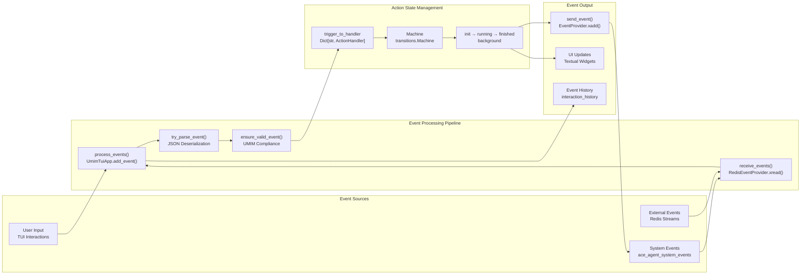
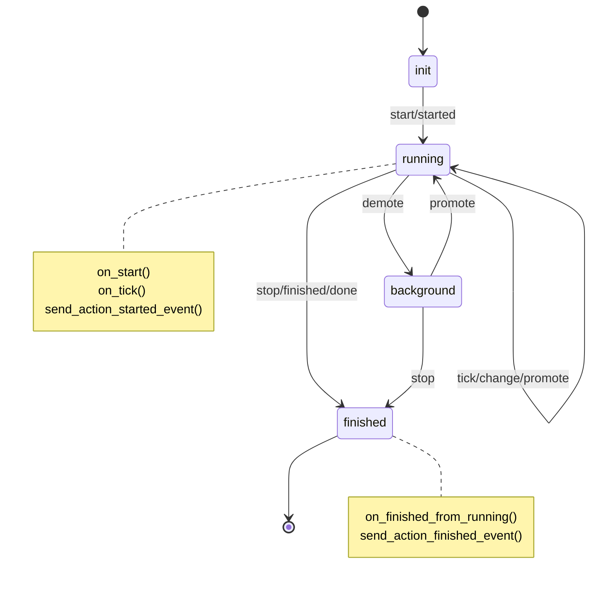
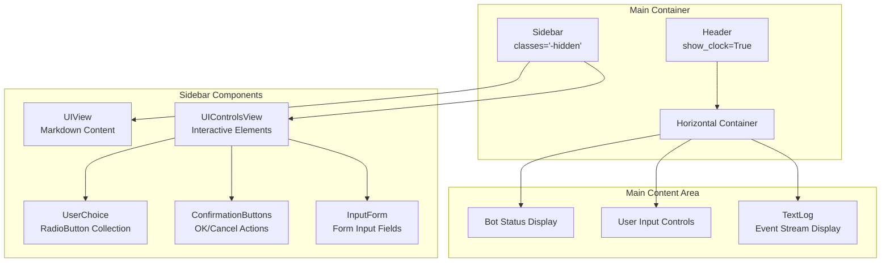

<!-- source: DeepWiki mcp.deepwiki.com · repo NVIDIA/ACE · extra page Event Client · fetched 2026-10-26 -->

# Event Client

<details>
<summary>Relevant source files</summary>

The following files were used as context for generating this wiki page:

- [microservices/ace_agent/4.0/clients/event_client/event_client.py](microservices/ace_agent/4.0/clients/event_client/event_client.py)
- [microservices/ace_agent/4.0/clients/event_client/requirements.txt](microservices/ace_agent/4.0/clients/event_client/requirements.txt)
- [microservices/ace_agent/4.0/clients/event_client/style.css](microservices/ace_agent/4.0/clients/event_client/style.css)

</details>


The Event Client is a terminal-based user interface (TUI) application that provides a simulation and monitoring environment for ACE Agent event interfaces. It serves as a development and testing tool for observing and interacting with the event-driven architecture of ACE Agent microservices through Redis-backed event streams.

For information about other client applications, see [Chat Client](#3.2.1) for HTTP-based text interactions and [Speech Client](#3.2.2) for gRPC-based speech processing pipelines. For broader context on the ACE Agent Framework architecture, see [Microservices Architecture](#3.1).

## Architecture Overview

The Event Client implements a sophisticated event simulation system built on the Textual TUI framework, providing real-time visualization and interaction capabilities for ACE Agent events.

### Core System Architecture

```mermaid
graph TD
    subgraph "Event Client Application"
        UmimTuiApp["UmimTuiApp<br/>Main TUI Application"]
        EventProvider["EventProvider<br/>Abstract Event Interface"]
        RedisEventProvider["RedisEventProvider<br/>Redis Stream Implementation"]
    end
    
    subgraph "Action Handling System"
        ActionHandler["ActionHandler<br/>Base Action State Machine"]
        TimerHandler["TimerActionHandler<br/>Timer Events"]
        GestureHandler["GestureActionHandler<br/>Gesture Animation"]
        UtteranceHandler["UtteranceBotActionHandler<br/>Speech Events"]
        VisualHandler["VisualActionHandler<br/>UI Scene Events"]
    end
    
    subgraph "UI Components"
        Sidebar["Sidebar<br/>Visual Scene Container"]
        UserChoice["UserChoice<br/>Choice Selection Widget"]
        InputForm["InputForm<br/>Form Input Widget"]
        TextLog["TextLog<br/>Event Display"]
    end
    
    subgraph "External Systems"
        Redis[("Redis<br/>ace_agent_system_events<br/>umim_events_1")]
        ACEAgent["ACE Agent<br/>Microservices"]
    end
    
    UmimTuiApp --> EventProvider
    EventProvider <|-- RedisEventProvider
    RedisEventProvider --> Redis
    
    UmimTuiApp --> ActionHandler
    ActionHandler <|-- TimerHandler
    ActionHandler <|-- GestureHandler
    ActionHandler <|-- UtteranceHandler
    ActionHandler <|-- VisualHandler
    
    UmimTuiApp --> Sidebar
    UmimTuiApp --> TextLog
    Sidebar --> UserChoice
    Sidebar --> InputForm
    
    Redis <--> ACEAgent
```

**Sources:** [microservices/ace_agent/4.0/clients/event_client/event_client.py:1-100]()

### Event Flow Architecture



**Sources:** [microservices/ace_agent/4.0/clients/event_client/event_client.py:114-140](), [microservices/ace_agent/4.0/clients/event_client/event_client.py:615-620]()

## Core Components

### Event Provider System

The Event Client uses an abstract `EventProvider` interface with Redis-specific implementation for event streaming:

| Component | Purpose | Key Methods |
|-----------|---------|-------------|
| `EventProvider` | Abstract event interface | `receive_events()`, `send_event()` |
| `RedisEventProvider` | Redis Streams implementation | `xread()`, `xadd()` through Redis client |
| `event_provider_factory()` | Factory pattern for provider creation | Creates configured provider instances |

The `RedisEventProvider` manages channel state tracking and implements timeout-based event polling:

```python
# Channel state management for Redis streams
self._channel_state: Dict[str, str] = dict(
    map(lambda c: (c, "$" if discard_existing_events else "0"), channels)
)
```

**Sources:** [microservices/ace_agent/4.0/clients/event_client/event_client.py:88-98](), [microservices/ace_agent/4.0/clients/event_client/event_client.py:100-140](), [microservices/ace_agent/4.0/clients/event_client/event_client.py:142-154]()

### Action Handler Framework

The Action Handler system implements finite state machines for managing different types of ACE Agent actions:

#### Base ActionHandler Architecture



#### Action Handler Implementations

| Handler Class | Action Types | UI Element | Special Behavior |
|---------------|--------------|------------|------------------|
| `TimerActionHandler` | StartTimerBotAction, TimerBotActionStarted | `#bot-timer` | Duration tracking, countdown display |
| `GestureActionHandler` | StartGestureBotAction, GestureBotActionStarted | `#bot-gesture` | Animation stack management |
| `UtteranceBotActionHandler` | StartUtteranceBotAction, UtteranceBotActionStarted | `#bot-utterance` | Progressive text display |
| `VisualActionHandler` | VisualChoiceSceneAction, VisualFormSceneAction | `#scene-ui` | Sidebar UI management |
| `PostureActionHandler` | StartPostureBotAction, PostureBotActionStarted | `#bot-posture` | Override action stack |

**Sources:** [microservices/ace_agent/4.0/clients/event_client/event_client.py:533-705](), [microservices/ace_agent/4.0/clients/event_client/event_client.py:707-761](), [microservices/ace_agent/4.0/clients/event_client/event_client.py:1099-1142]()

### Event Validation and UMIM Compliance

The system implements Universal Multimodal Interaction Model (UMIM) compliance validation:

```python
_event_validators = [
    Validator("Events need to provide 'type'", lambda e: "type" in e),
    Validator("Events need to provide 'uid'", lambda e: _has_property(e, Property("uid", str))),
    Validator("Events need to provide 'event_created_at' of type 'str'", 
              lambda e: _has_property(e, Property("event_created_at", str))),
    # ... additional validators
]
```

Event modality information is automatically added based on action type mappings:

| Action Type | Modality | Policy |
|-------------|----------|---------|
| UtteranceBotAction | bot_speech | replace |
| VisualChoiceSceneAction | information | override |
| GestureBotAction | bot_gesture | override |
| TimerBotAction | time | parallel |

**Sources:** [microservices/ace_agent/4.0/clients/event_client/event_client.py:171-219](), [microservices/ace_agent/4.0/clients/event_client/event_client.py:222-231]()

## User Interface Components

### Main Application Structure

The `UmimTuiApp` class extends Textual's `App` class and provides the primary interface:

| Key Properties | Purpose |
|----------------|---------|
| `show_sidebar` | Reactive property for UI scene visibility |
| `running_actions` | Dict tracking active ActionHandler instances |
| `trigger_to_handler` | Maps event types to handler classes |
| `interaction_history` | Event logging for session persistence |

### TUI Layout Components



### Interactive UI Widgets

The Event Client provides specialized widgets for different interaction patterns:

#### UserChoice Widget
Handles multiple choice selections with automatic event generation:

```python
def on_radio_button_changed(self, event: RadioButton.Changed) -> None:
    self.toggle_choice(event.radio_button.id)
    e = new_event(
        "VisualChoiceSceneActionChoiceUpdated",
        action_uid=self.action_handler.action_uid,
        current_choice=list(self.choices),
    )
    self.action_handler.send_event(e)
```

#### InputForm Widget
Manages form input with real-time event updates:

```python
def on_input_changed(self, event: Input.Changed) -> None:
    if event.input.id in self.inputs:
        self.inputs[event.input.id]["value"] = event.value
        e = new_event(
            "VisualFormSceneActionInputUpdated",
            action_uid=self.action_handler.action_uid,
            interim_inputs=list(self.inputs.values()),
        )
        self.action_handler.send_event(e)
```

**Sources:** [microservices/ace_agent/4.0/clients/event_client/event_client.py:1370-1395](), [microservices/ace_agent/4.0/clients/event_client/event_client.py:1397-1418](), [microservices/ace_agent/4.0/clients/event_client/event_client.py:1644-1700]()

## Configuration and Usage

### Application Configuration

The Event Client uses global configuration variables for Redis connectivity and operational modes:

| Configuration | Default Value | Purpose |
|---------------|---------------|---------|
| `redis_host` | "localhost" | Redis server hostname |
| `redis_port` | 6379 | Redis server port |
| `stream_id` | "1" | Pipeline stream identifier |
| `channel_id` | "umim_events_1" | Primary event channel |
| `SYSTEM_EVENTS_STREAM` | "ace_agent_system_events" | System-level events |

### Key Bindings

The application provides keyboard shortcuts for common operations:

| Binding | Action | Function |
|---------|--------|----------|
| `Ctrl+T` | toggle_timestamps | Show/hide event timestamps |
| `Ctrl+S` | save_interaction | Export event history |
| `Ctrl+C` | exit_app | Terminate application |
| `Ctrl+B` | toggle_sidebar | Show/hide visual UI panel |

### Event Processing Modes

The Event Client operates in two primary modes:

1. **Active Mode** (`app_in_active_mode = True`): Generates and sends events
2. **Passive Mode** (`app_in_active_mode = False`): Only receives and displays events

**Sources:** [microservices/ace_agent/4.0/clients/event_client/event_client.py:55-62](), [microservices/ace_agent/4.0/clients/event_client/event_client.py:1475-1481](), [microservices/ace_agent/4.0/clients/event_client/event_client.py:637-639]()

## Dependencies and Requirements

The Event Client requires the following Python packages as specified in the requirements:

| Package | Version | Purpose |
|---------|---------|---------|
| `textual` | 0.29.0 | TUI framework for terminal applications |
| `typer` | 0.9.0 | CLI argument parsing and commands |
| `redis` | 4.6.0 | Redis client for event streaming |
| `transitions` | 0.9.0 | Finite state machine implementation |
| `typing_extensions` | 4.7.1 | Enhanced type hints support |

**Sources:** [microservices/ace_agent/4.0/clients/event_client/requirements.txt:1-5]()

---

