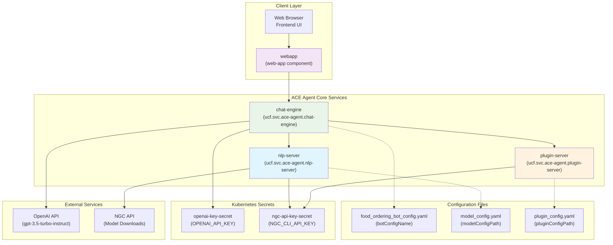
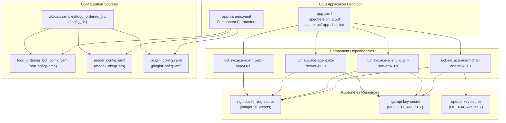
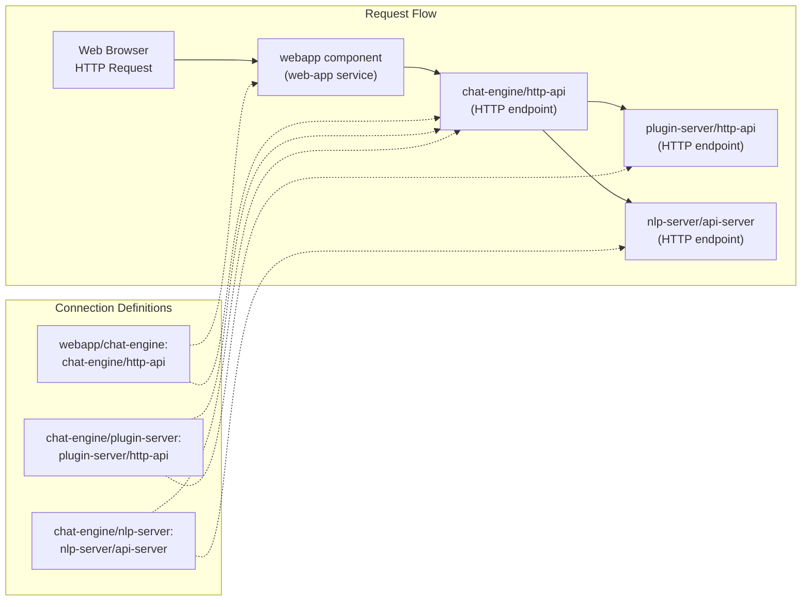

<!-- source: DeepWiki mcp.deepwiki.com · repo NVIDIA/ACE · extra page Food Ordering Bot · fetched 2026-10-26 -->

# Food Ordering Bot

Relevant source files

The following files were used as context for generating this wiki page:

- [microservices/ace_agent/4.0/deploy/ucs_apps/chat_bot/food_ordering_bot/README.md](microservices/ace_agent/4.0/deploy/ucs_apps/chat_bot/food_ordering_bot/README.md)
- [microservices/ace_agent/4.0/deploy/ucs_apps/chat_bot/food_ordering_bot/app-params.yaml](microservices/ace_agent/4.0/deploy/ucs_apps/chat_bot/food_ordering_bot/app-params.yaml)
- [microservices/ace_agent/4.0/deploy/ucs_apps/chat_bot/food_ordering_bot/app.yaml](microservices/ace_agent/4.0/deploy/ucs_apps/chat_bot/food_ordering_bot/app.yaml)

## Purpose and Scope

This page documents the Food Ordering Bot, a sample conversational AI application that demonstrates the capabilities of the ACE Agent Framework for building domain-specific chatbots. The Food Ordering Bot serves as a virtual assistant capable of listing menu items, managing order carts, and calculating bill amounts through natural language interactions.

This documentation covers the bot's architecture, deployment configuration, and integration with ACE Agent microservices. For information about other sample bots, see [Stock Bot](#5.1.2) and [RAG Bot](#5.1.3). For broader ACE Agent framework concepts, see [ACE Agent Framework](#3).

## System Overview

The Food Ordering Bot is implemented as a UCS (Unified Cloud Services) application that orchestrates multiple ACE Agent microservices to provide conversational food ordering capabilities. The bot uses OpenAI's GPT-3.5-turbo-instruct model as its primary language model and operates entirely in text-to-text mode without speech processing.

### Core Capabilities

| Capability | Description |
|------------|-------------|
| Menu Browsing | Lists available food items and categories |
| Cart Management | Adds, removes, and modifies items in order cart |
| Order Calculation | Computes total bill amount with itemized breakdown |
| Natural Language Processing | Interprets user intents and maintains conversation context |

**Food Ordering Bot Component Architecture**

Sources: [microservices/ace_agent/4.0/deploy/ucs_apps/chat_bot/food_ordering_bot/app.yaml:25-65](), [microservices/ace_agent/4.0/deploy/ucs_apps/chat_bot/food_ordering_bot/app-params.yaml:1-18]()

## UCS Application Configuration

The Food Ordering Bot is defined as a UCS application with specification version 2.5.0, containing four primary components that work together to provide conversational AI capabilities.

### Application Definition

**UCS Application Structure**

Sources: [microservices/ace_agent/4.0/deploy/ucs_apps/chat_bot/food_ordering_bot/app.yaml:1-65](), [microservices/ace_agent/4.0/deploy/ucs_apps/chat_bot/food_ordering_bot/app-params.yaml:1-18]()

### Component Configuration

The application parameters define specific configurations for each microservice component:

| Component | Key Configuration Parameters |
|-----------|----------------------------|
| `chat-engine` | `botConfigName: food_ordering_bot_config.yaml` `logLevel: "DEBUG"` `gunicornWorkers: "1"` `gunicornTimeout: "150"` |
| `nlp-server` | `ucfVisibleGpus: [0]` `modelConfigPath: "model_config.yaml"` `gunicornWorkers: "4"` `gunicornTimeout: "120"` |
| `plugin-server` | `pluginConfigPath: "plugin_config.yaml"` |

Sources: [microservices/ace_agent/4.0/deploy/ucs_apps/chat_bot/food_ordering_bot/app-params.yaml:1-18]()

## Service Connections and Data Flow

The UCS application defines explicit connections between components that establish the communication pathways for request processing.

**Inter-Service Communication Pattern**

Sources: [microservices/ace_agent/4.0/deploy/ucs_apps/chat_bot/food_ordering_bot/app.yaml:60-65]()

## Deployment Process

The Food Ordering Bot follows a multi-step deployment process using UCS tools and Helm charts for Kubernetes deployment.

### Prerequisites and Setup

The deployment requires several Kubernetes secrets to be configured before application deployment:

| Secret Name | Purpose | Key |
|-------------|---------|-----|
| `ngc-docker-reg-secret` | Docker registry authentication for NVIDIA container images | Docker registry credentials |
| `ngc-api-key-secret` | NGC API access for model downloads | `NGC_CLI_API_KEY` |
| `openai-key-secret` | OpenAI API access for GPT model inference | `OPENAI_API_KEY` |

### Build and Deployment Commands

The deployment process uses the following command sequence:

1. **Helm Chart Generation**: `ucf_app_builder_cli app build app.yaml app-params.yaml`
2. **Kubernetes Deployment**: `helm install ace-agent ucf-app-chat-bot-4.0.0/`
3. **Pod Status Monitoring**: `watch kubectl get pods`
4. **Web Access**: Access via `http://<workstation IP>:<Webapp_NodePort>`
5. **Cleanup**: `helm uninstall ace-agent && kubectl delete pvc --all`

Sources: [microservices/ace_agent/4.0/deploy/ucs_apps/chat_bot/food_ordering_bot/README.md:38-61]()

### Configuration File Locations

All configuration files are sourced from the `../../../../samples/food_ordering_bot` directory relative to the UCS application definition, establishing a standardized configuration layout for the bot's behavior, model settings, and plugin configurations.

Sources: [microservices/ace_agent/4.0/deploy/ucs_apps/chat_bot/food_ordering_bot/app.yaml:34-54]()

---

