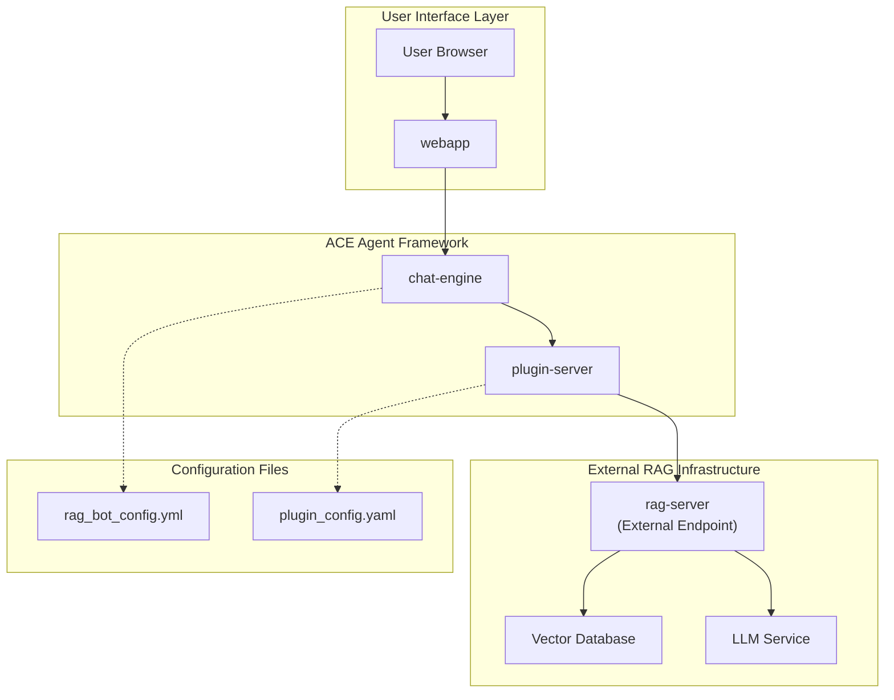
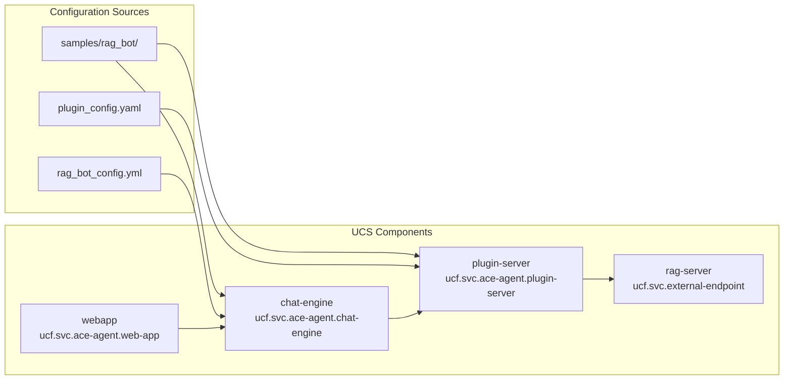
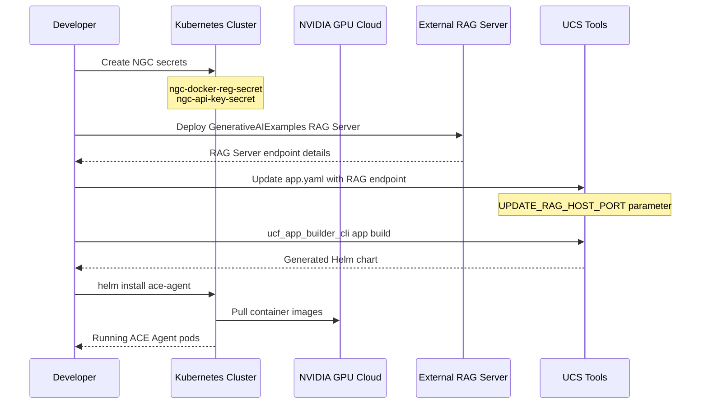

<!-- source: DeepWiki mcp.deepwiki.com · repo NVIDIA/ACE · extra page RAG Bot · fetched 2026-10-26 -->

# RAG Bot

<details>
<summary>Relevant source files</summary>

The following files were used as context for generating this wiki page:

- [microservices/ace_agent/4.0/deploy/ucs_apps/chat_bot/rag_bot/README.md](microservices/ace_agent/4.0/deploy/ucs_apps/chat_bot/rag_bot/README.md)
- [microservices/ace_agent/4.0/deploy/ucs_apps/chat_bot/rag_bot/app-params.yaml](microservices/ace_agent/4.0/deploy/ucs_apps/chat_bot/rag_bot/app-params.yaml)
- [microservices/ace_agent/4.0/deploy/ucs_apps/chat_bot/rag_bot/app.yaml](microservices/ace_agent/4.0/deploy/ucs_apps/chat_bot/rag_bot/app.yaml)

</details>


This page documents the Retrieval Augmented Generation (RAG) Bot sample application, which demonstrates how to integrate external RAG services with the ACE Agent framework to enable document-based question answering capabilities. The RAG Bot leverages NVIDIA's GenerativeAIExamples repository for the retrieval and generation pipeline while using ACE Agent's microservices for conversation management and user interaction.

For information about other chat-based sample bots, see [Food Ordering Bot](#5.1.1) and [Stock Bot](#5.1.2).

## Architecture Overview

The RAG Bot implements a distributed architecture where the ACE Agent framework handles conversation orchestration while delegating retrieval and generation tasks to an external RAG server. This separation allows for flexible deployment of different RAG implementations while maintaining consistent conversation flow management.

**RAG Bot System Architecture**


Sources: [microservices/ace_agent/4.0/deploy/ucs_apps/chat_bot/rag_bot/app.yaml:1-56]()

## Component Configuration

The RAG Bot is deployed as a UCS application with specific component configurations that define the integration points and service dependencies.

### UCS Application Components

| Component | Type | Purpose | Configuration Source |
|-----------|------|---------|---------------------|
| `chat-engine` | `ucf.svc.ace-agent.chat-engine` | Conversation orchestration and Colang processing | `rag_bot_config.yml` |
| `plugin-server` | `ucf.svc.ace-agent.plugin-server` | Business logic and external service integration | `plugin_config.yaml` |
| `webapp` | `ucf.svc.ace-agent.web-app` | Web-based user interface | Default configuration |
| `rag-server` | `ucf.svc.external-endpoint` | External RAG service endpoint | Runtime configuration |

**Component Dependencies and File Mapping**


Sources: [microservices/ace_agent/4.0/deploy/ucs_apps/chat_bot/rag_bot/app.yaml:20-55](), [microservices/ace_agent/4.0/deploy/ucs_apps/chat_bot/rag_bot/app-params.yaml:1-6]()

## Deployment Architecture

The RAG Bot follows a two-phase deployment model where the external RAG infrastructure must be deployed separately before the ACE Agent components are configured to connect to it.

### Prerequisites and Dependencies

The deployment requires several external dependencies and configurations:

| Requirement | Purpose | Configuration Location |
|-------------|---------|----------------------|
| NGC API Key | Model and container access | `ngc-api-key-secret` Kubernetes secret |
| Docker Registry Access | Container image pulling | `ngc-docker-reg-secret` Kubernetes secret |
| RAG Server Deployment | Document retrieval and generation | External GenerativeAIExamples deployment |
| Local Path Provisioner | Persistent storage | Kubernetes cluster configuration |

**Deployment Flow**


Sources: [microservices/ace_agent/4.0/deploy/ucs_apps/chat_bot/rag_bot/README.md:20-41]()

## External RAG Integration

The RAG Bot's core functionality depends on integration with an external RAG server that handles document indexing, vector search, and generation. This external server must be deployed from the NVIDIA GenerativeAIExamples repository.

### RAG Server Configuration

The external RAG server endpoint is configured as an `external-endpoint` component in the UCS application:

```yaml
- name: rag-server
  type: ucf.svc.external-endpoint
  parameters:
    service: UPDATE_RAG_HOST_PORT
    port: 8081
```

The `UPDATE_RAG_HOST_PORT` parameter must be manually updated with the actual deployed RAG server's host and port information before deployment.

### Service Connections

The RAG Bot establishes the following service connections for request routing:

| Connection | Source | Destination | Protocol |
|------------|--------|-------------|----------|
| User Interface | `webapp` | `chat-engine` | HTTP |
| Conversation Processing | `chat-engine` | `plugin-server` | HTTP |
| RAG Query Processing | `plugin-server` | `rag-server` | HTTP |

Sources: [microservices/ace_agent/4.0/deploy/ucs_apps/chat_bot/rag_bot/app.yaml:46-55]()

## Configuration Files

The RAG Bot utilizes two primary configuration files that define the bot's behavior and plugin integration:

### Bot Configuration

The `botConfigName` parameter references `rag_bot_config.yml`, which contains the Colang-based conversation flow definitions and guardrails specific to RAG-based interactions.

### Plugin Configuration

The `pluginConfigPath` parameter references `plugin_config.yaml`, which defines how the plugin-server integrates with the external RAG service, including API endpoints, authentication, and request formatting.

Sources: [microservices/ace_agent/4.0/deploy/ucs_apps/chat_bot/rag_bot/app-params.yaml:1-6]()

## Deployment Commands

The RAG Bot deployment follows standard UCS application deployment procedures with specific configuration steps:

1. **Secret Creation**: Establish NGC credentials for container and model access
2. **RAG Server Deployment**: Deploy external RAG infrastructure from GenerativeAIExamples
3. **Configuration Update**: Modify `app.yaml` with RAG server endpoint details
4. **Helm Chart Generation**: Build UCS application using `ucf_app_builder_cli`
5. **Deployment**: Install generated Helm chart with `helm install ace-agent`

The deployment creates a fully functional conversational AI system capable of answering questions based on indexed documents through the external RAG pipeline.

Sources: [microservices/ace_agent/4.0/deploy/ucs_apps/chat_bot/rag_bot/README.md:20-48]()

---

