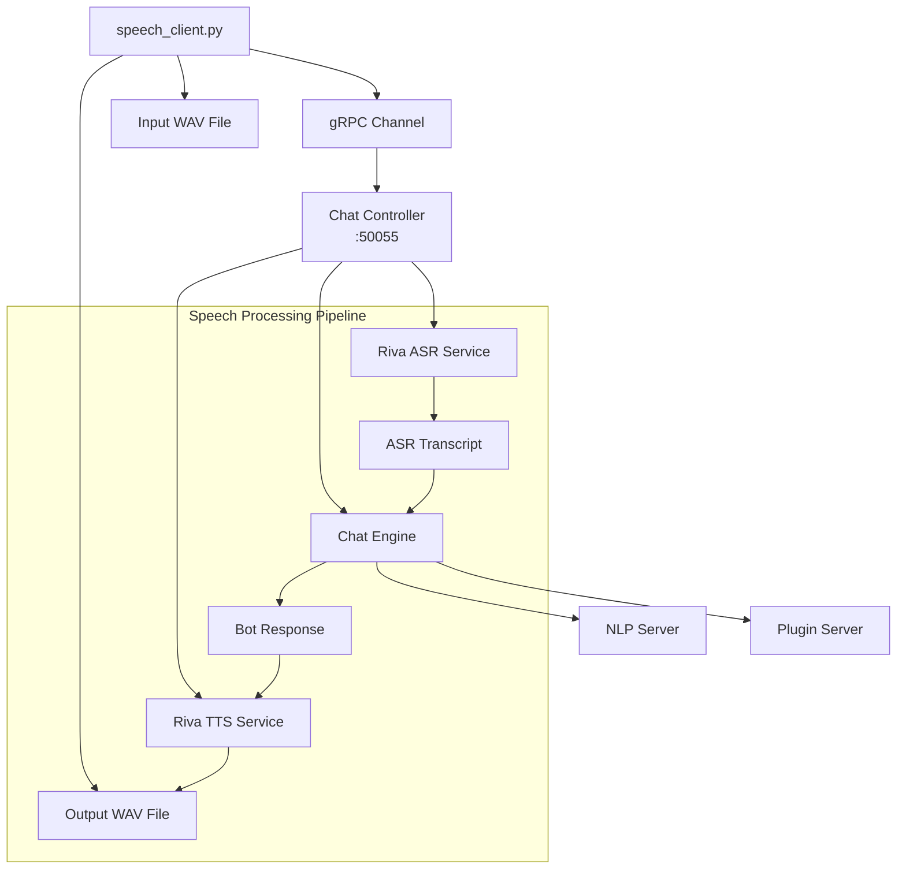
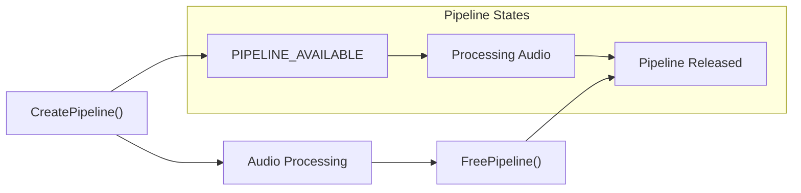
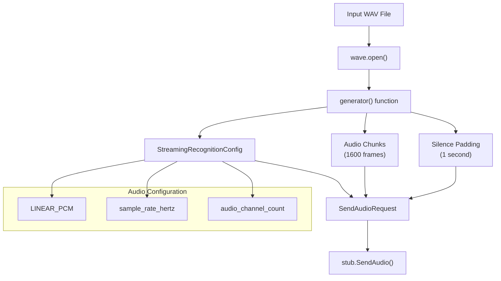
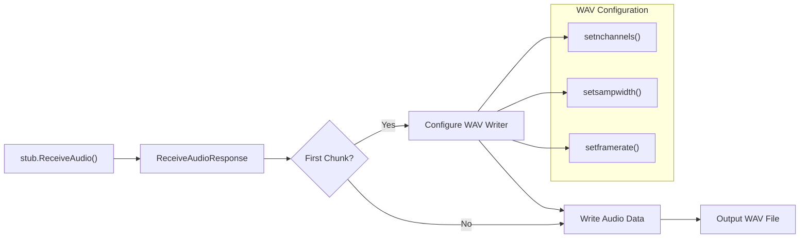
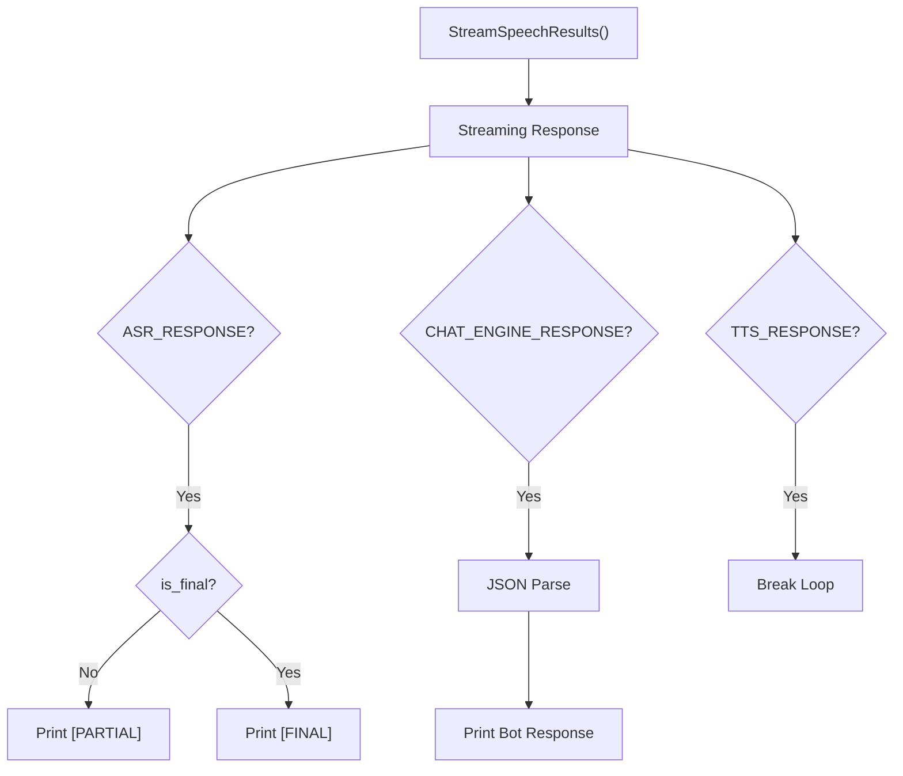

<!-- source: DeepWiki mcp.deepwiki.com · repo NVIDIA/ACE · extra page Speech Client · fetched 2026-10-26 -->

# Speech Client

Relevant source files

The following files were used as context for generating this wiki page:

- [microservices/ace_agent/4.0/clients/speech_client/requirements.txt](microservices/ace_agent/4.0/clients/speech_client/requirements.txt)
- [microservices/ace_agent/4.0/clients/speech_client/setup.sh](microservices/ace_agent/4.0/clients/speech_client/setup.sh)
- [microservices/ace_agent/4.0/clients/speech_client/speech_client.py](microservices/ace_agent/4.0/clients/speech_client/speech_client.py)

## Purpose and Scope

The Speech Client is a gRPC-based Python client application that enables speech processing interactions with the ACE Agent Chat Controller service. It provides a complete audio processing pipeline that handles speech input, processes it through Automatic Speech Recognition (ASR), generates conversational responses, and returns synthesized speech output via Text-to-Speech (TTS).

This document covers the Speech Client's architecture, gRPC communication protocols, and audio streaming capabilities. For HTTP-based text conversations, see [Chat Client](#3.2.1). For event-based monitoring interfaces, see [Event Client](#3.2.3).

## Architecture Overview

The Speech Client operates as a standalone gRPC client that communicates with the Chat Controller microservice, which orchestrates the complete speech processing pipeline including ASR, NLP processing, and TTS services.

### Speech Client System Integration

Sources: [microservices/ace_agent/4.0/clients/speech_client/speech_client.py:40-42](), [microservices/ace_agent/4.0/clients/speech_client/speech_client.py:94-95]()

## Core Functionality

### gRPC Protocol Buffer Integration

The Speech Client uses generated Python gRPC stubs from protocol buffer definitions to communicate with the ACE Agent services.

| Component | Purpose | Generated From |
|-----------|---------|----------------|
| `ace_agent_pb2` | Message definitions and data structures | Proto files in `../../proto/` |
| `ace_agent_pb2_grpc` | gRPC service stubs and client interfaces | Proto files in `../../proto/` |

The setup process generates these files using the `setup.sh` script which compiles `.proto` files into Python modules.

Sources: [microservices/ace_agent/4.0/clients/speech_client/speech_client.py:20-22](), [microservices/ace_agent/4.0/clients/speech_client/setup.sh:23]()

### Pipeline Management

The Speech Client manages pipeline lifecycles through dedicated gRPC calls:

Each pipeline session requires a unique `stream_id` generated using `uuid.uuid4()` to isolate concurrent speech processing sessions.

Sources: [microservices/ace_agent/4.0/clients/speech_client/speech_client.py:46-55](), [microservices/ace_agent/4.0/clients/speech_client/speech_client.py:153-156]()

### Audio Streaming Protocol

The Speech Client implements bidirectional audio streaming using gRPC streaming APIs:

#### SendAudio Streaming

The audio streaming generator function processes WAV files in chunks of 1600 frames with a 50ms delay between chunks to simulate real-time audio streaming.

Sources: [microservices/ace_agent/4.0/clients/speech_client/speech_client.py:58-94]()

#### ReceiveAudio Processing

The client receives TTS audio data and writes it to a WAV file using the `wave` module:

Sources: [microservices/ace_agent/4.0/clients/speech_client/speech_client.py:97-124]()

## Streaming Speech Results

The Speech Client receives real-time processing results through the `StreamSpeechResults` API, which provides three types of responses:

| Message Type | Purpose | Data Structure |
|--------------|---------|----------------|
| `ASR_RESPONSE` | Speech transcription results | `asr_result.results.alternatives[0].transcript` |
| `CHAT_ENGINE_RESPONSE` | Bot conversational responses | `chat_engine_response.result` (JSON) |
| `TTS_RESPONSE` | Text-to-speech completion signal | Pipeline completion indicator |

### Message Processing Flow

The streaming loop continues until a `TTS_RESPONSE` is received, indicating the complete processing pipeline has finished.

Sources: [microservices/ace_agent/4.0/clients/speech_client/speech_client.py:125-151]()

## Implementation Details

### Command Line Interface

The Speech Client accepts the following command line arguments:

| Argument | Default | Purpose |
|----------|---------|---------|
| `--audio_file_path` | Required | Input WAV file for ASR processing |
| `--tts_output_path` | `tts_output.wav` | Output file for TTS audio |
| `--server` | `0.0.0.0:50055` | gRPC server endpoint |

Sources: [microservices/ace_agent/4.0/clients/speech_client/speech_client.py:26-32]()

### Error Handling

The client implements validation and exception handling for:

- Input audio file existence validation
- Pipeline creation status verification  
- gRPC timeout handling (10 second timeout)
- TTS audio reception exceptions
- Streaming response loop termination

Sources: [microservices/ace_agent/4.0/clients/speech_client/speech_client.py:34-38](), [microservices/ace_agent/4.0/clients/speech_client/speech_client.py:104-124](), [microservices/ace_agent/4.0/clients/speech_client/speech_client.py:136-151]()

### Protocol Buffer Setup

The client requires compiled protocol buffer files generated using `grpc_tools.protoc`. The `setup.sh` script automates this process:

- Input directory: `./../../proto/` (default)
- Output directory: `./` (current directory)
- Generates: `*_pb2.py` and `*_pb2_grpc.py` files

Sources: [microservices/ace_agent/4.0/clients/speech_client/setup.sh:1-29](), [microservices/ace_agent/4.0/clients/speech_client/requirements.txt:1]()

---

