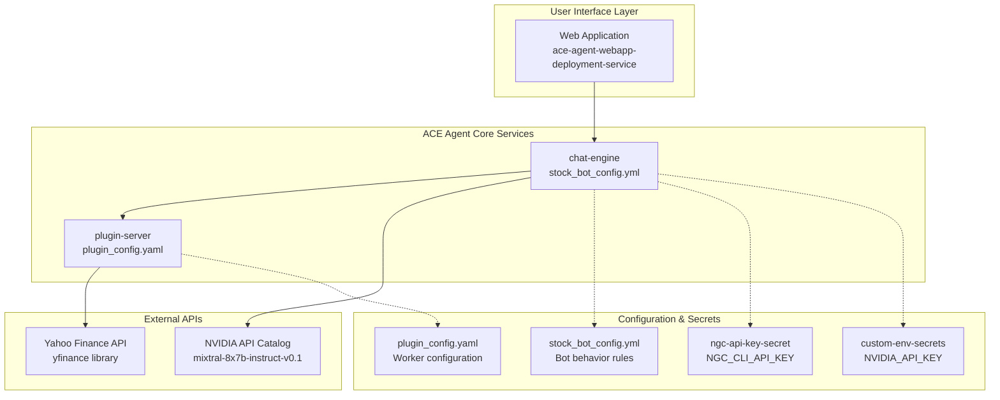
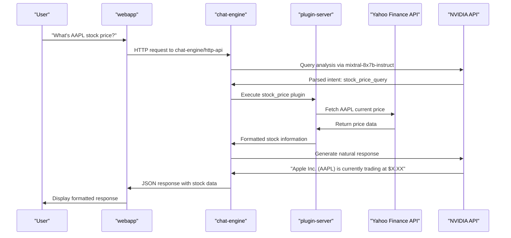
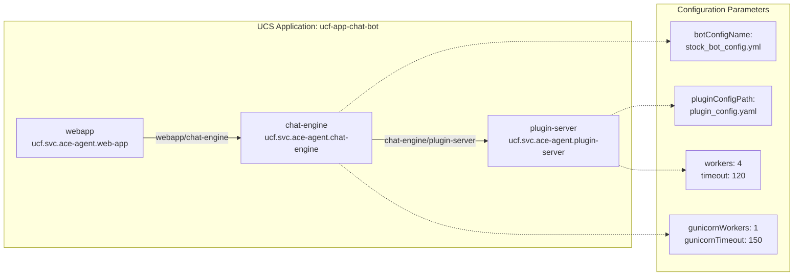

<!-- source: DeepWiki mcp.deepwiki.com · repo NVIDIA/ACE · extra page Stock Bot · fetched 2026-10-26 -->

# Stock Bot

<details>
<summary>Relevant source files</summary>

The following files were used as context for generating this wiki page:

- [microservices/ace_agent/4.0/deploy/ucs_apps/chat_bot/stock_bot/README.md](microservices/ace_agent/4.0/deploy/ucs_apps/chat_bot/stock_bot/README.md)
- [microservices/ace_agent/4.0/deploy/ucs_apps/chat_bot/stock_bot/app-params.yaml](microservices/ace_agent/4.0/deploy/ucs_apps/chat_bot/stock_bot/app-params.yaml)
- [microservices/ace_agent/4.0/deploy/ucs_apps/chat_bot/stock_bot/app.yaml](microservices/ace_agent/4.0/deploy/ucs_apps/chat_bot/stock_bot/app.yaml)

</details>


## Purpose and Scope

The Stock Bot is a specialized conversational AI agent designed to provide real-time stock market information and answer financial queries. This bot leverages the Yahoo Finance API for live stock price data and NVIDIA's Mixtral-8x7B-Instruct model for natural language processing of financial questions. The Stock Bot strictly limits its responses to stock market-related topics, rejecting off-topic queries to maintain focus.

This document covers the Stock Bot's architecture, configuration, and deployment as a UCS application. For information about the broader chat bot ecosystem, see [Chat Bots](#5.1). For details on other sample bots, see [Food Ordering Bot](#5.1.1) and [RAG Bot](#5.1.3).

Sources: [microservices/ace_agent/4.0/deploy/ucs_apps/chat_bot/stock_bot/README.md:1-6]()

## Architecture Overview

The Stock Bot implements the standard ACE Agent microservices architecture, consisting of three core components that work together to process financial queries and provide stock market information.

### Stock Bot Component Architecture



The Stock Bot follows the standard ACE Agent pattern where the `chat-engine` orchestrates conversation flow while the `plugin-server` handles external API integrations. The configuration enforces strict topic boundaries, ensuring the bot only responds to financial queries.

Sources: [microservices/ace_agent/4.0/deploy/ucs_apps/chat_bot/stock_bot/app.yaml:24-52](), [microservices/ace_agent/4.0/deploy/ucs_apps/chat_bot/stock_bot/app-params.yaml:1-14]()

### Query Processing Flow



This sequence illustrates how the Stock Bot processes financial queries through its microservices architecture, leveraging both the Yahoo Finance API for data retrieval and NVIDIA's Mixtral model for natural language understanding and generation.

Sources: [microservices/ace_agent/4.0/deploy/ucs_apps/chat_bot/stock_bot/README.md:1-2]()

## UCS Application Configuration

The Stock Bot is deployed as a UCS (Unified Cloud Services) application using Helm charts. The application definition specifies the required microservices, their configurations, and inter-service connections.

### Application Structure

| Component | Type | Purpose | Configuration File |
|-----------|------|---------|------------------|
| `chat-engine` | `ucf.svc.ace-agent.chat-engine:4.0.0` | Conversation orchestration | `stock_bot_config.yml` |
| `plugin-server` | `ucf.svc.ace-agent.plugin-server:4.0.0` | External API integration | `plugin_config.yaml` |
| `webapp` | `ucf.svc.ace-agent.web-app:4.0.0` | Web interface | Default configuration |

The `app.yaml` defines the UCS application structure with version `4.0.0` and name `ucf-app-chat-bot`. Configuration files are located in the `../../../../samples/stock_bot` directory relative to the UCS app definition.

Sources: [microservices/ace_agent/4.0/deploy/ucs_apps/chat_bot/stock_bot/app.yaml:1-54]()

### Service Connections and Parameters



The connection topology shows `webapp/chat-engine: chat-engine/http-api` and `chat-engine/plugin-server: plugin-server/http-api`, establishing the request flow through the microservices stack.

Sources: [microservices/ace_agent/4.0/deploy/ucs_apps/chat_bot/stock_bot/app.yaml:50-52](), [microservices/ace_agent/4.0/deploy/ucs_apps/chat_bot/stock_bot/app-params.yaml:1-14]()

## Deployment Requirements and Secrets

The Stock Bot requires specific Kubernetes secrets for authentication with external services and model access.

### Required Secrets Configuration

| Secret Name | Key | Purpose | Source |
|-------------|-----|---------|---------|
| `ngc-docker-reg-secret` | Docker registry credentials | Pull NGC container images | NGC CLI API Key |
| `ngc-api-key-secret` | `NGC_CLI_API_KEY` | Download models from NGC | NGC CLI API Key |
| `custom-env-secrets` | `ENV` | NVIDIA API access | Custom environment file |

The `custom-env-secrets` contains the `NVIDIA_API_KEY` required for accessing the mixtral-8x7b-instruct-v0.1 model through the NVIDIA API Catalog.

```yaml
# Example custom-env.txt format
NVIDIA_API_KEY="nvapi-XXX"
```

Sources: [microservices/ace_agent/4.0/deploy/ucs_apps/chat_bot/stock_bot/README.md:20-36](), [microservices/ace_agent/4.0/deploy/ucs_apps/chat_bot/stock_bot/app.yaml:14-22]()

### Deployment Process

The Stock Bot deployment follows the standard UCS application workflow:

1. **Secret Creation**: Establish required Kubernetes secrets for NGC and NVIDIA API access
2. **Chart Generation**: Execute `ucf_app_builder_cli app build app.yaml app-params.yaml`
3. **Helm Installation**: Deploy using `helm install ace-agent ucf-app-chat-bot-4.0.0/`
4. **Service Access**: Access via `ace-agent-webapp-deployment-service` NodePort

The deployment creates persistent volumes and requires the Local Path Provisioner for storage management. The generated Helm chart name follows the pattern `ucf-app-chat-bot-4.0.0/`.

Sources: [microservices/ace_agent/4.0/deploy/ucs_apps/chat_bot/stock_bot/README.md:38-61]()

## Model Integration and API Usage

The Stock Bot integrates two primary external services: Yahoo Finance for stock data retrieval and NVIDIA's API Catalog for natural language processing.

### NVIDIA Mixtral Integration

The bot uses the `mixtral-8x7b-instruct-v0.1` model deployed via the NVIDIA API Catalog for:
- Natural language understanding of financial queries
- Stock-related topic classification
- Response generation with financial context
- Off-topic query rejection

Access requires an API key from the [mixtral-8x7b-instruct-v0.1 model card](https://build.nvidia.com/mistralai/mixtral-8x7b-instruct) configured as `NVIDIA_API_KEY` in the `custom-env-secrets`.

### Yahoo Finance API Integration

Stock price data is retrieved using the `yfinance` Python library, which provides:
- Real-time stock price information
- Historical data access
- Company financial metrics
- Market data aggregation

The Yahoo Finance integration is handled through the `plugin-server` component with 4 workers and a 120-second timeout configuration.

Sources: [microservices/ace_agent/4.0/deploy/ucs_apps/chat_bot/stock_bot/README.md:2](), [microservices/ace_agent/4.0/deploy/ucs_apps/chat_bot/stock_bot/README.md:30-36](), [microservices/ace_agent/4.0/deploy/ucs_apps/chat_bot/stock_bot/app-params.yaml:8-14]()

---

