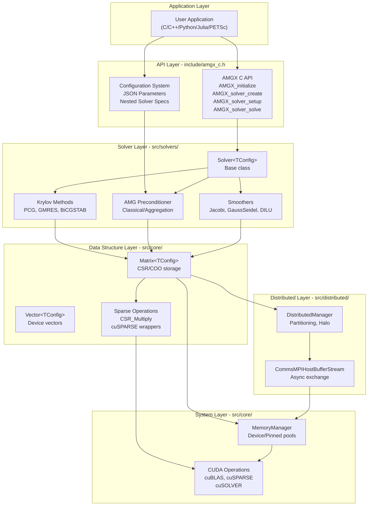
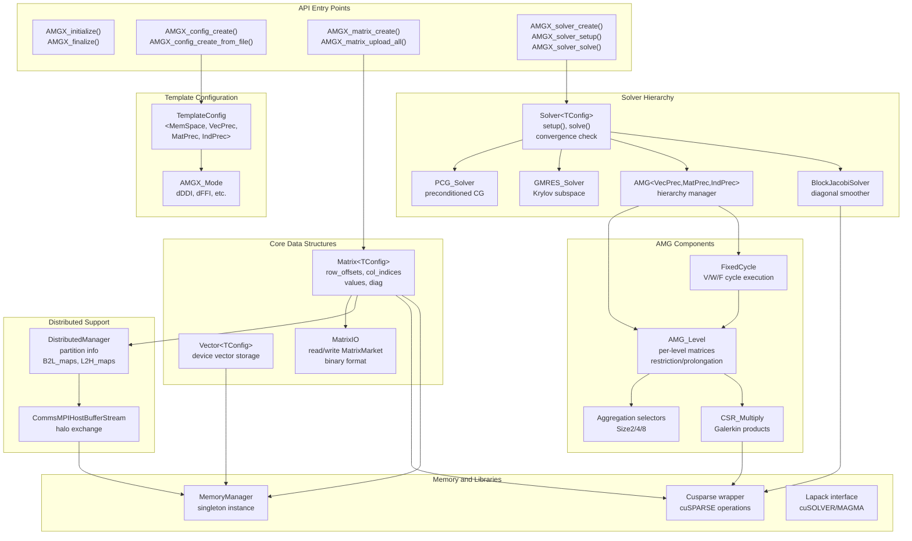

<!-- source: DeepWiki mcp.deepwiki.com · repo NVIDIA/AMGX · page 1 Overview · fetched 2026-10-26 -->

# Overview

<details>
<summary>Relevant source files</summary>

The following files were used as context for generating this wiki page:

- [.gitignore](.gitignore)
- [README.md](README.md)
- [doc/AMGX_Reference.pdf](doc/AMGX_Reference.pdf)

</details>


This document provides a high-level introduction to the AMGX library: its purpose, architecture, and core capabilities. For specific implementation details, refer to the component-specific pages such as [Solver Framework](#3.1), [Matrix System](#2.1), [Distributed Computing](#2.4), and [C API](#4.1).

## Purpose and Scope

AMGX (Algebraic Multigrid Solver) is a GPU-accelerated library for solving large sparse linear systems of the form **Ax = b** that commonly arise in scientific computing and engineering simulations. The library provides a collection of iterative solvers, multigrid preconditioners, and smoothers optimized for NVIDIA GPUs, with support for both single-GPU and distributed multi-GPU configurations.

**Sources:** [README.md:1-26]()

## What is AMGX

AMGX targets the computationally intensive linear solver portion of implicit unstructured simulations. Rather than providing a complete simulation framework, AMGX focuses exclusively on solving linear systems efficiently on GPU hardware. The library abstracts GPU parallelism and multi-GPU scaling behind a simple C API, allowing applications written in C, C++, Python, Julia, or through PETSc integration to leverage GPU acceleration without managing CUDA details directly.

The library's core value proposition is threefold:

1. **GPU Acceleration**: All solver operations execute on NVIDIA GPUs using optimized CUDA kernels and cuSPARSE/cuBLAS primitives
2. **Flexible Composition**: JSON-based configuration system allows nested solvers, preconditioners, and smoothers to be composed arbitrarily
3. **Distributed Scaling**: MPI-based parallelism enables scaling across multiple GPUs and compute nodes

**Sources:** [README.md:1-19]()

## Key Capabilities

The following table summarizes AMGX's primary features:

| Category | Capabilities |
|----------|-------------|
| **Precision Support** | FP32, FP64, mixed precision; limited complex datatype support |
| **Problem Types** | Scalar systems, coupled block systems (block CSR format) |
| **AMG Methods** | Classical (Ruge-Stuben), Unsmoothed Aggregation |
| **Krylov Solvers** | CG, PCG, BiCGSTAB, GMRES, FGMRES |
| **Smoothers** | Jacobi, Block Jacobi, Gauss-Seidel, DILU, Chebyshev Polynomial |
| **Direct Solvers** | Dense LU (via cuSOLVER), used for coarse grids |
| **Eigensolvers** | ARNOLDI, LANCZOS, LOBPCG, PageRank |
| **Distributed Computing** | MPI-based multi-GPU/multi-node with halo exchange |
| **Configuration** | JSON parameter files with extensive tuning options |
| **API** | C API with opaque handles; bindings for Python, Julia, PETSc |
| **Platforms** | Linux, Windows; requires CUDA-capable GPU (Compute Capability ≥ 3.0) |

**Sources:** [README.md:8-19](), [README.md:41-45]()

## System Architecture

AMGX is structured as a layered system where each layer builds upon the capabilities of lower layers. The following diagram illustrates the major architectural layers and their relationships:

**Diagram: AMGX Layered Architecture**



**Sources:** [README.md:3-4](), High-level diagrams (Diagram 1, Diagram 2)

### Layer Descriptions

**Application Layer**: User code interfaces with AMGX through the C API defined in [include/amgx_c.h](). The API uses opaque handles (`AMGX_solver_handle`, `AMGX_matrix_handle`, etc.) to hide implementation complexity. See [API Design and Object Model](#4.1.1) for details.

**API Layer**: The [include/amgx_c.h]() header exposes initialization (`AMGX_initialize`), configuration (`AMGX_config_create`), matrix upload (`AMGX_matrix_upload_all`), solver lifecycle (`AMGX_solver_create`, `AMGX_solver_setup`, `AMGX_solver_solve`), and cleanup functions. Configuration is specified via JSON files located in [src/configs/]() or constructed programmatically. See [Configuration System](#4.2) for JSON format details.

**Solver Layer**: All solver implementations inherit from `Solver<TConfig>` base class defined in the [src/solvers/]() directory. This includes Krylov methods (PCG, GMRES, BiCGSTAB in respective files), the `AMG` class hierarchy for multigrid preconditioning, and various smoothers. See [Solver Framework](#3.1) and [Algebraic Multigrid](#3.2).

**Data Structure Layer**: The `Matrix<TConfig>` class in [src/core/]() provides CSR and COO sparse matrix storage with block structure support. `Vector<TConfig>` handles device-resident vectors. Sparse operations leverage `CSR_Multiply` for matrix-matrix products and cuSPARSE wrappers for matrix-vector multiplication. See [Matrix System](#2.1).

**Distributed Layer**: `DistributedManager` and `DistributedArranger` classes in [src/distributed/]() handle matrix partitioning, neighbor discovery, and halo region management. `CommsMPIHostBufferStream` implements asynchronous MPI communication patterns. See [Distributed Computing](#2.4).

**System Layer**: `MemoryManager` singleton provides pooled allocation for both pinned host memory and device memory to reduce allocation overhead. CUDA operations integrate cuBLAS, cuSPARSE, and cuSOLVER libraries. See [Memory Management](#2.3).

## Core Components

The following diagram maps AMGX's primary C++ classes and their relationships, showing how code entities interact at runtime:

**Diagram: Core Component Relationships**



**Sources:** High-level diagrams (Diagram 2), [README.md:3-19]()

### Component Responsibilities

**Matrix<TConfig>**: Stores sparse matrices in CSR (Compressed Sparse Row) or COO (Coordinate) format with support for block structures. Provides matrix operations including analysis (symmetry detection, diagonal dominance), I/O (MatrixMarket and binary formats), and distributed setup. Located in [src/core/]().

**Solver<TConfig>**: Abstract base class defining the solver interface with `setup()` and `solve()` methods. Concrete implementations include Krylov methods (PCG, GMRES, BiCGSTAB), smoothers (Jacobi, Gauss-Seidel, DILU), and the AMG multigrid hierarchy. All solvers inherit convergence checking and residual computation logic. See [Solvers](#3).

**AMG and AMG_Level**: The `AMG` class manages the multigrid hierarchy by creating `AMG_Level` objects for each coarsening level. Each level stores the system matrix, restriction/prolongation operators, and level-specific vectors. `FixedCycle` orchestrates V, W, or F cycles through the hierarchy. See [AMG Hierarchy and Cycles](#3.2.1).

**DistributedManager**: Maintains partition information for distributed matrices, including neighbor lists, boundary-to-local (B2L) maps, and local-to-halo (L2H) maps. Coordinates matrix renumbering to separate interior and boundary rows for latency hiding. See [Distributed Manager](#2.4.1).

**CommsMPIHostBufferStream**: Implements asynchronous MPI communication using pinned host buffers. Handles vector and matrix halo exchange by gathering boundary data to host, performing non-blocking MPI sends/receives, and scattering received data to device halo regions. See [MPI Communication](#2.4.2).

**MemoryManager**: Singleton providing memory pools for both pinned host memory and device memory. Reduces allocation overhead by reusing pre-allocated buffers. Supports asynchronous operations via CUDA streams. See [Memory Management](#2.3).

## Template-Based Type System

AMGX uses C++ templates extensively to generate specialized code for different precision and memory configurations. The `TemplateConfig<MemSpace, VecPrec, MatPrec, IndPrec>` class encapsulates four template parameters:

| Parameter | Options | Purpose |
|-----------|---------|---------|
| `MemSpace` | `AMGX_host`, `AMGX_device` | Specifies host or device memory |
| `VecPrec` | `float`, `double`, `complex<float>`, `complex<double>`, `int`, `int64`, `bool` | Vector element precision |
| `MatPrec` | `float`, `double`, `complex<float>`, `complex<double>` | Matrix element precision |
| `IndPrec` | `int`, `int64` | Matrix index precision (32 or 64-bit) |

The C API uses an `AMGX_Mode` enumeration that encodes all four parameters into a single integer value (e.g., `dDDI` for device memory, double vector precision, double matrix precision, int indices). At runtime, mode dispatch macros (`AMGX_FORALL_BUILDS`, `AMGX_CASE_LINE`) route API calls to the appropriate template instantiation. This design provides compile-time optimization while maintaining runtime flexibility. See [Mode System and Template Dispatch](#4.1.2) for implementation details.

**Sources:** High-level diagrams (Diagram 6), [README.md:9-10]()

## Build Artifacts and Usage

The build system (see [Build System](#1.3)) produces the following artifacts:

| Artifact | Type | Purpose |
|----------|------|---------|
| `libamgx.a` | Static library | Link-time inclusion of AMGX functionality |
| `libamgxsh.so` (Linux) / `amgxsh.dll` (Windows) | Shared library | Runtime dynamic linking |
| `amgx_capi` | Example executable | Single-GPU usage demonstration |
| `amgx_mpi_capi` | Example executable | Multi-GPU/MPI usage demonstration |
| `amgx_tests_launcher` | Test executable | Regression test suite |

Example libraries are located in [examples/]() and demonstrate typical API usage patterns. The [examples/matrix.mtx]() file provides a sample input matrix in MatrixMarket format. Pre-configured solver setups are available in [src/configs/]() with names like `FGMRES_AGGREGATION.json`, `PCG_CLASSICAL_JACOBI.json`, etc.

**Typical single-GPU workflow:**
```bash
./amgx_capi -m matrix.mtx -c ../src/configs/FGMRES_AGGREGATION.json
```

**Typical multi-GPU workflow:**
```bash
mpirun -n 4 ./amgx_mpi_capi -m matrix.mtx -c ../src/configs/PCG_AGGREGATION.json
```

For detailed programming examples, see [Basic Examples](#4.3.1) and [MPI Examples](#4.3.2).

**Sources:** [README.md:52-60](), [README.md:83-86](), [README.md:89-186]()

## Dependencies and Requirements

AMGX requires the following dependencies:

**Required:**
- **CUDA Toolkit** ≥ 12.0 (provides cuBLAS, cuSPARSE, cuSOLVER, CUDA Runtime)
- **CMake** ≥ 3.18 (build system; 3.22+ recommended with NVIDIA HPC SDK)
- **C++11-compliant compiler** (GCC ≥ 4.8, MSVC ≥ 14.0)
- **NVIDIA GPU** with Compute Capability ≥ 3.0

**Optional:**
- **MPI implementation** (OpenMPI, MPICH) for distributed multi-GPU support
- **Intel MKL** for accelerated eigensolver operations
- **MAGMA** for additional LAPACK/eigensolver acceleration
- **RapidJSON** (header-only, bundled with AMGX) for JSON parsing

The build can be configured to produce a non-MPI single-GPU library by setting `CMAKE_NO_MPI=ON`, resulting in a smaller library that does not require MPI installation. See [Build Configuration](#5.1) for detailed CMake options and [Build System](#1.3) for build instructions.

**Sources:** [README.md:41-70]()

## External Bindings and Integration

AMGX provides a C API designed for integration with applications in multiple languages:

| Language/Framework | Repository | Maintainer |
|--------------------|------------|------------|
| **Python** | [pyamgx](https://github.com/shwina/pyamgx) | @shwina |
| **Julia** | [AMGX.jl](https://github.com/JuliaGPU/AMGX.jl) | JuliaGPU community |
| **PETSc** | [AmgXWrapper](https://github.com/barbagroup/AmgXWrapper) | @piyueh, barbagroup |

These bindings wrap the C API with language-specific idioms and memory management patterns. The PETSc wrapper allows existing PETSc applications to use AMGX as a solver/preconditioner without code modifications. See [External Bindings](#4.4) for integration details.

**Sources:** [README.md:195-200]()

## Additional Resources

- **API Reference**: [doc/AMGX_Reference.pdf]() provides complete API documentation
- **Solver Configurations**: [src/configs/]() contains pre-tuned JSON configurations for common problem types
- **Test Suite**: [src/tests/]() provides regression tests and validation
- **CI Pipeline**: [ci/]() contains containerized build and test infrastructure

For algorithm details and research background, see the white papers and case studies linked in [README.md:21-25]().

**Sources:** [README.md:188-207]()

---

