<!-- source: DeepWiki mcp.deepwiki.com · repo NVIDIA/AMGX · page 1.1 System Architecture · fetched 2026-10-26 -->

# System Architecture

Relevant source files

The following files were used as context for generating this wiki page:

- [.gitignore](.gitignore)
- [CMakeLists.txt](CMakeLists.txt)
- [README.md](README.md)
- [doc/AMGX_Reference.pdf](doc/AMGX_Reference.pdf)
- [examples/CMakeLists.txt](examples/CMakeLists.txt)
- [examples/amgx_mpi_capi.c](examples/amgx_mpi_capi.c)
- [examples/amgx_mpi_poisson7.c](examples/amgx_mpi_poisson7.c)
- [examples/eigen_examples/CMakeLists.txt](examples/eigen_examples/CMakeLists.txt)
- [include/amgx_c.h](include/amgx_c.h)
- [src/CMakeLists.txt](src/CMakeLists.txt)
- [src/amgx_c.cu](src/amgx_c.cu)
- [src/matrix_analysis.cu](src/matrix_analysis.cu)

## Overview

This document provides a comprehensive overview of the AMGX (Algebraic MultiGrid) library's architecture and its core components. AMGX is a highly optimized GPU-accelerated solver framework designed for large sparse linear systems, featuring a flexible composition system for solvers, preconditioners, and smoothers.

The architecture documentation focuses on how the main components interact with each other, the memory management systems, the API layer, and distributed computing capabilities. For specific information about solver implementations, see [Solvers](#3) and for API usage details, see [API and Integration](#4).

## High-Level Architecture

The AMGX system follows a layered architecture with clear separation between the API surface, core solver components, and resource management infrastructure.

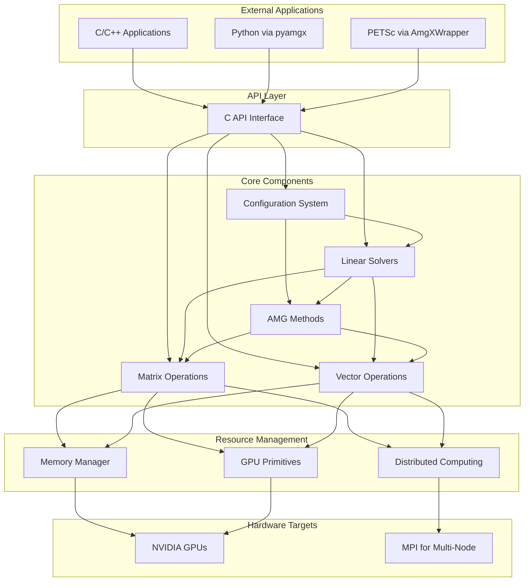

Sources: [include/amgx_c.h:104-124](), [src/amgx_c.cu:12-41](), [README.md:1-25]()

## Component Architecture

### Handle System and Resource Management

AMGX uses opaque handles to manage resources and maintain state between API calls. These handles are defined in the C API and map to C++ objects internally.

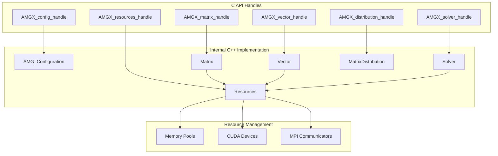

Sources: [include/amgx_c.h:104-124](), [src/amgx_c.cu:639-644]()

### Mode System and Template Configuration

AMGX employs a templated mode system that allows for different precision combinations for matrices, vectors, and indices:

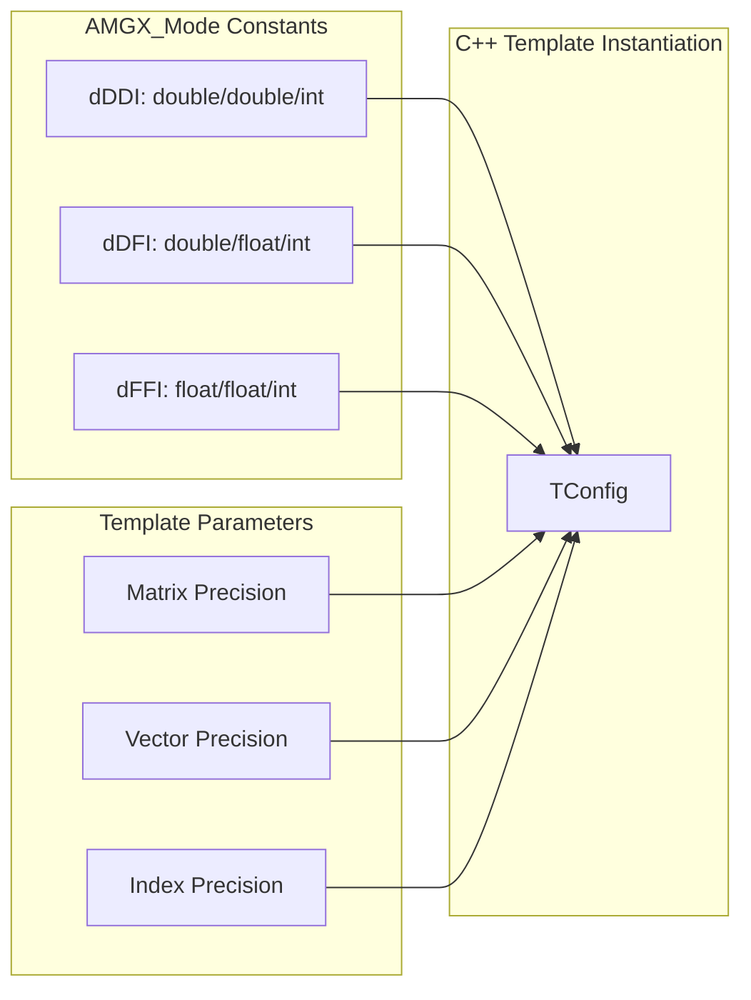

Sources: [src/amgx_c.cu:52-69](), [src/amgx_c.cu:642-643]()

## C API Architecture

The C API serves as the primary interface for external applications to interact with AMGX. It provides a set of functions categorized by their purpose.

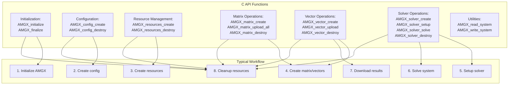

Sources: [include/amgx_c.h:146-605](), [examples/amgx_mpi_poisson7.c:92-369](), [examples/amgx_mpi_capi.c:93-432]()

## Memory Management System

AMGX employs a sophisticated memory management system that handles both host and device memory allocation efficiently.

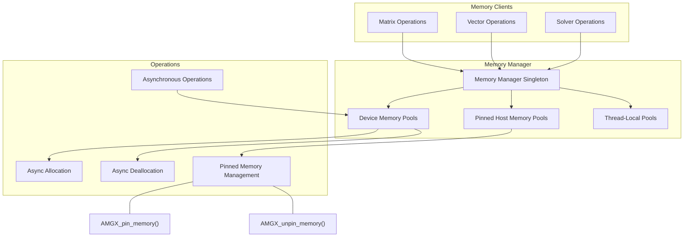

Sources: [include/amgx_c.h:178-183](), [src/amgx_c.cu:72-126]()

## Distributed Computing Architecture

AMGX supports distributed memory parallel computing using MPI for multi-node and multi-GPU execution.

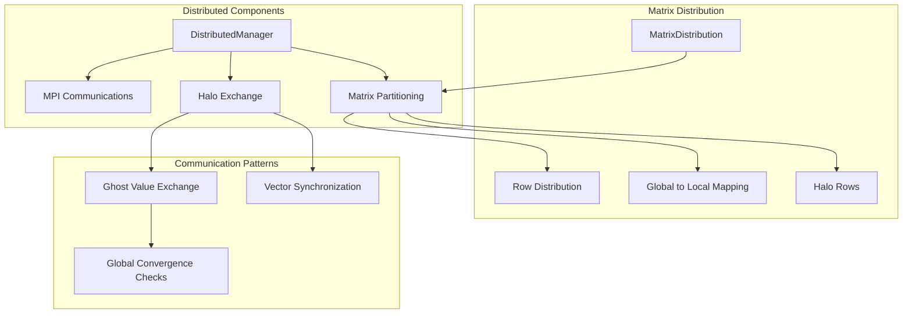

Sources: [src/amgx_c.cu:158-207](), [src/amgx_c.cu:476-635](), [examples/amgx_mpi_poisson7.c:105-129]()

## Matrix Operations and Data Structures

AMGX provides optimized matrix operations that leverage GPU parallelism for sparse linear algebra.

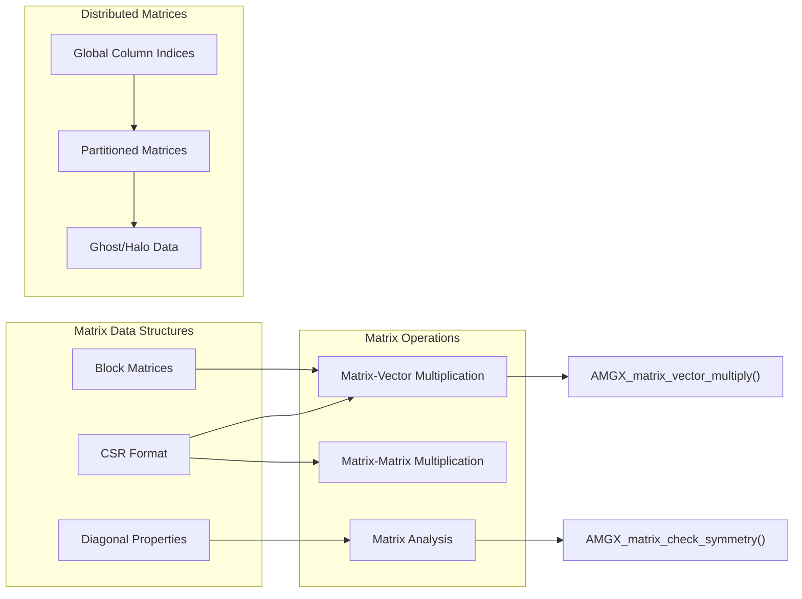

Sources: [src/amgx_c.cu:844-896](), [src/matrix_analysis.cu:20-272](), [include/amgx_c.h:262-334]()

## Solver Composition Architecture

AMGX provides a flexible solver composition system that allows for nested solvers and preconditioners.

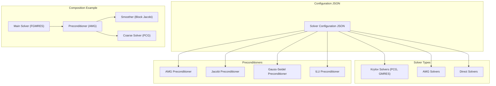

Sources: [README.md:11-16](), [examples/amgx_mpi_capi.c:207-228](), [examples/amgx_mpi_poisson7.c:207-242]()

## Initialization and Setup Flow

The following diagram illustrates the typical initialization and setup flow for using AMGX:

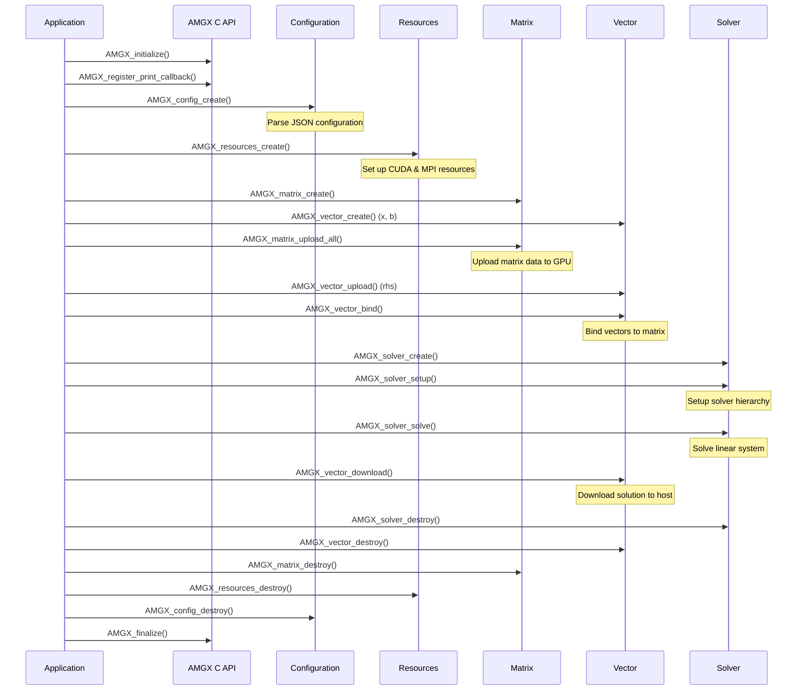

Sources: [examples/amgx_mpi_poisson7.c:158-368](), [examples/amgx_mpi_capi.c:160-430](), [include/amgx_c.h:146-170]()

## Multi-Node Distributed Execution

AMGX supports distributed-memory parallel execution with efficient communication patterns:

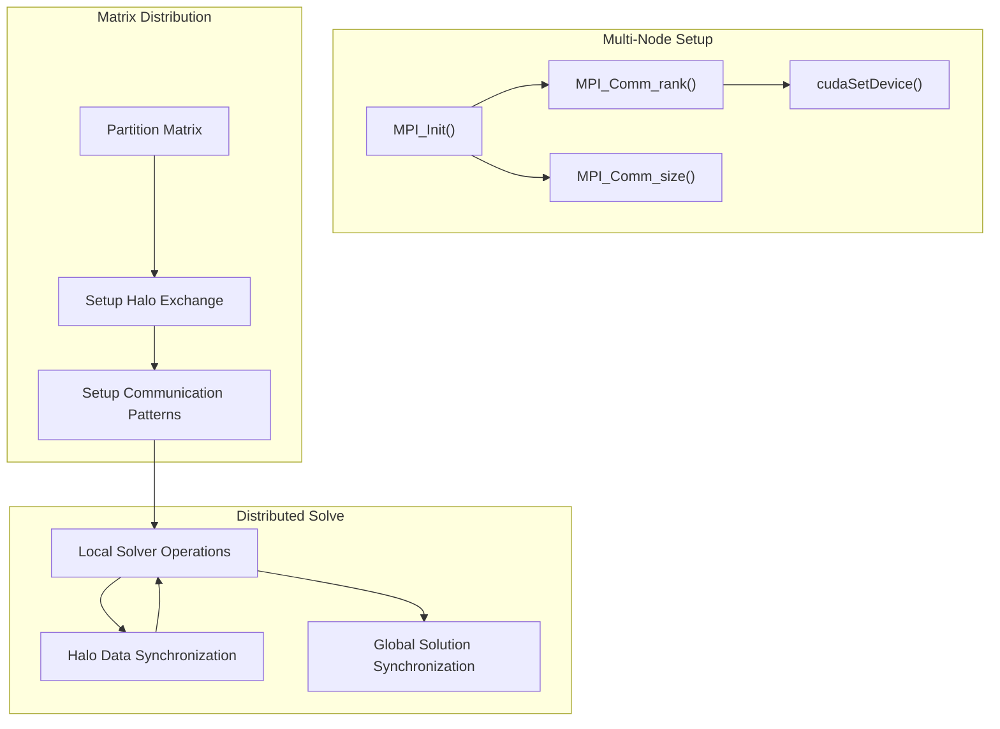

Sources: [examples/amgx_mpi_poisson7.c:119-129](), [examples/amgx_mpi_capi.c:121-133](), [src/amgx_c.cu:158-207]()

## Configuration System

AMGX uses a flexible configuration system based on JSON to define solver behavior:

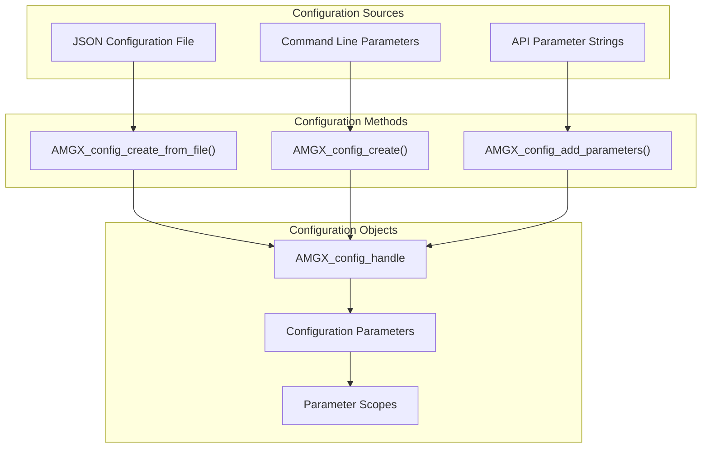

Sources: [include/amgx_c.h:192-215](), [examples/amgx_mpi_poisson7.c:207-228](), [examples/amgx_mpi_capi.c:207-228]()

## Resources and Device Management

AMGX resources encapsulate the hardware resources and their management:

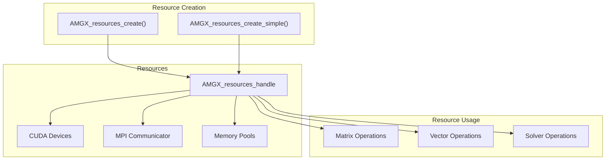

Sources: [include/amgx_c.h:217-230](), [src/amgx_c.cu:72-126](), [examples/amgx_mpi_poisson7.c:238]()

## Key Data Structures

| Component | C Handle | Internal Implementation | Description |
|-----------|----------|-------------------------|-------------|
| Configuration | `AMGX_config_handle` | `AMG_Configuration` | Stores solver parameters and configuration |
| Resources | `AMGX_resources_handle` | `Resources` | Manages CUDA devices, MPI communicators, and memory pools |
| Matrix | `AMGX_matrix_handle` | `Matrix<TConfig>` | Represents sparse matrices in CSR format with block structure |
| Vector | `AMGX_vector_handle` | `Vector<TConfig>` | Represents dense vectors with optional block structure |
| Solver | `AMGX_solver_handle` | `AMG_Solver<TConfig>` | Implements linear solver algorithms |
| Distribution | `AMGX_distribution_handle` | `MatrixDistribution` | Controls how matrices are distributed across processes |

Sources: [include/amgx_c.h:104-124](), [src/amgx_c.cu:639-644]()

## Error Handling

AMGX provides two modes of error handling:

1. **Return Code System**: Functions return `AMGX_RC` error codes that can be checked
2. **Exception Handling**: Internal exception handling can be enabled via configuration

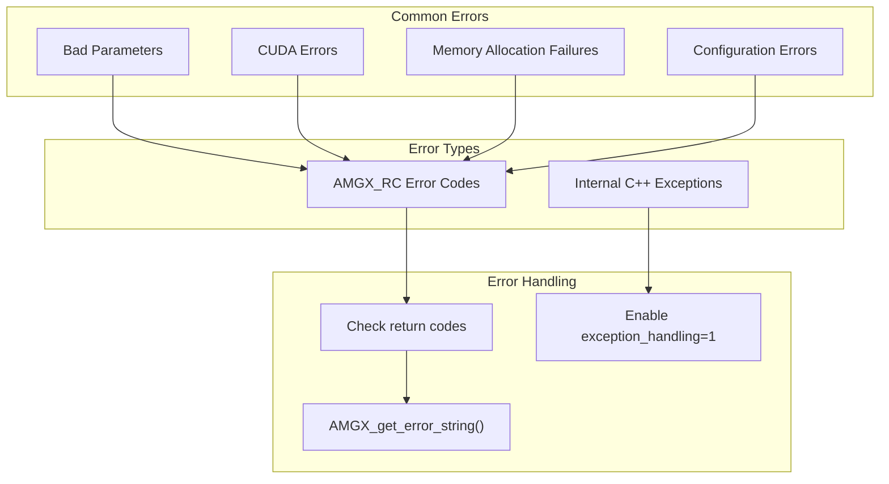

Sources: [include/amgx_c.h:48-69](), [include/amgx_c.h:127-144](), [examples/amgx_mpi_poisson7.c:236]()

---

