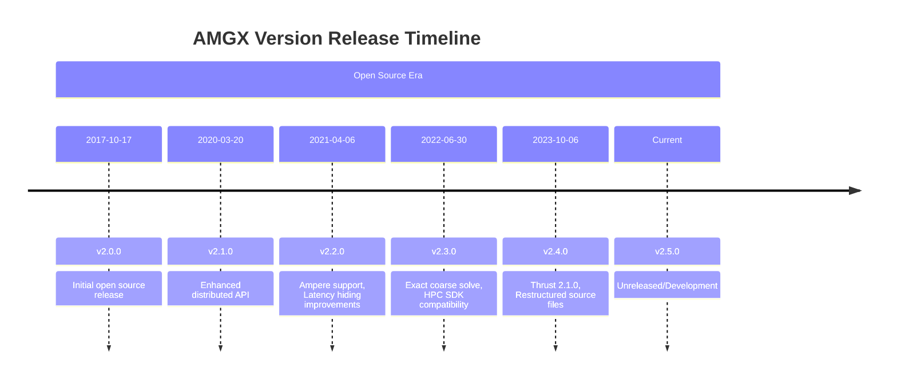
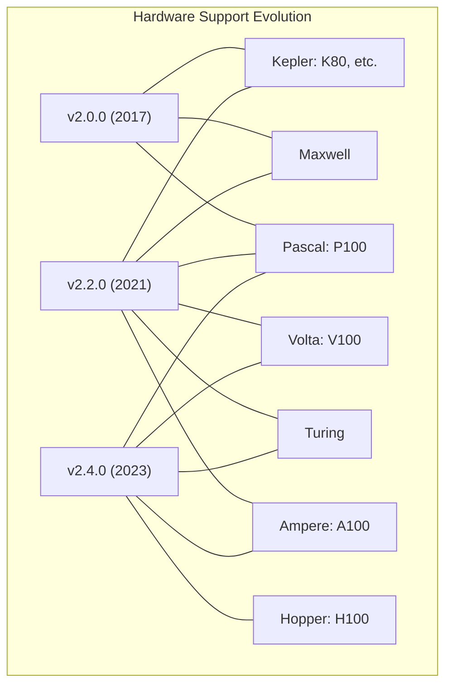
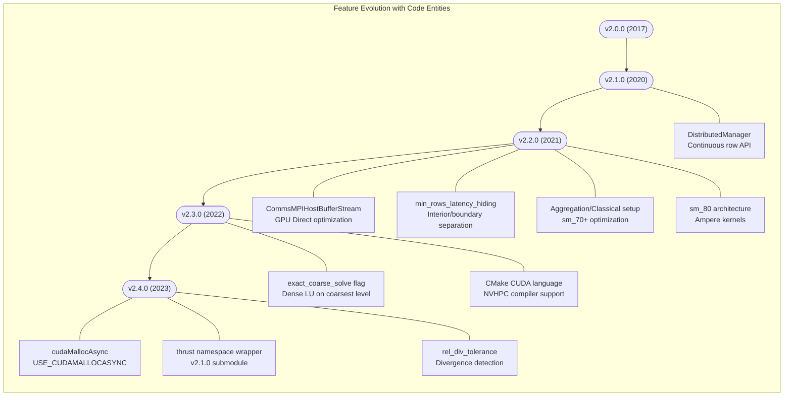
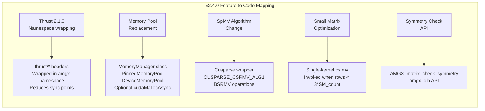
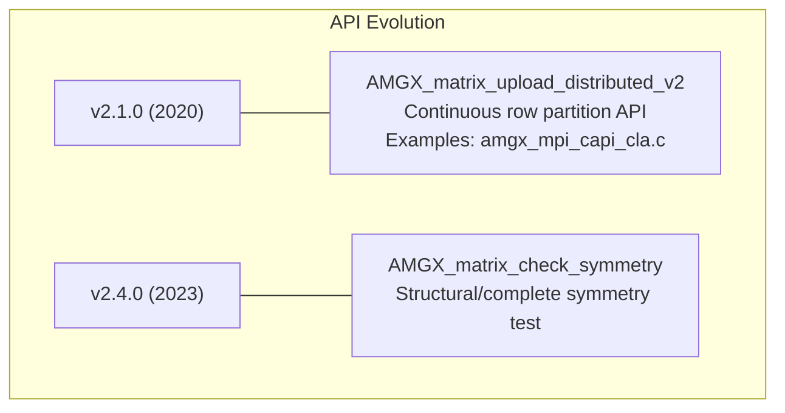
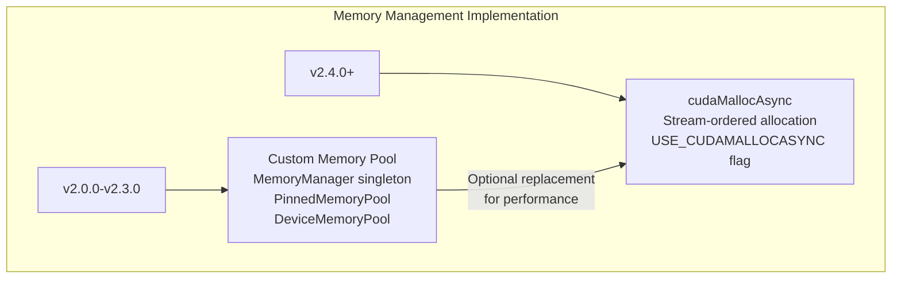

<!-- source: DeepWiki mcp.deepwiki.com · repo NVIDIA/AMGX · page 1.2 Version History · fetched 2026-10-26 -->

# Version History

Relevant source files

The following files were used as context for generating this wiki page:

- [CHANGELOG](CHANGELOG)
- [src/distributed/comms_mpi_hostbuffer_stream.cu](src/distributed/comms_mpi_hostbuffer_stream.cu)

## Purpose and Scope

This page documents version changes, CUDA compatibility updates, and feature evolution across AMGX releases. Each version entry includes tested configurations, key code changes, and API modifications. For build system details and dependencies, see [Build System](#1.3).

## Current Version

The current version of AMGX is 2.5.0, as defined in the source code.

Sources:
- [ReleaseVersion.txt:1-2]()
- [src/version.cu:1-6]()

## Version Timeline

Sources:
- [CHANGELOG:4-118]()

## Version Details

### v2.4.0 (2023-10-06)

#### Major Code Changes
- **Source restructuring**: Removed plugin feature, reorganized all source files
- **Memory management**: Replaced custom `MemoryManager` implementation with `cudaMallocAsync` (when `USE_CUDAMALLOCASYNC` is defined)
- **Synchronization fixes**: Fixed multiple synchronization issues in GPU kernels for sm_70+ architectures
- **Thrust integration**: Upgraded to Thrust 2.1.0, added as submodule, wrapped in namespace to avoid shared library conflicts
- **SpMV optimization**: Changed `Cusparse` wrapper to use `CUSPARSE_CSRMV_ALG1` algorithm
- **Small matrix optimization**: Added single-kernel csrmv implementation invoked when local matrix rows < 3 × SM count

#### API Additions
- `AMGX_matrix_check_symmetry()`: Tests if matrix is structurally or completely symmetric
- `DISABLE_EXCEPTION_HANDLING`: Compile-time flag to improve debugging experience
- `rel_div_tolerance`: Configuration parameter for divergence detection

#### Bug Fixes
- Partition reordering for `block_size > 1`
- Grid sizing in exact coarse solve
- SIGFPE when initial norm is zero
- `use_sum_stopping_criteria` flag behavior

#### Tested Configurations
- **OS**: Ubuntu 20.04, Ubuntu 22.04
- **Compilers**: NVHPC 23.7, GCC 9.4.0, GCC 12.1
- **MPI**: OpenMPI 4.0.x
- **CUDA**: 11.2, 11.8, 12.2
- **GPUs**: A100, H100

Sources:
- [CHANGELOG:5-45]()

### v2.3.0 (2022-06-30)

This version focused on build system improvements and performance optimizations.

#### Major Changes
- Increased minimum CMake version to 3.18 and adapted to use CUDA as a language
- Made it possible to compile with HPC SDK
- Improved performance of `compute_values_kernel` by ~1.3x
- Optimized block tuning for aggressive coarsening

#### New Features
- Added exact coarse solve, accessible via the "exact_coarse_solve" flag
- Fixed multiple bugs including cuSPARSE handle deletion issues

#### Tested Configurations
- Ubuntu 20.04, Ubuntu 18.04
- gcc 7.4.0, gcc 9.3.0
- OpenMPI 4.0.x
- CUDA 11.0, 11.2
- Windows 10 with Visual Studio 2019 and MS MPI v10.1.2

Sources:
- [CHANGELOG:49-76]()

### v2.2.0 (2021-04-06)

This release included important distributed computing and hardware support updates.

#### Major Changes
- GPU Direct support fixes (improved results and performance)
- Latency hiding improvements and bug fixes
- Performance tuning for Volta GPUs in aggregation and classical setup phase
- Gauss-Siedel performance improvements on Volta and newer architectures
- Added Ampere architecture support
- Various community-requested bug fixes and enhancements

#### Tested Configurations
- Ubuntu 20.04, Ubuntu 18.04
- gcc 7.4.0, gcc 9.3.0
- OpenMPI 4.0.x
- CUDA 10.2, 11.0, 11.2
- Windows 10 with Visual Studio 2019 and MS MPI v10.1.2

Sources:
- [CHANGELOG:79-101]()

### v2.1.0 (2020-03-20)

This minor update focused on distributed computing capabilities.

#### Major Changes
- Added new API for providing distributed matrix partitioning information
- New approach works when partitions own continuous rows in a matrix
- Added example implementation for the new API
- General distributed code improvements

Sources:
- [CHANGELOG:104-112]()

### v2.0.0 (2017-10-17)

The initial open source release of AMGX.

Sources:
- [CHANGELOG:114-118]()

## Supported GPU Architectures Over Time

Sources:
- [CHANGELOG:36-44]()
- [CHANGELOG:63-74]()
- [CHANGELOG:91-99]()

## Key Feature Evolution

Sources:
- [CHANGELOG:4-118]()
- [src/distributed/comms_mpi_hostbuffer_stream.cu:1-1616]()

## CUDA Version Support Table

The table below shows the CUDA versions tested and supported with each AMGX version.

| AMGX Version | Minimum CUDA | Maximum CUDA | Tested CUDA Versions |
|--------------|--------------|--------------|----------------------|
| v2.0.0 | - | - | Not specified |
| v2.1.0 | - | - | Not specified |
| v2.2.0 | - | 11.2 | 10.2, 11.0, 11.2 |
| v2.3.0 | - | 11.2 | 11.0, 11.2 |
| v2.4.0 | 11.2 | 12.2 | 11.2, 11.8, 12.2 |

Sources:
- [CHANGELOG:36-44]()
- [CHANGELOG:63-74]()
- [CHANGELOG:91-99]()

## Code Entity Changes by Version

This section maps high-level features to specific code entities affected in each version.

### v2.4.0 Code Entity Mapping

### v2.2.0 Distributed Computing Changes

Key files affected by latency hiding and GPU Direct improvements:

| Feature | Code Entity | File/Location |
|---------|-------------|---------------|
| Latency Hiding | `CommsMPIHostBufferStream::do_exchange_halo_async()` | `comms_mpi_hostbuffer_stream.cu` |
| Interior/Boundary | `min_rows_latency_hiding` threshold | Communication module |
| GPU Direct | `exchange_halo_wait()`, `do_exchange_halo_async()` | `comms_mpi_hostbuffer_stream.cu` |
| Halo Exchange | `MPI_Waitall()`, `MPI_Isend()`, `MPI_Irecv()` | MPI communication patterns |

Sources:
- [CHANGELOG:11-35]()
- [CHANGELOG:83-88]()
- [src/distributed/comms_mpi_hostbuffer_stream.cu:633-686]()

## Compiler Support Evolution

| AMGX Version | Linux Compilers | Windows Compilers | HPC SDK Support |
|--------------|-----------------|-------------------|-----------------|
| v2.0.0 | - | - | No |
| v2.1.0 | - | - | No |
| v2.2.0 | gcc 7.4.0, gcc 9.3.0 | MSVC 19.28 (VS 2019) | No |
| v2.3.0 | gcc 7.4.0, gcc 9.3.0 | MSVC 19.28 (VS 2019) | Yes |
| v2.4.0 | GCC 9.4.0, GCC 12.1, NVHPC 23.7 | Limited testing | Yes (NVHPC 23.7) |

Sources:
- [CHANGELOG:36-44]()
- [CHANGELOG:63-74]()
- [CHANGELOG:91-99]()

## Significant API Additions

Key C API additions by version:

| Version | API Function | Purpose | Example |
|---------|-------------|---------|---------|
| v2.1.0 | New distributed partition API | Simplified partition specification for continuous rows | `amgx_mpi_capi_cla.c` |
| v2.4.0 | `AMGX_matrix_check_symmetry` | Matrix symmetry validation | Structural or value-based symmetry check |

Sources:
- [CHANGELOG:108-111]()
- [CHANGELOG:34]()

## Memory Management Evolution

AMGX memory management system evolved from custom pooling to CUDA stream-ordered memory allocation:

Key code entities:
- `MemoryManager`: Singleton managing custom memory pools (pre-v2.4.0)
- `PinnedMemoryPool`: Host pinned memory allocation
- `DeviceMemoryPool`: Device memory allocation
- `cudaMallocAsync`: CUDA stream-ordered memory allocation (v2.4.0+ optional)
- `USE_CUDAMALLOCASYNC`: Compile flag to enable new allocator

Sources:
- [CHANGELOG:14]()

## Notes on Windows Support

While AMGX does support building on Windows, testing on Windows has been limited across all versions. Windows support is generally considered experimental compared to the more thoroughly tested Linux environments.

Sources:
- [CHANGELOG:45-46]()
- [CHANGELOG:74-76]()
- [CHANGELOG:96-99]()

---

