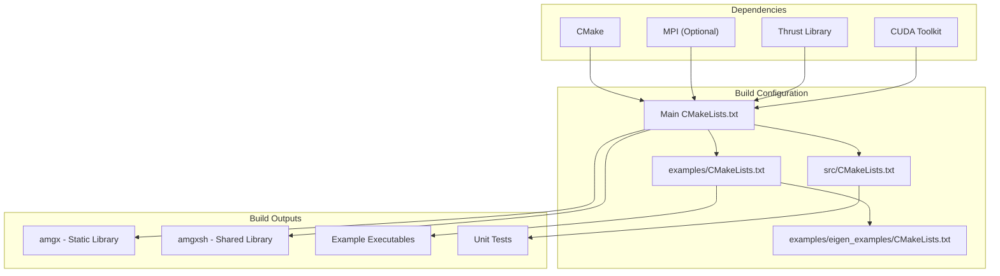
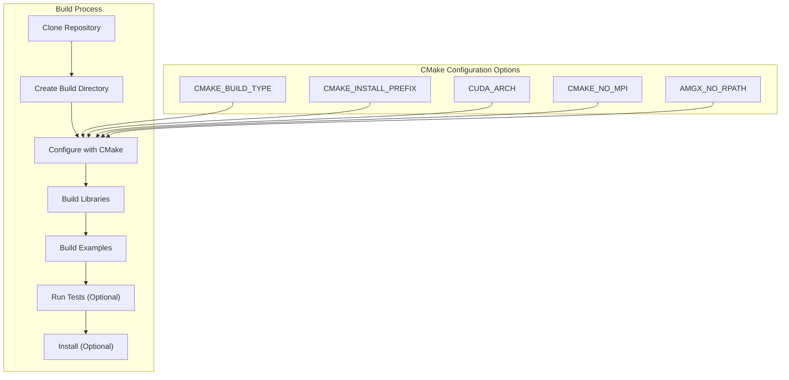
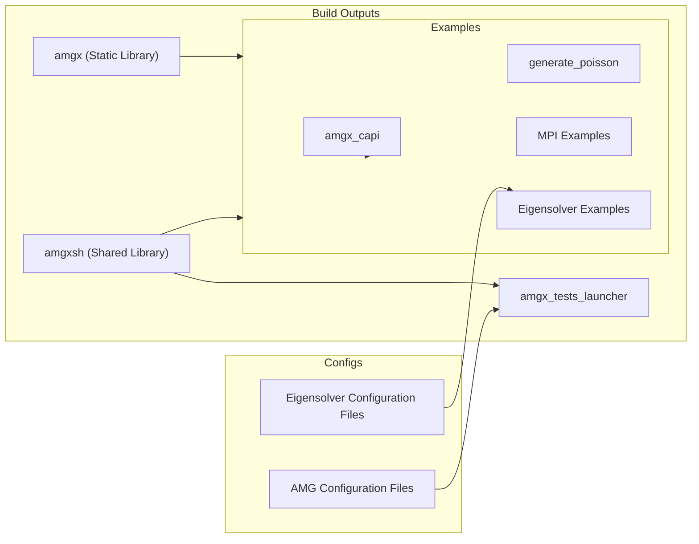
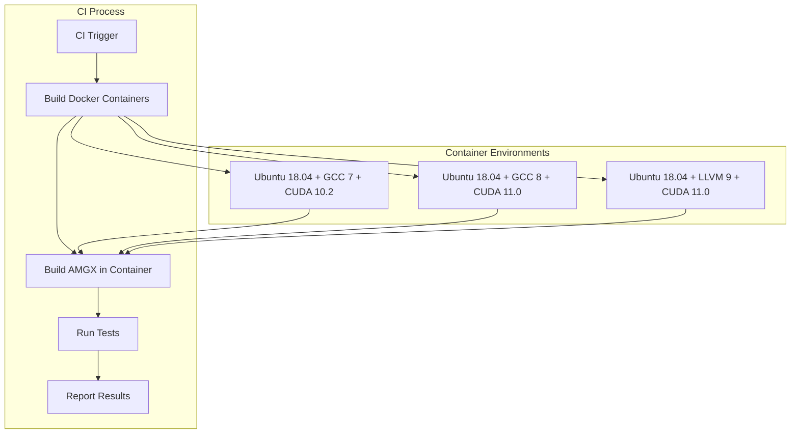

<!-- source: DeepWiki mcp.deepwiki.com · repo NVIDIA/AMGX · page 1.3 Build System · fetched 2026-10-26 -->

# Build System

<details>
<summary>Relevant source files</summary>

The following files were used as context for generating this wiki page:

- [CMakeLists.txt](CMakeLists.txt)
- [examples/CMakeLists.txt](examples/CMakeLists.txt)
- [examples/eigen_examples/CMakeLists.txt](examples/eigen_examples/CMakeLists.txt)
- [src/CMakeLists.txt](src/CMakeLists.txt)

</details>


## Overview

The AMGX (Algebraic MultiGrid Accelerated) build system is based on CMake and provides support for building the AMGX libraries, examples, and test frameworks on various platforms with different compilers and CUDA versions. This document explains the build process, dependencies, configuration options, and build outputs.

For information on the overall system architecture, see [System Architecture](#1.1).

Sources: [CMakeLists.txt:27-31]()

## Prerequisites

### Required Software

To build AMGX from source, you need:

| Requirement | Minimum Version | Notes |
|-------------|-----------------|-------|
| CMake | 3.18 | Required for configuring the build |
| CUDA Toolkit | 11.0 | GPU programming framework |
| C++ Compiler | Compatible with CUDA | GCC, Clang, or MSVC |
| MPI (Optional) | - | For distributed computing capabilities |

Sources: [CMakeLists.txt:27-49](), [CMakeLists.txt:125-141]()

### Supported CUDA Architectures

AMGX supports different GPU architectures depending on the CUDA version:

| CUDA Version | Supported Architectures |
|--------------|-------------------------|
| CUDA 12.x+ | SM 70 (Volta), SM 80 (Ampere), SM 90 (Hopper) |
| CUDA 11.x | SM 70 (Volta), SM 80 (Ampere) |

Sources: [CMakeLists.txt:193-205]()

## Build System Structure

The AMGX build system is organized hierarchically, with the main CMakeLists.txt delegating to subsidiary build scripts.



Sources: [CMakeLists.txt:238-289](), [src/CMakeLists.txt:5-13](), [examples/CMakeLists.txt:5-113]()

## Build Configurations

AMGX supports multiple build configurations:

| Configuration | Description | Compiler Flags |
|---------------|-------------|----------------|
| Debug | Debug build with symbols | `-g -G` for CUDA code |
| Release | Optimized build | `-DNDEBUG` |
| Profile | Performance profiling | Same as Release with `-DPROFILE` |
| RelWithTraces | Release with debug symbols | `-g -DNDEBUG` |

Sources: [CMakeLists.txt:42-47](), [CMakeLists.txt:151-159]()

## Build Process

### Basic Build Steps



Sources: [CMakeLists.txt:37-106](), [CMakeLists.txt:207-224](), [ci/test.sh:8-27]()

### Command Line Instructions

To build AMGX from source:

```
# Clone the repository
git clone https://github.com/NVIDIA/AMGX.git
cd AMGX

# Create a build directory
mkdir build
cd build

# Configure
cmake .. -DCMAKE_BUILD_TYPE=Release

# Build
make -j8

# Run tests (optional)
./tests/amgx_tests_launcher

# Install (optional)
make install
```

Sources: [ci/test.sh:8-27]()

## Build Options

| Option | Description | Default | 
|--------|-------------|---------|
| `CMAKE_BUILD_TYPE` | Build configuration | Release |
| `CMAKE_INSTALL_PREFIX` | Installation directory | `..` |
| `CUDA_ARCH` | Target CUDA architectures | Depends on CUDA version |
| `CMAKE_NO_MPI` | Disable MPI support | false |
| `AMGX_NO_RPATH` | Disable RPATH in built binaries | false |
| `AMGX_INCLUDE_EXTERNAL` | Include external 3rd party libraries | true |

Sources: [CMakeLists.txt:42-47](), [CMakeLists.txt:87-106](), [CMakeLists.txt:118-141](), [CMakeLists.txt:207-224]()

## Build Outputs

The build system produces several outputs:



Sources: [CMakeLists.txt:248-251](), [src/CMakeLists.txt:18-41](), [examples/CMakeLists.txt:18-105]()

### Libraries

- **Static Library**: `libamgx.a` (Unix) or `amgx.lib` (Windows)
- **Shared Library**: `libamgxsh.so` (Unix) or `amgxsh.dll` (Windows)

Sources: [CMakeLists.txt:248-271]()

### Examples

The build generates several example applications demonstrating AMGX usage:

| Example | Description |
|---------|-------------|
| `amgx_capi` | Basic C API usage example |
| `generate_poisson` | Generates and solves a Poisson problem |
| `amgx_mpi_capi` | MPI-enabled example (if MPI is enabled) |
| `eigensolver` | Example using AMGX eigensolvers |

Sources: [examples/CMakeLists.txt:18-39](), [examples/CMakeLists.txt:47-107](), [examples/eigen_examples/CMakeLists.txt:18-54]()

### Configuration Files

The build system installs various JSON configuration files for different solver types:

- Aggregation configurations
- Krylov solvers (CG, GMRES, etc.)
- Classical AMG cycle configurations
- Eigensolver configurations

These configuration files are installed to `lib/configs/` and `lib/configs/eigen_configs/`.

Sources: [src/CMakeLists.txt:64-109]()

## Installation

The `make install` command installs:

1. Header files to `${CMAKE_INSTALL_PREFIX}/include`
2. Libraries to `${CMAKE_INSTALL_PREFIX}/lib`
3. Configuration files to `${CMAKE_INSTALL_PREFIX}/lib/configs`
4. Examples to `${CMAKE_INSTALL_PREFIX}/lib/examples`

By default, `CMAKE_INSTALL_PREFIX` is set to `..` (parent directory of the build directory).

Sources: [CMakeLists.txt:87-106](), [CMakeLists.txt:278-284](), [src/CMakeLists.txt:67-109](), [examples/CMakeLists.txt:110-113]()

## Continuous Integration

AMGX has a continuous integration (CI) system that automates building and testing on different platforms.



The CI process can be controlled via environment variables:

| Variable | Description | Default |
|----------|-------------|---------|
| `AMGX_CI_CONTAINERS` | List of containers to test | All containers |
| `AMGX_CI_KEEP_BUILD` | Preserve build directories | 0 (clean build) |

Sources: [ci/README.md:7-37](), [ci/run.sh:8-55](), [ci/test.sh:8-27](), [ci/containers/x86_64-ubuntu18.04-gnu7-cuda10.2.py:5-39](), [ci/containers/x86_64-ubuntu18.04-gnu8-cuda11.0.py:5-39](), [ci/containers/x86_64-ubuntu18.04-llvm9-cuda11.0.py:5-43]()

## Troubleshooting

Common build issues and their solutions:

1. **In-place builds**: AMGX disallows in-place builds. Always create a separate build directory.
   
   ```
   Error: In-place builds are not supported. Please create a separate build directory
   ```

2. **Unsupported CUDA architecture**: Make sure the specified CUDA architecture is supported by your CUDA version.

3. **Missing MPI**: If MPI is not found, MPI-dependent examples will not be built unless forced by `CMAKE_NO_MPI`.

Sources: [CMakeLists.txt:36-39](), [CMakeLists.txt:193-217](), [CMakeLists.txt:125-141]()

---

