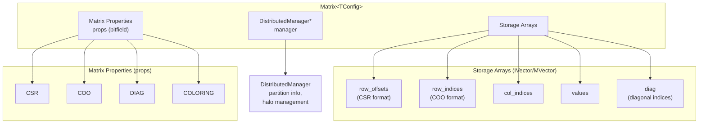
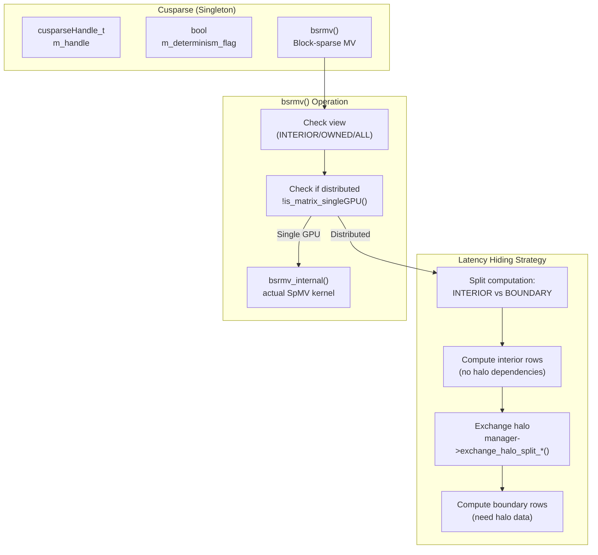
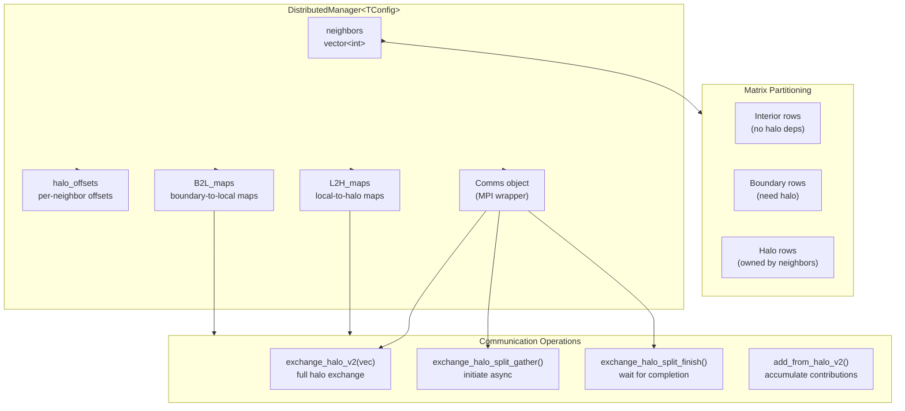
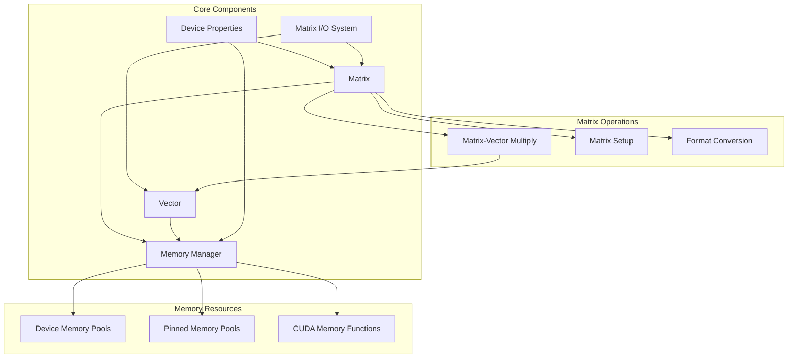

<!-- source: DeepWiki mcp.deepwiki.com · repo NVIDIA/AMGX · page 2 Core Components · fetched 2026-10-26 -->

# Core Components

<details>
<summary>Relevant source files</summary>

The following files were used as context for generating this wiki page:

- [include/reorder_partition.h](include/reorder_partition.h)
- [src/amgx_cusparse.cu](src/amgx_cusparse.cu)
- [src/distributed/distributed_arranger.cu](src/distributed/distributed_arranger.cu)
- [src/distributed/distributed_manager.cu](src/distributed/distributed_manager.cu)
- [src/matrix.cu](src/matrix.cu)
- [src/matrix_io.cu](src/matrix_io.cu)
- [src/readers.cu](src/readers.cu)
- [src/solvers/gauss_seidel_solver.cu](src/solvers/gauss_seidel_solver.cu)
- [src/solvers/multicolor_dilu_solver.cu](src/solvers/multicolor_dilu_solver.cu)

</details>


This page provides an overview of the fundamental data structures and operations that form the foundation of AMGX. The core components are organized into four main subsystems:

- **Matrix System** ([§2.1](#2.1)): Sparse matrix storage, I/O, and operations
- **Vector Operations** ([§2.2](#2.2)): Dense vector storage and manipulation
- **Memory Management** ([§2.3](#2.3)): Custom memory pools and allocation strategies
- **Distributed Computing** ([§2.4](#2.4)): Multi-GPU partitioning and communication

All core components are templated on `TConfig` (TemplateConfig), which specifies memory space (host/device), precision types (float/double/complex), and index types (int/int64). This allows the same code to work across different configurations. See [Mode System and Template Dispatch](#4.1.2) for details on how these templates are exposed through the C API.

For information about solvers that use these components, see [Solvers](#3).

## Template Configuration System

All core components in AMGX use the `TemplateConfig<MemSpace, VecPrec, MatPrec, IndPrec>` type to enable compile-time specialization:

| Template Parameter | Options | Purpose |
|-------------------|---------|---------|
| `MemSpace` | `AMGX_host`, `AMGX_device` | CPU or GPU memory |
| `VecPrec` | `AMGX_vecFloat`, `AMGX_vecDouble`, `AMGX_vecComplex`, `AMGX_vecDoubleComplex`, `AMGX_vecInt`, `AMGX_vecInt64`, `AMGX_vecBool` | Vector element precision |
| `MatPrec` | `AMGX_matFloat`, `AMGX_matDouble`, `AMGX_matComplex`, `AMGX_matDoubleComplex` | Matrix element precision |
| `IndPrec` | `AMGX_indInt`, `AMGX_indInt64` | Matrix index type |

This design allows the library to generate optimized code for each combination at compile time, while exposing a uniform C API at runtime through template dispatch macros (`AMGX_FORALL_BUILDS`, `AMGX_CASE_LINE`).

Sources: [src/matrix.cu:213-228](), [src/amgx_cusparse.cu:48-102]()

## Matrix System Overview

The `Matrix<TConfig>` class provides sparse matrix storage and operations. Matrices can be stored in CSR (Compressed Sparse Row) or COO (Coordinate) format, with optional separate diagonal storage for efficiency.

**Core Matrix Data Structures**



Sources: [src/matrix.cu:35-127](), [src/matrix.cu:213-228]()

**Key Matrix Members and Methods:**

| Member/Method | Type | Purpose |
|--------------|------|---------|
| `row_offsets` | `IVector` | CSR row pointers (size: num_rows+1) |
| `col_indices` | `IVector` | Column indices for each non-zero |
| `values` | `MVector` | Matrix values (includes block structure) |
| `diag` | `IVector` | Indices of diagonal elements |
| `manager` | `DistributedManager*` | Handles distributed partitioning and halo exchange |
| `apply(v, res, view)` | method | Matrix-vector multiplication (SpMV) |
| `computeDiagonal()` | method | Extract diagonal indices |
| `get_block_dimx()`, `get_block_dimy()` | methods | Get block dimensions |
| `hasProps(prop)` | method | Check if matrix has property (CSR/COO/DIAG/etc) |

The matrix system supports:
- **Block matrices**: Block dimensions specified by `block_dimx` and `block_dimy`
- **Format properties**: CSR, COO, DIAG stored as bitflags in `props`
- **Distributed matrices**: Optional `manager` pointer for multi-GPU support
- **Matrix coloring**: Stored in `MatrixColoring` object for parallel algorithms

See [Matrix System](#2.1) for detailed documentation of storage formats, I/O, and sparse operations.

Sources: [src/matrix.cu:35-127](), [src/matrix.cu:460-458]()

## Sparse Matrix Operations

Sparse matrix-vector multiplication (SpMV) is a critical operation performed through the `Cusparse` class, which wraps cuSPARSE library calls and implements latency hiding for distributed matrices.

**Cusparse Class: SpMV with Latency Hiding**



Sources: [src/amgx_cusparse.cu:48-102](), [src/amgx_cusparse.cu:534-600]()

**Key Cusparse Methods:**

| Method | Purpose | Key Features |
|--------|---------|--------------|
| `bsrmv(alpha, A, x, beta, y, view)` | Block-sparse matrix-vector multiply | Supports CSR/DIAG formats, latency hiding, views (INTERIOR/BOUNDARY/OWNED) |
| `bsrmv_internal()` | Internal SpMV kernel dispatch | Calls cuSPARSE routines or custom kernels based on problem size |
| `get_instance()` | Get singleton instance | Thread-safe singleton pattern |

The `bsrmv()` method implements **latency hiding** for distributed matrices:
1. Initiate halo exchange: `manager->exchange_halo_split_gather(x)`
2. Compute interior rows (no dependencies on halo): `bsrmv_internal(..., INTERIOR, ...)`
3. Wait for halo exchange completion: `manager->exchange_halo_split_finish(x)`
4. Compute boundary rows (depend on halo): `bsrmv_internal(..., BOUNDARY, ...)`

This overlaps communication with computation to reduce distributed overhead.

For details on matrix storage, I/O, and SpGEMM operations, see [Matrix System](#2.1).

Sources: [src/amgx_cusparse.cu:75-102](), [src/amgx_cusparse.cu:1026-1103]()

## Vector Operations Overview

The `Vector<TConfig>` class provides dense vector storage and operations. Vectors support block dimensions and distributed storage with halo regions.

**Key Vector Features:**

| Feature | Description |
|---------|-------------|
| Template type | `Vector<TemplateConfig<MemSpace, VecPrec, MatPrec, IndPrec>>` |
| Block dimensions | `block_dimx`, `block_dimy` for block-structured data |
| Dirty bit | `dirtybit` flag indicating if halo data needs refresh |
| Tag | `tag` for tracking communication operations |
| Upload/Download | Methods for host-device data transfer |

Vectors integrate with the distributed system through:
- **Halo exchange**: Managed by `DistributedManager::exchange_halo_v2()`
- **Boundary communication**: Separate interior/boundary handling
- **Reordering**: Support for renumbering based on partition layout

See [Vector Operations](#2.2) for detailed documentation.

Sources: [src/matrix.cu:215-227](), [src/amgx_cusparse.cu:75-102]()

## Memory Management Overview

AMGX implements custom memory pools to reduce allocation overhead. Memory management is handled through a singleton `MemoryManager` that manages separate pools for device (GPU) and pinned host memory.

**Memory Pool Hierarchy:**

| Pool Type | Purpose | Key Methods |
|-----------|---------|-------------|
| `MemoryPool` (base) | Abstract pool interface | `allocate()`, `free()`, `add_memory()`, `free_all()` |
| `DeviceMemoryPool` | GPU memory pooling | Wraps `cudaMallocAsync`/`cudaFreeAsync` |
| `PinnedMemoryPool` | Pinned host memory | Wraps `cudaMallocHost`/`cudaFreeHost` |

**Key Features:**
- **Pool reuse**: Maintains free lists to avoid repeated allocations
- **Async operations**: Supports stream-ordered memory operations
- **Dynamic expansion**: Pools grow automatically when needed
- **Thread-local pools**: Reduces contention in multi-threaded scenarios
- **Memory scaling**: Can allocate larger chunks than requested (`m_alloc_scaling_factor`)

The memory system is transparent to user code—AMGX components use standard CUDA allocation functions, which are internally routed through the pool system when enabled.

See [Memory Management](#2.3) for detailed documentation of pool implementation, configuration options, and workspace management.

Sources: [src/amgx_cusparse.cu:1076-1101]()

## Distributed Computing Overview

AMGX supports multi-GPU distributed computing through the `DistributedManager<TConfig>` class, which handles matrix partitioning, halo region management, and inter-process communication.

**DistributedManager Architecture**



Sources: [src/distributed/distributed_manager.cu:782-854](), [src/distributed/distributed_manager.cu:856-866]()

**Key Distributed Concepts:**

| Concept | Description |
|---------|-------------|
| **Interior rows** | Rows with no dependencies on halo data; can be computed first |
| **Boundary rows** | Rows that reference halo columns; require communication |
| **Halo rows** | Ghost rows owned by neighbor ranks; stored locally for computation |
| **B2L maps** | Boundary-to-local index mappings for each neighbor |
| **L2H maps** | Local-to-halo index mappings for packing send buffers |
| **Halo offsets** | Per-neighbor offsets in halo storage arrays |

**Communication Patterns:**

1. **Vector exchange**: `exchange_halo_v2(x)` - exchange vector halo before SpMV
2. **Matrix exchange**: Transfer matrix structure during hierarchy construction
3. **Latency hiding**: Split computation (interior first, then boundary) while exchanging halo
4. **Aggregation exchange**: Accumulate coarse-grid residuals from neighbors

The distributed system integrates with:
- **Matrix operations**: `Cusparse::bsrmv()` automatically triggers halo exchange
- **Solvers**: AMG cycles exchange data at each level
- **Aggregation**: Coarsening creates distributed coarse matrices with new partitioning

See [Distributed Computing](#2.4) for detailed documentation of partitioning strategies, MPI communication, and the distributed arranger system.

Sources: [src/distributed/distributed_manager.cu:1-43](), [src/distributed/distributed_arranger.cu:52-103]()

## Matrix I/O System

AMGX provides matrix I/O through the `MatrixIO<TConfig>` class, which uses a registration system for different file formats.

**MatrixIO Class:**

| Method | Purpose |
|--------|---------|
| `readSystem(fname, A, b, x, cfg, props, rank_rows)` | Read matrix and vectors from file |
| `writeSystem(fname, A, b, x)` | Write matrix and vectors to file |
| `registerReader(key, func)` | Register a reader function for a format |
| `registerWriter(key, func)` | Register a writer function for a format |

**Supported Formats:**
- **MatrixMarket**: Text format (`.mtx` files) with header metadata
- **Binary**: Compact binary format for faster I/O
- **Custom formats**: Extensible through registration system

**Key Features:**
- Support for complex-valued matrices
- Distributed reading (via `rank_rows` parameter)
- Optional RHS vector (`b`) and solution vector (`x`)
- Block matrix support with block dimensions in header
- Properties control: read size only, read full matrix, etc.

Example header from MatrixMarket file:
```
%%MatrixMarket matrix coordinate real general
%%NVAMG 2 2 diagonal rhs solution
num_rows num_cols num_nonzeros
```

See [Matrix Storage and I/O](#2.1.1) for detailed file format specifications and examples.

Sources: [src/matrix_io.cu:34-90](), [src/matrix_io.cu:407-489](), [src/readers.cu:53-106]()

## Relationship Between Core Components



Sources: [src/matrix.cu:214-227](), [src/global_thread_handle.cu:422-537](), [src/matrix.cu:747-810]()

The core components of AMGX work together to provide an efficient foundation for GPU-accelerated linear solvers:

- **Matrix and Vector classes** provide the primary data structures
- **Memory Manager** optimizes memory usage across all components
- **Device Properties** informs optimizations throughout the system
- **Matrix I/O** provides data input/output capabilities

These components form the foundation upon which the solver algorithms in AMGX are built, enabling high-performance GPU-accelerated linear system solutions.

---

