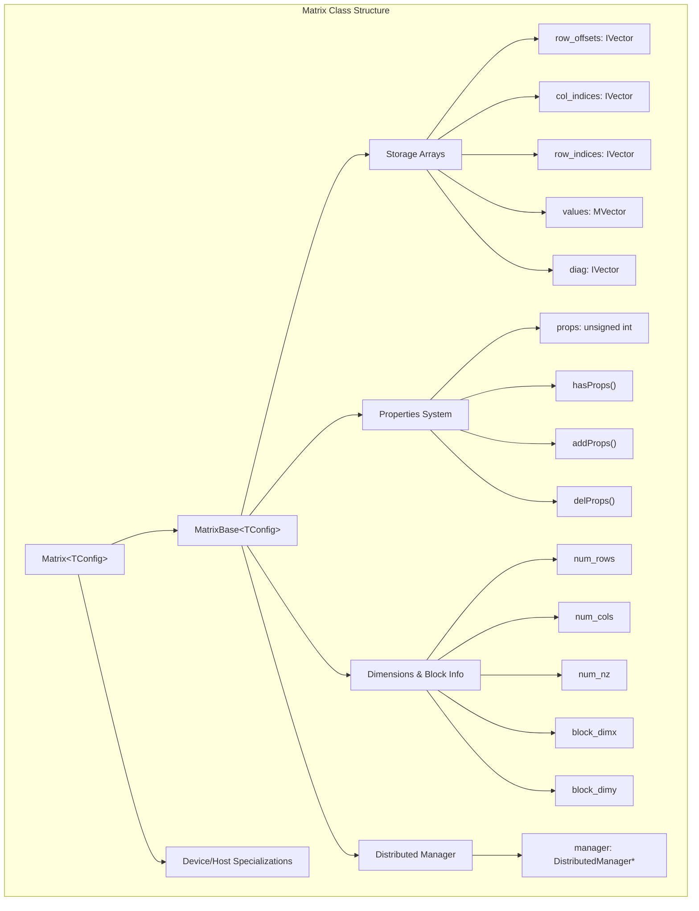
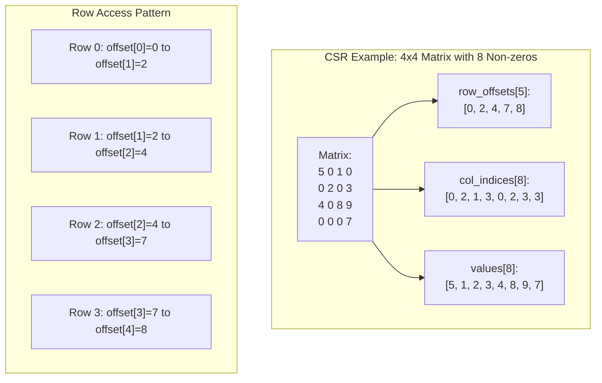
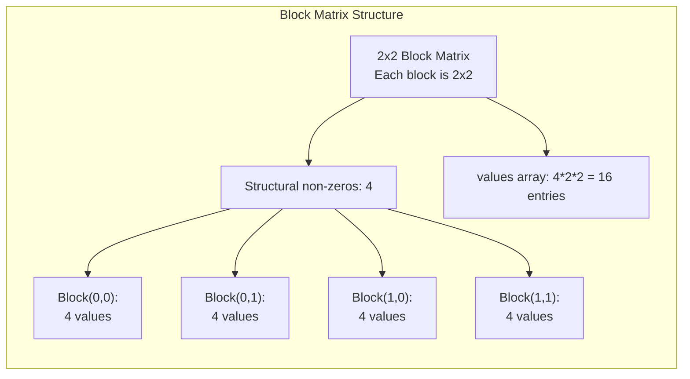
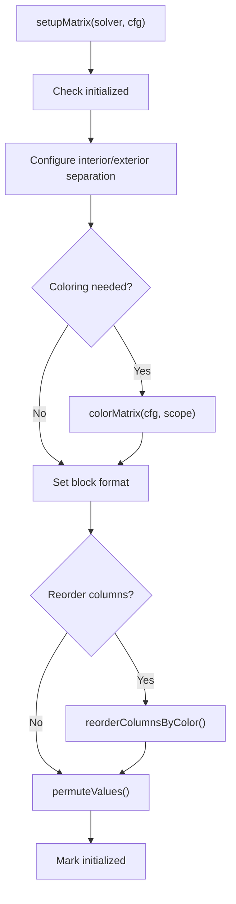
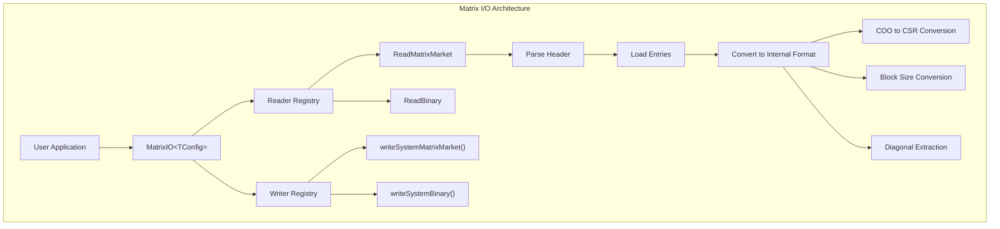
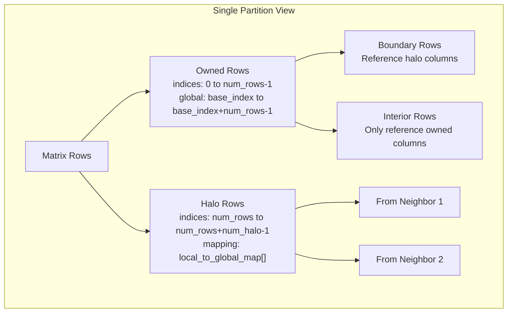
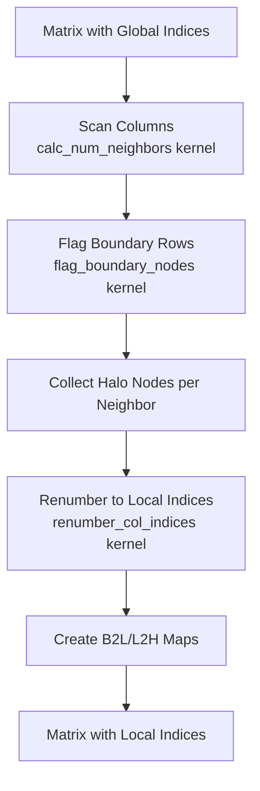
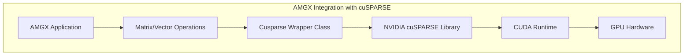
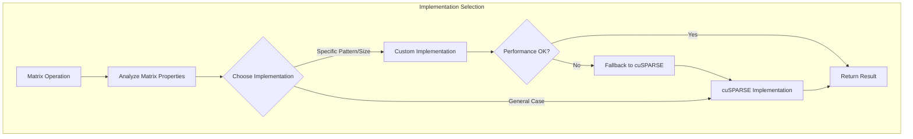

<!-- source: DeepWiki mcp.deepwiki.com · repo NVIDIA/AMGX · page 2.1 Matrix System · fetched 2026-10-26 -->

# Matrix System

<details>
<summary>Relevant source files</summary>

The following files were used as context for generating this wiki page:

- [src/distributed/distributed_arranger.cu](src/distributed/distributed_arranger.cu)
- [src/matrix.cu](src/matrix.cu)
- [src/matrix_io.cu](src/matrix_io.cu)
- [src/readers.cu](src/readers.cu)
- [src/solvers/multicolor_dilu_solver.cu](src/solvers/multicolor_dilu_solver.cu)

</details>


This page documents the core `Matrix` class in AMGX, which represents sparse matrices in various formats optimized for GPU computation. The matrix system supports CSR and COO formats, block structures, distributed storage across multiple GPUs, and properties like coloring for parallel solvers. For detailed information about matrix storage formats and I/O, see [Matrix Storage and I/O](#2.1.1). For sparse matrix operations like SpMV, see [Sparse Matrix Operations](#2.1.2). For matrix-matrix multiplication, see [CSR Multiplication](#2.1.3).

## Matrix Class Overview

The `Matrix<TConfig>` template class is the central data structure for sparse matrices in AMGX. It is parameterized by `TConfig`, which specifies memory space (host/device), vector precision, matrix precision, and index precision through the `TemplateConfig` system (see [Mode System and Template Dispatch](#4.1.2) for details).

### Matrix Template Structure

```
Matrix<TemplateConfig<AMGX_device, t_vecPrec, t_matPrec, t_indPrec>>
```

Where:
- **Memory Space**: `AMGX_host` or `AMGX_device`
- **Vector Precision**: Float, double, complex types
- **Matrix Precision**: Float, double, complex types  
- **Index Precision**: 32-bit or 64-bit integers

The `Matrix` class inherits from `MatrixBase<TConfig>` which provides core functionality, while device-specific specializations add GPU-optimized operations.

**Title: Matrix Class Hierarchy and Key Members**



Sources: [src/matrix.cu:213-228](), [include/matrix.h]()

### Matrix Properties and Formats

Matrix properties are stored as bit flags in the `props` field. The main format properties are:

| Property | Flag | Description |
|----------|------|-------------|
| CSR | `CSR` | Compressed Sparse Row format - stores row offsets and column indices |
| COO | `COO` | Coordinate format - stores row and column indices for each entry |
| DIAG | `DIAG` | Separate diagonal storage for improved solver efficiency |
| COLORING | `COLORING` | Matrix has been colored for parallel processing |

Additional properties track matrix state:
- Block structures with `block_dimx` and `block_dimy`
- Initialization state via `m_initialized` flag
- Column reordering state via `m_cols_reordered_by_color`
- Distributed storage state via attached `DistributedManager`

Properties are manipulated using:
- `hasProps(flag, props)` - Check if property is set
- `addProps(flag)` - Add a property
- `delProps(flag)` - Remove a property

Sources: [src/matrix.cu:462-695](), [src/matrix.cu:701-743]()

## Sparse Storage Formats

AMGX matrices store sparse data in one of two primary formats: CSR (Compressed Sparse Row) or COO (Coordinate). Both formats can optionally store diagonal elements separately via the `DIAG` property.

**Title: Matrix Storage Format Comparison**

| Format | Arrays Used | Typical Use Case | Conversion Cost |
|--------|-------------|------------------|-----------------|
| CSR | `row_offsets`, `col_indices`, `values` | SpMV, iterative solvers, most operations | O(nnz) from COO |
| COO | `row_indices`, `col_indices`, `values` | Matrix assembly, format conversion | O(nnz) from CSR |
| DIAG | Additional diagonal storage in `values` | Improved solver convergence | O(nrows) overhead |

### CSR Format Storage

The CSR format compresses row information for efficient row-based access:

- `row_offsets[i]` to `row_offsets[i+1]` defines the range of non-zeros in row `i`
- `col_indices[k]` stores the column index of the k-th non-zero
- `values[k]` stores the value of the k-th non-zero
- Size: `num_rows+1` for row_offsets, `num_nz` for col_indices and values

**Title: CSR Format Data Layout**



Sources: [src/matrix.cu:31-58](), [src/matrix.cu:60-78]()

### COO Format Storage

The COO format explicitly stores row indices for each non-zero:

- `row_indices[k]` stores the row index of the k-th non-zero
- `col_indices[k]` stores the column index of the k-th non-zero
- `values[k]` stores the value of the k-th non-zero
- Size: `num_nz` for all three arrays

COO format is useful during matrix construction and for format conversions. Conversion between COO and CSR is performed by the `computeRowOffsets()` and `computeRowIndices()` kernels.

### Block Matrix Storage

Block matrices store dense blocks for each structural non-zero:

- `block_dimx` and `block_dimy` define block dimensions
- `values` array size is `num_nz * block_dimx * block_dimy` (plus diagonal if `DIAG` is set)
- Blocks stored in row-major order within the values array
- Total matrix dimensions: `num_rows * block_dimx` by `num_cols * block_dimy`

Block storage improves arithmetic intensity and memory bandwidth utilization for systems with naturally blocked structure (e.g., multi-component PDEs).

**Title: Block Matrix Storage Layout**



Sources: [src/matrix.cu:462-695](), [src/matrix.cu:701-743]()

### Diagonal Separation

When the `DIAG` property is set, diagonal elements are stored separately at the end of the `values` array:

- Off-diagonal entries: `values[0]` to `values[num_nz * block_size - 1]`
- Diagonal entries: `values[num_nz * block_size]` to `values[(num_nz + num_rows) * block_size - 1]`
- `diag[i]` stores the offset where row `i`'s diagonal begins in the values array
- `m_diag_end_offsets[i]` stores the end offset

This separation enables more efficient diagonal operations in iterative solvers and can improve convergence characteristics. The `computeDiagonal()` method computes the `diag` array for CSR matrices, or sets it directly for COO format with the `DIAG` property.

Sources: [src/matrix.cu:988-1058](), [src/matrix.cu:80-99](), [src/matrix.cu:101-126]()

## Matrix Dimensions and Indexing

The `Matrix` class tracks several dimension-related fields:

| Field | Description | Typical Access |
|-------|-------------|----------------|
| `num_rows` | Number of block rows | `get_num_rows()` |
| `num_cols` | Number of block columns | `get_num_cols()` |
| `num_nz` | Number of structural non-zeros | `get_num_nz()` |
| `block_dimx` | Block row dimension | `get_block_dimx()` |
| `block_dimy` | Block column dimension | `get_block_dimy()` |
| `block_size` | `block_dimx * block_dimy` | `get_block_size()` |

For scalar matrices, both block dimensions are 1. The actual matrix dimensions in terms of scalar entries are `num_rows * block_dimx` by `num_cols * block_dimy`.

### Index Spaces

AMGX uses different index spaces depending on context:

- **Block indices**: Index into structural rows/columns (`0` to `num_rows-1`, `0` to `num_cols-1`)
- **Scalar indices**: Index into actual matrix entries (`0` to `num_rows*block_dimx-1`)
- **Non-zero indices**: Index into `col_indices` and `values` arrays (`0` to `num_nz-1`)
- **Value indices**: Index into `values` array for block entries (`0` to `num_nz*block_size-1`)

For distributed matrices, additional global indexing is used (see [Distributed Manager](#2.4.1) for details).

Sources: [src/matrix.cu:701-743]()

## Matrix Operations

The `Matrix` class provides several key operations for matrix manipulation and computation.

### Core Matrix Methods

| Method | Purpose | Location |
|--------|---------|----------|
| `apply(v, res, view)` | Matrix-vector multiplication: `res = A*v` | [src/matrix.cu:215-228]() |
| `computeDiagonal()` | Compute diagonal indices array | [src/matrix.cu:988-1058]() |
| `resize(rows, cols, nz)` | Allocate/resize matrix storage | [src/matrix.cu:701-743]() |
| `setupMatrix(solver, cfg)` | Prepare matrix for solving (coloring, reordering) | [src/matrix.cu:750-812]() |
| `reorderColumnsByColor()` | Reorder columns by color for optimized access | [src/matrix.cu:843-941]() |
| `sortByRowAndColumn()` | Sort matrix entries lexicographically | [src/matrix.cu:945-984]() |
| `convert(mat, props, bdimx, bdimy)` | Convert between block sizes and properties | [src/matrix.cu:462-695]() |
| `print()` / `printToFile()` | Output matrix to file or stdout | [src/matrix.cu:233-458]() |

### Matrix Setup and Configuration

The `setupMatrix()` method prepares a matrix for use in iterative solvers:

1. **Coloring** (if needed by solver): Colors the matrix rows to enable parallel Gauss-Seidel or other smoothers
2. **Block format conversion**: Changes block structure if needed
3. **Column reordering**: Reorders columns by color for better memory access patterns
4. **Value permutation**: Applies permutations to matrix values

The setup process uses configuration parameters from `AMG_Config` and queries the solver for its requirements via methods like `isColoringNeeded()` and `getReorderColsByColorDesired()`.

**Title: Matrix Setup Flow**



Sources: [src/matrix.cu:750-812](), [src/matrix.cu:843-941]()

### Diagonal Computation

The `computeDiagonal()` method locates diagonal elements in the matrix:

- For CSR format: Uses `computeDiagonalKernelCSR` kernel to search each row
- For COO format: Uses `computeDiagonalKernelCOO` kernel to scan all entries
- For `DIAG` property: Directly sets `diag[i] = num_nz + i`

The `diag` array stores indices into the `values` array where diagonal blocks begin. If no diagonal is found for a row, the entry is set to `null_index` (typically `num_nz`). The `m_diag_end_offsets` array stores the end position for each diagonal block.

Sources: [src/matrix.cu:988-1058](), [src/matrix.cu:80-99](), [src/matrix.cu:101-126](), [src/matrix.cu:168-178]()

### Column Reordering

The `reorderColumnsByColor()` method reorders matrix columns to group elements of the same color:

1. Appends diagonal elements to COO format (if stored separately)
2. Computes color of each column using `getMatrixColoring().getRowColors()`
3. Sorts entries by `(row, column_color)` using `cusp::detail::sort_by_row_and_column()`
4. Stores permutation vector in `m_values_permutation_vector`
5. Computes `m_smaller_color_offsets` and `m_larger_color_offsets` for efficient access

This reordering enables the multicolor DILU solver and Gauss-Seidel smoother to process colors in parallel while respecting dependencies.

Sources: [src/matrix.cu:843-941](), [src/matrix.cu:128-166]()

## Matrix I/O and Format Conversion

The matrix system supports reading and writing matrices in multiple formats, as well as conversions between different block sizes and properties.

### I/O Formats

Matrix I/O is handled by the `MatrixIO` class with pluggable readers and writers:

- **MatrixMarket format**: Text-based `.mtx` files with coordinate entries
- **Binary format**: Efficient binary storage for large matrices
- **AMGX extensions**: Support for block matrices, diagonal storage, RHS, and solution vectors

The MatrixMarket reader in [src/readers.cu:643-1396]() handles:
- Symmetric, skew-symmetric, and Hermitian matrices (expanded to full storage)
- Complex matrices with optional conversion to real equivalent reformulation (ERF)
- Block matrices with arbitrary block sizes
- External diagonal storage

**Title: Matrix I/O System**



Sources: [src/matrix_io.cu:34-91](), [src/matrix_io.cu:93-263](), [src/matrix_io.cu:266-404](), [src/readers.cu:643-1396]()

### Format Conversion

The `convert()` method transforms matrices between different block sizes and properties:

```cpp
void convert(const Matrix<TConfig> &mat, unsigned int new_props, 
             int block_dimy, int block_dimx)
```

The conversion process:
1. Iterates through source matrix entries (COO or CSR)
2. Maps each source scalar entry to destination block position
3. Accumulates values into destination blocks
4. Handles external diagonal conversion to internal or vice versa
5. Pads incomplete blocks with identity elements

This enables operations like:
- Converting scalar matrices to block matrices
- Changing block sizes (e.g., 2x2 to 4x4)
- Consolidating external diagonal into matrix body

Sources: [src/matrix.cu:462-695]()

### Complex to Real Conversion

For complex-valued matrices, AMGX can convert to real-valued equivalent reformulation (ERF) using formulations K1-K4:

- **K1-K4 formulations**: Different arrangements of real and imaginary parts
- **Scalar ERF**: Doubles matrix size (2N x 2N)
- **Block ERF**: Converts to 2x2 block system maintaining N x N structure

This allows real-valued solvers to handle complex systems. The conversion is triggered by the `complex_conversion` configuration parameter.

Sources: [src/readers.cu:186-639]()

## Distributed Matrix Structure

AMGX supports distributed sparse matrices across multiple GPUs or nodes using MPI. Each process owns a contiguous range of rows and maintains halo (ghost) rows from neighboring processes.

### Distributed Matrix Layout

A distributed matrix has:

- **Owned rows**: Rows with indices `[base_index, base_index + index_range)` 
- **Halo rows**: Ghost rows from neighbors, indexed as `[num_owned_rows, num_owned_rows + num_halo_rows)`
- **Local-to-global mapping**: `local_to_global_map` array mapping halo indices to global row IDs
- **Column indices**: Use local indexing - owned rows use local IDs, halo rows use global IDs

The `DistributedManager` attached to the matrix tracks:
- Neighbor partition IDs
- Boundary-to-local (B2L) maps for communication
- Local-to-halo (L2H) maps for send buffers
- Halo ranges for each neighbor

**Title: Distributed Matrix Index Space**



Sources: [src/distributed/distributed_arranger.cu:950-1002](), [src/distributed/distributed_arranger.cu:1004-1112]()

### Matrix Renumbering

The `DistributedArranger` class in [src/distributed/distributed_arranger.cu]() handles matrix renumbering:

1. **Neighbor discovery**: Scans matrix columns to identify neighboring partitions via `create_neighbors()` / `calc_num_neighbors` kernel
2. **Boundary flagging**: Identifies boundary rows that reference halo nodes via `flag_boundary_nodes` kernel
3. **Halo collection**: Gathers unique halo nodes needed from each neighbor
4. **Local renumbering**: Renumbers column indices from global to local space via `renumber_col_indices` kernel
5. **B2L/L2H mapping**: Creates maps for MPI communication patterns

After renumbering, all column indices use local indexing where indices `< num_rows` refer to owned rows and indices `>= num_rows` refer to halo rows.

**Title: Matrix Renumbering Flow**



Sources: [src/distributed/distributed_arranger.cu:215-241](), [src/distributed/distributed_arranger.cu:106-113](), [src/distributed/distributed_arranger.cu:676-708](), [src/distributed/distributed_arranger.cu:1159-1201]()

### Halo Rings

AMGX supports multiple "rings" of halo rows:
- **Ring 1**: Direct neighbors referenced by owned rows
- **Ring 2**: Neighbors of ring 1 (for aggressive coarsening in AMG)
- **Ring k**: k-th level of neighbors

Additional rings enable matrix operations like Galerkin coarsening (`R*A*P`) on coarse grids where the coarse matrix pattern requires wider halos.

Sources: [src/distributed/distributed_arranger.cu:950-1002](), [src/distributed/distributed_arranger.cu:1004-1112]()

## Integration with CUDA and cuSPARSE

AMGX leverages NVIDIA's CUDA and cuSPARSE libraries for optimal performance on GPUs.

### cuSPARSE Integration

The `Cusparse` class wraps cuSPARSE functionality, providing:

- Matrix-vector multiplication (csrmv, bsrmv)
- Matrix-matrix multiplication (csrgemm)
- Format conversions
- Block operations

This integration enables AMGX to use highly optimized implementations while providing a consistent interface.



Sources: [src/amgx_cusparse.cu:30-40](src/amgx_cusparse.cu:30-40), [src/amgx_cusparse.cu:1080-1110](src/amgx_cusparse.cu:1080-1110)

### Custom vs. cuSPARSE Implementation

AMGX includes both custom implementations and wrappers for cuSPARSE:

- **Custom implementations**: Optimized for specific matrix patterns and sizes
- **cuSPARSE wrappers**: Used for general cases and as fallbacks

The choice between implementations is based on matrix properties, size, and heuristics.



Sources: [src/csr_multiply.cu:402-447](src/csr_multiply.cu:402-447), [src/amgx_cusparse.cu:295-399](src/amgx_cusparse.cu:295-399)

## Performance Considerations

Several factors affect the performance of matrix and vector operations in AMGX:

### Matrix Format Selection

- **CSR**: Good general-purpose format with efficient row access
- **Block CSR**: Better for matrices with block structure (higher arithmetic intensity)
- **Separate diagonal storage**: Can improve convergence for iterative solvers

### Memory Access Patterns

- Coalesced memory access is critical for GPU performance
- Matrix reordering can improve locality and reduce irregular access
- Block operations can increase arithmetic intensity and improve performance

### GPU Optimization Techniques

- Shared memory usage for frequently accessed data
- Warp-level primitives for efficient communication
- Thread cooperation for sparse data structures
- Asynchronous operations for latency hiding

Sources: [src/amgx_cusparse.cu:1013-1079](src/amgx_cusparse.cu:1013-1079), [src/csr_multiply_detail.cu:48-234](src/csr_multiply_detail.cu:48-234)

---

