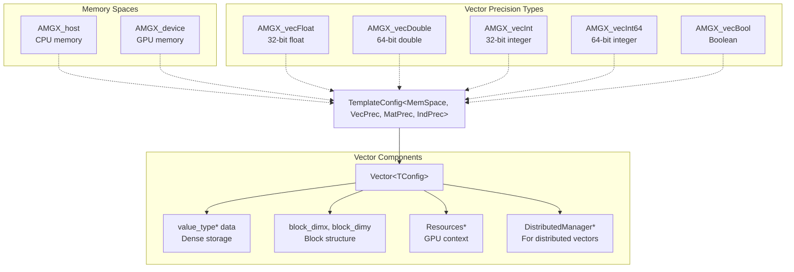
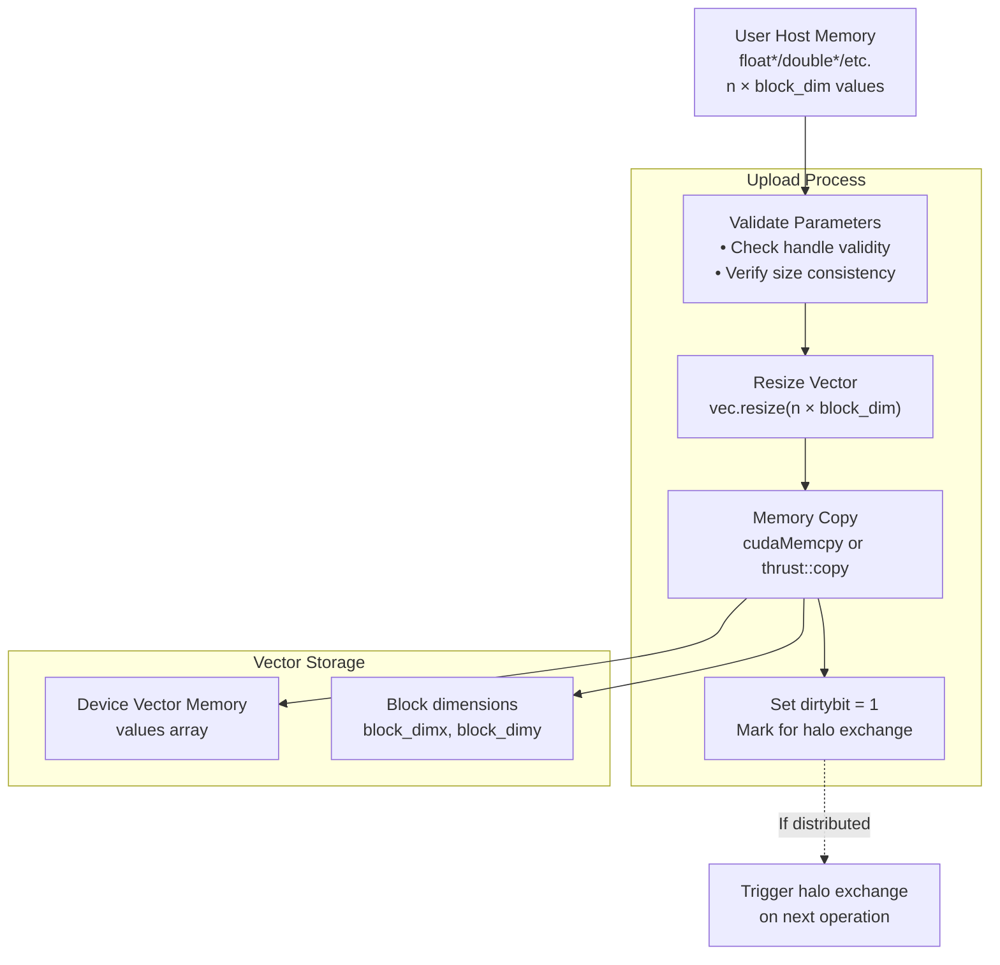
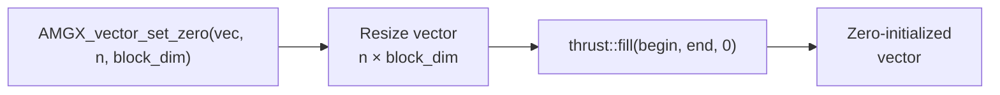
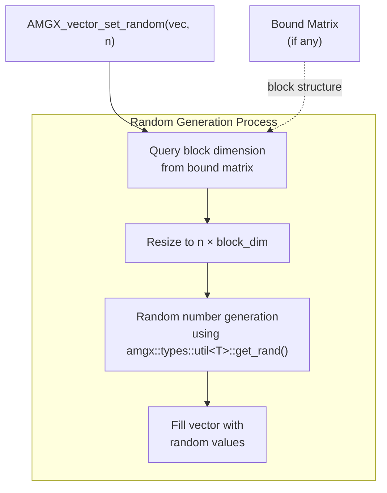
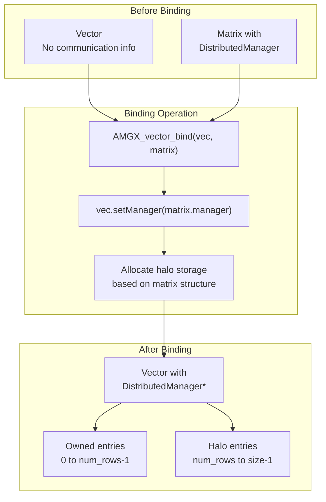
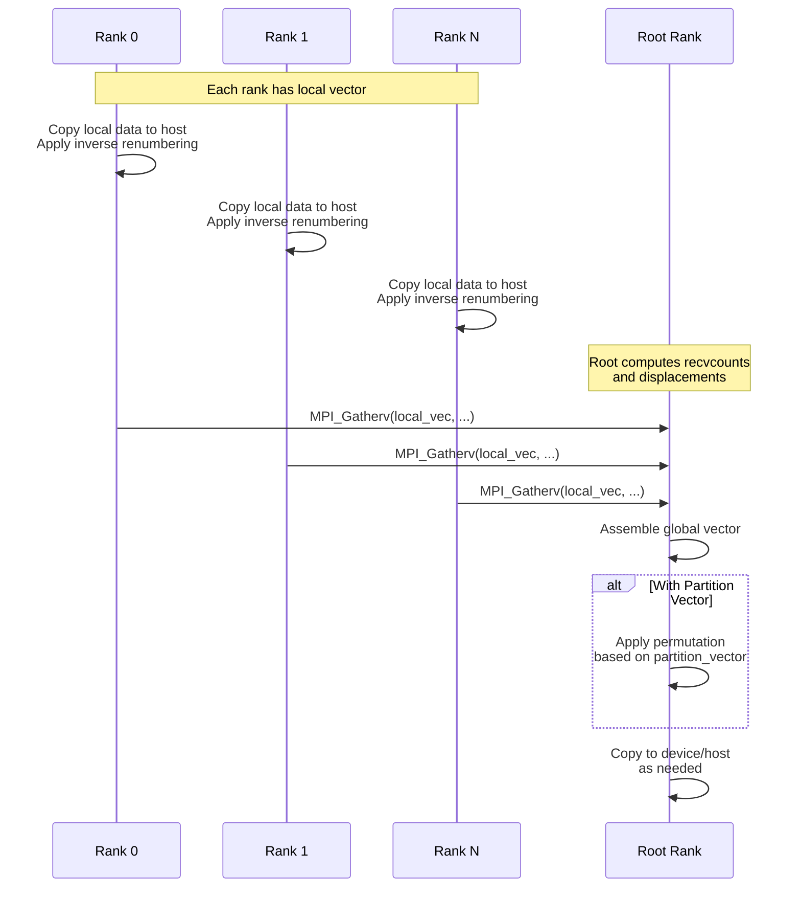
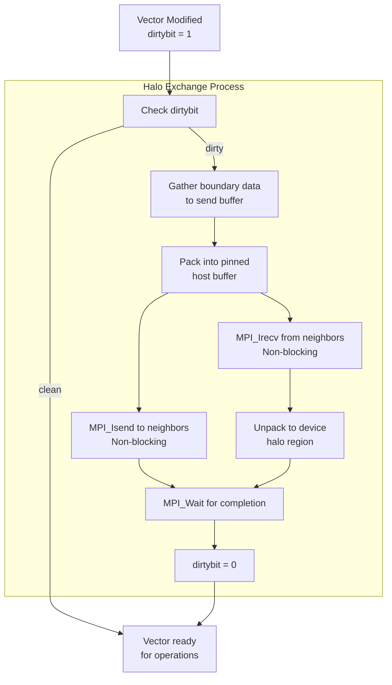
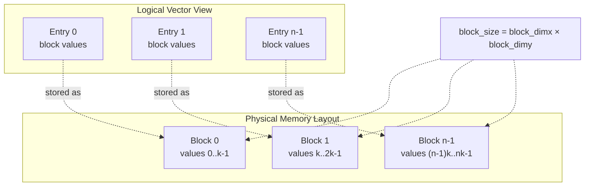

<!-- source: DeepWiki mcp.deepwiki.com · repo NVIDIA/AMGX · page 2.2 Vector Operations · fetched 2026-10-26 -->

# Vector Operations

<details>
<summary>Relevant source files</summary>

The following files were used as context for generating this wiki page:

- [examples/amgx_mpi_capi.c](examples/amgx_mpi_capi.c)
- [examples/amgx_mpi_poisson7.c](examples/amgx_mpi_poisson7.c)
- [include/amgx_c.h](include/amgx_c.h)
- [src/amgx_c.cu](src/amgx_c.cu)
- [src/distributed/distributed_arranger.cu](src/distributed/distributed_arranger.cu)
- [src/matrix.cu](src/matrix.cu)
- [src/matrix_analysis.cu](src/matrix_analysis.cu)
- [src/matrix_io.cu](src/matrix_io.cu)
- [src/readers.cu](src/readers.cu)
- [src/solvers/multicolor_dilu_solver.cu](src/solvers/multicolor_dilu_solver.cu)

</details>


## Purpose and Scope

This page documents the `Vector` class and its associated operations in AMGX, which provides dense vector storage and manipulation capabilities for both single-GPU and distributed multi-GPU environments. Vectors in AMGX store solution vectors, right-hand side vectors, and intermediate results during iterative solving. For matrix operations that involve vectors (such as sparse matrix-vector multiplication), see [Sparse Matrix Operations](#2.1.2). For information about how vectors are managed in distributed memory settings, see [Distributed Computing](#2.4).

**Sources:** [src/amgx_c.cu:1-700](), [include/amgx_c.h:335-370]()

## Vector Class Architecture

The `Vector` class is templated on `TConfig`, which encapsulates memory space (host/device), vector precision, matrix precision, and index precision. Vectors are always dense (no sparsity) and support block structure where each entry can contain multiple scalar values.

### Template Configuration and Type System



**Sources:** [src/amgx_c.cu:100-126](), [include/amgx_c.h:116-117]()

### C API Handle System

The C API exposes vectors through opaque handles that wrap the templated C++ implementation:

| C API Type | Internal Representation | Purpose |
|------------|------------------------|---------|
| `AMGX_vector_handle` | `Vector<TConfig>*` | Opaque pointer to typed vector |
| `AMGX_Mode` | Encoded template parameters | Runtime type selection |
| `AMGX_resources_handle` | `Resources*` | GPU device context |

The mode system allows runtime selection of precision while maintaining compile-time optimization. Each `AMGX_vector_handle` stores its mode tag, enabling template dispatch at API boundaries.

**Sources:** [src/amgx_c.cu:100-126](), [include/amgx_c.h:107-117]()

## Vector Lifecycle Management

### Creation and Destruction

Vector objects are created through the C API and associated with specific GPU resources:

```mermaid
sequenceDiagram
    participant User as User Application
    participant API as AMGX C API
    participant Factory as Vector Factory
    participant Resources as Resources Object
    participant Vector as Vector&lt;TConfig&gt;
    
    User->>API: AMGX_vector_create(&vec, rsrc, mode)
    API->>API: Extract mode parameters<br/>(precision, memory space)
    API->>Factory: Create with mode switch
    Factory->>Vector: new Vector&lt;TConfig&gt;(resources)
    Vector->>Resources: Register with GPU context
    Vector-->>Factory: Vector instance
    Factory-->>API: Wrap in handle
    API-->>User: AMGX_vector_handle
    
    Note over Vector: Vector ready for use
    
    User->>API: AMGX_vector_destroy(vec)
    API->>Vector: Delete vector object
    Vector->>Resources: Unregister
    Vector-->>API: Memory freed
    API-->>User: AMGX_RC_OK
```

**Sources:** [src/amgx_c.cu:1042-1096](), [src/amgx_c.cu:1384-1432]()

The creation process:
1. **Mode extraction**: Parse `AMGX_Mode` to determine template parameters
2. **Template dispatch**: Use macro-based switch to instantiate correct type
3. **Resource association**: Link vector to GPU device and memory pools
4. **Handle wrapping**: Return opaque handle to user

**Sources:** [src/amgx_c.cu:1042-1096]()

## Vector Data Transfer Operations

### Upload Operation: Host to Device/Vector

The `AMGX_vector_upload` function transfers data from host memory into the vector:



**Sources:** [src/amgx_c.cu:1098-1150]()

Key implementation details from [src/amgx_c.cu:1098-1150]():
- Vector size is `n × block_dim` where `n` is number of rows and `block_dim` is the block size
- Data layout matches the block structure (block_dimx × block_dimy)
- Uses `cudaMemcpyDefault` for automatic host-to-device or host-to-host transfer
- Sets `dirtybit = 1` to indicate halo regions need updating in distributed settings

### Download Operation: Vector to Host

The `AMGX_vector_download` function retrieves vector data back to host memory:

```mermaid
sequenceDiagram
    participant User as User Application
    participant API as vector_download
    participant Vec as Vector&lt;TConfig&gt;
    participant Manager as DistributedManager
    participant Memory as Device/Host Memory
    
    User->>API: AMGX_vector_download(vec, data)
    API->>Vec: Get vector reference
    
    alt Distributed Vector
        API->>Manager: Check if halo exchange needed
        Manager->>Manager: exchange_halo_wait()
        Note over Manager: Ensure halo regions<br/>are up-to-date
        Manager->>Vec: Clear dirtybit
    end
    
    API->>Vec: Get size and data pointer
    Vec-->>API: values.raw(), size()
    
    API->>Memory: cudaMemcpy(data, vec.values, size)
    Memory-->>User: Vector data copied to host
    
    User->>User: Process downloaded data
```

**Sources:** [src/amgx_c.cu:1152-1215]()

Download process details:
1. **Halo synchronization**: If distributed, wait for any pending halo exchanges to complete
2. **Size verification**: Ensure destination buffer is appropriately sized
3. **Memory copy**: Transfer from device (or host) to user-provided host buffer
4. **Format preservation**: Data is copied in the same block-structured layout as stored

**Sources:** [src/amgx_c.cu:1152-1215]()

## Vector Initialization Operations

### Setting Vectors to Zero



Implementation uses Thrust library's `fill` operation to efficiently set all values to zero, working on both host and device vectors through template specialization.

**Sources:** [src/amgx_c.cu:1217-1275]()

### Setting Vectors to Random Values

The `AMGX_vector_set_random` operation initializes vectors with random values for testing:



**Sources:** [src/amgx_c.cu:1277-1327]()

## Vector-Matrix Binding for Distributed Operations

### Binding Mechanism

Vectors must be bound to matrices in distributed settings to establish communication patterns. This binding determines how halo regions are exchanged during vector operations.



**Sources:** [src/amgx_c.cu:1329-1382]()

### Vector Structure After Binding

Once bound, vectors are logically partitioned:

| Region | Index Range | Content | Communication |
|--------|-------------|---------|---------------|
| **Owned** | `[0, num_rows)` | Local data owned by this rank | May send to neighbors |
| **Halo** | `[num_rows, size)` | Ghost data from neighbors | Received during exchange |

The halo size is determined by the matrix's distributed structure and the number of halo rings required for the algorithm (typically 1-2 rings).

**Sources:** [src/amgx_c.cu:1329-1382](), [src/amgx_c.cu:478-635]()

## Distributed Vector Operations

### Global Vector Construction

In distributed environments, vectors may need to be gathered from all ranks to a root rank. The `construct_global_vector` function performs this operation:



**Sources:** [src/amgx_c.cu:478-635]()

### Halo Exchange for Vectors

When vectors are modified, their halo regions must be updated before use in operations like SpMV:



**Sources:** [src/amgx_c.cu:1152-1215](), [src/amgx_c.cu:478-635]()

Key aspects of halo exchange:
1. **Dirtybit tracking**: Vectors maintain a `dirtybit` flag indicating when halo data is stale
2. **Lazy exchange**: Halo exchange is deferred until the vector is actually used
3. **Boundary identification**: The matrix's `b2l_maps` (boundary-to-local maps) identify which entries to send
4. **Asynchronous communication**: Uses non-blocking MPI to overlap with computation where possible

**Sources:** [src/amgx_c.cu:1152-1215]()

## Vector Memory Layout and Block Structure

### Block-Structured Vectors

Vectors support block structure where each logical entry contains `block_dimx × block_dimy` scalar values:



For a vector with `n` entries and block size `k × k`:
- **Total storage**: `n × k × k` scalar values
- **Layout**: Contiguous blocks, with block 0's values, then block 1's values, etc.
- **Common cases**: Scalar (1×1), 2×2 blocks for 2D problems, 3×3 blocks for 3D problems

**Sources:** [src/amgx_c.cu:1098-1150](), [src/amgx_c.cu:478-635]()

## Example Usage Patterns

### Single-GPU Vector Operations

```
// Example from amgx_capi examples
AMGX_vector_create(&x, rsrc, mode);
AMGX_vector_create(&b, rsrc, mode);

// Allocate and initialize host data
float *x_h = malloc(n * sizeof(float));
float *b_h = malloc(n * sizeof(float));
// ... initialize b_h ...

// Upload vectors
AMGX_vector_upload(x, n, 1, x_h);  // 1 = block_dim for scalar
AMGX_vector_upload(b, n, 1, b_h);

// Solve (solver uses vectors)
AMGX_solver_solve(solver, b, x);

// Download solution
AMGX_vector_download(x, x_h);
```

**Sources:** [examples/amgx_mpi_capi.c:240-350]()

### Distributed Vector Operations

```
// Example from MPI examples
AMGX_vector_create(&x, rsrc, mode);
AMGX_vector_create(&b, rsrc, mode);

// Read distributed matrix (establishes partition)
AMGX_read_system_distributed(A, b, x, filename, ...);

// Vectors are now associated with distributed structure
// Binding happens automatically or explicitly:
AMGX_vector_bind(x, A);
AMGX_vector_bind(b, A);

// Upload local part
AMGX_vector_upload(x, local_n, block_dim, local_x_data);
AMGX_vector_upload(b, local_n, block_dim, local_b_data);

// Solve (halo exchanges happen automatically)
AMGX_solver_solve(solver, b, x);

// Download local part
AMGX_vector_download(x, local_x_data);
```

**Sources:** [examples/amgx_mpi_capi.c:240-350](), [examples/amgx_mpi_poisson7.c:240-310]()

## Integration with Other Components

### Vector-Manager Interaction

The `DistributedManager` coordinates vector communication:

| Manager Component | Vector Usage |
|-------------------|--------------|
| `b2l_maps` | Identifies boundary entries to send to neighbors |
| `halo_ranges` | Defines where to store received halo data |
| `neighbors` | List of MPI ranks to exchange data with |
| `part_offsets` | Maps global indices to partitions for construction |

**Sources:** [src/amgx_c.cu:478-635]()

### Vector-Matrix Dependencies

Vectors depend on matrices for:
1. **Block structure**: Vectors inherit block dimensions from bound matrices
2. **Communication patterns**: Halo exchange follows matrix's distributed structure
3. **Size validation**: Vector dimensions must match matrix dimensions
4. **Renumbering**: Vectors may need reordering to match matrix's interior/boundary separation

**Sources:** [src/amgx_c.cu:1329-1382]()

---

