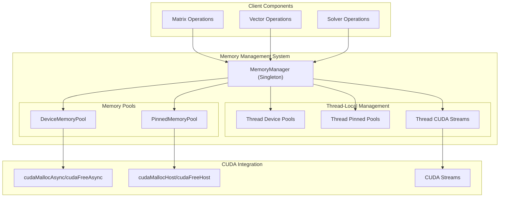
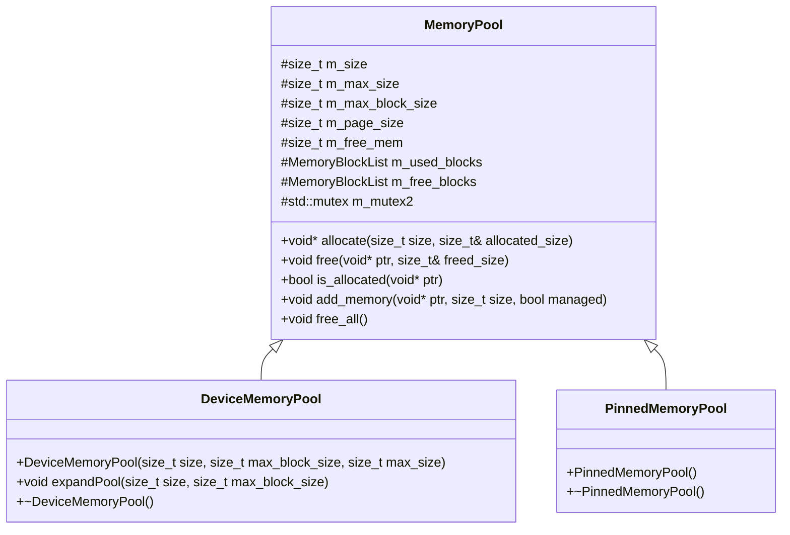
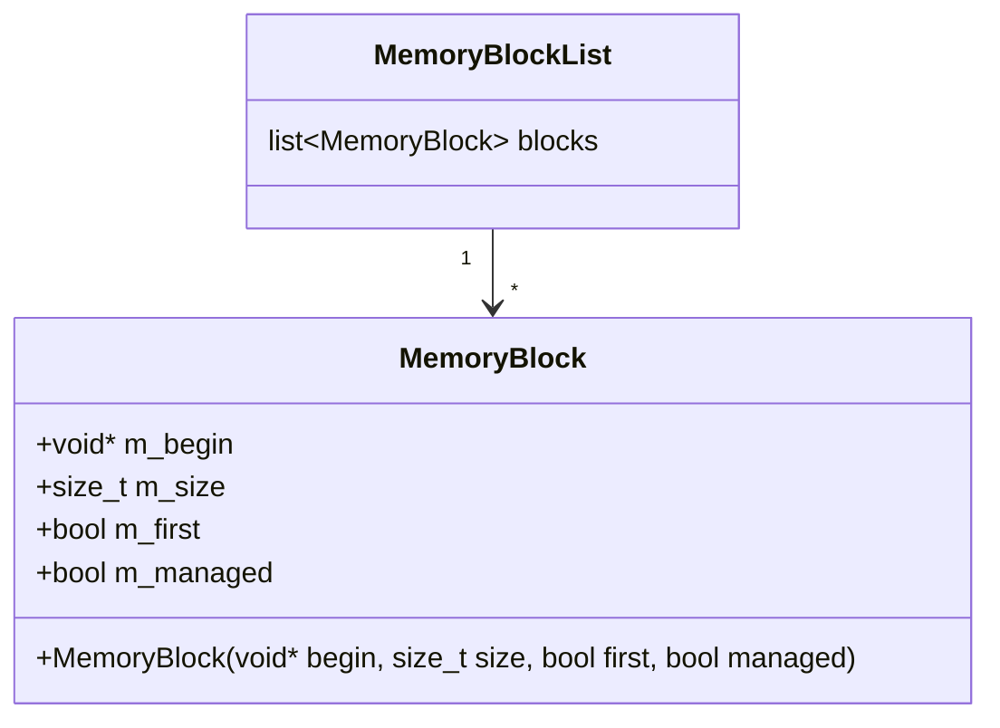
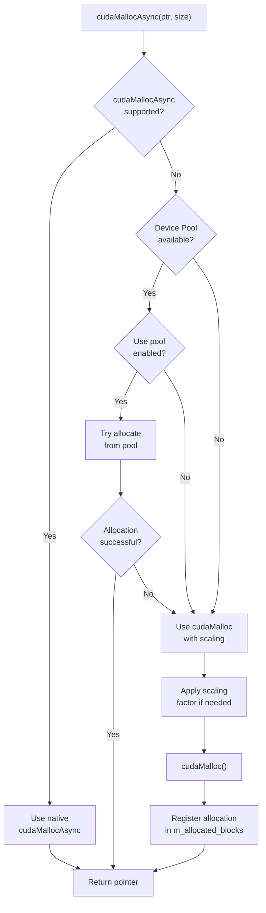
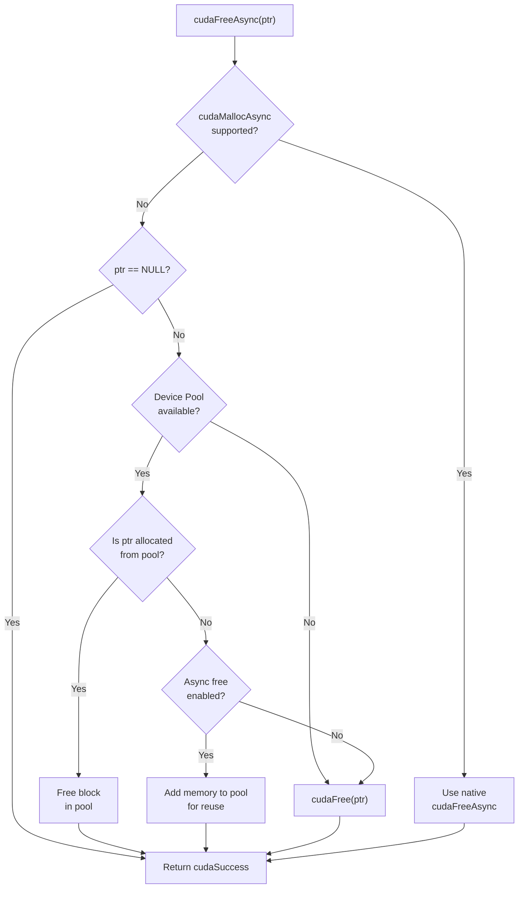
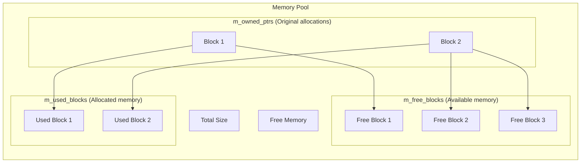
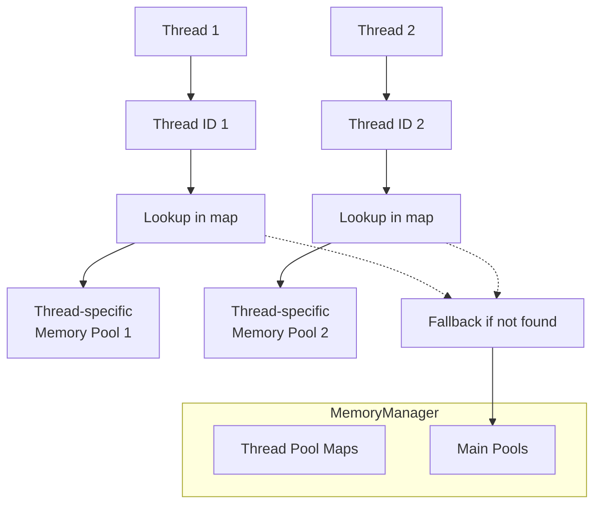
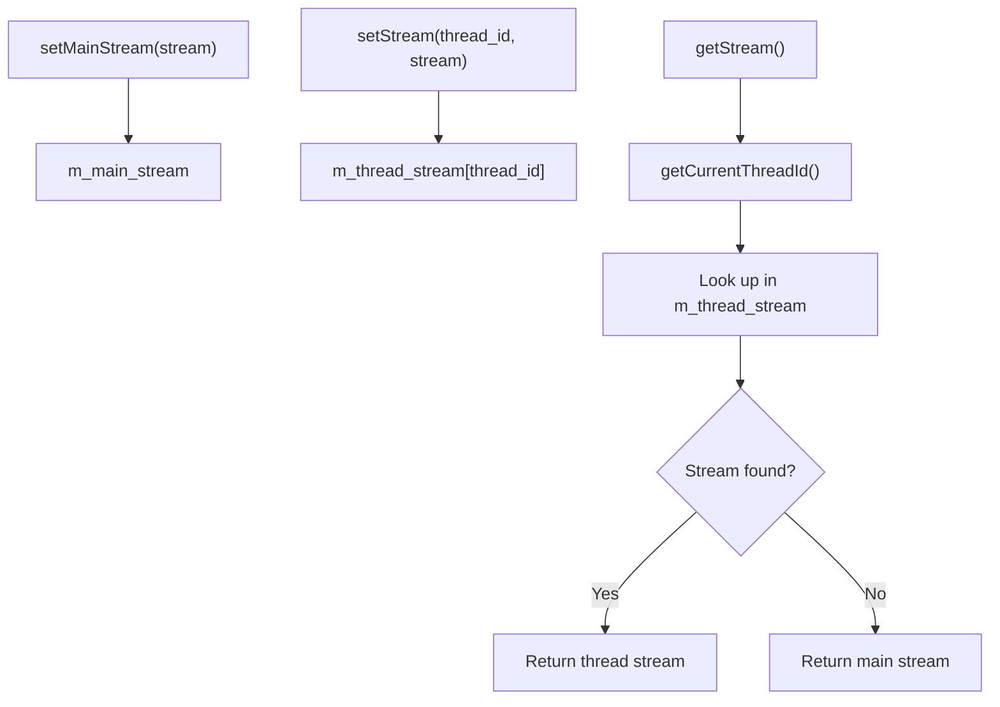
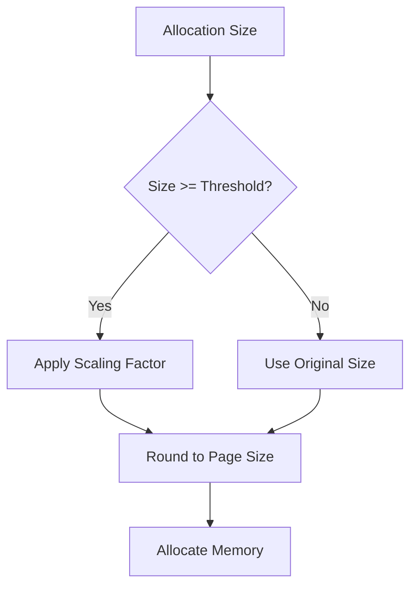

<!-- source: DeepWiki mcp.deepwiki.com · repo NVIDIA/AMGX · page 2.3 Memory Management · fetched 2026-10-26 -->

# Memory Management

<details>
<summary>Relevant source files</summary>

The following files were used as context for generating this wiki page:

- [include/device_properties.h](include/device_properties.h)
- [include/global_thread_handle.h](include/global_thread_handle.h)
- [src/device_properties.cu](src/device_properties.cu)
- [src/global_thread_handle.cu](src/global_thread_handle.cu)

</details>


This page documents the memory management system in AMGX, focusing on GPU and host memory allocation, memory pools, and asynchronous operations. The memory management system provides efficient allocation and deallocation of both device (GPU) and host memory through specialized memory pools, reducing allocation overhead and memory fragmentation.

## Overview

AMGX implements a custom memory management system to efficiently handle the allocation and deallocation of GPU memory, which is a critical resource in sparse linear solvers. The system provides:

- Pooled memory allocation to reduce overhead of frequent allocations
- Thread-local memory management to improve concurrency 
- Asynchronous memory operations
- Device and host (pinned) memory management
- Support for recent CUDA features like cudaMallocAsync

### Memory Management Component Diagram



Sources: [include/global_thread_handle.h:32-126](), [src/global_thread_handle.cu:423-537]()

## Memory Manager

The `MemoryManager` is a singleton class that serves as the central component of the memory management system, coordinating all memory operations and maintaining memory pools.

### Key Responsibilities

- Manages device and pinned memory pools
- Coordinates thread-local memory pools
- Handles CUDA stream associations
- Controls asynchronous memory operations
- Maintains memory scaling parameters

### Memory Manager Implementation 

The `MemoryManager` is implemented as a singleton to ensure a single point of control for memory operations across the application:

```mermaid
classDiagram
    class MemoryManager {
        -PinnedMemoryPool* m_main_pinned_pool
        -DeviceMemoryPool* m_main_device_pool
        -cudaStream_t m_main_stream
        -bool m_use_async_free
        -bool m_use_device_pool
        -size_t m_alloc_scaling_factor
        -size_t m_alloc_scaling_threshold
        -bool m_use_cudamallocasync
        +static MemoryManager& get_instance()
        +void sync_pinned_pool()
        +void sync_device_pool()
        +size_t scale(size_t size)
        +bool uses_cudamallocasync()
    }
    
    class "Thread-specific Maps" {
        map<thread_id, DeviceMemoryPool*> m_thread_device_pools
        map<thread_id, PinnedMemoryPool*> m_thread_pinned_pools
        map<thread_id, cudaStream_t> m_thread_stream
        map<void*, size_t> m_allocated_blocks
    }
    
    MemoryManager -- "Thread-specific Maps"
```

Sources: [src/global_thread_handle.cu:423-537](), [include/global_thread_handle.h:32-126]()

## Memory Pools

AMGX implements two types of memory pools to efficiently manage different types of memory:

1. **DeviceMemoryPool**: Manages GPU (device) memory
2. **PinnedMemoryPool**: Manages pinned (page-locked) host memory

Both inherit from the base `MemoryPool` class which provides common functionality for memory block management.

### Memory Pool Hierarchy



Sources: [include/global_thread_handle.h:32-154](), [src/global_thread_handle.cu:50-126](), [src/global_thread_handle.cu:343-388]()

### Memory Block Management

Memory pools use the `MemoryBlock` structure to track memory regions:



The pools maintain two main lists:
- `m_free_blocks`: Available memory blocks
- `m_used_blocks`: Currently allocated memory blocks

Sources: [include/global_thread_handle.h:42-55](), [src/global_thread_handle.cu:72-127](), [src/global_thread_handle.cu:116-217]()

## Memory Allocation Process

AMGX provides custom wrappers around CUDA memory allocation functions:
- `cudaMallocAsync`: Allocates device memory
- `cudaMallocHost`: Allocates pinned host memory
- `cudaFreeAsync`: Frees device memory
- `cudaFreeHost`: Frees pinned host memory

These functions follow a decision process to determine whether to use pooled memory or direct CUDA allocation.

### Memory Allocation Flow



Sources: [src/global_thread_handle.cu:843-957](), [src/global_thread_handle.cu:776-841]()

### Memory Deallocation Flow



Sources: [src/global_thread_handle.cu:959-1075](), [src/global_thread_handle.cu:816-841]()

## Pool Allocation Internals

When allocating from a memory pool, the `MemoryPool::allocate` method follows these steps:

1. Find the best fit block that can accommodate the requested size
2. Calculate the aligned size based on the page size
3. If a suitable block is found:
   - Split the block if it's larger than needed
   - Add the used portion to the used blocks list
   - Update statistics
4. If no suitable block is found, return NULL to fallback to direct allocation

### Memory Block Structure and Management

Memory blocks within the pool are maintained in a sorted order to facilitate efficient merging of adjacent free blocks during deallocation.



During deallocation, the `MemoryPool::free` method:
1. Finds the block to be freed in the used blocks list
2. Inserts it into the free blocks list in sorted order
3. Merges contiguous free blocks to reduce fragmentation
4. Updates statistics

Sources: [src/global_thread_handle.cu:117-217](), [src/global_thread_handle.cu:219-309]()

## Thread Management and Synchronization

AMGX supports multi-threaded access to memory pools through thread-specific memory pools and synchronization mechanisms.

### Thread-Local Pools

Each thread can have its own device and pinned memory pools, accessed through thread ID:



Sources: [src/global_thread_handle.cu:493-526](), [src/global_thread_handle.cu:573-603](), [src/global_thread_handle.cu:623-653]()

### Thread Synchronization

Thread synchronization is achieved through:

1. Mutex locks to protect data structures during concurrent access
2. Thread-local pools to minimize contention
3. Pool joining functions to consolidate memory across threads:
   - `joinPinnedPools()`
   - `joinDevicePools()`

Sources: [src/global_thread_handle.cu:1082-1107](), [src/global_thread_handle.cu:539-559](), [src/global_thread_handle.cu:98-114]()

## CUDA Stream Integration

AMGX integrates with CUDA streams to enable asynchronous operations. Streams can be:

1. Thread-specific: Each thread can have its own stream
2. Global: A main stream for operations not associated with a specific thread

The streams are used for:
- Asynchronous memory allocation and deallocation
- Kernel execution in parallel with memory operations
- Coordinating operations across multiple GPU resources

### Stream Management Functions



Sources: [src/global_thread_handle.cu:721-747](), [include/global_thread_handle.h:192-196]()

## Advanced Memory Features

### Memory Scaling

AMGX can apply scaling to memory allocations to reduce the frequency of allocations:

- `m_alloc_scaling_factor`: Percentage of additional memory to allocate
- `m_alloc_scaling_threshold`: Minimum size before scaling is applied



Sources: [src/global_thread_handle.cu:473-484](), [src/global_thread_handle.cu:699-703]()

### Native cudaMallocAsync Support

Recent versions of AMGX include support for CUDA's native `cudaMallocAsync` feature, which provides efficient asynchronous memory allocation directly from the CUDA runtime.

This is enabled when the device supports memory pools and is controlled by the `m_use_cudamallocasync` flag in the `MemoryManager`.

Sources: [src/global_thread_handle.cu:442-460](), [src/global_thread_handle.cu:847-852](), [src/global_thread_handle.cu:963-968]()

## API Reference

### Memory Pool Management

| Function | Description |
|----------|-------------|
| `setPinnedMemoryPool(pool)` | Set the main pinned memory pool |
| `setDeviceMemoryPool(pool)` | Set the main device memory pool |
| `setPinnedMemoryPool(thread_id, pool)` | Set a thread-specific pinned pool |
| `setDeviceMemoryPool(thread_id, pool)` | Set a thread-specific device pool |
| `destroyPinnedMemoryPool()` | Destroy the main pinned memory pool |
| `destroyDeviceMemoryPool()` | Destroy the main device memory pool |
| `expandDeviceMemoryPool(size, max_block_size)` | Add memory to the device pool |

### Memory Allocation Functions

| Function | Description |
|----------|-------------|
| `cudaMallocAsync(ptr, size, stream)` | Allocate device memory |
| `cudaFreeAsync(ptr, stream)` | Free device memory |
| `cudaMallocHost(ptr, size)` | Allocate pinned host memory |
| `cudaFreeHost(ptr)` | Free pinned host memory |
| `cudaFreeWait()` | Wait for async free operations to complete |

### Configuration Functions

| Function | Description |
|----------|-------------|
| `setAsyncFreeFlag(bool)` | Enable/disable asynchronous free |
| `setDeviceMemoryPoolFlag(bool)` | Enable/disable device memory pool |
| `setMallocScalingFactor(size_t)` | Set the allocation scaling factor |
| `setMallocScalingThreshold(size_t)` | Set the scaling threshold |

Sources: [include/global_thread_handle.h:156-216]()

## Integration with AMGX Components

The memory management system is used throughout AMGX, particularly in:

1. **Matrix Operations**: For efficient allocation and deallocation of matrix data structures
2. **Vector Operations**: For managing vector data
3. **Solvers**: For temporary workspace allocations during solves
4. **Distributed Computing**: For managing communication buffers

Sources: [src/strided_reduction.h:644-654](), [src/matrix_coloring/greedy_recolor.cu:645-654](), [src/amg_level.cu:22-24]()

---

