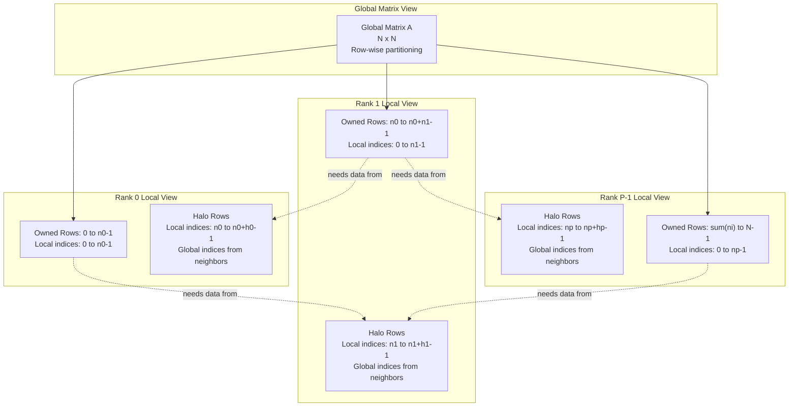
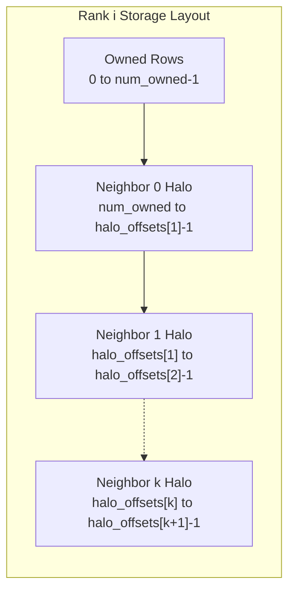
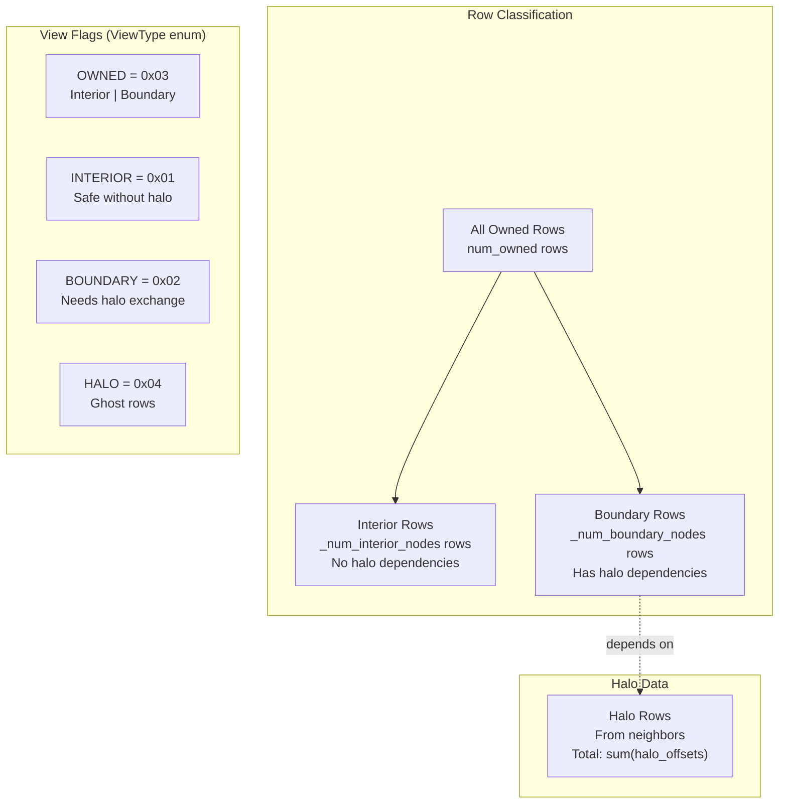
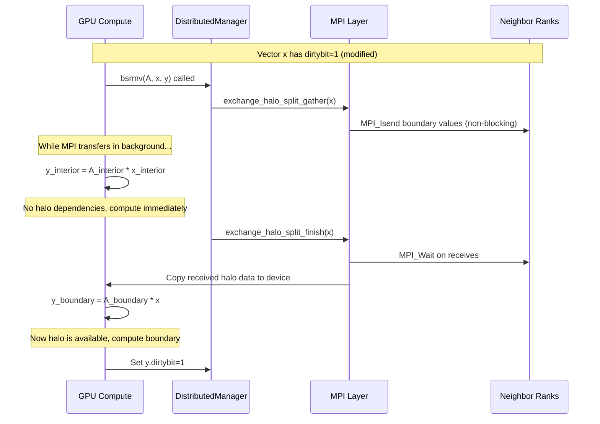
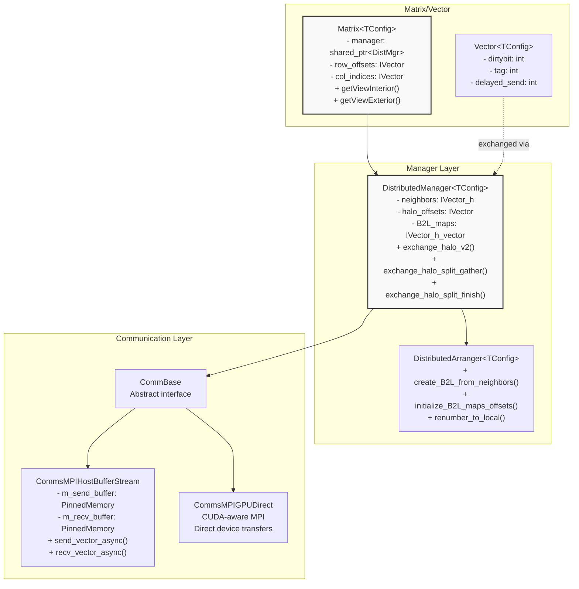
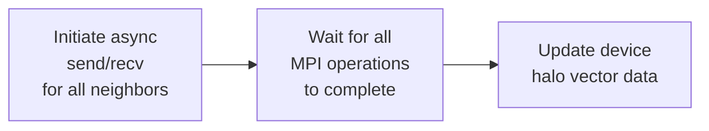
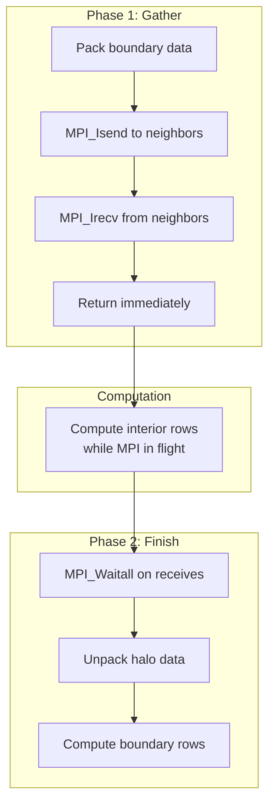
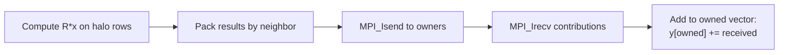

<!-- source: DeepWiki mcp.deepwiki.com · repo NVIDIA/AMGX · page 2.4 Distributed Computing · fetched 2026-10-26 -->

# Distributed Computing

<details>
<summary>Relevant source files</summary>

The following files were used as context for generating this wiki page:

- [include/reorder_partition.h](include/reorder_partition.h)
- [src/amgx_cusparse.cu](src/amgx_cusparse.cu)
- [src/distributed/distributed_arranger.cu](src/distributed/distributed_arranger.cu)
- [src/distributed/distributed_manager.cu](src/distributed/distributed_manager.cu)
- [src/matrix.cu](src/matrix.cu)
- [src/matrix_io.cu](src/matrix_io.cu)
- [src/readers.cu](src/readers.cu)
- [src/solvers/gauss_seidel_solver.cu](src/solvers/gauss_seidel_solver.cu)
- [src/solvers/multicolor_dilu_solver.cu](src/solvers/multicolor_dilu_solver.cu)

</details>


This document provides an overview of AMGX's distributed memory parallelization system, which enables scaling across multiple GPUs and compute nodes. It covers the fundamental concepts of matrix/vector partitioning, halo exchange, and latency hiding mechanisms.

For detailed information on partition management and boundary/interior separation, see [Distributed Manager](#2.4.1). For MPI communication protocols and halo exchange implementation, see [MPI Communication](#2.4.2).

## Purpose and Scope

The distributed computing subsystem enables AMGX to solve linear systems that exceed the memory capacity of a single GPU by partitioning matrices and vectors across multiple processes. Each MPI rank operates on its local partition while coordinating with neighbors through halo exchange to maintain mathematical correctness.

This page describes the high-level architecture and data distribution model. Implementation details of specific components are documented in child pages.

## Distributed Memory Model

AMGX employs a distributed memory model where each MPI rank owns a contiguous subset of matrix rows. The global matrix is logically partitioned row-wise, with each rank storing:

- **Owned rows**: Rows for which this rank is responsible
- **Halo rows**: Ghost/shadow copies of rows owned by neighboring ranks, needed for local computation



**Local vs Global Indexing**: Each rank uses local indices (0 to num_owned + num_halo - 1) internally, but must translate to global indices for communication. Column indices in owned rows may reference either owned or halo rows using local indexing.

Sources: [src/distributed/distributed_manager.cu:1-50](), [src/matrix.cu:1-50]()

## Matrix Partitioning Strategy

Matrix rows are partitioned contiguously across ranks based on global row indices. Each rank stores:

| Component | Description | Size |
|-----------|-------------|------|
| `row_offsets` | CSR row pointer array | `num_owned + num_halo + 1` |
| `col_indices` | Column indices (local numbering) | `nnz_owned + nnz_halo` |
| `values` | Matrix values | `nnz_owned + nnz_halo` |
| `manager->halo_offsets` | Start index of each neighbor's halo rows | `num_neighbors + 1` |

The `DistributedManager` maintains this structure through the `halo_offsets` array, which delineates boundaries between different neighbors' halo data.



**Partition Metadata**:
- `base_index`: Global row ID of first owned row
- `index_range`: Number of owned rows
- `neighbors`: Vector of neighbor rank IDs
- `halo_offsets`: Cumulative sizes defining halo sections

Sources: [src/distributed/distributed_manager.cu:813-854]()

## Boundary and Interior Separation

To enable latency hiding, AMGX separates owned rows into **interior** and **boundary** regions:

- **Interior rows**: Rows whose SpMV computation depends only on owned data
- **Boundary rows**: Rows that reference at least one halo element

This separation allows overlapping communication with computation.



The `DistributedManager` maintains separate row lists for each category, accessible through `getRowsListForView()`. During setup, boundary nodes are identified by scanning column indices for references beyond the owned range.

Sources: [src/distributed/distributed_arranger.cu:106-137](), [src/distributed/distributed_manager.cu:822-853]()

## Latency Hiding in SpMV

Sparse matrix-vector multiplication (`bsrmv`) uses latency hiding to overlap MPI communication with GPU computation:



**Key Functions**:
- `exchange_halo_split_gather()`: Initiates non-blocking sends/receives
- `exchange_halo_split_finish()`: Waits for completion and updates halo
- `bsrmv_internal()`: Performs actual SpMV on specified view (INTERIOR or BOUNDARY)

The decision to use latency hiding is made at line [src/amgx_cusparse.cu:75]():
```cpp
bool latencyHiding = (A.getViewInterior() != A.getViewExterior() && 
                      !A.is_matrix_singleGPU() && x.dirtybit != 0);
```

Sources: [src/amgx_cusparse.cu:48-102](), [src/distributed/distributed_manager.cu:1-50]()

## View System and ViewType

The `ViewType` enumeration defines different subsets of the local matrix for selective operations:

| ViewType | Value | Meaning |
|----------|-------|---------|
| `INTERIOR` | 0x01 | Interior rows only |
| `BOUNDARY` | 0x02 | Boundary rows only |
| `OWNED` | 0x03 | All owned rows (INTERIOR \| BOUNDARY) |
| `HALO` | 0x04 | First ring of halo rows |
| `HALO2` | 0x08 | Second ring of halo rows |
| `FULL` | 0x0F | Everything including all halos |

Views control which rows participate in operations. For example, during latency hiding:

1. Set view to `INTERIOR`: Compute on rows [0, `_num_interior_nodes`)
2. Set view to `BOUNDARY`: Compute on rows [`_num_interior_nodes`, `_num_interior_nodes + _num_boundary_nodes`)

The view system is implemented through:
- `getOffsetAndSizeForView()`: Returns starting row and count for a view
- `getNnzForView()`: Returns number of non-zeros in a view
- `setView()`, `setViewInterior()`, `setViewExterior()`: Change active view

Sources: [src/matrix.cu:215-227](), [src/amgx_cusparse.cu:48-102]()

## Core Distributed Classes



### DistributedManager

The `DistributedManager<TConfig>` class is the central coordinator for all distributed operations. Key responsibilities:

- **Neighbor Management**: Maintains list of neighboring ranks and their partition ranges
- **Halo Exchange**: Orchestrates vector/matrix communication via `exchange_halo_*()` methods
- **Index Mapping**: Stores boundary-to-local (B2L) and local-to-halo (L2H) maps for each neighbor
- **View Computation**: Caches row counts and nnz for different views (INTERIOR, OWNED, FULL, etc.)

Critical members:
- `neighbors`: Host vector of neighbor rank IDs
- `halo_offsets`: Cumulative halo row counts per neighbor
- `B2L_maps`: Per-neighbor mapping from boundary indices to local indices
- `L2H_maps`: Per-neighbor mapping from local halo indices to positions in remote rank

Sources: [src/distributed/distributed_manager.cu:782-855]()

### DistributedArranger

The `DistributedArranger` class handles initial setup and renumbering:

- **Neighbor Discovery**: Identifies which ranks share matrix dependencies
- **B2L Map Creation**: Builds boundary-to-local index translation tables
- **Matrix Renumbering**: Reorders rows/columns from global to local indexing
- **Boundary Identification**: Classifies rows as interior vs boundary

Key methods:
- `create_B2L_from_neighbors()`: Constructs B2L maps given neighbor list
- `renumber_to_local()`: Converts global column indices to local
- `create_neighbors()`: Discovers neighbors from matrix structure

Sources: [src/distributed/distributed_arranger.cu:51-103](), [src/distributed/distributed_arranger.cu:106-137]()

### Communication Classes

Communication is abstracted through `CommBase` interface with two main implementations:

**CommsMPIHostBufferStream**: 
- Uses pinned host memory as staging buffers
- Asynchronous transfers: Device → Host → MPI → Host → Device
- Suitable for non-CUDA-aware MPI implementations

**CommsMPIGPUDirect**:
- Direct GPU-to-GPU transfers with CUDA-aware MPI
- Lower latency, avoids host staging
- Requires MPI implementation with CUDA support

Both implement methods like:
- `send_vector_async()`, `recv_vector_async()`: Initiate non-blocking transfers
- `send_vector_wait_all()`, `recv_vector_wait_all()`: Block until completion

Sources: [src/distributed/comms_mpi_hostbuffer_stream.cu:1-50](), [src/distributed/comms_mpi_gpudirect.cu:1-50]()

## Distributed Matrix Setup Flow

```mermaid
sequenceDiagram
    participant User
    participant API as AMGX_matrix_upload_all
    participant Mat as Matrix&lt;TConfig&gt;
    participant Arr as DistributedArranger
    participant Mgr as DistributedManager
    participant Comm as CommsMPI*
    
    User->>API: Upload CSR + partition info
    API->>Mat: Allocate with global indices
    
    Mat->>Arr: create_neighbors()
    Note over Arr: Scan col_indices to find<br/>which ranks are referenced
    Arr->>Comm: MPI_Alltoall exchange neighbor info
    Arr->>Mgr: Set neighbors list
    
    Mat->>Arr: create_B2L_from_neighbors()
    Note over Arr: For each neighbor, determine<br/>which boundary rows need data
    Arr->>Comm: Exchange boundary row lists
    Arr->>Mgr: Build B2L_maps, L2H_maps
    
    Mat->>Arr: renumber_to_local()
    Note over Arr: Convert global column indices<br/>to local (owned + halo)
    Arr->>Mat: Update col_indices with local IDs
    
    Mat->>Arr: initialize_B2L_maps_offsets()
    Note over Arr: Compute halo_offsets array
    Arr->>Mgr: Set halo_offsets
    
    Mgr->>Mgr: set_initialized(row_offsets)
    Note over Mgr: Cache view sizes:<br/>_num_rows_interior,<br/>_num_rows_owned,<br/>_num_rows_full
    
    Mat->>Mat: computeDiagonal()
    Mat->>Mat: set_initialized(1)
```

This setup phase transforms the initially uploaded global-indexed matrix into a local-indexed structure with properly configured halo regions and neighbor mappings.

Sources: [src/distributed/distributed_manager.cu:813-854](), [src/distributed/distributed_arranger.cu:1-100]()

## Halo Exchange Patterns

AMGX supports multiple halo exchange strategies depending on performance requirements:

### Standard Exchange (`exchange_halo_v2`)

Blocking exchange suitable when latency hiding is not possible:



### Split Exchange for Latency Hiding

Two-phase exchange enabling computation overlap:



### Restriction Exchange (`add_from_halo`)

During AMG restriction, contributions must be added from halo back to owned:



This reverse pattern ensures coarse-level vectors accumulate contributions from all fine-level neighbors.

Sources: [src/amgx_cusparse.cu:151-206](), [src/distributed/distributed_manager.cu:1-50]()

## Memory Layout and Index Translation

Each rank maintains three index spaces:

1. **Global indices**: Unique row/column IDs across all ranks (type: `int64_t`)
2. **Local owned indices**: 0 to `num_owned-1` 
3. **Local halo indices**: `num_owned` to `num_owned + num_halo - 1`

The `DistributedManager` provides translation through:

- **B2L_maps[neighbor_id]**: Maps this rank's boundary rows to local indices needed by neighbor
- **L2H_maps[neighbor_id]**: Maps received halo data positions to local halo indices
- **local_to_global_map**: Maps local halo indices to global row IDs

Example: When rank 0 sends to rank 1:
1. Rank 0 packs values at `B2L_maps[1]` indices
2. Rank 1 receives into halo positions via `L2H_maps[0]`
3. Rank 1's column indices reference these halo positions directly

Sources: [src/distributed/distributed_manager.cu:813-854](), [src/distributed/distributed_arranger.cu:140-183]()

---

