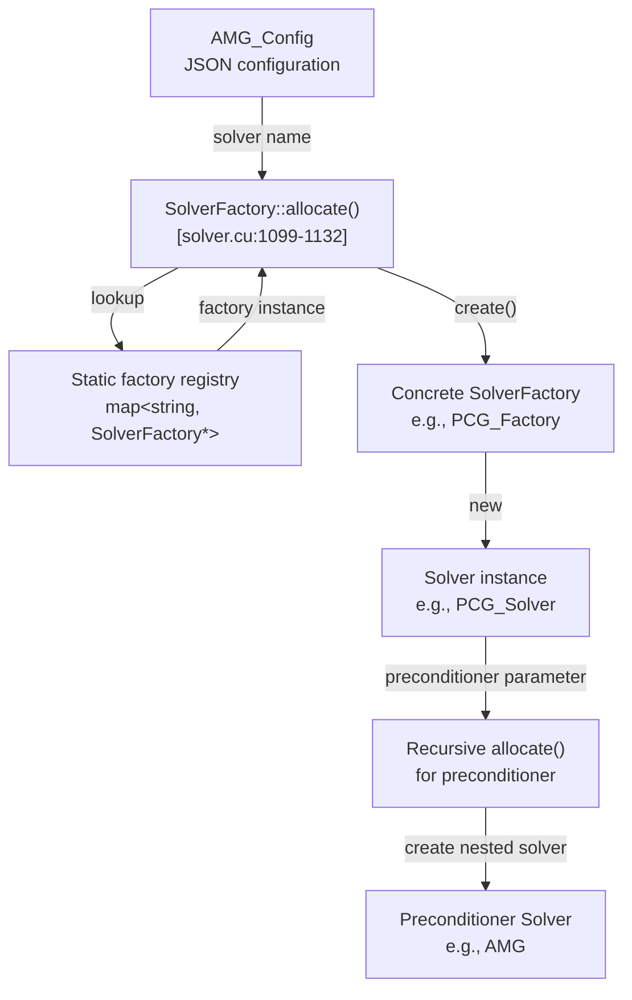
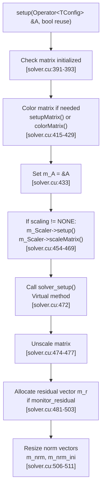
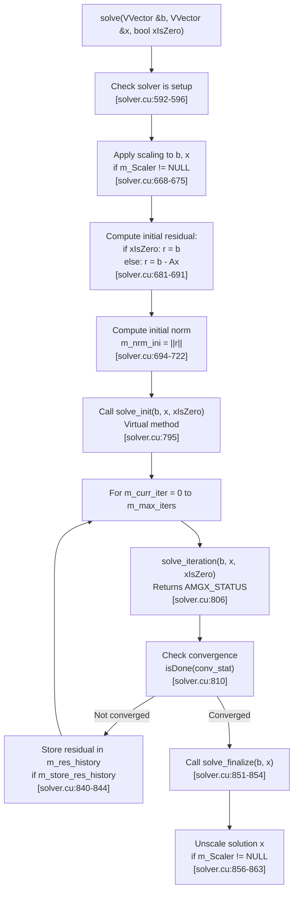
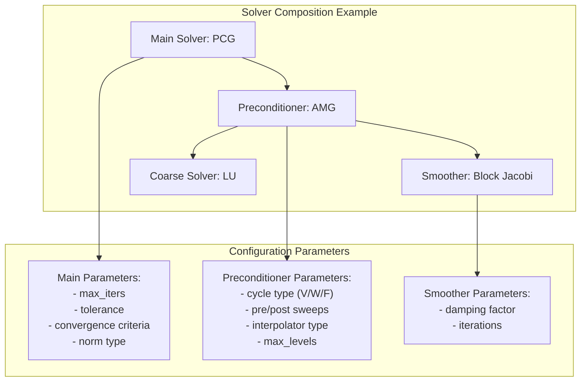
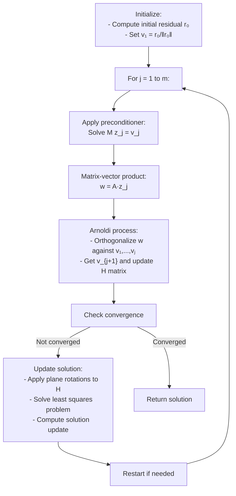
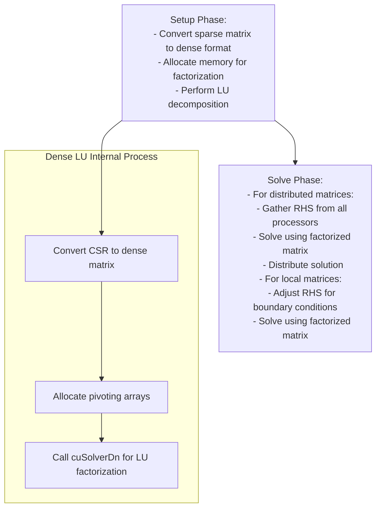
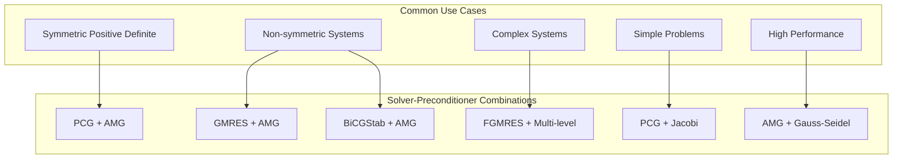

<!-- source: DeepWiki mcp.deepwiki.com · repo NVIDIA/AMGX · page 3 Solvers · fetched 2026-10-26 -->

# Solvers

<details>
<summary>Relevant source files</summary>

The following files were used as context for generating this wiki page:

- [include/aggregation/aggregation_amg_level.h](include/aggregation/aggregation_amg_level.h)
- [include/amg_level.h](include/amg_level.h)
- [include/solvers/solver.h](include/solvers/solver.h)
- [src/aggregation/aggregation_amg_level.cu](src/aggregation/aggregation_amg_level.cu)
- [src/amg.cu](src/amg.cu)
- [src/cycles/fixed_cycle.cu](src/cycles/fixed_cycle.cu)
- [src/solvers/block_jacobi_solver.cu](src/solvers/block_jacobi_solver.cu)
- [src/solvers/solver.cu](src/solvers/solver.cu)
- [src/tests/fgmres_zero_initial_residual.cu](src/tests/fgmres_zero_initial_residual.cu)

</details>


## Overview
The AMGX solver framework provides a collection of high-performance GPU-accelerated linear system solvers designed to efficiently solve large sparse linear systems. This page documents the solver framework architecture, the base `Solver<TConfig>` class, and the available solution methods.

All solvers in AMGX inherit from the `Solver<TConfig>` base class ([include/solvers/solver.h:21-268]()), which defines the common interface for setup, solve iterations, convergence checking, and residual computation. The framework uses a factory pattern for solver instantiation and supports flexible composition where solvers can serve as preconditioners for other solvers.

Sources:
- [include/solvers/solver.h:21-268]()
- [src/solvers/solver.cu:26-109]()

## Solver Framework Architecture

### Solver Base Class

The `Solver<TConfig>` class ([include/solvers/solver.h:21-268]()) provides the abstract interface that all concrete solvers implement. Key components include:

**Core Data Members:**
- `Operator<TConfig> *m_A` - The matrix operator
- `Vector<TConfig> *m_r` - Residual vector
- `Convergence<TConfig> *m_convergence` - Convergence checking object
- `Scaler<TConfig> *m_Scaler` - Optional matrix/vector scaler
- `AMG_Config *m_cfg` - Configuration object
- `PODVector_h m_nrm`, `m_nrm_ini` - Current and initial norm values
- `std::vector<PODVector_h> m_res_history` - Residual history storage

**Key Parameters:**
- `m_max_iters` - Maximum iterations allowed
- `m_norm_type` - Norm type (L1, L2, or Max)
- `m_monitor_residual` - Whether to compute residuals
- `m_monitor_convergence` - Whether to check convergence
- `m_store_res_history` - Whether to store residual history

Sources:
- [include/solvers/solver.h:191-267]()
- [src/solvers/solver.cu:26-109]()

### Solver Class Hierarchy

```mermaid
graph TD
    SolverBase["Solver&lt;TConfig&gt;<br/>Base class<br/>[solver.h:21-268]"]
    
    subgraph "Krylov Solvers"
        PCG["PCG_Solver<br/>Preconditioned<br/>Conjugate Gradient"]
        GMRES["GMRES_Solver<br/>Generalized Minimal<br/>Residual"]
        FGMRES["FGMRES_Solver<br/>Flexible GMRES"]
        BiCGStab["BiCGStab_Solver<br/>BiConjugate Gradient<br/>Stabilized"]
    end
    
    subgraph "Smoothers/Relaxation"
        BlockJacobi["BlockJacobi_Solver<br/>[block_jacobi_solver.cu]"]
        GaussSeidel["GaussSeidel_Solver<br/>Multicolor GS"]
        DILU["DILU_Solver<br/>Incomplete LU"]
    end
    
    subgraph "Direct Methods"
        DenseLU["DenseLUSolver<br/>[dense_lu_solver.cu]"]
    end
    
    subgraph "Multigrid"
        AMG["AMG<br/>Algebraic Multigrid<br/>[amg.cu]"]
    end
    
    SolverBase --> PCG
    SolverBase --> GMRES
    SolverBase --> FGMRES
    SolverBase --> BiCGStab
    SolverBase --> BlockJacobi
    SolverBase --> GaussSeidel
    SolverBase --> DILU
    SolverBase --> DenseLU
    SolverBase --> AMG
    
    subgraph "Supporting Components"
        ConvergenceObj["Convergence&lt;TConfig&gt;<br/>Criteria checking"]
        ScalerObj["Scaler&lt;TConfig&gt;<br/>Matrix/vector scaling"]
        ConfigObj["AMG_Config<br/>Parameter storage"]
    end
    
    SolverBase --> ConvergenceObj
    SolverBase --> ScalerObj
    SolverBase --> ConfigObj
```



Sources:
- [include/solvers/solver.h:21-268]()
- [src/solvers/block_jacobi_solver.cu:1-1295]()

### SolverFactory Pattern

Solvers are instantiated through the `SolverFactory<TConfig>` pattern ([include/solvers/solver.h:270-308]()), which maintains a registry of available solver types. The factory:

1. **Registration**: Each solver type registers itself with `SolverFactory::registerFactory()`
2. **Allocation**: `SolverFactory::allocate()` creates solver instances based on configuration strings
3. **Nested Solvers**: The factory prevents infinite recursion when solvers use themselves as preconditioners with the same scope



Sources:
- [include/solvers/solver.h:270-308]()
- [src/solvers/solver.cu:1037-1132]()

## Solver Lifecycle

### Setup Phase

The `Solver::setup()` method ([src/solvers/solver.cu:332-553]()) initializes the solver for a given matrix:



**Key Steps:**
1. **Matrix Validation**: Check that matrix is initialized ([solver.cu:391-393]())
2. **Matrix Coloring**: Apply coloring if solver requires it ([solver.cu:415-429]())
3. **Scaling**: Optionally scale the matrix for better conditioning ([solver.cu:454-469]())
4. **Solver-Specific Setup**: Call virtual `solver_setup()` method ([solver.cu:472]())
5. **Vector Allocation**: Allocate residual and norm vectors ([solver.cu:481-511]())

Sources:
- [src/solvers/solver.cu:332-553]()

### Solve Phase

The `Solver::solve()` method ([src/solvers/solver.cu:586-970]()) executes the solver iterations:



**Key Steps:**
1. **Validation**: Verify setup was called ([solver.cu:592-596]())
2. **Initial Residual**: Compute `r = b - Ax` or `r = b` if `xIsZero` ([solver.cu:681-691]())
3. **Initial Norm**: Compute and store `m_nrm_ini` ([solver.cu:711-714]())
4. **Initialization**: Call solver-specific `solve_init()` ([solver.cu:795]())
5. **Iteration Loop**: Repeatedly call `solve_iteration()` until convergence ([solver.cu:803-845]())
6. **Finalization**: Call `solve_finalize()` to clean up ([solver.cu:851-854]())

Sources:
- [src/solvers/solver.cu:586-970]()

## Solver Hierarchy and Composition

AMGX uses a sophisticated solver composition system allowing solvers to be nested as preconditioners for other solvers. This enables the creation of powerful solution strategies tailored to specific problem characteristics.



Sources:
- [src/configs/PCG_V.json:3-34]()
- [src/solvers/gmres_solver.cu:25-48]()
- [src/solvers/fgmres_solver.cu:214-250]()

## Krylov Subspace Methods

AMGX implements several Krylov subspace methods, which are iterative techniques for solving large sparse linear systems. These methods are particularly effective when combined with appropriate preconditioners.

### PCG (Preconditioned Conjugate Gradient)

PCG is an efficient Krylov subspace method for symmetric positive definite matrices. In AMGX, it can be configured with various convergence criteria and preconditioners, typically AMG.

### GMRES (Generalized Minimal RESidual)

GMRES is designed for non-symmetric systems and is implemented with restart capabilities to manage memory usage. The implementation includes:

- Modified Gram-Schmidt orthogonalization
- Givens rotations for stability
- Configurable restart parameter
- Support for flexible preconditioning



Sources:
- [src/solvers/gmres_solver.cu:151-210]()
- [src/solvers/gmres_solver.cu:270-392]()

### FGMRES (Flexible GMRES)

FGMRES extends GMRES to allow for varying preconditioners in each iteration. This is particularly useful when using adaptive or approximate preconditioning techniques.

Key features of the FGMRES implementation:

- Dynamic Krylov subspace management
- Memory-adaptive implementation
- Fallback to DQGMRES when memory is limited
- Support for different convergence criteria

Sources:
- [src/solvers/fgmres_solver.cu:17-180]()
- [src/solvers/fgmres_solver.cu:407-568]()

## Direct Solvers

### Dense LU Solver

AMGX includes a direct solver based on LU factorization for dense matrices, which is particularly useful for small to medium-sized problems or as a coarse grid solver in multigrid methods.

The Dense LU solver:
- Uses cuSOLVER for GPU-accelerated factorization
- Handles both single and multi-GPU configurations
- Supports block matrices with various block sizes
- Can be used for both exact and inexact solutions



Sources:
- [src/solvers/dense_lu_solver.cu:453-889]()
- [src/solvers/dense_lu_solver.cu:485-508]()
- [src/solvers/dense_lu_solver.cu:513-568]()

## Residual Computation and Convergence

### Residual Computation

The `Solver` class provides methods for computing residuals ([src/solvers/solver.cu:184-206]()):

**Method**: `compute_residual(const VVector &b, VVector &x)`
- Computes `r = b - Ax` using the stored `m_r` vector
- Uses `m_A->apply(x, *m_r)` for matrix-vector product
- Performs AXPBY operation: `r = 1.0*b - 1.0*(Ax)`

**Method**: `compute_residual(const VVector &b, VVector &x, VVector &r)`
- Same as above but stores result in provided vector `r`

Sources:
- [src/solvers/solver.cu:184-206]()

### Norm Computation

The `Solver::compute_norm()` method ([src/solvers/solver.cu:209-214]()) computes the norm of the residual:

- Uses the `get_norm()` utility function
- Supports scalar norm (single value) or block norm (one value per block row)
- Applies norm factor for L1 normalization if configured
- Supports L1, L2, and Max norms via `m_norm_type`

Sources:
- [src/solvers/solver.cu:209-222]()

### Convergence Checking

The `Solver::converged()` methods ([src/solvers/solver.cu:264-296]()) check convergence using the `Convergence<TConfig>` object:

**Key Method**: `converged(const VVector &b, VVector &x)`
1. Computes residual if `m_monitor_residual` is true
2. Computes norm if `m_monitor_convergence` is true
3. Calls `m_convergence->convergence_update_and_check(m_nrm, m_nrm_ini)`
4. Returns `AMGX_STATUS` (CONVERGED, NOT_CONVERGED, or DIVERGED)

**Convergence Criteria Types:**

| Type | Description | Check |
|------|-------------|-------|
| `ABSOLUTE` | Absolute tolerance | `‖r‖ < tolerance` |
| `RELATIVE_INI` | Relative to initial | `‖r‖/‖r₀‖ < tolerance` |
| `RELATIVE_MAX_CORE` | Relative to max | `‖r‖/max(‖r₀‖, ‖b‖) < tolerance` |
| `COMBINED` | Combined criteria | Both relative and absolute |

Sources:
- [src/solvers/solver.cu:264-296]()
- [include/solvers/solver.h:236-239]()

## Solver Configuration

AMGX solvers are configured through JSON configuration files that specify the solver type, preconditioners, convergence criteria, and other parameters.

### Configuration Parameters

Common parameters read by the `Solver` constructor ([src/solvers/solver.cu:26-109]()):

| Parameter | Type | Description | Default |
|-----------|------|-------------|---------|
| `max_iters` | int | Maximum iterations | Required |
| `tolerance` | double | Convergence tolerance | Via Convergence object |
| `norm` | NormType | Norm type (L1, L2, MAX) | Required |
| `use_scalar_norm` | int | Use single scalar vs block norm | Required |
| `convergence` | string | Convergence criterion type | Required |
| `monitor_residual` | int | Compute residuals each iteration | 0 |
| `store_res_history` | int | Store residual history | 0 |
| `obtain_timings` | int | Measure setup/solve times | 0 |
| `scaling` | string | Matrix scaling type | "NONE" |
| `print_solve_stats` | int | Print iteration statistics | 0 |
| `print_grid_stats` | int | Print grid hierarchy info | 0 |
| `solver_verbose` | int | Verbose parameter output | 0 |

Sources:
- [src/solvers/solver.cu:33-80]()
- [include/solvers/solver.h:221-255]()

### Example Configuration

PCG with AMG preconditioner from [src/configs/PCG_V.json:1-35]():

```json
{
    "config_version": 2, 
    "solver": {
        "solver": "PCG", 
        "preconditioner": {
            "solver": "AMG", 
            "smoother": "BLOCK_JACOBI",
            "presweeps": 1, 
            "postsweeps": 1,
            "max_iters": 1, 
            "cycle": "V"
        }, 
        "max_iters": 100, 
        "tolerance": 1e-06, 
        "convergence": "RELATIVE_INI", 
        "norm": "L2"
    }
}
```

Sources:
- [src/solvers/solver.cu:26-109]()

## Matrix Scaling

The `Solver` class supports optional matrix and vector scaling to improve conditioning ([src/solvers/solver.cu:454-477]()):

**Scaling Workflow:**
1. During `setup()`: Scale the matrix using `m_Scaler->scaleMatrix(A, SCALE)`
2. Perform solver setup on the scaled matrix
3. Unscale the matrix before returning from `setup()`
4. During `solve()`: Scale matrix and RHS, unscale initial guess
5. After solving: Scale solution, unscale RHS and matrix

**Note**: Current scaling implementation is conservative to ensure correct convergence checks. Custom kernels could optimize this by scaling/unscaling on-the-fly.

Sources:
- [src/solvers/solver.cu:435-477]()
- [src/solvers/solver.cu:668-675]()
- [src/solvers/solver.cu:856-863]()

## Solver Timing and Profiling

When `obtain_timings=1`, the `Solver` class records detailed timing information using CUDA events ([src/solvers/solver.cu:88-109]()):

**Timing Events:**
- `m_setup_start`, `m_setup_stop` - Setup phase timing
- `m_solve_start`, `m_solve_stop` - Overall solve timing
- `m_iter_start`, `m_iter_stop` - Per-iteration timing

**Timing Output** ([src/solvers/solver.cu:1023-1031]()):
- Total time (setup + solve)
- Setup time in seconds
- Solve time in seconds  
- Average time per iteration

Sources:
- [src/solvers/solver.cu:88-109]()
- [src/solvers/solver.cu:1023-1031]()

## Solver-Preconditioner Relationships

One of AMGX's key strengths is the flexible composition of solvers and preconditioners. The following diagram shows common solver-preconditioner combinations:



Sources:
- [src/configs/PCG_V.json:3-34]()
- [src/solvers/gmres_solver.cu:25-48]()
- [src/solvers/fgmres_solver.cu:214-250]()

## Summary

The AMGX solver framework provides a comprehensive suite of iterative and direct solvers for large sparse linear systems, with a focus on GPU acceleration. The modular design allows for flexible composition of solvers and preconditioners to address a wide range of problem types and sizes.

Key features include:
- Krylov subspace methods (PCG, GMRES, FGMRES)
- Direct solvers (Dense LU)
- Multiple convergence criteria options
- Flexible preconditioner integration
- JSON-based configuration system

For specific solver implementations, see the subpages:
- [Algebraic Multigrid (AMG)](#3.1)
- [Krylov Solvers](#3.2)
- [Other Solvers](#3.3)

---

