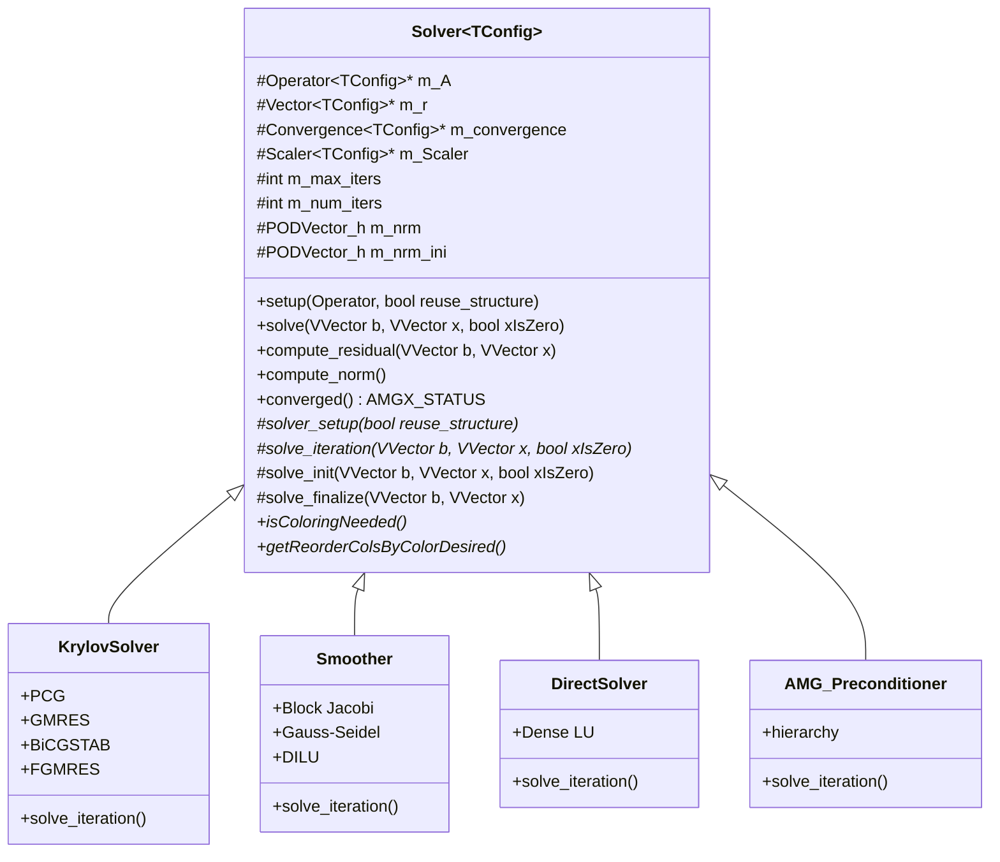
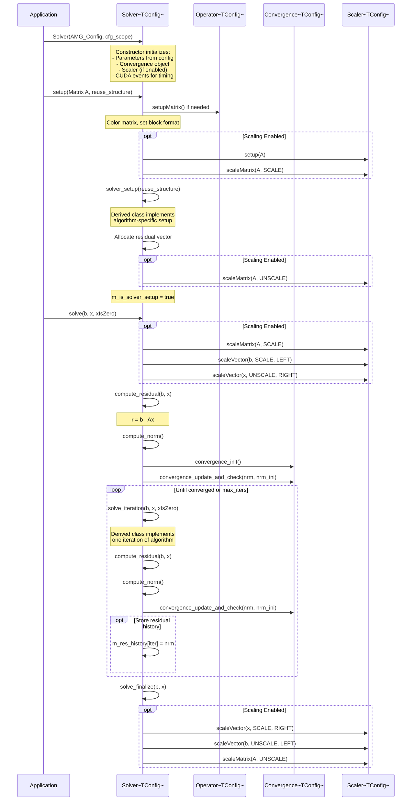
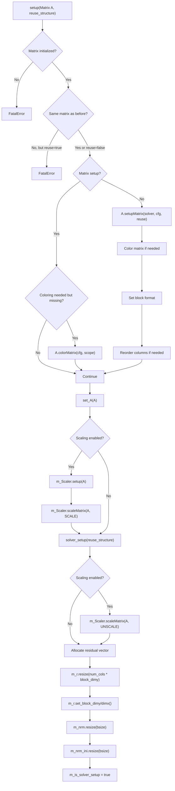
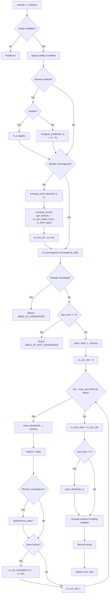
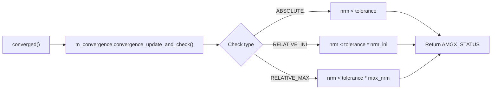
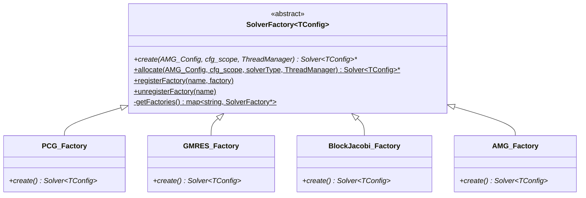
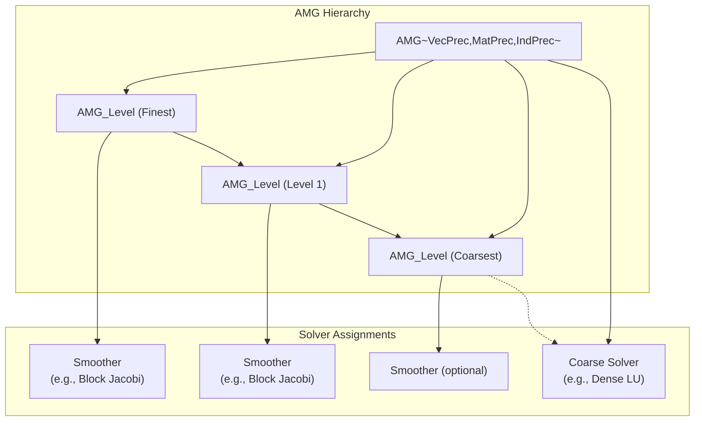
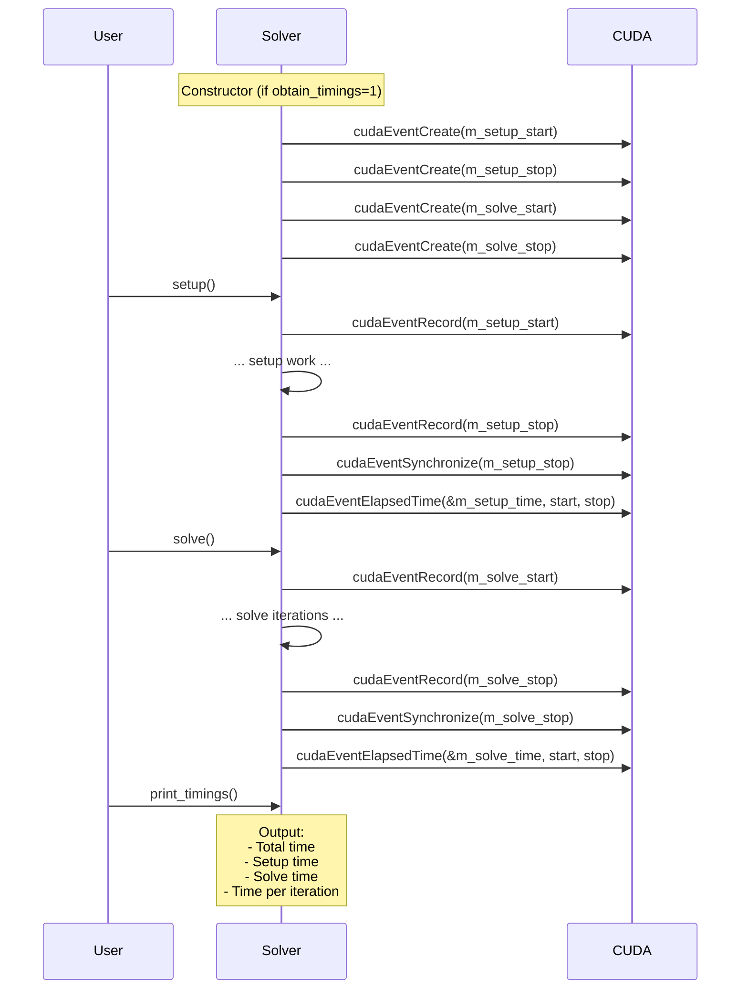
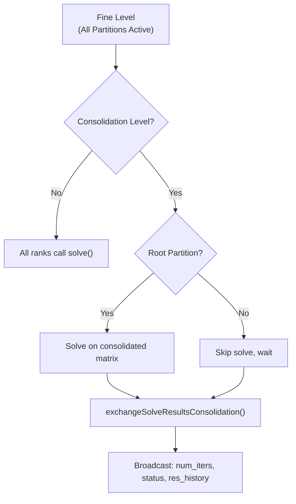
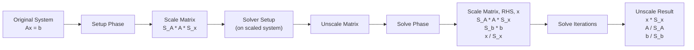

<!-- source: DeepWiki mcp.deepwiki.com · repo NVIDIA/AMGX · page 3.1 Solver Framework · fetched 2026-10-26 -->

# Solver Framework

<details>
<summary>Relevant source files</summary>

The following files were used as context for generating this wiki page:

- [include/aggregation/aggregation_amg_level.h](include/aggregation/aggregation_amg_level.h)
- [include/amg_level.h](include/amg_level.h)
- [include/solvers/solver.h](include/solvers/solver.h)
- [src/aggregation/aggregation_amg_level.cu](src/aggregation/aggregation_amg_level.cu)
- [src/amg.cu](src/amg.cu)
- [src/cycles/fixed_cycle.cu](src/cycles/fixed_cycle.cu)
- [src/solvers/block_jacobi_solver.cu](src/solvers/block_jacobi_solver.cu)
- [src/solvers/solver.cu](src/solvers/solver.cu)
- [src/tests/fgmres_zero_initial_residual.cu](src/tests/fgmres_zero_initial_residual.cu)

</details>


## Purpose and Scope

The Solver Framework provides the foundational infrastructure for all iterative solution methods in AMGX. It defines the `Solver<TConfig>` base class that implements common functionality for setup, solving, convergence checking, residual computation, and performance monitoring. Specific solution methods (Krylov solvers, smoothers, direct solvers) inherit from this base class and implement algorithm-specific behavior.

For information about specific solver implementations, see:
- Krylov methods: [3.3](#3.3)
- AMG as a solver/preconditioner: [3.2](#3.2)
- Smoothers: [3.4](#3.4)
- Direct solvers: [3.5](#3.5)

For information about the API layer that wraps solvers, see [4.1](#4.1).

---

## Base Class Architecture

### Solver Template Hierarchy



The `Solver<TConfig>` base class is defined in [include/solvers/solver.h:21-268]() and implemented in [src/solvers/solver.cu:26-1158](). It uses the template parameter `TConfig` to encode memory space (host/device), vector precision, matrix precision, and index precision.

**Sources:** [include/solvers/solver.h:21-268](), [src/solvers/solver.cu:26-109]()

---

## Solver Lifecycle

### Three-Phase Execution Model



**Sources:** [src/solvers/solver.cu:333-553]() (setup), [src/solvers/solver.cu:586-970]() (solve)

---

## Setup Phase Details

### Matrix Preparation and Solver Configuration

The setup phase prepares the matrix and configures the solver:



**Key Setup Operations:**

1. **Matrix Validation** [src/solvers/solver.cu:385-412]()
   - Check if matrix is initialized
   - Verify reuse_structure compatibility
   - Handle distributed (glued) matrices

2. **Matrix Configuration** [src/solvers/solver.cu:414-429]()
   - Coloring: Required by some solvers (e.g., Gauss-Seidel)
   - Block format: Set appropriate block dimensions
   - Column reordering: Optimize memory access patterns

3. **Scaling** [src/solvers/solver.cu:450-477]()
   - Optional equation scaling (NONE, BINORMALIZATION, DIAGONAL_SYMMETRIC)
   - Applied before solver_setup, then removed
   - Re-applied during solve phase

4. **Solver-Specific Setup** [src/solvers/solver.cu:472]()
   - Pure virtual method `solver_setup(bool reuse_matrix_structure)`
   - Implemented by derived classes
   - Sets up algorithm-specific data structures

5. **Residual Allocation** [src/solvers/solver.cu:481-503]()
   - Allocate `m_r` if monitoring residual or if `is_residual_needed()`
   - Size: `num_cols * block_dimy`
   - Set block dimensions and communication tag

**Sources:** [src/solvers/solver.cu:333-553]()

---

## Solve Phase Details

### Iteration Loop and Convergence



**Key Solve Operations:**

1. **Initial Residual** [src/solvers/solver.cu:681-692]()
   - If `xIsZero=true`, residual is just `b`
   - Otherwise, compute `r = b - Ax`

2. **Initial Norm** [src/solvers/solver.cu:694-715]()
   - Compute norm based on `m_norm_type` (L1, L2, L_INF)
   - Handle scalar vs. block norms (`m_use_scalar_norm`)
   - Store as `m_nrm_ini` for relative convergence

3. **Iteration Loop** [src/solvers/solver.cu:803-845]()
   - Call `solve_iteration()` (pure virtual, implemented by derived class)
   - Update residual and norm after each iteration
   - Check convergence
   - Store residual history if requested
   - Print statistics based on verbosity level

4. **Finalization** [src/solvers/solver.cu:851-854]()
   - Call `solve_finalize()` if any iterations were performed
   - Hook for cleanup or post-processing

**Sources:** [src/solvers/solver.cu:586-970]()

---

## Residual and Convergence Management

### Residual Computation

The solver maintains a residual vector `m_r` and computes it using:

```cpp
// src/solvers/solver.cu:184-206
void compute_residual(const VVector &b, VVector &x)
{
    // r = b - Ax
    m_A->apply(x, *m_r);           // m_r = Ax
    axpby(b, *m_r, *m_r, 1.0, -1.0, offset, size);  // m_r = b - m_r
}
```

**Norm Calculation** [src/solvers/solver.cu:209-222]():
- Delegates to `get_norm()` utility function
- Supports L1, L2, L_INF norms
- Can compute scalar norm or per-block-row norm
- Uses `m_norm_factor` for scaled norms (e.g., L1 scaled by matrix diagonal)

**Convergence Check** [src/solvers/solver.cu:285-296]():



The `Convergence<TConfig>` object (allocated in constructor) implements different convergence criteria. See [Convergence Framework](#TODO) for details.

**Sources:** [src/solvers/solver.cu:184-296]()

---

## Configuration and Parameters

### Key Configuration Parameters

| Parameter | Type | Default | Description |
|-----------|------|---------|-------------|
| `max_iters` | int | - | Maximum number of iterations |
| `tolerance` | double | - | Convergence tolerance |
| `norm` | NormType | L2 | Norm type: L1, L2, or L_INF |
| `use_scalar_norm` | int | 0 | Compute scalar norm instead of block norm |
| `convergence` | string | - | Convergence criterion type |
| `monitor_residual` | int | 1 | Compute residual every iteration |
| `store_res_history` | int | 0 | Store residual history array |
| `obtain_timings` | int | 0 | Measure setup and solve times |
| `print_solve_stats` | int | 0 | Print iteration statistics |
| `print_grid_stats` | int | 0 | Print grid hierarchy information |
| `solver_verbose` | int | 0 | Print detailed solver parameters |
| `scaling` | string | NONE | Matrix scaling type |

**Configuration Loading** [src/solvers/solver.cu:27-62]():
```cpp
Solver(AMG_Config &cfg, const std::string &cfg_scope, ThreadManager *tmng) {
    m_verbosity_level = cfg.getParameter<int>("verbosity_level", cfg_scope);
    m_monitor_residual = cfg.getParameter<int>("monitor_residual", cfg_scope);
    m_store_res_history = cfg.getParameter<int>("store_res_history", cfg_scope);
    m_max_iters = cfg.getParameter<int>("max_iters", cfg_scope);
    m_norm_type = cfg.getParameter<NormType>("norm", cfg_scope);
    m_convergence = ConvergenceFactory<TConfig>::allocate(cfg, cfg_scope);
    // ...
}
```

**Parameter Validation** [src/solvers/solver.cu:64-73]():
- Cannot print stats without monitoring residual
- Cannot store history without monitoring residual
- Backward compatibility for scope="default"

**Sources:** [src/solvers/solver.cu:27-109](), [include/solvers/solver.h:191-268]()

---

## Factory Pattern and Registration

### SolverFactory Design



**Factory Registration** [src/solvers/solver.cu:1045-1059]():
```cpp
void SolverFactory<TConfig>::registerFactory(std::string name, SolverFactory<TConfig> *f) {
    std::map<std::string, SolverFactory<TConfig>*> &factories = getFactories();
    if (factories.find(name) != factories.end()) {
        FatalError("SolverFactory '" + name + "' has already been registered");
    }
    factories[name] = f;
}
```

**Factory Allocation** [src/solvers/solver.cu:1099-1158]():
1. Extract solver name from configuration
2. Look up factory in registry
3. Validate solver type (prevent infinite nesting with default scope)
4. Create solver instance
5. Set solver name

**Nested Solver Configuration:**
```json
{
    "solver": "PCG",
    "preconditioner": "AMG",
    "amg_solver": {
        "smoother": "BLOCK_JACOBI",
        "coarse_solver": "DENSE_LU_SOLVER"
    }
}
```

The factory system supports arbitrary nesting through scoped configurations. When `allocate()` is called with `solverType="preconditioner"`, it reads the config parameter and recursively creates nested solvers.

**Sources:** [src/solvers/solver.cu:1037-1158](), [include/solvers/solver.h:270-308]()

---

## Integration with AMG Hierarchy

### Solvers in AMG Context



**Smoother Usage** [src/cycles/fixed_cycle.cu:63-109]():
- Called during pre-smoothing phase
- Called during post-smoothing phase
- Number of sweeps controlled by AMG configuration
- Can be skipped on coarsest level if coarse solver exists

```cpp
// Pre-smoothing
smoother->setTolerance(0.0);
smoother->set_max_iters(n_presweeps);
smoother->solve(b, x, xIsZero);
```

**Coarse Solver Usage** [src/amg.cu:65-73]():
- Optional, configured via `coarse_solver` parameter
- Applied on coarsest level only
- If absent, smoother performs additional sweeps

**Solver as Preconditioner:**
- AMG itself is a `Solver<TConfig>` that can be nested
- Used as preconditioner for Krylov methods
- Multiple levels of nesting supported through factory system

**Sources:** [src/cycles/fixed_cycle.cu:25-248](), [src/amg.cu:38-86](), [include/amg_level.h:195-196]()

---

## Timing and Profiling

### Performance Measurement



**CUDA Event Usage** [src/solvers/solver.cu:93-109]():
- Events created during construction if `obtain_timings=1`
- Destroyed in destructor [src/solvers/solver.cu:130-141]()
- Provides accurate GPU timing

**Timing Measurement Points:**
1. **Setup Time** [src/solvers/solver.cu:381-382](), [src/solvers/solver.cu:516-521]()
2. **Solve Time** [src/solvers/solver.cu:663-664](), [src/solvers/solver.cu:868-873]()
3. **Per-Iteration Time** (computed in `print_timings()`)

**Memory Usage Tracking** [src/solvers/solver.cu:754](), [src/solvers/solver.cu:817](), [src/solvers/solver.cu:929]():
- Uses `MemoryInfo::getMaxMemoryUsage()` 
- Reported in GB alongside iteration statistics

**Sources:** [src/solvers/solver.cu:88-109](), [src/solvers/solver.cu:1023-1031]()

---

## Distributed Computing Support

### MPI Integration

The solver framework supports distributed matrices and vectors through integration with the distributed management system:

**Setup Phase:**
- Checks if matrix is distributed [src/solvers/solver.cu:399-411]()
- Handles "glued" matrices (consolidated partitions) specially
- Skips setup for empty partitions in consolidated cases

**Solve Phase:**
- Vector gluing for consolidated levels [src/solvers/solver.cu:604-637]()
- Exchanges solve results across partitions [src/solvers/solver.cu:299-302]()
- Synchronization barriers when profiling [src/solvers/solver.cu:365-379](), [src/solvers/solver.cu:647-661]()

**Consolidation Support:**


**Residual Exchange** [src/solvers/solver.cu:299-302]():
```cpp
void exchangeSolveResultsConsolidation(AMGX_STATUS &status) {
    this->get_A().getManager()->exchangeSolveResultsConsolidation(
        m_num_iters, m_res_history, status, m_store_res_history == 1);
}
```

**Sources:** [src/solvers/solver.cu:299-302](), [src/solvers/solver.cu:604-637](), [src/solvers/solver.cu:973-1002]()

---

## Virtual Methods for Derived Classes

### Required Implementations

Derived solver classes must implement these pure virtual methods:

| Method | Purpose | Example |
|--------|---------|---------|
| `solver_setup(bool reuse_structure)` | Algorithm-specific setup | Allocate work vectors, compute ILU |
| `solve_iteration(VVector &b, VVector &x, bool xIsZero)` | One iteration of the algorithm | CG step, Jacobi sweep |
| `isColoringNeeded()` | Does algorithm need colored matrix? | Returns true for Gauss-Seidel |
| `getReorderColsByColorDesired()` | Should columns be reordered by color? | Returns true for some smoothers |
| `getInsertDiagonalDesired()` | Should zero diagonals be inserted? | Returns true if algorithm needs diagonal |

**Optional Hooks:**

| Method | Purpose | Default |
|--------|---------|---------|
| `solve_init(VVector &b, VVector &x, bool xIsZero)` | Initialize before iterations | No-op |
| `solve_finalize(VVector &b, VVector &x)` | Cleanup after iterations | No-op |
| `is_residual_needed()` | Allocate residual vector? | Returns true |
| `getColoringScope(string &scope)` | Which config scope for coloring? | "default" |
| `printSolverParameters()` | Print algorithm-specific params | No-op |
| `print_grid_stats()` | Print hierarchy info | No-op |
| `print_vis_data()` | Print visualization data | No-op |

**Example: Block Jacobi** [src/solvers/block_jacobi_solver.cu]():
- `solver_setup()`: Compute diagonal block inverses
- `solve_iteration()`: Apply `x = x + ω D^(-1) (b - Ax)`
- `isColoringNeeded()`: Returns false (Jacobi is inherently parallel)
- `is_residual_needed()`: Returns true (needs to compute `b - Ax`)

**Sources:** [include/solvers/solver.h:133-169](), [src/solvers/block_jacobi_solver.cu:1-1294]()

---

## Scaling Support

### Matrix and Vector Scaling

AMGX supports equation scaling to improve numerical conditioning:



**Scaling Types:**
- `NONE`: No scaling (default)
- `BINORMALIZATION`: Scale rows and columns to unit norm
- `DIAGONAL_SYMMETRIC`: Scale by square root of diagonal

**Implementation Details** [src/solvers/solver.cu:434-477]():
1. Scaler object created in constructor if scaling enabled
2. Matrix scaled before `solver_setup()` to ensure solver sees scaled system
3. Matrix unscaled after setup
4. Re-scaled during solve, then unscaled after iterations

**Rationale for Complexity** [src/solvers/solver.cu:435-449]():
> Current implementation is slow but produces correct convergence checks.
> Residual norm calculations are not aware of scaling, so scaling/unscaling
> is performed around solve to ensure norms are computed correctly.

**Sources:** [src/solvers/solver.cu:39-48](), [src/solvers/solver.cu:434-477](), [src/solvers/solver.cu:667-675](), [src/solvers/solver.cu:856-863]()

---

## Error Handling

### Exception Safety and Error Propagation

The solver provides exception-safe wrappers for API calls:

**setup_no_throw** [src/solvers/solver.cu:555-582]():
```cpp
AMGX_ERROR setup_no_throw(Operator<TConfig> &A, bool reuse_matrix_structure) {
    AMGX_ERROR rc = AMGX_OK;
    AMGX_TRIES() {
        // Check for consolidated non-root partition
        if (A.getManager() != NULL && 
            A.getManager()->isFineLevelConsolidated() && 
            !A.getManager()->isFineLevelRootPartition()) {
            this->set_A(A);  // Skip actual setup
        } else {
            this->setup(A, reuse_matrix_structure);
        }
    }
    AMGX_CATCHES(rc)
    return rc;
}
```

**solve_no_throw** [src/solvers/solver.cu:973-1002]():
```cpp
AMGX_ERROR solve_no_throw(VVector &b, VVector &x, AMGX_STATUS &status, bool xIsZero) {
    AMGX_ERROR rc = AMGX_OK;
    AMGX_TRIES() {
        // Check for consolidated non-root partition
        if (!(this->get_A().getManager() != NULL && 
              this->get_A().getManager()->isFineLevelConsolidated() && 
              !this->get_A().getManager()->isFineLevelRootPartition())) {
            status = this->solve(b, x, xIsZero);
        }
        // Exchange results if consolidation was used
        if (this->get_A().getManager() != NULL && 
            this->get_A().getManager()->isFineLevelConsolidated()) {
            this->exchangeSolveResultsConsolidation(status);
        }
    }
    AMGX_CATCHES(rc)
    return rc;
}
```

**Common Error Checks:**
- Matrix not initialized [src/solvers/solver.cu:391-393]()
- Setup not called before solve [src/solvers/solver.cu:592-596]()
- Block size mismatch [src/solvers/solver.cu:598-601]()
- Invalid residual access [src/solvers/solver.cu:309-318]()

**Sources:** [src/solvers/solver.cu:555-582](), [src/solvers/solver.cu:973-1002]()

---

