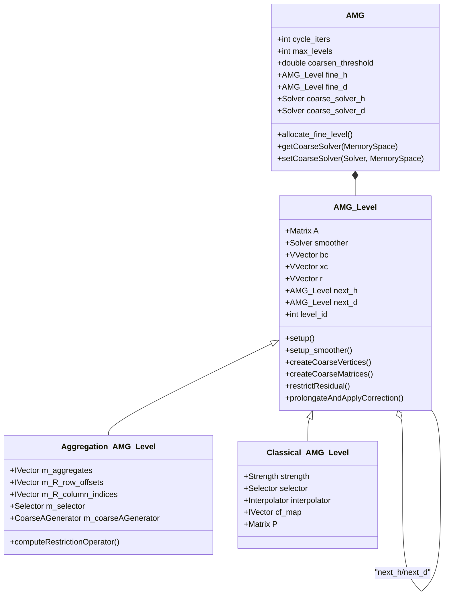
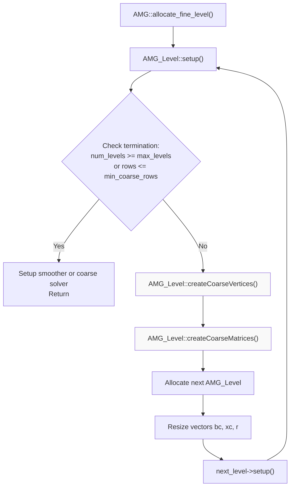
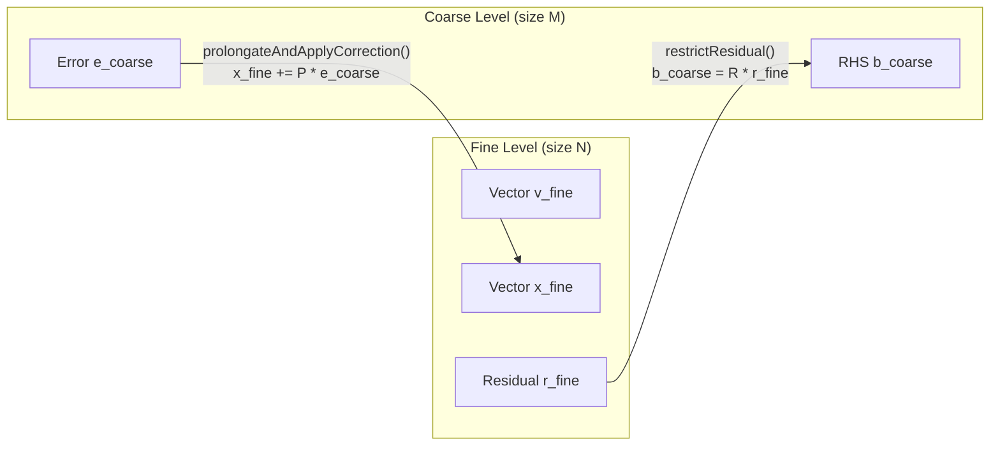
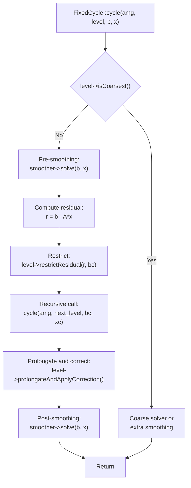

<!-- source: DeepWiki mcp.deepwiki.com · repo NVIDIA/AMGX · page 3.2 Algebraic Multigrid (AMG) · fetched 2026-10-26 -->

# Algebraic Multigrid (AMG)

<details>
<summary>Relevant source files</summary>

The following files were used as context for generating this wiki page:

- [include/aggregation/aggregation_amg_level.h](include/aggregation/aggregation_amg_level.h)
- [include/amg_level.h](include/amg_level.h)
- [include/solvers/solver.h](include/solvers/solver.h)
- [src/aggregation/aggregation_amg_level.cu](src/aggregation/aggregation_amg_level.cu)
- [src/amg.cu](src/amg.cu)
- [src/cycles/fixed_cycle.cu](src/cycles/fixed_cycle.cu)
- [src/solvers/block_jacobi_solver.cu](src/solvers/block_jacobi_solver.cu)
- [src/solvers/solver.cu](src/solvers/solver.cu)
- [src/tests/fgmres_zero_initial_residual.cu](src/tests/fgmres_zero_initial_residual.cu)

</details>


## Overview

Algebraic Multigrid (AMG) in AMGX is a multilevel preconditioning technique that constructs a hierarchy of progressively coarser problem representations to accelerate convergence of iterative solvers. The implementation consists of two phases: a **setup phase** that builds the hierarchy from matrix structure and values, and a **solve phase** that applies multigrid cycles using smoothers and coarse grid corrections.

AMG is accessible through the `AMG<vecPrec, matPrec, indPrec>` class template ([src/amg.cu:38-86]()) which manages the hierarchy and orchestrates setup and solve operations. The hierarchy consists of `AMG_Level<TConfig>` instances ([include/amg_level.h:51-215]()) representing each grid level, with specialized implementations for Classical and Aggregation approaches.

This page covers:
- AMG hierarchy construction methodology
- Classical vs Aggregation AMG approaches
- Cycle types (V-cycle, W-cycle, F-cycle)
- Restriction and prolongation operators
- Integration with the solver framework

For specific cycle implementations, see section 3.2.1. For smoothers used at each level, see section 3.4.

## AMG Class Hierarchy

**Diagram: AMG Class Structure**



The `AMG` class manages the entire hierarchy, storing pointers to the finest level and coarse solver. Each `AMG_Level` contains a matrix `A`, smoother, temporary vectors (`bc`, `xc`, `r`), and pointers to the next level in either host or device memory space.

Sources: [src/amg.cu:38-86](), [include/amg_level.h:51-215](), [include/aggregation/aggregation_amg_level.h:34-163]()

## Setup Phase

The setup phase constructs the multigrid hierarchy by recursively coarsening the problem until termination criteria are met. This occurs in `AMG_Setup::setup()` ([src/amg.cu:147-421]()).

**Diagram: AMG Setup Process**



The setup loop ([src/amg.cu:201-418]()) performs:

1. **Coarse vertex selection**: Creates mapping from fine to coarse points via `createCoarseVertices()`
2. **Coarse operator construction**: Forms coarse matrix via `createCoarseMatrices()`
3. **Vector allocation**: Sizes temporary vectors for restriction/prolongation
4. **Recursive setup**: Calls `setup()` on next level until termination

Termination occurs when `num_levels >= max_levels` or the coarse grid size reaches `min_coarse_rows` ([src/amg.cu:207-226]()).

Sources: [src/amg.cu:147-421](), [include/amg_level.h:97-98]()

## AMG Methodologies

AMGX provides two AMG variants that differ in their coarsening strategy:

### Aggregation AMG

`Aggregation_AMG_Level` ([include/aggregation/aggregation_amg_level.h:34-163]()) groups fine points into aggregates, where each aggregate becomes a single coarse point. The implementation:

**Coarse Vertex Creation** ([src/aggregation/aggregation_amg_level.cu:238-299]()):
1. `m_selector->setAggregates()` assigns each fine point to an aggregate
2. Aggregates stored in `m_aggregates` vector mapping fine index → aggregate index
3. Aggregate count becomes coarse level dimension

**Restriction Operator** ([src/aggregation/aggregation_amg_level.cu:238-299]()):
- Constructs CSR matrix `R` with `m_R_row_offsets` and `m_R_column_indices`
- Each row corresponds to one aggregate
- Non-zero columns indicate fine points in that aggregate
- Typically, `R[i,j] = 1` if point `j` belongs to aggregate `i`

**Prolongation** ([src/aggregation/aggregation_amg_level.cu:156-181]()):
- Uses `m_aggregates` for direct lookup: `x_fine[i] += correction[m_aggregates[i]]`
- Kernel: `prolongateAndApplyCorrectionKernel` for 1×1 blocks
- Kernel: `prolongateAndApplyCorrectionBlockDiaCsrKernel` for N×N blocks

**Coarse Matrix Formation**:
- Galerkin operator: `A_coarse = R * A * P` where `P = R^T`
- Computed in `createCoarseMatrices()` using sparse matrix multiplication

### Classical AMG

`Classical_AMG_Level` uses C/F splitting where coarse (C) points are selected to adequately interpolate fine (F) points based on connection strength.

**Key Components**:
- `Strength` object: Measures variable coupling strength
- `Selector` object: Performs C/F splitting (PMIS, HMIS, etc.)
- `Interpolator` object: Constructs interpolation matrix `P`
- `cf_map`: Integer vector marking each point as C or F

The classical approach typically produces denser interpolation operators but can handle more general problems.

Sources: [include/aggregation/aggregation_amg_level.h:34-163](), [src/aggregation/aggregation_amg_level.cu:156-299]()

## Restriction and Prolongation Operations

Transfer operators move information between grid levels during the solve phase.

**Diagram: Transfer Operator Operations**



### Restriction

`AMG_Level::restrictResidual(r, rr)` ([include/amg_level.h:83]()) transfers the fine-grid residual to the coarse grid. In aggregation AMG:

**1×1 Block Format** ([src/aggregation/aggregation_amg_level.cu:91-111]()):
```
rr[i] = sum over j in aggregate i of r[j]
```
Implemented in `restrictResidualKernel` which sums contributions using CSR format with `m_R_row_offsets` and `m_R_column_indices`.

**N×N Block Format** ([src/aggregation/aggregation_amg_level.cu:114-153]()):
Similar summation performed blockwise in `restrictResidualBlockDiaCsrKernel` with block dimensions 2, 3, 4, 5, 8, or 10.

### Prolongation and Correction

`AMG_Level::prolongateAndApplyCorrection(e, bc, x, tmp)` ([include/amg_level.h:84]()) interpolates the coarse-grid correction to the fine grid and applies it:

**Basic Operation** ([src/aggregation/aggregation_amg_level.cu:156-165]()):
```
x[i] += alpha * e[aggregates[i]]
```
where `alpha` is a scaling factor (typically 1.0 or computed via error scaling).

**Error Scaling** ([src/aggregation/aggregation_amg_level.cu:702-824]()):
When `error_scaling >= 2`, the implementation computes an optimal scaling factor by:
1. Prolongating the coarse correction: `e_fine = P * e_coarse`
2. Smoothing `e_fine` with the current smoother
3. Computing `alpha = <r, A*e_fine> / <A*e_fine, A*e_fine>` (or similar)
4. Applying: `x += alpha * e_fine`

This adaptive scaling improves robustness, especially for difficult problems.

Sources: [src/aggregation/aggregation_amg_level.cu:91-840](), [include/amg_level.h:83-84]()

## Multigrid Cycles

The `FixedCycle<TConfig, CycleDispatcher>` class ([src/cycles/fixed_cycle.cu:24-248]()) orchestrates the multigrid cycle by recursively calling itself on finer and coarser levels.

**Diagram: Cycle Execution Flow**



### Cycle Types

The `CycleDispatcher` template parameter determines the recursion pattern:

| Cycle Type | Dispatcher Class | Recursion Strategy |
|------------|------------------|-------------------|
| V-Cycle | `V_CycleDispatcher` | Single recursive call at each level |
| W-Cycle | `W_CycleDispatcher` | Two recursive calls at each level |
| F-Cycle | `F_CycleDispatcher` | One V-cycle, then one recursive call |
| CG-Cycle | `CG_CycleDispatcher` | Conjugate gradient acceleration |
| CG-Flex | `CG_Flex_CycleDispatcher` | Flexible CG with variable preconditioning |

**V-Cycle**: Most efficient, visits each level once during descent and once during ascent.

**W-Cycle**: More robust, applies two cycles at intermediate levels. Approximately twice the cost of V-cycle but can converge faster for difficult problems.

**F-Cycle**: Compromise between V and W, applying V-cycles with increasing depth as the cycle progresses.

The cycle type is selected at compile time through template instantiation ([src/cycles/fixed_cycle.cu:254-277]()).

### Smoothing

Pre-smoothing ([src/cycles/fixed_cycle.cu:71-109]()) and post-smoothing ([src/cycles/fixed_cycle.cu:192-224]()) apply the smoother (`Solver<TConfig>`) for a configured number of iterations:

- `presweeps = amg->getNumPresweeps()`
- `postsweeps = amg->getNumPostsweeps()`
- Coarsest level uses `coarsest_sweeps` iterations

The smoother is set up via `level->setup_smoother()` during the setup phase.

Sources: [src/cycles/fixed_cycle.cu:24-248](), [include/amg_level.h:98]()

## Integration with Solver Framework

While AMG can be used as a standalone solver, it is commonly used as a preconditioner for Krylov methods. The `AMG` class does not inherit from `Solver<TConfig>` but provides a compatible interface for setup and solve operations.

**AMG as Preconditioner**:
When configured as a preconditioner (e.g., for PCG or GMRES), the outer Krylov solver calls AMG's solve method to apply the preconditioner. Each call to AMG's solve performs `cycle_iters` multigrid cycles ([src/amg.cu:43]()).

**Coarse Grid Solver**:
The coarsest level can use either:
1. A direct solver (e.g., Dense LU) via `coarse_solver_d` or `coarse_solver_h` ([src/amg.cu:66-73]())
2. Smoother-only approach by setting `coarse_solver = NOSOLVER` ([src/amg.cu:64-68]())

The coarse solver is invoked in `AMG_Level::launchCoarseSolver()` ([include/amg_level.h:131]()) when the recursion reaches the coarsest level ([src/cycles/fixed_cycle.cu:112-116]()).

Sources: [src/amg.cu:38-86](), [src/cycles/fixed_cycle.cu:112-116](), [include/amg_level.h:131]()

## Implementation Details

### Restriction and Prolongation

Restriction transfers residuals from fine to coarse levels, while prolongation transfers correction terms from coarse to fine levels:

| Operation | Classical AMG | Aggregation AMG |
|-----------|---------------|-----------------|
| Restriction | Uses transpose of interpolation | Direct mapping based on aggregates |
| Prolongation | Applies interpolation matrix | Direct mapping based on aggregates |

Sources: [src/aggregation/aggregation_amg_level.cu:374-511](src/aggregation/aggregation_amg_level.cu:374-511)

### GPU Optimization

The AMG implementation in AMGX is highly optimized for GPU execution:

1. **GPU-Accelerated Matrix Operations**: Specialized kernels for sparse matrix operations
2. **Asynchronous Execution**: Overlapping computation and communication
3. **Memory Management**: Careful allocation and reuse of GPU memory
4. **Thread Management**: Efficient thread utilization for parallel operations

### Smoothing Operations

Smoothers are critical components applied at each level to reduce error:

1. **Block Jacobi**: Simple but effective parallel smoother
2. **Gauss-Seidel**: More effective but less parallelizable
3. **Chebyshev**: Polynomial smoother with good parallel properties

Sources: [src/solvers/block_jacobi_solver.cu:23-414](src/solvers/block_jacobi_solver.cu:23-414)

## AMG Configuration

The AMG implementation is highly configurable through parameters:

| Parameter | Description | Default |
|-----------|-------------|---------|
| `cycle_iters` | Number of cycle iterations | 1 |
| `max_levels` | Maximum number of levels in hierarchy | 20 |
| `presweeps` | Number of pre-smoothing iterations | 1 |
| `postsweeps` | Number of post-smoothing iterations | 1 |
| `strength_threshold` | Threshold for strong connections | 0.25 |
| `interpolation_type` | Type of interpolation to use | `D2` |
| `selector_type` | Coarse/fine point selection algorithm | `PMIS` |

Sources: [src/amg.cu:43-54](src/amg.cu:43-54)

---

