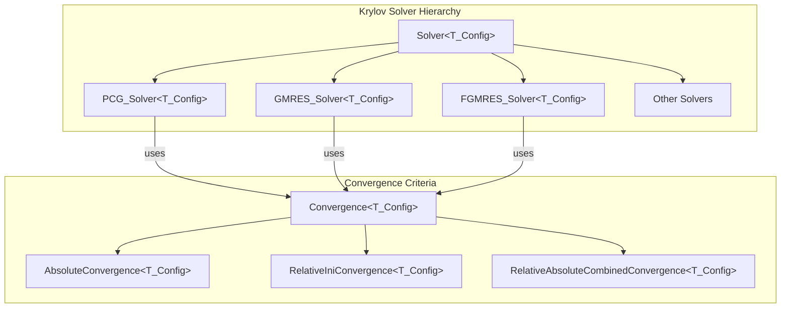
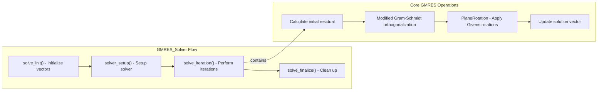
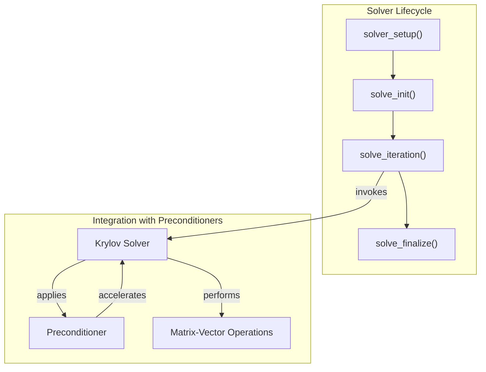
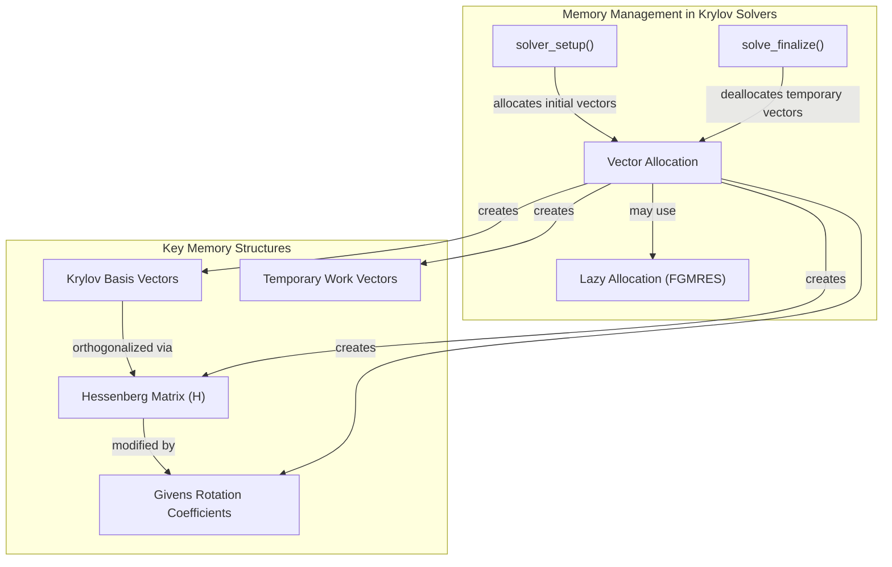

<!-- source: DeepWiki mcp.deepwiki.com · repo NVIDIA/AMGX · page 3.3 Krylov Solvers · fetched 2026-10-26 -->

# Krylov Solvers

<details>
<summary>Relevant source files</summary>

The following files were used as context for generating this wiki page:

- [include/aggregation/aggregation_amg_level.h](include/aggregation/aggregation_amg_level.h)
- [include/amg_level.h](include/amg_level.h)
- [include/solvers/solver.h](include/solvers/solver.h)
- [src/aggregation/aggregation_amg_level.cu](src/aggregation/aggregation_amg_level.cu)
- [src/amg.cu](src/amg.cu)
- [src/configs/PCG_F.json](src/configs/PCG_F.json)
- [src/configs/PCG_V.json](src/configs/PCG_V.json)
- [src/configs/PCG_W.json](src/configs/PCG_W.json)
- [src/cycles/fixed_cycle.cu](src/cycles/fixed_cycle.cu)
- [src/solvers/block_jacobi_solver.cu](src/solvers/block_jacobi_solver.cu)
- [src/solvers/solver.cu](src/solvers/solver.cu)
- [src/tests/fgmres_zero_initial_residual.cu](src/tests/fgmres_zero_initial_residual.cu)

</details>


This document provides technical details about the Krylov subspace solvers implemented in AMGX. Krylov methods are a class of iterative techniques for solving large sparse linear systems of equations of the form Ax = b. For information on algebraic multigrid (AMG) methods which can be used as preconditioners with these solvers, see [Algebraic Multigrid (AMG)](#3.1).

## Overview of Krylov Solvers in AMGX

AMGX implements several Krylov subspace solvers that can be used as standalone solvers or in combination with preconditioners to efficiently solve linear systems. These iterative methods construct basis vectors from the Krylov subspace and use them to find increasingly accurate approximations to the solution.



Sources: [src/solvers/gmres_solver.cu](), [src/solvers/fgmres_solver.cu](), [src/convergence/absolute.cu](), [src/convergence/relative_ini.cu](), [src/convergence/combined_rel_ini_abs.cu]()

## Available Krylov Solvers

### PCG (Preconditioned Conjugate Gradient)

The Preconditioned Conjugate Gradient solver is designed for symmetric positive definite matrices. It is one of the most efficient Krylov methods when applicable.

Configuration example:
```json
{
    "solver": "PCG",
    "preconditioner": {
        "solver": "AMG",
        "cycle": "V",  // Can be V, W, or F cycle
        ...
    },
    "max_iters": 100,
    "tolerance": 1e-06,
    "norm": "L2",
    "convergence": "RELATIVE_INI"
}
```

Sources: [src/configs/PCG_V.json:25-33](), [src/configs/PCG_W.json:25-33](), [src/configs/PCG_F.json:25-33]()

### GMRES (Generalized Minimal Residual)

GMRES is a robust Krylov solver applicable to non-symmetric matrices. It minimizes the residual norm over a Krylov subspace.



Key implementation components:
- `GMRES_Solver<T_Config>` class provides the main solver implementation
- Maintains orthogonal basis vectors in the `m_V_vectors` array
- Uses `PlaneRotation()` for solving the least squares problem using Givens rotations
- Supports restarting through the `gmres_n_restart` parameter

Sources: [src/solvers/gmres_solver.cu:24-267]()

### FGMRES (Flexible GMRES)

FGMRES extends GMRES by allowing different preconditioners in each iteration. This makes it more flexible but requires additional storage.

Key implementation components:
- `FGMRES_Solver<T_Config>` class provides the main solver implementation
- Uses the `KrylovSubspaceBuffer<T_Config>` helper class to manage Krylov vectors efficiently
- Implements "lazy" memory allocation to conserve GPU memory

Sources: [src/solvers/fgmres_solver.cu:17-183](), [src/solvers/fgmres_solver.cu:214-569]()

## Solver Architecture and Integration

Krylov solvers in AMGX follow a common interface and can be integrated with preconditioners to accelerate convergence.



The solver architecture enables composition of solvers, where a Krylov solver can use another solver (often AMG) as a preconditioner. This is configured through JSON configuration files.

Sources: [src/solvers/gmres_solver.cu:77-118](), [src/solvers/fgmres_solver.cu:273-299]()

## Convergence Criteria

AMGX provides several convergence criteria for Krylov solvers:

| Convergence Type | Class | Description |
|------------------|-------|-------------|
| Absolute | `AbsoluteConvergence<T_Config>` | Converges when residual norm < tolerance |
| Relative to Initial | `RelativeIniConvergence<T_Config>` | Converges when residual norm / initial residual norm < tolerance |
| Combined | `RelativeAbsoluteCombinedConvergence<T_Config>` | Converges when either absolute or relative criteria are met |

All convergence criteria can be specified in the solver configuration via the `convergence` parameter:

```json
{
    "solver": "PCG",
    "convergence": "RELATIVE_INI",  // Options: ABSOLUTE, RELATIVE_INI, COMBINED
    "tolerance": 1e-06
}
```

Sources: [src/convergence/absolute.cu:17-46](), [src/convergence/relative_ini.cu:16-44](), [src/convergence/combined_rel_ini_abs.cu:17-49]()

## Key Configuration Parameters

The following parameters can be configured for Krylov solvers:

| Parameter | Description | Default |
|-----------|-------------|---------|
| `solver` | Solver type ("PCG", "GMRES", "FGMRES", etc.) | Required |
| `preconditioner` | Preconditioner specification | "NOSOLVER" |
| `max_iters` | Maximum number of iterations | 100 |
| `tolerance` | Convergence tolerance | 1e-6 |
| `norm` | Norm type for residual calculation ("L1", "L2", "LINF") | "L2" |
| `convergence` | Convergence criterion | "RELATIVE_INI" |
| `gmres_n_restart` | Restart parameter for GMRES/FGMRES | Varies |
| `gmres_krylov_dim` | Size of Krylov subspace for GMRES/FGMRES | min(max_iters, gmres_n_restart) |
| `monitor_residual` | Whether to monitor residual during iterations | 1 (true) |
| `print_solve_stats` | Whether to print solver statistics | 1 (true) |
| `obtain_timings` | Whether to collect timing information | 1 (true) |

Sources: [src/configs/PCG_V.json:3-35](), [src/solvers/gmres_solver.cu:42-43](), [src/solvers/fgmres_solver.cu:233-240]()

## Implementation Details

### GMRES Implementation

GMRES implementation follows these key steps:

1. Compute initial residual: r0 = b - Ax0
2. Define first Krylov vector: v1 = r0 / ||r0||
3. For each iteration:
   - Apply preconditioner (if any)
   - Perform matrix-vector product
   - Orthogonalize against previous Krylov vectors using Modified Gram-Schmidt
   - Apply Givens rotations to minimize residual
   - Check for convergence
4. When restarting or converging, solve the least squares problem and update the solution

The GMRES implementation in AMGX supports both full GMRES and restarted GMRES depending on the configuration parameters.

Sources: [src/solvers/gmres_solver.cu:218-267](), [src/solvers/gmres_solver.cu:269-392]()

### FGMRES Implementation

FGMRES extends GMRES by storing additional vectors to allow for varying preconditioners. The implementation includes:

1. Efficient Krylov vector storage through `KrylovSubspaceBuffer<T_Config>`
2. Adaptive memory allocation based on available GPU memory
3. Support for optimization to DQGMRES (Direct Quasi-GMRES) when memory constraints apply
4. Options for updating solution every iteration or at restart points

Sources: [src/solvers/fgmres_solver.cu:406-568]()

## Memory Management

Krylov solvers in AMGX efficiently manage memory:



Sources: [src/solvers/gmres_solver.cu:95-118](), [src/solvers/fgmres_solver.cu:95-211]()

## Best Practices

When using Krylov solvers in AMGX:

1. Choose the appropriate solver based on matrix properties:
   - PCG for symmetric positive definite matrices
   - GMRES or FGMRES for non-symmetric matrices
   
2. Select an effective preconditioner to accelerate convergence

3. Configure restart parameters carefully for GMRES/FGMRES:
   - Smaller restart values use less memory but may converge slower
   - Larger restart values converge faster but require more memory

4. Set appropriate convergence criteria and tolerances for your specific problem

5. Monitor residuals during iterations to check convergence progress

Sources: [src/solvers/gmres_solver.cu:42-47](), [src/solvers/fgmres_solver.cu:232-240]()

---

