<!-- source: DeepWiki mcp.deepwiki.com · repo NVIDIA/AMGX · page 3.4 Smoothers · fetched 2026-10-26 -->

# Smoothers

<details>
<summary>Relevant source files</summary>

The following files were used as context for generating this wiki page:

- [include/aggregation/aggregation_amg_level.h](include/aggregation/aggregation_amg_level.h)
- [include/amg_level.h](include/amg_level.h)
- [include/reorder_partition.h](include/reorder_partition.h)
- [include/solvers/solver.h](include/solvers/solver.h)
- [src/aggregation/aggregation_amg_level.cu](src/aggregation/aggregation_amg_level.cu)
- [src/amg.cu](src/amg.cu)
- [src/amgx_cusparse.cu](src/amgx_cusparse.cu)
- [src/cycles/fixed_cycle.cu](src/cycles/fixed_cycle.cu)
- [src/distributed/distributed_arranger.cu](src/distributed/distributed_arranger.cu)
- [src/distributed/distributed_manager.cu](src/distributed/distributed_manager.cu)
- [src/matrix.cu](src/matrix.cu)
- [src/matrix_io.cu](src/matrix_io.cu)
- [src/readers.cu](src/readers.cu)
- [src/solvers/block_jacobi_solver.cu](src/solvers/block_jacobi_solver.cu)
- [src/solvers/gauss_seidel_solver.cu](src/solvers/gauss_seidel_solver.cu)
- [src/solvers/multicolor_dilu_solver.cu](src/solvers/multicolor_dilu_solver.cu)
- [src/solvers/solver.cu](src/solvers/solver.cu)
- [src/tests/fgmres_zero_initial_residual.cu](src/tests/fgmres_zero_initial_residual.cu)

</details>


## Purpose and Scope

Smoothers are iterative solvers used within AMGX's Algebraic Multigrid (AMG) preconditioner to reduce high-frequency error components in the solution. This page documents the smoother framework, available smoother implementations, and their integration into multigrid cycles. For information about the complete solver hierarchy and Krylov methods, see [Solvers](#3). For AMG cycle orchestration, see [AMG Hierarchy and Cycles](#3.2.1).

**Sources:** [src/cycles/fixed_cycle.cu:1-200](), [include/solvers/solver.h:1-250]()

---

## Smoother Role in Multigrid

Smoothers operate at each level of the AMG hierarchy, performing local relaxation to reduce oscillatory error before and after coarse-grid correction. The multigrid cycle applies smoothers in three phases:

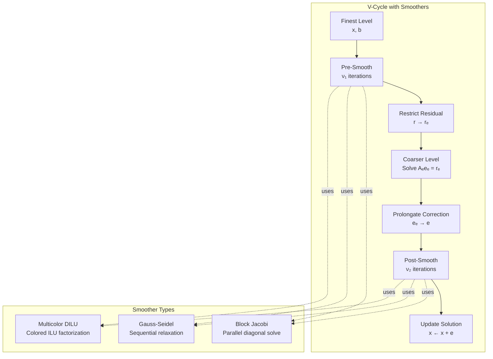

**Sources:** [src/cycles/fixed_cycle.cu:25-100](), [src/amg.cu:1-100]()

### Smoother Invocation in Cycles

The cycle dispatcher calls smoothers through the `Solver<TConfig>::solve()` and `smooth()` interfaces:

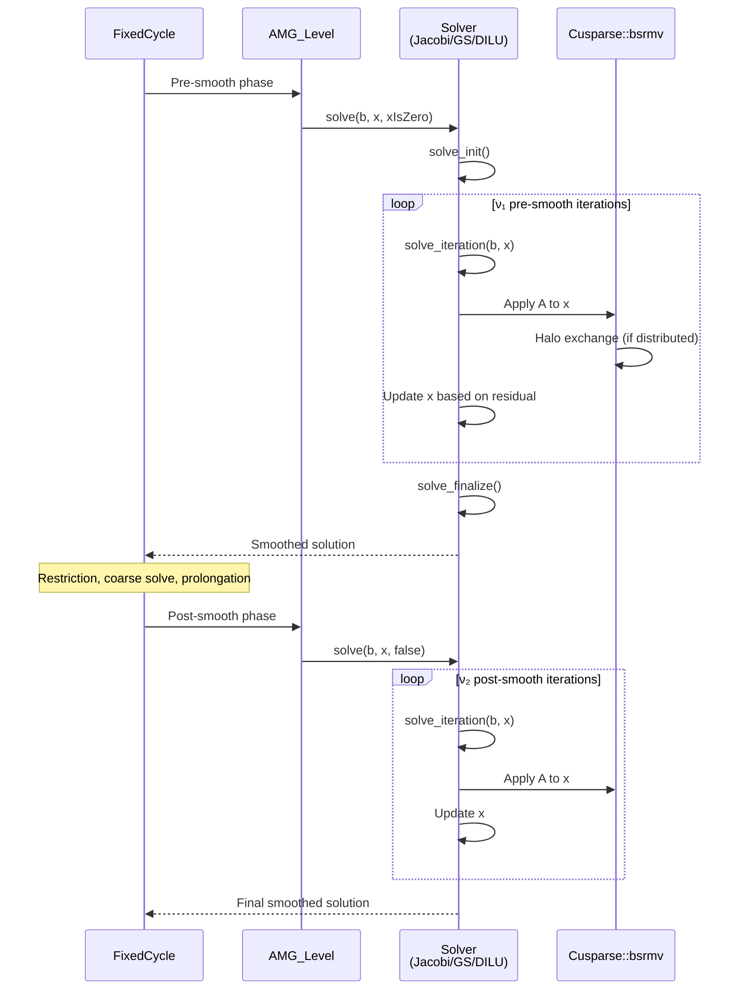

**Sources:** [src/cycles/fixed_cycle.cu:60-150](), [src/solvers/solver.cu:130-160]()

---

## Smoother Base Class and Lifecycle

All smoothers inherit from `Solver<TConfig>` and implement the standard solver interface:

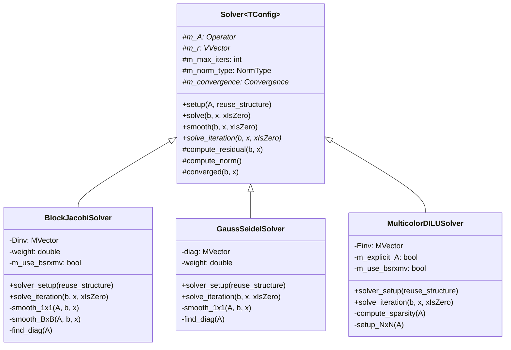

**Sources:** [include/solvers/solver.h:20-200](), [src/solvers/solver.cu:26-110]()

### Smoother Setup Phase

During `solver_setup()`, smoothers prepare data structures needed for iterations:

| Smoother | Setup Operations | Data Structures Created |
|----------|------------------|------------------------|
| **Block Jacobi** | Extract/compute diagonal blocks, invert diagonal | `Dinv` (inverted diagonal blocks) |
| **Gauss-Seidel** | Extract diagonal values from matrix | `diag` (diagonal values) |
| **Multicolor DILU** | Color matrix, compute sparsity pattern, factorize | `Einv` (inverted E = D - L - U factors) |

**Sources:** [src/solvers/block_jacobi_solver.cu:100-200](), [src/solvers/gauss_seidel_solver.cu:40-70](), [src/solvers/multicolor_dilu_solver.cu:600-800]()

### Smoother Iteration Phase

The core `solve_iteration()` method performs one relaxation sweep:

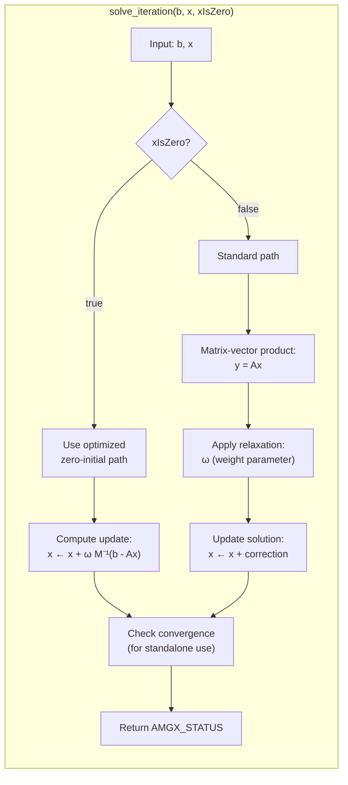

**Sources:** [src/solvers/gauss_seidel_solver.cu:78-102](), [src/solvers/block_jacobi_solver.cu:300-400]()

---

## Block Jacobi Solver

Block Jacobi performs parallel diagonal relaxation by solving `D xⁱ⁺¹ = ω(b - (A - D)xⁱ)`, where `D` contains the block diagonal of `A`.

### Block Jacobi Algorithm

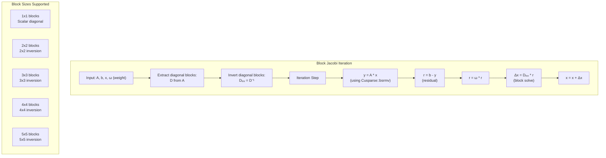

**Sources:** [src/solvers/block_jacobi_solver.cu:1-100](), [src/solvers/block_jacobi_solver.cu:300-500]()

### Block Diagonal Inversion Kernels

Block Jacobi uses specialized CUDA kernels for different block sizes:

| Block Size | Kernel | Method | Lines |
|------------|--------|--------|-------|
| 1×1 | Scalar division | Direct reciprocal | [src/solvers/block_jacobi_solver.cu:85-150]() |
| 2×2 | `matinv_matrix_per_thread_pivot<2>` | Gauss-Jordan with pivoting | [src/solvers/block_jacobi_solver.cu:84-200]() |
| 3×3 | `matinv_matrix_per_thread_pivot<3>` | Gauss-Jordan with pivoting | [src/solvers/block_jacobi_solver.cu:84-200]() |
| 4×4 | `matinv_matrix_per_thread_pivot<4>` | Gauss-Jordan with pivoting | [src/solvers/block_jacobi_solver.cu:84-200]() |
| 5×5 | `matinv_matrix_per_thread_pivot<5>` | Gauss-Jordan with pivoting | [src/solvers/block_jacobi_solver.cu:84-200]() |

The diagonal extraction and inversion occurs in setup:

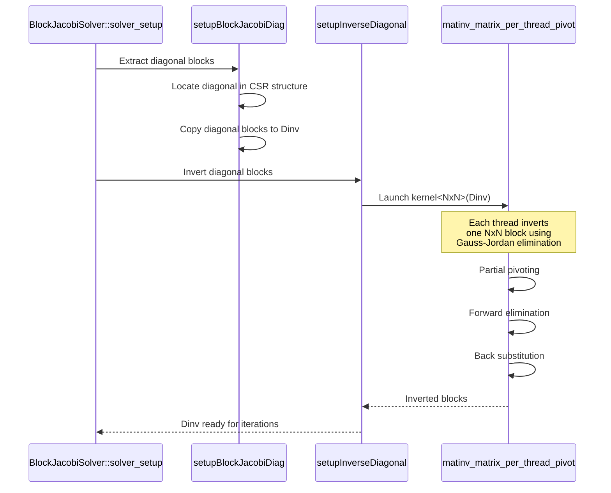

**Sources:** [src/solvers/block_jacobi_solver.cu:600-900](), [src/solvers/block_jacobi_solver.cu:84-200]()

### Block Jacobi Smoothing Operation

The smoothing kernels apply the relaxation using inverted diagonals:

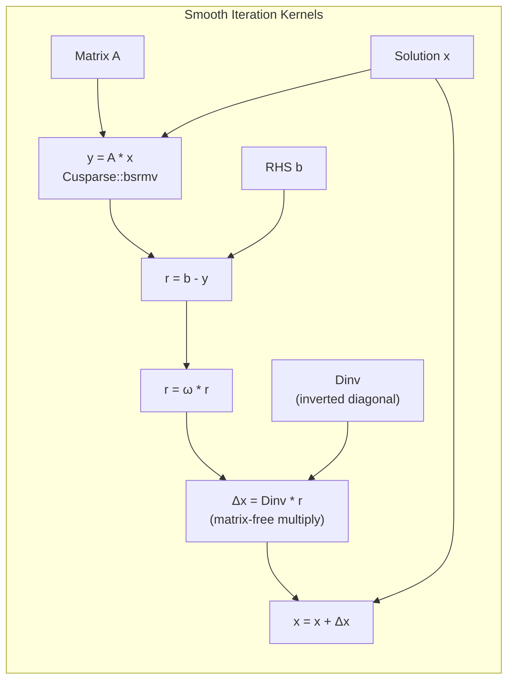

For zero initial guess, an optimized kernel is used:

```
x = ω * Dinv * b
```

This avoids the matrix-vector product and residual computation.

**Sources:** [src/solvers/block_jacobi_solver.cu:1200-1400](), [src/solvers/block_jacobi_solver.cu:1600-1800]()

---

## Gauss-Seidel Solver

Gauss-Seidel performs sequential relaxation by updating each row using the most recent values. AMGX implements a parallelized version that processes all rows simultaneously (block Jacobi-like), suitable for GPU execution.

### Gauss-Seidel Algorithm

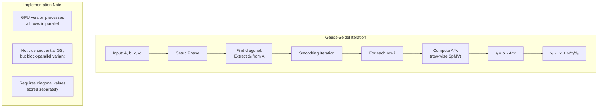

**Sources:** [src/solvers/gauss_seidel_solver.cu:1-50](), [src/solvers/gauss_seidel_solver.cu:78-102]()

### Gauss-Seidel Kernels

#### Device Kernel (GPU)

The GPU kernel `GS_smooth_kernel` processes all rows in parallel:

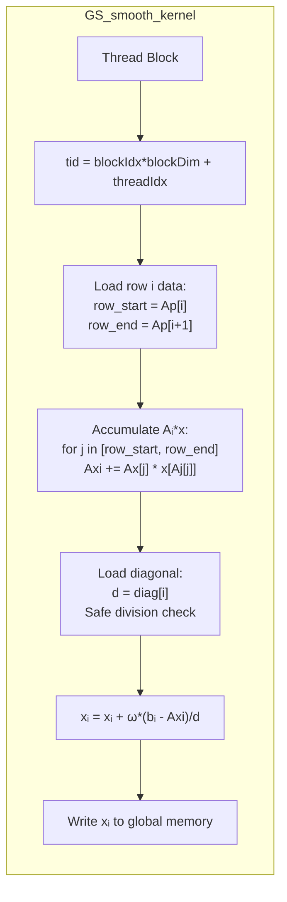

**Sources:** [src/solvers/gauss_seidel_solver.cu:198-227](), [src/solvers/gauss_seidel_solver.cu:230-248]()

#### Host Implementation

The host version performs sequential Gauss-Seidel as expected:

```
for i = 0 to num_rows-1:
    Axi = 0
    for j = row_offsets[i] to row_offsets[i+1]-1:
        Axi += values[j] * x[col_indices[j]]
    x[i] = x[i] + weight * (b[i] - Axi) / diag[i]
```

**Sources:** [src/solvers/gauss_seidel_solver.cu:152-168]()

### Gauss-Seidel Configuration

The relaxation factor `ω` controls damping:

| Parameter | Default | Range | Effect |
|-----------|---------|-------|--------|
| `relaxation_factor` | 1.0 | (0, 2) | ω < 1: under-relaxation (more stable)<br/>ω = 1: standard Gauss-Seidel<br/>ω > 1: over-relaxation (faster convergence risk) |

**Sources:** [src/solvers/gauss_seidel_solver.cu:16-25]()

---

## Multicolor DILU Solver

Multicolor DILU (Distributed Incomplete LU) uses graph coloring to parallelize ILU factorization. Nodes of the same color are independent and can be processed simultaneously.

### DILU Coloring and Factorization

```mermaid
graph TB
    subgraph "DILU Setup Process"
        Input["Input: Matrix A"]
        
        Coloring["Graph Coloring"]
        ColorMatrix["Color matrix rows<br/>so same-color rows<br/>are independent"]
        
        Sparsity["Compute Sparsity Pattern"]
        Pattern["Pattern of E = D - L - U<br/>Lower + Diag + Upper parts"]
        
        IterColors["Iterate Over Colors"]
        ColorSetup["For each color k:<br/>Process all rows of color k"]
        
        FactorRow["Factor row i (color k)"]
        LoadDiag["Load diagonal block:<br/>Eᵢᵢ = Aᵢᵢ"]
        
        UpdateLower["For j < i with color < k:<br/>Eᵢᵢ -= Aᵢⱼ * Eⱼⱼ⁻¹ * Aⱼᵢ"]
        
        Invert["Invert Eᵢᵢ<br/>(Gauss-Jordan)"]
        Store["Store Eᵢᵢ⁻¹ in Einv"]
        
        Input --> Coloring
        Coloring --> ColorMatrix
        ColorMatrix --> Sparsity
        Sparsity --> Pattern
        Pattern --> IterColors
        IterColors --> ColorSetup
        ColorSetup --> FactorRow
        FactorRow --> LoadDiag
        LoadDiag --> UpdateLower
        UpdateLower --> Invert
        Invert --> Store
    end
```

**Sources:** [src/solvers/multicolor_dilu_solver.cu:1-100](), [src/solvers/multicolor_dilu_solver.cu:600-800]()

### DILU Block Kernels

DILU supports block sizes with specialized kernels:

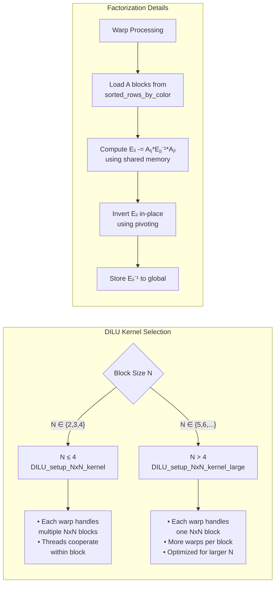

**Sources:** [src/solvers/multicolor_dilu_solver.cu:34-358](), [src/solvers/multicolor_dilu_solver.cu:361-550]()

### DILU Kernel Implementation Flow

The setup kernel `DILU_setup_NxN_kernel` performs color-by-color factorization:

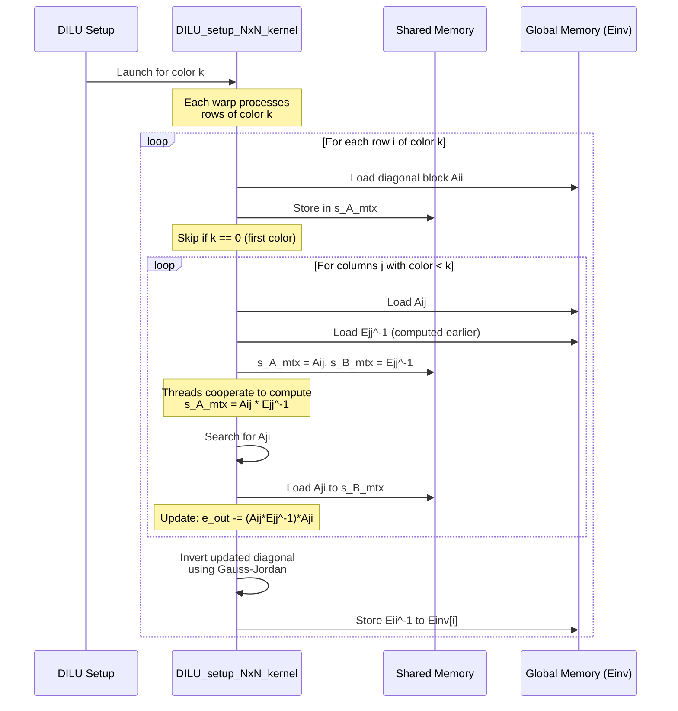

**Sources:** [src/solvers/multicolor_dilu_solver.cu:361-550]()

### DILU Solve Iteration

Once factorized, DILU applies the inverse during smoothing:

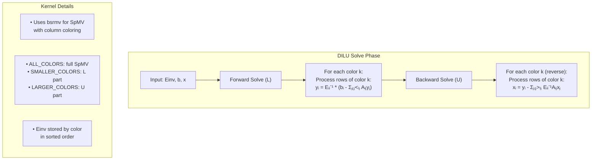

**Sources:** [src/solvers/multicolor_dilu_solver.cu:1000-1300]()

---

## Smoother Configuration

Smoothers are configured through the AMG configuration system using JSON parameters:

### Common Smoother Parameters

| Parameter | Type | Default | Description |
|-----------|------|---------|-------------|
| `smoother` | string | `"JACOBI_L1"` | Smoother type (see below) |
| `presweeps` | int | 1 | Number of pre-smoothing iterations (ν₁) |
| `postsweeps` | int | 1 | Number of post-smoothing iterations (ν₂) |
| `relaxation_factor` | double | 1.0 | Relaxation parameter ω for damping |
| `use_bsrxmv` | bool | false | Use BSRXMV instead of BSRMV for Block Jacobi |

**Sources:** [src/cycles/fixed_cycle.cu:60-90](), [src/amg.cu:40-70]()

### Available Smoother Types

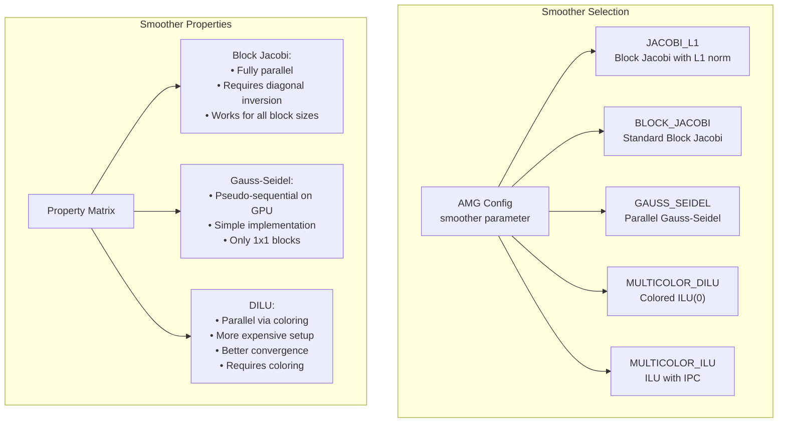

**Sources:** [src/solvers/solver.cu:26-50]()

### Example Configuration

```json
{
  "solver": "AMG",
  "presweeps": 1,
  "postsweeps": 1,
  "smoother": "BLOCK_JACOBI",
  "relaxation_factor": 0.8,
  "max_levels": 10,
  "cycle": "V"
}
```

This configures an AMG V-cycle with Block Jacobi smoothing, 1 pre-sweep, 1 post-sweep, and under-relaxation factor ω=0.8.

**Sources:** [src/amg.cu:1-100]()

---

## Sparse Matrix-Vector Operations in Smoothers

All smoothers rely on `Cusparse::bsrmv()` for block sparse matrix-vector multiplication (SpMV):

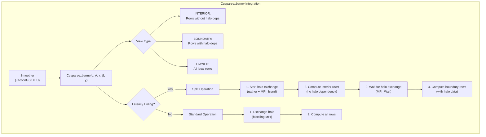

**Sources:** [src/amgx_cusparse.cu:48-102](), [src/amgx_cusparse.cu:75-90]()

### SpMV Variants Used by Smoothers

Different SpMV signatures support various smoother requirements:

| SpMV Variant | Signature | Used By | Purpose |
|--------------|-----------|---------|---------|
| Standard | `bsrmv(α, A, x, β, y)` | All smoothers | Basic y = αAx + βy |
| Diagonal | `bsrmv(α, A, E, x, β, y)` | - | With diagonal matrix E |
| Colored | `bsrmv(color, α, A, x, β, y)` | DILU | Process specific color |
| Column-filtered | `bsrmv(selector, color, α, A, x, β, y)` | DILU | Filter column colors |

**Sources:** [src/amgx_cusparse.cu:348-431](), [src/amgx_cusparse.cu:437-521]()

---

## Performance Considerations

### Smoother Selection Guidelines

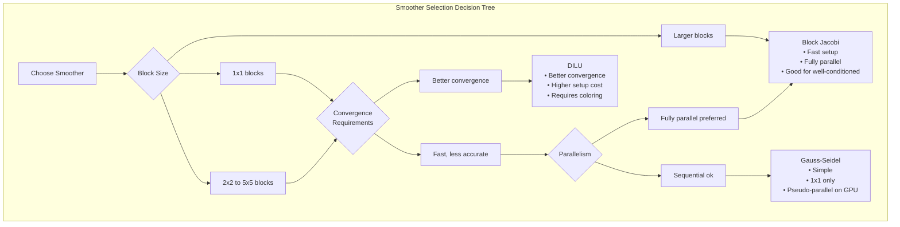

**Sources:** [src/solvers/block_jacobi_solver.cu:1-100](), [src/solvers/gauss_seidel_solver.cu:1-50](), [src/solvers/multicolor_dilu_solver.cu:1-100]()

### Computational Complexity

| Smoother | Setup Cost | Iteration Cost | Memory Overhead |
|----------|------------|----------------|-----------------|
| **Block Jacobi** | O(n·b³) block inversions | O(nnz·b²) SpMV + O(n·b²) diagonal solve | O(n·b²) for Dinv |
| **Gauss-Seidel** | O(n) diagonal extraction | O(nnz·b²) SpMV | O(n) for diag |
| **DILU** | O(c·nnz·b³) colored factorization | O(c·nnz·b²) colored SpMV | O(n·b²) for Einv |

Where:
- n = number of rows
- nnz = number of non-zeros
- b = block size
- c = number of colors

**Sources:** [src/solvers/block_jacobi_solver.cu:600-900](), [src/solvers/multicolor_dilu_solver.cu:600-1200]()

### Distributed Smoothing

In distributed settings, smoothers must handle halo exchange:

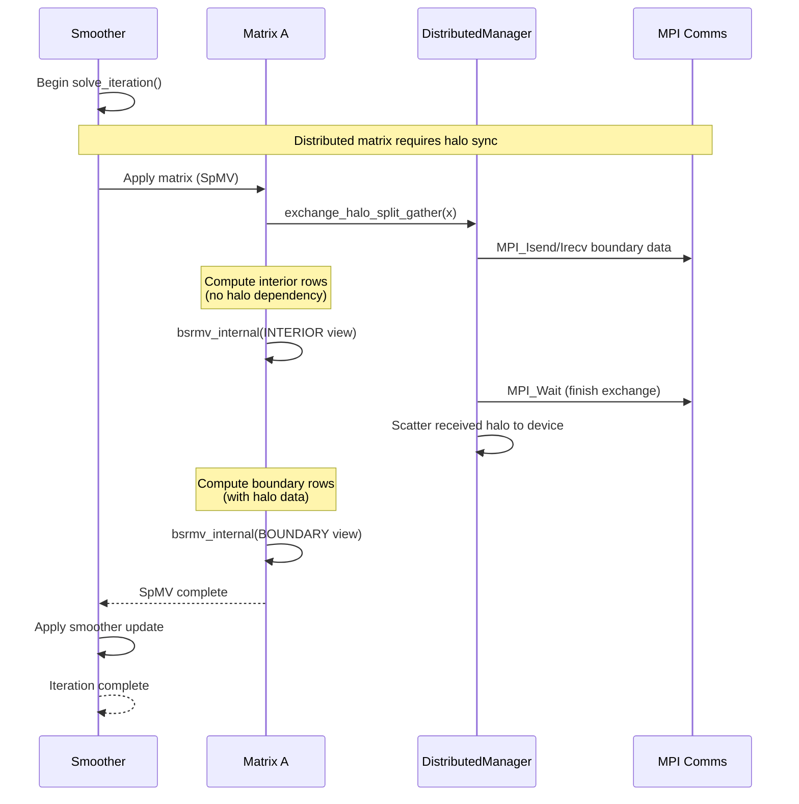

**Sources:** [src/amgx_cusparse.cu:75-99](), [src/distributed/distributed_manager.cu:1-100]()

---

## Summary

Smoothers in AMGX are specialized iterative solvers that reduce high-frequency error within multigrid cycles. The three main implementations—Block Jacobi, Gauss-Seidel, and Multicolor DILU—offer different tradeoffs between setup cost, convergence rate, and parallelism. All smoothers inherit from the `Solver<TConfig>` base class and integrate with the AMG framework through standardized setup and iteration interfaces. Matrix-vector operations are performed via `Cusparse::bsrmv()`, which handles distributed matrices with latency-hiding optimizations for boundary data exchange.

**Sources:** [src/solvers/solver.cu:26-110](), [src/cycles/fixed_cycle.cu:25-150](), [include/solvers/solver.h:1-250]()

---

