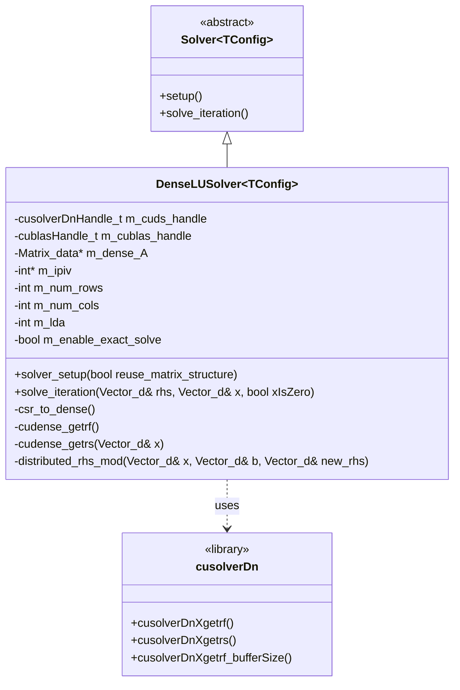
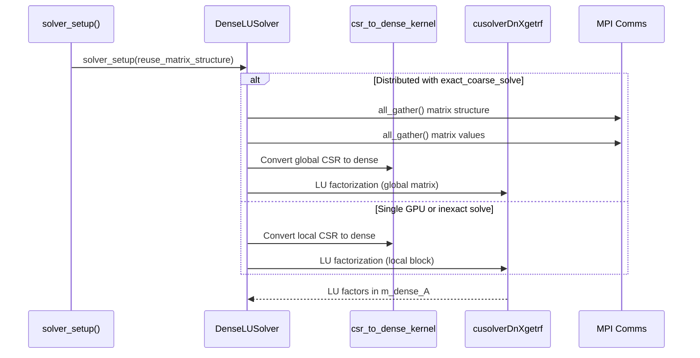
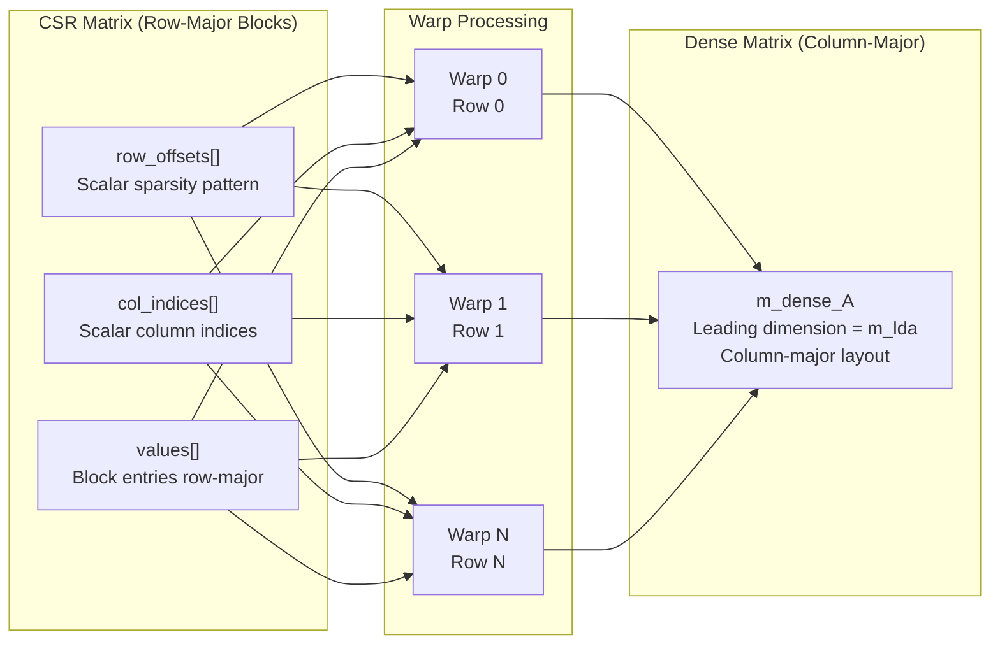
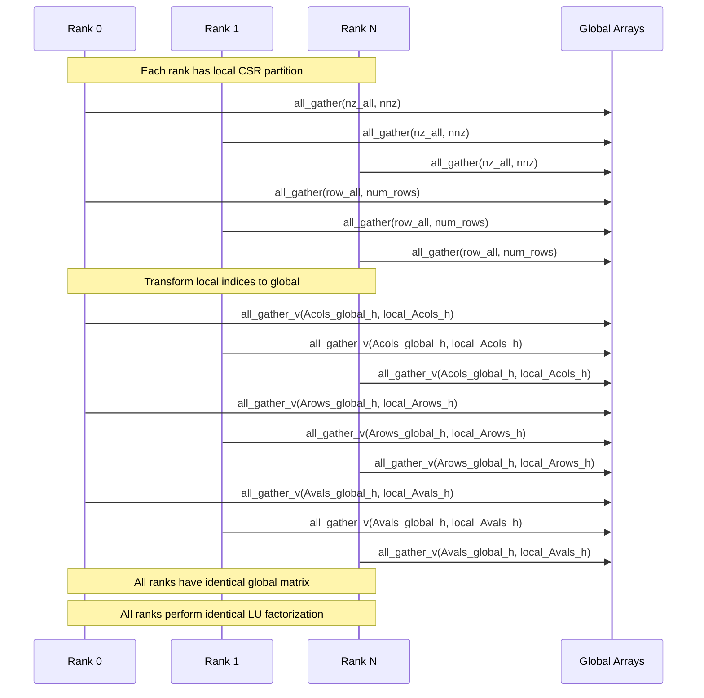
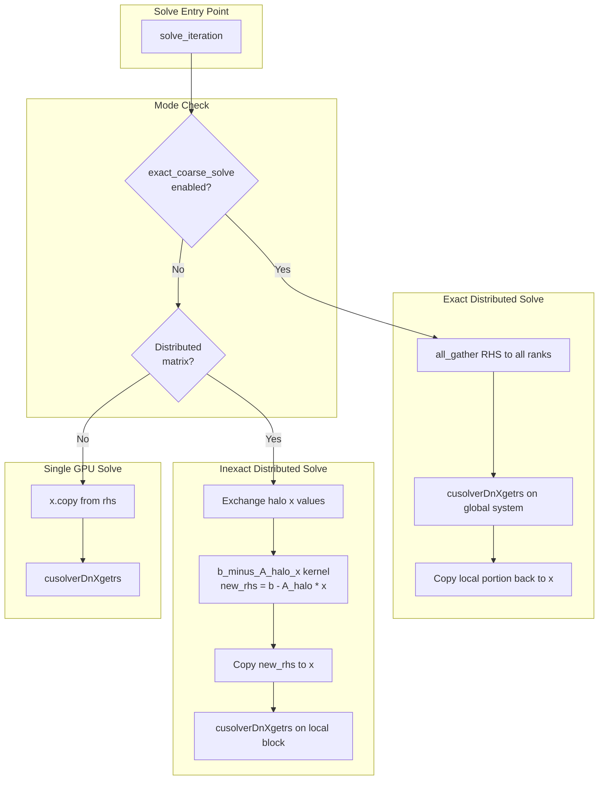
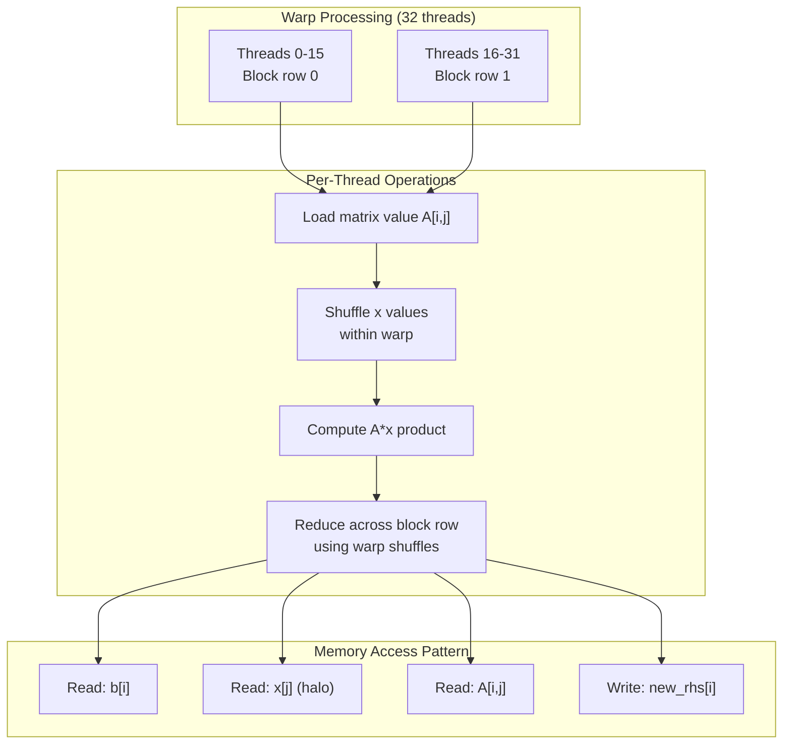

<!-- source: DeepWiki mcp.deepwiki.com · repo NVIDIA/AMGX · page 3.5 Direct Solvers · fetched 2026-10-26 -->

# Direct Solvers

<details>
<summary>Relevant source files</summary>

The following files were used as context for generating this wiki page:

- [include/cutil.h](include/cutil.h)
- [include/energymin/interpolators/common.h](include/energymin/interpolators/common.h)
- [src/amgx_lapack.cu](src/amgx_lapack.cu)
- [src/hash_workspace.cu](src/hash_workspace.cu)
- [src/scalers/diagonal_symmetric.cu](src/scalers/diagonal_symmetric.cu)
- [src/solvers/dense_lu_solver.cu](src/solvers/dense_lu_solver.cu)

</details>


## Purpose and Scope

Direct solvers in AMGX compute exact solutions to linear systems through matrix factorization rather than iterative refinement. This page covers the Dense LU solver implementation used primarily on coarse grids in AMG hierarchies, and the LAPACK/MAGMA integration layer that provides dense linear algebra operations including eigenvalue computation and QR factorization.

For iterative solution methods, see [Krylov Solvers](#3.3) and [Smoothers](#3.4). For specialized eigensolver configurations, see [Eigensolvers](#3.6). For information about the LAPACK/MAGMA interface details, see [LAPACK and MAGMA Integration](#3.5.2).

---

## Dense LU Solver Overview

The `DenseLUSolver` class provides direct solution of linear systems via LU factorization using NVIDIA's cuSOLVER library. It operates by converting sparse CSR matrices to dense column-major format, computing the LU decomposition, and solving via forward/backward substitution. This solver is typically configured as the coarsest-level solver in AMG hierarchies where system sizes are small enough (typically hundreds to thousands of unknowns) that dense factorization is efficient.

The implementation supports two operational modes:
- **Inexact solve**: Each MPI rank factorizes only its local diagonal block (block Jacobi across ranks)
- **Exact solve**: All ranks gather the complete global matrix and compute an exact distributed solution

**Sources:**
- [src/solvers/dense_lu_solver.cu:624-671]()
- [src/solvers/dense_lu_solver.cu:453-483]()

---

## Class Structure and Lifecycle



The `DenseLUSolver` constructor initializes cuSOLVER and cuBLAS handles, sets maximum iterations to 1 (since direct solvers converge in a single step), and determines whether exact distributed solving is enabled based on configuration parameters.

**Sources:**
- [src/solvers/dense_lu_solver.cu:624-671]()
- [src/solvers/dense_lu_solver.cu:673-701]()

---

## Setup Phase: Matrix Conversion and Factorization



### CSR to Dense Conversion

The `csr_to_dense_kernel` converts block CSR format to dense column-major storage. Each warp processes one row-block of the sparse matrix:

**Kernel Strategy:**
- One warp per matrix row-block
- Within a warp, threads handle individual block entries
- Diagonal blocks handled separately if stored externally
- Halo columns (ghost data) are skipped during conversion
- Output is column-major dense matrix suitable for cuSOLVER



The kernel implementation at [src/solvers/dense_lu_solver.cu:52-110]() uses template parameters for block dimensions and efficiently maps thread indices to block elements.

**Sources:**
- [src/solvers/dense_lu_solver.cu:52-110]()
- [src/solvers/dense_lu_solver.cu:486-509]()

### LU Factorization

The `cudense_getrf` method wraps cuSOLVER's `cusolverDnXgetrf` function:

1. Query workspace size via `cusolverDnXgetrf_bufferSize`
2. Allocate workspace memory (`m_trf_wspace`)
3. Perform in-place LU factorization
4. Store pivot sequence in `m_ipiv`
5. Check for singularity (info > 0) or invalid parameters (info < 0)
6. Free workspace

The factorization is performed in-place, overwriting `m_dense_A` with both L and U factors stored in packed format.

**Sources:**
- [src/solvers/dense_lu_solver.cu:514-571]()

### Distributed Exact Solve Mode

When `exact_coarse_solve=1` and `algorithm=CLASSICAL`, the solver gathers the complete global matrix to all ranks:



This mode requires transforming local packed indices to global unpacked indices using kernels `local_row_offsets_to_global` and `local_col_indices_to_global`, which use the `local_to_global_map` maintained by the distributed manager.

**Sources:**
- [src/solvers/dense_lu_solver.cu:758-876]()
- [src/solvers/dense_lu_solver.cu:714-741]()

---

## Solve Phase: Triangular Solves



### Exact Distributed Solve

In exact mode, all ranks gather the complete RHS vector and solve the full system:

```
cusolverDnXgetrs(handle, CUBLAS_OP_N, m_num_rows, 1, 
                 m_dense_A, m_lda, m_ipiv,
                 x_global.raw(), m_num_rows, info);
```

Each rank extracts its local portion from the global solution vector using displacement information.

**Sources:**
- [src/solvers/dense_lu_solver.cu:913-953]()

### Inexact Distributed Solve

For distributed matrices without exact solve enabled, each rank solves only its local diagonal block. The RHS must be modified to account for contributions from halo (ghost) nodes:

**Modified RHS:** `new_rhs = b - A_halo * x`

The `b_minus_A_halo_x` kernel computes this correction:

| Kernel Features | Description |
|----------------|-------------|
| **Block dimensions** | Template parameter `N` for block size (1-5 supported) |
| **Warp allocation** | One warp handles `WARP_SIZE / (N*N)` row-blocks |
| **Row/column major** | Template parameter selects layout |
| **Halo detection** | `a_col_id >= num_owned_rows` identifies halo columns |
| **Reduction** | Uses warp shuffle operations to reduce block products |

The kernel at [src/solvers/dense_lu_solver.cu:146-354]() efficiently computes the matrix-vector product for halo contributions and subtracts from the RHS.

**Sources:**
- [src/solvers/dense_lu_solver.cu:961-979]()
- [src/solvers/dense_lu_solver.cu:146-354]()
- [src/solvers/dense_lu_solver.cu:361-449]()

### Triangular Solve

The `cudense_getrs` method calls cuSOLVER to solve using the pre-computed LU factors:

```cpp
cusolverDnXgetrs(m_cuds_handle, CUBLAS_OP_N,
                 m_num_rows, 1, m_dense_A, m_lda,
                 m_ipiv, x.raw(), m_num_rows, m_cuds_info);
```

This performs:
1. Forward substitution: Solve `L*y = rhs` 
2. Backward substitution: Solve `U*x = y`

The solution overwrites the input vector `x`.

**Sources:**
- [src/solvers/dense_lu_solver.cu:575-595]()

---

## Memory Management

The `DenseLUSolver` manages several device memory allocations:

| Member | Purpose | Allocation |
|--------|---------|------------|
| `m_dense_A` | Dense matrix (LU factors) | `m_num_cols * m_lda * sizeof(Matrix_data)` |
| `m_ipiv` | Pivot sequence | `m_num_rows * sizeof(int)` |
| `m_cuds_info` | cuSOLVER status output | `sizeof(int)` |
| `m_trf_wspace` | Factorization workspace | Queried from cuSOLVER (temporary) |

The `allocMem` helper function [src/solvers/dense_lu_solver.cu:598-618]() handles allocation with optional zero-initialization. Memory is freed in the destructor using `amgx::memory::cudaFreeAsync`.

For distributed exact solve, additional temporary storage holds global matrix data:

- `Acols_global` / `Arows_global`: Global CSR structure
- `nz_all` / `row_all`: Per-rank nnz and row counts
- `nz_displs` / `row_displs`: Displacements for MPI gathers

These persist across multiple solve calls if matrix structure is reused.

**Sources:**
- [src/solvers/dense_lu_solver.cu:598-618]()
- [src/solvers/dense_lu_solver.cu:673-701]()

---

## Configuration and Usage

### JSON Configuration

The Dense LU solver is typically configured as the coarse solver in an AMG hierarchy:

```json
{
  "solver": "AMG",
  "presweeps": 1,
  "postsweeps": 1,
  "coarse_solver": "DENSE_LU_SOLVER",
  "algorithm": "CLASSICAL",
  "exact_coarse_solve": 0
}
```

**Key Parameters:**

| Parameter | Values | Description |
|-----------|--------|-------------|
| `coarse_solver` | `"DENSE_LU_SOLVER"` | Specifies Dense LU for coarsest level |
| `exact_coarse_solve` | `0` or `1` | Enables exact distributed solve (CLASSICAL only) |
| `algorithm` | `"CLASSICAL"` | Required for exact solve mode |

### Performance Considerations

**When to use Dense LU:**
- Coarse grid size < 1000-5000 unknowns
- High accuracy required on coarse level
- Sufficient memory for dense storage (O(n²))

**Inexact vs Exact mode:**
- **Inexact** (default): Lower communication cost, each rank solves independently
- **Exact**: Higher accuracy but requires O(n²) memory per rank and global communication

The exact mode is beneficial when:
- Coarse grid is very small (< 1000 unknowns globally)
- Maximum accuracy is required
- Convergence is sensitive to coarse-grid solve accuracy

**Sources:**
- [src/solvers/dense_lu_solver.cu:667-670]()

---

## Distributed RHS Modification Details

The `b_minus_A_halo_x` kernel uses sophisticated warp-level parallelism:



**Thread Mapping for N×N blocks:**
- `lane_id = threadIdx.x % WARP_SIZE` (0-31)
- `block_row = lane_id / N`
- `block_col = lane_id % N`
- Threads with `block_row >= N` are inactive

**Reduction Strategy:**
The `reduce_distributed_vectors` function [src/solvers/dense_lu_solver.cu:113-142]() uses warp shuffle instructions:
- For power-of-2 N: Binary tree reduction via `__shfl_xor`
- For non-power-of-2 N: Sequential reduction via `__shfl_down`

This achieves efficient communication within a warp without shared memory.

**Sources:**
- [src/solvers/dense_lu_solver.cu:146-354]()
- [src/solvers/dense_lu_solver.cu:113-142]()

---

## LAPACK and MAGMA Integration (See Section 3.5.2)

While the Dense LU solver uses cuSOLVER directly, AMGX also provides a `Lapack` interface class for additional dense linear algebra operations. This is documented in detail in [LAPACK and MAGMA Integration](#3.5.2), but key capabilities include:

- **Eigenvalue solvers**: `geev()`, `syevd()`, `sygvd()` for standard and generalized eigenproblems
- **QR factorization**: `geqrf()` and `orgqr()` for orthogonalization (used in eigensolvers)
- **Triangular operations**: `trtri()` for matrix inversion
- **Tridiagonal eigensolvers**: `stedx()` for Lanczos methods

The `Lapack` class template provides compile-time dispatch based on:
- Memory space (host/device)
- Precision (float/double/complex)
- Backend availability (LAPACK/MAGMA/cuSOLVER)

**Sources:**
- [src/amgx_lapack.cu:47-81]()
- [src/amgx_lapack.cu:209-241]()

---

