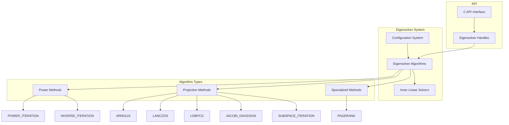
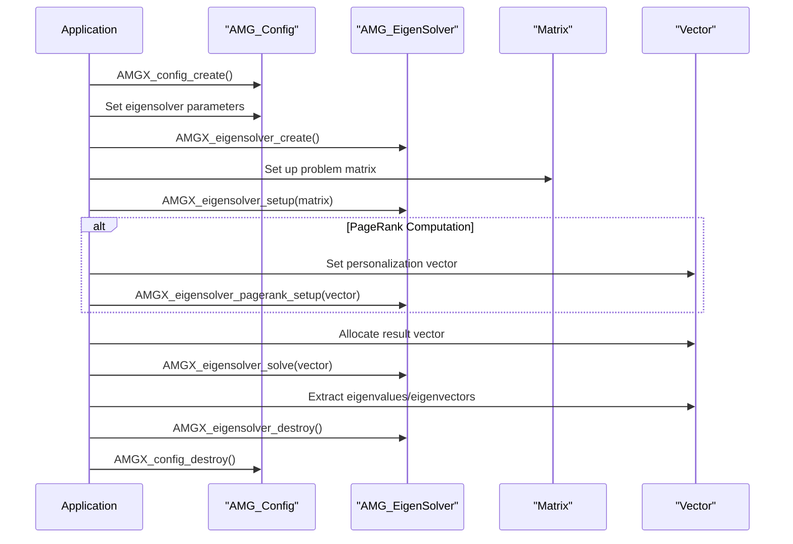
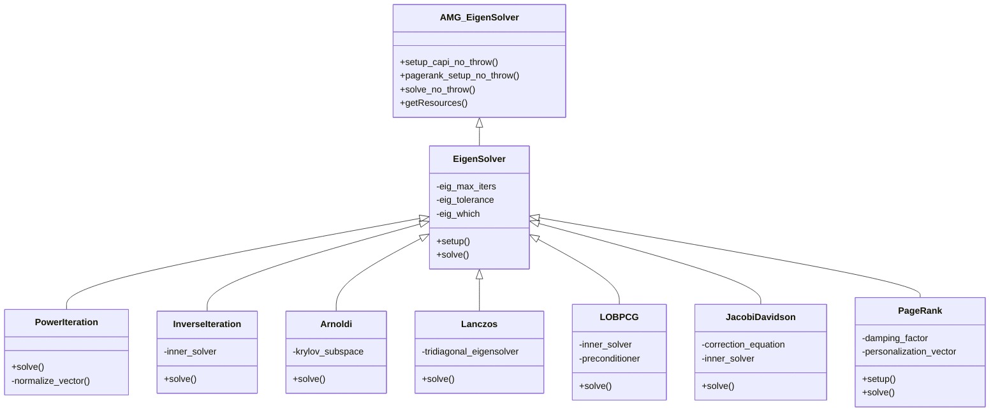

<!-- source: DeepWiki mcp.deepwiki.com · repo NVIDIA/AMGX · page 3.6 Eigensolvers · fetched 2026-10-26 -->

# Eigensolvers

<details>
<summary>Relevant source files</summary>

The following files were used as context for generating this wiki page:

- [.gitignore](.gitignore)
- [README.md](README.md)
- [doc/AMGX_Reference.pdf](doc/AMGX_Reference.pdf)
- [include/cutil.h](include/cutil.h)
- [include/energymin/interpolators/common.h](include/energymin/interpolators/common.h)
- [src/amgx_lapack.cu](src/amgx_lapack.cu)
- [src/hash_workspace.cu](src/hash_workspace.cu)
- [src/scalers/diagonal_symmetric.cu](src/scalers/diagonal_symmetric.cu)
- [src/solvers/dense_lu_solver.cu](src/solvers/dense_lu_solver.cu)

</details>


The AMGX library provides robust eigensolvers designed for finding eigenvalues and eigenvectors of sparse matrices on GPUs. These solvers are particularly useful for spectral analysis, finding dominant modes in physical systems, stability analysis, and specialized applications like PageRank computation.

## Overview

AMGX eigensolvers provide GPU-accelerated methods for efficiently computing eigenvalues and eigenvectors of sparse matrices. The library offers several algorithms suitable for different types of problems, with configuration options for controlling accuracy, performance, and which eigenvalues to compute.



Sources: [src/amgx_eig_c.cu](), [src/configs/eigen_configs/ARNOLDI](), [src/configs/eigen_configs/LANCZOS](), [src/configs/eigen_configs/LOBPCG](), [src/configs/eigen_configs/JACOBI_DAVIDSON](), [src/configs/eigen_configs/POWER_ITERATION](), [src/configs/eigen_configs/PAGERANK](), [src/configs/eigen_configs/SUBSPACE_ITERATION](), [src/configs/eigen_configs/INVERSE_FGMRES]()

## Available Eigensolvers

AMGX provides the following eigensolvers:

| Eigensolver | Description | Typical Use Cases |
|-------------|-------------|------------------|
| POWER_ITERATION | Simple iterative method that converges to the dominant eigenpair | Finding largest eigenvalue with minimal memory requirements |
| INVERSE_ITERATION | Power iteration with matrix inverse to find smallest eigenvalues | Computing smallest eigenvalues using inner linear solvers |
| ARNOLDI | Builds Krylov subspace for eigenvalue approximation | Computing multiple eigenvalues, good for non-symmetric matrices |
| LANCZOS | Specialized Arnoldi for symmetric matrices | Computing eigenvalues of symmetric matrices efficiently |
| LOBPCG | Locally Optimal Block Preconditioned Conjugate Gradient | Computing a few extreme eigenvalues of large symmetric matrices |
| JACOBI_DAVIDSON | Subspace iteration with correction equation | Computing interior eigenvalues or clustered eigenvalues |
| SUBSPACE_ITERATION | Block generalization of power iteration | Computing multiple dominant eigenvalues simultaneously |
| PAGERANK | Specialized solver for PageRank computation | Web page ranking and network analysis |

Sources: [src/configs/eigen_configs/ARNOLDI](), [src/configs/eigen_configs/LANCZOS](), [src/configs/eigen_configs/LOBPCG](), [src/configs/eigen_configs/JACOBI_DAVIDSON](), [src/configs/eigen_configs/POWER_ITERATION](), [src/configs/eigen_configs/PAGERANK](), [src/configs/eigen_configs/SUBSPACE_ITERATION](), [src/configs/eigen_configs/INVERSE_FGMRES]()

## Eigensolver Configuration

AMGX eigensolvers are configured through JSON configuration files or parameter strings. The core parameters common to most eigensolvers include:

| Parameter | Description | Default |
|-----------|-------------|---------|
| `eig_solver` | Algorithm selection (e.g., "POWER_ITERATION", "ARNOLDI") | N/A |
| `eig_max_iters` | Maximum number of iterations | Varies by algorithm |
| `eig_tolerance` | Convergence tolerance | Typically 1e-4 |
| `eig_which` | Which eigenvalues to compute ("largest", "smallest", "pagerank") | "largest" |
| `eig_wanted_count` | Number of eigenvalues to compute (for some methods) | Varies |
| `eig_eigenvector` | Whether to compute eigenvectors (for some methods) | 1 (true) |

Some eigensolvers, such as INVERSE_ITERATION or LOBPCG, require an inner linear solver to be configured. This is specified using the `solver` parameter with its own configuration scope.

Example configuration for LOBPCG:

```json
{
  "config_version": 2,
  "eig_solver": "LOBPCG",
  "eig_max_iters": 1000,
  "eig_tolerance": 1e-4,
  "eig_which": "largest",
  "solver": {
    "solver": "FGMRES",
    "scope": "main",
    "gmres_n_restart": 10,
    "preconditioner": {
      "solver": "AMG",
      "scope": "amg"
    }
  }
}
```

Sources: [src/amgx_config.cu](), [src/configs/eigen_configs/LOBPCG](), [src/configs/eigen_configs/JACOBI_DAVIDSON](), [src/configs/eigen_configs/INVERSE_FGMRES]()

## Eigensolver Workflow

The AMGX eigensolvers follow this typical workflow:



Sources: [src/amgx_eig_c.cu:157-321]()

## C API for Eigensolvers

The C API provides a straightforward interface for working with eigensolvers:

| Function | Description |
|----------|-------------|
| `AMGX_eigensolver_create` | Creates a new eigensolver instance |
| `AMGX_eigensolver_setup` | Sets up the eigensolver with a matrix |
| `AMGX_eigensolver_pagerank_setup` | Special setup for PageRank computation |
| `AMGX_eigensolver_solve` | Solves the eigenvalue problem |
| `AMGX_eigensolver_destroy` | Releases resources used by the eigensolver |

Example of using the C API:

```c
// Initialize AMGX
AMGX_initialize();

// Create resources and configuration
AMGX_resources_handle rsrc;
AMGX_config_handle cfg;
AMGX_resources_create(&rsrc, NULL, 1, 0);
AMGX_config_create(&cfg, "eig_solver=POWER_ITERATION, eig_max_iters=1000, eig_tolerance=1e-6");

// Create eigensolver
AMGX_eigensolver_handle solver;
AMGX_eigensolver_create(&solver, rsrc, mode, cfg);

// Set up matrix and vector
AMGX_matrix_handle A;
AMGX_vector_handle x;
// ... Initialize matrix A with your problem data ...

// Set up solver with matrix
AMGX_eigensolver_setup(solver, A);

// Solve eigenvalue problem
AMGX_eigensolver_solve(solver, x);

// Clean up
AMGX_eigensolver_destroy(solver);
AMGX_config_destroy(cfg);
AMGX_resources_destroy(rsrc);
AMGX_finalize();
```

Sources: [src/amgx_eig_c.cu:157-321]()

## Implementation Details

The eigensolvers are implemented as specialized template classes within the AMGX framework. The main class hierarchy is organized as follows:



Sources: [src/amgx_eig_c.cu:25-147]()

## Performance Considerations

When using AMGX eigensolvers, consider the following performance aspects:

1. **Algorithm Selection**:
   - For finding just the largest eigenvalue, POWER_ITERATION is the simplest and requires minimal memory
   - For a few extreme eigenvalues of symmetric matrices, LOBPCG often provides the best performance
   - For multiple eigenvalues, ARNOLDI, LANCZOS, or SUBSPACE_ITERATION are appropriate

2. **Inner Solver Configuration**:
   - Methods like INVERSE_ITERATION and LOBPCG heavily depend on the efficiency of the inner linear solver
   - Configure the inner solver appropriately for your problem (AMG preconditioner often helps)

3. **Convergence Parameters**:
   - Adjust `eig_max_iters` and `eig_tolerance` based on desired accuracy
   - Too tight tolerance may result in unnecessary iterations
   - Too loose tolerance may produce inaccurate results

4. **Memory Usage**:
   - Projection methods (ARNOLDI, LANCZOS) store additional vectors for the Krylov subspace
   - Block methods (SUBSPACE_ITERATION, LOBPCG) store multiple vectors per iteration

AMGX provides timing utilities for performance measurements through the `TimerMap` class, which can be used to benchmark eigensolver performance.

Sources: [include/amgx_timer.h:269-515]()

## Known Limitations

- Some eigensolvers may converge slowly for matrices with clustered eigenvalues
- PageRank is specifically optimized for web graphs and similar network structures
- Configuration options between different eigensolvers are not fully consistent
- For very large matrices, memory constraints on the GPU may limit the size of solvable problems

Sources: [src/configs/eigen_configs/PAGERANK](), [src/configs/eigen_configs/LOBPCG](), [src/configs/eigen_configs/JACOBI_DAVIDSON]()

---

