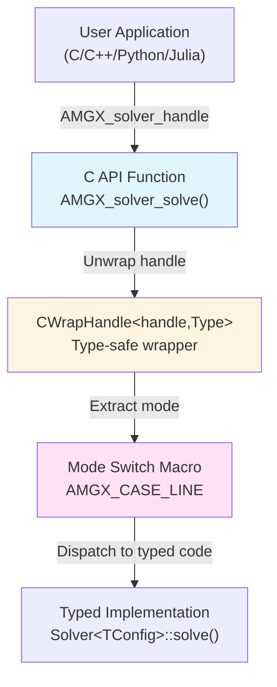
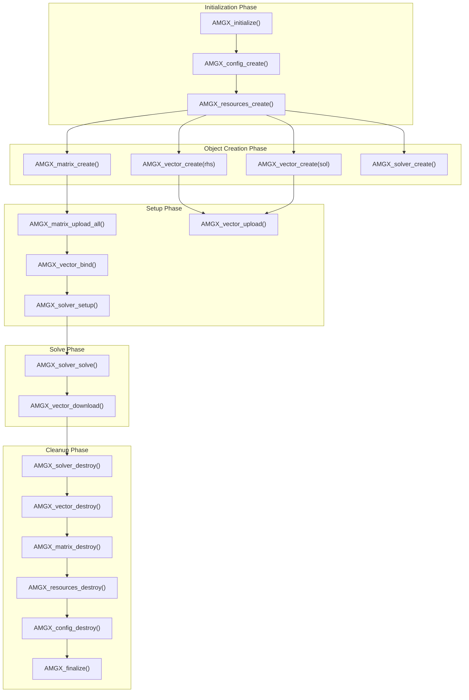
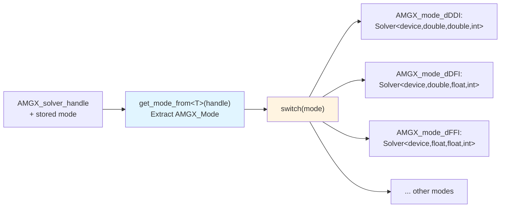
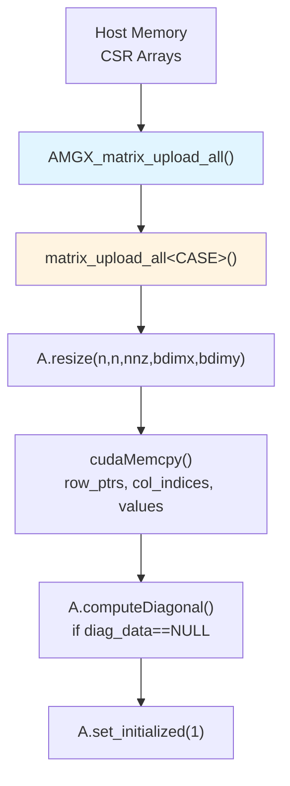
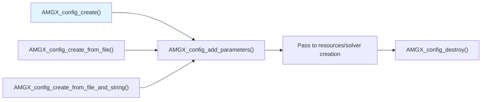
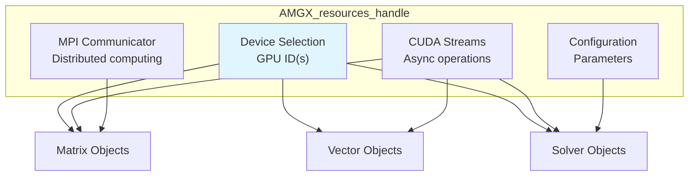
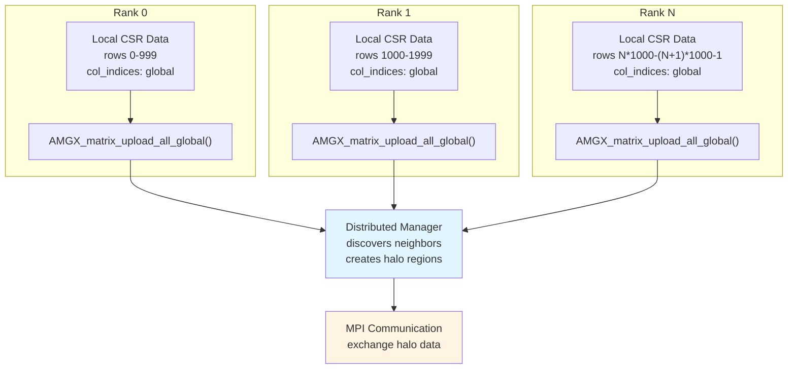

<!-- source: DeepWiki mcp.deepwiki.com · repo NVIDIA/AMGX · page 4 API and Integration · fetched 2026-10-26 -->

# API and Integration

<details>
<summary>Relevant source files</summary>

The following files were used as context for generating this wiki page:

- [examples/amgx_capi.h](examples/amgx_capi.h)
- [examples/amgx_mpi_capi.c](examples/amgx_mpi_capi.c)
- [examples/amgx_mpi_poisson7.c](examples/amgx_mpi_poisson7.c)
- [include/amgx_c.h](include/amgx_c.h)
- [src/amgx_c.cu](src/amgx_c.cu)
- [src/matrix_analysis.cu](src/matrix_analysis.cu)

</details>


This document describes the external interfaces for using AMGX from applications written in C, C++, and other languages. The AMGX C API provides a stable interface that abstracts the library's internal template-based architecture, enabling applications to configure and execute GPU-accelerated algebraic multigrid solvers without requiring C++ template knowledge. For internal solver configuration and algorithms, see [Solvers](#3). For the JSON configuration format details, see [Configuration System](#4.2).

---

## C API Design and Architecture

The AMGX C API uses an opaque handle design pattern where internal C++ objects are exposed through pointer handles. All API functions return `AMGX_RC` status codes, and the library employs template dispatch at runtime to select the correct typed implementation based on an `AMGX_Mode` parameter.

### Opaque Handle System

AMGX exposes five primary object types through opaque handles:

| Handle Type | Internal Type | Purpose |
|-------------|---------------|---------|
| `AMGX_config_handle` | `AMG_Configuration` | Stores solver configuration parameters |
| `AMGX_resources_handle` | `Resources` | Manages GPU devices, streams, and MPI communicators |
| `AMGX_matrix_handle` | `Matrix<TConfig>` | Sparse matrix storage and operations |
| `AMGX_vector_handle` | `Vector<TConfig>` | Dense vector storage |
| `AMGX_solver_handle` | `AMG_Solver<TConfig>` | Solver hierarchy and iteration logic |
| `AMGX_distribution_handle` | `MatrixDistribution` | Distributed matrix partitioning metadata |

Each handle is defined as an opaque pointer to a dummy struct:

```c
typedef struct {char AMGX_config_handle_dummy;} AMGX_config_handle_struct;
typedef AMGX_config_handle_struct *AMGX_config_handle;
```

Sources: [include/amgx_c.h:107-124]()

### Handle Wrapping Implementation

The C API implementation wraps typed C++ objects using the `CWrapHandle` template:



**Handle Wrapping Flow**

The `CWrapHandle` template provides type-safe access to the underlying C++ objects:

```cpp
// From src/amgx_c.cu
typedef CWrapHandle<AMGX_config_handle, AMG_Configuration> ConfigW;
typedef CWrapHandle<AMGX_resources_handle, Resources> ResourceW;
typedef CWrapHandle<AMGX_matrix_handle, Matrix<TConfig>> MatrixW;
```

Sources: [src/amgx_c.cu:639-641](), [src/amgx_c_wrappers.inl]()

### Object Lifecycle and Relationships



**Typical AMGX API Usage Lifecycle**

All objects created with a `*_create()` function must be destroyed with the corresponding `*_destroy()` function. Resources must be created before matrices, vectors, and solvers that use them.

Sources: [examples/amgx_mpi_capi.c:163-432](), [examples/amgx_mpi_poisson7.c:158-363]()

### API Function Categories

The C API provides approximately 60 functions organized into categories:

| Category | Key Functions | Purpose |
|----------|---------------|---------|
| **Initialization** | `AMGX_initialize`, `AMGX_finalize` | Library setup/teardown |
| **Configuration** | `AMGX_config_create`, `AMGX_config_create_from_file` | Parameter management |
| **Resources** | `AMGX_resources_create`, `AMGX_resources_create_simple` | GPU/MPI setup |
| **Matrix** | `AMGX_matrix_upload_all`, `AMGX_matrix_replace_coefficients` | Sparse matrix I/O |
| **Vector** | `AMGX_vector_upload`, `AMGX_vector_download` | Dense vector I/O |
| **Solver** | `AMGX_solver_setup`, `AMGX_solver_solve` | Solver operations |
| **Distribution** | `AMGX_matrix_upload_all_global`, `AMGX_distribution_create` | Distributed matrix upload |
| **Utilities** | `AMGX_read_system`, `AMGX_write_system` | File I/O |
| **Analysis** | `AMGX_matrix_check_symmetry`, `AMGX_matrix_check_diag_dominant` | Matrix properties |

Sources: [include/amgx_c.h:149-611]()

---

## Mode System and Template Dispatch

AMGX uses the `AMGX_Mode` enum to encode four template parameters (memory space, vector precision, matrix precision, index precision) into a single integer. At runtime, the C API dispatches to the appropriate template instantiation.

### AMGX_Mode Encoding

The `AMGX_Mode` enum encodes template configuration:

```c
// From include/amgx_config.h
typedef enum {
    AMGX_mode_dDDI = 0,  // device, double matrix, double vector, int32 indices
    AMGX_mode_dDFI = 1,  // device, double matrix, float vector, int32 indices
    AMGX_mode_dFFI = 2,  // device, float matrix, float vector, int32 indices
    // ... additional modes
} AMGX_Mode;
```

Each mode combines:
- **Memory Space**: `d` (device/GPU) or `h` (host/CPU)
- **Matrix Precision**: `D` (double), `F` (float), `Z` (complex double), `C` (complex float)
- **Vector Precision**: `D` (double), `F` (float), `Z` (complex double), `C` (complex float)
- **Index Precision**: `I` (int32) or `L` (int64)

### Template Dispatch Mechanism



**Runtime Template Dispatch Flow**

The implementation uses the `AMGX_CASE_LINE` macro to generate cases for all supported modes:

```cpp
// Pattern used throughout src/amgx_c.cu
switch (mode) {
#define AMGX_CASE_LINE(CASE) case CASE: { \
    *resources = get_mode_object_from<CASE,AMG_Solver,AMGX_solver_handle>(slv)->getResources(); \
} break;
    AMGX_FORALL_BUILDS(AMGX_CASE_LINE)
    AMGX_FORCOMPLEX_BUILDS(AMGX_CASE_LINE)
#undef AMGX_CASE_LINE
    default:
        AMGX_CHECK_API_ERROR_NORSRC(AMGX_ERR_BAD_MODE);
}
```

Sources: [src/amgx_c.cu:45-70](), [src/amgx_c.cu:646-677]()

### Precision Selection at Runtime

Users select precision when creating objects:

```c
// Example: Create solver with double precision matrix/vector
AMGX_Mode mode = AMGX_mode_dDDI;
AMGX_solver_create(&solver, rsrc, mode, cfg);
AMGX_matrix_create(&A, rsrc, mode);
AMGX_vector_create(&x, rsrc, mode);
```

All objects (matrix, vectors, solver) used together must have compatible modes. The API validates mode compatibility:

```cpp
// From src/amgx_c.cu
if (wrapA.mode() != wrapSolver.mode()) {
    FatalError("Error: mismatch between Matrix mode and Solver Mode.\n", 
               AMGX_ERR_BAD_PARAMETERS);
}
```

Sources: [src/amgx_c.cu:664-677](), [examples/amgx_mpi_capi.c:186-209]()

---

## Error Handling and Status Reporting

### Return Codes

All C API functions return `AMGX_RC` status codes:

| Return Code | Value | Meaning |
|-------------|-------|---------|
| `AMGX_RC_OK` | 0 | Success |
| `AMGX_RC_BAD_PARAMETERS` | 1 | Invalid function arguments |
| `AMGX_RC_UNKNOWN` | 2 | Unknown error |
| `AMGX_RC_NOT_SUPPORTED_TARGET` | 3 | Operation not supported for memory space |
| `AMGX_RC_NOT_SUPPORTED_BLOCKSIZE` | 4 | Block size not supported |
| `AMGX_RC_CUDA_FAILURE` | 5 | CUDA runtime error |
| `AMGX_RC_THRUST_FAILURE` | 6 | Thrust library error |
| `AMGX_RC_NO_MEMORY` | 7 | Memory allocation failed |
| `AMGX_RC_IO_ERROR` | 8 | File I/O error |
| `AMGX_RC_BAD_MODE` | 9 | Invalid AMGX_Mode |
| `AMGX_RC_CORE` | 10 | Core algorithm error |
| `AMGX_RC_BAD_CONFIGURATION` | 12 | Invalid configuration parameters |

Sources: [include/amgx_c.h:51-69]()

### Error String Retrieval

Applications can retrieve human-readable error descriptions:

```c
char msg[4096];
AMGX_RC err = AMGX_solver_setup(solver, A);
if (err != AMGX_RC_OK) {
    AMGX_get_error_string(err, msg, 4096);
    fprintf(stderr, "Error: %s\n", msg);
}
```

### AMGX_SAFE_CALL Macro

The API header provides a convenience macro for error checking:

```c
#define AMGX_SAFE_CALL(rc) \
{ \
  AMGX_RC err; \
  char msg[4096]; \
  switch(err = (rc)) { \
  case AMGX_RC_OK: \
    break; \
  default: \
    fprintf(stderr, "AMGX ERROR: file %s line %6d\n", __FILE__, __LINE__); \
    AMGX_get_error_string(err, msg, 4096); \
    fprintf(stderr, "AMGX ERROR: %s\n", msg); \
    AMGX_abort(NULL,1); \
    break; \
  } \
}
```

Usage example:

```c
AMGX_SAFE_CALL(AMGX_initialize());
AMGX_SAFE_CALL(AMGX_config_create(&cfg, "..."));
```

Sources: [include/amgx_c.h:130-144](), [examples/amgx_mpi_capi.c:164-240]()

### Solve Status Reporting

After solving, applications can query the convergence status:

```c
AMGX_SOLVE_STATUS status;
AMGX_solver_get_status(solver, &status);

switch(status) {
    case AMGX_SOLVE_SUCCESS:        // Converged to tolerance
    case AMGX_SOLVE_FAILED:         // Solver internal failure
    case AMGX_SOLVE_DIVERGED:       // Residual increased
    case AMGX_SOLVE_NOT_CONVERGED:  // Max iterations reached
}
```

Sources: [include/amgx_c.h:74-80](), [examples/amgx_mpi_capi.c:406-416]()

### Internal Error Handling

Internally, the C API uses try-catch blocks to convert C++ exceptions to return codes:

```cpp
// Pattern from src/amgx_c.cu
AMGX_ERROR rc = AMGX_OK;
AMGX_TRIES() {
    // Internal implementation
} AMGX_CATCHES(rc)
AMGX_CHECK_API_ERROR_NORSRC(rc)
return AMGX_RC_OK;
```

When `exception_handling=1` is set in the configuration, the library internally handles errors without requiring explicit checks after each call (except during initialization).

Sources: [src/amgx_c.cu:45-70](), [examples/amgx_mpi_capi.c:236-240]()

---

## Matrix and Vector Upload/Download

### Single-GPU Matrix Upload

The primary function for uploading a matrix is `AMGX_matrix_upload_all`:

```c
AMGX_RC AMGX_matrix_upload_all(
    AMGX_matrix_handle mtx,
    int n,                      // Number of rows
    int nnz,                    // Number of non-zeros
    int block_dimx,             // Block dimension X
    int block_dimy,             // Block dimension Y
    const int *row_ptrs,        // CSR row pointers (size n+1)
    const int *col_indices,     // CSR column indices (size nnz)
    const void *data,           // Matrix values (size nnz*block_dimx*block_dimy)
    const void *diag_data       // Optional diagonal values
);
```

The function accepts CSR format data and automatically transfers it to GPU memory. The `data` pointer type depends on the matrix precision (float or double).



**Single-GPU Matrix Upload Flow**

Sources: [src/amgx_c.cu:852-922](), [include/amgx_c.h:270-279]()

### Vector Upload and Download

Vectors are uploaded and downloaded separately:

```c
// Upload vector from host to device
double *rhs_h = malloc(n * sizeof(double));
// ... fill rhs_h ...
AMGX_vector_upload(b, n, 1, rhs_h);

// Download solution from device to host
double *sol_h = malloc(n * sizeof(double));
AMGX_vector_download(x, sol_h);
```

Vectors must be bound to a matrix to inherit its distributed communication patterns:

```c
AMGX_vector_bind(x, A);
AMGX_vector_bind(b, A);
```

Sources: [include/amgx_c.h:344-371](), [examples/amgx_mpi_poisson7.c:304-308]()

### Distributed Matrix Upload

For distributed computing, AMGX provides two approaches:

#### Approach 1: Global Indices with Partition Vector

```c
AMGX_matrix_upload_all_global(
    mtx,
    n_global,              // Global number of rows
    n_local,               // Local number of rows owned by this rank
    nnz_local,             // Local number of non-zeros
    block_dimx, block_dimy,
    row_ptrs,              // Local CSR row pointers
    col_indices_global,    // Column indices in GLOBAL numbering
    data,
    diag_data,
    allocated_halo_depth,  // Number of halo rings (typically 1 or 2)
    num_import_rings,      // Communication rings needed
    partition_vector       // Array mapping each global row to owning rank
);
```

The partition vector has size `n_global` and specifies which rank owns each row.

#### Approach 2: Distribution Handle (Recommended)

```c
// Create distribution handle
AMGX_distribution_handle dist;
AMGX_distribution_create(&dist, cfg);

// Option A: Set partition vector
AMGX_distribution_set_partition_data(dist, AMGX_DIST_PARTITION_VECTOR, partition_vec);

// Option B: Set contiguous partition offsets (faster)
int64_t offsets[num_ranks+1] = {0, 1000, 2000, 3000, ...};
AMGX_distribution_set_partition_data(dist, AMGX_DIST_PARTITION_OFFSETS, offsets);

// Upload matrix with distribution metadata
AMGX_matrix_upload_distributed(mtx, n_global, n_local, nnz_local,
                                block_dimx, block_dimy,
                                row_ptrs, col_indices_global, data, diag_data,
                                dist);
```

Sources: [include/amgx_c.h:545-586](), [src/amgx_c.cu:1024-1316]()

### Matrix Coefficient Replacement

For nonlinear problems or time-dependent simulations, coefficients can be updated without changing sparsity structure:

```c
// Update matrix values only (sparsity pattern unchanged)
AMGX_matrix_replace_coefficients(A, n, nnz, new_data, new_diag_data);
AMGX_solver_setup(solver, A);  // Re-setup with new coefficients
AMGX_solver_solve(solver, b, x);
```

Sources: [include/amgx_c.h:281-286](), [src/amgx_c.cu:924-1022]()

---

## Configuration System

### JSON Configuration Format

AMGX configuration is specified using JSON format with a two-level hierarchy: solver configuration and nested preconditioner configuration.

```json
{
    "config_version": 2,
    "solver": {
        "solver": "PCG",
        "preconditioner": {
            "solver": "AMG",
            "smoother": {
                "solver": "BLOCK_JACOBI"
            },
            "coarse_solver": {
                "solver": "DENSE_LU_SOLVER"
            }
        },
        "convergence": "RELATIVE_INI_CORE",
        "tolerance": 1e-6,
        "max_iters": 100,
        "monitor_residual": 1,
        "print_solve_stats": 1
    }
}
```

### Configuration Object Lifecycle



**Configuration Creation Options**

Three ways to create configuration:

```c
// 1. From string
AMGX_config_create(&cfg, "solver=PCG, preconditioner=AMG, max_iters=100");

// 2. From file
AMGX_config_create_from_file(&cfg, "config.json");

// 3. From file + string overrides
AMGX_config_create_from_file_and_string(&cfg, "base.json", 
                                         "tolerance=1e-8, max_iters=200");

// 4. Add parameters after creation
AMGX_config_add_parameters(&cfg, "print_grid_stats=1");
```

Sources: [include/amgx_c.h:193-215](), [examples/amgx_mpi_capi.c:212-232]()

### Key Configuration Parameters

| Parameter | Values | Description |
|-----------|--------|-------------|
| `solver` | `PCG`, `GMRES`, `FGMRES`, `BiCGSTAB`, `AMG` | Top-level solver type |
| `preconditioner` | `AMG`, `BLOCK_JACOBI`, `MULTICOLOR_DILU` | Preconditioner for Krylov solvers |
| `convergence` | `RELATIVE_INI_CORE`, `ABSOLUTE`, `RELATIVE_INI` | Convergence criteria |
| `tolerance` | float | Residual tolerance |
| `max_iters` | int | Maximum iterations |
| `norm` | `L1`, `L2`, `LMAX` | Norm for residual computation |
| `monitor_residual` | 0/1 | Print residual each iteration |
| `print_solve_stats` | 0/1 | Print solve statistics |
| `print_grid_stats` | 0/1 | Print AMG grid statistics |

### AMG-Specific Parameters

| Parameter | Values | Description |
|-----------|--------|-------------|
| `algorithm` | `AGGREGATION`, `CLASSICAL` | AMG coarsening algorithm |
| `selector` | `SIZE_2`, `SIZE_4`, `SIZE_8`, `PMIS` | Coarsening selector |
| `max_levels` | int | Maximum AMG levels |
| `cycle` | `V`, `W`, `F`, `CG` | Multigrid cycle type |
| `presweeps` | int | Pre-smoothing iterations |
| `postsweeps` | int | Post-smoothing iterations |
| `coarse_solver` | `DENSE_LU_SOLVER`, `NOSOLVER` | Coarsest level solver |

Sources: [src/configs/](), Configuration documentation

### Default Number of Rings

For distributed solvers, the configuration determines communication depth:

```c
int nrings;
AMGX_config_get_default_number_of_rings(cfg, &nrings);
// Typically: 1 ring for aggregation AMG, 2 rings for classical AMG
```

Sources: [include/amgx_c.h:210-212](), [examples/amgx_mpi_capi.c:296-297]()

---

## Resources and Device Management

### Resources Object

The `AMGX_resources_handle` manages GPU devices, CUDA streams, and MPI communicators:



**Resources Object Contents and Usage**

### Creating Resources

#### Simple Resources (Single GPU, No MPI)

```c
AMGX_resources_handle rsrc;
AMGX_resources_create_simple(&rsrc, cfg);
```

#### Full Resources (Multi-GPU, MPI)

```c
// MPI initialization
MPI_Init(&argc, &argv);
MPI_Comm_rank(MPI_COMM_WORLD, &rank);

// Select GPU based on local rank
int gpu_count;
cudaGetDeviceCount(&gpu_count);
int local_rank = rank % gpu_count;
cudaSetDevice(local_rank);

// Create resources with MPI
AMGX_resources_handle rsrc;
AMGX_resources_create(&rsrc, cfg, &MPI_COMM_WORLD, 1, &local_rank);
```

The `AMGX_resources_create` signature:

```c
AMGX_RC AMGX_resources_create(
    AMGX_resources_handle *rsc,
    AMGX_config_handle cfg,
    void *comm,           // MPI_Comm* (NULL for single GPU)
    int device_num,       // Number of devices this process uses
    const int *devices    // Array of device IDs
);
```

Sources: [include/amgx_c.h:218-230](), [examples/amgx_mpi_capi.c:124-242]()

### Device Selection and MPI Coordination

Typical multi-GPU setup:

```c
int rank, nranks, gpu_count;
MPI_Comm_size(MPI_COMM_WORLD, &nranks);
MPI_Comm_rank(MPI_COMM_WORLD, &rank);
cudaGetDeviceCount(&gpu_count);

// Assign GPUs in round-robin fashion
int lrank = rank % gpu_count;
cudaSetDevice(lrank);
printf("Process %d selecting device %d\n", rank, lrank);

// Create resources
AMGX_resources_create(&rsrc, cfg, &MPI_COMM_WORLD, 1, &lrank);
```

Sources: [examples/amgx_mpi_capi.c:124-133](), [examples/amgx_mpi_poisson7.c:120-127]()

---

## Basic Usage Example

### Complete Single-GPU Example

```c
#include "amgx_c.h"

int main() {
    AMGX_Mode mode = AMGX_mode_dDDI;  // double precision, int indices
    AMGX_config_handle cfg;
    AMGX_resources_handle rsrc;
    AMGX_matrix_handle A;
    AMGX_vector_handle x, b;
    AMGX_solver_handle solver;
    
    // 1. Initialize library
    AMGX_SAFE_CALL(AMGX_initialize());
    AMGX_SAFE_CALL(AMGX_register_print_callback(&print_callback));
    
    // 2. Create configuration
    AMGX_SAFE_CALL(AMGX_config_create(&cfg, 
        "config_version=2, "
        "solver(main)=PCG, "
        "main:preconditioner=AMG, "
        "main:tolerance=1e-6, "
        "main:max_iters=100"));
    
    // 3. Create resources
    AMGX_resources_create_simple(&rsrc, cfg);
    
    // 4. Create matrix, vectors, solver
    AMGX_matrix_create(&A, rsrc, mode);
    AMGX_vector_create(&x, rsrc, mode);
    AMGX_vector_create(&b, rsrc, mode);
    AMGX_solver_create(&solver, rsrc, mode, cfg);
    
    // 5. Upload matrix (CSR format)
    int n = 1000, nnz = 5000;
    int *row_ptrs = ...; // Size n+1
    int *col_indices = ...; // Size nnz
    double *values = ...; // Size nnz
    AMGX_matrix_upload_all(A, n, nnz, 1, 1, 
                           row_ptrs, col_indices, values, NULL);
    
    // 6. Upload vectors
    double *rhs_h = ...; // Size n
    double *sol_h = ...; // Size n (initial guess)
    AMGX_vector_upload(b, n, 1, rhs_h);
    AMGX_vector_upload(x, n, 1, sol_h);
    
    // 7. Bind vectors to matrix (for distributed communication)
    AMGX_vector_bind(x, A);
    AMGX_vector_bind(b, A);
    
    // 8. Setup solver
    AMGX_solver_setup(solver, A);
    
    // 9. Solve
    AMGX_solver_solve(solver, b, x);
    
    // 10. Check status
    AMGX_SOLVE_STATUS status;
    AMGX_solver_get_status(solver, &status);
    
    // 11. Download solution
    AMGX_vector_download(x, sol_h);
    
    // 12. Cleanup
    AMGX_solver_destroy(solver);
    AMGX_vector_destroy(x);
    AMGX_vector_destroy(b);
    AMGX_matrix_destroy(A);
    AMGX_resources_destroy(rsrc);
    AMGX_config_destroy(cfg);
    AMGX_finalize();
    
    return 0;
}
```

Sources: Examples pattern from [examples/amgx_mpi_capi.c:97-439]()

---

## MPI Distributed Usage Example

### Distributed Matrix Setup



**Distributed Matrix Upload and Neighbor Discovery**

### Complete MPI Example

```c
#include <mpi.h>
#include "amgx_c.h"

int main(int argc, char **argv) {
    int rank, nranks, lrank, gpu_count;
    AMGX_Mode mode = AMGX_mode_dDDI;
    
    // 1. Initialize MPI and select GPU
    MPI_Init(&argc, &argv);
    MPI_Comm_rank(MPI_COMM_WORLD, &rank);
    MPI_Comm_size(MPI_COMM_WORLD, &nranks);
    
    cudaGetDeviceCount(&gpu_count);
    lrank = rank % gpu_count;
    cudaSetDevice(lrank);
    
    // 2. Initialize AMGX
    AMGX_initialize();
    AMGX_config_create_from_file(&cfg, "config.json");
    
    // Enable internal error handling
    AMGX_config_add_parameters(&cfg, "exception_handling=1");
    
    // 3. Create resources with MPI
    AMGX_resources_create(&rsrc, cfg, &MPI_COMM_WORLD, 1, &lrank);
    
    // 4. Create objects
    AMGX_matrix_create(&A, rsrc, mode);
    AMGX_vector_create(&x, rsrc, mode);
    AMGX_vector_create(&b, rsrc, mode);
    AMGX_solver_create(&solver, rsrc, mode, cfg);
    
    // 5. Read distributed matrix from file
    int nrings;
    AMGX_config_get_default_number_of_rings(cfg, &nrings);
    AMGX_read_system_distributed(A, b, x, "matrix.mtx", 
                                  nrings, nranks, NULL, 0, NULL);
    
    // Alternatively: Generate distributed Poisson matrix
    int nx=100, ny=100, nz=100;  // Local problem size per rank
    int px=2, py=2, pz=2;         // Process grid (2x2x2 = 8 ranks)
    AMGX_generate_distributed_poisson_7pt(A, b, x, nrings, nrings,
                                          nx, ny, nz, px, py, pz);
    
    // 6. Setup and solve
    MPI_Barrier(MPI_COMM_WORLD);  // Optional: for timing stability
    AMGX_solver_setup(solver, A);
    
    MPI_Barrier(MPI_COMM_WORLD);
    AMGX_solver_solve(solver, b, x);
    
    // 7. Check status and download
    AMGX_SOLVE_STATUS status;
    AMGX_solver_get_status(solver, &status);
    
    // Download local part of solution
    AMGX_vector_download(x, local_sol);
    
    // 8. Cleanup
    AMGX_solver_destroy(solver);
    AMGX_vector_destroy(x);
    AMGX_vector_destroy(b);
    AMGX_matrix_destroy(A);
    AMGX_resources_destroy(rsrc);
    AMGX_config_destroy(cfg);
    AMGX_finalize();
    MPI_Finalize();
    
    return 0;
}
```

Sources: [examples/amgx_mpi_capi.c:97-439](), [examples/amgx_mpi_poisson7.c:92-369]()

### Partition Vector Format

When using `AMGX_matrix_upload_all_global`, the partition vector specifies row ownership:

```c
// Example: 1000 rows distributed across 4 ranks
int n_global = 1000;
int partition_vector[1000];

// Contiguous partitioning: rank 0 owns rows 0-249, rank 1 owns 250-499, etc.
for (int i = 0; i < 1000; i++) {
    partition_vector[i] = i / 250;  // Maps rows to ranks
}

// Upload with partition information
AMGX_matrix_upload_all_global(A, n_global, n_local, nnz_local,
                               1, 1, row_ptrs, col_indices_global, values, NULL,
                               allocated_halo_depth, num_import_rings,
                               partition_vector);
```

For contiguous partitioning, using `AMGX_distribution_handle` with offsets is more efficient.

Sources: [src/amgx_c.cu:1024-1316]()

---

## Utility Functions

### Matrix I/O

AMGX provides utilities for reading and writing matrix systems:

```c
// Read matrix from MatrixMarket file
AMGX_read_system(A, b, x, "matrix.mtx");

// Write matrix system to file
AMGX_write_system(A, b, x, "output.mtx");

// Distributed read
AMGX_read_system_distributed(A, b, x, "matrix.mtx",
                             allocated_halo_depth, nranks,
                             partition_sizes, partition_vector_size,
                             partition_vector);
```

Sources: [include/amgx_c.h:418-450]()

### Matrix Analysis

Check matrix properties:

```c
// Check symmetry
int structurally_symmetric, symmetric;
AMGX_matrix_check_symmetry(A, &structurally_symmetric, &symmetric);

// Check diagonal dominance
int diag_dominant;
AMGX_matrix_check_diag_dominant(A, &diag_dominant);
```

Sources: [include/amgx_c.h:588-596](), [src/matrix_analysis.cu:106-379]()

### Geometry Attachment

For visualization or geometric coarsening:

```c
double *geox = ...; // X coordinates, size n
double *geoy = ...; // Y coordinates, size n
double *geoz = ...; // Z coordinates, size n (NULL for 2D)
AMGX_matrix_attach_geometry(A, geox, geoy, geoz, n);
```

Sources: [include/amgx_c.h:518-523]()

### Distributed Poisson Generator

For testing and benchmarking:

```c
// Generate 7-point Poisson problem on 3D grid
// Local problem size: nx × ny × nz per rank
// Process grid: px × py × pz (total nranks = px*py*pz)
AMGX_generate_distributed_poisson_7pt(A, b, x,
                                      allocated_halo_depth, num_import_rings,
                                      nx, ny, nz,
                                      px, py, pz);
```

This automatically generates a distributed matrix with appropriate communication patterns.

Sources: [include/amgx_c.h:492-503](), [examples/amgx_mpi_poisson7.c:244-274]()

---

## Dynamic Library Loading

AMGX supports optional dynamic loading, allowing applications to load the library at runtime without linking at compile time.

### Dynamic Loading API

```c
#include <dlfcn.h>  // Unix
// #include <windows.h>  // Windows

// Load library
void *lib_handle = dlopen("libamgxsh.so", RTLD_LAZY);
// void *lib_handle = LoadLibrary("amgxsh.dll");  // Windows

// Load all function pointers
int amgx_liblink_all(void *lib_handle) {
    AMGX_initialize = (t_AMGX_initialize)dlsym(lib_handle, "AMGX_initialize");
    AMGX_config_create = (t_AMGX_config_create)dlsym(lib_handle, "AMGX_config_create");
    // ... load all other functions
    return (AMGX_initialize != NULL && ...);  // Check all loaded
}

// Use library normally
if (amgx_liblink_all(lib_handle)) {
    AMGX_initialize();
    // ...
}

// Cleanup
dlclose(lib_handle);
// FreeLibrary(lib_handle);  // Windows
```

Sources: [examples/amgx_capi.h:530-777]()

### Function Pointer Types

For each API function, a corresponding function pointer type exists:

```c
typedef AMGX_RC (*t_AMGX_initialize)();
typedef AMGX_RC (*t_AMGX_config_create)(AMGX_config_handle *cfg, const char *options);
typedef AMGX_RC (*t_AMGX_solver_solve)(AMGX_solver_handle slv, 
                                       AMGX_vector_handle rhs,
                                       AMGX_vector_handle sol);
// ... etc for all ~60 functions
```

Sources: [examples/amgx_capi.h:117-525]()

---

## External Language Bindings

AMGX's C API enables integration with multiple programming languages and frameworks.

### Python: pyamgx

Community-developed Python wrapper providing pythonic interface:

```python
import pyamgx

# Initialize
pyamgx.initialize()

# Create configuration
cfg = pyamgx.Config().create_from_dict({
    "solver": "PCG",
    "preconditioner": "AMG",
    "max_iters": 100,
    "tolerance": 1e-6
})

# Create resources and objects
resources = pyamgx.Resources().create_simple(cfg)
A = pyamgx.Matrix().create(resources, mode='dDDI')
x = pyamgx.Vector().create(resources, mode='dDDI')
b = pyamgx.Vector().create(resources, mode='dDDI')
solver = pyamgx.Solver().create(resources, cfg, mode='dDDI')

# Upload data (from NumPy/SciPy sparse matrices)
A.upload_CSR(row_ptrs, col_indices, values)
x.upload(x_data)
b.upload(b_data)

# Solve
solver.setup(A)
solver.solve(b, x)

# Download solution
solution = x.download()

# Cleanup
solver.destroy()
```

Project: https://github.com/shwina/pyamgx

### Julia: AMGX.jl

Julia wrapper providing idiomatic Julian interface:

```julia
using AMGX

# Initialize
AMGX.initialize()

# Create configuration
cfg = AMGXConfig("solver=PCG, preconditioner=AMG, max_iters=100")

# Create solver
resources = AMGXResources(cfg)
solver = AMGXSolver(resources, :dDDI, cfg)

# Upload matrix (from SparseArrays)
A_sparse = sparse(I, J, V, n, n)
A_amgx = AMGXMatrix(resources, :dDDI)
upload!(A_amgx, A_sparse)

# Create and upload vectors
x = AMGXVector(resources, :dDDI)
b = AMGXVector(resources, :dDDI)
upload!(x, x_data)
upload!(b, b_data)

# Solve
setup!(solver, A_amgx)
solve!(solver, x, b)

# Download solution
solution = download(x)
```

Project: https://github.com/JuliaGPU/AMGX.jl

### PETSc: AmgXWrapper

Integration with PETSc framework for seamless solver substitution:

```c
#include <petsc.h>

// Create PETSc matrix and vectors
Mat A;
Vec x, b;
MatCreate(PETSC_COMM_WORLD, &A);
// ... setup matrix ...

// Create PETSc KSP with AMGX backend
KSP ksp;
KSPCreate(PETSC_COMM_WORLD, &ksp);
KSPSetType(ksp, KSPAMGX);
KSPSetOperators(ksp, A, A);

// Set AMGX configuration via PETSc options
PetscOptionsSetValue("-amgx_solver", "PCG");
PetscOptionsSetValue("-amgx_preconditioner", "AMG");

// Solve
KSPSolve(ksp, b, x);
```

Project: https://github.com/barbagroup/AmgXWrapper

Sources: External project documentation

---

## API Function Reference Summary

### Initialization Functions

| Function | Purpose |
|----------|---------|
| `AMGX_initialize()` | Initialize AMGX library (call once per process) |
| `AMGX_finalize()` | Shut down AMGX library (call once per process) |
| `AMGX_get_api_version()` | Query API version (major, minor) |
| `AMGX_get_build_info_strings()` | Get build version, date, time strings |
| `AMGX_install_signal_handler()` | Install CUDA error signal handler |
| `AMGX_register_print_callback()` | Register custom output callback |

### Configuration Functions

| Function | Purpose |
|----------|---------|
| `AMGX_config_create()` | Create config from parameter string |
| `AMGX_config_create_from_file()` | Create config from JSON file |
| `AMGX_config_create_from_file_and_string()` | Create config from file with string overrides |
| `AMGX_config_add_parameters()` | Add/modify parameters in existing config |
| `AMGX_config_get_default_number_of_rings()` | Get halo depth for config |
| `AMGX_config_destroy()` | Destroy config object |

### Resource Functions

| Function | Purpose |
|----------|---------|
| `AMGX_resources_create()` | Create resources with MPI and device selection |
| `AMGX_resources_create_simple()` | Create resources for single GPU, no MPI |
| `AMGX_resources_destroy()` | Destroy resources object |

### Matrix Functions

| Function | Purpose |
|----------|---------|
| `AMGX_matrix_create()` | Create matrix object |
| `AMGX_matrix_upload_all()` | Upload local CSR matrix |
| `AMGX_matrix_upload_all_global()` | Upload distributed matrix with global indices |
| `AMGX_matrix_upload_distributed()` | Upload with distribution handle (recommended) |
| `AMGX_matrix_replace_coefficients()` | Update matrix values (not structure) |
| `AMGX_matrix_get_size()` | Query matrix dimensions and block size |
| `AMGX_matrix_get_nnz()` | Query number of non-zeros |
| `AMGX_matrix_download_all()` | Download matrix to host |
| `AMGX_matrix_destroy()` | Destroy matrix object |

### Vector Functions

| Function | Purpose |
|----------|---------|
| `AMGX_vector_create()` | Create vector object |
| `AMGX_vector_upload()` | Upload vector data from host |
| `AMGX_vector_download()` | Download vector data to host |
| `AMGX_vector_set_zero()` | Set all elements to zero |
| `AMGX_vector_bind()` | Bind vector to matrix for communication patterns |
| `AMGX_vector_get_size()` | Query vector size and block dimension |
| `AMGX_vector_destroy()` | Destroy vector object |

### Solver Functions

| Function | Purpose |
|----------|---------|
| `AMGX_solver_create()` | Create solver object |
| `AMGX_solver_setup()` | Build solver hierarchy (call after matrix upload) |
| `AMGX_solver_solve()` | Solve system Ax=b |
| `AMGX_solver_solve_with_0_initial_guess()` | Solve with x=0 initial guess |
| `AMGX_solver_get_status()` | Get solve convergence status |
| `AMGX_solver_get_iterations_number()` | Get number of iterations performed |
| `AMGX_solver_get_iteration_residual()` | Get residual for specific iteration |
| `AMGX_solver_calculate_residual_norm()` | Compute ||b - Ax|| explicitly |
| `AMGX_solver_destroy()` | Destroy solver object |

### Utility Functions

| Function | Purpose |
|----------|---------|
| `AMGX_read_system()` | Read matrix/vectors from file |
| `AMGX_write_system()` | Write matrix/vectors to file |
| `AMGX_read_system_distributed()` | Read distributed matrix from file |
| `AMGX_write_system_distributed()` | Write distributed matrix to file |
| `AMGX_generate_distributed_poisson_7pt()` | Generate test Poisson problem |
| `AMGX_matrix_check_symmetry()` | Check matrix symmetry |
| `AMGX_matrix_check_diag_dominant()` | Check diagonal dominance |

Sources: [include/amgx_c.h:149-611]()

---

